# Eldoria 项目断点与任务检查点 (Session Checkpoint)

> **更新时间**：2026-10-13 16:30:00  
> **版本基准**：
> - **第一部（大本营篇）**：V10.31.0+ · 937 章节体系（共 1066+ 条条目，含 423 个 NSFW 章节与 17 篇自由探索章节，959 条 sex 索引完整覆盖），全库编号 1~937 连续无缺口，7 大项一致性校验 100% 全绿通过；
> - **第二部（维里迪亚王国篇）**：十三幕四十二阶段详规全线竣工定稿！00~06 母案集群（管理中枢、大纲导航、王国地理与经济、生活流张弛律动、全境三方武装与克制链、异族特遣、跨幕物理状态机）深度闭环；`docs2/` 实体设定档案库已建档 94 个实体卡（含白隼档案卡），0 错误通过一致性检查；【第五幕大本营留守组生态、白隼羁绊源起与幕间戏份设计】全案 11 处文件已 100% 落地闭环！
> **当前总进度**：**【第二部十三幕四十二阶段详规全线竣工定稿】+【第五幕大本营留守组生态/白隼前置羁绊/四大幕间戏份/三层立体物流/状态机闭环 11 篇文件全量落位】+【第一部大纲读者审读推进至批次 23（Ch001~Ch460 全量落地）】+【角色专属 NSFW 企划集群（莫尔茨 47 套、卢卡斯 4 卷、朱利安 2 篇）全部规划齐备】**  
> **最新状态**：**已彻底完成《临时方案_第五幕大本营留守组动态与幕间戏份设计.md》全案落位、全线质检、契约握手并正式归档至 `方案/第二部/已执行/`；全局工作断点与进度总控统一归拢锚定于本检查点；全库工程环境与质检脚本保持 100% 绿色自洽**。

---

## 一、 第一部（大本营篇）：工程战果与大纲审读当前断点

### 1. 标号情境慢推体系与物理边界硬约束（基础架构升级）
* **彻底切除诱发跳剧情的冗余字段**：
  - 全库 937 章**彻底删除了 `章节任务` 与 `章节终止条件` 字段**，铲除了“条件2把整章核心串在一句话里诱发 AI 单次回复狂飙闭环”的根本病根；
* **标号情境硬约束与双轮强制冷却闭环**：
  - 每条情境行首规范使用 `- 1. `、`- 2. `... 纯数字标号；末尾情境（第 $N$ 条）纯物象化环境收束；TXT 显式包含 `总情境数: {N}`（自由探索章节使用 `总情境数: 自由探索章节`）；
  - `_章节追踪指令.TXT` 与 `_游戏状态界面.TXT` 严守“单次回复仅展开 1 条情境，未到末尾严禁退场收束”；
  - 到达第 $N$ 条时，严格经历“余韵沉淀（第N条 余韵沉淀）”与“过渡收束（第N条 过渡收束）”双轮冷却流转切章。
* **TavernHelper 变量状态机 v1.3.0 静默纯净版与递归引信**：
  - 故事章节配置 `excludeRecursion=False`，由常驻母条目 `CH00`（Order: 1000, 正文含 `第{{getvar::chapter}}章`）专职唤醒；
  - 全库总览与指令条目一律 `preventRecursion=True`，彻底杜绝递归群爆；切章步进绝对归零（`0/0`），增加基于消息指纹的防重节流，聊天流 100% 无系统气泡污染。

### 2. 第一部大纲读者审读推进现状（批次看板核验）
依据 [`方案/第一部/第一部大纲读者审读_总进度看板.md`](../方案/第一部/第一部大纲读者审读_总进度看板.md)，大纲审查采用 IDE 主会话通读审查模式，严查剧情逻辑、动机构建（尤其是 NSFW 章节起因、开头与微动作）、代词滥用、古风与现代科技词穿越。
* **已完成并落地归档批次（共 23 批次，Ch001 ~ Ch460）**：
  - **批次 01 ~ 16**（Ch001 ~ Ch320）：序章集结、营地工程协同、全员群像、矮人岩丘、心木净化、菲猫耳/兽耳硬伤拔除、黑丝挑逗阶梯、雷恩退役骑士体制纠偏、间接吞精红线拔除、凯尔深喉、书房长桌与双章拆分连续性治理；
  - **批次 17 ~ 20**（Ch321 ~ Ch400）：密林与营地双重推进、跨线深入期全量代词本名正位、书房长桌连续弧重塑、彻底铲除第三帝国穿越硬伤、天光/腰际四大防火墙禁词清理、山洞连续弧事后身体回收与深情核账闭环；
  - **批次 21 ~ 23**（Ch401 ~ Ch460）：温泉霸气交锋与性行为等级虚高校准、寒潭取暖第三者校准、夜光苔神性自救与披风取暖闭环、掌控与沉沦阶段二次深情回收补全、拔除狗爬式与代词本名正位。
* **当前执行断点**：
  - **批次 24（Ch461 ~ Ch480）** ⏳ 待执行（后续推进时依序开展审查）。

---

## 二、 第二部（维里迪亚王国篇）：宏篇主线十三幕四十二阶段定稿

第二部（维里迪亚王国篇 / 雾帷之后）定位为双主线（艾德里安领主成长线 A + 雷恩骑士救赎线 B）驱动的宏大日式西幻史诗。目前**十三幕四十二阶段分阶段详规已全部竣工定稿**，93 张实体卡无缝穿透。

### 1. 十三幕主线演进拓扑与四十二阶段全景

```mermaid
graph TD
    M1["【第一幕：破晓之森与破冰初探】(阶段一~三)<br/>心木圣坛 · 帷幕初散 · 界石密函与信物 · 王储骑马初访有限摸底"] --> M2["【第二幕：密林往返·烟火人间与融冰结交】(阶段四~七)<br/>初送物资与矮人初酒 · 帝国约会与进城采买 · 突袭暗鼠救幼狼 · 哈根建屋与莫逆定盟"]
    M2 --> M3["【第三幕：边防暗潮与平原立足】(阶段八~十)<br/>边境城关暗哨 · 难民水毒救治 · 暗渠潜行 · 法尔肯驿镇前哨立足"]
    M3 --> M4["【第四幕：商道初通·行商许可与部族共识】(阶段十一~十四)<br/>玛格丽特密信传许可 · 营地馅饼与两族心结 · 朱利安斩排毒救幼狼立信 · 生态保护敕令"]
    M4 --> M5["【第五幕：分道巡礼·虚妄的线索】(阶段十五~十九)<br/>驿馆正式签约奉还手札 · 艾斯特雷亚焦土 · 西南修道院 · 迷雾海港走私 · 法尔肯商争破袭"]
    M5 --> M6["【第六幕：王都商路·繁华市井与暗潮生活流】(阶段二十~二十三)<br/>心木商行扎根 · 钟表学徒科林与八音盒羁绊 · 商行修车结交卢卡斯 · 雷恩辨识莫尔茨旧仇暗线"]
    M6 --> M7["【第七幕：血色伏击·至暗大溃败】(阶段二十四~二十六)<br/>白鹿大驿馆大公会盟 · 异化死士夜袭 · 巨剑折断 · 雷恩被俘入圣殿死牢 · 泥泞突围"]
    M7 --> M8["【第八幕：绝境流亡·篝火重铸与艾斯特雷亚之誓】(阶段二十七~二十九)<br/>劳拉酒庄休养 · 奥蕾莉亚断旗立界 · 艾德里安领主觉醒 · 凡人匠艺重铸双手大剑"]
    M8 --> M9["【第九幕：深渊古道·暗河谍影与地底破壁】(阶段三十~三十二)<br/>凯尔玲逆流盲泉 · 亚尔缇娜光剑死牢测绘与密电送药 · 羊毛商战运大剑 · 荒原狼战破围"]
    M9 --> M10["【第十幕：惊天劫狱·血洗圣殿死牢】(阶段三十三~三十五)<br/>哈根勘破承重薄弱点 · 加尔潜渡斩销 · 劳拉重剑劈碎莫尔茨重铠雪耻 · 解救雷恩与老骑士"]
    M10 --> M11["【第十一幕：王都暗流·沙龙旧卷与法理围城】(阶段三十六~三十八)<br/>金鸢尾沙龙名媛潜伏 · 艾德里安起获特许状 · 玲破拆维克托工坊 · 竞技场御前决斗仲裁"]
    M11 --> M12["【第十二幕：王都异化·双城合围决战】(阶段三十九~四十一)<br/>教会水网投毒 · 加尔舍命关闸 · 黎恩菲娜千米超自然防火墙 · 科林八音盒抚平恐惧"]
    M12 --> M13["【第十三幕：破晓大审判与黎明宪章】(阶段四十二)<br/>阿达尔伯特断剑殉道 · 卢卡斯誓师开城救民 · 真理广场法理大公审 · 自由大宪章 · 逆向篷车告别礼"]
```

### 2. 7 大核心母案中枢集群（管理与运行基准）
所有详规编写、状态流转与跨幕咬合严格以 `方案/第二部/主线与世界扩充方案/` 下的 7 大母案为准绳：
- `00_第二部宏篇主线总纲与方案管理中枢.md`：全局架构统筹、十三幕四十二阶段容量基准与详规管理法典；
- `01_宏篇主线剧情总大纲与分幕导航.md`：演进总舵、至暗挫折与多线救赎节点导航；
- `02_王国地理版图、封建社会阶层与货币经济基准.md`：五大地理版图、170km 时空标尺、双重货币（旧银克朗 / 紫铜便士）、特许行会垄断；
- `03_生活流张弛律动、营地温情后勤与工坊反差方案.md`：三段式张弛节律（高压 ➔ 市井 ➔ 营地）、爱丽榭大食堂温情后勤、乔治工坊科技反差；
- `04_全境三方武装力量、战斗克制链与黑幕权谋博弈方案.md`：王国军 vs 圣殿骑士团 vs 晨光教廷三方格局、古代暗影发条机兽克制链、双首恶（阿达尔伯特与克莱门特三世）利益裂痕；
- `05_异族特遣跨境支援动因、部族约束与战术分工方案.md`：矮人/狼人/蜥蜴人跨境动因与战术分工；
- `06_第二部主线跨幕连续性与全局物理状态机.md`：跨幕契约握手、角色伤病耐久链、四大铁证流向、170km 时空周历标尺。

### 3. 第五幕（分道巡礼·虚妄的线索）全阶段深化闭环
第五幕处于“边境扎根完成 ➔ 触碰禁区核心 ➔ 步入王都大舞台”的枢纽转折点，阶段十五至十九详规已全面闭环：
- **阶段十五（驿馆盟约与战旗分兵）**：朱利安夜访奉还母亲手札原本（`EVD-03`），出示三百六十名平民证言为雷恩平反；羊皮纸地图与木雕战旗推演敲定四路出征；
- **阶段十六（主线A·艾斯特雷亚焦土）**：艾德里安与菲勘察焦土毒荆棘，先灵之镜驱散心魔，破拆古代发条机兽起获【教廷秘库工匠主齿轮原本】（`EVD-01`）；
- **阶段十七（主线B·晨光修道院救赎）**：雷恩与劳拉西南山道接头艾琳娜修女，祭坛暗格起获【拒杀平民十五人抗命名册原本】（`EVD-02`）与暗影黑血试管；月下极剑名场面挑飞白鹰佩剑不伤一人，当面揭穿主教私印，卢卡斯恪守信义放行；
- **阶段十八（主线C·迷雾海港走私调查）**：菲娜与乔治救助黑斑孤儿，破拆黑帆底舱起获【三十一年前心木碳化残根】（`EVD-04`），突袭芦苇荡货栈起获黑市洗钱账本与密卷；
- **阶段十九（大本营·法尔肯商争破袭）**：黎恩、亚莉莎与罗恩坐镇法尔肯，亚莉莎复式记账法穿透罗曼商行假账，市政公秤公开仲裁；罗恩霜银巨狼破阵击溃暗弩死士；四大物理铁证装入特制防震封蜡铁匣，整备篷车启程赴王都。

### 4. 关键矛盾重构与政治逻辑自洽
- **阿达尔伯特知情权谋与老骑士关押动因**：十四年前大团长阿达尔伯特知晓戈德弗里等十五名老骑士拒杀平民，为保全骑士团封建自治特权与雷恩性命，知情将老骑士秘密关押于圣殿地下水牢；晨光教廷则对外欺瞒称其在修道院服苦役；雷恩十四年后获悉真相，化解对大团长的世仇误解，形成第十三幕法理大审判与大团长断剑殉道的悲壮闭环；
- **二元机构严格隔离**：晨光教廷（神权、司铎、发条机兽、异端审问厅达米安/克莱门特三世）与圣殿骑士团（修会封建霸权、大要塞、重骑兵、白鹰分队卢卡斯、典狱长莫尔茨、大团长阿达尔伯特）物理隔离，严禁词汇混淆。

---

## 三、 角色专属 NSFW 企划与衍生情境库

第二部专属 NSFW 企划与主线保持 100% 物理隔离，作为独立情境库完备建档：

1. **莫尔茨 NSFW 全案（47 套完整方案，分四卷）**：
   - 卷一：[`01_黑野猪酒馆市井情趣篇.md`](../方案/第二部/莫尔茨NSFW/01_黑野猪酒馆市井情趣篇（方案一至方案十六）.md)（方案 1~16，市井酒馆私通与舞台展演）；
   - 卷二：[`02_圣殿要塞深入与要职近身篇.md`](../方案/第二部/莫尔茨NSFW/02_圣殿要塞深入与要职近身篇（方案十七至方案三十七）.md)（方案 17~37，要塞内廊、浴堂、冷锻与主堡寝居）；
   - 卷三：[`03_圣殿地牢深入与核心情趣篇.md`](../方案/第二部/莫尔茨NSFW/03_圣殿地牢深入与核心情趣篇（方案三十八至方案四十五）.md)（方案 38~45，地牢前哨、忏悔石室与群骑围观）；
   - 卷四：[`04_王都暗渠突围与终极收束篇.md`](../方案/第二部/莫尔茨NSFW/04_王都暗渠突围与终极收束篇（方案四十六至方案四十七）.md)（方案 46~47，暗渠激流突围与终极情感收束）；
   - 配套方案：主线节奏咬合方案与时间线拉长临时补丁（35~40 天真实生活史流转表）。
2. **卢卡斯 NSFW 全案（白鹰先锋骑兵队长，4 卷）**：
   - 马房暗查与骑士戒律沉沦（菲娜线）、迷迭香商行利益迷醉（玛格丽特线）、晨光药舍创伤破戒（艾琳娜线）、大教堂告解室与管风琴两部曲（菲娜线）。
3. **朱利安 NSFW 全案（第一王子，2 篇）**：
   - 白金深闱与密室地籍（菲娜线）、魔女暗影拔毒与深宫救赎（艾玛线，古代魔女以身导毒生死救赎）。

---

## 四、 核心写作法典、红线防御与技能矩阵

全库正文创作、大纲构思与情境精修必须无条件执行以下法典（锚定 [`AGENTS.md`](../AGENTS.md) 与 [`writing-guards.md`](rules/writing-guards.md)）：

### 1. 写作文风与反向回溯原则
* **日轻原声反向回溯（JRPG Back-Translation Protocol）**：写作前坚决切断中式网文与市井话本联想。每一句对白、旁白与心理活动在输出前反向自查：“倒推回 JRPG 脚本原文，日文会怎么写？官方汉化又会怎么翻？”
* **绝对去古风四大防火墙**：
  - ① **成语彻底归零**：禁止四字成语代替肢体动作与当下心理，拆解为具象自然口语；
  - ② **消灭文言偏正与假古雅代词**：杜绝文言偏正与假古雅修辞，还原现代通俗动词与空间描写；
  - ③ **肃清评书量词与说书强调腔**：杜绝“只见”、“果不其然”、“按捺不住”等评书腔调，由真实物理切入；
  - ④ **消灭现代公文与伪科学词汇**：杜绝“战斗收束”、“逐项推进”等公文词，严禁使用“神经”、“生理性”等伪科学词汇。
* **词汇唯一权威源**：全量词汇正向映射严格遵循 [`lexicon.md`](rules/lexicon.md)。

### 2. 核心人设与阶段界限
* **黎恩**：活泼开朗、话多爱吐槽、擅长开玩笑调侃；温和真诚有分寸，沉醉于背德反差的欲火刺激；事后温柔深情身体回收；严禁削减为冷漠哑巴木头人；
* **菲娜**：320岁精灵守护者·炽天使血脉（外貌体态如20岁少女，具象描写中“少女身躯/精灵少女”合规）；心软、底气充沛，受困时绝不写悲戚哭喊或受害者作风；老夫老妻状态下私下与黎恩默契调情与深情相依；
* **人称阶段铁律**：第一部前中期严禁提前套用“老夫老妻”；第二部维里迪亚篇才是真正的“老夫老妻”；
* **男主底线铁律**：菲娜与第三者口腔接触后彻底含水漱净前，黎恩绝对禁止与菲娜深吻或舌吻，**绝对禁止间接吞精**。
* **矮人三兄弟唯一定锚与称谓层级**：长兄多尔金（最强锻造）、二哥哈根（建筑工程）、三弟法林（魔法工匠，艾玛正配伴侣）；营地成年组称“大哥/二哥/名字”，晚辈少女组（玲、黑兔、爱丽榭）称“叔叔”。

### 3. 专职技能分派矩阵
- [`viridia-writer`](skills/viridia-writer/SKILL.md)：负责第二部宏篇主线总控、风土把控、详规大纲与正文章节创作；
- [`emma-polisher`](skills/emma-polisher/SKILL.md)：艾玛专属章节润色与情境精修；
- [`fie-polisher`](skills/fie-polisher/SKILL.md)：菲专属章节润色与情境精修；
- [`scenario-reference-vault`](skills/scenario-reference-vault/SKILL.md)：参考文献深度解构元技能（内嵌 100 万字参考剧本全集与 `search_vault.py` 索引）；
- [`secret-affair-designer`](skills/secret-affair-designer/SKILL.md)：隐秘背德事件叙事力学设计；
- [`story-polisher`](skills/story-polisher/SKILL.md) / [`story-writer`](skills/story-writer/SKILL.md)：章节精修、新建与情境扩写；
- [`worldbook-ops`](skills/worldbook-ops/SKILL.md)：世界书工程运维与自动化全库构建。

---

## 五、 工程自动化工具与质检命令

| 工具脚本 | 命令示例 | 核心职能 | 当前状态 |
| :--- | :--- | :--- | :---: |
| **第二部专属一致性检查** | `python scripts2/check_viridia_consistency.py` | 验证 docs2 实体卡规范、ID 唯一性、分类与章节结构 | ✅ 94 卡满分通过 |
| **第二部文风与违规扫描** | `python scripts2/scan_viridia_diseases.py` | 扫描第二部文档中的古风禁词、评书腔、第一部字段污染 | 🔍 质检雷达随时可查 |
| **第一部全库一致性检查** | `python scripts/check_consistency.py` | 验证 937 章编号连续性、文件名、命名规范、sex 索引与阶段字段 | ✅ 7 大项 100% 全绿 |
| **第一部单章/全库验证工具** | `python scripts/story_tool.py validate` | 校验故事章节格式、情境标号、总情境数与元数据 | ✅ 937 章全部通过 |
| **全库一键重构与构建** | `python scripts/rebuild_all.py` | 全量编译输出主 JSON 与各视图浏览器文档 | 📦 随时一键构建 |

---

## 六、 核心方案与导航索引

- 📄 [方案/第二部/README.md](../方案/第二部/README.md)（第二部统一全案规划与总控中枢）
- 📄 [方案/第二部/主线与世界扩充方案/00_第二部宏篇主线总纲与方案管理中枢.md](../方案/第二部/主线与世界扩充方案/00_第二部宏篇主线总纲与方案管理中枢.md)（十三幕四十二阶段总览）
- 📄 [方案/第二部/主线与世界扩充方案/01_宏篇主线剧情总大纲与分幕导航.md](../方案/第二部/主线与世界扩充方案/01_宏篇主线剧情总大纲与分幕导航.md)（剧情演进总大纲）
- 📄 [方案/第一部/第一部大纲读者审读_总进度看板.md](../方案/第一部/第一部大纲读者审读_总进度看板.md)（第一部审读批次看板）
- 📄 [AGENTS.md](../AGENTS.md)（世界书常驻全局指令与调度中枢）
- 📄 [.agents/rules/writing-guards.md](rules/writing-guards.md)（写作规范与语言质感法典）
- 📄 [.agents/rules/lexicon.md](rules/lexicon.md)（实体与词汇权威映射字典）

---

## 七、 当前断点与下一阶段演进路线

1. **第一部（大本营篇）演进路线**：
   - 读者审读已落地至批次 23（Ch441 ~ Ch460）；
   - **待推进断点**：按计划开启 **批次 24（Ch461 ~ Ch480）** 的大纲审查与意见落地；
2. **第二部（维里迪亚王国篇）演进路线**：
   - 十三幕四十二阶段详规已全部定稿闭环，第五幕阶段十五至十九分阶段详规与四大物理铁证起获装箱已完整对齐；
   - **下阶段主要方向**：
     - ① 进入第二部章节正文写作阶段（按阶段大纲在 `docs2/story/` 展开编写）；
     - ② 或根据用户指令对特定幕（如第六幕王都商路、第七幕至暗溃败等）进行分阶段详规的进一步微雕扩充。
