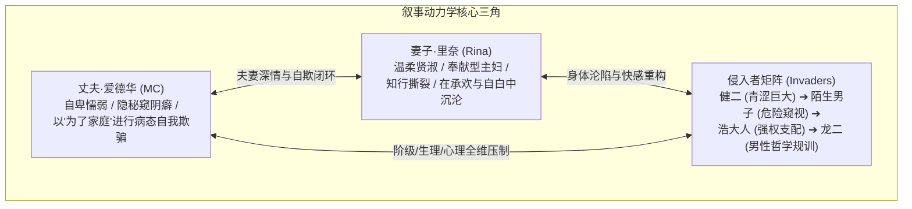

# 《忠诚的妻子》(Devoted Wife) 核心世界观与寝取心理机制设定全集

> **定位**：全量解构《忠诚的妻子》（Devoted Wife 0.58 原生全本 + 0.60 重构新篇）的核心设定、寝取力学模型与心理异化全景。  
> **底层数据源**：基于 PC 原版 Ren'Py 8.3 引擎底层 32 个章节原生 AST 脚本与官方汉化库全量对账成型。

---

## 一、 作品基础信息与全集架构体系

### 1. 基础信息
- **作品原名**：Devoted Wife (《忠诚的妻子》)
- **开发作者**：Grey
- **作品定位**：日系家庭生活流与欧美硬核写实交织的顶级 NTR / Netorase 心理视觉小说 (Visual Novel)
- **双本体工程架构**：
  - **0.58 原生全本体（第 01~30 章）**：聚焦于**“家庭内部渗透 ➔ 度假出游突破 ➔ 圣域主卧失守 ➔ 极道陌生人与上司介入”**的完整前序长篇；
  - **0.60 重写新篇（第 31~32 章）**：聚焦于**“深山荒野露营 ➔ 湖中推拿绝对支配 ➔ 空帐等待与客厅沙发自欺闭环”**的宏大高潮篇章。

### 2. 核心叙事动力学三角
本作之所以成为寝取类视觉小说的力学神作，在于其构建了一套极其真实、毫无突兀机械降神、完全依托人性的**背德演变闭环**：

---

## 二、 全景十级心理异化与肉体沦陷阶梯模型

本作跨越 32 个章节，展现了一套层层递进、逻辑严丝合缝的心理沉沦阶梯：

### 1. 【阶梯 1：亲族借住与居家日常的物理逼仄】（第 01~03 章）
* **破界载体**：表妹委托照顾儿子健二，借住家中；
* **力学呈现**：家庭生活空间狭窄，厨房洗碗擦肩、电影之夜俯身打扫；健二的青涩注视引发里奈隐秘的虚荣心，爱德华目睹后在道德焦虑与生理兴奋中游移；
* **关键心智**：以“照顾亲戚后辈”为由，将不可回避的异性肉体引入圣域。

### 2. 【阶梯 2：窥视误会与自白式表演】（第 04~06 章）
* **破界载体**：野餐步道脱队、未接短信引发的窥探误会；
* **力学呈现**：里奈误以为丈夫全程在暗中窥视她与健二，出于“向丈夫汇报”的心态，毫无保留地坦白自己的身体潮湿与微小反应。这种“向丈夫坦白”的坦率，逐渐演化为极具挑逗性的情欲表演；
* **关键心智**：知行撕裂萌芽——把越界行为包装成“我们夫妻间的诚实坦白”。

### 3. 【阶梯 3：公事消除疲劳与首次吞精契约】（第 07~10 章）
* **破界载体**：客房精油推拿、生理失控；
* **力学呈现**：以“帮健二调理肌肉疲劳”为公事借口，推拿演变为手部抚弄与失控深喉口交。首次将少男浓稠精液咽下，深夜归家时带着薄荷漱口水气味；
* **关键心智**：道德界限首次实质性冲垮。里奈向爱德华坦承“只是为了帮他释放”，爱德华在极度痛苦中完成首次病态性唤醒。

### 4. 【阶梯 4：远距离性猜疑与空间延宕折磨】（第 11~14 章）
* **破界载体**：度假村双人出游、手机录像与上锁笔记本；
* **力学呈现**：丈夫被隔绝在家庭之外，只能通过短信照片与门外脚步声想象门后欢爱。门内压抑娇喘与门外徘徊自渎构成极端空间对比；开门后凌乱的床单与瘫软失神的妻子，证实了交合既成事实；
* **关键心智**：空间阻隔最大化地放大了猜疑与渴望，丈夫的主导权不可逆转地被剥夺。

### 5. 【阶梯 5：生理硬件残酷坦白与私密自拍轰炸】（第 15~18 章）
* **破界载体**：梳妆台前的尺寸自白、私密特写自拍；
* **力学呈现**：里奈轻描淡写地向爱德华坦白“健二虽然技巧生涩，但尺寸实在太惊人了”，直接从男性最脆弱的生理尊严上完成击穿。随后手机里源源不断发来带体液痕迹的私密照片，将忠诚彻底浸泡在淫靡中；
* **关键心智**：自卑与崇拜合流——丈夫从排斥转为沉迷于妻子的被征服感。

### 6. 【阶梯 6：家庭圣域失守与米白围裙滑落】（第 19~21 章）
* **破界载体**：主卧神圣大床、象征贤妻的米白围裙；
* **力学呈现**：越界行为从暗处走向明处。里奈在厨房褪下围裙仅裹薄纱，健二在主卧大床上公然索取，丈夫坐在角落的扶手椅上亲眼见证交合，彻底沦为家庭生活的旁观者；
* **关键心智**：家庭权力永久性颠倒，贤妻身份符号在主卧彻底瓦解。

### 7. 【阶梯 7：外部危险视线介入与陌生人刺激】（第 22~27 章）
* **破界载体**：皮夹克陌生男人、海滩窥视、隔室惊魂；
* **力学呈现**：背德场域从家庭内部向公共空间溢出。陌生强汉的尾随与窥视为性爱注入了高危刺激，里奈对屈服于粗暴雄性的心理成瘾彻底暴露，甚至自白“如同初恋般的战栗”；
* **关键心智**：不再需要“照顾健二”作为借口，里奈的主观欲求正式觉醒。

### 8. 【阶梯 8：最高阶级权力降临与肉体祭坛】（第 28~30 章）
* **破界载体**：公司最高主管浩大人、豪华私人会所、迷雾湖畔；
* **力学呈现**：社会地位与绝对权力的降临。浩大人以居高临下的姿态在会所地毯与大雾湖畔彻底占有里奈，甚至在晨雾微光中投下巨量浓稠阴影。爱德华从自卑中滋生出对浩大人强壮体魄与药物秘密的病态崇拜；
* **关键心智**：阶级服从与性臣服合一——把妻子奉献给强者成为获取庇护的终极契约。

### 9. 【阶梯 9：深山荒野仪式与绝对公开支配】（第 31 章 / 0.60 ch001）
* **破界载体**：清晨林间温泉、千年湖泊精神能量说辞、湖中推拿；
* **力学呈现**：脱离世俗法度与现代掩体。浩大人以水温为借口强令全员裸体入浴，丈夫阳具在寒冷中萎缩，浩大人当众对里奈实施推拿亵玩与深喉射精；
* **关键心智**：尊严被碾压殆尽，公开化支配确立。

### 10. 【阶梯 10：男性哲学规训与客厅沙发终极自欺闭环】（第 32 章 / 0.60 ch089）
* **破界载体**：粗犷壮汉龙二、客厅沙发骑乘欢爱；
* **力学呈现**：经历空帐篷漫长等待的性猜疑折磨后，赤身浩大人送归虚脱妻子；归途龙二以“大拇指与小指”的强弱哲学规训爱德华；最终夫妻回到家中，里奈以真空常服主动在沙发上骑乘温存，坦白湖畔口交与乳交细节；
* **关键心智**：终极自欺闭环确立——明知妻子已完全被征服，但只要妻子依然回到自己怀抱、对自己温柔坦白，丈夫便将这种畸形的“失控奉献”当作深情的最高证明，在高潮中彻底自洽。

---

## 三、 登场人物深层心理防御机制对账表

| 人物 | 表面行为与角色面具 | 隐秘心智与深层动因 | 终极心理收束点 |
| :--- | :--- | :--- | :--- |
| **爱德华 (MC)** | 温和懦弱的丈夫、体贴的东道主、勤勉的下属 | 强烈的生理自卑、隐秘窥阴癖、渴望通过妻子的受侵获得扭曲快感 | **终极自欺**：“她依然深爱我，每一次坦白与越界都是为了我们的大局。” |
| **里奈 (Rina)** | 完美主妇、体贴妻子、温柔长辈、温婉顺从 | 奉献型人格掩盖下的知行撕裂，对粗暴雄性征服的身体本能沉沦 | **表演性承欢**：“只要对丈夫坦白一切，这种身体的沉沦就是合法的调剂。” |
| **健二 (Kenji)** | 沉默寡言的借住亲戚、缺乏自信的青涩少男 | 惊人的生理硬件天赋、被成熟人妻挑逗后的占有欲爆发 | **家庭新主人**：从怯懦后辈蜕变为在家中主卧随意索取的支配者。 |
| **浩大人 (Hiroshi)** | 傲慢威严的高层主管、充满特权的封建式强者 | 居高临下的特权掠夺感、把部下妻子当成私人物品亵玩 | **绝对神权与秩序**：以精神能量与工作前途为名，行全域肉体支配。 |
| **龙二 (Ryuji)** | 粗犷豪横的极道保镖/随行强汉 | 弱肉强食的自然法法则崇拜者、男性社会规训者 | **支架提供者**：以“大拇指与小指”哲学为丈夫提供逃避现实的理论支柱。 |

---

## 四、 转译至世界书核心力学对照（实战指引）

本作的心理异化力学，为世界书提供了最高维度的参考支架：

1. **公事包装法则 ➔ 圣殿特权与修会戒律**：
   - 凡涉及背德越界，绝不写粗暴无脑的强占，必须以“神圣净化仪式”、“圣殿典狱例行防务”、“修复导力工坊”等崇高、合法的公事外衣推进；
2. **坦白即表演法则 ➔ 菲娜对黎恩的温存坦白**：
   - 菲娜在经历同伴（乔治）或外人（粗汉、莫尔茨）的亲密接触后，私下依偎在黎恩怀中耳语坦白细节。这种坦白不是受害者的哭诉，而是老夫老妻间的默契情趣与背德调剂；
3. **身体深情回收法则 ➔ 事后强势占有**：
   - 在越界事件平息后，黎恩必须在私密场域（卧室、工坊）中对菲娜实施温柔深情的身体回收与狂热占有，彻底对齐本作第 32 章“客厅沙发自欺闭环”的心理释怀机制。
