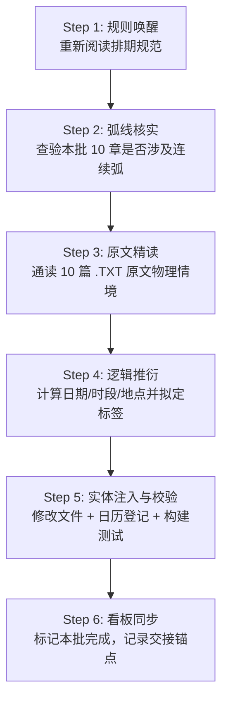

# 第一部章节时空标签长任务规划看板 (Timeline Tagging Kanban)

> **全局定位**：第一部（Eldoria 营地篇，共 937 章）章节首句时空标签（`【X月X日·时段·地点】`）工程化长任务执行看板与批次追踪档案。  
> **核心规范基准**：[`_章节时间线与时空标签排期规范.md`](_章节时间线与时空标签排期规范.md)（排期法则、历法铁律、语法格式、地点映射与转场机制）  
> **逐章排期明细台账**：[`_章节日历排期总表.md`](_章节日历排期总表.md)（全量已注入章节的详细日期、时段、地点与剧情逻辑台账）  
> **连续叙事对照权威**：[`_连续叙事弧线章节总览.md`](_连续叙事弧线章节总览.md)（25 个连续弧判定与紧密接续依据）  
> **物理空间对照权威**：[`docs/location/`](../location/)（全量地点命名权威源，禁止生造地点）  

---

## 一、 长任务执行宪章与四大绝对铁律

为彻底解决大语言模型“自回归事件扎堆压缩病”，并杜绝多轮长任务中的“规则稀释”、“后期遗忘”与“偷懒推导”，所有执行 Agent 必须将以下四项准则视为**不可违背的物理硬约束**：

```
       ┌─────────────────────────────────────────────────────────────┐
       │                长任务四大绝对铁律 (Core Protocols)           │
       ├─────────────────────────────────────────────────────────────┤
       │ 1. 严格锁死 10 章/批次：杜绝合并批次，保证上下文充沛聚焦    │
       │ 2. 每批次强制重读规范：杜绝凭经验记忆，防后期规则遗忘      │
       │ 3. 必须精读 10 章原文：杜绝仅看标题关键字，严谨物理推导    │
       │ 4. 地点严格对齐 location 库：严禁自造虚构场景，规范转场    │
       └─────────────────────────────────────────────────────────────┘
```

### 1. 【粒度铁律】每批次严格限制 10 章
* 绝对禁止为了图快擅自将 2 个或多个批次合并推进（严禁一次性处理 20 章或 30 章）。
* **原因**：每次处理 10 章是大语言模型保证上下文深度聚焦、对前后章节物理逻辑保持敏锐触觉的黄金窗口。一旦章节过多，必然导致对细节视而不见。

### 2. 【防遗忘铁律】每批次启动必须第一步重新查看排期规范
* 每开启一个新批次，**第一项动作必须是通过 `view_file` 重新完整阅读 [`_章节时间线与时空标签排期规范.md`](_章节时间线与时空标签排期规范.md)**。
* **原因**：杜绝“只读一遍规则就自以为全记住”的思维惰性。重新激活大脑对**每月固定 30 天**（严禁31日）、标准时段分类（清晨/上午/午后/傍晚/黄昏/夜晚/深夜/凌晨）、连续叙事弧（24~48h内）与独立单章（间隔 2~5 天，平均 3~4 天）的刚性记忆。

### 3. 【防偷懒铁律】每批次必须通读 10 章原文，严禁仅看标题与关键字
* 每批次排期前，必须使用 `view_file` 将该批次 10 篇 `.TXT` 原文完整读取一遍（重点通读前言、情境 1 以及上下文环境交代）。
* 严禁仅根据章节标题（如“暴雨”、“清晨”）或提取一两个字面词走马观花猜时间。
* 必须从正文的**真实物理环境（天气、光线、窗外天色）、角色体能恢复状况（酸软休养数日）、事件因果（是否紧接上一场对峙）**中严谨推导出真实日期与时段。

### 4. 【空间与语法铁律】严格对齐地点库，按需启动双标签
* 标签中的地点名称必须 100% 精准对齐 [`docs/location/`](../location/) 及其下属合法子场景（如：`营地木屋`、`工坊`、`工坊卧室`、`图书室`、`矮人小屋`、`矮人锻造工坊`、`低语林地`、`银流河商道` 等），严禁凭空编造不存在的地点。
* 若单个章节内部存在显式时间跨越（前半段铺垫，后半段跨越数天转入核心），**严格执行章内跨时空转场多标签机制**（如 369 章范例）。

---

## 二、 批次标准化作业流程（Batch SOP）

每推进一个批次（10章），必须严格按以下 **6 步闭环标准作业流程** 执行：



1. **Step 1：规则唤醒（Read Spec）**  
   使用 `view_file` 调取 [`docs/story/_章节时间线与时空标签排期规范.md`](_章节时间线与时空标签排期规范.md)，复核历法换算规则、地点规范与排期间隔。
2. **Step 2：弧线核实（Check Arc）**  
   使用 `view_file` 查阅 [`docs/story/_连续叙事弧线章节总览.md`](_连续叙事弧线章节总览.md)，锁定当前 10 章中是否存在 25 个连续叙事弧或成对拆分章（上/下）。
3. **Step 3：原文精读（Read 10 Chapter TXTs）**  
   使用 `view_file` 调取当前批次 10 篇 `.TXT` 文件，逐章通读前言、情境 1 与环境动态，获取真实物理线索。
4. **Step 4：逻辑推衍（Timeline Deduction）**  
   承接上一批次末尾的日期与时段，严格按规则制定 10 章的排期方案：
   - 独立单章：自然推进 2 ~ 5 天（平均 3~4 天）；
   - 连续叙事弧：紧凑锁定在 24 ~ 48 小时内（时段顺延）；
   - 成对拆分章：通常同日接续，若章内跨多天采用双标签；
   - 遇月末 30 日直接进位至下月 1 日（严禁 31 日）。
5. **Step 5：实体注入与构建校验（Inject & Build）**  
   - 将标签精准注入 10 篇 `.TXT` 的情境 1 开头，自然清洗冗余前导时间词；
   - 将这 10 章的明细同步追加写入 [`docs/story/_章节日历排期总表.md`](_章节日历排期总表.md)；
   - 终端执行：
     ```bash
     python scripts/check_consistency.py
     python scripts/build_eldoria.py
     ```
     确保全绿灯通过，酒馆构建产物完全同步。
6. **Step 6：看板同步与交接（Update Kanban）**  
   在本看板中将当前批次勾选为已完成，更新最新日期时间锚点，并在会话中向用户汇报当前批次落地情况与下一批次规划。

---

## 三、 全局任务状态总览 (Status Overview)

* **全库总章数**：937 章
* **当前排期基准原点**：第 350 章 = **5月30日·深夜·营地木屋**（繁荫季末）
* **当前完成排期覆盖**：**第 350 ~ 851 章（共 502 章已全量入库，突破 500 章里程碑！Phase 5 批次48 完工，跨入第四年 7月 金叶季初！）**
* **当前最新时间锚点**：**7月12日·夜晚·书房**（第四年7月金叶季初，凯尔四重铁证决意探地下寻父，玲坚定同行，阶段8·后日谈 稳步推进！）
* **当前主攻阶段**：**第五阶段（Phase 5）：阶段 8·后日谈（第 832 ~ 937 章，共 106 章 / 11 批）**
* **下一待执行批次**：👉 **Batch 49（第 852 ~ 861 章，大本营夏日祭与庆典日常）**

---

## 四、 分阶段与分批次推进计划总表

### 阶段 0：前序章节追溯区（Phase 0: Retrospective 1~349，共 349 章 / 35 批）
> **说明**：玩家当前实机游玩自 350 章向前推进。前 349 章作为历史前序背景，待主线向后推进通关或按玩家需求反向追溯。

<details>
<summary>展开查看前序 35 个批次规划 (Batch R01 ~ R35)</summary>

* [ ] **Batch R01**：第 001 ~ 010 章（阶段0·序章）
* [ ] **Batch R02**：第 011 ~ 020 章（阶段0·序章）
* [ ] **Batch R03**：第 021 ~ 030 章（阶段0·序章）
* [ ] **Batch R04**：第 031 ~ 040 章（阶段0·序章）
* [ ] **Batch R05**：第 041 ~ 050 章（阶段0·序章）
* [ ] **Batch R06**：第 051 ~ 060 章（阶段0·序章）
* [ ] **Batch R07**：第 061 ~ 070 章（阶段0·序章收官）
* [ ] **Batch R08**：第 071 ~ 080 章（阶段1·试探和暧昧）
* [ ] **Batch R09**：第 081 ~ 090 章（阶段1·试探和暧昧）
* [ ] **Batch R10**：第 091 ~ 100 章（阶段1·试探和暧昧）
* [ ] **Batch R11**：第 101 ~ 110 章（阶段1·试探和暧昧）
* [ ] **Batch R12**：第 111 ~ 114 章（阶段1收官）+ 115 ~ 120 章（阶段2·挑逗和接受）
* [ ] **Batch R13**：第 121 ~ 130 章（阶段2·挑逗和接受）
* [ ] **Batch R14**：第 131 ~ 140 章（阶段2·挑逗和接受）
* [ ] **Batch R15**：第 141 ~ 149 章（阶段2收官）+ 150 章（阶段3·渐进接触）
* [ ] **Batch R16**：第 151 ~ 160 章（阶段3·渐进接触）
* [ ] **Batch R17**：第 161 ~ 170 章（阶段3·渐进接触）
* [ ] **Batch R18**：第 171 ~ 180 章（阶段3·渐进接触）
* [ ] **Batch R19**：第 181 ~ 190 章（阶段3·渐进接触）
* [ ] **Batch R20**：第 191 ~ 200 章（阶段3·渐进接触，含弧1: 194~195）
* [ ] **Batch R21**：第 201 ~ 210 章（阶段3·渐进接触）
* [ ] **Batch R22**：第 211 ~ 220 章（阶段3·渐进接触）
* [ ] **Batch R23**：第 221 ~ 230 章（阶段3·渐进接触）
* [ ] **Batch R24**：第 231 ~ 240 章（阶段3·渐进接触）
* [ ] **Batch R25**：第 241 ~ 250 章（阶段3·渐进接触）
* [ ] **Batch R26**：第 251 ~ 260 章（阶段3·渐进接触）
* [ ] **Batch R27**：第 261 ~ 270 章（阶段3·渐进接触）
* [ ] **Batch R28**：第 271 ~ 279 章（阶段3收官）+ 280 章（阶段4·跨线起步，含弧2: 280~286）
* [ ] **Batch R29**：第 281 ~ 290 章（阶段4·跨线）
* [ ] **Batch R30**：第 291 ~ 300 章（阶段4·跨线）
* [ ] **Batch R31**：第 301 ~ 310 章（阶段4·跨线，含弧3: 307~317）
* [ ] **Batch R32**：第 311 ~ 320 章（阶段4·跨线，含弧3余篇）
* [ ] **Batch R33**：第 321 ~ 330 章（阶段4·跨线，含弧4: 322~325）
* [ ] **Batch R34**：第 331 ~ 340 章（阶段4·跨线）
* [ ] **Batch R35**：第 341 ~ 349 章（阶段4·跨线，连接 350 原点）

</details>

---

### 先行验证批（Pilot Batch，已完成）

| 批次编号 | 覆盖章节 | 章节数 | 涉及连续叙事弧 / 拆分章 | 覆盖时间跨度 | 状态 |
| :--- | :--- | :---: | :--- | :--- | :---: |
| **Batch 00** | **350 ~ 370** | 21 | **弧5**（356~362 菲娜/乔治 视频直播到留宿）<br>成对拆分：363/364（月光岩）、369/370（商道巨石双标签） | 5月30日·深夜 ～ 7月10日·夜晚<br>（跨越繁荫季末至金叶季初，共40天） | **✅ 已完成** |

---

### 第一阶段（Phase 1）：阶段 4·跨线 完结冲刺（第 371 ~ 449 章，共 79 章 / 8 批）

> **当前进行中阶段**：前承基准 **7月10日·夜晚·营地木屋**，向金叶季中后期推进。

| 批次编号 | 章节范围 | 章节数 | 重点关注叙事弧与特征 | 预期执行重点与前承关系 | 状态 |
| :--- | :--- | :---: | :--- | :--- | :---: |
| **Batch 01** | **371 ~ 380** | 10 | **弧6（372~379，共8章）**：<br>菲娜×凯尔·书房背德（桌底踩碾/桌布咽吞/晨曦归巢） | **覆盖 7月14日深夜 ～ 7月25日午后**；371单章过度，372~379弧内同日黄昏至次日晨，380单章南部沼泽 | **✅ 已完成** |
| **Batch 02** | **381 ~ 390** | 10 | 独立单章日常、训练场对决与营地休整 | **覆盖 7月28日黄昏 ～ 8月16日午后**；跨月至8月，含矮人风箱口交双章、密道导力灯与兽潮完全共鸣 | **✅ 已完成** |
| **Batch 03** | **391 ~ 400** | 10 | **弧7（391~394，共4章）及山洞连贯篇（395~397）**：<br>奥蕾莉亚·暴雨巡逻冲锋与山洞膝枕占有/爱抚/释放 | **覆盖 8月20日午后 ～ 8月27日午后**；391~397暴雨山洞事件紧密接续（含拂晓雨停返营），398~399沼泽敷药，400雨后空地探索 | **✅ 已完成** |
| **Batch 04** | **401 ~ 410** | 10 | 兵械室黑丝蹭弄双章、走廊偶遇、初夜疼痛倾诉、矮人祖厅舔舐、月光岩满月之夜 | **覆盖 8月30日午后 ～ 9月18日傍晚**；跨月至9月（金叶季后段），含402/403兵械室拆分章、409满月之夜、多尔金舔弄与爱丽榭谈心 | **✅ 已完成** |
| **Batch 05** | **411 ~ 420** | 10 | **弧8（412~413，共2章）**：菲娜×乔治生气修复<br>417~419黄金罗刹冰焰温泉三部曲、414镜湖探询、420寒潭取暖 | **覆盖 9月21日傍晚 ～ 10月7日午后**；跨入10月（沉眠季初），含412~413连续24h边界确立、417~419温泉三连章、420寒潭体温臀交（上） | **✅ 已完成** |
| **Batch 06** | **421 ~ 430** | 10 | 寒潭取暖余篇、剑技特训、后山暖坡、更衣帐生涩含弄、贮藏室破锁隐奸、夜光苔孢子最后一次 | **覆盖 10月7日午后 ～ 10月23日午后**；含421~422寒潭完结、425~426更衣帐艾德里安生涩口交双章、427~428贮藏室破锁隐奸双章、429~430夜光苔双章 | **✅ 已完成** |
| **Batch 07** | **431 ~ 440** | 10 | 营地冬日、银流河暴雨旧亭取暖、赶制冬衣、柴堆深吻、书房见证提议、晨光日常、玲恶作剧、第二次早晨、鬼之力理论 | **覆盖 10月26日清晨 ～ 11月25日午后**；跨入11月，含432~433暴雨旧亭雷恩手交、434全员缝衣、435柴堆互慰、436/439凯尔传教士深顶吞精与逼问、440双核心协同 | **✅ 已完成** |
| **Batch 08** | **441 ~ 449** | 9 | **弧9（443~449，共7章）**：<br>艾德里安暴雨府邸·浪子初夜（下午茶/困局/许可/烛光初夜） | **覆盖 11月28日傍晚 ～ 12月2日上午**；跨入12月，含441雷恩稳重第二次、442月末宁静暮色、443~449暴雨困局艾德里安初夜全流程与晨间黎恩强势回收坦白 | **✅ 已完成** |

---

### 第二阶段（Phase 2）：阶段 5·享受和掌控（第 450 ~ 660 章，共 211 章 / 21 批）

> **阶段特征**：菲娜心智进入享受与掌控阶段，包含弧 10 至弧 16，大本营社交网络与多角色羁绊全面成熟。

| 批次编号 | 章节范围 | 章节数 | 重点叙事弧与主要剧情线 | 状态 |
| :--- | :--- | :---: | :--- | :---: |
| **Batch 09** | **450 ~ 459** | 10 | **弧10（456~458）**：菲娜·隐奸设计→门外视线→床上对话 | **覆盖 12月5日午后 ～ 12月27日清晨**；跨入阶段5，含乔治掉笔与开裆丝袜口交、爱丽榭换装漫步、艾玛告白法林、弧10隐奸掌控与自由探索 | **✅ 已完成** |
| **Batch 10** | **460 ~ 469** | 10 | 营地日常与外部据点巡防（跨越 12月30日 年末，迎来 1月1日 萌芽季新年元旦） | **覆盖 12月30日午后 ～ 1月27日午后**；跨年跨季至萌芽季，含乔治工坊电容、艾玛石殿牛头人对话、劳拉月光乳交、石殿防卫、导力枪火金、预警网石板、姐妹联合足交、终端空白、午后探索 | **✅ 已完成** |
| **Batch 11** | **470 ~ 479** | 10 | 魔法工坊与符文试炼 | **覆盖 1月30日清晨 ～ 2月21日午后**；跨入2月，含空白区侦察、艾德里安会议桌下调情与本番、黎恩再填满三次内射、艾玛紫丝牛头人、深夜篝火故事会、符文室艾玛深吞、地下日记双章与太古图书馆银塔记载 | **✅ 已完成** |
| **Batch 12** | **480 ~ 489** | 10 | **弧11（481~485）**：艾玛×卡兹尔·意外进入→告诉法林 | **覆盖 2月24日傍晚 ～ 3月10日清晨**；跨入3月（萌芽季末），含480矿坑探索、481~485沼泽意外交媾与法林坦白包容、486亚莉莎蕾丝足交告白、487星空探索、488镜湖水文、489劳拉双流派剑风 | **✅ 已完成** |
| **Batch 13** | **490 ~ 499** | 10 | 森林侦察与防线稳固 | **覆盖 3月13日黄昏 ～ 4月12日深夜**；跨入4月（繁荫季初），含490四人齐射面部大冒险、491法林紫丝足交、492温泉月光探索、493雨季防汛排水渠、494哈根工棚背对弯腰、495劳拉白袜排毒、496银流河午后探索、497艾玛传送门隔室口足、498精灵矮人贸易注音、499圣光锁链雷恩插入 | **✅ 已完成** |
| **Batch 14** | **500 ~ 509** | 10 | **弧12（504~506）**：劳拉·幻猿创伤→菲娜夜晚治愈 | **覆盖 4月15日午后 ～ 5月7日傍晚**；跨入5月（繁荫季中），含500厨房三人炖菜、501篝火傍晚探索、502医疗帐雷恩手交、503沼泽幼崽黑斑、504~506弧12幻猿痛哭与黎恩整夜治愈、507北方猎场夺回、508林间空地午后探索、509艾玛牛头人精油乳交臣服 | **✅ 已完成** |
| **Batch 15** | **510 ~ 519** | 10 | **弧13（511~518）**：菲娜×凯尔·享受与破戒八部曲 | **覆盖 5月10日深夜 ～ 5月18日深夜**；510乔治拘束内射，511~518弧13高梯/测绘棚/壁画深喉/共鸣石台/兽皮毯/沙盘/精油逼问/整夜深顶回收，519黎恩魔力沉眠留白 | **✅ 已完成** |
| **Batch 16** | **520 ~ 529** | 10 | 阶段 5 深入生活流与锻造探索 | **覆盖 5月19日清晨 ～ 6月13日午后**；跨入6月（繁荫季末，跨越营地一周年！），含520黎恩苏醒燕麦粥、521奥蕾莉亚与菲切磋、522加尔建交信、523~524树顶哨棚踏板断裂雷恩单臂托抱深顶内射成对双章、525劳拉仰躺精油足交、526菲教亚莉莎追踪、527法林烫伤艾玛清创、528劳拉雷恩盾剑合练、529工坊午后自由探索 | **✅ 已完成** |
| **Batch 17** | **530 ~ 539** | 10 | 银流河商道与外部势力接触 | **覆盖 6月16日午后 ～ 7月3日午后**；含530~531多尔金试甲滑油跌坐深捣内射成对双章、532~533乔治工坊跪地舔穴与后入抽送成对双章、534雷恩劳拉夜巡遭遇影牙兽、535午后探索春暖鸣鸟、536~537南部沼泽连体长靴缆绳排查与连根斩除双篇、538哈根四锤修复结婚扣环、539跨入7月金叶季劳拉白袜抱胸嫌弃足交 | **✅ 已完成** |
| **Batch 18** | **540 ~ 549** | 10 | 营地扩建与私语林地净化 | **覆盖 7月6日清晨 ～ 7月30日午后**；含540劳拉向奥蕾莉亚学范德尔流格挡、541银流河黄昏探索、542地下药室艾玛吹痂口交抚慰法林、543艾德里安精油推拿与D杯乳交、544法林阿卡迪亚剑柄刻符文重织金线十年之约、545书房午后金叶季光影探索、546~547温泉哈根失控内射与菲娜冷语警告成对双章、548劳拉遭低语者轮奸雷恩回收守护至天明、549艾玛锻造室手交多尔金与走廊守护符文 | **✅ 已完成** |
| **Batch 19** | **550 ~ 559** | 10 | **弧14（551~553）**：艾玛×法林·符文室确立关系 | **覆盖 8月3日黄昏 ～ 8月26日深夜**；跨入8月金叶季中，含550符文石阶黄昏探索、551~553弧14艾玛法林符文室确立关系揉按吮吸口交三部曲、554主哨塔扩建亮眼、555满月西北山谷狼人同盟、556哨塔日暮远眺西北、557法林暖手石献身第一次、558亚尔缇娜月牙木梳编发、559法林烫伤痊愈反向推拿深插 | **✅ 已完成** |
| **Batch 20** | **560 ~ 569** | 10 | 祭典与宴会前夕筹备 | **覆盖 8月29日夜晚 ～ 9月26日深夜**；跨入9月金叶季末，含560营火醉酒雷恩克制外射、561艾德里安上等皮革新剑柄缠带、562工坊外树荫午后探索、563旧告解室隔板穿槽深含口交与黎恩目击、564密林腐化藤拘束舔穴深插、565蜥蜴人同盟鳄牙与尾绕脚踝、566沼泽黑斑幼崽圣光压制、567温泉三人即兴手交足交言语羞辱、568月夜温泉水汽深夜探索、569法林烫伤一月痊愈平滑白疤与深夜长桌十指交扣 | **✅ 已完成** |
| **Batch 21** | **570 ~ 579** | 10 | **弧15（575~589 前段）**：菲娜生日宴会双线并行·醉意营地 | **覆盖 9月29日黄昏 ～ 10月10日深夜**；跨入10月沉眠季初，含570月影鹿浅滩轻嗅无杀气漫步、571密林巡逻粗树后遮掩深顶内射与夜间69深情坦白、572太古石殿艾玛克服恐惧深喉吞精牛头人、573节庆前夕浆果与麦香暮色、574破晓菲晨间口交主动跨坐索欢、575~579弧15菲娜生日宴会前段：月光百合大宴哭泣、草莓蛋糕许愿与亚莉莎银吊坠、奥蕾莉亚全员拼酒与矮人古歌、深夜散场各自归宿、法林三醉汉困局与艾德里安护送艾玛 | **✅ 已完成** |
| **Batch 22** | **580 ~ 589** | 10 | **弧15（575~589 后段）**：迷糊的艾玛与艾德里安护送·浪子留营 | **覆盖 10月10日深夜 ～ 10月11日深夜**；弧15后半段全量落地，含580护送矮人屋门槛、581~582甜蜜勒索索吻、583~584大姐姐温柔占有足踩与符文共鸣内射、585宿醉通讯舒服呢引爆误会、586劳拉破绽分析与玲击沉法林澄清、587~588艾德里安破防痛哭跪地挽留、589劳拉手交宣泄立规矩仅此一次 | **✅ 已完成** |
| **Batch 23** | **590 ~ 599** | 10 | 生日宴后修复与营地平静日常 | **覆盖 10月14日清晨 ～ 11月8日午后**；跨入11月沉眠季中，含590晨光木窗炊烟自由探索、591木屋二楼通宵防御结界推演与破晓热茶、592菲巡逻暴雨高烧通宵守护、593会议桌下黑丝踩胸惩罚凯尔、594亚莉莎爱丽榭冬衣改装导力缝纫机、595菜地嫩苗与微风蝴蝶自由探索、596心木悬崖边缘伪装网隐蔽口交深喉、597会议厅凯尔还书菲娜手交秒射、598乔治导力护盾二测与鬼之力偏光、599艾玛深紫丝袜为哈根足交立约照料 | **✅ 已完成** |
| **Batch 24** | **600 ~ 609** | 10 | 深入太古遗迹与结界探秘 | **覆盖 11月11日夜晚 ～ 12月2日黄昏**；跨入12月沉眠季末，含600菲娜贴脸丈量口交解开凯尔心结、601阴天营地柔和灰白自由探索、602暴风雪矿道避难帐篷艾玛法林睡袋纯爱、603~604哈根小屋厨房水槽管道卡臀舔穴抽送成对双章、605地下日记第三页太古图书馆盲鱼与古语、606谷仓外廊谷物干香自由探索、607月光岩艾玛为月语者口交两百年后唤名、608太古石殿艾玛跨坐牛头人深顶内射、609镜湖菲娜圣光折射雷恩亡妻灵魂释然调侃与黎恩横抱力竭归宿 | **✅ 已完成** |
| **Batch 25** | **610 ~ 619** | 10 | 菲守夜口交、庆典3P、雷恩亡妻解密与镜湖救赎、工坊测试与月光乳交 | **覆盖 12月5日深夜 ～ 12月30日傍晚**；第二年岁末整年圆满收官，含610菲被毯守夜口交、611深夜探索、612大战庆典3P、613雷恩亡妻信件解密、614镜湖菲娜以亡妻名义深沉内射救赎、615午后探索、616帽檐下轻吻抚慰乔治、617劳拉D杯月光乳交、618多尔金重磨骑士剑、619岁末傍晚探索全营平静 | **✅ 已完成** |
| **Batch 26** | **620 ~ 629** | 10 | 试盾死角抚慰、紫丝腿交、例会桌底乳交、免提双口交、太古真相解谜、牛头人喉音印证、兄弟争宠左右开弓、五族联军长桌会议 | **覆盖 1月3日傍晚 ～ 1月28日夜晚**；跨入第三年萌芽季初，含620多尔金试盾死角抚慰、621月语者紫丝腿交、622劳拉例会桌底乳交、623哈根多尔金免提双口交黎恩吃醋深入、624艾玛凯尔菲通宵解谜Thalion封印、625牛头人导力灯回忆喉音印证学者父亲、626图书室午后探索、627~628艾玛左右开弓双含矮人兄弟成对双章、629五族联军长桌会议协同立约 | **✅ 已完成** |
| **Batch 27** | **630 ~ 639** | 10 | 影牙黑潮围营、温泉轮奸内射、雨后清晨、吊带袜足交、亚莉莎熏香本番、史莱姆胶质侵犯、厨房热气、剑压呼吸法、太古图书馆暗门 | **覆盖 1月30日深夜 ～ 2月23日午后**；跨入第三年2月萌芽季中，含630影牙兽群围营五族协作防守（1月30日月末收官）、631温泉黎恩泡晕艾德里安乔治轮番多次内射事后告知、632雨歇晨间探索、633艾玛吊带袜实证研究足交、634亚莉莎薄纱熏香催情本番、635~636艾玛遭腐化史莱姆胶质高潮与法林温情急救成对双章、637厨房热气探索、638温泉劳拉奥蕾莉亚剑压谈心、639牛头人开暗门发现父亲导力灯刻痕 | **✅ 已完成** |
| **Batch 28** | **640 ~ 649** | 10 | 圣光花田失控轮奸、遗产拍卖会、带斑岩羊封猎令、露台微醺交融双章、空地午后探索、古旧温泉艾玛浮力多尔金内射、事后尺寸探讨、亚尔缇娜黑丝足交、哨塔黎明探索 | **覆盖 2月26日午后 ～ 3月18日清晨**；突破300章里程碑，跨入3月萌芽季末，含640圣光花田花粉失控黎恩雷恩轮奸菲娜、641艾德里安拍卖会亚莉莎百金认可、642岩羊休眠孢子封猎令（2月30日月末收官）、643~644露台微醺艾德里安托抱深顶与黎恩门外窥视深吻回收双章、645空地午后探索、646深山温泉水汽艾玛受多尔金水下贯穿法林深吻、647木屋尺寸探讨坦白、648亚尔缇娜黑丝足交慌乱喷精、649哨塔黎明探索 | **✅ 已完成** |
| **Batch 29** | **650 ~ 660** | 11 | **弧16（657~660）**：菲娜/多尔金/哈根/牛头人；阶段 5 收官 | **覆盖 3月21日午后 ～ 4月9日深夜**；跨入第三年4月繁荫季初，Phase 2 全量211章圆满收官！含650导力显影液银塔坐标、651~652艾玛心木废墟遭多残影侵犯与法林被窝温存成对双章、653北塔夜袭防线整编、654亚尔缇娜工坊黑丝足交多尔金（3月30日月末收官）、655镜湖雷恩凯尔轮番内射坦白（4月跨月）、656银塔圣光碎片回收、657~660弧16矿道连续四章（双龙贯通/深喉内射/牛头人极巨爆射/导力器全程录像二次轮奸/黎恩看录像暴烈重新占有），Stage 5 完美收官！ | **✅ 已完成** |

---

### 第三阶段（Phase 3）：阶段 6·放纵（第 661 ~ 811 章，共 151 章 / 15 批）

> **阶段特征**：菲娜极致放纵与主动掌控，包含弧 17、弧 18，跨越沉眠季（10~12月）。

| 批次编号 | 章节范围 | 章节数 | 重点叙事弧与特征 | 状态 |
| :--- | :--- | :---: | :--- | :---: |
| **Batch 30** | **661 ~ 670** | 10 | 阶段 6 开启，四个人的灶台，放纵心智新阶段展现 | **覆盖 4月12日傍晚 ～ 5月2日上午**；跨入第三年5月繁荫季中，阶段6放纵盛大开篇！含661爱丽榭四人灶台黎恩尝旧味、662多尔金大锤掩护艾玛桌底含吮法林深喉、663心木废墟外围符文共鸣与三角嵌套、664亚尔缇娜白丝足交哈根轻吻发旋、665繁荫季午后探索、666~667北方深林雪径猎狼与避难木屋热汤成对双章、668训练场劳拉玲骑士道探讨、669艾玛精油乳交法林许诺留至天亮（4月30日月末收官）、670岩丘祖厅三兄弟合力修复三百年符文层（跨入5月） | **✅ 已完成** |
| **Batch 31** | **671 ~ 680** | 10 | 营地日常生活与高默契背德 | **覆盖 5月5日傍晚 ～ 5月29日清晨**；覆盖第三年5月大部，含671银流河黄昏探索、672~673哈根麻绳床翻身压上与菲娜自主骑乘绝顶灌满成对双章、674太古石殿艾玛向牛头人诀别与法林矿道深情守候、675深夜篝火菲娜为乔治手交当面宣誓归属、676劳拉菲娜老橡树夜话磨刀与剑士决意、677艾德里安下跪反向服务至数度高潮与黎恩深情覆盖、678满月银流河深夜探索、679乔治传感器装置测试与工坊后入抽送内射、680奥蕾莉亚与菲晨雾切磋探讨本能直觉 | **✅ 已完成** |
| **Batch 32** | **681 ~ 690** | 10 | 外部探索与私密羁绊 | **覆盖 5月30日深夜 ～ 6月21日午后**；跨越两整年大关跨入6月繁荫季末，含681白丝足交雷恩深情慰藉亡妻忌日与黎恩内射覆盖（5月30日月末收官）、682深夜图书室孤灯探索（6月跨月）、683~684晚宴喧嚣储木堆侧入与回屋口含坦白内射覆盖成对双章、685银流河上游溯溪水质勘察与菲微红相约、686工坊重锤节拍隐奸内射与黎恩温和包容、687演武坪薄霜清晨探索、688篝火微醺哈根多尔金双握手交降温、689~690再访暖岩艾玛卡兹尔文化误会冰释与相视释怀成对双章 | **✅ 已完成** |
| **Batch 33** | **691 ~ 700** | 10 | 暴风雪前夕营地防御与角色深入心智 | **覆盖 6月24日夜晚 ～ 7月18日傍晚**；跨越繁荫季收官（6月30日）迈入金叶季（7月），含691无名冰袋药膏艾德里安笨拙关怀、692晨间阳光探索、693法林醉卧一门之隔多尔金哈根死寂双重内射（6月30日月末繁荫季终）、694工坊菲娜不再往后缩主动迎纳（7月跨月）、695~696女骑士压制鬼之力女上位本番与清醒承诺成对双章、697哨塔雷恩羊毛斗篷下军姿深吞避险、698魔导杖战术算法99.7%校准合作、699满月之夜（7月15日）狼人撕衣袭击与飞刀解救人品大改观、700密林边缘日暮雾驹探索 | **✅ 已完成** |
| **Batch 34** | **701 ~ 710** | 10 | 伴生矿搜寻、训练场屋后手交、触手麻痹拘束、骑士礼仪、东方好茶口交、环营结界落成、空地午后探索、工坊敞门隐奸、午睡掀裙口交、晨练深喉意外 | **覆盖 7月21日上午 ～ 8月16日清晨**；跨越金叶季7月末（7月30日月末收官）迈入8月中，含701菲与多尔金峡谷寻矿、702劳拉训练场屋后主动为艾德里安手交、703艾玛遭腐化触手麻痹拘束高潮法林急救、704菲娜训练场请教劳拉骑士礼仪、705劳拉府邸坦然享口交温柔亲额头（7月30日月末收官）、706四柱共鸣环营结界落成与黎恩减负排班（8月跨月）、707林间空地午后探索、708乔治门窗大敞隐奸菲娜应允抽送、709黎恩引雷恩撞菲娜午睡娇姿口交伺候、710劳拉晨练树后乳交意外滑入深喉暴怒警告 | **✅ 已完成** |
| **Batch 35** | **711 ~ 720** | 10 | **弧17（720~721）**：古商道破译、午后营地探索、深夜潜入乳交手交、书房白丝踩手、祖厅晚餐桌下放浪、地下日记第四页、69式交换、深夜哨塔探索、古商道伏击战、假传讯工作台指交 | **覆盖 8月19日上午 ～ 9月14日傍晚**；跨越金叶季8月末（8月30日月末收官）迈入9月中，弧17正式揭幕！含711商路古羊皮卷破译、712营地午后早黄落叶探索、713艾德里安深夜潜入卧室劳拉压抑被动手交、714菲娜书房白丝踩手背手交凯尔并告知黎恩、715祖厅晚餐菲娜故意掉叉子桌下多尔金后入熔岩内射（8月30日月末收官）、716地下日记第四页太古图书馆第十四年（9月跨月）、717劳拉艾德里安庄园69式双向吸吮吞精夹头、718深夜哨塔星空探索、719低语林地古商道废商栈影牙兽伏击突围、720弧17假传讯工作台指交娇啼求慢 | **✅ 已完成** |
| **Batch 36** | **721 ~ 730** | 10 | **弧17（720~721）**：旧沙发口交内射收官；双线程早晨唤醒、晨间训练场、狼人入营轮岗、满月接吻即湿双章、猎兵初夜学习、菜地晨间探索、地热蒸汽室偷窥双章 | **覆盖 9月14日夜晚 ～ 10月27日午后**；跨越金叶季9月收官迈入沉眠季（10月），弧17圆满收官！含721旧沙发口交颜射与骑乘内射（弧17终）、722亚尔缇娜双线程早晨口交手交矮人兄弟、723晨间训练场露水探索、724月语者三狼人入营七天轮岗（9月30天满进位，10月沉眠季初跨月）、725~726满月夜（10月15日）雷恩忆亡妻深吻动情裙湿与沉实贯穿内射成对双章、727菲真情献身初夜娇啼求欢、728晨间菜地星彩花探索、729~730地热蒸汽室玲门缝偷看哈根背德后入内射与黎恩覆盖回收成对双章 | **✅ 已完成** |
| **Batch 37** | **731 ~ 740** | 10 | 符文启蒙课、异色瞳十四年记忆、爆裂符文实战、温泉黄昏探索、太刀熔炉隐奸、晨光木屋散步、紫丝掰穴观淫双章、工坊天窗探索、气密舱高温试盾 | **覆盖 10月30日上午 ～ 11月22日午后**；跨越沉眠季10月末（10月30日月末收官）深入11月中下旬，含731艾玛引导玲镰刀铭刻光符文（10月30日月末收官）、732西北山谷月语者凭异色瞳忆及十四年前凯尔之父（11月沉眠季中跨月）、733玲爆裂短矢轰碎巨型腐化史莱姆、734温泉傍晚暮色探索、735太刀通光圣光引爆三道符文双矮人前后夹击内射、736银流河散步黎恩菲娜深情誓言太刀烙印、737~738艾玛紫丝反锁工坊掰穴引导双矮人观淫射精并闻舔脚心成对双章、739工坊天窗午后宁静探索、740黎恩进驻气密舱试盾见后厅橡木门紧闭落锁 | **✅ 已完成** |
| **Batch 38** | **741 ~ 750** | 10 | 气密舱试盾收束、慢下来书房省思、紫丝双洞齐灌双章、巷口从容口交、林缘示警断线、营地暮色探索、麦酒窖悬空放纵双章、两大强女温泉夜话 | **覆盖 11月22日午后 ～ 12月17日深夜**；跨越沉眠季11月末（11月30日月末收官）迈入12月中，含741气密舱卸甲达标三人收束、742凯尔慢下来晨起自省见黎恩归来、743~744艾玛紫丝破口蹭蹭至双矮人双洞齐灌与冷视训诫成对双章（11月30日月末收官）、745菲娜拽艾德里安死角3分钟吞精与黎恩微酸惩戒（12月跨月）、746林缘示警线缆遭撕裂与三日抢修承诺、747银流河暮色探索、748~749地下麦酒窖梯断多尔金悬空托抱贯入内射与回屋门板立位覆盖成对双章、750奥蕾莉亚与菲娜深夜温泉坦露心迹 | **✅ 已完成** |
| **Batch 39** | **751 ~ 760** | 10 | 桌下之手从容隐奸、矮人棋黑兔欢笑、紫丝全裸观淫双章、岁末篝火探索、地下暗渠仰面深含、桌下之口深喉吞精、护甲应力测试垫片、最后边界月光岩深深温存、河边先斩后奏浅滩高潮 | **覆盖 12月21日傍晚 ～ 1月19日午后**；跨越第三年岁末（12月30日月末收官）迈入第四年萌芽季初，含751会议桌下套弄艾德里安射帕、752黑兔矮人棋与石英小鸟、753~754艾玛全裸紫丝俯身展示供双矮人观淫撸管与菊穴舔舐成对双章、755第三年岁末夜晚篝火日常探索（12月30日整年收官）、756暗渠滑倒雷恩决堤仰面深吞与亚尔缇娜偏灯掩护（跨入第四年1月萌芽季初）、757例会桌下深喉艾德里安写字手抖射喉、758乔治为雷恩测护甲应力加固垫片、759月圆夜月语者深埋最后边界与油瓶相拥、760凯尔红耳邀约菲娜自主应允浅滩结合 | **✅ 已完成** |
| **Batch 40** | **761 ~ 770** | 10 | 空地午后花田探索、只干后穴不碰前穴、木屋中途接手二次射精、晨露采野莓家的味道、暖岩石上暮色通讯意外三章、低语者掳人彻夜守候、古树暴雨避难后入双章 | **覆盖 1月22日午后 ～ 2月11日傍晚**；跨越第四年1月末（1月30日月末收官）迈入2月萌芽季中，含761花田午后光斑日常探索、762艾玛应允双矮人轮流后穴贯入射精、763木屋菲娜跨坐与黎恩接手凶猛贯入引凯尔二次射精、764爱丽榭携黑兔采野莓熬酱与家的味道（1月30日月末收官）、765~767暖岩石地热蒸汽艾玛被刺勾衣跌入卡兹尔怀中结合及法林导力通讯含蓄作答应允成套三章（跨入2月）、768爱丽榭清晨取水被低语者拖入雾中获救黎恩彻夜守门、769~770密林巡逻暴雨困于古树凹陷菲娜湿身娇羞主动求暖引雷恩贯入内射与回屋坦白成对双章 | **✅ 已完成** |
| **Batch 41** | **771 ~ 780** | 10 | 雨后营地水滴探索、满月夜袭决意进军、心木废墟轰杀狼王、荒原马车咬帕骑乘双章、篝火石圈温暖暮色、黑兔被舔初尝高潮双章、深夜书房从不后悔、紫丝双洞齐入双重内射 | **覆盖 2月12日清晨 ～ 3月4日午后**；跨越第四年2月末（2月30日月末收官）迈入3月萌芽季末，含771暴雨翌晨空气清冽探索、772兽群满月三路夜袭与决战废墟决意、773深入心木废墟轰杀影牙狼王首领、774~775南缘荒径货运马车颠簸菲娜咬白帕骑乘与扎营黎恩毛毡覆盖回收成对双章、776暮色篝火松木取暖日常探索、777~778黑兔访矮人屋误入厕所被多尔金哈根舔弄乳尖蜜穴高潮接吻成对双章、779深夜书房黑兔向菲倾诉被吻心声、780艾玛时隔五日再访工坊双洞齐入双重内射并决意坦白（跨入3月） | **✅ 已完成** |
| **Batch 42** | **781 ~ 790** | 10 | 溪边午后银流鱼探索、精灵王古剑授菲娜、前哨夜袭退守夺回、雷恩房内安神蜜酒互舔、艾玛笔记全盘坦白深情原谅、外壁古语留言从容化烬、花田暮色归巢探索、月光岩心跳证明、雷恩大醉劳拉口交艾德里安抚臀射精、老家野蜂蜜醒酒汤晨光静流 | **覆盖 3月7日午后 ～ 4月4日清晨**；跨越第四年3月末（3月30日月末收官）迈入4月繁荫季初，含781银流河午后探索、782多尔金古剑托付、783前哨夜袭退守夺回、784雷恩房内蜜酒互舔、785艾玛笔记全盘坦白深情原谅、786心木外壁Thalion古语留言从容化烬、787花田暮色归巢探索、788月光岩心跳证明（3月30日月末收官）、789雷恩大醉劳拉口交艾德里安抚臀射精（4月跨月）、790野蜂蜜醒酒汤晨光静流 | **✅ 已完成** |
| **Batch 43** | **791 ~ 800** | 10 | 劳拉直球告白折返口交、通话中濒死隐忍被抚高潮、奥蕾莉亚与菲晨光两次挥剑、决战前夕石殿符文防御整备、石殿午后暗金探索、木屋视讯书房加时赛双章（双龙贯穿/复盘立项）、亚莉莎玲篝火保养导力器、矮人三兄弟烈酒盛宴群交轮奸双章（三穴齐贯/掌心名字符文） | **覆盖 4月4日上午 ～ 4月24日深夜**；深入第四年4月繁荫季初，含791劳拉艾德里安告白折返跪口、792雷恩来电濒死隐忍与木屋索取补偿、793晨光无心切磋、794石殿防御物资全网总备、795石殿午后探索、796~797书房加时赛黑丝足交至双龙交合与倒叙坦白成对双章、798亚莉莎玲篝火组装导力器、799~800矮人三兄弟烈酒盛宴三穴同时贯通与掌心名字符文成对双章 | **✅ 已完成** |
| **Batch 44** | **801 ~ 811** | 11 | **弧18（810~811）**：温泉隔雾水下指交、花田边缘午后探索、腿间净化金光解脱、迷雾昏迷半梦半醒交叉、黑暗中不准开灯乳交猜人、茶会后清醒共谋双龙失控、银流河深夜冷月探索、塔楼银发最后一瞥、VII班篝火谈彼此为锚、低语者极限轮奸体液共鸣金柱解脱、圣光之谷深情乳交体温覆写；**阶段 6 完美收官！** | **覆盖 4月27日夜晚 ～ 5月23日深夜**；跨越第四年4月末（4月30日月末收官）迈入5月繁荫季中，Phase 3 全量 151 章圆满收官！含801温泉水下指交雷恩闲聊、802花田午后探索（4月30日月末收官）、803腿间夹蹭内射令低语者解脱长眠（5月跨月）、804山谷迷雾昏迷后入与含口绝顶、805卧房黑暗乳交与指交猜人、806催情茶清醒前后双龙失控、807银流河深夜冷月探索、808断誓厅塔楼废墟回望Thalion确定决战、809营地篝火深夜守护倾诉、810~811弧18低语者极限轮奸纯金光柱解脱与圣光之谷双乳包裹深情覆写收束双章，Stage 6 壮丽收官！ | **✅ 已完成** |

---

### 第四阶段（Phase 4）：阶段 7·终局（第 812 ~ 831 章，共 20 章 / 2 批）

> **阶段特征**：决战前夜、守护者残影、远古真相与深情终局誓约。

| 批次编号 | 章节范围 | 章节数 | 重点叙事弧与特征 | 状态 |
| :--- | :--- | :---: | :--- | :---: |
| **Batch 45** | **812 ~ 821** | 10 | **弧19（813~814）**：温水木桶清洗回归、四个人的篝火情感集结、旧衬衫跪口至深情情书、心木树下双核贯通天地、艾斯特雷亚鸢尾花戒指托付、亚尔赛德战前守夜剑心通透、玲与天使林缘结契、爱丽榭倾心最后晚餐全员羁绊、凯尔辞典U盘文明记录、五族晨光誓师告别孤独 | **覆盖 5月23日深夜 ～ 5月25日清晨**；决战前夕群像壮阔集结！含812温水洗净异类体液、813四人深夜篝火、814独属两人的完整情书、815心木树下双核贯通、816鸢尾花戒指穿链、817亚尔赛德战前守夜、818玲林缘解开心结、819爱丽榭全员专属菜肴大宴、820凯尔辞典U盘、821破晓五族誓师挥剑出征 | **✅ 已完成** |
| **Batch 46** | **822 ~ 831** | 10 | **弧20（823~826）**：守护者残影/Thalion<br>**弧21（828~829）**：菲娜/Thalion；阶段 7 决战收官 | **覆盖 5月25日上午 ～ 5月26日夜晚**；Phase 4 阶段7（终局）20章全量圆满收官！含822五族三路进军断誓厅、823~826弧20四部曲（三岔路口分兵/菲娜以身相渡守护者残影/心木树根痛哭释怀/并肩黎恩断誓厅同款正装对峙）、827劳拉奥蕾莉亚殿外背靠背一步不退、828~829弧21决战双章（道破太古封印真相灰金光桥/Thalion释怀剥离核心显露心木幼种化金光）、830破晓拂晓五族群像心木树复苏、831营地木屋温存坦白定情收官！ | **✅ 已完成** |

---

### 第五阶段（Phase 5）：阶段 8·后日谈（第 832 ~ 937 章，共 106 章 / 11 批）

> **阶段特征**：第一部后日谈温存、全员未来期许、维里迪亚前置过渡与长线余韵。

| 批次编号 | 章节范围 | 章节数 | 重点叙事弧与特征 | 状态 |
| :--- | :--- | :---: | :--- | :--- | :---: |
| **Batch 47** | **832 ~ 841** | 10 | 决战胜利后营地修复与悠长假日、府邸乳交查岗、双人晨步、浴室腿交隐奸双章、晨间探索、数字与花瓣、书房黑丝足交、狼人满月后门双章 | **覆盖 5月29日傍晚 ～ 6月15日深夜**；跨入第四年6月繁荫季中满月夜！含832雾帷散后查验裂隙（5月29日）、833劳拉府邸乳交踩蘑菇荒诞掩饰（5月30日月末收官）、834清晨漫步银流河打水漂（6月跨月）、835~836浴室腿交隐奸雷恩门外夸赞双章、837晨间自由探索、838艾玛亚尔缇娜斐波那契数列共鸣、839书房黑丝足交凯尔获悉狼人生理、840~841西北山谷满月之夜月语者22cm后穴贯穿与木屋深情回归成对双章！ | **✅ 已完成** |
| **Batch 48** | **842 ~ 851** | 10 | **弧22（844~845）**：橡树午后、黄金罗刹双男、府邸初入破防、次晨告发双打、山谷物资顺路、温泉傍晚收官、催情茶体液温柔净化、月光百合草地约定、沼泽战后试剑、书房铁证决意寻父 | **覆盖 6月18日午后 ～ 7月12日夜晚**；突破500章大关，跨越6月30日月末收官迈入7月金叶季初！含842橡树下清凉午后、843奥蕾莉亚宣布加尔为男人菲娜吃醋、844~845弧22成对双章（艾德里安府邸初次深埋贯穿只唤雷恩/次晨向雷恩坦白交合宣誓训练场夫妻双打艾德里安）、846亚莉莎山谷石窟乳交蹭穴、847温泉石阶傍晚（6月30日月末收官）、848低语林地菲娜催情茶以身体净化低语者（7月跨月）、849月光百合草地相约、850南部沼泽试剑对决、851书房凯尔四重铁证决意探地下寻父玲同行！ | **✅ 已完成** |
| **Batch 49** | **852 ~ 861** | 10 | 深夜瞭望台探索、满月狼首灰骑双龙、剑鳞黄昏对决、睡裙赴约满月接纳、倒木鳞甲乳交、木屋门廊午后、普通夜主动跨坐、黄金罗刹温泉五部曲全部位、蜜穴慈悲解脱低语者、两女凯尔书房四手手交 | **覆盖 7月14日深夜 ～ 7月30日午后**；跨越7月满月（7月15日）与月末收官（7月30日）！含852深夜瞭望台、853满月心木树下双龙贯穿、854黄昏沼泽野梅试剑、855满月夜丝绸睡裙赴约接纳、856倒木乳交指交、857门廊午后、858非满月主动跨坐定情、859温泉全部位掌控、860蜜穴慈悲主动净化低语者、861两女凯尔书房四手手交娇羞坦白！ | **✅ 已完成** |
| **Batch 50** | **862 ~ 871** | 10 | 黎明第一盏灯探索、倒木矛尖口交、视讯恶作剧跨坐深顶、篝火天使碎片倾诉、玲游戏本番破防失控、满月午后落叶探索、加尔来访暖石双指高潮、满月月光百合温柔破身、书房黑丝踩膝定日常、唯你一人跨坐深沉内射 | **覆盖 8月2日清晨 ～ 8月24日深夜**；跨越8月满月夜（8月15日）！含862晨光初醒、863奥蕾莉亚倒木口交、864菲娜视讯恶作剧当面内射、865深夜篝火玲吐露心声、866玲游戏本番失控动情、867满月日午后、868加尔初访营地暖石双指高潮、869满月百合花海罗恩温柔破身、870玲书房踩膝确立日常、871劳拉深夜跨坐雷恩深顶内射！ | **✅ 已完成** |
| **Batch 51** | **872 ~ 881** | 10 | **弧23（877~881，共5章）**：密林小径新芽探索、河床春草野战、月末紫雾轮奸净化最终黎恩深沉内射、雾帷消散携手晨步、木屋门廊深夜探索、**弧23父子相见五部曲**（地下见盲鱼账本/异色瞳泪流认亲/十四年心跳与地图/午后重见阳光营地相迎/夜晚全营篝火围坐玲自我介绍） | **覆盖 8月27日清晨 ～ 9月8日夜晚**；跨越8月末收官（8月30日）迈入9月金叶季末！含872晨间探索、873河床春草草地野战、874低语者轮奸净化黎恩最终内射（8月30日月末收官）、875雾帷散去两人牵手晨步（9月跨月）、876门廊深夜、877~881弧23父子相见壮阔五部曲完美收官！ | **✅ 已完成** |
| **Batch 52** | **882 ~ 891** | 10 | 菜地藤架暮色探索、书房日常跨坐深顶、门契约三语破解、六碗齐聚全家晚餐、工具间修灯轮番深顶、图书室窗边午后、荧光藻开花幽蓝夜战、亚尔缇娜直球我也要、裂隙频率初通马奇亚斯、沼泽求偶习俗破译 | **覆盖 9月11日傍晚 ～ 9月30日午后**；跨越9月满月（9月15日）并迎来9月金叶季月末收官（9月30日）！含882菜地暮色、883玲与凯尔确立日常、884三语破解门本质为契约、885满月夜全家六碗温馨晚餐、886工具间哈根多尔金深顶、887图书室窗边探索、888沼泽荧光藻加尔20cm矛尖内射、889亚尔缇娜我也要双矮人初尝温柔、890乔治导力通讯首次跨裂隙接通马奇亚斯、891艾玛破译卡兹尔长尾与暖岩石求偶大告白！ | **✅ 已完成** |
| **Batch 53** | **892 ~ 901** | 10 | 封印语双向钥匙、训练场余波、冷锻台坦白、满月主导完全结合、两人挑战奥蕾莉亚、战后悼亡醉酒放肆、三人视讯满足不了我、月光岩大鸡巴崇拜、厨房炖汤热气、不算什么干的是屁眼 | **覆盖 10月2日上午 ～ 10月30日午后**；跨入第四年10月沉眠季初，经历10月15日满月夜与10月末收官！含892石板背面双向契约公式（10月跨月）、893训练场午后探索、894工坊冷锻台艾玛失守与法林独占、895满月夜亚莉莎上位双骑锁死、896黎恩加尔联手挑战奥蕾莉亚平手收官、897亚尔缇娜探访买醉矮人锻台轮奸深情、898菲娜三人行视讯黎恩连夜归营身心回收、899艾玛月光岩口交月语者许诺下次再来、900厨房热气傍晚探索、901劳拉后穴艾德里安破防与雷恩吃醋二次占有（10月30日月末收官）！ | **✅ 已完成** |
| **Batch 54** | **902 ~ 911** | 10 | 门开回家的路、镰刀第三符文、满月夜狼尾巴双章、月光鳞甲语言、导力护盾骨架、银塔广场余韵、深夜矮人小屋双章、导力器那边手没停 | **覆盖 11月2日午后 ～ 11月25日傍晚**；跨入第四年11月沉眠季中，经历11月15日满月夜！含902裂隙稳定开启连接帝国东部、903玲改良火球符文、904~905菲娜薄睡裙满月西北山谷22cm口足交与深入内射及回屋汇报成对双章、906满月夜艾玛暖岩石逆鳞结合、907满月次日乔治哈根护盾折叠弧合作、908银塔广场探索、909~910菲娜深夜访矮人小屋前后双龙夹击成对双章、911菲娜工坊取镰刀实时通讯黎恩多尔金沉顶内射！ | **✅ 已完成** |
| **Batch 55** | **912 ~ 920** | 9 | **弧24（915~916）**：出发双章、和平小径、维里迪亚第二位伴侣口交隐奸、单人黑丝夜晚、两把佩剑约定、溪流石阶 | 待执行 | **👉 下一批次 [NEXT]** |
| **Batch 56** | **921 ~ 930** | 10 | **弧25（921~923）**：菲娜/乔治；营地未来筹备 | ⏳ 未开始 |
| **Batch 57** | **931 ~ 937** | 7 | 第一部全书终章！大本营篇圆满落幕，启程准备 | ⏳ 未开始 |

---

## 五、 断点接盘与批次交接指引 (Handover Protocol)

每次对话中或在切换新对话继续推进时，后任 Agent 必须无条件执行以下接盘动作：

1. **查验本看板当前激活批次（Current Active Batch）**：
   - 当前锁定批次：**Batch 55（第 912 ~ 920 章）**；
   - 前承基准点：**11月25日·傍晚·工坊**（11月沉眠季中后段，向11月末及12月沉眠季末推进）；
2. **第一步强制动作**：
   - 调用 `view_file` 查阅 [`docs/story/_章节时间线与时空标签排期规范.md`](_章节时间线与时空标签排期规范.md) 全文；
3. **第二步查阅弧线**：
   - 调用 `view_file` 查阅 [`docs/story/_连续叙事弧线章节总览.md`](_连续叙事弧线章节总览.md)；
4. **第三步完整调取 10 篇原文**：
   - 调用 `view_file` 读取 `852` 至 `861` 共 10 篇 `.TXT`，根据物理事件推导时段与地点；
5. **第四步执行并验证**：
   - 注入标签、登记日历总表、运行 `check_consistency.py` 与 `build_eldoria.py`；
6. **第五步更新看板**：
   - 将 Batch 49 状态改为 `✅ 已完成`，并激活 Batch 50。
