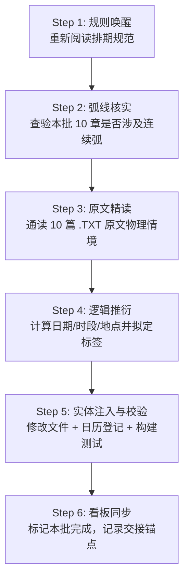

# 第一部章节时空标签长任务规划看板 (Timeline Tagging Kanban)

> **全局定位**：第一部（Eldoria 营地篇，共 937 章）章节首句时空标签（`【X月X日·时段·地点】`）工程化长任务执行看板与批次追踪档案。  
> **核心规范基准**：[`_章节时间线与时空标签排期规范.md`](_章节时间线与时空标签排期规范.md)（排期法则、历法铁律、语法格式、地点映射与转场机制）  
> **逐章排期明细台账**：[`_章节日历排期总表.md`](_章节日历排期总表.md)（全量已注入章节的详细日期、时段、地点与剧情逻辑台账）  
> **连续叙事对照权威**：[`_连续叙事弧线章节总览.md`](_连续叙事弧线章节总览.md)（25 个连续弧判定与紧密接续依据）  
> **物理空间对照权威**：[`docs/location/`](../location/)（全量地点命名权威源，禁止生造地点）  

---

## 一、 长任务执行宪章与四大绝对铁律

为彻底解决大语言模型“自回归事件扎堆压缩病”，并杜绝多轮长任务中的“规则稀释”、“后期遗忘”与“偷懒推导”，所有执行 Agent 必须将以下四项准则视为**不可违背的物理硬约束**：

```
       ┌─────────────────────────────────────────────────────────────┐
       │                长任务四大绝对铁律 (Core Protocols)           │
       ├─────────────────────────────────────────────────────────────┤
       │ 1. 严格锁死 10 章/批次：杜绝合并批次，保证上下文充沛聚焦    │
       │ 2. 每批次强制重读规范：杜绝凭经验记忆，防后期规则遗忘      │
       │ 3. 必须精读 10 章原文：杜绝仅看标题关键字，严谨物理推导    │
       │ 4. 地点严格对齐 location 库：严禁自造虚构场景，规范转场    │
       └─────────────────────────────────────────────────────────────┘
```

### 1. 【粒度铁律】每批次严格限制 10 章
* 绝对禁止为了图快擅自将 2 个或多个批次合并推进（严禁一次性处理 20 章或 30 章）。
* **原因**：每次处理 10 章是大语言模型保证上下文深度聚焦、对前后章节物理逻辑保持敏锐触觉的黄金窗口。一旦章节过多，必然导致对细节视而不见。

### 2. 【防遗忘铁律】每批次启动必须第一步重新查看排期规范
* 每开启一个新批次，**第一项动作必须是通过 `view_file` 重新完整阅读 [`_章节时间线与时空标签排期规范.md`](_章节时间线与时空标签排期规范.md)**。
* **原因**：杜绝“只读一遍规则就自以为全记住”的思维惰性。重新激活大脑对**每月固定 30 天**（严禁31日）、标准时段分类（清晨/上午/午后/傍晚/黄昏/夜晚/深夜/凌晨）、连续叙事弧（24~48h内）与独立单章（间隔 2~5 天，平均 3~4 天）的刚性记忆。

### 3. 【防偷懒铁律】每批次必须通读 10 章原文，严禁仅看标题与关键字
* 每批次排期前，必须使用 `view_file` 将该批次 10 篇 `.TXT` 原文完整读取一遍（重点通读前言、情境 1 以及上下文环境交代）。
* 严禁仅根据章节标题（如“暴雨”、“清晨”）或提取一两个字面词走马观花猜时间。
* 必须从正文的**真实物理环境（天气、光线、窗外天色）、角色体能恢复状况（酸软休养数日）、事件因果（是否紧接上一场对峙）**中严谨推导出真实日期与时段。

### 4. 【空间与语法铁律】严格对齐地点库，按需启动双标签
* 标签中的地点名称必须 100% 精准对齐 [`docs/location/`](../location/) 及其下属合法子场景（如：`营地木屋`、`工坊`、`工坊卧室`、`图书室`、`矮人小屋`、`矮人锻造工坊`、`低语林地`、`银流河商道` 等），严禁凭空编造不存在的地点。
* 若单个章节内部存在显式时间跨越（前半段铺垫，后半段跨越数天转入核心），**严格执行章内跨时空转场多标签机制**（如 369 章范例）。

---

## 二、 批次标准化作业流程（Batch SOP）

每推进一个批次（10章），必须严格按以下 **6 步闭环标准作业流程** 执行：



1. **Step 1：规则唤醒（Read Spec）**  
   使用 `view_file` 调取 [`docs/story/_章节时间线与时空标签排期规范.md`](_章节时间线与时空标签排期规范.md)，复核历法换算规则、地点规范与排期间隔。
2. **Step 2：弧线核实（Check Arc）**  
   使用 `view_file` 查阅 [`docs/story/_连续叙事弧线章节总览.md`](_连续叙事弧线章节总览.md)，锁定当前 10 章中是否存在 25 个连续叙事弧或成对拆分章（上/下）。
3. **Step 3：原文精读（Read 10 Chapter TXTs）**  
   使用 `view_file` 调取当前批次 10 篇 `.TXT` 文件，逐章通读前言、情境 1 与环境动态，获取真实物理线索。
4. **Step 4：逻辑推衍（Timeline Deduction）**  
   承接上一批次末尾的日期与时段，严格按规则制定 10 章的排期方案：
   - 独立单章：自然推进 2 ~ 5 天（平均 3~4 天）；
   - 连续叙事弧：紧凑锁定在 24 ~ 48 小时内（时段顺延）；
   - 成对拆分章：通常同日接续，若章内跨多天采用双标签；
   - 遇月末 30 日直接进位至下月 1 日（严禁 31 日）。
5. **Step 5：实体注入与构建校验（Inject & Build）**  
   - 将标签精准注入 10 篇 `.TXT` 的情境 1 开头，自然清洗冗余前导时间词；
   - 将这 10 章的明细同步追加写入 [`docs/story/_章节日历排期总表.md`](_章节日历排期总表.md)；
   - 终端执行：
     ```bash
     python scripts/check_consistency.py
     python scripts/build_eldoria.py
     ```
     确保全绿灯通过，酒馆构建产物完全同步。
6. **Step 6：看板同步与交接（Update Kanban）**  
   在本看板中将当前批次勾选为已完成，更新最新日期时间锚点，并在会话中向用户汇报当前批次落地情况与下一批次规划。

---

## 三、 全局任务状态总览 (Status Overview)

* **全库总章数**：937 章
* **当前排期基准原点**：第 350 章 = **5月30日·深夜·营地木屋**（繁荫季末）
* **当前完成排期覆盖**：**第 350 ~ 619 章（共 270 章已全量入库，Phase 2 批次25 完工，第二年 360 天圆满收官！）**
* **当前最新时间锚点**：**12月30日·傍晚·营地木屋**（第二年沉眠季末·岁末，覆盖571天，突破270章大关，第二年整年圆满闭环！）
* **当前主攻阶段**：**第二阶段（Phase 2）：阶段 5·享受和掌控（第 450 ~ 660 章，共 211 章 / 21 批）**
* **下一待执行批次**：👉 **Batch 26（第 620 ~ 629 章，跨入第三年 1月 萌芽季初，新岁开春与日常推演）**

---

## 四、 分阶段与分批次推进计划总表

### 阶段 0：前序章节追溯区（Phase 0: Retrospective 1~349，共 349 章 / 35 批）
> **说明**：玩家当前实机游玩自 350 章向前推进。前 349 章作为历史前序背景，待主线向后推进通关或按玩家需求反向追溯。

<details>
<summary>展开查看前序 35 个批次规划 (Batch R01 ~ R35)</summary>

* [ ] **Batch R01**：第 001 ~ 010 章（阶段0·序章）
* [ ] **Batch R02**：第 011 ~ 020 章（阶段0·序章）
* [ ] **Batch R03**：第 021 ~ 030 章（阶段0·序章）
* [ ] **Batch R04**：第 031 ~ 040 章（阶段0·序章）
* [ ] **Batch R05**：第 041 ~ 050 章（阶段0·序章）
* [ ] **Batch R06**：第 051 ~ 060 章（阶段0·序章）
* [ ] **Batch R07**：第 061 ~ 070 章（阶段0·序章收官）
* [ ] **Batch R08**：第 071 ~ 080 章（阶段1·试探和暧昧）
* [ ] **Batch R09**：第 081 ~ 090 章（阶段1·试探和暧昧）
* [ ] **Batch R10**：第 091 ~ 100 章（阶段1·试探和暧昧）
* [ ] **Batch R11**：第 101 ~ 110 章（阶段1·试探和暧昧）
* [ ] **Batch R12**：第 111 ~ 114 章（阶段1收官）+ 115 ~ 120 章（阶段2·挑逗和接受）
* [ ] **Batch R13**：第 121 ~ 130 章（阶段2·挑逗和接受）
* [ ] **Batch R14**：第 131 ~ 140 章（阶段2·挑逗和接受）
* [ ] **Batch R15**：第 141 ~ 149 章（阶段2收官）+ 150 章（阶段3·渐进接触）
* [ ] **Batch R16**：第 151 ~ 160 章（阶段3·渐进接触）
* [ ] **Batch R17**：第 161 ~ 170 章（阶段3·渐进接触）
* [ ] **Batch R18**：第 171 ~ 180 章（阶段3·渐进接触）
* [ ] **Batch R19**：第 181 ~ 190 章（阶段3·渐进接触）
* [ ] **Batch R20**：第 191 ~ 200 章（阶段3·渐进接触，含弧1: 194~195）
* [ ] **Batch R21**：第 201 ~ 210 章（阶段3·渐进接触）
* [ ] **Batch R22**：第 211 ~ 220 章（阶段3·渐进接触）
* [ ] **Batch R23**：第 221 ~ 230 章（阶段3·渐进接触）
* [ ] **Batch R24**：第 231 ~ 240 章（阶段3·渐进接触）
* [ ] **Batch R25**：第 241 ~ 250 章（阶段3·渐进接触）
* [ ] **Batch R26**：第 251 ~ 260 章（阶段3·渐进接触）
* [ ] **Batch R27**：第 261 ~ 270 章（阶段3·渐进接触）
* [ ] **Batch R28**：第 271 ~ 279 章（阶段3收官）+ 280 章（阶段4·跨线起步，含弧2: 280~286）
* [ ] **Batch R29**：第 281 ~ 290 章（阶段4·跨线）
* [ ] **Batch R30**：第 291 ~ 300 章（阶段4·跨线）
* [ ] **Batch R31**：第 301 ~ 310 章（阶段4·跨线，含弧3: 307~317）
* [ ] **Batch R32**：第 311 ~ 320 章（阶段4·跨线，含弧3余篇）
* [ ] **Batch R33**：第 321 ~ 330 章（阶段4·跨线，含弧4: 322~325）
* [ ] **Batch R34**：第 331 ~ 340 章（阶段4·跨线）
* [ ] **Batch R35**：第 341 ~ 349 章（阶段4·跨线，连接 350 原点）

</details>

---

### 先行验证批（Pilot Batch，已完成）

| 批次编号 | 覆盖章节 | 章节数 | 涉及连续叙事弧 / 拆分章 | 覆盖时间跨度 | 状态 |
| :--- | :--- | :---: | :--- | :--- | :---: |
| **Batch 00** | **350 ~ 370** | 21 | **弧5**（356~362 菲娜/乔治 视频直播到留宿）<br>成对拆分：363/364（月光岩）、369/370（商道巨石双标签） | 5月30日·深夜 ～ 7月10日·夜晚<br>（跨越繁荫季末至金叶季初，共40天） | **✅ 已完成** |

---

### 第一阶段（Phase 1）：阶段 4·跨线 完结冲刺（第 371 ~ 449 章，共 79 章 / 8 批）

> **当前进行中阶段**：前承基准 **7月10日·夜晚·营地木屋**，向金叶季中后期推进。

| 批次编号 | 章节范围 | 章节数 | 重点关注叙事弧与特征 | 预期执行重点与前承关系 | 状态 |
| :--- | :--- | :---: | :--- | :--- | :---: |
| **Batch 01** | **371 ~ 380** | 10 | **弧6（372~379，共8章）**：<br>菲娜×凯尔·书房背德（桌底踩碾/桌布咽吞/晨曦归巢） | **覆盖 7月14日深夜 ～ 7月25日午后**；371单章过度，372~379弧内同日黄昏至次日晨，380单章南部沼泽 | **✅ 已完成** |
| **Batch 02** | **381 ~ 390** | 10 | 独立单章日常、训练场对决与营地休整 | **覆盖 7月28日黄昏 ～ 8月16日午后**；跨月至8月，含矮人风箱口交双章、密道导力灯与兽潮完全共鸣 | **✅ 已完成** |
| **Batch 03** | **391 ~ 400** | 10 | **弧7（391~394，共4章）及山洞连贯篇（395~397）**：<br>奥蕾莉亚·暴雨巡逻冲锋与山洞膝枕占有/爱抚/释放 | **覆盖 8月20日午后 ～ 8月27日午后**；391~397暴雨山洞事件紧密接续（含拂晓雨停返营），398~399沼泽敷药，400雨后空地探索 | **✅ 已完成** |
| **Batch 04** | **401 ~ 410** | 10 | 兵械室黑丝蹭弄双章、走廊偶遇、初夜疼痛倾诉、矮人祖厅舔舐、月光岩满月之夜 | **覆盖 8月30日午后 ～ 9月18日傍晚**；跨月至9月（金叶季后段），含402/403兵械室拆分章、409满月之夜、多尔金舔弄与爱丽榭谈心 | **✅ 已完成** |
| **Batch 05** | **411 ~ 420** | 10 | **弧8（412~413，共2章）**：菲娜×乔治生气修复<br>417~419黄金罗刹冰焰温泉三部曲、414镜湖探询、420寒潭取暖 | **覆盖 9月21日傍晚 ～ 10月7日午后**；跨入10月（沉眠季初），含412~413连续24h边界确立、417~419温泉三连章、420寒潭体温臀交（上） | **✅ 已完成** |
| **Batch 06** | **421 ~ 430** | 10 | 寒潭取暖余篇、剑技特训、后山暖坡、更衣帐生涩含弄、贮藏室破锁隐奸、夜光苔孢子最后一次 | **覆盖 10月7日午后 ～ 10月23日午后**；含421~422寒潭完结、425~426更衣帐艾德里安生涩口交双章、427~428贮藏室破锁隐奸双章、429~430夜光苔双章 | **✅ 已完成** |
| **Batch 07** | **431 ~ 440** | 10 | 营地冬日、银流河暴雨旧亭取暖、赶制冬衣、柴堆深吻、书房见证提议、晨光日常、玲恶作剧、第二次早晨、鬼之力理论 | **覆盖 10月26日清晨 ～ 11月25日午后**；跨入11月，含432~433暴雨旧亭雷恩手交、434全员缝衣、435柴堆互慰、436/439凯尔传教士深顶吞精与逼问、440双核心协同 | **✅ 已完成** |
| **Batch 08** | **441 ~ 449** | 9 | **弧9（443~449，共7章）**：<br>艾德里安暴雨府邸·浪子初夜（下午茶/困局/许可/烛光初夜） | **覆盖 11月28日傍晚 ～ 12月2日上午**；跨入12月，含441雷恩稳重第二次、442月末宁静暮色、443~449暴雨困局艾德里安初夜全流程与晨间黎恩强势回收坦白 | **✅ 已完成** |

---

### 第二阶段（Phase 2）：阶段 5·享受和掌控（第 450 ~ 660 章，共 211 章 / 21 批）

> **阶段特征**：菲娜心智进入享受与掌控阶段，包含弧 10 至弧 16，大本营社交网络与多角色羁绊全面成熟。

| 批次编号 | 章节范围 | 章节数 | 重点叙事弧与主要剧情线 | 状态 |
| :--- | :--- | :---: | :--- | :---: |
| **Batch 09** | **450 ~ 459** | 10 | **弧10（456~458）**：菲娜·隐奸设计→门外视线→床上对话 | **覆盖 12月5日午后 ～ 12月27日清晨**；跨入阶段5，含乔治掉笔与开裆丝袜口交、爱丽榭换装漫步、艾玛告白法林、弧10隐奸掌控与自由探索 | **✅ 已完成** |
| **Batch 10** | **460 ~ 469** | 10 | 营地日常与外部据点巡防（跨越 12月30日 年末，迎来 1月1日 萌芽季新年元旦） | **覆盖 12月30日午后 ～ 1月27日午后**；跨年跨季至萌芽季，含乔治工坊电容、艾玛石殿牛头人对话、劳拉月光乳交、石殿防卫、导力枪火金、预警网石板、姐妹联合足交、终端空白、午后探索 | **✅ 已完成** |
| **Batch 11** | **470 ~ 479** | 10 | 魔法工坊与符文试炼 | **覆盖 1月30日清晨 ～ 2月21日午后**；跨入2月，含空白区侦察、艾德里安会议桌下调情与本番、黎恩再填满三次内射、艾玛紫丝牛头人、深夜篝火故事会、符文室艾玛深吞、地下日记双章与太古图书馆银塔记载 | **✅ 已完成** |
| **Batch 12** | **480 ~ 489** | 10 | **弧11（481~485）**：艾玛×卡兹尔·意外进入→告诉法林 | **覆盖 2月24日傍晚 ～ 3月10日清晨**；跨入3月（萌芽季末），含480矿坑探索、481~485沼泽意外交媾与法林坦白包容、486亚莉莎蕾丝足交告白、487星空探索、488镜湖水文、489劳拉双流派剑风 | **✅ 已完成** |
| **Batch 13** | **490 ~ 499** | 10 | 森林侦察与防线稳固 | **覆盖 3月13日黄昏 ～ 4月12日深夜**；跨入4月（繁荫季初），含490四人齐射面部大冒险、491法林紫丝足交、492温泉月光探索、493雨季防汛排水渠、494哈根工棚背对弯腰、495劳拉白袜排毒、496银流河午后探索、497艾玛传送门隔室口足、498精灵矮人贸易注音、499圣光锁链雷恩插入 | **✅ 已完成** |
| **Batch 14** | **500 ~ 509** | 10 | **弧12（504~506）**：劳拉·幻猿创伤→菲娜夜晚治愈 | **覆盖 4月15日午后 ～ 5月7日傍晚**；跨入5月（繁荫季中），含500厨房三人炖菜、501篝火傍晚探索、502医疗帐雷恩手交、503沼泽幼崽黑斑、504~506弧12幻猿痛哭与黎恩整夜治愈、507北方猎场夺回、508林间空地午后探索、509艾玛牛头人精油乳交臣服 | **✅ 已完成** |
| **Batch 15** | **510 ~ 519** | 10 | **弧13（511~518）**：菲娜×凯尔·享受与破戒八部曲 | **覆盖 5月10日深夜 ～ 5月18日深夜**；510乔治拘束内射，511~518弧13高梯/测绘棚/壁画深喉/共鸣石台/兽皮毯/沙盘/精油逼问/整夜深顶回收，519黎恩魔力沉眠留白 | **✅ 已完成** |
| **Batch 16** | **520 ~ 529** | 10 | 阶段 5 深入生活流与锻造探索 | **覆盖 5月19日清晨 ～ 6月13日午后**；跨入6月（繁荫季末，跨越营地一周年！），含520黎恩苏醒燕麦粥、521奥蕾莉亚与菲切磋、522加尔建交信、523~524树顶哨棚踏板断裂雷恩单臂托抱深顶内射成对双章、525劳拉仰躺精油足交、526菲教亚莉莎追踪、527法林烫伤艾玛清创、528劳拉雷恩盾剑合练、529工坊午后自由探索 | **✅ 已完成** |
| **Batch 17** | **530 ~ 539** | 10 | 银流河商道与外部势力接触 | **覆盖 6月16日午后 ～ 7月3日午后**；含530~531多尔金试甲滑油跌坐深捣内射成对双章、532~533乔治工坊跪地舔穴与后入抽送成对双章、534雷恩劳拉夜巡遭遇影牙兽、535午后探索春暖鸣鸟、536~537南部沼泽连体长靴缆绳排查与连根斩除双篇、538哈根四锤修复结婚扣环、539跨入7月金叶季劳拉白袜抱胸嫌弃足交 | **✅ 已完成** |
| **Batch 18** | **540 ~ 549** | 10 | 营地扩建与私语林地净化 | **覆盖 7月6日清晨 ～ 7月30日午后**；含540劳拉向奥蕾莉亚学范德尔流格挡、541银流河黄昏探索、542地下药室艾玛吹痂口交抚慰法林、543艾德里安精油推拿与D杯乳交、544法林阿卡迪亚剑柄刻符文重织金线十年之约、545书房午后金叶季光影探索、546~547温泉哈根失控内射与菲娜冷语警告成对双章、548劳拉遭低语者轮奸雷恩回收守护至天明、549艾玛锻造室手交多尔金与走廊守护符文 | **✅ 已完成** |
| **Batch 19** | **550 ~ 559** | 10 | **弧14（551~553）**：艾玛×法林·符文室确立关系 | **覆盖 8月3日黄昏 ～ 8月26日深夜**；跨入8月金叶季中，含550符文石阶黄昏探索、551~553弧14艾玛法林符文室确立关系揉按吮吸口交三部曲、554主哨塔扩建亮眼、555满月西北山谷狼人同盟、556哨塔日暮远眺西北、557法林暖手石献身第一次、558亚尔缇娜月牙木梳编发、559法林烫伤痊愈反向推拿深插 | **✅ 已完成** |
| **Batch 20** | **560 ~ 569** | 10 | 祭典与宴会前夕筹备 | **覆盖 8月29日夜晚 ～ 9月26日深夜**；跨入9月金叶季末，含560营火醉酒雷恩克制外射、561艾德里安上等皮革新剑柄缠带、562工坊外树荫午后探索、563旧告解室隔板穿槽深含口交与黎恩目击、564密林腐化藤拘束舔穴深插、565蜥蜴人同盟鳄牙与尾绕脚踝、566沼泽黑斑幼崽圣光压制、567温泉三人即兴手交足交言语羞辱、568月夜温泉水汽深夜探索、569法林烫伤一月痊愈平滑白疤与深夜长桌十指交扣 | **✅ 已完成** |
| **Batch 21** | **570 ~ 579** | 10 | **弧15（575~589 前段）**：菲娜生日宴会双线并行·醉意营地 | **覆盖 9月29日黄昏 ～ 10月10日深夜**；跨入10月沉眠季初，含570月影鹿浅滩轻嗅无杀气漫步、571密林巡逻粗树后遮掩深顶内射与夜间69深情坦白、572太古石殿艾玛克服恐惧深喉吞精牛头人、573节庆前夕浆果与麦香暮色、574破晓菲晨间口交主动跨坐索欢、575~579弧15菲娜生日宴会前段：月光百合大宴哭泣、草莓蛋糕许愿与亚莉莎银吊坠、奥蕾莉亚全员拼酒与矮人古歌、深夜散场各自归宿、法林三醉汉困局与艾德里安护送艾玛 | **✅ 已完成** |
| **Batch 22** | **580 ~ 589** | 10 | **弧15（575~589 后段）**：迷糊的艾玛与艾德里安护送·浪子留营 | **覆盖 10月10日深夜 ～ 10月11日深夜**；弧15后半段全量落地，含580护送矮人屋门槛、581~582甜蜜勒索索吻、583~584大姐姐温柔占有足踩与符文共鸣内射、585宿醉通讯舒服呢引爆误会、586劳拉破绽分析与玲击沉法林澄清、587~588艾德里安破防痛哭跪地挽留、589劳拉手交宣泄立规矩仅此一次 | **✅ 已完成** |
| **Batch 23** | **590 ~ 599** | 10 | 生日宴后修复与营地平静日常 | **覆盖 10月14日清晨 ～ 11月8日午后**；跨入11月沉眠季中，含590晨光木窗炊烟自由探索、591木屋二楼通宵防御结界推演与破晓热茶、592菲巡逻暴雨高烧通宵守护、593会议桌下黑丝踩胸惩罚凯尔、594亚莉莎爱丽榭冬衣改装导力缝纫机、595菜地嫩苗与微风蝴蝶自由探索、596心木悬崖边缘伪装网隐蔽口交深喉、597会议厅凯尔还书菲娜手交秒射、598乔治导力护盾二测与鬼之力偏光、599艾玛深紫丝袜为哈根足交立约照料 | **✅ 已完成** |
| **Batch 24** | **600 ~ 609** | 10 | 深入太古遗迹与结界探秘 | **覆盖 11月11日夜晚 ～ 12月2日黄昏**；跨入12月沉眠季末，含600菲娜贴脸丈量口交解开凯尔心结、601阴天营地柔和灰白自由探索、602暴风雪矿道避难帐篷艾玛法林睡袋纯爱、603~604哈根小屋厨房水槽管道卡臀舔穴抽送成对双章、605地下日记第三页太古图书馆盲鱼与古语、606谷仓外廊谷物干香自由探索、607月光岩艾玛为月语者口交两百年后唤名、608太古石殿艾玛跨坐牛头人深顶内射、609镜湖菲娜圣光折射雷恩亡妻灵魂释然调侃与黎恩横抱力竭归宿 | **✅ 已完成** |
| **Batch 25** | **610 ~ 619** | 10 | 菲守夜口交、庆典3P、雷恩亡妻解密与镜湖救赎、工坊测试与月光乳交 | **覆盖 12月5日深夜 ～ 12月30日傍晚**；第二年岁末整年圆满收官，含610菲被毯守夜口交、611深夜探索、612大战庆典3P、613雷恩亡妻信件解密、614镜湖菲娜以亡妻名义深沉内射救赎、615午后探索、616帽檐下轻吻抚慰乔治、617劳拉D杯月光乳交、618多尔金重磨骑士剑、619岁末傍晚探索全营平静 | **✅ 已完成** |
| **Batch 26** | **620 ~ 629** | 10 | 新岁开春与日常推演（跨入第三年 1月 萌芽季初） | 待执行（跨入第三年 1月 萌芽季初） | **👉 下一批次 [NEXT]** |
| **Batch 27** | **630 ~ 639** | 10 | 巡逻突发事件与情感升温 | ⏳ 未开始 |
| **Batch 28** | **640 ~ 649** | 10 | 古代魔导器激活与深层异动 | ⏳ 未开始 |
| **Batch 29** | **650 ~ 660** | 11 | **弧16（657~660）**：菲娜/多尔金/哈根/牛头人；阶段 5 收官 | ⏳ 未开始 |

---

### 第三阶段（Phase 3）：阶段 6·放纵（第 661 ~ 811 章，共 151 章 / 15 批）

> **阶段特征**：菲娜极致放纵与主动掌控，包含弧 17、弧 18，跨越沉眠季（10~12月）。

| 批次编号 | 章节范围 | 章节数 | 重点叙事弧与特征 | 状态 |
| :--- | :--- | :---: | :--- | :---: |
| **Batch 30** | **661 ~ 670** | 10 | 阶段 6 开启，放纵心智新阶段展现 | ⏳ 未开始 |
| **Batch 31** | **671 ~ 680** | 10 | 营地日常生活与高默契背德 | ⏳ 未开始 |
| **Batch 32** | **681 ~ 690** | 10 | 外部探索与私密羁绊 | ⏳ 未开始 |
| **Batch 33** | **691 ~ 700** | 10 | 暴风雪前夕营地防御 | ⏳ 未开始 |
| **Batch 34** | **701 ~ 710** | 10 | 冬季严寒营地室内活动 | ⏳ 未开始 |
| **Batch 35** | **711 ~ 720** | 10 | **弧17（720~721）**：菲娜×乔治 | ⏳ 未开始 |
| **Batch 36** | **721 ~ 730** | 10 | 弧17余篇与工坊暖炉日常 | ⏳ 未开始 |
| **Batch 37** | **731 ~ 740** | 10 | 营地新春准备与巡回 | ⏳ 未开始 |
| **Batch 38** | **741 ~ 750** | 10 | 深入森林核心地带 | ⏳ 未开始 |
| **Batch 39** | **751 ~ 760** | 10 | 极寒天气与木屋温存 | ⏳ 未开始 |
| **Batch 40** | **761 ~ 770** | 10 | 远古封印微弱共鸣 | ⏳ 未开始 |
| **Batch 41** | **771 ~ 780** | 10 | 营地各组深入羁绊演进 | ⏳ 未开始 |
| **Batch 42** | **781 ~ 790** | 10 | 沉眠季末期冰雪消融日常 | ⏳ 未开始 |
| **Batch 43** | **791 ~ 800** | 10 | 迎接新萌芽季与春季整备 | ⏳ 未开始 |
| **Batch 44** | **801 ~ 811** | 11 | **弧18（810~811）**：菲娜/黎恩/低语者；阶段 6 收官 | ⏳ 未开始 |

---

### 第四阶段（Phase 4）：阶段 7·终局（第 812 ~ 831 章，共 20 章 / 2 批）

> **阶段特征**：决战前夜、守护者残影、远古真相与深情终局誓约。

| 批次编号 | 章节范围 | 章节数 | 重点叙事弧与特征 | 状态 |
| :--- | :--- | :---: | :--- | :---: |
| **Batch 45** | **812 ~ 821** | 10 | **弧19（813~814）**：菲娜/黎恩<br>终局深层共鸣与决战集结 | ⏳ 未开始 |
| **Batch 46** | **822 ~ 831** | 10 | **弧20（823~826）**：守护者残影/Thalion<br>**弧21（828~829）**：菲娜/Thalion；阶段 7 决战收官 | ⏳ 未开始 |

---

### 第五阶段（Phase 5）：阶段 8·后日谈（第 832 ~ 937 章，共 106 章 / 11 批）

> **阶段特征**：第一部后日谈温存、全员未来期许、维里迪亚前置过渡与长线余韵。

| 批次编号 | 章节范围 | 章节数 | 重点叙事弧与特征 | 状态 |
| :--- | :--- | :---: | :--- | :---: |
| **Batch 47** | **832 ~ 841** | 10 | 决战胜利后营地修复与悠长假日 | ⏳ 未开始 |
| **Batch 48** | **842 ~ 851** | 10 | **弧22（844~845）**：劳拉/艾德里安/雷恩 | ⏳ 未开始 |
| **Batch 49** | **852 ~ 861** | 10 | 大本营夏日祭与庆典日常 | ⏳ 未开始 |
| **Batch 50** | **862 ~ 871** | 10 | 和平年代的工坊与学识研究 | ⏳ 未开始 |
| **Batch 51** | **872 ~ 881** | 10 | **弧23（877~881）**：凯尔/柯恩/玲/全员（5章） | ⏳ 未开始 |
| **Batch 52** | **882 ~ 891** | 10 | 各部族使节来访与森林繁荣 | ⏳ 未开始 |
| **Batch 53** | **892 ~ 901** | 10 | 漫长岁月中的真挚告白与相守 | ⏳ 未开始 |
| **Batch 54** | **902 ~ 911** | 10 | 南方王国传来的消息与远方信使 | ⏳ 未开始 |
| **Batch 55** | **912 ~ 920** | 9 | **弧24（915~916）**：劳拉/艾德里安/雷恩 | ⏳ 未开始 |
| **Batch 56** | **921 ~ 930** | 10 | **弧25（921~923）**：菲娜/乔治；营地未来筹备 | ⏳ 未开始 |
| **Batch 57** | **931 ~ 937** | 7 | 第一部全书终章！大本营篇圆满落幕，启程准备 | ⏳ 未开始 |

---

## 五、 断点接盘与批次交接指引 (Handover Protocol)

每次对话中或在切换新对话继续推进时，后任 Agent 必须无条件执行以下接盘动作：

1. **查验本看板当前激活批次（Current Active Batch）**：
   - 当前锁定批次：**Batch 01（第 371 ~ 380 章）**；
   - 前承基准点：**7月10日·夜晚·营地木屋**（金叶季初）；
2. **第一步强制动作**：
   - 调用 `view_file` 查阅 [`docs/story/_章节时间线与时空标签排期规范.md`](_章节时间线与时空标签排期规范.md) 全文；
3. **第二步查阅弧线**：
   - 调用 `view_file` 查阅 [`docs/story/_连续叙事弧线章节总览.md`](_连续叙事弧线章节总览.md) 中关于 **弧6（372~379）** 的具体设定；
4. **第三步完整调取 10 篇原文**：
   - 调用 `view_file` 读取 `371` 至 `380` 共 10 篇 `.TXT`，根据物理事件推导时段与地点；
5. **第四步执行并验证**：
   - 注入标签、登记日历总表、运行 `check_consistency.py` 与 `build_eldoria.py`；
6. **第五步更新看板**：
   - 将 Batch 01 状态改为 `✅ 已完成`，并激活 Batch 02。
