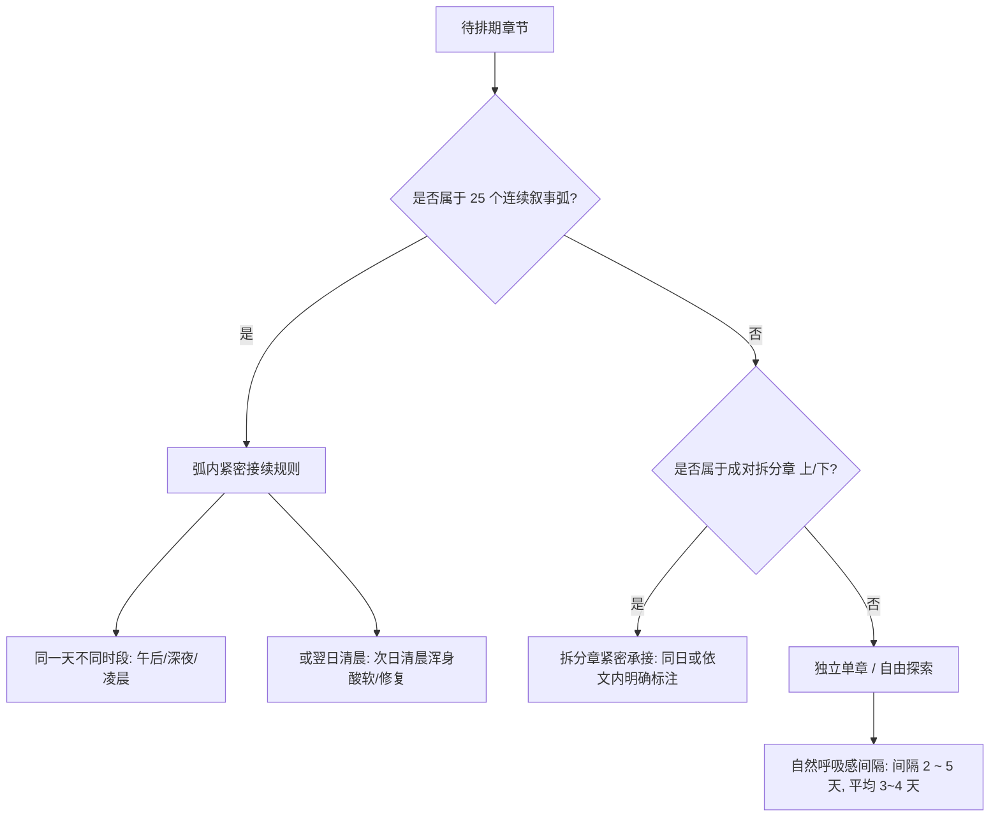

# 第一部章节时间线与时空标签排期规范

> **定位**：指导第一部（Eldoria 营地篇，共 937 章）各章节大纲首句时间地点标签（`【X月X日·时段·地点】`）的排期推演、生成规范与执行法典。  
> **长任务推进看板**：[`_章节时空标签长任务规划看板.md`](_章节时空标签长任务规划看板.md)（分阶段分批次、每批10章执行进度追踪）。  
> **核心联动依据**：[`_连续叙事弧线章节总览.md`](_连续叙事弧线章节总览.md)（判定连续时间与独立间隔的绝对权威源）。  
> **底层历法基准**：[`docs/world/_世界观概述.TXT`](../world/_世界观概述.TXT)（圣光纪年、每年 360 天、每月 30 天）。  
> **空间实体基准**：[`docs/location/`](../location/)（全量地点命名权威源，标签中地点必须精准对齐地点档案）。

---

## 一、 设计初衷与底层目标

在酒馆（SillyTavern）游玩推进过程中，大语言模型因上下文自回归机制，天然倾向于保持连贯推导，极易将相邻章节无脑编排为“同一天的清晨/中午/晚上”或紧邻的连轴转次日。这导致了严重的**“事件扎堆压缩病”**（短短几十天发生数百次重大战斗、背德出轨与冒险），破坏了西幻 RPG 的沉浸感与长周期生活流呼吸感。

**核心解决方案**：
直接在每个章节大纲情境 1 开头注入高优先级紧凑标签 `【X月X日·时段·地点】`。大模型读取到明确的日期跳跃（如从 5月30日 跳跃到 6月3日），会在叙事开篇主动交代时间推移（如“平静度过了数日后……”），彻底打破事件堆叠假象。

---

## 二、 历法基准与时间演进体系

* **世界历法**：圣光纪年（以第一缕圣光落地为元年），故事起点约为 3472 年 6 月 15 日。
* **四季划分**：
  * **萌芽季**：1 ~ 3 月
  * **繁荫季**：4 ~ 6 月
  * **金叶季**：7 ~ 9 月
  * **沉眠季**：10 ~ 12 月
* **每月天数铁律**：**每月固定 30 天**（全年共 360 天）。
  * 例：5 月 30 日的次日直接为 6 月 1 日，严禁出现 5 月 31 日。
* **标准时段分类**：
  * `清晨`、`上午`、`午后`、`傍晚`、`黄昏`、`夜晚`、`深夜`、`凌晨`。

---

## 三、 时空标签语法与插入规范

### 1. 文本格式
统一采用紧凑方括号格式，放置在情境 1 的最起始位置：
* **常规章节（含编号）**：
  ```yaml
  情境:
    - 1. 【5月30日·深夜·营地木屋】木屋里只亮着一盏昏黄小灯……
  ```
* **自由探索章节（无编号）**：
  ```yaml
  情境:
    - 【6月11日·午后·图书室】图书室里的午后光线从高窗斜进来……
  ```

### 2. 叙事冗余清洗
若原文情境 1 首句开头已有时间副词（如“深夜，……”、“黄昏时分，……”、“傍晚，……”），插入标签时将前导冗余时间副词自然吸纳或裁剪，保持散句清澈通顺。

### 3. 地点实体权威对齐法则（Grounding to docs/location）
标签中的“地点”字段**绝对严禁凭空自造未定义的虚构名称**，必须严格对应 [`docs/location/`](../location/) 及其下属具体物理功能子空间，确保酒馆在加载章节时能够精准联动唤醒地点设定条目：
* **营地生活区**：`营地木屋`、`木屋卧室`（[`木屋.TXT`](../location/木屋.TXT)）；`工坊`、`工坊卧室`（[`乔治的工坊.TXT`](../location/乔治的工坊.TXT)）；`图书室`（[`太古图书馆.TXT`](../location/太古图书馆.TXT) / [`书房.TXT`](../location/书房.TXT)）；`营地训练场`（[`训练场.TXT`](../location/训练场.TXT)）；`营地厨房`、`营地篝火`（[`营地篝火.TXT`](../location/营地篝火.TXT)）；`会议厅`（[`会议厅.TXT`](../location/会议厅.TXT)）；`公共浴厕`（[`公共浴厕.TXT`](../location/公共浴厕.TXT)）；
* **外部与部族据点**：`矮人小屋`、`矮人锻造工坊`（[`矮人岩丘.TXT`](../location/矮人岩丘.TXT)）；`低语林地`、`枯树根裂隙`（[`低语林地.TXT`](../location/低语林地.TXT)）；`银流河`、`银流河商道`（[`银流河.TXT`](../location/银流河.TXT)）；`月光岩`（[`银流河.TXT`](../location/银流河.TXT) / [`北方深林.TXT`](../location/北方深林.TXT)）；`艾德里安的府邸`（[`艾德里安的府邸.TXT`](../location/艾德里安的府邸.TXT)）；`光晶矿坑`、`太古石殿`、`圣光花田`、`圣光之泉`、`心木废墟` 等；
* **地点精度分层**：
  * 大场景：低语林地、银流河商道、月光岩；
  * 建筑室内：营地木屋、工坊、矮人小屋；
  * 微观私密场景：工坊卧室、木屋卧室、商道马车内。

### 4. 章内跨时空转场多标签机制（Multi-Tag Intra-Chapter Transition）
当单个章节内部存在显式时间跨度转折（例如情境 1 前半段为铺垫事件，后半段跨越数天转入核心正戏，如第 369 章前段劈石、后段赴约推拿）时，**完全允许在转折处插入第二个时空标签**：
```yaml
情境:
  - 1. 【7月8日·上午·银流河商道】雨季的山洪冲刷了银流河商道……艾德里安收起手中的撬棍，吹了声口哨赞叹亚尔赛德流的剑威。【7月10日·夜晚·营地木屋】两天后艾德里安托菲带信，邀劳拉前往营地边缘的木屋接受答谢……
```
* **效果**：大模型既能感知前段铺垫的发生时空，又能在转折时精准将镜头切换至两天后的深夜木屋，并与下一章 370（下）的 `【7月10日·夜晚·营地木屋】` 达成完美的 1:1 闭环对接。

---

## 四、 核心排期法则（连续弧 vs 独立单章）

排期时必须严格查验 [`_连续叙事弧线章节总览.md`](_连续叙事弧线章节总览.md)，依据章节性质动态决策时间间隔：



### 1. 连续叙事弧（In-Arc Chapters，绝对连续）
* 弧内章节（如弧 5 的 356~362、弧 6 的 372~379）属于高密度剧情链。
* **严格限制在 24~48 小时内发生**，通常为连续时段演进（深夜 → 凌晨 → 次日清晨）。
* 严禁在连续弧内部粗暴跨越多天！

### 2. 成对拆分章节（Split Chapters）
* 标题含 `（上）/（下）` 的成对章节，除正文明确交代“数天后”跨度外，默认属于同日同一场景的上下半场。若章内跨天，采用**章内双标签**实现平滑过渡。

### 3. 独立单章（Standalone Chapters，长周期呼吸感）
* 凡未被收录进 25 个连续弧的普通章节（如 350、351、353、355 等），属于漫长营地生活中的散落事件。
* **必须拉开 2 ~ 5 天（平均 3~4 天）的平静日常间隔**，给予角色巡逻排班、工坊研发、结界维护与休整的合理生理周期。

### 4. 自由探索章节（Free-Explore Chapters）
* 营地开放式漫游节点（如 354、365、368），间隔 2 ~ 3 天推进，多设定于清晨或午后的平静时刻。

---

## 五、 推进进度、日历台账与长任务看板

* **基准锚点**：以玩家实机游玩进度 **第 350 章 = 5月30日·深夜·营地木屋** 为绝对原点。
* **当前完成范围**：**第 350 ~ 370 章（共 21 章已全量落地并构建入库）**。
* **独立日历排期台账**：
  为保持规范文档轻量精炼，已注入章节的逐章时空台账（含日期、时段、地点、剧情类型与逻辑间隔）统一在独立日历档案中持续维护：
  👉 **[`_章节日历排期总表.md`](_章节日历排期总表.md)**
* **长任务规划看板**：
  全量 937 章分阶段分批次（每批次严格 10 章）长线排期追踪与断点交接看板：
  👉 **[`_章节时空标签长任务规划看板.md`](_章节时空标签长任务规划看板.md)**

---

## 六、 批次标准化作业执行指引（SOP 与三大铁律）

为避免长任务中“只读一遍规则导致后期规则遗忘”与“看标题偷懒猜时间破坏生活流”，每个批次推进必须严格执行以下三大铁律与标准化流程：

### 1. 三大硬约束
1. **【批次锁死】每批次严格限制 10 章**：严禁合并批次推进，确保大模型上下文深度与注意力聚焦；
2. **【强制重读】每批次启动必须重新查看本文档规范**：唤醒每月 30 天、时段分类、地点对齐与连续弧规则，坚决杜绝经验遗忘；
3. **【通读原文】每批次必须通读 10 章 `.TXT` 原文**：从正文物理环境、天气、体力恢复与转折中严谨推导，严禁仅看标题或搜关键字偷懒。

### 2. 标准 6 步作业闭环
1. **规则唤醒**：调用 `view_file` 重新完整阅读本文档；
2. **弧线核实**：调用 `view_file` 查阅 [`_连续叙事弧线章节总览.md`](_连续叙事弧线章节总览.md)；
3. **原文精读**：调用 `view_file` 逐章通读当前批次 10 篇 `.TXT` 原文；
4. **推衍排期**：结合上一批次末尾锚点计算日期与时段（独立单章间隔 2~5 天，连续弧锁定在 24~48h 内）；
5. **注入与验证**：写入文件情境 1 开头，登记入日历总表，终端运行 `check_consistency.py` 与 `build_eldoria.py`；
6. **看板同步**：更新 [`_章节时空标签长任务规划看板.md`](_章节时空标签长任务规划看板.md) 勾选状态并汇报。

