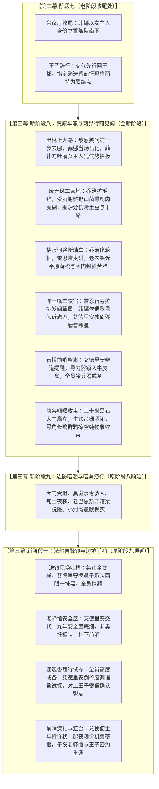

# 方案 07：第三幕扩充新增阶段八（荒原行商生活流）与全局接口对齐方案

> **所属模块**：第二部·主线与世界扩充方案 / 第三幕结构扩充与全书接口对齐  
> **定位**：第三幕由 2 阶段扩充为 3 阶段的宏篇详规方案。在大本营誓约与边境黑石大门危机之间，增设荒原行商公路生活流阶段；明确各剧情节点在老阶段与新阶段的具体落位位置；确立全书阶段顺延与接口统一规范。

---

## 一、 剧情节点具体落位与分阶段精准划分

为确保剧情逻辑严密、层次清晰，本次扩充涉及的全部剧情点明确划分至对应阶段与具体段落位置：

---

## 二、 逐阶段详细剧情内容与生动对白规范

### 1. 【第二幕·阶段七：两界交融定盟·森林深处巡礼与商队南下】（老阶段·收尾修改）
* **落位位置**：阶段七的第 4 节（会议厅全员誓约收尾）与第 5 节（数日整备·王子先行）。
* **具体修改内容**：
  * **菲娜女主人发言**：菲娜在长木桌主位被众人注视得小脸发红，挥起小拳头下达命令：明确交代奥蕾莉亚统帅和艾玛留守后方大本营照料，自己作为女主人必须亲自跟在黎恩身边随商队南下监督，必须把健康完整的雷恩和艾德里安带回家；
  * **朱利安临行暗线交代**：朱利安身为第一王储，受王室礼制约束，且受教会与要塞盯防，无法随民间粗布大篷车同行；他在会议定盟后先行辞行，轻骑走王室正规巡查路线回王都去忙正务（暗中调动忠诚旧部、取回母亲临终手札）。临行前朱利安向全员交代联络方式：
    > “维里迪亚王都暗流汹涌，我必须轻骑走王室常态路线先行赶回王都，没法跟着大篷车一起走。不过大家穿过边境大门到了法尔肯驿镇之后，直接去后街的‘迷迭香商行’找女主人玛格丽特夫人。她是我暗中信任、结盟多年的商界伙伴，我已经提前给她送去了王室密信与信物。到时候她不仅会帮大家把旧银币兑换成流通的便士、提供地下安全屋掩护，更会安排我们秘密碰头的具体时间与地点。”

---

### 2. 【第三幕·阶段八：荒原车辙与两界行商见闻】（全新阶段·全篇详规）
* **落位位置**：第三幕第 1 阶段，全新独立篇章。
* **独立事件 1：荒原启程与菲娜凭气势拍板大吐槽**  
  两辆满载粗羊毛与硬干酪的双马大篷车压过南境石溪木桥，驶入冷风呼啸的开阔荒原。  
  黎恩一边拉着缰绳，一边转过头，温和地笑着看向身旁裹着灰亚麻斗篷的精灵守护者：“女主人，既然我们已经到了维里迪亚地界……作为带队的女主人，咱们第一步计划具体怎么走呀？”  
  菲娜整个人瞬间石化。  
  少女眨巴眨巴清澈漂亮的大眼睛，小脑袋僵硬地一点点转过去，眼神飘忽地看向窗外光秃秃的枯树枝，白皙的小脸腾地一下涨得通红，有些心虚地结结巴巴道：“……欸？第一步？那、那个……我刚才在会议室不是说了嘛，要……要齐心协力往前走呀！”  
  后排草垛里，菲冷不丁探出一颗小脑袋，面无表情地咬了一口手里的脆苹果，平淡地直接补刀：“……教官，菲娜姐当时在会议厅，纯粹是靠着女主人的威风和气势拍板的。其实她连维里迪亚有几个镇子都没记全。”  
  菲娜顿时像被踩了尾巴的小猫一样，耳根通红，鼓起软乎乎的腮帮子，有些害羞又有些着急地轻轻捶了黎恩胳膊一下，小声抗议：“菲！笨蛋黎恩，你嘴角都在偷笑了，不许笑！我……我虽然不认路，但我有直觉！直觉告诉我顺着车辙往前走肯定没错啦！”  
  车厢里充满快活温暖的笑声，出征初期的紧绷感随风散开。

* **独立事件 2：废弃风车营地的露营生活流**  
  暮色四合，荒原气温骤降，冷风呼呼直吹。车队拐入废弃石砌风车磨坊背风处扎营。  
  乔治熟练卸下两匹挽马，在车轮外侧拉起厚实的防风毛毡；爱丽榭在避风的厚石壁下生起干燥柴火，架起轻便的小铜锅，慢慢熬煮大本营带来的风干野山菌、熏鹿肉丁与燕麦浓糊；铁网边烤着切成小块的耐储干酪与土豆。  
  滚烫浓郁的白汽在冷风中飘散开来，香气扑鼻。菲娜裹着深灰斗篷，小巧的鼻子冻得微红，两手捧着热陶碗小口喝着野菌麦糊，两颊泛起暖融融的红晕。少女在长凳下轻轻碰了碰黎恩的靴子，小声赞叹爱丽榭的手艺真好；黎恩细心地用短刀切开烤熟的土豆，分给菲娜、爱丽榭和同伴们，大家围在柴火堆旁分食热气腾腾的晚餐，感受着属于同伴之间的踏实温情。

* **独立事件 3：路遇断轴流民板车（老农与平原苛税）**  
  次日正午车队行至枯水河谷，路边横着一辆木轮断裂倾覆的破旧板车，一家衣衫褴褛的老农和妇孺冻得在冷风里瑟瑟发抖，车上的粗麻袋散落一地。  
  乔治热心地跳下马车，从工具箱里取出沉重的铁锤与备用生铁长钉，手脚麻利地替老农加固打磨好断裂的桦木轮轴；雷恩温厚地递上两块大本营带来的耐储麦饼。  
  老农捧着热饼老泪纵横，连连躬身道谢，向大家讲出边境的真实惨状：今年教会在中西部强占平原肥沃的麦田当免税采邑，大门关卡的税吏更是按马车轮轴硬抽三成重税；普通自耕农交不起租粮，只能变卖农具逃难北上，谁知边境大门早早戒严不准放行，大家全被堵在谷口挨冻挨饿。底层平民受压迫的真实风土自然呈现。

* **独立事件 4：冻土篷车温存与星空守夜**  
  深夜初冬的小冻雨淅淅沥沥敲打着大篷车的厚油布，荒原格外寒冷寂静。乔治在车架外挂好防风皮帘。  
  车厢里点着一盏微弱的防风马灯。雷恩温厚地坐在木板床边，小心翼翼地替劳拉挑去长发上沾着的碎麦草屑；劳拉高挑的身躯裹着厚毛毯，脸颊微热，在昏暗光线中轻轻靠在丈夫结实的手臂旁，低声叮嘱雷恩也多穿件皮背心。  
  另一角，菲蜷缩在厚毛毡里像只小猫一样发出安稳微弱的呼噜声；菲娜依偎在黎恩怀里，纤细的手指抓着黎恩的衣角，把有些发凉的脸颊贴在黎恩颈间，小声坦白自己作为异界精灵来到这片陌生苦难的大陆，其实心里一直很忐忑，很害怕自己帮不上大家的忙；黎恩在阴影中温柔搂紧少女纤细柔嫩的腰肢，低下头轻吻她的发顶，在她耳边温声宽慰打气，让菲娜彻底定下心来。  
  车厢外，艾德里安披着破旧斗篷倚在风车站残墙边，小口抿着酒壶里的冷酒，抬头凝望着南方地平线上漫天闪烁的寒星。浪子脸上的轻浮彻底收敛起来，眼睛里倒映着故土的星光，流露出身为归乡者的深沉心绪。

* **独立事件 5：石桥辨道与前哨整肃**  
  第三日清晨霜白覆野，两辆双马大篷车平稳驶过荒原南部的古老单孔青石桥。  
  艾德里安指着前方隐隐起伏的黑石峡谷，神情恢复了商人特有的机敏从容，向全员交代前行方略：“前面就是黑石峡谷的咽喉地带了。朱利安王子走王室公差轻骑回王都安排手札与旧部，咱们不用指望明面上的王家接待。大门过去十公里就是法尔肯驿镇，按王子给的底细，镇上的迷迭香商行玛格丽特夫人是王室盟友，加上我当年跟她也有过过命的行商交情，只要能顺利过关，咱们的第一站落脚点和流通便士就有着落了。”  
  乔治再次逐一检查全员死死锁入双层牛皮遮蔽盒的 ARCUS 战术导力器，确认零导力光芒外泄；黎恩握紧腰间木鞘太刀，劳拉背负双手大剑，全员神情严肃进入戒备状态。

* **独立事件 6：黑石大峡谷巨门矗立（纯物象收束）**  
  双马大篷车拐过黑石峡谷最后一道陡峭的花岗岩转角。  
  凛冽刺骨的谷风扑面而来，两侧三十米高的喀斯特青黑石壁如巨刃插天，一座厚重狰狞、包覆着生铁吊栅的三十米青黑巨石门楼（维里迪亚大门）冷冷横亘在峡谷咽喉正中央；门楼上生铁火炬盆冒着滚滚黑烟，圣殿白鹰旗与王家双头狮旗在寒风中猎猎作响。  
  门外泥泞的洼地里，数百顶黑发烂的棚户散发着酸腐气味，一排排粗亚麻马车堵在紧闭的生铁吊栅外，沉重的关卡钟声当的一声自崖壁顶端敲响，惊起群鸦掠过阴沉沉的铅灰色天际。

---

### 3. 【第三幕·阶段九：边防暗潮与暗渠潜行】（老阶段顺延·原阶段八）
* **落位位置**：第三幕第 2 阶段，由原阶段八顺延更名而来。
* **具体剧情承载**：
  * 完全保留原剧情：边境大门三十米巨石门楼受阻检查、贫民窟黑斑水毒暴发、达米安焚营指令与巴恩斯对峙、爱丽榭解毒草药囊与菲娜温和救提米、暴雨夜零导力冷兵器协同击退死士刺杀、缴获首件铁证黑血铅管（EVD-01）、老巴恩斯相认开启古代石砌泄洪暗渠放行、暗河涉水脱险、小河湾车厢换干衣服擦发温存轻吻、爱丽榭煮香草茶烤麦饼晨歇远眺；
  * **前置接口对齐**：开头无缝承接新阶段八末尾黑石峡谷巨门阴影。

---

### 4. 【第三幕·阶段十：法尔肯驿镇与边境前哨】（老阶段顺延·原阶段九）
* **落位位置**：第三幕第 3 阶段，由原阶段九顺延更名而来。
* **具体位置的精准修改**：
  * **第 1 节（入镇现场：吐槽艾德里安两眼一抹黑）**：
    - 双马篷车驶入法尔肯驿镇，看着街巷里四处游弋的圣殿巡逻骑士、被拆掉改建的商摊与混乱的新路标，全车人把目光齐刷刷投向坐在车辕上的艾德里安：“大商人，到了你当年跑了十几年商的法尔肯了，接下来怎么走？哪条路安全？怎么找住处？”
    - 艾德里安尴尬地抓了抓有些凌乱的银灰长发，摸着鼻子干咳两声：“咳……这个嘛，我好几年没回法尔肯了，街巷全被教会折腾得面目全非，新立的哨卡我一个都没见过……其实我现在也两眼一抹黑。”
    - 亚莉莎一拍脑门：“……哈啊？！你刚才在荒原上吹得那么响，合着进了镇子还是两眼一抹黑？！”
    - 黎恩单手扶额，在心里默默按下了吐槽键：`（……原本还以为这老浪子进了城镇就能轻车熟路，搞了半天大家全员依然是两眼一抹黑啊！）`
    - 艾德里安赶忙干笑着摆手，凭着旧记忆指引车队避开巡骑、钻入潮湿背巷，并在车厢驶入夹道时压低声音交代老驿馆是十九年前家族安全屋的底细；
    - 进入“猎鹰与十字”老驿馆，老奥托认出商牌私印相认，二楼套间与暗梯安全屋扎根。
  * **第 3 节（迷迭香商行：谨慎试探与密信对账）**：
    - 晚餐后艾德里安带黎恩前往后街迷迭香商行。路上艾德里安提醒黎恩，虽然朱利安王子做过交代，但他几年未回，教会高压下吃不准玛格丽特是否变质、周围有无暗哨，全员保持高度戒备；菲在屋脊索敌，黎恩按刀随行；
    - 艾德里安进门后先用昔日倒爷熟人的调侃试探虚实：“哎呀，这几年大门查得这么紧，我还以为夫人早就被教会的神棍们收编当大财主了呢。”
    - 玛格丽特白了他一眼轻啐“少拿吸血神棍恶心我”，确认玛格丽特反感教会并暗中对上王子的密信信物后，艾德里安才彻底放下戒备，双方坐下对账；
    - 玛格丽特当面兑付三百枚紫铜便士与《香料运送特许状》，开启地下深石暗窖第二据点；
  * **第 4 节与第 6 节（情报咬合与王子会合）**：
    - 玛格丽特揭露罗曼商行垄断麦粉暴涨四成，老铁匠乌尔里希密告中西部焦土废墟机兽齿轮南下；
    - 子夜朱利安王子依约在老驿馆会合，奉还十九年前手札与忠仆册（EVD-03），恢复雷恩骑士名誉，签署《生态保护敕令》，蚕豆沙盘推演确立四路分兵大战略，拂晓分道启程，圆满交接第四幕（新阶段十一）。

---

## 三、 全书阶段编号顺延与母案对齐架构

### 1. 全书各幕阶段编号顺延表（纯净整数线性递增）

| 幕次 | 包含阶段编号 | 阶段总数 | 核心主题 |
| :--- | :--- | :--- | :--- |
| **第一幕** | 阶段一 ~ 阶段三 | 3 个阶段 | 破晓之森与破冰初探 |
| **第二幕** | 阶段四 ~ 阶段七 | 4 个阶段 | 密林往返·烟火人间与融冰结交 |
| **第三幕（扩充）** | **阶段八 ~ 阶段十** | **3 个阶段** | **边境暗潮与平原立足（新增荒原行商）** |
| **第四幕** | 阶段十一 ~ 阶段十四 | 4 个阶段 | 分道巡礼·虚妄的线索（原阶段十~十三顺延） |
| **第五幕** | 阶段十五 ~ 阶段十八 | 4 个阶段 | 王都商路·繁华市井与暗潮生活流（原阶段十四~十七顺延） |
| **第六幕** | 阶段十九 ~ 阶段二十一 | 3 个阶段 | 血色伏击·至暗大溃败（原阶段十八~二十顺延） |
| **第七幕** | 阶段二十二 ~ 阶段二十四 | 3 个阶段 | 绝境流亡·篝火重铸与艾斯特雷亚之誓（原阶段二十一~二十三顺延） |
| **第八幕** | 阶段二十五 ~ 阶段二十七 | 3 个阶段 | 深渊古道·暗河谍影与地底破壁（原阶段二十四~二十六顺延） |
| **第九幕** | 阶段二十八 ~ 阶段三十 | 3 个阶段 | 惊天劫狱·血洗圣殿死牢（原阶段二十七~二十九顺延） |
| **第十幕** | 阶段三十一 ~ 阶段三十三 | 3 个阶段 | 王都暗流·沙龙旧卷与法理围城（原阶段三十~三十二顺延） |
| **第十一幕** | 阶段三十四 ~ 阶段三十六 | 3 个阶段 | 王都异化·双城合围决战（原阶段三十三~三十五顺延） |
| **第十二幕** | 阶段三十七 | 1 个阶段 | 破晓大审判与黎明宪章（原阶段三十六顺延） |

全书总阶段数由 36 个扩为 37 个，各幕内部剧情承载完全稳定。

---

## 四、 文件变动执行清单与对齐 SOP

落地执行时，按以下严格顺序原子化执行：

1. **新建详规文件**：
   * 创建 `方案/第二部/主线与世界扩充方案/分阶段详规/03_第三幕_边境暗潮与平原立足/阶段八_荒原车辙与两界行商见闻详规.md`；
2. **第三幕详规重命名与内容同步**：
   * 原 `阶段八_边防暗潮与暗渠潜行详规.md` ➔ 重命名为 `阶段九_边防暗潮与暗渠潜行详规.md`，标题改为【阶段九】，前置承接阶段八；
   * 原 `阶段九_法尔肯驿镇与边境前哨详规.md` ➔ 重命名为 `阶段十_法尔肯驿镇与边境前哨详规.md`，标题改为【阶段十】，植入入镇吐槽艾德里安与商行密信试探；
3. **第四幕至第十二幕详规文件名与标题批量平移**：
   * 针对 27 个分阶段详规文件，执行文件名与内部第一行标题编号统一 `+1`；
4. **母案大纲全局统一对齐**：
   * 更新 `00_第三幕大纲与接口.md`，确立阶段八、九、十，更新前后置契约；
   * 更新 `01_宏篇主线剧情总大纲与分幕导航.md`，刷新全书 37 阶段总表；
   * 更新 `00_第二部宏篇主线总纲与方案管理中枢.md`，刷新阶段区间表与统计数据；
   * 更新 `06_第二部主线跨幕连续性与全局物理状态机.md`，刷新物理证物（EVD-01~06）阶段映射；
   * 更新第四幕至第十二幕各幕大纲文件（`00_第四幕大纲与接口.md` ~ `00_第十二幕大纲与接口.md`）中的阶段编号与超链接；
5. **质量扫描与一致性复核**：
   * 运行 `python scripts2/scan_viridia_diseases.py` 确保 100% 纯度无违规词；
   * 校验全库超链接，确保零死链、零接口断层。
