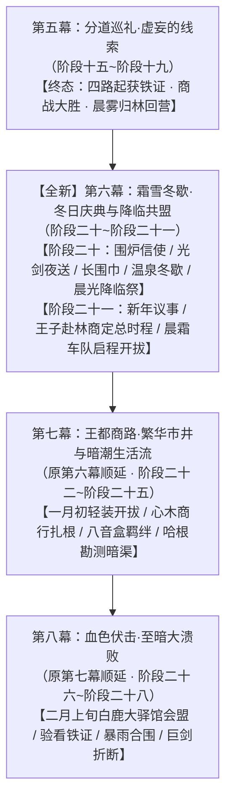

# 临时方案：全新第六幕·霜雪冬歇·冬日庆典与降临共盟总体规划方案

> **所属母案**：[00_第二部宏篇主线总纲与方案管理中枢.md](主线与世界扩充方案/00_第二部宏篇主线总纲与方案管理中枢.md) · [01_宏篇主线剧情总大纲与分幕导航.md](主线与世界扩充方案/01_宏篇主线剧情总大纲与分幕导航.md)  
> **设定库参考基准**：本方案全程以 `docs2/` 实体设定档案库为第一权威基准，相关地点、角色与事件实体严格对齐以下卡片：
> - 地理：`LOC_D2_01` 营地篝火与大食堂 · `LOC_D2_02` 镜湖与林间温泉 · `LOC_D2_11` 法尔肯驿镇 · `LOC_D2_43` 猎鹰与十字老驿馆 · `LOC_D2_18` 白金王宫地下密室 · `LOC_D2_31` 白鹿大驿馆 · `LOC_D2_44` 心木商行
> - 角色：`CHR_D2_06` 黎恩 · `CHR_D2_04` 菲娜 · `CHR_D2_01` 艾德里安 · `CHR_D2_02` 劳拉 · `CHR_D2_03` 雷恩 · `CHR_D2_18` 朱利安 · `CHR_D2_07` 亚莉莎 · `CHR_D2_08` 菲 · `CHR_D2_09` 乔治 · `CHR_D2_11` 亚尔缇娜 · `CHR_D2_10` 爱丽榭 · `CHR_D2_12` 奥蕾莉亚 · `CHR_D2_05` 艾玛
> - 异族领袖：多尔金（长兄·锻造大师）· 哈根（二哥·建筑工程）· 法林（三弟·魔法工匠）· 鳞母与加尔（蜥蜴人）· 月语者与罗恩（狼人）
> - 核心节庆：沉眠季深冬·【晨光降临祭】（全境与各族最盛大的跨年新年盛典，严格遵循西幻与晨光大陆专属历法）
> - 距离基准：大本营→大门15km；大门→法尔肯10km；法尔肯→王都110km；白鹿大驿馆位于平原大道中段（距王都约90km）

---

## 〇、 方案定位与阶段十九收束改名说明

### 1. 阶段十九收束点重界定与改名
* **原方案症结**：原阶段十九试图在法尔肯商战刚刚打完的同一阶段内，紧接着塞入大本营庆功、信使往还、朱利安老驿舍碰头、亚尔缇娜光剑夜飞王宫、长围巾、大公会盟时程揭晓以及车队启程奔赴王都等七重大戏，导致时空连续过于仓促，剥夺了四路巡礼大胜后应有的深冬冬歇呼吸感；
* **阶段十九精准收束点**：
  - 阶段十九正文严格收束于法尔肯粮仓防守战大捷、公秤官收押纵火打手并查封商馆、四路铁证齐聚：
  > “清晨破晓，大车行粮仓的纵火打手被全部押入法尔肯市政地牢，罗曼商行的全部货栈与商馆被铁锁牢牢查封。四路独立巡礼历经数周严冬奔波，四大核心物理铁证完好无损地汇流齐聚，法尔肯的民心与粮道也彻底安定。为了避免在人多眼杂的驿镇过早暴露行迹，黎恩、菲娜、雷恩、劳拉、艾德里安、菲、乔治、亚莉莎与罗恩一行，在晨雾掩护下将四大铁证安全护送回仅数公里之遥的 Eldoria 大本营休整。晨曦穿透林间薄雾，车轮踏碎积雪，四路凯旋的身影渐渐融入苍茫风雪与古树密林之中。”
  - **到此为止，第五幕·分道巡礼·虚妄的线索正式胜利收官！**
* **阶段十九更名对齐**：
  - 原文件名：`阶段十九_公秤仲裁与晨霜启程·复式商战与光剑密送详规.md`
  - **正式重命名为**：[`阶段十九_公秤仲裁与晨雾归林·复式商战与粮道大捷详规.md`](主线与世界扩充方案/分阶段详规/05_第五幕_分道巡礼·虚妄的线索/阶段十九_公秤仲裁与晨雾归林·复式商战与粮道大捷详规.md)
  - 核心任务：彻底聚焦暗窖复式记账攻坚、市政公秤长廊公开仲裁、大车行粮仓夜战破阵生擒打手、以及四路铁证晨雾归林休整。

### 2. 原后续剧情全量无损迁移至【全新第六幕】（100% 照抄原版正文，绝不漏掉任何剧情）
* 原阶段十九后续的**围炉休整、信使密约、朱利安老驿舍取证、亚尔缇娜战术壳光剑高空夜驰王宫送证、爱丽榭两米一五深蓝长围巾毛毛虫趣话、以及晨霜轻装车队启程向王都**等精彩剧情，**100% 完整原封不动照抄收录至【全新第六幕】**；
* 结合深冬大雪封山的时节风土，融入露天温泉、雪地嬉戏与沉眠季末期【晨光降临祭】盛大狂欢，并在新年一月初由朱利安王子深入大本营会议厅正式定锚大公会盟（2月上旬）与王都大商路总时程，随后从容启程！

---

## 一、 幕级拓扑重构与时序衔接

* **时序跨度**：圣光历3472年沉眠季12月下旬至3473年萌芽季1月上旬（跨越约两周半时间）；
* **前置输入（承接第五幕·阶段十九）**：
  - 空间：法尔肯南部荒原雪道 ➔ 晨光大门 ➔ Eldoria大本营；
  - 状态：法尔肯粮仓保卫战全胜，四大物理铁证齐备并由全员在晨雾掩护下护送回大本营；
  - 资产：教廷秘库工匠主齿轮原本（EVD-04）、平民受创救治病历与黑血毒理分析手稿原本（EVD-05）、心木枯萎碳化残根原本（EVD-06）、黑市洗钱账本全卷；全套合规通关凭据与法尔肯商战缴获账册。
* **后置交付（交接第七幕·王都商路）**：
  - 空间：Eldoria大本营 ➔ 晨光大门 ➔ 法尔肯北门中央王都大道；
  - 状态：四大铁证已由亚尔缇娜光剑高空隐匿安全封存入王宫机密石室，商队全员轻装上阵无携带违禁物风险；全员在冬歇中完全恢复精气神，明确掌握白鹿大驿馆大公会盟（2月上旬）与法理大审判的总战略，四轮重型大篷车整备完毕；
  - 承接点：新年一月初，商队轻装踏上中央王都大道，正式驶向王国心脏，进驻王都下城区设立“心木商行”！

---

## 二、 全新第六幕分阶段演进蓝图（全量继承与原版照抄）

本幕由 **2 个长线演进阶段** 构成（阶段二十至阶段二十一）：

### 阶段二十：铁证密送与庆典冬歇·光剑夜驰与【晨光降临祭】
* **所属幕次**：第六幕·阶段二十
* **时间定锚**：圣光历3472年沉眠季12月下旬（约十天）
* **核心剧情演进**：

#### 1. 大本营围炉温情与数日后的信使密约（原文字 100% 照抄继承）
大本营指挥木屋的大食堂内，石砌大壁炉里的松木与耐烧栎木大柴烧得通红旺盛，噼啪作响，融融暖意瞬间驱散了全员身上的朔风严寒。留守组同伴们齐齐迎上前——奥蕾莉亚统帅端坐在长桌主位从容点头，爱丽榭与亚莉莎很快端来了一大锅热气腾腾、飘散着迷迭香与干酪清香的野山菌羊肉炖汤，还有刚出炉的黄油黑麦软面包和温热的丁香肉桂苹果红茶。  
围坐在厚木长桌旁，大家痛痛快快地享受着难得的放松。菲捧着大陶碗小口喝汤，整个人惬意地陷在毛茸茸的羊毛软垫里，舒服得像只冬日暖阳下的小猫；多尔金与哈根大口灌着黑麦酒粗豪大笑，法林细心擦拭着器械，玲咬着甜苹果干调皮打趣，凯尔与艾玛微笑着记录文献，整个大食堂洋溢着属于同伴凯旋的浓厚烟火呼吸感。  
大伙儿在大本营踏实歇息了数日。由于罗曼商行分号主管已逃往王都报信，四大铁证体积沉重且属于致命违禁物，如何安全送达王都一直是必须解决的难题。黎恩与艾德里安通过法尔肯迷迭香商行玛格丽特夫人的王室绝密信道，给王都的朱利安王子捎去了暗信，商榷物证交割对策并顺便邀请王子来营地一同喝上两杯。  
数日后，玛格丽特夫人派心腹近卫送来了朱利安王子的亲笔火漆密信。在密信中，朱利安解释道：自己身处王都，教会主教与异端审问厅达米安的眼线盯得极紧，现在大张旗鼓赶去森林大本营实在太过麻烦，已经来不及参加营地的庆功宴会了；但他已经做好了周密安排，自己有绝对的办法瞒过教会眼线微服脱身，与大家定于次日子夜在法尔肯“猎鹰与十字”老驿舍二楼大套间碰头，当面验看并取走四大铁证！  
既然王子有周全的脱身把握并定下取证之约，众人心中大定，在大本营将四件铁证与装备全面检修妥当。到了与王子约定的次日夜里，主角团带着四大铁证再次秘密进驻法尔肯“猎鹰与十字”老驿舍二楼套间，静候王子的到来。

#### 2. 铁证归拢与光剑夜驰（原版正文 100% 照抄继承，不漏一字）
子夜过半，法尔肯“猎鹰与十字”老驿舍二楼的大套间内，石壁炉的炭火泛着宁静的暗红微光。  
粗栎木长桌中央，四路调查组连日奔波起获的四大核心铁证，在厚羊毛毡上整齐排开：  
1. 西线艾德里安与菲斩获的【教廷秘库工匠序列号青铜主齿轮原本（EVD-04）】；  
2. 西南线雷恩与劳拉起获的【平民受创救治病历与黑血毒理分析手稿原本（EVD-05）】；  
3. 南线黎恩与菲娜自黑帆快船底舱截获的【三十一年前心木树枯萎碳化残根（EVD-06）】；  
4. 潮汐草泽水上货栈破拆缴获的【黑市洗钱账本全卷与大贵族往来密卷】。  
木门轻扣两声，身披深灰旅行斗篷的朱利安在两名贴身亲信的护卫下悄然推门而入。此前在阶段十五双方已结下深厚血盟，此番朱利安特意秘密赶赴法尔肯汇合，查验调查战果。当年轻王子的目光落在长桌上并排陈列的四重铁证上时，呼吸不由自主地微微停滞，修长的手指轻轻触碰着冰冷的青铜齿轮与泛黄病历，眼中浮现出难以抑制的震动与庄重。  
“三十一年的黑幕……终于在这里拼凑出了无可辩驳的真相。”朱利安的声音低沉而肃穆。  
然而，战术瓶颈随即摆在眼前：罗曼商行主管已仓皇逃往王都报信，达米安统领的审问厅斥候与税卡卫兵必定在王都各城门与外围货栈严密布控。如果商队拖着四辆大篷车、试图把这些沉重可疑的禁忌物证夹带入城，稍有差池便会引发开箱严查，招致灭顶之灾。  
“整个王国境内，眼下唯一绝对安全的地方，只有白金王宫地下的王室机密石室（`LOC_D2_18`）。”朱利安蹙眉分析道，“父王在深宫内暗中留存了十八年黑账，在没有彻底撕破脸皮发动武装叛乱前，教会和圣殿的爪牙绝不敢擅闯父王的内闱搜查。但法尔肯距离王都整整一百一十公里，沿途哨卡森严，如何能避开所有眼线把我和这批铁证送回王宫？”  
“——如果是运送物资与人员，克劳·索拉斯可以提供战术支援。”  
一直安静站在窗边的亚尔缇娜平淡开口。小巧的少女抬起纤细的手腕，随着便携终端的微弱提示音，通体银白、线条流畅的【战术壳·克劳·索拉斯】在空气中无声浮现，悬浮在半空之中。  
亚尔缇娜面无表情地抬起头，淡定地汇报参数：“克劳·索拉斯已解除飞行限制。开启光学折射迷彩与高空降噪力场后，可搭载两名乘员与五十公斤物资；自法尔肯经云层上方直飞王宫后方隐秘露台，航程约需十八分钟。被地面目击与拦截的概率为零。”  
乔治赞许地点了点头，迅速从行囊里取出两只特制双层防震铅板手提箱，将四件铁证妥善卡紧在阻燃内衬中，牢牢锁入战术壳侧面的防震挂架。  
朱利安半信半疑地系紧斗篷，跨坐在战术壳后座的乘员固定位上。  
伴随着透明气流护罩的合拢与光学迷彩的瞬间激活，克劳·索拉斯化作一缕连夜视都无法捕捉的微弱波动，自天井无声垂直拔地而起，径直穿透风雪，刺入茫茫天幕！  
接下来展开的，是一段让年轻王子毕生难忘的高空飞行。  
战术壳在数千米的高空云层之上以极其惊人的速度破空巡航！脚下被撕裂的茫茫雪云如狂潮般飞退，狂风在无形气流护罩外发出凄厉刺耳的呼啸。平素只骑过战马与双马大车的朱利安何曾见识过这种来自塞姆利亚大陆导力工业顶峰的非凡机械！向下俯瞰，平原山峦如同一张被急速扯向后方的黑白幕布，强烈的失重与超高速冲击让年轻王子吓得脸色惨白、浑身紧绷得如同一块坚硬的玄武岩，两手死死攥着战术壳冰冷的生铁合金扶手，骨节因为过度用力而发白，牙关止不住地上下打颤：  
“亚、亚尔缇娜小姐……！这、这速度是不是太快了点……？！我们……我们真的不会直接掉下去吗……？！”  
而在前排操控席上，娇巧的亚尔缇娜整个人宛如一尊精致的陶瓷人偶，全程维持着毫无波澜的面瘫扑克脸。少女清澈明亮的大眼睛平静地注视着屏幕上的高度仪与风阻数值，头也不回地用平缓清脆的声线淡定回复：  
“回答殿下：目前飞行巡航速度仅为额定功率的百分之六十五，属于极度平稳的低速巡航状态。另外，请殿下尽量闭紧嘴唇，以免寒冷气流倒灌入呼吸道引发剧烈咳嗽。”  
朱利安吓得赶紧把嘴闭死，整个人在凛冽的高空寒风中度过了人生中最漫长、最心惊肉跳的十八分钟。  
“——目标抵达。开始减速下降。”  
伴随着气流护罩的微弱轻响，战术壳如同一滴无形的雨滴，轻巧平稳地降落在白金王宫后山深处与密室相通的大理石悬空高台上。  
光学迷彩悄然解除，朱利安踩在坚实的石板地面上，两条腿几乎脱力发软，本能地一把扶住旁边雕花的大理石立柱，靠在石柱上大口大口喘着粗气，胸口剧烈起伏，冷汗几乎将内里的羊毛衫全部浸透。  
亚尔缇娜动作利落地将两只沉重的防震铅箱卸下，稳稳递到朱利安面前。看着眼前这位平日里尊贵从容、此刻却靠着柱子瑟瑟发抖的年轻王子，亚尔缇娜歪了歪小脑袋，清澈的大眼睛轻轻眨了一下，用平板冷淡却分明透着体贴关怀的语调，丢出了一句可爱的即时吐槽：  
“根据战术壳生理监测指标……殿下的心跳速率已达每分钟一百六十八次，双腿肌群处于轻度痉挛状态。为了王国的稳定与未来的法理大审判，建议殿下立刻饮用加糖温热红茶并卧床就寝，请勿继续靠在石柱上发抖……那么，祝您晚安，王子殿下。”  
朱利安靠着立柱愣了片刻，苍白的面庞上终于忍不住浮现出一抹又好笑又感激的苦笑：“呼……真是毫不留情呢……不过，谢谢你的关心，亚尔缇娜……你也路上小心。”  
亚尔缇娜轻轻欠身行礼，转身轻巧跃回战术壳。克劳·索拉斯重新化为无形微光，垂直破空而起，无声消失在茫茫夜色之中。  
朱利安提起两只铅箱，转身推开王宫密室的花岗岩暗门，将这批即将撕碎教廷伪装的致命铁证，稳妥安置在深宫秘格之中！

#### 3. 围巾温情与毛毛虫趣话（原版正文 100% 照抄继承，不漏一字）
大套间的角落里，收拾停当的旅行皮行囊整齐靠在长木椅旁，空气中弥漫着烤苹果与燕麦红茶的暖香。  
出发前夕，亚莉莎双手抱着那个大包裹快步走到黎恩面前，把包裹硬生生塞进黎恩怀里，双手叉腰故意板起小脸：“喏！拿着！这是爱丽榭特意让亚尔缇娜用光剑给你空运送过来的！”  
黎恩有些茫然地解开包裹，双手将那条又厚又长、毛茸茸的深蓝长围巾在房间里完全抖开。两米一五的夸张长度几乎从长桌的一头拖到了另一头，黎恩忍不住抓了抓头发苦笑自嘲：“这、这也太长了吧……围在脖子上整个人都要被埋进去了，感觉就像一条深蓝色的毛毛虫啊……”  
菲整个人懒散地缩在高背木椅里，晃荡着细长的双腿，面无表情地面瘫补刀：“……大毛毛虫。教官看起来很好吃。”  
长桌旁的同伴们顿时爆发出善意的哄堂大笑。  
亚莉莎见状耳尖唰地红透了，像只炸毛的小猫般双手叉腰，气鼓鼓地跺了跺脚娇嗔威胁：“笨蛋黎恩！你居然敢嫌弃爱丽榭的心意？！这可是她熬了好几个晚上亲手织出来的！你要是敢不围上，今晚我就让罗恩追着咬你哦！”  
罗恩在旁边温和地晃了晃毛茸茸的狼尾巴，苦笑着偏过脸表示无辜。  
菲娜双手捧着陶杯，清澈的琥珀色双瞳里满是宠溺与笑意，柔声打趣：“好啦好啦，黎恩快戴上吧，外面天寒地冻的，有爱丽榭的温暖守护多安心呀~”  
被大家调侃逗弄，黎恩无奈地温和一笑。他收起玩笑的神色，动作格外轻柔地将深蓝长围巾在脖颈上工整地绕了两个厚实的保暖圈，将毛茸茸的流苏抚平，整个人在深蓝风衣与厚实围巾的包裹下更显精神挺拔。  
黎恩揉了揉温暖的流苏，看着身侧欢声笑语的同伴们，心中唯有守护彼此的踏实暖流。

#### 4. 踏雪归营与镜湖露天温泉
铁证已被亚尔缇娜安全密送入王宫密室，法尔肯民生安定。此时已入深冬，凛冽朔风呼啸，漫天暴风雪渐渐封冻了北上平原大道的长途行旅。众人向玛格丽特夫人道别，驾驶四轮重车踏碎积雪，安然返回白雪皑皑的 Eldoria 大本营休整过冬。  
暮色渐浓，大本营后山镜湖旁的天然石砌温泉池蒸腾起大片白蒙蒙的热汽，与池边松针上的积雪相映成趣。经历了连续数周长途奔波的劳顿，黎恩与菲娜在安静的泉池中洗去风尘。菲娜一头金发用木簪随意挽起，白皙剔透的肌肤在温热泉水中泛着娇嫩的粉红。320岁的精灵守护者舒适地舒展着纤细优美的身躯，像只吃饱喝足的小猫般依偎在黎恩身侧，琥珀色的大眼睛里满是通透柔和的温情。两人轻声耳语，聊起海港暗舱的惊险与法尔肯商战的完胜。黎恩温和调侃菲娜在海港假扮商人少妇时的娇媚神态，惹得菲娜又羞又气，伸出纤足在水下轻轻踢了黎恩一脚，嗔怪他“越来越会捉弄人了”；黎恩笑着握住她浸在水里的白皙小脚拉入怀中，两人在漫天飞雪与温热泉水中享受着属于老夫老妻的极致静谧与安心依赖。

#### 5. 雪地嬉闹与沉眠季末期【晨光降临祭】全营狂欢
白昼的林间空地变成了欢乐的海洋。玲团起大雪球出其不意地砸在法林的后脑勺上，引得矮人三弟嗷嗷直叫；菲轻盈地跃上大树枝头，抓起一把把积雪精准投掷，把乔治的大胡子染得雪白；亚莉莎双手叉腰指挥着罗恩堆砌巨大的雪狼雕塑，结果被雷恩不小心弄塌了半边，逗得全场哄堂大笑。傍晚的大食堂长桌上摆满了不可思议的丰盛美食：矮人特制的炭烤羊排外焦里嫩、油脂滋滋作响；蜥蜴人采集的冬眠香草烘焙出清甜的烤鱼；爱丽榭与亚莉莎烘烤出三层高的黄油糖霜水果大蛋糕，空气中弥漫着肉桂、丁香与烤苹果的热烈香气；多尔金与哈根抱出珍藏的大木桶，将泡沫浓郁的黑麦烈酒倒满每一只陶杯，整个大木屋回荡着杯盘撞击与豪爽大笑。  
沉眠季深冬之夜，全境最盛大的传统节日——【晨光降临祭】如期而至。暮色降临后，整座大本营被点缀得宛如梦幻仙境。精灵符文与矮人晶石被点亮，挂满松枝的彩色琉璃灯在雪夜中绽放出暖金与淡紫的柔光；中央空地升起了数米高的冲天篝火，烈焰舔舐着夜空，将飘落的雪花融化为晶莹的水汽。各族首领手挽着手围着篝火起舞：鳞母手持象征丰饶的泉水藤杖为全营祈福，月语者昂首迎着寒冬明月发出苍凉悠扬的祝福长嗥，多尔金挥动大铁锤敲响古老的铸造铜砧，清脆的金属共鸣宛如新年的钟声。在倒数声中，众人一同举起温热的丁香苹果酒杯，齐声高呼新年祝词！整座森林沉浸在无与伦比的温暖与幸福之中。  
当然，外界是绝不可能察觉到森林深处竟然这般灯火通明、热闹非凡的——若是从十五公里外的晨光大门、或是从更南面边境哨卡的眺望塔向北远眺，深冬的 Eldoria 原始密林唯有一片被暴风雪彻底封冻的苍茫与死寂。刺骨的朔风呼啸盘旋，厚重的积雪压弯了松枝，整座森林在外界眼中完全陷入了深冬的长眠，连一丝火星、一缕炊烟或一声异响都没有漏出树冠分毫。  
这份严密的隐蔽，正是菲娜、艾玛、月语者、鳞母与法林、乔治在庆典开幕前便心照不宣布设好的结界手笔：  
- **树冠与魔导的视觉遮蔽**：菲娜以精灵守护者的血脉共鸣唤醒整片古树森林，引导繁茂高耸的树冠在高空紧密搭接，筑成天然的风雪华盖；艾玛则在林冠上层展开了精密的古代魔女幻术与光影折射力场，将数十米冲天篝火的烈焰与琉璃彩灯的暖光全部偏转滤除，从外界高空俯瞰，只能看到平整深厚的厚雪云层与微弱的寒夜星芒；  
- **声波与地脉的声学消融**：月语者引动狼人萨满风语术，使部族的祝福长嗥与众人的欢歌笑语同肆虐的暴风雪达成声波谐振，在蔓延到森林外围前，就自然稀释为呜咽呼啸的纯粹风声；法林与乔治在营地外围哨线钉下了矮人符文吸热石与导力阻尼地桩，消解了铜砧敲击与众人踏地起舞的震颤；鳞母则以水泽秘法升起贴地寒雾，掩去地表残存的温热与足迹气味；  
- **主动遮蔽的多重动机**：在外界常态认知中，教会、异端审问厅与世俗权贵此刻的视线全被王都内部的政治风暴与罗曼商行的经济账目所牵制，根本没有任何理由把注意力投向这片数百年来人迹罕至的极北冻土，更不知道林中收容着各族领民的营地存在。几位守护者之所以未雨绸缪地提前布下重重遮蔽，核心动机在于多重视角：  
  1. *主动维持外界认知定式*：绝不打破数百年来外界对森林“严寒死寂、毫无生机”的既有印象。若是任由冲天火光与长嗥穿透树冠，十五公里外的晨光大门守卫与夜间巡防在黑暗雪原上就能望见北方天际反常的火光倒影，反而会无端激起边境哨卡与过路行商的警惕与好奇窥探；  
  2. *顺应部族传统与林地休眠*：异族向来习惯避世隐居，菲娜与各族先知本能地选择将欢庆能量完全收束在营地界限之内，既不惊扰整片古树与冻土在严冬中的自然休眠，也是对自身家园生态的敬畏；  
  3. *确保全营身心彻底放松，留足年后战略退路*：大家历经一整年的颠沛与连日严冬四路奔波，身心早已紧绷到了极点，唯有在确凿无虞的安全屏障守护下，同伴们才能毫无后顾之忧地卸下防备开怀欢笑；同时也确保了新年一月商队轻装南下王都开设商行时，身后的根据地永远沉没在茫茫风雪的盲区中，享有最稳固的情报与退路安全。

---

### 阶段二十一：深冬议事与战略定锚·王子赴林与一月大商路总纲
* **所属幕次**：第六幕·阶段二十一
* **时间定锚**：圣光历3473年萌芽季1月上旬（新年伊始，约一周）
* **核心剧情演进**：

#### 1. 新年晨曦与大本营会议厅集结
晨光降临祭的欢腾渐渐隐入新年的宁静，大陆北方迎来了冰雪渐融前夕的清冽晨曦。大本营指挥木屋的会议厅内，长桌中央铺开了由乔治与凯尔联合绘制的维里迪亚全境最新立体沙盘，以及王都三层立体格局图纸。奥蕾莉亚统帅端坐主位，黎恩、菲娜、艾德里安、劳拉、雷恩、亚莉莎、菲、乔治、艾玛等主力全员就座，休整完毕的精气神达到了巅峰状态。

#### 2. 朱利安王子秘密深入大本营
木门推开，身穿厚实防风旅行斗篷的朱利安王子在两名贴身亲信的护卫下快步走入会议厅。王子解开斗篷，苍白英俊的面庞上洋溢着重逢的欣喜与郑重。王子首先向众人通报了王宫近况：四大物理铁证经由亚尔缇娜光剑连夜密送后，已由埃德蒙国王亲手封存入王室机密石室暗格，教廷与异端审问厅毫不知情；罗曼商行分号主管虽逃回王都告状，但苦于没有真凭实据，反被法尔肯市政厅以“纵火行凶与偷税漏税”通报商署，达米安暂时不敢在明面上发难。

#### 3. 正式商定【总时程与重大战略节点】（原版正文 100% 照抄继承，时程校准为一月至二月）
朱利安走到立体沙盘前，取过雕花木旗，**正式向全员揭晓并商定了反抗同盟的核心总时程与三大战略节点**：  
1. **第一节点·全境大公会盟时间地点**：王室与反教廷大领主们（包括西境亨里克边境伯等手握兵权的重臣）已彻底敲定盟约，定于**萌芽季初（圣光历3473年2月上旬）**，在王都以南约九十公里的平原商道要冲——著名的石造贵族大驿馆**【白鹿大驿馆】（`LOC_D2_31`）**举行全境反教廷大公绝密会盟！届时朱利安将亲携四大铁证赴会，当着全境大领主的面启封验看，正式缔结反抗教廷暴政与伪案的政治军事同盟；  
2. **第二节点·法理大审判时机**：会盟确立大势后，反抗同盟将在紧接着的春季王国大典（真理广场朝觐之时），当着全境平民与各旗队骑士的面发动全境法理大审判，彻底推翻教廷三十一年的暗影统治；  
3. **第三节点·商队四周战略窗口与王都立足使命**：从当下（1月上旬，商队启程）到白鹿大驿馆会盟，商队拥有**约四周至五周（一个月左右）的准备窗口期**。朱利安郑重拜托众人：请商队凭借已获批的正规《内陆商道通行状》，轻装进驻王都下城区，租下商馆设立“心木商行”（`LOC_D2_44`），以大宗平准粮油与北地羊毛贸易为掩护扎下脚跟，并暗中探查王都下水暗渠力学结构，作为后续大公会盟期间王都内部唯一的可靠退路与情报后盾！

#### 4. 晨霜破晓车队启程开拔（原版正文 100% 照抄继承，不漏一字）
清晨的第一道白霜覆盖在驿馆天井的青石板上，薄冰在微冷的朔风中微微泛着银光。  
四辆经过全面检修、轴承涂满耐寒兽脂、马蹄全部钉好百锻防滑抓地铁钉的四轮重型大篷车，在庭院中整备完毕。  
由于四大铁证已由亚尔缇娜先一步安全密送入王宫密室，车队此时完全是纯粹合规的商队配置。乔治与雷恩利落地将越冬的硬干酪木桶、整捆羊毛线与大宗麦粉袋稳妥固定在货厢内，车体没有夹带任何违禁之物，轻便而扎实。  
全员身披厚保暖冬装跃上马车。庭院门口，玛格丽特夫人与学徒小汉斯并肩立在石阶前，微笑着挥手送行。  
“路上注意安全，各位。”玛格丽特夫人柔声叮嘱，“王都那边的商行分号我已经提前托信打点好了，我们在法尔肯等你们凯旋的消息。”  
“驾——！！”  
伴随着沉稳利落的扬鞭轻喝，四辆大篷车缓缓启动。坚固的铁蹄与木轮踏碎地面上的薄霜，发出规律而清脆的“咯吱”声响。  
车队穿过法尔肯北城门高大厚重的石拱门洞，驶上了笔直延伸向北方地平线尽头的中央王都大道。  
晨曦穿透深冬的薄雾，金色的朝阳洒在车队的生牛皮顶棚上。车辙在银装素裹的平原大道上平稳延展，向着风起云涌的王国政治心脏坚定进发。  
**【完美无缝交接第七幕·王都商路·繁华市井与暗潮生活流】！**

---

## 三、 核心实体与物象核验表

| 维度 | 对应实体与设定 | 功能与防呆规范 |
| :--- | :--- | :--- |
| **地理据点** | Eldoria大本营指挥木屋大食堂（`LOC_D2_01`）、后山镜湖温泉（`LOC_D2_02`）、猎鹰与十字老驿馆（`LOC_D2_43`）、白金王宫密室（`LOC_D2_18`）、白鹿大驿馆（`LOC_D2_31`）、心木商行（`LOC_D2_44`） | 严格依据 `docs2/location/` 空间据点，声光质感真实自然。 |
| **导力战术装备** | 【战术壳·克劳·索拉斯】（光剑）、高空光学折射迷彩、高空降噪力场、双层防震铅板手提箱 | 严格执行千米高空零导力外溢规范，确保王国平民与守卡零目击。 |
| **节庆与民俗道具** | 沉眠季末期【晨光降临祭】、彩色琉璃灯、冲天篝火、黑麦烈酒、丁香肉桂热苹果酒、三层水果糖霜蛋糕、两米一五深蓝长围巾 | 纯正 JRPG 剑与魔法轻小说节庆风土道具，严格遵循西幻与晨光大陆专属历法规范。 |
| **重大战略节点** | 圣光历3473年2月上旬【白鹿大驿馆】大公会盟、春季大典法理大审判、商队四周王都立足准备期 | 严密承接第七幕（原第六幕）王都商路四周生活流，彻底解决时间线断层与仓促感。 |

---

## 四、 幕级结构顺延总对照表

| 原幕次编号与名称 | 调整后幕次编号与名称 | 核心定位与阶段变动 |
| :--- | :--- | :--- |
| **第五幕**：分道巡礼·虚妄的线索 | **第五幕**：分道巡礼·虚妄的线索 | 涵盖阶段十五至阶段十九。**终态：四路铁证起获 · 商战大胜 · 晨雾归林回营**（文件名：[`阶段十九_公秤仲裁与晨雾归林·复式商战与粮道大捷详规.md`](主线与世界扩充方案/分阶段详规/05_第五幕_分道巡礼·虚妄的线索/阶段十九_公秤仲裁与晨雾归林·复式商战与粮道大捷详规.md)）。 |
| *无* | **【全新】第六幕：霜雪冬歇·冬日庆典与降临共盟** | **涵盖阶段二十至阶段二十一（共 2 个阶段）**。 1. **阶段二十**：大本营围炉休整、朱利安老驿舍取证、亚尔缇娜光剑高空夜送王宫、爱丽榭长围巾毛毛虫趣话、温泉温存、沉眠季末期【晨光降临祭】大欢聚； 2. **阶段二十一**：新年伊始朱利安王子赴林议事、正式定锚白鹿大驿馆大公会盟（2月上旬）与一月商路总纲、晨霜轻装车队启程开拔驶向王都大道。 |
| **第六幕**：王都商路·繁华市井与暗潮生活流 | **第七幕**：王都商路·繁华市井与暗潮生活流 | 原阶段二十至阶段二十三顺延为**阶段二十二至阶段二十五**。一月初商队抵王都下城建立心木商行、科林八音盒羁绊、卢卡斯交锋、哈根勘测暗渠、四周准备期从容铺展。 |
| **第七幕**：血色伏击·至暗大溃败 | **第八幕**：血色伏击·至暗大溃败 | 原阶段二十四至阶段二十五顺延为**阶段二十六至阶段二十七**。二月上旬白鹿大驿馆大公会盟密室验看四大铁证、异化死士深夜暴雨合围、大剑折断、雷恩被俘。 |
| **第八幕**：绝境流亡·篝火重铸与艾斯特雷亚之誓 | **第九幕**：绝境流亡·篝火重铸与艾斯特雷亚之誓 | 原阶段顺延。 |
| **第九幕**：深渊暗道·暗河谍影与地底破壁 | **第十幕**：深渊暗道·暗河谍影与地底破壁 | 原阶段顺延。 |
| **第十幕**：惊天劫狱·血洗圣殿死牢 | **第十一幕**：惊天劫狱·血洗圣殿死牢 | 原阶段顺延。 |
| **第十一幕**：王都暗流·沙龙旧卷与法理围城 | **第十二幕**：王都暗流·沙龙旧卷与法理围城 | 原阶段顺延。 |
| **第十二幕**：王都异化·双城合围决战 | **第十三幕**：王都异化·双城合围决战 | 原阶段顺延。 |
| **第十三幕**：破晓大审判与黎明宪章 | **第十四幕**：破晓大审判与黎明宪章 | 原阶段顺延。 |
