# 方案一：宏篇主线剧情总大纲与分幕导航

> **所属方案**：[00_第二部宏篇主线总纲与方案管理中枢.md](00_第二部宏篇主线总纲与方案管理中枢.md)  
> **规划规模**：十四幕·四十九阶段长篇史诗体系  
> **演进模式**：十四幕·四十九阶段·多线交织·至暗救赎史诗体系  
> **核心基调**：纯正日式 RPG 西幻（JRPG Western Fantasy）、晨光大陆（日式西幻中世纪）真实生活史质感、零导力反差、至暗挫折与绝地救赎，严格恪守 [viridia-writer](../../../.agents/skills/viridia-writer/SKILL.md) 技能铁律。

---

## 一、 宏观十四幕演进全景架构

```mermaid
graph TD
    M1["【第一幕：破晓之森与破冰初探】<br/>战后余波净化 · 心木圣坛 · 帷幕初散 · 界石密函与信物 · 王储骑马初访有限摸底"]
    M2["【第二幕：密林往返·烟火人间与融冰结交】<br/>初送物资与矮人初酒 · 帝国约会与带乡巴佬进城 · 采菌钓鱼狼人萌芽 · 突袭暗鼠救幼狼 · 哈根建屋与莫逆定盟 · 商队南下"]
    M3["【第三幕：边境暗潮与平原立足】<br/>荒原车辙见闻 · 黑石峡谷维里迪亚大门 · 水毒化解 · 暴雨夜零导力反击死士 · 石砌泄洪暗渠潜渡 · 驿馆首夜安睡与前哨扎根"]
    M4["【第四幕：商道初通·身份证明、行商许可与部族共识】<br/>晨歇复盘 · 玛格丽特密信 · 许可就绪 · 集市采风回流 · 营地馅饼与两族心结 · 朱利安斩排毒救幼狼立信"]
    M5["【第五幕：分道巡礼·虚妄的线索】<br/>驿馆签约分兵 · 荒原潜行与地窟惊魂 · 先灵映照与极剑破执 · 机巧穿轴与白鹰立信 · 公秤仲裁与晨雾归林"]
    M6["【第六幕：霜雪冬歇·冬日庆典与降临共盟】<br/>光剑夜驰密送四大铁证 · 圣域白雪皑皑 · 晨光降临祭异域烟火 · 深冬大本营议事与一月大商路总纲"]
    M7["【第七幕：王都商路·繁华市井与暗潮生活流】<br/>心木商行立足 · 工坊街百工与八音盒羁绊 · 商行修车与卢卡斯之交 · 雷恩远眺莫尔茨旧仇暗线"]
    M8["【第八幕：血色伏击·至暗大溃败】<br/>白鹿大驿馆大公会盟 · 异化死士夜袭 · 巨剑折断 · 雷恩被俘入圣殿死牢 · 泥泞突围"]
    M9["【第九幕：绝境流亡·篝火重铸与艾斯特雷亚之誓】<br/>劳拉旧领酒庄休养 · 奥蕾莉亚断旗立界 · 艾德里安领主觉醒 · 艾玛拔毒与法林重铸双手大剑"]
    M10["【第十幕：深渊秘道·暗河谍影与地底破壁】<br/>凯尔玲盲泉逆流 · 亚尔缇娜光剑死牢测绘 · 隔窗密电送药 · 羊毛商战运大剑 · 荒原狼战破围"]
    M11["【第十一幕：惊天劫狱·血洗圣殿死牢】<br/>哈根勘破拱顶薄弱点 · 加尔潜渡斩销 · 劳拉重剑劈碎莫尔茨重铠 · 解救雷恩与资深骑士 · 卢卡斯信义放行"]
    M12["【第十二幕：王都暗流·沙龙旧卷与法理围城】<br/>金鸢尾沙龙名媛潜伏 · 艾德里安调阅王家密库 · 玲破拆维克托工坊 · 十字竞技场御前决斗"]
    M13["【第十三幕：王都异化·双城合围决战】<br/>教会垂死水网投毒 · 加尔舍命关闸 · 黎恩菲娜超自然防火墙 · 科林八音盒抚平恐惧 · 黑野猪长夜谈"]
    M14["【第十四幕：破晓大审判与黎明宪章】<br/>阿达尔伯特断剑殉道 · 卢卡斯誓师开城救民 · 真理广场九票裁决大公审 · 自由大宪章 · 逆向长途篷车告别礼"]

    M1 --> M2 --> M3 --> M4 --> M5 --> M6 --> M7 --> M8 --> M9 --> M10 --> M11 --> M12 --> M13 --> M14
```

---

## 二、 十四幕六十八阶段导航路由总枢纽

> 💡 **架构解耦声明**：为彻底杜绝长篇史诗在单一大文件下的上下文损耗与维护膨胀，第二部现全面推行【分幕专属子目录树 + 大纲与阶段双层解耦】工业级体系。母案聚焦于全局宏观路由与跨幕承接，详细阶段推演全面下沉至各幕专属目录。

---

### 1. 【第一幕：破晓之森与破冰初探】
* **核心定位**：战后余波的净化、跨界规则的建立、古迷雾消退、森林大本营温暖日常展现。帷幕消退朱利安界石留函以诚建交，轻装单骑初访营地；艾德里安与雷恩保持审慎试探，人间烟火打破高坛幻想；菲娜揭露异族受害血泪史与严正警诫，远观岩丘建立分寸边界。
* **幕级导航**：👉 [00_第一幕大纲与接口.md](分阶段详规/01_第一幕_破晓之森与破冰初探/00_第一幕大纲与接口.md)
* **下属阶段速查**：
  | 阶段编号 | 阶段名称 | 详规链接 |
  | :--- | :--- | :--- |
  | **阶段一** | 战后新生与心木再生 | [阶段一详规](分阶段详规/01_第一幕_破晓之森与破冰初探/阶段一_战后新生与心木再生详规.md) |
  | **阶段二** | 帷幕初散、界石密函与故人回忆 | [阶段二详规](分阶段详规/01_第一幕_破晓之森与破冰初探/阶段二_帷幕初散、界石密函与故人回忆详规.md) |
  | **阶段三** | 王储骑马初访、有限摸底与诚意信物 | [阶段三详规](分阶段详规/01_第一幕_破晓之森与破冰初探/阶段三_王储骑马初访、有限摸底与诚意信物详规.md) |

---

### 2. 【第二幕：密林往返·烟火人间与融冰结交】
* **核心定位**：打破流水线好感度，展开长达四周（W04~W07，历时一个月）的非连续往返交往与大本营自主生活流。朱利安多次运送物资并被矮人烈酒灌趴；黎恩菲娜回帝国甜蜜约会、西风墓前紫菀花与白羽信伴源起、带王子进城见识导力列车开眼界；蓝褶菌料理事故、湖畔钓鱼与蜥蜴人冬眠假死乌龙；突袭黑市解救幼狼受刀伤赢得狼族尊重；哈根傲娇挥锤建屋；四人暴雨夜围炉长谈定盟，商队整装南下。
* **幕级导航**：👉 [00_第二幕大纲与接口.md](分阶段详规/02_第二幕_密林往返·烟火人间与融冰结交/00_第二幕大纲与接口.md)
* **下属阶段速查**：
  | 阶段编号 | 阶段名称 | 详规链接 |
  | :--- | :--- | :--- |
  | **阶段四** | 初送物资与矮人初酒·帝国约会与带乡巴佬进城 | [阶段四详规](分阶段详规/02_第二幕_密林往返·烟火人间与融冰结交/阶段四_初送物资与矮人初酒·帝国约会与带乡巴佬进城详规.md) |
  | **阶段五** | 异界神奇日常·矮人品酒会与狼人线萌芽 | [阶段五详规](分阶段详规/02_第二幕_密林往返·烟火人间与融冰结交/阶段五_异界神奇日常·矮人品酒会与狼人线萌芽详规.md) |
  | **阶段六** | 营地温情羁绊·实事实质破冰与傲娇建屋 | [阶段六详规](分阶段详规/02_第二幕_密林往返·烟火人间与融冰结交/阶段六_营地温情羁绊·实事实质破冰与傲娇建屋详规.md) |
  | **阶段七** | 林国定盟·森林深处巡礼与商队南下 | [阶段七详规](分阶段详规/02_第二幕_密林往返·烟火人间与融冰结交/阶段七_林国定盟·森林深处巡礼与商队南下详规.md) |

---

### 3. 【第三幕：边境暗潮与平原立足】
* **核心定位**：商队踏上荒原车辙展开边境行商见闻生活流，破损车轴互助流民，暗号接头与商会戒条交代，远眺三十米关卡黑石巨壁；黑石峡谷维里迪亚大门平息黑斑水毒化解达米安神罚焚营危机，暴雨夜零导力冷兵器反击死士缴获黑血铁证，大门守备队长巴恩斯感念救孙之德开启古代石砌泄洪暗渠放行；法尔肯驿馆前哨扎根，市井生活流汉斯端盘，迷迭香商行兑换紫铜便士并验看暗记，后街铁匠密告机兽异动。全员在驿馆套间首夜安睡，平原前哨据点正式扎根立足。
* **幕级导航**：👉 [00_第三幕大纲与接口.md](分阶段详规/03_第三幕_边境暗潮与平原立足/00_第三幕大纲与接口.md)
* **下属阶段速查**：
  | 阶段编号 | 阶段名称 | 详规链接 |
  | :--- | :--- | :--- |
  | **阶段八** | 荒原车辙与边境行商见闻 | [阶段八详规](分阶段详规/03_第三幕_边境暗潮与平原立足/阶段八_荒原车辙与边境行商见闻详规.md) |
  | **阶段九** | 边防暗潮与暗渠潜行 | [阶段九详规](分阶段详规/03_第三幕_边境暗潮与平原立足/阶段九_边防暗潮与暗渠潜行详规.md) |
  | **阶段十** | 法尔肯驿镇与边境前哨 | [阶段十详规](分阶段详规/03_第三幕_边境暗潮与平原立足/阶段十_法尔肯驿镇与边境前哨详规.md) |

---

### 4. 【第四幕：商道初通·身份证明、行商许可与部族共识】
* **核心定位**：建立合法行商身份，实现森林大本营与平原常态化往返流通，彻底化解两族切肤之痛并奠定大盟约坚实基础。晨歇全员复盘剖析守备腰牌局限并商定求援，黎恩艾德里安亲赴商行后堂由玛格丽特飞报王都朱利安，玛格丽特暮色送达正规雇工印照与通行状；众人持证集市采风体验生活流，满载生活物资正规通关回流大本营；爱丽榭大食堂白面水果馅饼与篝火欢聚；大本营议事牵出蜥蜴人黑水排毒与狼人幼狼被盗猎切肤之痛；艾德里安与黎恩连夜托信玛格丽特；朱利安雷霆斩断排毒、捣毁偷猎团解救幼狼，亲赴森林呈卷还幼立信；各族心结冰释铸就盟约共识，围炉共饮整备重返法尔肯。
* **幕级导航**：👉 [00_第四幕大纲与接口.md](分阶段详规/04_第四幕_商道初通·行商许可与部族共识/00_第四幕大纲与接口.md)
* **下属阶段速查**：
  | 阶段编号 | 阶段名称 | 详规链接 | 核心演进概览 |
  | :--- | :--- | :--- | :--- |
  | **阶段十一** | 晨歇复盘与隔音长桌·玛格丽特密信与身份许可就绪 | [阶段十一详规](分阶段详规/04_第四幕_商道初通·行商许可与部族共识/阶段十一_晨歇复盘与隔音长桌·玛格丽特密信与身份许可就绪详规.md) | 劳拉晨起打趣与隔音长桌复盘，商定求援；独立事件商行后堂接洽飞报王都，独立事件玛格丽特暮色送达正规身份证明与行商许可。 |
  | **阶段十二** | 城镇风土与营地回流·大食堂馅饼与两族心结 | [阶段十二详规](分阶段详规/04_第四幕_商道初通·行商许可与部族共识/阶段十二_城镇风土与营地回流·大食堂馅饼与两族心结详规.md) | 持证集市采风生活流，满载篷车大门放行回流营地，爱丽榭水果馅饼，议事道出两族切肤痛点，连夜托信。 |
  | **阶段十三** | 林民之困与四处求索·父子密室长谈与植树开荒之谋 | [阶段十三详规](分阶段详规/04_第四幕_商道初通·行商许可与部族共识/阶段十三_林民之困与四处求索·父子密室长谈与植树开荒之谋详规.md) | 朱利安初涉民生碰壁，驿馆长桌三女献策（菲娜种树、艾玛放猎、亚莉莎立法），探讨排毒因太激进或治标不治本否决暂搁置，朱利安独立行政长跑，营地种花与集市生活流，近卫开荒受阻与求援修罗场打趣，菲娜哈根强援破岩平垄，深夜王宫父子长谈国王埃德蒙点破借力打力之策。 |
  | **阶段十四** | 借势止毒与幼狼归林·轮猎法令立信与大盟约铸成 | [阶段十四详规](分阶段详规/04_第四幕_商道初通·行商许可与部族共识/阶段十四_借势止毒与幼狼归林·轮猎法令立信与大盟约铸成详规.md) | 借圣餐酒风波迫使教廷自禁排毒，石荒地麦苗破土轮猎令生效，巡林游侠与近卫截获幼狼，大本营呈卷送幼立信，两族心结冰释大同盟共识铸成。 |

---

### 5. 【第五幕：分道巡礼·虚妄的线索】
* **核心定位**：法尔肯驿馆朱利安王子正式举行签约仪式、奉还十九年前手札（EVD-03）、雷恩名誉平反、羊皮纸地图与木雕战旗推演并四路分兵出征；打破单线孤立结构，全面采用“四路交错并进与生活流穿插”的群像巡礼架构；荒原潜行与地窟惊魂，西线暗影侵蚀急于冒进，菲手刀敲晕艾德里安，亚尔缇娜光剑与艾玛天降救援；大本营救治，镜湖满月唤醒先灵之镜驱散心魔，艾玛魔力透支虚脱；海港底舱心木残根与绝壁月下并肩誓约、幕间王都暗网布控；机巧穿轴撬下齿轮铭文铁证与白鹰队长信义放行；复式商战公秤铜钟大裁决与霜银巨狼破阵；全线大捷，商队押运救济粮与换防物资启程归林，返回 Eldoria 大本营迎来深冬庆典冬歇。
* **幕级导航**：👉 [00_第五幕大纲与接口.md](分阶段详规/05_第五幕_分道巡礼·虚妄的线索/00_第五幕大纲与接口.md)
* **下属阶段速查**：
    | 阶段编号 | 阶段名称 | 详规链接 | 核心演进概览 |
  | :--- | :--- | :--- | :--- |
  | **阶段十五** | 驿馆盟约缔结·母亲手札与地图木雕战旗分兵 | [阶段十五详规](分阶段详规/05_第五幕_分道巡礼·虚妄的线索/阶段十五_驿馆盟约缔结·母亲手札与地图木雕战旗分兵详规.md) | 包含关键演进：大本营晨会——大后方落定与冬日移驻前哨之议；木屋冬夜趣话——暖炉同寝与沙发客日常；沉眠季寒风——冬装换备与进驻驿馆套间；暗梯三扣——夜访重聚与前线复盘。 |
  | **阶段十六** | 荒原潜行与地窟惊魂·暗影侵蚀与光剑救援 | [阶段十六详规](分阶段详规/05_第五幕_分道巡礼·虚妄的线索/阶段十六_荒原潜行与地窟惊魂·暗影侵蚀与光剑救援详规.md) | 包含关键演进：荒原棘草——石穴干粮与酒庄暗门；枯井旧匣——少主暗记；冷杉林道——深山旧修院与艾琳娜重逢；法尔肯后方——工坊整备与防滑改制。 |
  | **阶段十七** | 月牙古泉·遗迹石闸解算与暗影异兽初战 | [阶段十七详规](分阶段详规/05_第五幕_分道巡礼·虚妄的线索/阶段十七_月牙古泉·遗迹石闸解算与暗影异兽初战详规.md) | 包含关键演进：营地救治——医务室连线与隐秘情趣暗语；镜湖满月——先灵之镜与心魔消解；熔岩深窟——重整二探与机兽破闸；咸涩海雾——酒馆暗角推拉与退潮浅滩孤儿。 |
  | **阶段十八** | 先灵石台·极剑试炼破执与太古秘辛起获 | [阶段十八详规](分阶段详规/05_第五幕_分道巡礼·虚妄的线索/阶段十八_先灵石台·极剑试炼破执与太古秘辛起获详规.md) | 包含关键演进：绝壁月下——残损烙印与伴侣剑士誓约；暴雨暗舱——撬锁起获心木与篷船身体回收；温泉雪雾——栎木大剑与豪迈对练；幕间·王都暗室——暗紫眼睛与旧案卷宗。 |
  | **阶段十九** | 机巧穿轴与白鹰立信·货栈暗账与信义放行 | [阶段十九详规](分阶段详规/05_第五幕_分道巡礼·虚妄的线索/阶段十九_机巧穿轴与白鹰立信·货栈暗账与信义放行详规.md) | 包含关键演进：飞索断阀——排气瘫痪与穿轴破拆；熏风微醺——橡木桶之吻；白鹰重骑——林道合围与剑脊挑刃；主教私印——越权铁证与信义放行。 |
  | **阶段二十** | 公秤仲裁与晨雾归林·复式商战与粮道大捷 | [阶段二十详规](分阶段详规/05_第五幕_分道巡礼·虚妄的线索/阶段二十_公秤仲裁与晨雾归林·复式商战与粮道大捷详规.md) | 包含关键演进：暗窖攻坚——复式记账与穿透图谱；市政公秤——铜钟大鸣与粮车解封；粮仓夜战——霜银巨狼与破甲箭阵；铁证汇流——晨雾归林与前哨收官。 |

---

### 6. 【第六幕：霜雪冬歇·冬日庆典与降临共盟】
* **核心定位**：宏大篇章承前启后、松弛有度的深冬冬歇生活流与战略定锚大幕。全员凯旋回营享用羊肉热汤与大壁炉休整，塞菲尔引信鸽接王室密信；亚尔缇娜操控战术壳【克劳·索拉斯】开启高空隐匿力场，携双层防震铅板箱将四大物理铁证连夜高空夜驰密送王宫地下密室暗格封存；爱丽榭深蓝长围巾毛毛虫趣话温馨定格；深冬暴雪骤降封林，全员默契“装傻”留宿朱利安；极寒雪仗、后厨洋葱麦糊、矮人锻炉打铁、森林温泉冬歇与水下踢脚身体回收、幼狼嬉闹探访、导力全息跑团桌游与“勇者斗恶龙”共鸣；晨光降临祭全营狂欢与多重全域隐蔽结界；新年伊始朱利安便服做客营地深冬议事，敲定一月王都大商路行动总纲，全员整装开赴王都。
* **幕级导航**：👉 [00_第六幕大纲与接口.md](分阶段详规/06_第六幕_霜雪冬歇·冬日庆典与降临共盟/00_第六幕大纲与接口.md)
* **下属阶段速查**：
    | 阶段编号 | 阶段名称 | 详规链接 | 核心演进概览 |
  | :--- | :--- | :--- | :--- |
  | **阶段二十一** | 铁证密送与风雪初歇·光剑夜驰与客舍留宿 | [阶段二十一详规](分阶段详规/06_第六幕_霜雪冬歇·冬日庆典与降临共盟/阶段二十一_铁证密送与风雪初歇·光剑夜驰与客舍留宿详规.md) | 包含关键演进：大本营围炉温情与王室密信；工坊煤油除污、算盘查账与铅箱封装；战术壳光剑高空夜驰与认真医嘱；围巾温情与毛毛虫趣话。 |
  | **阶段二十二** | 深冬留宿·围炉分食麦饼与矮人雪仗打铁日常 | [阶段二十二详规](分阶段详规/06_第六幕_霜雪冬歇·冬日庆典与降临共盟/阶段二十二_深冬留宿·围炉分食麦饼与矮人雪仗打铁日常详规.md) | 包含关键演进：极寒雪仗与克劳·索拉斯的艺术创作；后厨暖香与爱丽榭传授洋葱麦糊小秘密；矮人岩丘山腹打铁与粗豪烈酒；森林温泉冬歇与水下踢脚。 |
  | **阶段二十三** | 晨光降临·全营篝火欢歌与冬日降临共盟 | [阶段二十三详规](分阶段详规/06_第六幕_霜雪冬歇·冬日庆典与降临共盟/阶段二十三_晨光降临·全营篝火欢歌与冬日降临共盟详规.md) | 包含关键演进：药舍暖灯——风雪送医与薄荷防冻膏；幼狼踏雪探访与掌心无防备的纯真；导力全息跑团桌游与“勇者斗恶龙”奇妙共鸣；降临祭前夕送朱利安回王都陪父王过节。 |
  | **阶段二十四** | 隔音长桌·冬日议事复盘与王都商路沙盘推演 | [阶段二十四详规](分阶段详规/06_第六幕_霜雪冬歇·冬日庆典与降临共盟/阶段二十四_隔音长桌·冬日议事复盘与王都商路沙盘推演详规.md) | 包含关键演进：萌芽季初林地行动与王子的日常闲逛；午后做客与亚尔缇娜的日常补刀；王宫密室铁证现状与边境局势通报；沙盘推演：残酷王廷现实与联络大领主困局。 |
  | **阶段二十五** | 整装待发·战术导力物理伪装与一月大商路总纲 | [阶段二十五详规](分阶段详规/06_第六幕_霜雪冬歇·冬日庆典与降临共盟/阶段二十五_整装待发·战术导力物理伪装与一月大商路总纲详规.md) | 包含关键演进：双主角的王都认知与记忆切片；朱利安展开三层立体地图：上城、中城与下城的纵深解构；奥蕾莉亚的战术统帅剖析：阴影中最坚固的锚点；商定商队前往王都的四大核心任务。 |

---

### 7. 【第七幕：王都商路·繁华市井与暗潮生活流】
* **核心定位**：风暴间歇期的王都生活流大舒展，全景展开上城要塞、中城集市沙龙、下城工坊运河三层立体格局。心木商行扎根下城，玲与艾玛结识纯良学徒科林并展开八音盒羁绊；黎恩修车修蹄结交正直先锋队长卢卡斯；雷恩辨识莫尔茨凶影戒备；哈根勘测暗渠；商队获《商行特许状》，平原大道从容启程，暴风雨前夕抵达白鹿大驿馆就位。
* **幕级导航**：👉 [00_第七幕大纲与接口.md](分阶段详规/07_第七幕_王都商路·繁华市井与暗潮生活流/00_第七幕大纲与接口.md)
* **下属阶段速查**：
    | 阶段编号 | 阶段名称 | 详规链接 | 核心演进概览 |
  | :--- | :--- | :--- | :--- |
  | **阶段二十六** | 南门过闸·王都繁华初涉与金鸢尾老铺寻访 | [阶段二十六详规](分阶段详规/07_第七幕_王都商路·繁华市井与暗潮生活流/阶段二十六_南门过闸·王都繁华初涉与金鸢尾老铺寻访详规.md) | 包含关键演进：青黑石门——商馆落脚与长桌起名风波；吧台死角——粗糙大手掐臀与壮胆揉胸试探；阁楼暗室——草垫私语、娇羞坦白与立约温存；剪边紫铜——复式清账与集市采风。 |
  | **阶段二十七** | 临街老铺·心木商行盘下与工匠整饬翻新 | [阶段二十七详规](分阶段详规/07_第七幕_王都商路·繁华市井与暗潮生活流/阶段二十七_临街老铺·心木商行盘下与工匠整饬翻新详规.md) | 包含关键演进：后巷桶堆——借检私酒掀裙搜身与巷口望哨；断轴狭道——飞锤排险与初识卢卡斯；商行后院：推门误撞擦身与羞涩避险；临河铁砧——暗渠听石与矮人石工。 |
  | **阶段二十八** | 初次开门·心木香薰走俏与市井眼线暗布 | [阶段二十八详规](分阶段详规/07_第七幕_王都商路·繁华市井与暗潮生活流/阶段二十八_初次开门·心木香薰走俏与市井眼线暗布详规.md) | 包含关键演进：面粉货栈：防护围裙系带收紧与翘臀贴紧研磨；破烂校袍——昔日公学；柴房幽暗——偶发独处、巨物冲击与双手套弄；公署壁垒——法理碰壁与夜雨围炉指津。 |
  | **阶段二十九** | 百工暗巷·维克托地下工坊寻访与齿轮咬合 | [阶段二十九详规](分阶段详规/07_第七幕_王都商路·繁华市井与暗潮生活流/阶段二十九_百工暗巷·维克托地下工坊寻访与齿轮咬合详规.md) | 包含关键演进：白鸽招牌——游丝听音与傲娇切磋；工坊前堂：借尺测绘与前堂敲头破冰；薄荷蓝眸——古卷晨曦与纯澈知音；零件木架：木梯跌落与死角手部排解。 |
  | **阶段三十** | 铜齿清音·八音盒核心试音与贵族沙龙入场契机 | [阶段三十详规](分阶段详规/07_第七幕_王都商路·繁华市井与暗潮生活流/阶段三十_铜齿清音·八音盒核心试音与贵族沙龙入场契机详规.md) | 包含关键演进：料理水台：深夜夜起喝水与料理水台前白嫩足交；落地镜前：双腿大张开深蹲与wide hip口部照料；白鹰铁蹄——火炉热锻与骑士工匠之谊；起居绒垫：商行二楼菲娜手把手教导给姐姐指交。 |
  | **阶段三十一** | 衣香鬓影·金鸢尾沙龙礼仪伪装与名媛茶叙辩锋 | [阶段三十一详规](分阶段详规/07_第七幕_王都商路·繁华市井与暗潮生活流/阶段三十一_衣香鬓影·金鸢尾沙龙礼仪伪装与名媛茶叙辩锋详规.md) | 包含关键演进：露台夜航与雪菊暗香——高空降临与全员相护；老乐器行：窄琴凳桌底手部排解；羊皮复账与名媛清谈——沙龙暗流与红裙破局；起居长椅：菲娜手把手教导胸怀安抚。 |
  | **阶段三十二** | 密室长卷·王储忠义派碰头与平民抚恤密账交割 | [阶段三十二详规](分阶段详规/07_第七幕_王都商路·繁华市井与暗潮生活流/阶段三十二_密室长卷·王储忠义派碰头与平民抚恤密账交割详规.md) | 包含关键演进：桌下暗流——绘图长桌下的隔门博弈与深喉；暗渠水文——沙池战阵与白鹰之誓；地下酒窖：橡木桶垫仓板手部排解；截断皮鞭——草料棚旁的纯净初心。 |
  | **阶段三十三** | 雨夜归途·下城马车伏击反侦察与暗梢斩断 | [阶段三十三详规](分阶段详规/07_第七幕_王都商路·繁华市井与暗潮生活流/阶段三十三_雨夜归途·下城马车伏击反侦察与暗梢斩断详规.md) | 包含关键演进：长桌救赎——暗室以太舒缓与长桌交融温存；临窗大床：午后窗帘微掩与正面相拥深入结合；吧台打烊——逗猫棒晃荡、猫性追舔与暴烈颜射；便所隔间——木板后入剧震与佣兵拍门避险。 |
  | **阶段三十四** | 后室托付·商行暗账交割与下城防线留守 | [阶段三十四详规](分阶段详规/07_第七幕_王都商路·繁华市井与暗潮生活流/阶段三十四_后室托付·商行暗账交割与下城防线留守详规.md) | 包含关键演进：风铃铜鸽——商行退路交托与暗渠封图；暴雨包厢——床沿高位折叠与雷鸣掩护破防贯穿；温室花影——天使喷泉旁的足尖抚弄；阁楼暗室——前后双重刺激与同步内射身心极乐。 |
  | **阶段三十五** | 白鹿启程·商队满载北返与暗潮围城预兆 | [阶段三十五详规](分阶段详规/07_第七幕_王都商路·繁华市井与暗潮生活流/阶段三十五_白鹿启程·商队满载北返与暗潮围城预兆详规.md) | 包含关键演进：蒙面华舞——深夜舞台托腿展演、白银铠甲破防与工匠装傻飙戏；运河夜舟——两把短剑的影；银甲抚胸——石桥送行与北门开闸；残雪破冻——平原疾驰与车辕论剑。 |

---

### 8. 【第八幕：血色伏击·至暗大溃败】
* **核心定位**：全书第一次断崖式跌落低谷！反派展现冷酷政治手腕与恐怖生化武力，安全网全线崩塌。白鹿大驿馆密室验看四大铁证确立政治同盟，深夜遭数千铁骑与异化死士合围；戴着道义枷锁守护平民，劳拉双手大剑硬撼重锤黑酸当场折断重创；雷恩斩断吊桥绞盘力竭被俘押入第七号水牢；朱利安断后负伤，埃德蒙国王被软禁，全境通缉。
* **幕级导航**：👉 [00_第八幕大纲与接口.md](分阶段详规/08_第八幕_血色伏击·至暗大溃败/00_第八幕大纲与接口.md)
* **下属阶段速查**：
    | 阶段编号 | 阶段名称 | 详规链接 | 核心演进概览 |
  | :--- | :--- | :--- | :--- |
  | **阶段三十六** | 合流会盟与白鹿大驿馆围城 | [阶段三十六详规](分阶段详规/08_第八幕_血色伏击·至暗大溃败/阶段三十六_合流会盟与白鹿大驿馆围城详规.md) | 包含关键演进：羊毛深廊——密室会晤与四重铁证启封；齿轮凹痕与金鹰重印——领主博弈与政治法统密盟；暴雨防汛——婉拒晚宴与连夜西返；壁炉酒暖——大厅战备宴饮与暗匙仁誓。 |
  | **阶段三十七** | 异化死士狂潮与名刃折断 | [阶段三十七详规](分阶段详规/08_第八幕_血色伏击·至暗大溃败/阶段三十七_异化死士狂潮与名刃折断详规.md) | 包含关键演进：残破玄关——回廊苦战与剑脊卸刃；裂木重斧——强酸毒雾与双光护穴；雨幕电光——庭院雷照与白鹰残印；破壁轰鸣——机兽突入与名刃绝响。 |
  | **阶段三十八** | 血染石桥·生铁巨盾断后与雷恩力竭被俘 | [阶段三十八详规](分阶段详规/08_第八幕_血色伏击·至暗大溃败/阶段三十八_血染石桥·生铁巨盾断后与雷恩力竭被俘详规.md) | 包含关键演进：浊浪怒涛——林缘分流与断链横江；重枷加身——阔剑震伞；深渊幽闭——水牢隔栅。 |
  | **阶段三十九** | 暴雨溃退·至暗残部突围与林缘防线收拢 | [阶段三十九详规](分阶段详规/08_第八幕_血色伏击·至暗大溃败/阶段三十九_暴雨溃退·至暗残部突围与林缘防线收拢详规.md) | 包含关键演进：血染残袍——晨雾独轮；孤峰高塔——血红蜡印；酸涩空桶——晨光断刃。 |

---

### 9. 【第九幕：绝境流亡·篝火重铸与艾斯特雷亚之誓】
* **核心定位**：从泥泞绝望中爬起，人心向背悄然逆转；完成信念觉醒与战备重整，边境战术威慑建立。劳拉酒庄休养，领民掩护促成艾德里安领主意志觉醒；奥蕾莉亚手持阿卡迪亚巨剑单人断旗立界威慑圣殿骑兵；菲穿越涵洞送断刃，法林与哈根以凡人匠艺雕琢防酸符文重铸破邪巨剑；加尔与罗恩特遣组水运集结。
* **幕级导航**：👉 [00_第九幕大纲与接口.md](分阶段详规/09_第九幕_绝境流亡·篝火重铸与艾斯特雷亚之誓/00_第九幕大纲与接口.md)
* **下属阶段速查**：
    | 阶段编号 | 阶段名称 | 详规链接 | 核心演进概览 |
  | :--- | :--- | :--- | :--- |
  | **阶段四十** | 泥泞长路·荒野伤兵撤退与领民草棚接应 | [阶段四十详规](分阶段详规/09_第九幕_绝境流亡·篝火重铸与艾斯特雷亚之誓/阶段四十_泥泞长路·荒野伤兵撤退与领民草棚接应详规.md) | 包含关键演进：泥泞碎石——地窖扎根与物理防线；冰泉冷敷——戒指与残刃；残刃蜂窝——以重剑为盾与心性破执；黑铁水牢——暗河傲骨与铁链暗语。 |
  | **阶段四十一** | 古堡残垣·祖训石碑摸索与领主责任觉醒 | [阶段四十一详规](分阶段详规/09_第九幕_绝境流亡·篝火重铸与艾斯特雷亚之誓/阶段四十一_古堡残垣·祖训石碑摸索与领主责任觉醒详规.md) | 包含关键演进：忠仆断骨——染血铜印与领主觉醒；暗夜求药——修女执拗与医者同行。 |
  | **阶段四十二** | 篝火誓约·全队战损复盘与死牢劫狱誓约缔结 | [阶段四十二详规](分阶段详规/09_第九幕_绝境流亡·篝火重铸与艾斯特雷亚之誓/阶段四十二_篝火誓约·全队战损复盘与死牢劫狱誓约缔结详规.md) | 包含关键演进：围炉地窖——栎木炭火与前哨分工；炉火余烬——深夜酒馆的特许铜牌、跨坐索吻与要塞之约；铁链暗号——水牢传音、塞菲尔求援与罗刹出巡。 |
  | **阶段四十三** | 界标逼近·圣殿追兵压境与旧领哨卡对峙 | [阶段四十三详规](分阶段详规/09_第九幕_绝境流亡·篝火重铸与艾斯特雷亚之誓/阶段四十三_界标逼近·圣殿追兵压境与旧领哨卡对峙详规.md) | 包含关键演进：泥炉烤饼——少主的晨间誓言；晨霜深谷——峡谷通道与极道威慑；粮车篷布——碎石颠簸、双手套弄与假意崇拜；纯重风压——白鹰断旗与坚石深裂。 |
  | **阶段四十四** | 大剑当关·黄金罗刹正面霸气一击震慑追兵 | [阶段四十四详规](分阶段详规/09_第九幕_绝境流亡·篝火重铸与艾斯特雷亚之誓/阶段四十四_大剑当关·黄金罗刹正面霸气一击震慑追兵详规.md) | 包含关键演进：白雾石阁——滑油双乳夹弄、贴脸比大小与乳沟暴射；马厩木笛——水牢蓄力与暗渠接头；锻铁工作台——整备台足交踩踏、磨石声掩护与铁砧后入；整备油石——黑酸之虞与王都前哨。 |
  | **阶段四十五** | 残兵对策·太古古库线索破译与分工整备 | [阶段四十五详规](分阶段详规/09_第九幕_绝境流亡·篝火重铸与艾斯特雷亚之誓/阶段四十五_残兵对策·太古古库线索破译与分工整备详规.md) | 包含关键演进：白泉石阁——两指门缝绝佳视角、主动深喉与正对后入；难得轮休——回酒庄看望同伴；领民暗道——寻刃决意与潜渡启程；主堡高窗——窗帘下全根深喉与中庭高声吆喝施威。 |
  | **阶段四十六** | 太古盲井·古库重力闸门破译与古代矿材启封 | [阶段四十六详规](分阶段详规/09_第九幕_绝境流亡·篝火重铸与艾斯特雷亚之誓/阶段四十六_太古盲井·古库重力闸门破译与古代矿材启封详规.md) | 包含关键演进：雨夜潜渡——涵洞暗渠与残梁寻刃；沼泽验毒——以太微光与药溶除渣；垂幔风管——告解室隔板探秘握抚、管风琴圣咏披风深喉与洗礼堂漱口温存；竞技更衣——战前拍脸、跪伏托囊细致舔蛋与门外听音。 |
  | **阶段四十七** | 地火炉鸣·矮人地热锻炉点燃与防酸破邪巨剑重铸 | [阶段四十七详规](分阶段详规/09_第九幕_绝境流亡·篝火重铸与艾斯特雷亚之誓/阶段四十七_地火炉鸣·矮人地热锻炉点燃与防酸破邪巨剑重铸详规.md) | 包含关键演进：千磅铁砧——百炼折叠与冷泉淬火；罗曼主池——水下暗涌潜弄、装晕闭眼与水台正面托举；绝壁露台——黑市薄黑丝亲手套弄、高空口乳与哨塔俯瞰；暗河逆流——重剑密运与领主之誓。 |
  | **阶段四十八** | 试剑淬火·圣光灌注名刃与死牢劫狱战术总推演 | [阶段四十八详规](分阶段详规/09_第九幕_绝境流亡·篝火重铸与艾斯特雷亚之誓/阶段四十八_试剑淬火·圣光灌注名刃与死牢劫狱战术总推演详规.md) | 包含关键演进：双雄竞夺——主池浓雾水下双抚、双雄口爆与水台 3P 肉搏；残阳高窗——粉发背影窗前依偎、微弱娇啼与中庭生疑；高位鞍架——马具库顶层面对面托臀悬空贯穿与巡前沉沦；暴雷深夜——侧卧面对面暗贴、枕底双手套弄与同步释放。 |

---

### 10. 【第十幕：深渊秘道·暗河谍影与地底破壁】
* **核心定位**：战术潜入与工程攻坚的巅峰大幕！潜入组与学者组全权主导，千米地底潜渡逆向破译，打通劫狱唯一生命线。凯尔与玲暗河探险破译重力石闸密码；亚尔缇娜光剑静音攀附测绘死牢地底水网，敲击密电隔窗送药；亚莉莎羊毛贸易商战掩护法林运送重铸巨剑，罗恩狼群破围肃清死士！
* **幕级导航**：👉 [00_第十幕大纲与接口.md](分阶段详规/10_第十幕_深渊古道·暗河谍影与地底破壁/00_第十幕大纲与接口.md)
* **下属阶段速查**：
    | 阶段编号 | 阶段名称 | 详规链接 | 核心演进概览 |
  | :--- | :--- | :--- | :--- |
  | **阶段四十九** | 逆水盲泉·深渊暗河舟行与钟乳险滩潜渡 | [阶段四十九详规](分阶段详规/10_第十幕_深渊古道·暗河谍影与地底破壁/阶段四十九_逆水盲泉·深渊暗河舟行与钟乳险滩潜渡详规.md) | 包含关键演进：盲门暗号——第七死牢回廊听音、粗木椅颠弄与冷水井擦拭；水槽廊下——端盆擦肩的言语调戏与苦笑讨饶；药草调配：推拿舒缓肩膀酸痛与长椅害羞口交排解；黑石深谷——暗河逆流与潜渡启航。 |
  | **阶段五十** | 石闸悬吊·太古泄洪闸卡槽手动破壁通关 | [阶段五十详规](分阶段详规/10_第十幕_深渊古道·暗河谍影与地底破壁/阶段五十_石闸悬吊·太古泄洪闸卡槽手动破壁通关详规.md) | 包含关键演进：起居暗室：艾玛脱袜跪地舔囊袋口交与背后裸足脚掌；避风石台——清创抹药与八音盒安宁；环形石窟——重力石闸与密码验算；亲信哨所——当面口侍炫耀、顺手摸牌与吃醋捏鼻惩罚。 |
  | **阶段五十一** | 暗影测绘·特务少女潜行与死牢巡防死角测算 | [阶段五十一详规](分阶段详规/10_第十幕_深渊古道·暗河谍影与地底破壁/阶段五十一_暗影测绘·特务少女潜行与死牢巡防死角测算详规.md) | 包含关键演进：符文雕刻：商行二楼手把手刻画降噪符文与紫丝大腿夹弄排解；晨光大本营——声学推演与生铁水银悬停；账台死角：亚莉莎前堂对账受制与桌底害羞打飞机；顶梁火把——钥匙拓光与立体管网手绘。 |
  | **阶段五十二** | 水牢定位·囚室铁窗敲击暗号与雷恩生命确认 | [阶段五十二详规](分阶段详规/10_第十幕_深渊古道·暗河谍影与地底破壁/阶段五十二_水牢定位·囚室铁窗敲击暗号与雷恩生命确认详规.md) | 包含关键演进：甲胄重架——引敌掩护艾玛、单腿高悬贯穿与沉睡胯下偷情口侍；酒庄工坊——艾玛配合法林，结合自己调查铠甲的弱点，给众人的武器上施加了魔法符文；药草静室：酒庄长木桌艾玛专注看草药书与白嫩腋下夹弄；排污涵洞——滑翔归队与爆破定策。 |
  | **阶段五十三** | 水磨暗坊·黑市物资对冲与重装机具过卡 | [阶段五十三详规](分阶段详规/10_第十幕_深渊古道·暗河谍影与地底破壁/阶段五十三_水磨暗坊·黑市物资对冲与重装机具过卡详规.md) | 包含关键演进：密闭账房——羊毛对冲与重器密拆；加急账目：商行二楼账房亚莉莎专注算账与单手套弄算错账；迷迭香印——水磨坊税卡智斗通关；绞盘绝壁——深渊平台悬空贯穿与防卡死解脱铜栓探明。 |
  | **阶段五十四** | 方解石室·三件重器就位与死牢决战前夜封盒 | [阶段五十四详规](分阶段详规/10_第十幕_深渊古道·暗河谍影与地底破壁/阶段五十四_方解石室·三件重器就位与死牢决战前夜封盒详规.md) | 包含关键演进：地下秘库——闻出艾玛气味吃醋盘问与旧账箱上跨坐套弄；武备侧廊——坦诚守约的局促致歉与划水赠哨；闭门听音——样品质检室逗弄反被按头亲吻与门外敲门惊魂颜射；满月荒丘——纯银巨狼与机械弓绝弦破网。 |

---

### 11. 【第十一幕：惊天劫狱·血洗圣殿死牢】
* **核心定位**：全篇压抑情绪的彻底宣泄！依托第十幕测绘的管网实施地底突防，四线并进全线爆发。哈根勘破地下石头拱顶偷工减料的弱点；加尔极寒潜渡斩销注水断电；劳拉重剑劈碎莫尔茨重铠震落激流，解救雷恩与十四位资深骑士；白鹰队长卢卡斯深明大义信义放行；撤回黑野猪暗室，爱丽榭温汤调理，吹温喂汤温情治愈。
* **幕级导航**：👉 [00_第十一幕大纲与接口.md](分阶段详规/11_第十一幕_惊天劫狱·血洗圣殿死牢/00_第十一幕大纲与接口.md)
* **下属阶段速查**：
    | 阶段编号 | 阶段名称 | 详规链接 | 核心演进概览 |
  | :--- | :--- | :--- | :--- |
  | **阶段五十五** | 哈根勘破弱点与加尔水泽潜渡 | [阶段五十五详规](分阶段详规/11_第十一幕_惊天劫狱·血洗圣殿死牢/阶段五十五_哈根勘破弱点与加尔水泽潜渡详规.md) | 包含关键演进：暗渠激流——巨型铁闸冰火对撞、水雾娇啼与塌方石室深情慢磨；面粉暗室——储藏室隔板木孔对视、正面深捣与漫天白粉终极深情内射回收；盲井回声——减配薄弱点与后方医疗据点；水底暗网——冰潭冷潜。 |
  | **阶段五十六** | 奇袭深层水牢与重剑斩碎莫尔茨重铠 | [阶段五十六详规](分阶段详规/11_第十一幕_惊天劫狱·血洗圣殿死牢/阶段五十六_奇袭深层水牢与重剑斩碎莫尔茨重铠详规.md) | 包含关键演进：破壁突入——生铁解枷；重铠暴怒——八叶偏转；断刃雪耻——重剑硬撼；破甲重斩——碎铠败亡。 |
  | **阶段五十七** | 信义抉择放行与暗室深夜守候喂汤 | [阶段五十七详规](分阶段详规/11_第十一幕_惊天劫狱·血洗圣殿死牢/阶段五十七_信义抉择放行与暗室深夜守候喂汤详规.md) | 包含关键演进：狭道断链——掩护突围；白鹰列阵——调令真相；信义誓约——撤桥放行；下城暗室——酒窖避难。 |

---

### 12. 【第十二幕：王都暗流·沙龙旧卷与法理围城】
* **核心定位**：法理与智慧的正面反击，剥离教廷在世俗与神权的双重合法性。爱丽榭古竖琴折服名媛揭露主教勒索，亚莉莎游说各大陪审领主利益读条；艾德里安调阅王家密库十九年前特许状；玲铜发夹卡死换向阀破拆工坊；启动大宪章决斗仲裁权，雷恩沙池挑飞裁决剑士，大陪审团9票终审裁决，三十年首恶同盟当众决裂！
* **幕级导航**：👉 [00_第十二幕大纲与接口.md](分阶段详规/12_第十二幕_王都暗流·沙龙旧卷与法理围城/00_第十二幕大纲与接口.md)
* **下属阶段速查**：
    | 阶段编号 | 阶段名称 | 详规链接 | 核心演进概览 |
  | :--- | :--- | :--- | :--- |
  | **阶段五十八** | 双城潜流与金鸢尾沙龙外交游说 | [阶段五十八详规](分阶段详规/12_第十二幕_王都暗流·沙龙旧卷与法理围城/阶段五十八_双城潜流与金鸢尾沙龙外交游说详规.md) | 包含关键演进：双城潜流——宵禁封城；运河摇曳：商行后院石阶码头篷船货舱水波跨坐深入结合；暗室请缨——茶叙之辩；深夜账房：商行软椅亚莉莎挑逗反被指尖轻弄至极致失神。 |
  | **阶段五十九** | 王家秘库档案起获与维克托地下工坊奇袭 | [阶段五十九详规](分阶段详规/12_第十二幕_王都暗流·沙龙旧卷与法理围城/阶段五十九_王家秘库档案起获与维克托地下工坊奇袭详规.md) | 包含关键演进：蒸气弥漫——无铁接头；夹墙暗阁——十九年卷；地籍盟约——全境图谱上的长桌深合；白垩暗记——涵道草图。 |
  | **阶段六十** | 十字竞技场御前仲裁决斗 | [阶段六十详规](分阶段详规/12_第十二幕_王都暗流·沙龙旧卷与法理围城/阶段六十_十字竞技场御前仲裁决斗详规.md) | 包含关键演进：药香暗室：酒庄起居暗室艾玛疲惫科林提议下身排解与大腿夹头；宪章权柄——御前作保；遮眼薄红：商行二楼亚莉莎卧室休息日午后正面大床深入结合；更衣石室——重剑交接。 |

---

### 13. 【第十三幕：王都异化·双城合围决战】
* **核心定位**：全书最高潮的大决战！拯救王都平民生命线，彻底荡涤暗影生化浩劫。克莱门特垂死向水网倾倒原液，阿达尔伯特闭门封城；凯尔结合太古封印语破译图谱锁定盲泉主闸，亚尔缇娜声纳回波引导，加尔舍命潜渡关闸引甘泉倒灌；黎恩菲娜筑牢超自然防火墙；科林八音盒点亮人性微光；黑野猪围炉长夜深谈。
* **幕级导航**：👉 [00_第十三幕大纲与接口.md](分阶段详规/13_第十三幕_王都异化·双城合围决战/00_第十三幕大纲与接口.md)
* **下属阶段速查**：
    | 阶段编号 | 阶段名称 | 详规链接 | 核心演进概览 |
  | :--- | :--- | :--- | :--- |
  | **阶段六十一** | 教会投毒水网与炼狱王都 | [阶段六十一详规](分阶段详规/13_第十三幕_王都异化·双城合围决战/阶段六十一_教会投毒水网与炼狱王都详规.md) | 包含关键演进：绝望投毒——黑水蔓延；避光木箱：商行样品库房深处货箱死角接纳结合；九门落锁——生铁封城；软言微声：酒庄暗室科林主动提议与艾玛害羞胸怀安抚。 |
  | **阶段六十二** | 太古水网主闸破译与冲车破障 | [阶段六十二详规](分阶段详规/13_第十三幕_王都异化·双城合围决战/阶段六十二_太古水网主闸破译与冲车破障详规.md) | 包含关键演进：古语破译——盲泉坐标；侧卧深情：商行二楼亚莉莎房间侧躺抬黑丝腿温和深入；矮人装甲——冲车列阵；巨狼破障——月下猎杀。 |
  | **阶段六十三** | 黎恩菲娜神圣守护光幕与黑野猪酒馆长夜 | [阶段六十三详规](分阶段详规/13_第十三幕_王都异化·双城合围决战/阶段六十三_黎恩菲娜神圣守护光幕与黑野猪酒馆长夜详规.md) | 包含关键演进：巨兽过载——风暴失控；双强合璧——神圣光幕；王宫密诏——近卫反正；围炉热汤——战前宁静。 |

---

### 14. 【第十四幕：破晓大审判与黎明宪章】
* **核心定位**：史诗胜利、法理终审裁决、体制新生与盛大温馨的生活流告别巡礼。圣殿校场对决阿达尔伯特断剑殉道与黄铜钥匙；卢卡斯誓师开城救民与近卫军正义合流；真理广场终极大公审四大铁证呈堂；朱利安新王加冕签署《自由大宪章》与《边境森林庇护敕令》；心木商行战后解下战甲喝热汤与科林赠玲八音盒；酒庄冬日采收踏浆与集市肉桂苹果派；逆向长途篷车告别礼（平原卢卡斯白鹰护送、汉斯驿馆倒满热苹果酒、玛格丽特夫人二楼举杯、提米崖石哨音）；营地温泉终极治愈池畔谈心与全营篝火欢宴。
* **幕级导航**：👉 [00_第十四幕大纲与接口.md](分阶段详规/14_第十四幕_破晓大审判与黎明宪章/00_第十四幕大纲与接口.md)
* **下属阶段速查**：
    | 阶段编号 | 阶段名称 | 详规链接 | 核心演进概览 |
  | :--- | :--- | :--- | :--- |
  | **阶段六十四** | 校场誓师公审裁决与黎明宪章 | [阶段六十四详规](分阶段详规/14_第十四幕_破晓大审判与黎明宪章/阶段六十四_校场誓师公审裁决与黎明宪章详规.md) | 包含关键演进：晨光断刃——校场对决；折剑为楔——斩断执念；先锋出击——主道合流；铅管家徽——公审开庭。 |
  | **阶段六十五** | 心木晨光工坊赠礼与下城烟火 | [阶段六十五详规](分阶段详规/14_第十四幕_破晓大审判与黎明宪章/阶段六十五_心木晨光工坊赠礼与下城烟火详规.md) | 包含关键演进：临河暖汤——商馆休整；地毯温存：商行二楼卧室白昼先吻抚后伏身深顶；纯澈音梳——八音赠礼；账册微响：亚莉莎卧室趴看账目被压着后方深入丢书痉挛。 |
  | **阶段六十六** | 金秋采收旧领酒庄与观星长谈 | [阶段六十六详规](分阶段详规/14_第十四幕_破晓大审判与黎明宪章/阶段六十六_金秋采收旧领酒庄与观星长谈详规.md) | 包含关键演进：漫山紫藤——采摘欢歌；冬酿暗室：酒庄暗室艾玛仰躺床沿折腿深顶达到极致；橡木沉香——踏浆嬉闹；忙碌四段：酒庄暗室艾玛忙碌中四段递进深入与脱力回馈。 |
  | **阶段六十七** | 逆向巡礼法尔肯热酒与边门哨音 | [阶段六十七详规](分阶段详规/14_第十四幕_破晓大审判与黎明宪章/阶段六十七_逆向巡礼法尔肯热酒与边门哨音详规.md) | 包含关键演进：旷野银线——平原送行；锡制麦杯——熟练热酒；白银细颈——隔窗致意；高悬吊栅——岩崖哨音。 |
  | **阶段六十八** | 凯旋归林温泉知心与全营欢宴 | [阶段六十八详规](分阶段详规/14_第十四幕_破晓大审判与黎明宪章/阶段六十八_凯旋归林温泉知心与全营欢宴详规.md) | 包含关键演进：蒸腾泉雾——池畔谈心；栎木烈焰——营地欢聚；金芒交碰——挚友释怀；漆黑微痕——工坊共鸣。 |

---

## 三、 十四幕挫折律动与核心破局对照

主线拒绝平铺直叙，设立递进式挫折瓶颈。全篇瓶颈由营地伙伴、各族挚友与本土盟友凭借凡人智慧、工程造诣与多元羁绊逐步突破，凸显凡人意志的高光：

```mermaid
graph LR
    P1["第一幕<br/>破冰初探<br/>(有限摸底)"] --> P2["第二幕<br/>烟火融冰<br/>(实事破冰)"]
    P2 --> P3["第三幕<br/>边防暗潮<br/>(石砌泄洪暗渠)"]
    P3 --> P4["第四幕<br/>商道初通<br/>(身份许可/两族立信)"]
    P4 --> P5["第五幕<br/>初战告捷<br/>(虚妄希望)"]
    P5 --> P6["第六幕<br/>霜雪冬歇<br/>(光剑密送/降临祭融冰)"]
    P6 --> P7["第七幕<br/>王都立足<br/>(心木商行/繁华暗涌)"]
    P7 --> P8["第八幕<br/>至暗伏击<br/>(白鹿伏击/雷恩被俘)"]
    P8 --> P9["第九幕<br/>泥泞流亡<br/>(界标立威/凡人重铸)"]
    P9 --> P10["第十幕<br/>深渊暗河<br/>(地底测绘/商战重运)"]
    P10 --> P11["第十一幕<br/>地牢破壁<br/>(奇袭死牢/营救成功)"]
    P11 --> P12["第十二幕<br/>法理围城<br/>(工坊奇袭/竞技场仲裁)"]
    P12 --> P13["第十三幕<br/>异化浩劫<br/>(双城合围/防火墙死守)"]
    P13 --> P14["第十四幕<br/>广场公审<br/>(断剑殉道/大宪章新生)"]
```

| 幕次 | 挫折 / 危机瓶颈 | 困境表现 | 核心破局主角与手段 |
| :--- | :--- | :--- | :--- |
| **第一幕** | 故国创伤与初见试探心防 | 维里迪亚将森林视为神弃死地，异界同伴心存戒备 | **朱利安（质朴信义单骑初访）+ 艾德里安/雷恩（克制试探）+ 黎恩/菲娜（自然守护分寸）**：轻装单骑拜访，大食堂起居展现烟火日常打破高坛幻想，菲娜揭露异族受害血泪史与严正警诫，不越界摸底赢得初步尊重。 |
| **第二幕** | 部族世仇与凡人交往信任瓶颈 | 狼人痛恨盗猎黑市，蜥蜴人饱受水毒之害，矮人冷眼戒备王权 | **营地同伴（主体生活流牵线）+ 朱利安（踏实办实事）+ 矮人三兄弟/狼族/蜥蜴人（实事见真章）**：多次往返送粮酒；帝都逛街开眼界；突袭商会解救幼狼受刀伤；跳下黑水沼泽扛石修水坝；哈根傲娇建屋拍钥匙，围炉长谈铸就生死与共的真挚羁绊。 |
| **第三幕** | 边境大门封锁与黑斑水毒蔓延 | 达米安专横封锁大门并下达神罚焚营绝杀令，暴雨夜死士突袭 | **爱丽榭（解毒草药囊）+ 菲娜（精灵药草护理与调和）+ 全员（冷兵器战技反击）+ 守备队长巴恩斯（良知放行）**：以营地特制抗腐草药大锅熬煮药汤平息毒情救下提米；暴雨夜零导力冷兵器全歼死士缴获黑血试剂；守备队长感念救孙开启石砌泄洪暗渠暗送潜渡。 |
| **第四幕** | 身份黑户寸步难行与各族世仇疑虑 | 全员无合法身份证明与通行许可不敢深入王国腹地；蜥蜴人受黑水排毒危害、狼人两只幼狼被盗猎掳走，不愿轻易结盟 | **玛格丽特夫人（密信与商行身份证明、通行许可）+ 朱利安（雷霆斩排毒查封黑船/捣毁猎团解救幼狼亲赴大本营）+ 鳞母/月语者/多尔金（实证实绩化解心结）**：获得正规商行通行状；朱利安呈递王室查封文卷并亲手送还完好幼狼，各族心悦诚服达成结盟共识。 |
| **第五幕** | 艾斯特雷亚地窟暗影蚀心毒与古代机兽 | 艾德里安遭瘴气侵蚀精神动摇，重型机兽坚不可摧 | **先灵埃尔德莱恩（先灵之镜）+ 菲（机巧拆解）+ 亚莉莎与罗恩（阶段十七走私调查与商战破黑帆）**：先灵之镜映照当年火灾真相坚固意志；菲机巧拆解撬下工匠印号主齿轮；亚莉莎复式记账穿透洗钱暗账，罗恩满月巨狼撕碎黑帆。 |
| **第六幕** | 严冬冰雪封路与四大铁证违禁携行风险 | 冰雪封路与边境城防严查使得携行铁证入王都有极高暴露风险，同伴身心在连番激战后陷入深度疲乏 | **亚尔缇娜（战术壳光剑高空隐匿密送）+ 艾德里安（白金王宫地下密室藏纳铁证）+ 营地全员（大食堂晨光降临祭长夜温情）+ 朱利安（深冬做客定锚一月轻装商队大商路）**：战术壳夜驰王都封存铁证剥离行商风险；晨光降临祭盛大庆典洗去征尘实现多族共盟心智熔铸；深冬议事敲定王都下城扎根心木商行合法大商路，从容蓄力合流。 |
| **第七幕** | 王都官僚设卡刁难与税官阻挠、旧仇暗影潜伏 | 行商许可审批滞后需4~5周周旋，雷恩辨识要塞典狱长莫尔茨凶影，市井排查暗流涌动 | **亚莉莎（复式记账梳理关防）+ 黎恩（修车整备结交卢卡斯）+ 艾玛玲（工坊街八音盒羁绊）+ 哈根（勘测暗渠）**：建立心木商行扎根下城，化解工坊街冲突，获取《商行特许状》，从容蓄力合流。 |
| **第八幕** | **【至暗转折】白鹿驿馆伏击** | 达米安与死士合围，亚尔席昂巨剑折断，雷恩被俘入死牢，王室遭软禁 | **朱利安王子（率近卫队断后负伤）+ 汉斯暗中送药 + 旧领领民（以干草车誓死藏匿伤员）**：在泥泞绝境中守护火种。 |
| **第九幕** | 巨剑强酸坏死受阻，边境骑兵进犯 | 剑身遭强酸灼蚀与重击断裂，金属孔隙渗毒无法熔铸；圣殿铁骑企图越过界标搜山 | **奥蕾莉亚（单人阿卡迪亚断旗立界）+ 艾玛/鳞母/法林多尔金（除酸重铸巨剑）+ 艾德里安领主觉醒**：黄金罗刹重剑威慑逼退搜捕；法林以黑角木符文刻杖与附魔银刻针雕琢防酸符文，纯粹凡人匠艺重铸防酸破邪双手大剑！ |
| **第十幕** | 深渊死牢断绝地表通讯与强攻条件 | 地表全面戒严，死牢暗藏水银震动报警与管网迷宫 | **玲（精巧机械齿轮卡死与水银阀暗锁）+ 凯尔（太古矮人石闸密码破译）+ 亚尔缇娜（光剑静音攀附绘制立体水网/密电送药）+ 亚莉莎与罗恩（羊毛贸易商战掩护法林运送重器/满月巨狼破围）**：特遣组千米地底潜入，打通惊天劫狱生命线！ |
| **第十一幕** | 死牢地基沉淀盲井注满暗影水银暗锁 | 莫尔茨在要塞排水死角布设机关铁网与暗锁，突入受阻 | **哈根（工程勘测弱点）+ 加尔（水泽勇士超凡潜水）+ 劳拉（重铸大剑斩碎莫尔茨重铠）+ 卢卡斯放行 + 爱丽榭（黑野猪暗室端汤救护）**：哈根看穿悬坠联动暗锁，指引加尔潜入水底斩断传动销，暴力开辟血洗死牢通道！ |
| **第十二幕** | 教廷掌控舆论审判权并量产机兽，工坊被毁后发动全城宵禁反扑 | 克莱门特欲公开审判雷恩，工坊被破后封锁商行软禁玛格丽特、接管近卫防区 | **亚莉莎与爱丽榭（沙龙名媛破防与外交游说）+ 玲与法林（物理黑客破拆维克托工坊）+ 朱利安与雷恩（御前决斗完胜）**：大陪审团 9 票倒戈彻底粉碎反派合法性！ |
| **第十三幕** | 王都下水道全城暗影投毒暴走 | 反派垂死向水网倾倒原液，平民异化狂暴，巨兽过载坍缩 | **凯尔与玲（太古图纸破译定位盲泉主闸）+ 亚尔缇娜（声纳回波引导）+ 加尔（舍命关闸）+ 黎恩菲娜（超自然防火墙）+ 黑野猪长夜谈**：水泽勇士引入活泉，双强阻隔生化灾害，众人围炉蓄势！ |
| **第十四幕** | 终极机兽突袭欲毁铁证，王都面临黑晶危机 | 圣殿校场外围失控机兽扑杀前副团长，全城紧闭防范灾厄 | **阿达尔伯特（断剑卡死机兽以身殉道）+ 卢卡斯率骑士团（重践誓言开城平暴）+ 艾德里安（刺穿核心斩首）+ 瓦卢瓦敲响法槌终审宣判 + 逆向巡礼 + 女组温泉池畔谈心**：骑士觉醒、法理胜诉与黎明大告别！ |

### 3.1 王国高层权力角力与“四重立体剥离”法理破局机制
在面对神权垄断（克莱门特三世）与修会武装割据（阿达尔伯特）的绝对劣势下，终局绝非靠异界强者的武力碾压，而是依托本土势力的政治觉醒与“四重立体剥离”机制破局：
* **埃德蒙国王（隐忍君王）**：在位十八年被教会与圣殿架空，深知暗影真相，以“疲惫软弱”为面具麻痹强敌；耗费整整十八年在寝殿内室手抄教会偷税侵地黑账卷轴，考据《王国根本宪章》大陪审团法统，秘密保全核心近卫死士；
* **朱利安王子（破局统筹）**：年轻敏锐的改革引路人，亲手密绘全国防务与政权图谱，通过流浪诗人暗线、王室密鸽与误导战术提供战略掩护；暗中联络迷迭香商行玛格丽特夫人囤粮两周平抑物价，串联开明大贵族切断圣殿粮台；
* **四重立体剥离法典**：
  1. *常规武装割据瓦解（釜底抽薪）*：雷恩携前副团长戈德弗里血书绝笔，大校场单挑挑断阿达尔伯特佩剑，唤醒底层旗队“晨光之誓”，促成全团宣布绝对中立，切断反派世俗武装牙齿；
  2. *超自然武装斩首与防火墙*：艾德里安以苦主原告身份用家传刺剑斩首终极机兽；黎恩（八叶居合/澄澈鬼之力）与菲娜（圣光净界）构筑千米超自然防火墙阻断毒雾，严格恪守“不干涉世俗主权”原则；
  3. *经济后勤休克制裁*：玛格丽特商会代表全境商业行会冻结洗钱暗道与粮道，使反派私兵陷入断炊瘫痪；
  4. *大陆体制过渡与新宪章收权*：四大铁证呈报大陆总部开除主谋，大陆派遣清廉新主教与新团长，朱利安国王以此签署《维里迪亚新协约》与《自由大宪章》，和平收回大要塞防务与各关卡世俗税权。

---

## 四、 docs2 实体完全咬合索引

| 方案维度 | 涉及的 docs2 实体卡片 |
| :--- | :--- |
| **主要角色** | 黎恩、Seraphina（菲娜）、劳拉、雷恩、艾德里安、菲、朱利安、乔治、爱丽榭、亚尔缇娜、艾玛、法林、玲、凯尔、罗恩、亚莉莎、奥蕾莉亚、加尔 |
| **重要NPC** | 埃德蒙（国王·50岁）、克莱门特三世（枢机主教·71岁）、阿达尔伯特（大团长·59岁）、戈德弗里（前副团长·62岁）、卢卡斯（白鹰队长·25岁·`NPC_D2_15`）、科林（钟表学徒·18岁·`NPC_D2_25`）、达米安（异端审问官·29岁）、维克托·格拉斯（炼金首席·35岁）、莫尔茨（地牢典狱长·38岁·`NPC_D2_19`）、玛格丽特（迷迭香商行·32岁）、瓦尔特·巴恩斯（大门守备队长·54岁）、艾琳娜（药舍修女·24岁）、柯恩·瓦尔德（帝国学者·55岁）、马奇亚斯（帝国调查官·23岁）、多尔金（矮人锻造大师）、哈根（矮人建筑大师·280岁·`NPC_D2_07`）、狼人月语者（狼族族长）、蜥蜴人鳞母（沼泽首领）、弗朗索瓦·德·瓦卢瓦（瓦卢瓦伯爵·65岁·王国大法庭首席法官）、亨里克·冯·布鲁诺（亨里克边境伯·52岁·平原大领主）、埃尔德莱恩（先灵·数千岁·最初守护者） |
| **王都核心舞台** | 十字竞技场（`LOC_D2_35`）、金鸢尾沙龙（`LOC_D2_40`）、圣泉大浴堂（`LOC_D2_33`）、真理广场（`LOC_D2_16`）、白金王宫（`LOC_D2_17`，王宫温室 `LOC_D2_34`、王宫密室 `LOC_D2_18`）、晨光大教堂（`LOC_D2_19`）、教廷秘库（`LOC_D2_20`）、王都下水道（`LOC_D2_32`）、黑野猪酒馆（`LOC_D2_30`）、心木商行（`LOC_D2_44`，下城临河商馆）、白鸽与游丝钟表工坊（下城工坊街）、圣殿要塞（`LOC_D2_21`，圣殿地牢 `LOC_D2_23`、圣殿校场 `LOC_D2_22`） |
| **王国领地舞台** | 维里迪亚关卡（`LOC_D2_10`）、法尔肯驿镇（`LOC_D2_11`）、猎鹰与十字（`LOC_D2_43`）、晨光修道院（`LOC_D2_12`）、艾斯特雷亚堡（`LOC_D2_13`）、暗影地窟（`LOC_D2_14`）、维里迪亚平原（`LOC_D2_15`）、白鹿驿馆（`LOC_D2_31`）、迷雾海港（`LOC_D2_36`）、艾斯特雷亚酒庄（`LOC_D2_37`）、隐士石泉（`LOC_D2_38`）、迷迭香商行（`LOC_D2_39`）、南部沼泽（`LOC_D2_07`） |
| **森林与帝国后方** | 营地篝火（`LOC_D2_01`）、心木圣坛（`LOC_D2_02`）、导力工房（`LOC_D2_03`）、艾斯特雷亚别邸（`LOC_D2_04`）、太古石殿（`LOC_D2_05`）、矮人锻炉大厅（`LOC_D2_06`）、狼人隐谷（`LOC_D2_08`）、边境猎屋（`LOC_D2_09`）、时空裂隙（`LOC_D2_24`）、裂隙阴影区（`LOC_D2_25`）、天线观测台（`LOC_D2_26`）、边境机房（`LOC_D2_27`）、帝都图书馆（`LOC_D2_28`）、太古秘书库（`LOC_D2_29`）、森林温泉（`LOC_D2_41`） |
| **威胁与怪物** | 暗影噬光傀儡、暗影实验畸变体、暗影忏悔者、破誓黑血狂骑、残区影牙兽 |
| **各族自治盟友** | 狼人部族（`CRT_D2_02`）、蜥蜴人部族（`CRT_D2_03`）、岩丘矮人三兄弟（`CRT_D2_05`，多尔金、哈根、法林） |
| **能量与法则** | 暗影能量、圣光、鬼之力、鬼之圣光、雾帷与时空裂隙 |
