# 方案一：宏篇主线剧情总大纲与分幕导航

> **所属方案**：[00_第二部宏篇主线总纲与方案管理中枢.md](00_第二部宏篇主线总纲与方案管理中枢.md)  
> **规划规模**：十二幕·三十七阶段长篇史诗体系  
> **演进模式**：十二幕·三十七阶段·多线交织·至暗救赎史诗体系  
> **核心基调**：纯正日式 RPG 西幻（JRPG Western Fantasy）、晨光大陆（日式西幻中世纪）真实生活史质感、零导力反差、至暗挫折与绝地救赎，严格恪守 [viridia-writer](../../../.agents/skills/viridia-writer/SKILL.md) 技能铁律。

---

## 一、 宏观十二幕演进全景架构

```mermaid
graph TD
    M1["【第一幕：破晓之森与破冰初探】<br/>战后余波净化 · 心木圣坛 · 帷幕初散 · 界石密函与信物 · 王储骑马初访有限摸底"]
    M2["【第二幕：密林往返·烟火人间与融冰结交】<br/>初送物资与矮人初酒 · 帝国约会与带乡巴佬进城 · 采菌钓鱼狼人萌芽 · 突袭暗鼠救幼狼 · 哈根建屋与莫逆定盟 · 商队南下"]
    M3["【第三幕：边防暗潮与平原立足】<br/>荒原车辙见闻 · 黑石峡谷维里迪亚大门 · 水毒化解 · 暴雨夜零导力反击死士 · 石砌泄洪暗渠潜渡 · 老驿馆平原前哨扎根"]
    M4["【第四幕：分道巡礼·虚妄的线索】<br/>艾斯特雷亚焦土探秘 · 西南晨光修道院名册与折剑十四人 · 南方海港走私调查 · 迷雾商战破黑帆"]
    M5["【第五幕：王都商路·繁华市井与暗潮生活流】<br/>白榆货栈立足 · 工坊街百工与八音盒羁绊 · 货栈修车与卢卡斯之交 · 雷恩远眺莫尔茨旧仇暗线"]
    M6["【第六幕：血色伏击·至暗大溃败】<br/>白鹿大驿馆大公会盟 · 异化死士夜袭 · 巨剑折断 · 雷恩被俘入圣殿死牢 · 泥泞突围"]
    M7["【第七幕：绝境流亡·篝火重铸与艾斯特雷亚之誓】<br/>劳拉旧领酒庄休养 · 奥蕾莉亚断旗立界 · 艾德里安领主觉醒 · 艾玛拔毒与法林重铸双手大剑"]
    M8["【第八幕：深渊古道·暗河谍影与地底破壁】<br/>凯尔玲盲泉逆流 · 亚尔缇娜光剑死牢测绘 · 隔窗密电送药 · 羊毛商战运大剑 · 荒原狼战破围"]
    M9["【第九幕：惊天劫狱·血洗圣殿死牢】<br/>哈根勘破承重薄弱点 · 加尔潜渡斩销 · 劳拉重剑劈碎莫尔茨重铠 · 解救雷恩与老骑士 · 卢卡斯信义放行"]
    M10["【第十幕：王都暗流·沙龙旧卷与法理围城】<br/>金鸢尾沙龙名媛潜伏 · 艾德里安调阅王家密库 · 玲破拆维克托工坊 · 十字竞技场御前决斗"]
    M11["【第十一幕：王都异化·双城合围决战】<br/>教会垂死水网投毒 · 加尔舍命关闸 · 黎恩菲娜超自然防火墙 · 科林八音盒抚平恐惧 · 黑野猪长夜谈"]
    M12["【第十二幕：破晓大审判与黎明宪章】<br/>阿达尔伯特断剑殉道 · 卢卡斯誓师开城救民 · 真理广场九票定谳大公审 · 自由大宪章 · 逆向长途篷车告别礼"]

    M1 --> M2 --> M3 --> M4 --> M5 --> M6 --> M7 --> M8 --> M9 --> M10 --> M11 --> M12
```

---

## 二、 十二幕三十七阶段导航路由总枢纽

> 💡 **架构解耦声明**：为彻底杜绝长篇史诗在单一大文件下的上下文损耗与维护膨胀，第二部现全面推行【分幕专属子目录树 + 大纲与阶段双层解耦】工业级体系。母案聚焦于全局宏观路由与跨幕流转，详细阶段推演全面下沉至各幕专属目录。

---

### 1. 【第一幕：破晓之森与破冰初探】
* **核心定位**：战后余波的净化、跨界规则的建立、古老迷雾消退、森林大本营温暖日常展现。帷幕消退朱利安界石留函以诚建交，轻装单骑初访营地；艾德里安与雷恩保持审慎试探，人间烟火打破高坛幻想；菲娜揭露异族受害血泪史与严正警诫，远观岩丘建立分寸边界。
* **幕级导航**：👉 [00_第一幕大纲与接口.md](分阶段详规/01_第一幕_破晓之森与破冰初探/00_第一幕大纲与接口.md)
* **下属阶段速查**：
  | 阶段编号 | 阶段名称 | 详规链接 |
  | :--- | :--- | :--- |
  | **阶段一** | 战后新生与心木再生 | [阶段一详规](分阶段详规/01_第一幕_破晓之森与破冰初探/阶段一_战后新生与心木再生详规.md) |
  | **阶段二** | 帷幕初散、界石密函与故人回忆 | [阶段二详规](分阶段详规/01_第一幕_破晓之森与破冰初探/阶段二_帷幕初散、界石密函与故人回忆详规.md) |
  | **阶段三** | 王储骑马初访、有限摸底与诚意信物 | [阶段三详规](分阶段详规/01_第一幕_破晓之森与破冰初探/阶段三_王储骑马初访、有限摸底与诚意信物详规.md) |

---

### 2. 【第二幕：密林往返·烟火人间与融冰结交】
* **核心定位**：打破流水线好感度，展开长达六至八周（W03~W08）的非连续往返交往与大本营自主生活流。朱利安多次运送物资并被矮人烈酒灌趴；黎恩菲娜回帝国甜蜜约会并带王子进城见识导力列车开眼界；蓝褶菌料理事故、湖畔钓鱼与蜥蜴人冬眠假死乌龙；突袭黑市解救幼狼受刀伤赢得狼族尊重；哈根傲娇挥锤建屋；四人暴雨夜围炉长谈定盟，商队整装南下。
* **幕级导航**：👉 [00_第二幕大纲与接口.md](分阶段详规/02_第二幕_密林往返·烟火人间与融冰结交/00_第二幕大纲与接口.md)
* **下属阶段速查**：
  | 阶段编号 | 阶段名称 | 详规链接 |
  | :--- | :--- | :--- |
  | **阶段四** | 初送物资与矮人初酒·帝国约会与带乡巴佬进城 | [阶段四详规](分阶段详规/02_第二幕_密林往返·烟火人间与融冰结交/阶段四_初送物资与矮人初酒·帝国约会与带乡巴佬进城详规.md) |
  | **阶段五** | 异界神奇日常·矮人品酒会与狼人线萌芽 | [阶段五详规](分阶段详规/02_第二幕_密林往返·烟火人间与融冰结交/阶段五_异界神奇日常·矮人品酒会与狼人线萌芽详规.md) |
  | **阶段六** | 营地温情羁绊·实事实质破冰与傲娇建屋 | [阶段六详规](分阶段详规/02_第二幕_密林往返·烟火人间与融冰结交/阶段六_营地温情羁绊·实事实质破冰与傲娇建屋详规.md) |
  | **阶段七** | 两界交融定盟·森林深处巡礼与商队南下 | [阶段七详规](分阶段详规/02_第二幕_密林往返·烟火人间与融冰结交/阶段七_两界交融定盟·森林深处巡礼与商队南下详规.md) |

---

### 3. 【第三幕：边防暗潮与平原立足】
* **核心定位**：商队踏上荒原车辙展开两界行商见闻生活流，破损车轴互助流民，暗号接头与商会戒条交代，远眺三十米关卡黑石巨壁；黑石峡谷维里迪亚大门平息黑斑水毒化解达米安神罚焚营危机，暴雨夜零导力冷兵器反击死士缴获黑血铁证，大门守备队长巴恩斯感念救孙之德开启古代石砌泄洪暗渠放行；法尔肯老驿馆前哨扎根，市井生活流汉斯端盘，迷迭香商行兑换紫铜便士并验看暗记，后街铁匠密告机兽异动，子夜朱利安王子重逢奉还手札签署《生态保护敕令》，蚕豆沙盘兵棋推演确立四路分兵。
* **幕级导航**：👉 [00_第三幕大纲与接口.md](分阶段详规/03_第三幕_边境暗潮与平原立足/00_第三幕大纲与接口.md)
* **下属阶段速查**：
  | 阶段编号 | 阶段名称 | 详规链接 |
  | :--- | :--- | :--- |
  | **阶段八** | 荒原车辙与两界行商见闻 | [阶段八详规](分阶段详规/03_第三幕_边境暗潮与平原立足/阶段八_荒原车辙与两界行商见闻详规.md) |
  | **阶段九** | 边防暗潮与暗渠潜行 | [阶段九详规](分阶段详规/03_第三幕_边境暗潮与平原立足/阶段九_边防暗潮与暗渠潜行详规.md) |
  | **阶段十** | 法尔肯驿镇与边境前哨 | [阶段十详规](分阶段详规/03_第三幕_边境暗潮与平原立足/阶段十_法尔肯驿镇与边境前哨详规.md) |

---

### 4. 【第四幕：分道巡礼·虚妄的线索】
* **核心定位**：三轨并进展开深度独立调查，逐步触碰反派核心禁区。艾斯特雷亚焦土探秘起获父亲学者遗志与工匠主齿轮；晨光修道院起获十四人名册，月下极剑救赎雷恩；海港湿地起获心木碳化残根与洗钱暗账；法尔肯商争复式记账穿透假账，罗恩巨狼月下破阵粉碎死士。
* **幕级导航**：👉 [00_第四幕大纲与接口.md](分阶段详规/04_第四幕_分道巡礼·虚妄的线索/00_第四幕大纲与接口.md)
* **下属阶段速查**：
  | 阶段编号 | 阶段名称 | 详规链接 |
  | :--- | :--- | :--- |
  | **阶段十一** | 艾斯特雷亚焦土与炼金机兽 | [阶段十一详规](分阶段详规/04_第四幕_分道巡礼·虚妄的线索/阶段十一_艾斯特雷亚焦土与炼金机兽详规.md) |
  | **阶段十二** | 晨光修道院救赎与折剑十四人 | [阶段十二详规](分阶段详规/04_第四幕_分道巡礼·虚妄的线索/阶段十二_晨光修道院救赎与折剑十四人详规.md) |
  | **阶段十三** | 迷雾海港走私网络与暗影黑帆 | [阶段十三详规](分阶段详规/04_第四幕_分道巡礼·虚妄的线索/阶段十三_迷雾海港走私网络与暗影黑帆详规.md) |
  | **阶段十四** | 法尔肯迷雾商争与月下破袭 | [阶段十四详规](分阶段详规/04_第四幕_分道巡礼·虚妄的线索/阶段十四_法尔肯迷雾商争与月下破袭详规.md) |

---

### 5. 【第五幕：王都商路·繁华市井与暗潮生活流】
* **核心定位**：战役间歇期的王都生活流大舒展，全景展开上城要塞、中城集市沙龙、下城工坊运河三层立体格局。白榆货栈扎根下城，玲与艾玛结识纯良学徒科林并展开八音盒羁绊；黎恩修车修蹄结交正直先锋队长卢卡斯；雷恩辨识莫尔茨凶影戒备；哈根勘测暗渠；商队获全境特许紫蜡文牒，平原大道从容启程，暴风雨前夕抵达白鹿大驿馆就位。
* **幕级导航**：👉 [00_第五幕大纲与接口.md](分阶段详规/05_第五幕_王都商路·繁华市井与暗潮生活流/00_第五幕大纲与接口.md)
* **下属阶段速查**：
  | 阶段编号 | 阶段名称 | 详规链接 |
  | :--- | :--- | :--- |
  | **阶段十五** | 王都初至与白榆货栈 | [阶段十五详规](分阶段详规/05_第五幕_王都商路·繁华市井与暗潮生活流/阶段十五_王都初至与白榆货栈详规.md) |
  | **阶段十六** | 工坊街百工与八音盒之音 | [阶段十六详规](分阶段详规/05_第五幕_王都商路·繁华市井与暗潮生活流/阶段十六_工坊街百工与八音盒之音详规.md) |
  | **阶段十七** | 王都繁华沙龙与市井暗涌 | [阶段十七详规](分阶段详规/05_第五幕_王都商路·繁华市井与暗潮生活流/阶段十七_王都繁华沙龙与市井暗涌详规.md) |
  | **阶段十八** | 纯铜八音盒商栈托付与白鹿启程 | [阶段十八详规](分阶段详规/05_第五幕_王都商路·繁华市井与暗潮生活流/阶段十八_纯铜八音盒商栈托付与白鹿启程详规.md) |

---

### 6. 【第六幕：血色伏击·至暗大溃败】
* **核心定位**：全书第一次断崖式跌落低谷！反派展现冷酷政治手腕与恐怖生化武力，安全网全线崩塌。白鹿大驿馆密室验看四大铁证确立政治同盟，深夜遭数千铁骑与异化死士合围；戴着道义枷锁守护平民，劳拉双手大剑硬撼重锤黑酸当场折断重创；雷恩斩断吊桥绞盘力竭被俘押入第七号水牢；朱利安断后负伤，老国王被软禁，全境通缉。
* **幕级导航**：👉 [00_第六幕大纲与接口.md](分阶段详规/06_第六幕_血色伏击·至暗大溃败/00_第六幕大纲与接口.md)
* **下属阶段速查**：
  | 阶段编号 | 阶段名称 | 详规链接 | 核心演进概览 |
  | :--- | :--- | :--- | :--- |
  | **阶段十九** | 合流会盟与白鹿大驿馆围城 | [阶段十九详规](分阶段详规/06_第六幕_血色伏击·至暗大溃败/阶段十九_合流会盟与白鹿大驿馆围城详规.md) | 密室验看四大铁证确立政治盟约，雷恩道义誓约，深夜暴雨中达米安死士与阿达尔伯特铁骑合围。 |
  | **阶段二十** | 异化死士狂潮与名刃折断 | [阶段二十详规](分阶段详规/06_第六幕_血色伏击·至暗大溃败/阶段二十_异化死士狂潮与名刃折断详规.md) | 异端死士自爆喷酸，劳拉舍身硬撼护平民，巨剑断折脏腑受创。 |
  | **阶段二十一** | 石桥断后、雷恩被俘与王室政变 | [阶段二十一详规](分阶段详规/06_第六幕_血色伏击·至暗大溃败/阶段二十一_石桥断后、雷恩被俘与王室政变详规.md) | 雷恩斩断绞盘被俘，大团长扣为人质，王子断后负伤，老国王被软禁。 |

---

### 7. 【第七幕：绝境流亡·篝火重铸与艾斯特雷亚之誓】
* **核心定位**：从泥泞绝望中爬起，人心向背悄然逆转；完成信念觉醒与战备重整，边境战术威慑建立。劳拉酒庄休养，领民掩护促成艾德里安领主意志觉醒；奥蕾莉亚手持阿卡迪亚巨剑单人断旗立界威慑圣殿骑兵；菲穿越涵洞送断刃，法林与哈根以凡人匠艺雕琢防酸符文重铸破邪巨剑；加尔与罗恩特遣组水运集结。
* **幕级导航**：👉 [00_第七幕大纲与接口.md](分阶段详规/07_第七幕_绝境流亡·篝火重铸与艾斯特雷亚之誓/00_第七幕大纲与接口.md)
* **下属阶段速查**：
  | 阶段编号 | 阶段名称 | 详规链接 | 核心演进概览 |
  | :--- | :--- | :--- | :--- |
  | **阶段二十二** | 泥泞逃亡、领民相护与领主觉醒 | [阶段二十二详规](分阶段详规/07_第七幕_绝境流亡·篝火重铸与艾斯特雷亚之誓/阶段二十二_泥泞逃亡、领民相护与领主觉醒详规.md) | 酒庄地窖避难照料劳拉，领民掩护，艾德里安领主觉醒，水牢巴恩斯傲骨。 |
  | **阶段二十三** | 界标对峙与黄金罗刹重剑威慑 | [阶段二十三详规](分阶段详规/07_第七幕_绝境流亡·篝火重铸与艾斯特雷亚之誓/阶段二十三_界标对峙与黄金罗刹重剑威慑详规.md) | 圣殿骑兵搜山，奥蕾莉亚重剑斩帅旗断界威慑，阿达尔伯特封关封锁道路只守不攻。 |
  | **阶段二十四** | 太古古库破译与重铸防酸破邪巨剑 | [阶段二十四详规](分阶段详规/07_第七幕_绝境流亡·篝火重铸与艾斯特雷亚之誓/阶段二十四_太古古库破译与重铸防酸破邪巨剑详规.md) | 菲暗送断刃，法林附魔银刻针重铸双手大剑，加尔罗恩特遣小组水运抵线。 |

---

### 8. 【第八幕：深渊古道·暗河谍影与地底破壁】
* **核心定位**：特务谍战与技术攻坚的巅峰大幕！特务组与学者组全权主导，千米地底潜渡逆向破译，打通劫狱唯一生命线。凯尔与玲暗河探险破译重力石闸密码；亚尔缇娜光剑静音攀附测绘死牢地底水网，敲击密电隔窗送药；亚莉莎羊毛贸易商战掩护法林运送重铸巨剑，罗恩狼群破围肃清死士！
* **幕级导航**：👉 [00_第八幕大纲与接口.md](分阶段详规/08_第八幕_深渊古道·暗河谍影与地底破壁/00_第八幕大纲与接口.md)
* **下属阶段速查**：
  | 阶段编号 | 阶段名称 | 详规链接 | 核心演进概览 |
  | :--- | :--- | :--- | :--- |
  | **阶段二十五** | 盲泉逆流与太古石闸 | [阶段二十五详规](分阶段详规/08_第八幕_深渊古道·暗河谍影与地底破壁/阶段二十五_盲泉逆流与太古石闸详规.md) | 凯尔护玲斗巨蜥，太古封印语破译重力石闸，打通地底生命线。 |
  | **阶段二十六** | 特务黑兔与死牢水网逆向测绘 | [阶段二十六详规](分阶段详规/08_第八幕_深渊古道·暗河谍影与地底破壁/阶段二十六_特务黑兔与死牢水网逆向测绘详规.md) | 亚尔缇娜光剑潜入绘制立体水网，密电接头雷恩送药，暗河营地口琴八音盒共鸣。 |
  | **阶段二十七** | 黑市商道交锋与重器密运 | [阶段二十七详规](分阶段详规/08_第八幕_深渊古道·暗河谍影与地底破壁/阶段二十七_黑市商道交锋与重器密运详规.md) | 亚莉莎羊毛贸易对冲商战运大剑，罗恩巨狼扫荡暗哨，劫狱条件全面成熟。 |

---

### 9. 【第九幕：惊天劫狱·血洗圣殿死牢】
* **核心定位**：全篇压抑情绪的彻底宣泄！依托第八幕测绘的管网实施地底突防，四线并进全线爆发。哈根工程点穴勘破主拱薄弱点；加尔极寒潜渡斩销注水断电；劳拉重剑劈碎莫尔茨重铠震落激流，解救雷恩与十四老骑士；白鹰队长卢卡斯深明大义信义放行；撤回黑野猪暗室，爱丽榭温汤调理，吹温喂汤温情治愈。
* **幕级导航**：👉 [00_第九幕大纲与接口.md](分阶段详规/09_第九幕_惊天劫狱·血洗圣殿死牢/00_第九幕大纲与接口.md)
* **下属阶段速查**：
  | 阶段编号 | 阶段名称 | 详规链接 | 核心演进概览 |
  | :--- | :--- | :--- | :--- |
  | **阶段二十八** | 哈根勘破弱点与加尔水泽潜渡 | [阶段二十八详规](分阶段详规/09_第九幕_惊天劫狱·血洗圣殿死牢/阶段二十八_哈根勘破弱点与加尔水泽潜渡详规.md) | 哈根工程点穴勘破主拱薄弱点，加尔潜入水底斩销，暴力开辟潜入通道。 |
  | **阶段二十九** | 奇袭深层水牢与重剑斩碎莫尔茨重铠 | [阶段二十九详规](分阶段详规/09_第九幕_惊天劫狱·血洗圣殿死牢/阶段二十九_奇袭深层水牢与重剑斩碎莫尔茨重铠详规.md) | 突袭底层水牢，劳拉重剑斩碎莫尔茨重铠震落激流，解救雷恩与十四老骑士。 |
  | **阶段三十** | 信义抉择放行与暗室深夜守候喂汤 | [阶段三十详规](分阶段详规/09_第九幕_惊天劫狱·血洗圣殿死牢/阶段三十_信义抉择放行与暗室深夜守候喂汤详规.md) | 卢卡斯撤桥放行前代骑士战友，全员撤回黑野猪暗室，爱丽榭端勺吹温喂汤。 |

---

### 10. 【第十幕：王都暗流·沙龙旧卷与法理围城】
* **核心定位**：法理与智慧的正面反击，剥离教廷在世俗与神权的双重合法性。爱丽榭古竖琴折服名媛揭露主教勒索，亚莉莎游说各大陪审领主利益读条；艾德里安调阅王家密库十九年前特许状；玲铜发夹卡死换向阀破拆工坊；启动大宪章决斗仲裁权，雷恩沙池挑飞裁决剑士，大陪审团9票定谳，三十年首恶同盟当众决裂！
* **幕级导航**：👉 [00_第十幕大纲与接口.md](分阶段详规/10_第十幕_王都暗流·沙龙旧卷与法理围城/00_第十幕大纲与接口.md)
* **下属阶段速查**：
  | 阶段编号 | 阶段名称 | 详规链接 | 核心演进概览 |
  | :--- | :--- | :--- | :--- |
  | **阶段三十一** | 双城潜流与金鸢尾沙龙外交游说 | [阶段三十一详规](分阶段详规/10_第十幕_王都暗流·沙龙旧卷与法理围城/阶段三十一_双城潜流与金鸢尾沙龙外交游说详规.md) | 爱丽榭古竖琴折服名媛揭露勒索，亚莉莎游说领主利益读条，黑野猪兄妹修罗场。 |
  | **阶段三十二** | 王家秘库档案起获与维克托地下工坊奇袭 | [阶段三十二详规](分阶段详规/10_第十幕_王都暗流·沙龙旧卷与法理围城/阶段三十二_王家秘库档案起获与维克托地下工坊奇袭详规.md) | 调阅王室特许状底卷，科林留白垩暗记，玲铜发夹卡死换向阀破拆工坊。 |
  | **阶段三十三** | 十字竞技场御前仲裁决斗 | [阶段三十三详规](分阶段详规/10_第十幕_王都暗流·沙龙旧卷与法理围城/阶段三十三_十字竞技场御前仲裁决斗详规.md) | 启动宪章决斗权，雷恩沙池挑飞裁决剑士，大陪审团9票定谳，两大反派决裂。 |

---

### 11. 【第十一幕：王都异化·双城合围决战】
* **核心定位**：全书最高潮的大决战！拯救王都平民生命线，彻底荡涤暗影生化浩劫。克莱门特垂死向水网倾倒原液，阿达尔伯特闭门封城；凯尔结合太古封印语破译图谱锁定盲泉主闸，亚尔缇娜声纳回波引导，加尔舍命潜渡关闸引甘泉倒灌；黎恩菲娜筑牢超自然防火墙；科林八音盒点亮人性微光；黑野猪围炉长夜深谈。
* **幕级导航**：👉 [00_第十一幕大纲与接口.md](分阶段详规/11_第十一幕_王都异化·双城合围决战/00_第十一幕大纲与接口.md)
* **下属阶段速查**：
  | 阶段编号 | 阶段名称 | 详规链接 | 核心演进概览 |
  | :--- | :--- | :--- | :--- |
  | **阶段三十四** | 教会投毒水网与炼狱王都 | [阶段三十四详规](分阶段详规/11_第十一幕_王都异化·双城合围决战/阶段三十四_教会投毒水网与炼狱王都详规.md) | 克莱门特垂死投毒水网，平民异化危机，科林八音盒抚平恐惧。 |
  | **阶段三十五** | 太古水网主闸破译与冲车破障 | [阶段三十五详规](分阶段详规/11_第十一幕_王都异化·双城合围决战/阶段三十五_太古水网主闸破译与冲车破障详规.md) | 凯尔定位盲泉主闸，哈根冲车破障，加尔舍命潜入沸水关闸消退毒水。 |
  | **阶段三十六** | 黎恩菲娜超自然防火墙与黑野猪长夜谈 | [阶段三十六详规](分阶段详规/11_第十一幕_王都异化·双城合围决战/阶段三十六_黎恩菲娜超自然防火墙与黑野猪长夜谈详规.md) | 澄澈鬼之力与圣光结界锁死坍缩自爆，朱利安救老国王，战前围炉长夜谈。 |

---

### 12. 【第十二幕：破晓大审判与黎明宪章】
* **核心定位**：史诗胜利、法理定谳、体制新生与盛大温馨的生活流告别巡礼。圣殿校场对决阿达尔伯特断剑殉道与黑铁钥匙；卢卡斯誓师开城救民与近卫军正义合流；真理广场终极大公审四大铁证呈堂；朱利安新王加冕签署《自由大宪章》与《生态保护敕令》；逆向长途篷车告别礼（科林八音盒新铺、汉斯老驿馆倒满热酒、卢卡斯白鹰护送、提米崖石哨音）；酒庄金秋采收踏浆与营地温泉终极治愈夜话。
* **幕级导航**：👉 [00_第十二幕大纲与接口.md](分阶段详规/12_第十二幕_破晓大审判与黎明宪章/00_第十二幕大纲与接口.md)
* **下属阶段速查**：
  | 阶段编号 | 阶段名称 | 详细规划链接 | 核心演进概览 |
  | :--- | :--- | :--- | :--- |
  | **阶段三十七** | 校场誓师双城平暴与黎明新世界 | [阶段三十七详规](分阶段详规/12_第十二幕_破晓大审判与黎明宪章/阶段三十七_校场誓师双城平暴与黎明新世界详规.md) | 校场断剑平暴、真理广场大公审、新王加冕与宪章签署、逆向长途篷车告别礼。 |

---

## 三、 十二幕挫折律动与核心破局对照

主线拒绝平铺直叙，设立递进式挫折瓶颈。全篇瓶颈由营地伙伴、各族挚友与本土盟友凭借凡人智慧、工程造诣与多元羁绊逐步突破，凸显凡人意志的高光：

```mermaid
graph LR
    P1["第一幕<br/>破冰初探<br/>(有限摸底)"] --> P2["第二幕<br/>烟火融冰<br/>(实事破冰)"]
    P2 --> P3["第三幕<br/>边防暗潮<br/>(石砌泄洪暗渠)"]
    P3 --> P4["第四幕<br/>初战告捷<br/>(虚妄希望)"]
    P4 --> P5["第五幕<br/>王都立足<br/>(繁华暗涌)"]
    P5 --> P6["第六幕<br/>至暗伏击<br/>(巨剑折断/雷恩被俘)"]
    P6 --> P7["第七幕<br/>泥泞流亡<br/>(界标立威/凡人重铸)"]
    P7 --> P8["第八幕<br/>深渊暗河<br/>(地底测绘/商战重运)"]
    P8 --> P9["第九幕<br/>地牢破壁<br/>(奇袭死牢/营救成功)"]
    P9 --> P10["第十幕<br/>法理围城<br/>(工坊奇袭/竞技场仲裁)"]
    P10 --> P11["第十一幕<br/>异化浩劫<br/>(双城合围/防火墙死守)"]
    P11 --> P12["第十二幕<br/>广场公审<br/>(断剑殉道/大宪章新生)"]
```

| 幕次 | 挫折 / 危机瓶颈 | 困境表现 | 核心破局主角与手段 |
| :--- | :--- | :--- | :--- |
| **第一幕** | 故国创伤与初见试探心防 | 维里迪亚将森林视为神弃死地，异界同伴心存戒备 | **朱利安（质朴信义单骑初访）+ 艾德里安/雷恩（克制试探）+ 黎恩/菲娜（自然守护分寸）**：轻装单骑拜访，大食堂起居展现烟火日常打破高坛幻想，菲娜揭露异族受害血泪史与严正警诫，不越界摸底赢得初步尊重。 |
| **第二幕** | 部族世仇与凡人交往信任瓶颈 | 狼人痛恨盗猎黑市，蜥蜴人饱受水毒之害，矮人冷眼戒备王权 | **营地同伴（主体生活流牵线）+ 朱利安（踏实办实事）+ 矮人三兄弟/狼族/蜥蜴人（实事见真章）**：多次往返送粮酒；帝都逛街开眼界；突袭商会解救幼狼受刀伤；跳下黑水沼泽扛石修水坝；哈根傲娇建屋拍钥匙，围炉长谈铸就过命交情。 |
| **第三幕** | 边境大门封锁与黑斑水毒蔓延 | 达米安专横封锁大门并下达神罚焚营绝杀令，暴雨夜死士突袭 | **爱丽榭（解毒草药囊）+ 菲娜（精灵药草护理与调和）+ 全员（冷兵器战技反击）+ 守备队长巴恩斯（良知放行）**：以营地特制抗腐草药大锅熬煮药汤平息毒情救下提米；暴雨夜零导力冷兵器全歼死士缴获黑血试剂；守备队长感念救孙开启石砌泄洪暗渠暗送潜渡。 |
| **第四幕** | 艾斯特雷亚地窟暗影蚀心毒与古代机兽 | 艾德里安遭瘴气侵蚀精神动摇，重型机兽坚不可摧 | **古老先灵埃尔德莱恩（先灵之镜）+ 菲（机巧拆解）+ 亚莉莎与罗恩（阶段十三走私调查与阶段十四商战破黑帆）**：先灵之镜映照当年火灾真相坚固意志；菲机巧拆解撬下工匠印号主齿轮；亚莉莎复式记账穿透洗钱暗账，罗恩满月巨狼撕碎黑帆。 |
| **第五幕** | 王都官僚门槛与税官刁难、旧仇暗影潜伏 | 通关文牒滞后需5~6周周旋，雷恩辨识要塞典狱长莫尔茨凶影，市井排查暗流涌动 | **亚莉莎（复式记账梳理关防）+ 黎恩（修车整备结交卢卡斯）+ 艾玛玲（工坊街八音盒羁绊）+ 哈根（勘测暗渠）**：建立白榆货栈扎根下城，化解工坊街冲突，获取合法文牒，从容蓄力合流。 |
| **第六幕** | **【至暗转折】白鹿驿馆伏击** | 达米安与死士合围，亚尔席昂巨剑折断，雷恩被俘入死牢，王室遭软禁 | **朱利安王子（率近卫军断后负伤）+ 汉斯暗中送药 + 旧领领民（以干草车誓死藏匿伤员）**：在泥泞绝境中守护火种。 |
| **第七幕** | 巨剑强酸坏死受阻，边境骑兵进犯 | 剑身遭强酸灼蚀与重击断裂，金属孔隙渗毒无法熔铸；圣殿铁骑企图越过界标搜山 | **奥蕾莉亚（单人阿卡迪亚断旗立界）+ 艾玛/鳞母/法林多尔金（除酸重铸巨剑）+ 艾德里安领主觉醒**：黄金罗刹重剑威慑逼退搜捕；法林以黑角木符文刻杖与附魔银刻针雕琢防酸符文，纯粹凡人匠艺重铸防酸破邪双手大剑！ |
| **第八幕** | 深渊死牢断绝地表通讯与强攻条件 | 地表全面戒严，死牢暗藏水银震动报警与管网迷宫 | **玲（精巧机械齿轮卡死与水银阀暗锁）+ 凯尔（太古矮人石闸密码破译）+ 亚尔缇娜（光剑静音攀附绘制立体水网/密电送药）+ 亚莉莎与罗恩（酒桶商战走私与满月巨狼破围）**：特遣组千米地底潜入，打通惊天劫狱生命线！ |
| **第九幕** | 死牢地基沉淀盲井注满暗影水银暗锁 | 莫尔茨在要塞排水死角布设机关铁网与暗锁，突入受阻 | **哈根（工程勘破点穴）+ 加尔（水泽勇士超凡潜水）+ 劳拉（重铸大剑斩碎莫尔茨重铠）+ 卢卡斯放行 + 爱丽榭（黑野猪暗室端汤救护）**：哈根看穿悬坠联动暗锁，指引加尔潜入水底斩断传动销，暴力开辟血洗死牢通道！ |
| **第十幕** | 教廷掌控舆论审判权并量产机兽，工坊被毁后发动全城宵禁反扑 | 克莱门特欲公开审判雷恩，工坊被破后封锁商行软禁玛格丽特、接管近卫防区 | **亚莉莎与爱丽榭（沙龙名媛破防与外交游说）+ 玲与法林（物理黑客破拆维克托工坊）+ 朱利安与雷恩（御前决斗完胜）**：大陪审团 9 票倒戈彻底粉碎反派合法性！ |
| **第十一幕** | 王都下水道全城暗影投毒暴走 | 反派垂死向水网倾倒原液，平民异化狂暴，巨兽过载坍缩 | **凯尔与玲（太古图纸破译定位盲泉主闸）+ 亚尔缇娜（声纳回波引导）+ 加尔（舍命关闸）+ 黎恩菲娜（超自然防火墙）+ 黑野猪长夜谈**：水泽勇士引入活泉，双强阻隔生化灾害，众人围炉蓄势！ |
| **第十二幕** | 终极机兽突袭校场欲毁铁证，王都陷入生化浩劫 | 校场外围失控机兽扑杀老副团长，全城九门紧闭灾厄蔓延 | **阿达尔伯特（断剑卡死机兽以身殉道）+ 卢卡斯率骑士团（重践誓言开城平暴）+ 艾德里安（刺穿核心斩首）+ 瓦卢瓦法槌定谳 + 逆向巡礼 + 女组温泉夜话**：骑士觉醒、法理定谳与黎明大告别！ |

### 3.1 王国高层权力角力与“四重立体剥离”法理破局机制
在面对神权垄断（克莱门特三世）与修会武装割据（阿达尔伯特）的绝对劣势下，终局绝非靠异界强者的武力碾压，而是依托本土势力的政治觉醒与“四重立体剥离”机制破局：
* **埃德蒙国王（隐忍君王）**：在位十八年被教会与圣殿架空，深知暗影真相，以“疲惫软弱”为面具麻痹强敌；耗费整整十八年在深宫手抄教会偷税侵地黑账卷轴，考据《王国根本宪章》大陪审团法统，秘密保全核心近卫军死士；
* **朱利安王子（破局统筹）**：年轻敏锐的改革引路人，亲手密绘全国军政权力图谱，通过流浪诗人暗线、信鸽与误导战术提供战略掩护；暗中联络迷迭香商行玛格丽特夫人囤粮两周平抑物价，串联开明大贵族切断圣殿粮台；
* **四重立体剥离法典**：
  1. *常规武装割据瓦解（釜底抽薪）*：雷恩携老副团长戈德弗里血书绝笔，大校场单挑挑断阿达尔伯特佩剑，唤醒底层旗队“晨光之誓”，促成全团宣布绝对中立，切断反派世俗武装牙齿；
  2. *超自然武装斩首与防火墙*：艾德里安以苦主原告身份用家传刺剑斩首终极机兽；黎恩（八叶居合/澄澈鬼之力）与菲娜（圣光净界）构筑千米超自然防火墙阻断毒雾，严格恪守“不干涉世俗主权”原则；
  3. *经济后勤休克制裁*：玛格丽特商会代表全境商业行会冻结洗钱暗道与粮道，使反派私兵陷入断炊瘫痪；
  4. *大陆体制过渡与新宪章收权*：三大铁证呈报大陆总部开除首恶，大陆派遣清廉新主教与新团长，朱利安国王以此签署《维里迪亚新协约》与《自由大宪章》，和平收回半数要塞与世俗税权。

---

## 四、 docs2 实体完全咬合索引

| 方案维度 | 涉及的 docs2 实体卡片 |
| :--- | :--- |
| **主要角色** | 黎恩、Seraphina（菲娜）、劳拉、雷恩、艾德里安、菲、朱利安、乔治、爱丽榭、亚尔缇娜、艾玛、法林、玲、凯尔、罗恩、亚莉莎、奥蕾莉亚、加尔 |
| **重要NPC** | 埃德蒙（国王·50岁）、克莱门特三世（枢机主教·71岁）、阿达尔伯特（大团长·59岁）、戈德弗里（老副团长·62岁）、卢卡斯（白鹰队长·25岁·`NPC_D2_15`）、科林（钟表学徒·18岁·`NPC_D2_25`）、达米安（异端审问官·29岁）、维克托·格拉斯（炼金首席·35岁）、莫尔茨（地牢典狱长·38岁·`NPC_D2_19`）、玛格丽特（迷迭香商行·32岁）、瓦尔特·巴恩斯（大门守备队长·54岁）、艾琳娜（药舍修女·24岁）、柯恩·瓦尔德（帝国学者·55岁）、马奇亚斯（帝国调查官·23岁）、多尔金（矮人锻造大师）、哈根（矮人建筑大师·280岁·`NPC_D2_07`）、狼人月语者（狼族族长）、蜥蜴人鳞母（沼泽首领）、弗朗索瓦·德·瓦卢瓦（瓦卢瓦伯爵·65岁·王国大法庭首席法官）、亨里克·冯·布鲁诺（亨里克边境伯·52岁·平原大领主）、埃尔德莱恩（古老先灵·数千岁·最初守护者） |
| **王都核心舞台** | 十字竞技场（`LOC_D2_35`）、金鸢尾沙龙（`LOC_D2_40`）、圣泉大浴堂（`LOC_D2_33`）、真理广场（`LOC_D2_16`）、白金王宫（`LOC_D2_17`，王宫温室 `LOC_D2_34`、王宫密室 `LOC_D2_18`）、晨光大教堂（`LOC_D2_19`）、教廷秘库（`LOC_D2_20`）、王都下水道（`LOC_D2_32`）、黑野猪酒馆（`LOC_D2_30`）、白榆货栈（下城临河商栈）、白鸽与游丝钟表工坊（下城工坊街）、圣殿要塞（`LOC_D2_21`，圣殿地牢 `LOC_D2_23`、圣殿校场 `LOC_D2_22`） |
| **王国领地舞台** | 维里迪亚关卡（`LOC_D2_10`）、法尔肯驿镇（`LOC_D2_11`）、晨光修道院（`LOC_D2_12`）、艾斯特雷亚堡（`LOC_D2_13`）、暗影地窟（`LOC_D2_14`）、维里迪亚平原（`LOC_D2_15`）、白鹿驿馆（`LOC_D2_31`）、迷雾海港（`LOC_D2_36`）、艾斯特雷亚酒庄（`LOC_D2_37`）、隐士石泉（`LOC_D2_38`）、迷迭香商行（`LOC_D2_39`）、南部沼泽（`LOC_D2_07`） |
| **森林与帝国后方** | 营地篝火（`LOC_D2_01`）、心木圣坛（`LOC_D2_02`）、导力工房（`LOC_D2_03`）、艾斯特雷亚别邸（`LOC_D2_04`）、太古石殿（`LOC_D2_05`）、矮人锻炉大厅（`LOC_D2_06`）、狼人隐谷（`LOC_D2_08`）、边境猎屋（`LOC_D2_09`）、时空裂隙（`LOC_D2_24`）、裂隙阴影区（`LOC_D2_25`）、天线观测台（`LOC_D2_26`）、边境机房（`LOC_D2_27`）、帝都图书馆（`LOC_D2_28`）、太古秘书库（`LOC_D2_29`）、森林温泉（`LOC_D2_41`） |
| **威胁与怪物** | 暗影噬光傀儡、暗影实验畸变体、暗影忏悔者、破誓黑血狂骑、残区影牙兽 |
| **各族自治盟友** | 狼人部族（`CRT_D2_02`）、蜥蜴人部族（`CRT_D2_03`）、岩丘矮人三兄弟（`CRT_D2_05`，多尔金、哈根、法林） |
| **能量与法则** | 暗影能量、圣光、鬼之力、鬼之圣光、雾帷与时空裂隙 |
