# 方案一：宏篇主线剧情总大纲与分幕导航

> **所属方案**：[00_第二部宏篇主线总纲与方案管理中枢.md](00_第二部宏篇主线总纲与方案管理中枢.md)  
> **规划规模**：十四幕·四十四阶段长篇史诗体系  
> **演进模式**：十四幕·四十四阶段·多线交织·至暗救赎史诗体系  
> **核心基调**：纯正日式 RPG 西幻（JRPG Western Fantasy）、晨光大陆（日式西幻中世纪）真实生活史质感、零导力反差、至暗挫折与绝地救赎，严格恪守 [viridia-writer](../../../.agents/skills/viridia-writer/SKILL.md) 技能铁律。

---

## 一、 宏观十四幕演进全景架构

```mermaid
graph TD
    M1["【第一幕：破晓之森与破冰初探】<br/>战后余波净化 · 心木圣坛 · 帷幕初散 · 界石密函与信物 · 王储骑马初访有限摸底"]
    M2["【第二幕：密林往返·烟火人间与融冰结交】<br/>初送物资与矮人初酒 · 帝国约会与带乡巴佬进城 · 采菌钓鱼狼人萌芽 · 突袭暗鼠救幼狼 · 哈根建屋与莫逆定盟 · 商队南下"]
    M3["【第三幕：边境暗潮与平原立足】<br/>荒原车辙见闻 · 黑石峡谷维里迪亚大门 · 水毒化解 · 暴雨夜零导力反击死士 · 石砌泄洪暗渠潜渡 · 驿馆首夜安睡与前哨扎根"]
    M4["【第四幕：商道初通·身份证明、行商许可与部族共识】<br/>晨歇复盘 · 玛格丽特密信 · 许可就绪 · 集市采风回流 · 营地馅饼与两族心结 · 朱利安斩排毒救幼狼立信"]
    M5["【第五幕：分道巡礼·虚妄的线索】<br/>驿馆签约分兵 · 荒原潜行与地窟惊魂 · 先灵映照与极剑破执 · 机巧穿轴与白鹰立信 · 公秤仲裁与晨雾归林"]
    M6["【第六幕：霜雪冬歇·冬日庆典与降临共盟】<br/>光剑夜驰密送四大铁证 · 圣域白雪皑皑 · 晨光降临祭异域烟火 · 深冬大本营议事与一月大商路总纲"]
    M7["【第七幕：王都商路·繁华市井与暗潮生活流】<br/>心木商行立足 · 工坊街百工与八音盒羁绊 · 商行修车与卢卡斯之交 · 雷恩远眺莫尔茨旧仇暗线"]
    M8["【第八幕：血色伏击·至暗大溃败】<br/>白鹿大驿馆大公会盟 · 异化死士夜袭 · 巨剑折断 · 雷恩被俘入圣殿死牢 · 泥泞突围"]
    M9["【第九幕：绝境流亡·篝火重铸与艾斯特雷亚之誓】<br/>劳拉旧领酒庄休养 · 奥蕾莉亚断旗立界 · 艾德里安领主觉醒 · 艾玛拔毒与法林重铸双手大剑"]
    M10["【第十幕：深渊秘道·暗河谍影与地底破壁】<br/>凯尔玲盲泉逆流 · 亚尔缇娜光剑死牢测绘 · 隔窗密电送药 · 羊毛商战运大剑 · 荒原狼战破围"]
    M11["【第十一幕：惊天劫狱·血洗圣殿死牢】<br/>哈根勘破拱顶薄弱点 · 加尔潜渡斩销 · 劳拉重剑劈碎莫尔茨重铠 · 解救雷恩与资深骑士 · 卢卡斯信义放行"]
    M12["【第十二幕：王都暗流·沙龙旧卷与法理围城】<br/>金鸢尾沙龙名媛潜伏 · 艾德里安调阅王家密库 · 玲破拆维克托工坊 · 十字竞技场御前决斗"]
    M13["【第十三幕：王都异化·双城合围决战】<br/>教会垂死水网投毒 · 加尔舍命关闸 · 黎恩菲娜超自然防火墙 · 科林八音盒抚平恐惧 · 黑野猪长夜谈"]
    M14["【第十四幕：破晓大审判与黎明宪章】<br/>阿达尔伯特断剑殉道 · 卢卡斯誓师开城救民 · 真理广场九票裁决大公审 · 自由大宪章 · 逆向长途篷车告别礼"]

    M1 --> M2 --> M3 --> M4 --> M5 --> M6 --> M7 --> M8 --> M9 --> M10 --> M11 --> M12 --> M13 --> M14
```

---

## 二、 十四幕四十四阶段导航路由总枢纽

> 💡 **架构解耦声明**：为彻底杜绝长篇史诗在单一大文件下的上下文损耗与维护膨胀，第二部现全面推行【分幕专属子目录树 + 大纲与阶段双层解耦】工业级体系。母案聚焦于全局宏观路由与跨幕承接，详细阶段推演全面下沉至各幕专属目录。

---

### 1. 【第一幕：破晓之森与破冰初探】
* **核心定位**：战后余波的净化、跨界规则的建立、古迷雾消退、森林大本营温暖日常展现。帷幕消退朱利安界石留函以诚建交，轻装单骑初访营地；艾德里安与雷恩保持审慎试探，人间烟火打破高坛幻想；菲娜揭露异族受害血泪史与严正警诫，远观岩丘建立分寸边界。
* **幕级导航**：👉 [00_第一幕大纲与接口.md](分阶段详规/01_第一幕_破晓之森与破冰初探/00_第一幕大纲与接口.md)
* **下属阶段速查**：
  | 阶段编号 | 阶段名称 | 详规链接 |
  | :--- | :--- | :--- |
  | **阶段一** | 战后新生与心木再生 | [阶段一详规](分阶段详规/01_第一幕_破晓之森与破冰初探/阶段一_战后新生与心木再生详规.md) |
  | **阶段二** | 帷幕初散、界石密函与故人回忆 | [阶段二详规](分阶段详规/01_第一幕_破晓之森与破冰初探/阶段二_帷幕初散、界石密函与故人回忆详规.md) |
  | **阶段三** | 王储骑马初访、有限摸底与诚意信物 | [阶段三详规](分阶段详规/01_第一幕_破晓之森与破冰初探/阶段三_王储骑马初访、有限摸底与诚意信物详规.md) |

---

### 2. 【第二幕：密林往返·烟火人间与融冰结交】
* **核心定位**：打破流水线好感度，展开长达六至八周（W03~W08）的非连续往返交往与大本营自主生活流。朱利安多次运送物资并被矮人烈酒灌趴；黎恩菲娜回帝国甜蜜约会、西风墓前紫菀花与白羽信伴源起、带王子进城见识导力列车开眼界；蓝褶菌料理事故、湖畔钓鱼与蜥蜴人冬眠假死乌龙；突袭黑市解救幼狼受刀伤赢得狼族尊重；哈根傲娇挥锤建屋；四人暴雨夜围炉长谈定盟，商队整装南下。
* **幕级导航**：👉 [00_第二幕大纲与接口.md](分阶段详规/02_第二幕_密林往返·烟火人间与融冰结交/00_第二幕大纲与接口.md)
* **下属阶段速查**：
  | 阶段编号 | 阶段名称 | 详规链接 |
  | :--- | :--- | :--- |
  | **阶段四** | 初送物资与矮人初酒·帝国约会与带乡巴佬进城 | [阶段四详规](分阶段详规/02_第二幕_密林往返·烟火人间与融冰结交/阶段四_初送物资与矮人初酒·帝国约会与带乡巴佬进城详规.md) |
  | **阶段五** | 异界神奇日常·矮人品酒会与狼人线萌芽 | [阶段五详规](分阶段详规/02_第二幕_密林往返·烟火人间与融冰结交/阶段五_异界神奇日常·矮人品酒会与狼人线萌芽详规.md) |
  | **阶段六** | 营地温情羁绊·实事实质破冰与傲娇建屋 | [阶段六详规](分阶段详规/02_第二幕_密林往返·烟火人间与融冰结交/阶段六_营地温情羁绊·实事实质破冰与傲娇建屋详规.md) |
  | **阶段七** | 林国定盟·森林深处巡礼与商队南下 | [阶段七详规](分阶段详规/02_第二幕_密林往返·烟火人间与融冰结交/阶段七_林国定盟·森林深处巡礼与商队南下详规.md) |

---

### 3. 【第三幕：边境暗潮与平原立足】
* **核心定位**：商队踏上荒原车辙展开边境行商见闻生活流，破损车轴互助流民，暗号接头与商会戒条交代，远眺三十米关卡黑石巨壁；黑石峡谷维里迪亚大门平息黑斑水毒化解达米安神罚焚营危机，暴雨夜零导力冷兵器反击死士缴获黑血铁证，大门守备队长巴恩斯感念救孙之德开启古代石砌泄洪暗渠放行；法尔肯驿馆前哨扎根，市井生活流汉斯端盘，迷迭香商行兑换紫铜便士并验看暗记，后街铁匠密告机兽异动。全员在驿馆套间首夜安睡，平原前哨据点正式扎根立足。
* **幕级导航**：👉 [00_第三幕大纲与接口.md](分阶段详规/03_第三幕_边境暗潮与平原立足/00_第三幕大纲与接口.md)
* **下属阶段速查**：
  | 阶段编号 | 阶段名称 | 详规链接 |
  | :--- | :--- | :--- |
  | **阶段八** | 荒原车辙与边境行商见闻 | [阶段八详规](分阶段详规/03_第三幕_边境暗潮与平原立足/阶段八_荒原车辙与边境行商见闻详规.md) |
  | **阶段九** | 边防暗潮与暗渠潜行 | [阶段九详规](分阶段详规/03_第三幕_边境暗潮与平原立足/阶段九_边防暗潮与暗渠潜行详规.md) |
  | **阶段十** | 法尔肯驿镇与边境前哨 | [阶段十详规](分阶段详规/03_第三幕_边境暗潮与平原立足/阶段十_法尔肯驿镇与边境前哨详规.md) |

---

### 4. 【第四幕：商道初通·身份证明、行商许可与部族共识】
* **核心定位**：建立合法行商身份，实现森林大本营与平原常态化往返流通，彻底化解两族切肤之痛并奠定大盟约坚实基础。晨歇全员复盘剖析守备腰牌局限并商定求援，黎恩艾德里安亲赴商行后堂由玛格丽特飞报王都朱利安，玛格丽特暮色送达正规雇工印照与通行状；众人持证集市采风体验生活流，满载生活物资正规通关回流大本营；爱丽榭大食堂白面水果馅饼与篝火欢聚；大本营议事牵出蜥蜴人黑水排毒与狼人幼狼被盗猎切肤之痛；艾德里安与黎恩连夜托信玛格丽特；朱利安雷霆斩断排毒、捣毁偷猎团解救幼狼，亲赴森林呈卷还幼立信；各族心结冰释铸就盟约共识，围炉共饮整备重返法尔肯。
* **幕级导航**：👉 [00_第四幕大纲与接口.md](分阶段详规/04_第四幕_商道初通·行商许可与部族共识/00_第四幕大纲与接口.md)
* **下属阶段速查**：
  | 阶段编号 | 阶段名称 | 详规链接 | 核心演进概览 |
  | :--- | :--- | :--- | :--- |
  | **阶段十一** | 晨歇复盘与隔音长桌·玛格丽特密信与身份许可就绪 | [阶段十一详规](分阶段详规/04_第四幕_商道初通·行商许可与部族共识/阶段十一_晨歇复盘与隔音长桌·玛格丽特密信与身份许可就绪详规.md) | 劳拉晨起打趣与隔音长桌复盘，商定求援；独立事件商行后堂接洽飞报王都，独立事件玛格丽特暮色送达正规身份证明与行商许可。 |
  | **阶段十二** | 城镇风土与营地回流·大食堂馅饼与两族心结 | [阶段十二详规](分阶段详规/04_第四幕_商道初通·行商许可与部族共识/阶段十二_城镇风土与营地回流·大食堂馅饼与两族心结详规.md) | 持证集市采风生活流，满载篷车大门放行回流营地，爱丽榭水果馅饼，议事道出两族切肤痛点，连夜托信。 |
  | **阶段十三** | 林民之困与四处求索·父子密室长谈与植树开荒之谋 | [阶段十三详规](分阶段详规/04_第四幕_商道初通·行商许可与部族共识/阶段十三_林民之困与四处求索·父子密室长谈与植树开荒之谋详规.md) | 朱利安初涉民生碰壁，驿馆长桌三女献策（菲娜种树、艾玛放猎、亚莉莎立法），探讨排毒因太激进或治标不治本否决暂搁置，朱利安独立行政长跑，营地种花与集市生活流，近卫开荒受阻与求援修罗场打趣，菲娜哈根强援破岩平垄，深夜王宫父子长谈国王埃德蒙点破借力打力之策。 |
  | **阶段十四** | 借势止毒与幼狼归林·轮猎法令立信与大盟约铸成 | [阶段十四详规](分阶段详规/04_第四幕_商道初通·行商许可与部族共识/阶段十四_借势止毒与幼狼归林·轮猎法令立信与大盟约铸成详规.md) | 借圣餐酒风波迫使教廷自禁排毒，石荒地麦苗破土轮猎令生效，巡林游侠与近卫截获幼狼，大本营呈卷送幼立信，两族心结冰释大同盟共识铸成。 |

---

### 5. 【第五幕：分道巡礼·虚妄的线索】
* **核心定位**：法尔肯驿馆朱利安王子正式举行签约仪式、奉还十九年前手札（EVD-03）、雷恩名誉平反、羊皮纸地图与木雕战旗推演并四路分兵出征；打破单线孤立结构，全面采用“四路交错并进与生活流穿插”的群像巡礼架构；荒原潜行与地窟惊魂，西线暗影侵蚀急于冒进，菲手刀敲晕艾德里安，亚尔缇娜光剑与艾玛天降救援；大本营救治，镜湖满月唤醒先灵之镜驱散心魔，艾玛魔力透支虚脱；海港底舱心木残根与绝壁月下并肩誓约、幕间王都暗网布控；机巧穿轴撬下齿轮铭文铁证与白鹰队长信义放行；复式商战公秤铜钟大裁决与霜银巨狼破阵；全线大捷，商队押运救济粮与换防物资启程归林，返回 Eldoria 大本营迎来深冬庆典冬歇。
* **幕级导航**：👉 [00_第五幕大纲与接口.md](分阶段详规/05_第五幕_分道巡礼·虚妄的线索/00_第五幕大纲与接口.md)
* **下属阶段速查**：
  | 阶段编号 | 阶段名称 | 详规链接 | 核心演进概览 |
  | :--- | :--- | :--- | :--- |
  | **阶段十五** | 驿馆盟约缔结·母亲手札与地图木雕战旗分兵 | [阶段十五详规](分阶段详规/05_第五幕_分道巡礼·虚妄的线索/阶段十五_驿馆盟约缔结·母亲手札与地图木雕战旗分兵详规.md) | 子夜朱利安便服夜访驿馆套间，奉还母亲手札（EVD-03），出示平民联名证言为雷恩平反，羊皮纸地图与木雕战旗推演敲定四路分兵，拂晓薄霜分道出征；森林边缘虚惊排查化解，达米安傲慢撤军。 |
  | **阶段十六** | 荒原潜行与地窟惊魂·暗影侵蚀与光剑救援 | [阶段十六详规](分阶段详规/05_第五幕_分道巡礼·虚妄的线索/阶段十六_荒原潜行与地窟惊魂·暗影侵蚀与光剑救援详规.md) | 四路出征与地窟惊变：西线酒庄建立前哨与书房绝笔起获；初入地窟艾德里安遭畸变体暗影侵蚀与精神污染，急于冒进被菲果断手刀敲晕；菲负重撤退遭异端审问厅巡查队围攻，亚尔缇娜战术壳光剑与艾玛天降救援回营；西南修道院艾琳娜重逢与平民病历起获；法尔肯工坊阻断器调试。 |
  | **阶段十七** | 先灵映照与极剑破执·暗影机兽与月下石台 | [阶段十七详规](分阶段详规/05_第五幕_分道巡礼·虚妄的线索/阶段十七_先灵映照与极剑破执·暗影机兽与月下石台详规.md) | 先灵洗心与四路攻坚：大本营救治艾德里安，艾玛视频连线菲娜（菲娜娇羞弄枪、“吃香蕉”娇嗔掩饰、传授镜湖仪式）；镜湖唤醒先灵之镜彻底净化精神污染坚固领主信念，艾玛魔力透支虚脱；南线海港浅滩毒斑与底舱心木残根；西线二探地窟机兽破闸战；西南后山绝壁劳拉并肩誓约化解雷恩幸存者愧疚；大本营温泉木剑对练；幕间王都暗室达米安推导艾德里安身份并布控暗网。 |
  | **阶段十八** | 机巧穿轴与白鹰立信·货栈暗账与信义放行 | [阶段十八详规](分阶段详规/05_第五幕_分道巡礼·虚妄的线索/阶段十八_机巧穿轴与白鹰立信·货栈暗账与信义放行详规.md) | 战技破拆与信义交锋：西线瞬步刺剑穿轴撬下齿轮铭文原本（EVD-04）；西南线剑脊挑飞敌剑与卢卡斯信义放行；南线破拆生铁夹壁缴获洗钱密卷；法尔肯二楼爱丽榭长围巾送达与集市税牌借故生事。 |
  | **阶段十九** | 公秤仲裁与晨雾归林·复式商战与粮道大捷 | [阶段十九详规](分阶段详规/05_第五幕_分道巡礼·虚妄的线索/阶段十九_公秤仲裁与晨雾归林·复式商战与粮道大捷详规.md) | 商战决胜与晨雾归林：亚莉莎复式记账穿透税单；市政公秤铜钟裁决解封粮车；粮仓霜银巨狼粉碎暗夜死士；全线大捷，商队押运救济粮与换防物资启程归林，返回 Eldoria 大本营。 |

---

### 6. 【第六幕：霜雪冬歇·冬日庆典与降临共盟】
* **核心定位**：宏大篇章承前启后、松弛有度的冬歇生活流与战略定锚大幕。亚尔缇娜操控战术壳【克劳·索拉斯】开启高空隐匿力场，携两只双层防震铅板箱将四大物理铁证连夜高空夜驰密送王宫地下密室暗格封存，彻底免除商队城门违禁搜查风险；森林大本营银装素裹、全员围炉烤火享用热汤与香料烤肉；晨光降临祭各族聚首营地，朱利安以诚挚朋友身份做客，品尝热苹果酒与烤肉，体验异域市井烟火与雪原温情；深冬大本营长桌会议，朱利安通报王都严酷现实与联络大领主困局，各方坦诚对账，敲定一月王都大商路行动总纲（轻装商队进驻、心木商行设立、暗渠力学勘测与充当王室暗处触角等候会盟契机），全员整装待发。
* **幕级导航**：👉 [00_第六幕大纲与接口.md](分阶段详规/06_第六幕_霜雪冬歇·冬日庆典与降临共盟/00_第六幕大纲与接口.md)
* **下属阶段速查**：
  | 阶段编号 | 阶段名称 | 详规链接 | 核心演进概览 |
  | :--- | :--- | :--- | :--- |
  | **阶段二十** | 铁证密送与庆典冬歇·光剑夜驰与晨光降临祭 | [阶段二十详规](分阶段详规/06_第六幕_霜雪冬歇·冬日庆典与降临共盟/阶段二十_铁证密送与庆典冬歇·光剑夜驰与晨光降临祭详规.md) | 光剑夜驰高空密送四大铁证入王宫密室；大本营冬日静谧生活流与全员除雪围炉；晨光降临祭冬日庆典各族欢聚，朱利安做客营地体验异域烟火。 |
  | **阶段二十一** | 深冬议事与战略定锚·王子做客与一月大商路总纲 | [阶段二十一详规](分阶段详规/06_第六幕_霜雪冬歇·冬日庆典与降临共盟/阶段二十一_深冬议事与战略定锚·王子做客与一月大商路总纲详规.md) | 营地深冬长桌联合议事；四大铁证安全交接复盘，通报王都残酷政局与联络大领主困局，敲定一月王都大商路行动总纲（轻装商队进驻、心木商行设立、暗渠勘测与充当王室暗处触角等候会盟契机），全员启程赴王都。 |

---

### 7. 【第七幕：王都商路·繁华市井与暗潮生活流】
* **核心定位**：战役间歇期的王都生活流大舒展，全景展开上城要塞、中城集市沙龙、下城工坊运河三层立体格局。心木商行扎根下城，玲与艾玛结识纯良学徒科林并展开八音盒羁绊；黎恩修车修蹄结交正直先锋队长卢卡斯；雷恩辨识莫尔茨凶影戒备；哈根勘测暗渠；商队获《商行特许状》，平原大道从容启程，暴风雨前夕抵达白鹿大驿馆就位。
* **幕级导航**：👉 [00_第七幕大纲与接口.md](分阶段详规/07_第七幕_王都商路·繁华市井与暗潮生活流/00_第七幕大纲与接口.md)
* **下属阶段速查**：
  | 阶段编号 | 阶段名称 | 详规链接 | 核心演进概览 |
  | :--- | :--- | :--- | :--- |
  | **阶段二十二** | 王都初至与心木商行 | [阶段二十二详规](分阶段详规/07_第七幕_王都商路·繁华市井与暗潮生活流/阶段二十二_王都初至与心木商行详规.md) | 租下临河商馆敲定心木商行招牌立足，复式清账与集市采买，门前排险结识卢卡斯，哈根暗渠听石，雷恩街角辨识莫尔茨凶影戒备。 |
  | **阶段二十三** | 工坊街百工与八音盒之音 | [阶段二十三详规](分阶段详规/07_第七幕_王都商路·繁华市井与暗潮生活流/阶段二十三_工坊街百工与八音盒之音详规.md) | 工坊街百工与机巧切磋，结识纯良学徒科林建立薄荷蓝姐弟羁绊，黎恩扛台钻相助，卢卡斯严正巡防与热锻修蹄之谊，围炉长谈。 |
  | **阶段二十四** | 王都繁华沙龙与市井暗涌 | [阶段二十四详规](分阶段详规/07_第七幕_王都商路·繁华市井与暗潮生活流/阶段二十四_王都繁华沙龙与市井暗涌详规.md) | 战术壳夜巡爱丽榭携高山雪菊茶抵达与全员相护，金鸢尾沙龙复式记账与玛格丽特现身破局，圣泉洗尘与暗渠测绘水文，科林护师与八音盒治愈孤儿，《商行特许状》核准到手，平原白鸽暗信召集与连夜备战。 |
  | **阶段二十五** | 纯铜八音盒商行托付与白鹿启程 | [阶段二十五详规](分阶段详规/07_第七幕_王都商路·繁华市井与暗潮生活流/阶段二十五_纯铜八音盒商行托付与白鹿启程详规.md) | 科林赠予纯铜风铃八音盒，商行退路交托与暗渠草图封存暗格，卢卡斯石桥送行，平原疾驰与车辕论剑，白鹿大驿馆就位与风暴前夕收官。 |

---

### 8. 【第八幕：血色伏击·至暗大溃败】
* **核心定位**：全书第一次断崖式跌落低谷！反派展现冷酷政治手腕与恐怖生化武力，安全网全线崩塌。白鹿大驿馆密室验看四大铁证确立政治同盟，深夜遭数千铁骑与异化死士合围；戴着道义枷锁守护平民，劳拉双手大剑硬撼重锤黑酸当场折断重创；雷恩斩断吊桥绞盘力竭被俘押入第七号水牢；朱利安断后负伤，埃德蒙国王被软禁，全境通缉。
* **幕级导航**：👉 [00_第八幕大纲与接口.md](分阶段详规/08_第八幕_血色伏击·至暗大溃败/00_第八幕大纲与接口.md)
* **下属阶段速查**：
  | 阶段编号 | 阶段名称 | 详规链接 | 核心演进概览 |
  | :--- | :--- | :--- | :--- |
  | **阶段二十六** | 合流会盟与白鹿大驿馆围城 | [阶段二十六详规](分阶段详规/08_第八幕_血色伏击·至暗大溃败/阶段二十六_合流会盟与白鹿大驿馆围城详规.md) | 密室验看四大铁证确立政治盟约，雷恩道义誓约，深夜暴雨中死士与铁骑合围。 |
  | **阶段二十七** | 异化死士狂潮与名刃折断 | [阶段二十七详规](分阶段详规/08_第八幕_血色伏击·至暗大溃败/阶段二十七_异化死士狂潮与名刃折断详规.md) | 异端死士自爆喷酸，劳拉舍身硬撼护平民，巨剑断折脏腑受创。 |
  | **阶段二十八** | 石桥断后、雷恩被俘与王室政变 | [阶段二十八详规](分阶段详规/08_第八幕_血色伏击·至暗大溃败/阶段二十八_石桥断后、雷恩被俘与王室政变详规.md) | 雷恩斩断绞盘被俘，大团长扣为人质，王子断后负伤，埃德蒙国王被软禁。 |

---

### 9. 【第九幕：绝境流亡·篝火重铸与艾斯特雷亚之誓】
* **核心定位**：从泥泞绝望中爬起，人心向背悄然逆转；完成信念觉醒与战备重整，边境战术威慑建立。劳拉酒庄休养，领民掩护促成艾德里安领主意志觉醒；奥蕾莉亚手持阿卡迪亚巨剑单人断旗立界威慑圣殿骑兵；菲穿越涵洞送断刃，法林与哈根以凡人匠艺雕琢防酸符文重铸破邪巨剑；加尔与罗恩特遣组水运集结。
* **幕级导航**：👉 [00_第九幕大纲与接口.md](分阶段详规/09_第九幕_绝境流亡·篝火重铸与艾斯特雷亚之誓/00_第九幕大纲与接口.md)
* **下属阶段速查**：
  | 阶段编号 | 阶段名称 | 详规链接 | 核心演进概览 |
  | :--- | :--- | :--- | :--- |
  | **阶段二十九** | 泥泞逃亡、领民相护与领主觉醒 | [阶段二十九详规](分阶段详规/09_第九幕_绝境流亡·篝火重铸与艾斯特雷亚之誓/阶段二十九_泥泞逃亡、领民相护与领主觉醒详规.md) | 酒庄地窖避难照料劳拉，领民掩护，艾德里安领主觉醒，水牢巴恩斯傲骨。 |
  | **阶段三十** | 界标对峙与黄金罗刹重剑威慑 | [阶段三十详规](分阶段详规/09_第九幕_绝境流亡·篝火重铸与艾斯特雷亚之誓/阶段三十_界标对峙与黄金罗刹重剑威慑详规.md) | 圣殿骑兵搜山，奥蕾莉亚重剑斩帅旗断界威慑，阿达尔伯特封关封锁道路只守不攻。 |
  | **阶段三十一** | 太古古库破译与重铸防酸破邪巨剑 | [阶段三十一详规](分阶段详规/09_第九幕_绝境流亡·篝火重铸与艾斯特雷亚之誓/阶段三十一_太古古库破译与重铸防酸破邪巨剑详规.md) | 菲暗送断刃，法林附魔银刻针重铸双手大剑，加尔罗恩特遣小组水运抵线。 |

---

### 10. 【第十幕：深渊秘道·暗河谍影与地底破壁】
* **核心定位**：战术潜入与工程攻坚的巅峰大幕！潜入组与学者组全权主导，千米地底潜渡逆向破译，打通劫狱唯一生命线。凯尔与玲暗河探险破译重力石闸密码；亚尔缇娜光剑静音攀附测绘死牢地底水网，敲击密电隔窗送药；亚莉莎羊毛贸易商战掩护法林运送重铸巨剑，罗恩狼群破围肃清死士！
* **幕级导航**：👉 [00_第十幕大纲与接口.md](分阶段详规/10_第十幕_深渊古道·暗河谍影与地底破壁/00_第十幕大纲与接口.md)
* **下属阶段速查**：
  | 阶段编号 | 阶段名称 | 详规链接 | 核心演进概览 |
  | :--- | :--- | :--- | :--- |
  | **阶段三十二** | 盲泉逆流与太古石闸 | [阶段三十二详规](分阶段详规/10_第十幕_深渊古道·暗河谍影与地底破壁/阶段三十二_盲泉逆流与太古石闸详规.md) | 凯尔护玲斗巨蜥，太古封印语破译重力石闸，打通地底生命线。 |
  | **阶段三十三** | 特务黑兔与死牢水网逆向测绘 | [阶段三十三详规](分阶段详规/10_第十幕_深渊古道·暗河谍影与地底破壁/阶段三十三_特务黑兔与死牢水网逆向测绘详规.md) | 亚尔缇娜光剑潜入绘制立体水网，密电接头雷恩送药，暗河营地口琴八音盒共鸣。 |
  | **阶段三十四** | 黑市商道交锋与重器密运 | [阶段三十四详规](分阶段详规/10_第十幕_深渊古道·暗河谍影与地底破壁/阶段三十四_黑市商道交锋与重器密运详规.md) | 亚莉莎羊毛贸易对冲商战运大剑，罗恩巨狼扫荡暗哨，劫狱条件全面成熟。 |

---

### 11. 【第十一幕：惊天劫狱·血洗圣殿死牢】
* **核心定位**：全篇压抑情绪的彻底宣泄！依托第十幕测绘的管网实施地底突防，四线并进全线爆发。哈根勘破地下石头拱顶偷工减料的弱点；加尔极寒潜渡斩销注水断电；劳拉重剑劈碎莫尔茨重铠震落激流，解救雷恩与十四位资深骑士；白鹰队长卢卡斯深明大义信义放行；撤回黑野猪暗室，爱丽榭温汤调理，吹温喂汤温情治愈。
* **幕级导航**：👉 [00_第十一幕大纲与接口.md](分阶段详规/11_第十一幕_惊天劫狱·血洗圣殿死牢/00_第十一幕大纲与接口.md)
* **下属阶段速查**：
  | 阶段编号 | 阶段名称 | 详规链接 | 核心演进概览 |
  | :--- | :--- | :--- | :--- |
  | **阶段三十五** | 哈根勘破弱点与加尔水泽潜渡 | [阶段三十五详规](分阶段详规/11_第十一幕_惊天劫狱·血洗圣殿死牢/阶段三十五_哈根勘破弱点与加尔水泽潜渡详规.md) | 哈根看破地下拱顶弱点，加尔潜入水底斩销，暴力开辟潜入通道。 |
  | **阶段三十六** | 奇袭深层水牢与重剑斩碎莫尔茨重铠 | [阶段三十六详规](分阶段详规/11_第十一幕_惊天劫狱·血洗圣殿死牢/阶段三十六_奇袭深层水牢与重剑斩碎莫尔茨重铠详规.md) | 突袭底层水牢，劳拉重剑斩碎莫尔茨重铠震落激流，解救雷恩与十四位资深骑士。 |
  | **阶段三十七** | 信义抉择放行与暗室深夜守候喂汤 | [阶段三十七详规](分阶段详规/11_第十一幕_惊天劫狱·血洗圣殿死牢/阶段三十七_信义抉择放行与暗室深夜守候喂汤详规.md) | 卢卡斯撤桥放行前代骑士同僚，全员撤回黑野猪暗室，爱丽榭端勺吹温喂汤。 |

---

### 12. 【第十二幕：王都暗流·沙龙旧卷与法理围城】
* **核心定位**：法理与智慧的正面反击，剥离教廷在世俗与神权的双重合法性。爱丽榭古竖琴折服名媛揭露主教勒索，亚莉莎游说各大陪审领主利益读条；艾德里安调阅王家密库十九年前特许状；玲铜发夹卡死换向阀破拆工坊；启动大宪章决斗仲裁权，雷恩沙池挑飞裁决剑士，大陪审团9票终审裁决，三十年首恶同盟当众决裂！
* **幕级导航**：👉 [00_第十二幕大纲与接口.md](分阶段详规/12_第十二幕_王都暗流·沙龙旧卷与法理围城/00_第十二幕大纲与接口.md)
* **下属阶段速查**：
  | 阶段编号 | 阶段名称 | 详规链接 | 核心演进概览 |
  | :--- | :--- | :--- | :--- |
  | **阶段三十八** | 双城潜流与金鸢尾沙龙外交游说 | [阶段三十八详规](分阶段详规/12_第十二幕_王都暗流·沙龙旧卷与法理围城/阶段三十八_双城潜流与金鸢尾沙龙外交游说详规.md) | 爱丽榭古竖琴折服名媛揭露勒索，亚莉莎游说领主利益读条，黑野猪兄妹修罗场。 |
  | **阶段三十九** | 王家秘库档案起获与维克托地下工坊奇袭 | [阶段三十九详规](分阶段详规/12_第十二幕_王都暗流·沙龙旧卷与法理围城/阶段三十九_王家秘库档案起获与维克托地下工坊奇袭详规.md) | 调阅王室特许状底卷，科林留白垩暗记，玲铜发夹卡死换向阀破拆工坊。 |
  | **阶段四十** | 十字竞技场御前仲裁决斗 | [阶段四十详规](分阶段详规/12_第十二幕_王都暗流·沙龙旧卷与法理围城/阶段四十_十字竞技场御前仲裁决斗详规.md) | 启动宪章决斗权，雷恩沙池挑飞裁决剑士，大陪审团9票终审裁决，两大反派决裂。 |

---

### 13. 【第十三幕：王都异化·双城合围决战】
* **核心定位**：全书最高潮的大决战！拯救王都平民生命线，彻底荡涤暗影生化浩劫。克莱门特垂死向水网倾倒原液，阿达尔伯特闭门封城；凯尔结合太古封印语破译图谱锁定盲泉主闸，亚尔缇娜声纳回波引导，加尔舍命潜渡关闸引甘泉倒灌；黎恩菲娜筑牢超自然防火墙；科林八音盒点亮人性微光；黑野猪围炉长夜深谈。
* **幕级导航**：👉 [00_第十三幕大纲与接口.md](分阶段详规/13_第十三幕_王都异化·双城合围决战/00_第十三幕大纲与接口.md)
* **下属阶段速查**：
  | 阶段编号 | 阶段名称 | 详规链接 | 核心演进概览 |
  | :--- | :--- | :--- | :--- |
  | **阶段四十一** | 教会投毒水网与炼狱王都 | [阶段四十一详规](分阶段详规/13_第十三幕_王都异化·双城合围决战/阶段四十一_教会投毒水网与炼狱王都详规.md) | 克莱门特垂死投毒水网，平民异化危机，科林八音盒抚平恐惧。 |
  | **阶段四十二** | 太古水网主闸破译与冲车破障 | [阶段四十二详规](分阶段详规/13_第十三幕_王都异化·双城合围决战/阶段四十二_太古水网主闸破译与冲车破障详规.md) | 凯尔定位盲泉主闸，哈根冲车破障，加尔舍命潜入沸水关闸消退毒水。 |
  | **阶段四十三** | 黎恩菲娜超自然防火墙与黑野猪长夜谈 | [阶段四十三详规](分阶段详规/13_第十三幕_王都异化·双城合围决战/阶段四十三_黎恩菲娜超自然防火墙与黑野猪长夜谈详规.md) | 澄澈鬼之力与圣光结界锁死坍缩自爆，朱利安救埃德蒙国王，战前围炉长夜谈。 |

---

### 14. 【第十四幕：破晓大审判与黎明宪章】
* **核心定位**：史诗胜利、法理终审裁决、体制新生与盛大温馨的生活流告别巡礼。圣殿校场对决阿达尔伯特断剑殉道与黑铁钥匙；卢卡斯誓师开城救民与近卫军正义合流；真理广场终极大公审四大铁证呈堂；朱利安新王加冕签署《自由大宪章》与《生态保护敕令》；逆向长途篷车告别礼（科林八音盒新铺、汉斯驿馆倒满热酒、卢卡斯白鹰护送、提米崖石哨音）；酒庄金秋采收踏浆与营地温泉终极治愈夜话。
* **幕级导航**：👉 [00_第十四幕大纲与接口.md](分阶段详规/14_第十四幕_破晓大审判与黎明宪章/00_第十四幕大纲与接口.md)
* **下属阶段速查**：
  | 阶段编号 | 阶段名称 | 详细规划链接 | 核心演进概览 |
  | :--- | :--- | :--- | :--- |
  | **阶段四十四** | 校场誓师双城平暴与黎明新世界 | [阶段四十四详规](分阶段详规/14_第十四幕_破晓大审判与黎明宪章/阶段四十四_校场誓师双城平暴与黎明新世界详规.md) | 校场断剑平暴、真理广场大公审、新王加冕与宪章签署、逆向长途篷车告别礼。 |

---

## 三、 十四幕挫折律动与核心破局对照

主线拒绝平铺直叙，设立递进式挫折瓶颈。全篇瓶颈由营地伙伴、各族挚友与本土盟友凭借凡人智慧、工程造诣与多元羁绊逐步突破，凸显凡人意志的高光：

```mermaid
graph LR
    P1["第一幕<br/>破冰初探<br/>(有限摸底)"] --> P2["第二幕<br/>烟火融冰<br/>(实事破冰)"]
    P2 --> P3["第三幕<br/>边防暗潮<br/>(石砌泄洪暗渠)"]
    P3 --> P4["第四幕<br/>商道初通<br/>(身份许可/两族立信)"]
    P4 --> P5["第五幕<br/>初战告捷<br/>(虚妄希望)"]
    P5 --> P6["第六幕<br/>霜雪冬歇<br/>(光剑密送/降临祭融冰)"]
    P6 --> P7["第七幕<br/>王都立足<br/>(心木商行/繁华暗涌)"]
    P7 --> P8["第八幕<br/>至暗伏击<br/>(白鹿伏击/雷恩被俘)"]
    P8 --> P9["第九幕<br/>泥泞流亡<br/>(界标立威/凡人重铸)"]
    P9 --> P10["第十幕<br/>深渊暗河<br/>(地底测绘/商战重运)"]
    P10 --> P11["第十一幕<br/>地牢破壁<br/>(奇袭死牢/营救成功)"]
    P11 --> P12["第十二幕<br/>法理围城<br/>(工坊奇袭/竞技场仲裁)"]
    P12 --> P13["第十三幕<br/>异化浩劫<br/>(双城合围/防火墙死守)"]
    P13 --> P14["第十四幕<br/>广场公审<br/>(断剑殉道/大宪章新生)"]
```

| 幕次 | 挫折 / 危机瓶颈 | 困境表现 | 核心破局主角与手段 |
| :--- | :--- | :--- | :--- |
| **第一幕** | 故国创伤与初见试探心防 | 维里迪亚将森林视为神弃死地，异界同伴心存戒备 | **朱利安（质朴信义单骑初访）+ 艾德里安/雷恩（克制试探）+ 黎恩/菲娜（自然守护分寸）**：轻装单骑拜访，大食堂起居展现烟火日常打破高坛幻想，菲娜揭露异族受害血泪史与严正警诫，不越界摸底赢得初步尊重。 |
| **第二幕** | 部族世仇与凡人交往信任瓶颈 | 狼人痛恨盗猎黑市，蜥蜴人饱受水毒之害，矮人冷眼戒备王权 | **营地同伴（主体生活流牵线）+ 朱利安（踏实办实事）+ 矮人三兄弟/狼族/蜥蜴人（实事见真章）**：多次往返送粮酒；帝都逛街开眼界；突袭商会解救幼狼受刀伤；跳下黑水沼泽扛石修水坝；哈根傲娇建屋拍钥匙，围炉长谈铸就生死与共的真挚羁绊。 |
| **第三幕** | 边境大门封锁与黑斑水毒蔓延 | 达米安专横封锁大门并下达神罚焚营绝杀令，暴雨夜死士突袭 | **爱丽榭（解毒草药囊）+ 菲娜（精灵药草护理与调和）+ 全员（冷兵器战技反击）+ 守备队长巴恩斯（良知放行）**：以营地特制抗腐草药大锅熬煮药汤平息毒情救下提米；暴雨夜零导力冷兵器全歼死士缴获黑血试剂；守备队长感念救孙开启石砌泄洪暗渠暗送潜渡。 |
| **第四幕** | 身份黑户寸步难行与各族世仇疑虑 | 全员无合法身份证明与通行许可不敢深入王国腹地；蜥蜴人受黑水排毒危害、狼人两只幼狼被盗猎掳走，不愿轻易结盟 | **玛格丽特夫人（密信与商行身份证明、通行许可）+ 朱利安（雷霆斩排毒查封黑船/捣毁猎团解救幼狼亲赴大本营）+ 鳞母/月语者/多尔金（实证实绩化解心结）**：获得正规商行通行状；朱利安呈递王室查封文卷并亲手送还完好幼狼，各族心悦诚服达成结盟共识。 |
| **第五幕** | 艾斯特雷亚地窟暗影蚀心毒与古代机兽 | 艾德里安遭瘴气侵蚀精神动摇，重型机兽坚不可摧 | **先灵埃尔德莱恩（先灵之镜）+ 菲（机巧拆解）+ 亚莉莎与罗恩（阶段十七走私调查与商战破黑帆）**：先灵之镜映照当年火灾真相坚固意志；菲机巧拆解撬下工匠印号主齿轮；亚莉莎复式记账穿透洗钱暗账，罗恩满月巨狼撕碎黑帆。 |
| **第六幕** | 严冬冰雪封路与四大铁证违禁携行风险 | 冰雪封路与边境城防严查使得携行铁证入王都有极高暴露风险，同伴身心在连番激战后陷入深度疲乏 | **亚尔缇娜（战术壳光剑高空隐匿密送）+ 艾德里安（白金王宫地下密室藏纳铁证）+ 营地全员（大食堂晨光降临祭长夜温情）+ 朱利安（深冬做客定锚一月轻装商队大商路）**：战术壳夜驰王都封存铁证剥离行商风险；晨光降临祭盛大庆典洗去征尘实现多族共盟心智熔铸；深冬议事敲定王都下城扎根心木商行合法大商路，从容蓄力合流。 |
| **第七幕** | 王都官僚设卡刁难与税官阻挠、旧仇暗影潜伏 | 行商许可审批滞后需4~5周周旋，雷恩辨识要塞典狱长莫尔茨凶影，市井排查暗流涌动 | **亚莉莎（复式记账梳理关防）+ 黎恩（修车整备结交卢卡斯）+ 艾玛玲（工坊街八音盒羁绊）+ 哈根（勘测暗渠）**：建立心木商行扎根下城，化解工坊街冲突，获取《商行特许状》，从容蓄力合流。 |
| **第八幕** | **【至暗转折】白鹿驿馆伏击** | 达米安与死士合围，亚尔席昂巨剑折断，雷恩被俘入死牢，王室遭软禁 | **朱利安王子（率近卫军断后负伤）+ 汉斯暗中送药 + 旧领领民（以干草车誓死藏匿伤员）**：在泥泞绝境中守护火种。 |
| **第九幕** | 巨剑强酸坏死受阻，边境骑兵进犯 | 剑身遭强酸灼蚀与重击断裂，金属孔隙渗毒无法熔铸；圣殿铁骑企图越过界标搜山 | **奥蕾莉亚（单人阿卡迪亚断旗立界）+ 艾玛/鳞母/法林多尔金（除酸重铸巨剑）+ 艾德里安领主觉醒**：黄金罗刹重剑威慑逼退搜捕；法林以黑角木符文刻杖与附魔银刻针雕琢防酸符文，纯粹凡人匠艺重铸防酸破邪双手大剑！ |
| **第十幕** | 深渊死牢断绝地表通讯与强攻条件 | 地表全面戒严，死牢暗藏水银震动报警与管网迷宫 | **玲（精巧机械齿轮卡死与水银阀暗锁）+ 凯尔（太古矮人石闸密码破译）+ 亚尔缇娜（光剑静音攀附绘制立体水网/密电送药）+ 亚莉莎与罗恩（羊毛贸易商战掩护法林运送重器/满月巨狼破围）**：特遣组千米地底潜入，打通惊天劫狱生命线！ |
| **第十一幕** | 死牢地基沉淀盲井注满暗影水银暗锁 | 莫尔茨在要塞排水死角布设机关铁网与暗锁，突入受阻 | **哈根（工程勘测弱点）+ 加尔（水泽勇士超凡潜水）+ 劳拉（重铸大剑斩碎莫尔茨重铠）+ 卢卡斯放行 + 爱丽榭（黑野猪暗室端汤救护）**：哈根看穿悬坠联动暗锁，指引加尔潜入水底斩断传动销，暴力开辟血洗死牢通道！ |
| **第十二幕** | 教廷掌控舆论审判权并量产机兽，工坊被毁后发动全城宵禁反扑 | 克莱门特欲公开审判雷恩，工坊被破后封锁商行软禁玛格丽特、接管近卫防区 | **亚莉莎与爱丽榭（沙龙名媛破防与外交游说）+ 玲与法林（物理黑客破拆维克托工坊）+ 朱利安与雷恩（御前决斗完胜）**：大陪审团 9 票倒戈彻底粉碎反派合法性！ |
| **第十三幕** | 王都下水道全城暗影投毒暴走 | 反派垂死向水网倾倒原液，平民异化狂暴，巨兽过载坍缩 | **凯尔与玲（太古图纸破译定位盲泉主闸）+ 亚尔缇娜（声纳回波引导）+ 加尔（舍命关闸）+ 黎恩菲娜（超自然防火墙）+ 黑野猪长夜谈**：水泽勇士引入活泉，双强阻隔生化灾害，众人围炉蓄势！ |
| **第十四幕** | 终极机兽突袭校场欲毁铁证，王都陷入生化浩劫 | 校场外围失控机兽扑杀前副团长，全城九门紧闭灾厄蔓延 | **阿达尔伯特（断剑卡死机兽以身殉道）+ 卢卡斯率骑士团（重践誓言开城平暴）+ 艾德里安（刺穿核心斩首）+ 瓦卢瓦敲响法槌终审宣判 + 逆向巡礼 + 女组温泉夜话**：骑士觉醒、法理胜诉与黎明大告别！ |

### 3.1 王国高层权力角力与“四重立体剥离”法理破局机制
在面对神权垄断（克莱门特三世）与修会武装割据（阿达尔伯特）的绝对劣势下，终局绝非靠异界强者的武力碾压，而是依托本土势力的政治觉醒与“四重立体剥离”机制破局：
* **埃德蒙国王（隐忍君王）**：在位十八年被教会与圣殿架空，深知暗影真相，以“疲惫软弱”为面具麻痹强敌；耗费整整十八年在寝殿内室手抄教会偷税侵地黑账卷轴，考据《王国根本宪章》大陪审团法统，秘密保全核心近卫军死士；
* **朱利安王子（破局统筹）**：年轻敏锐的改革引路人，亲手密绘全国军政权力图谱，通过流浪诗人暗线、信鸽与误导战术提供战略掩护；暗中联络迷迭香商行玛格丽特夫人囤粮两周平抑物价，串联开明大贵族切断圣殿粮台；
* **四重立体剥离法典**：
  1. *常规武装割据瓦解（釜底抽薪）*：雷恩携前副团长戈德弗里血书绝笔，大校场单挑挑断阿达尔伯特佩剑，唤醒底层旗队“晨光之誓”，促成全团宣布绝对中立，切断反派世俗武装牙齿；
  2. *超自然武装斩首与防火墙*：艾德里安以苦主原告身份用家传刺剑斩首终极机兽；黎恩（八叶居合/澄澈鬼之力）与菲娜（圣光净界）构筑千米超自然防火墙阻断毒雾，严格恪守“不干涉世俗主权”原则；
  3. *经济后勤休克制裁*：玛格丽特商会代表全境商业行会冻结洗钱暗道与粮道，使反派私兵陷入断炊瘫痪；
  4. *大陆体制过渡与新宪章收权*：四大铁证呈报大陆总部开除首恶，大陆派遣清廉新主教与新团长，朱利安国王以此签署《维里迪亚新协约》与《自由大宪章》，和平收回半数要塞与世俗税权。

---

## 四、 docs2 实体完全咬合索引

| 方案维度 | 涉及的 docs2 实体卡片 |
| :--- | :--- |
| **主要角色** | 黎恩、Seraphina（菲娜）、劳拉、雷恩、艾德里安、菲、朱利安、乔治、爱丽榭、亚尔缇娜、艾玛、法林、玲、凯尔、罗恩、亚莉莎、奥蕾莉亚、加尔 |
| **重要NPC** | 埃德蒙（国王·50岁）、克莱门特三世（枢机主教·71岁）、阿达尔伯特（大团长·59岁）、戈德弗里（前副团长·62岁）、卢卡斯（白鹰队长·25岁·`NPC_D2_15`）、科林（钟表学徒·18岁·`NPC_D2_25`）、达米安（异端审问官·29岁）、维克托·格拉斯（炼金首席·35岁）、莫尔茨（地牢典狱长·38岁·`NPC_D2_19`）、玛格丽特（迷迭香商行·32岁）、瓦尔特·巴恩斯（大门守备队长·54岁）、艾琳娜（药舍修女·24岁）、柯恩·瓦尔德（帝国学者·55岁）、马奇亚斯（帝国调查官·23岁）、多尔金（矮人锻造大师）、哈根（矮人建筑大师·280岁·`NPC_D2_07`）、狼人月语者（狼族族长）、蜥蜴人鳞母（沼泽首领）、弗朗索瓦·德·瓦卢瓦（瓦卢瓦伯爵·65岁·王国大法庭首席法官）、亨里克·冯·布鲁诺（亨里克边境伯·52岁·平原大领主）、埃尔德莱恩（先灵·数千岁·最初守护者） |
| **王都核心舞台** | 十字竞技场（`LOC_D2_35`）、金鸢尾沙龙（`LOC_D2_40`）、圣泉大浴堂（`LOC_D2_33`）、真理广场（`LOC_D2_16`）、白金王宫（`LOC_D2_17`，王宫温室 `LOC_D2_34`、王宫密室 `LOC_D2_18`）、晨光大教堂（`LOC_D2_19`）、教廷秘库（`LOC_D2_20`）、王都下水道（`LOC_D2_32`）、黑野猪酒馆（`LOC_D2_30`）、心木商行（`LOC_D2_44`，下城临河商馆）、白鸽与游丝钟表工坊（下城工坊街）、圣殿要塞（`LOC_D2_21`，圣殿地牢 `LOC_D2_23`、圣殿校场 `LOC_D2_22`） |
| **王国领地舞台** | 维里迪亚关卡（`LOC_D2_10`）、法尔肯驿镇（`LOC_D2_11`）、猎鹰与十字（`LOC_D2_43`）、晨光修道院（`LOC_D2_12`）、艾斯特雷亚堡（`LOC_D2_13`）、暗影地窟（`LOC_D2_14`）、维里迪亚平原（`LOC_D2_15`）、白鹿驿馆（`LOC_D2_31`）、迷雾海港（`LOC_D2_36`）、艾斯特雷亚酒庄（`LOC_D2_37`）、隐士石泉（`LOC_D2_38`）、迷迭香商行（`LOC_D2_39`）、南部沼泽（`LOC_D2_07`） |
| **森林与帝国后方** | 营地篝火（`LOC_D2_01`）、心木圣坛（`LOC_D2_02`）、导力工房（`LOC_D2_03`）、艾斯特雷亚别邸（`LOC_D2_04`）、太古石殿（`LOC_D2_05`）、矮人锻炉大厅（`LOC_D2_06`）、狼人隐谷（`LOC_D2_08`）、边境猎屋（`LOC_D2_09`）、时空裂隙（`LOC_D2_24`）、裂隙阴影区（`LOC_D2_25`）、天线观测台（`LOC_D2_26`）、边境机房（`LOC_D2_27`）、帝都图书馆（`LOC_D2_28`）、太古秘书库（`LOC_D2_29`）、森林温泉（`LOC_D2_41`） |
| **威胁与怪物** | 暗影噬光傀儡、暗影实验畸变体、暗影忏悔者、破誓黑血狂骑、残区影牙兽 |
| **各族自治盟友** | 狼人部族（`CRT_D2_02`）、蜥蜴人部族（`CRT_D2_03`）、岩丘矮人三兄弟（`CRT_D2_05`，多尔金、哈根、法林） |
| **能量与法则** | 暗影能量、圣光、鬼之力、鬼之圣光、雾帷与时空裂隙 |
