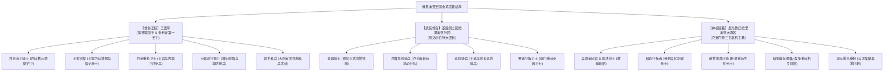
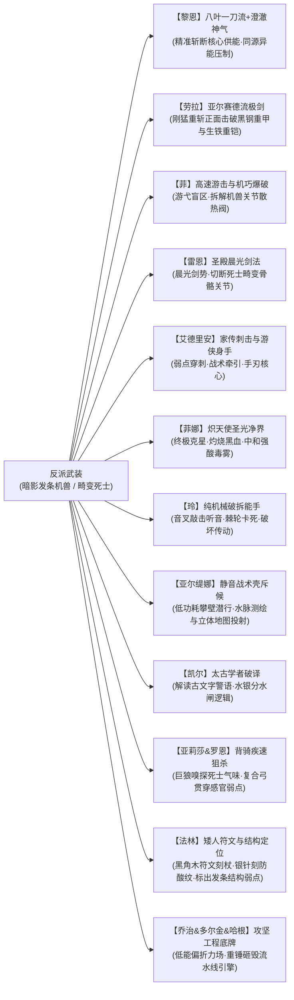

# 方案四：全境三方武装力量、战斗克制链与黑幕权谋博弈方案

> **所属方案**：[00_第二部宏篇主线总纲与方案管理中枢.md](00_第二部宏篇主线总纲与方案管理中枢.md)  
> **核心定位**：确立维里迪亚全境世俗王权（王国军）、圣殿骑士团（武装修会）与晨光教廷（神权暗箱）三方武装建制、主角团战斗克制链及反派双首恶权谋博弈机制。

---

## 一、 维里迪亚全境三方武装格局总览

维里迪亚王国的武装力量受神权侵蚀与封建割据影响，呈现出三方割据对峙的封建格局：

---

## 二、 阵营一：世俗王权与王国军建制体系

埃德蒙国王在位十八年，世俗王权被架空，正规军事力量被压缩在王都白金王宫方圆数十公里内。王国军并非中央集权正规大军，而是由内廷亲信、王宫卫戍与地方封地私兵构成的三层封建武装：

### 1. 王室直辖精锐（内廷核心）
* **白金近卫骑士**：
  * **法统与地位**：专属效忠国王与王子的王家荣誉武者，由朱利安王子亲自统率并一同操演剑术，规模约三百至五百人。
  * **装备外貌**：深蓝配金滚边骑兵罩袍，佩维里迪亚【双头狮】王家纹章；白金镀层半身雕花板甲；手持王室标准双手长剑与轻型刺剑，战马披挂深蓝马衣。
  * **战斗特长**：兼修步战与骑战剑术，擅长贴身护卫、小规模室内突击与密集剑盾方阵，具备极强的舍命护驾意志。
* **王家密探**：
  * **法统与地位**：埃德蒙国王十八年在王室内廷秘密保全的轻装情报人员。
  * **装备外貌**：深棕粗呢耐磨斗篷，轻皮甲，短弩与轻便匕首。
  * **战斗特长**：擅长利用下水道与暗道无声潜行、绝密信物护送与隐蔽侦察，具备极强的反追踪能力。

### 2. 王都世俗卫戍部队（外廷城防）
* **白金重枪卫士**：
  * **定位**：驻守白金王宫大门、城垛挑空回廊与内城主要通道的世俗常备步兵。
  * **装备外貌**：熟铁胸甲与锁子甲，手持三米重装长枪与生铁大盾。
  * **战斗特长**：擅长狭窄通道列盾拒马与阵地封锁，正面抗冲击力与防线维持能力极强。
* **王都巡守弩卫**：
  * **定位**：驻守王都城墙箭楼、吊桥闸口的外围城防守兵，维持下城白昼市井秩序。
  * **装备外貌**：轻铁护胸、带护颈覆面头盔、硬木复合重弩、腰挎单手短剑。
  * **战斗特长**：高处箭楼火力覆盖与城门盘查压制。

### 3. 地方大领主封地武装（泛王国军）
* **领主私兵**：
  * **定位**：受瓦卢瓦伯爵、亨里克边境伯等十二人大陪审团贵族供养的领地封臣士兵。
  * **装备外貌**：身着各自家族纹章盾牌与熟铁甲胄。
  * **战斗特长**：平时守卫地方领主庄园、粮仓与矿山，战时由领主征召集结，擅长依托街巷构筑街垒与阵地防守。

### 4. 王国军指挥官合法称谓
* **近卫侍卫长**：统领王宫内廷与白金近卫骑士日常防务的总管（朱利安重点结交对象）。
* **城防卫队长**：负责外围城垛与巡守弩卫轮值的世俗长官。

---

## 三、 阵营二：圣殿骑士团武装修会建制体系

全称为【晨光圣殿骑士团维里迪亚分团】。直属于全大陆圣殿大修会总团，享有独立的修会法权、受封要塞领地与军税豁免权，在法理上不受维里迪亚世俗君主直接管辖。掌控圣殿大要塞与过半边防哨卡。

### 1. 核心与基层兵种
* **圣殿骑士**：
  * **法统与地位**：在圣殿大要塞祭坛前立下晨光之誓的正式修会骑士，右手腕刺刻“晨光之誓”终身刻印（雷恩以及十四名拒杀平民的资深骑士均属此列）。
  * **装备外貌**：传统重装生铁板甲，身披灰白修会罩袍，手持十字阔剑与生铁重盾。
  * **战斗特长**：正统晨光剑法与重装步战，精通格挡反击与阵地重击，坚守骑士誓约正面迎敌。
* **白鹰先锋骑兵**：
  * **定位**：先锋骑兵队长卢卡斯统率的少壮派精锐骑兵分队。
  * **装备外貌**：白银镀层轻装骑兵铠，胸前佩戴白鹰与十字双重纹章，配备精钢合金长骑枪与双刃阔剑。
  * **战斗特长**：擅长高速长途机动、平原干道巡弋突袭与骑枪列阵冲锋，是修会机动性最强的精锐力量。
* **巡防骑兵**：
  * **定位**：负责平原商道、要塞周遭外围哨卡的机动巡逻骑兵。
  * **战斗特长**：轻装巡防与边境警戒，精通斥候哨探与地形探路。
* **要塞守备卫士**：
  * **定位**：驻守大要塞大门、黑铁水牢走廊与深层刑房的重步兵，手持十字重戟与重型破甲战斧。
  * **战斗特长**：擅长险要闸门防守、重甲格斗与狭隘地牢压制。
* **大门守备卫士**：
  * **定位**：常驻黑石峡谷维里迪亚大门哨所等边境关卡的外围分遣守备步兵（由边境守备队长瓦尔特·巴恩斯统领）。
  * **装备外貌**：旧式覆铁锁子甲，深灰/深蓝粗呢斗篷，手持生铁长枪与重制阔剑。
  * **战斗特长**：峡谷险隘卡位、吊闸门操作与关卡车马商队过磅搜检。

### 2. 圣殿骑士团指挥官合法称谓
* **大团长**：阿达尔伯特（执掌全团二十四年，坐镇大要塞中立自保）。
* **先锋骑兵队长**：卢卡斯（少壮派精神标杆，白鹰骑兵队统领）。
* **要塞典狱长**：莫尔茨（执掌深层黑铁水牢与惩戒刑房，阿达尔伯特的凶悍心腹）。
* **边境守备队长**：瓦尔特·巴恩斯（原维里迪亚大门守备长官，雷恩昔日部属）。

---

## 四、 阵营三：晨光教廷神权与地下暗箱武装

跨国正统宗教机构，在维里迪亚设立大教区。表面仅有少量大教堂礼仪侍卫，实际由克莱门特三世与异端审问厅掌控着三十一年间秘密研发的生化死士与机关兵器：

### 1. 异端审问厅与世俗暗线
* **异端审问官**：达米安（二十九岁，冷酷残酷的审问厅首领，专司灭口与搜捕）。
* **裁决剑士**：异端审问厅专司暗杀与行刑的黑袍精锐剑士，剑势阴狠凌厉，精通死角突刺与涂毒刃口。
* **黑袍斥候**：精通潜行、追踪与下毒的暗部斥候。
* **教会打手**：依附于教廷特许罗曼商行的走私打手与排毒工头。

### 2. 武器库一：古代暗影炼金兵器（机关与重火）
兵器基于三十一年前教廷在暗影遗迹中挖掘出的技术改造，依赖**“无光黑晶”**提供动力：
* **暗影噬光傀儡**：
  * 高约三米，以铸铁与青铜齿轮咬合而成的发条机兽，头部雕刻为滴水兽石雕。
  * 步履沉重且具扑击力，精钢巨爪能撕开轻装马车；胸腔黑晶散发微型重力场，吸附并迟滞十米内的轻型飞刃与箭矢；
  * 破坏方式：必须由高敏捷角色绕后，撬开后背散热阀，击碎核心黑晶。
* **虚无雾化重炮**：
  * 架设在重型四轮炮车上的八棱铜铸臼炮，利用气压泵喷射高压雾化暗影酸液；
  * 毒雾所过之处常规钢铁迅速脆化脱落，吸入肺部引起剧烈咯血；
  * 克制手段：依托菲娜圣光符文石激活的金色结界抵御酸雾侵蚀。
* **高抗冲黑钢重甲**：
  * 掺杂暗影废渣的高强度黑钢锻造而成，表面粗糙无光，能分散重型战技冲击，常规劈砍极难破防。

### 3. 武器库二：畸变异端死士体系（人体改造）
* **暗影忏悔者**：
  * 兵源为异端审问厅秘密抓捕的流民与重罪犯。
  * 皮肤惨白死灰，双眼被麻布缝死，依赖听觉与热量追踪；手指异化为三十厘米角质骨刺，行动无声迅捷，痛觉神经被切断；
  * 濒死时体内核心黑血发热，自爆化作腐蚀性血雨。
* **破誓黑血狂骑**：
  * **兵源与暗箱界限（两组受害者绝对隔离原则）**：
    1. **第一组·十四名正直资深骑士（戈德弗里、巴恩斯等）**：十四年前大雨夜誓死抗命拒杀平民。阿达尔伯特知情并亲自下令将其锁入圣殿深层黑铁水牢（动机为自负庇护，避免交给教廷充当活体实验材料）；莫尔茨呈递假卷宗充当遮羞布，暗中收受教廷黑金。
    2. **第二组·十四年间零散除名流放的年轻抗命骑士（真正的黑血狂骑兵源）**：因违背教廷意志或同情平民被除籍流放，由教廷借宗教法庭暗箱引渡押入地下秘库，剥离神智改造成狂暴杀戮兵器。阿达尔伯特自欺欺人地认为这批年轻人只是在偏远修道院苦修，不知其已被改造。
  * **生理战力**：肌肉膨胀至常人两倍，体表黑血搏动；双手巨斧挥舞如风，中刀不流红血，伤口由黑色粘液迅速封堵，正面阵地撕裂力强悍。

---

## 五、 三方武装力量对比与称谓隔离红线矩阵

为杜绝编制混淆与称谓漂移，全篇严格执行以下对照表：

| 维度 | **世俗王权（王国军）** | **圣殿骑士团（独立武装修会）** | **晨光教廷（大教区与暗部）** |
| :--- | :--- | :--- | :--- |
| **最高统帅** | 埃德蒙国王 / 朱利安第一王子 | 阿达尔伯特大团长（后卢卡斯继任） | 克莱门特三世枢机主教 / 达米安异端审问官 |
| **合法驻防区** | 白金王宫内廷、王都内城、王室庄园 | 圣殿大要塞、平原商道巡防区及边境哨所 | 晨光大教堂、大修道院、地下秘库/暗影地窟 |
| **编制层级** | 近卫队、卫戍队、巡守队 | 先锋骑兵队、分遣队、要塞守备队 | 异端审问厅、裁判所特工组、秘密工坊 |
| **指挥官合法称谓** | **近卫侍卫长、城防卫队长** | **先锋骑兵队长、要塞典狱长、边境守备队长** | **首席异端审问官、裁判所执事、教区司铎** |
| **基层人员专属称谓** | **白金近卫骑士、王家密探、白金重枪卫士、王都巡守弩卫、领主私兵** | **圣殿骑士、白鹰先锋骑兵、巡防骑兵、要塞守备卫士、大门守备卫士** | **裁决剑士、黑袍斥候、暗影忏悔者、破誓黑血狂骑、教会打手** |
| **严厉禁忌红线** | ❌ 严禁使用修会的“晨光之誓”；严禁使用中式“禁军/将领” | ❌ **绝对严禁出现“近卫/近卫队长”**；严禁“军队/军官/军纪” | ❌ 严禁公开列装正规重骑兵与野战步兵；生化死士与机兽绝不见光 |

---

## 六、 主角团各司其职的战斗克制链

在面对残酷的复合武装时，主角团依靠精密的冷兵器与战技配合克制强敌：

1. **艾德里安（血仇审判与手刃机兽核心）**：手持艾斯特雷亚家传刺剑，深谙家族机关建筑构造。在菲的高速配合下，艾德里安以精准弱点穿刺破坏终极发条机兽的动力黑晶与中枢发条，亲手完成物理斩首与家仇正名。
2. **雷恩（破誓救赎与誓约唤醒者）**：手持重盾与长剑，以晨光剑法迎击阿达尔伯特。雷恩的战法不在于杀戮昔日骑士，而在于挑飞佩剑与破防，在大要塞校场当众挑飞大团长佩剑，唤醒全团骑士挺进平暴救民。
3. **黎恩与菲娜（超自然灾害防火墙）**：严格遵循外部力量不干涉内政原则。黎恩以澄澈鬼之力压制地脉引力坍缩与虚无黑晶波动，菲娜以炽天使圣光净界中和雾化重炮与死士自爆的强酸剧毒，为广场万民撑开防护屏障，绝不抢夺本土主角的复仇与审判权。
4. **劳拉（正面破阵的钢铁壁垒）**：劳拉手持大剑施展亚尔赛德流绝技。在第十幕死牢决战中，劳拉正面硬撼典狱长莫尔茨三十公斤重型狼牙破甲锤的凶悍下劈，一剑斩碎其生铁碎颅重铠，为十四年前雷恩惨遭烙印放逐彻底雪耻。
5. **菲（高速致命拆解）**：在重火器咆哮缝隙中，菲依靠绳索摆荡与滑铲，在机兽傀儡死角安放定向破拆炸药，精准剥离外层护甲，为艾德里安制造绝杀契机。
6. **玲（精巧机械破拆手）**：在零导力环境下完全依靠机械原理。携带纯铜微型撬棍、游标卡尺与测音音叉，轻敲机兽外壳辨析发条受力与传动弱点，利用反向卡死棘轮使机兽陷入自锁瘫痪。
7. **法林（机巧弱点定位与防蚀符文）**：手持黑角木符文刻杖与纤细银刻针，在战甲与刃口刻画防酸抗蚀符文；以微光探针指出机兽护甲接缝处的传动齿销咬合弱点，引导大剑与刺剑精准破坏。
8. **亚尔缇娜（静音潜行侦察与立体测绘）**：操控战术壳光剑进入低功耗攀壁静音形态，充当地底潜行与敌后刺探斥候。利用回声装置探测溶洞盲区与地下水网流势，投射立体结构图。
9. **凯尔（古代符文破译与水网机关解码）**：迅速破译深渊地底通路与太古水利设施的古文字警语，解开太古蓄洪分水主闸的配重水银齿轮逻辑，逆转水流阻截敌方追兵。
10. **亚莉莎与罗恩（背骑疾速连射与寻踪猎杀）**：亚莉莎施展战术复合弓箭术，与化为白银巨狼的罗恩组成机动组合。罗恩在暗河与溶洞凭借嗅觉锁定死士黑血与机油气味；亚莉莎伏于狼背上射出破障重箭，精准贯穿暗影忏悔者的听觉耳膜与行动肌腱。
11. **乔治、多尔金与哈根（攻坚工程底牌）**：乔治研制的战术壳低能偏折力场偏转流弹与近防重火器；第十一幕奇袭维克托地下工坊时，哈根以太古图纸锁定主供能管路，玲指出魔导发条流水线的传动缺陷，配合艾德里安击碎控驭手环、多尔金重锤砸毁动力引擎，彻底切断机兽产能。

---

## 七、 双首恶七波权谋布局演进（对齐十四幕最新进度）

晨光教廷对圣殿骑士团没有法定指挥权，二者本质是长达数十年的利益分肥与互相制约同盟。在全篇十四幕演进中，反派权谋手段呈现七波递进反扑：

1. **第一波布局：上位者冷漠交办与大门密查（第三幕·阶段八至九）**
   * **阿达尔伯特修会密查**：边境剑痕报告送达大要塞长桌，大团长冷漠指令莫尔茨“去翻大门花名册，查清谁在关卡放行直接押回水牢，把第七号死牢收拾干净”。反派严令封锁消息、绝不公然通缉，以防圣殿内部同情旧案的资深骑士追查十四年前真相；
   * **莫尔茨暴虐缉捕**：突袭大门哨所，将边境守备队长瓦尔特·巴恩斯强行戴枷押入底层黑铁水牢严刑拷问；
   * **达米安边境灭口**：异端审问厅达米安冷酷下达贫民窟焚营令遮掩暗影废渣外溢，凭借解毒药渣线索咬尾追踪。
2. **第二波布局：商道截断与商战绞杀（第四幕·阶段十一至十四）**
   * **教廷特许商会垄断封锁**：达米安发现市井流传优质止血药剂与精铁器皿，察觉外部物资注入。教廷指使代理人罗曼商行联合圣殿税卡，下达货税倍增令，扣押迷迭香商行南境商队，雇佣暗巷打手企图洗劫货栈；
   * **经济扼杀**：企图通过垄断粮食配额与扣压行商，逼迫法尔肯镇民交出避难人员，切断主角团后勤。
3. **第三波布局：旧领地窟坑杀与修院截击（第五幕·阶段十五至十九）**
   * **旧领地窟坑杀**：发现有人在旧领调查，主教故意放出部分假档案，引诱调查队进入暗影地窟，启动噬光傀儡与暗影畸变体实施坑杀；
   * **修道院密令搜捕与借刀**：风言风语传出修道院一带出现带放逐烙印的骑士，阿达尔伯特在要塞长桌看到特殊剑痕报告自语“难道真是雷恩……不可能，都十四年了”，被克莱门特听到；主教心生不安，由达米安极快协助回忆起十四年前杀害前任大团长与屠戮平民的灭口旧案，主教冷汗直冒并对知情的达米安动了杀心；达米安内心阴冷盘算日后取而代之，表面恭敬建议将脏活推给圣殿以保全主教圣洁光辉形象；克莱门特私盖伪令，由达米安派卢卡斯以修会戒律追捕“破誓流放者雷恩”，卢卡斯截击时被雷恩挑落佩剑不伤一人；
   * **情报拼图合拢**：迷雾海港走私货栈被破、教廷洗钱暗账被劫，与旧领、修道院情报汇合，达米安猛然惊觉这是一场针对三十年暗影实验与灭门案的精准复仇。
4. **第四波布局：合流围剿与借病政变（第八幕·阶段二十六至二十八）**
   * **白鹿大驿馆围城**：亨里克边境伯随行车队中的教廷暗桩送出四大铁证与公审会盟绝密情报，克莱门特陷入癫狂绝望，连夜调遣数百暗影噬光傀儡与畸变死士围攻白鹿大驿馆；阿达尔伯特在要塞长桌神态冷淡嘲讽，拒绝充当教廷的看门猎犬，仅指令莫尔茨封锁外围白鹿河石桥以维持秩序，与教廷杀戮保持冷血中立与政治算计；
   * **守护之仁折剑**：达米安驱使死士在平民杂工中释放酸雾，黎恩菲娜维持防护牵制；战兽挥下重锤伴随剧毒酸液喷溅，为护住负伤同伴与避难平民，劳拉横剑硬撼导致亚尔赛德精钢大剑崩裂折断；
   * **朱利安反向断后**：朱利安率白金近卫骑士反向冲杀截断追兵，手刃两名刺客，左肩被刺穿负伤；
   * **战略人质扣押**：雷恩力竭，阿达尔伯特震开达米安剑锋扣押雷恩入水牢防备教廷反噬；
   * **借病政变**：借题发挥宣称刺客谋刺、埃德蒙国王重病谵妄，启动《战时统帅令》强除白金重枪卫士武装，软禁埃德蒙国王，全境通缉主角团。
5. **第五波布局：深渊地底通路水闸绝杀与伏击（第十幕·阶段三十二至三十四）**
   * **暗河封锁**：得知主角团借道地下溶洞水网潜入王都，达米安指使死士驱赶盲眼巨蜥与洞穴毒蛛封堵溶洞峡口；
   * **太古分水闸水银死锁**：在古代分水主闸灌注水银死锁发条，企图引急流淹没通路溺毙潜入者。
6. **第六波布局：沙龙暗控、工坊赶工与御前决斗破产（第十二幕·阶段三十八至四十）**
   * 克莱门特在金鸢尾沙龙维持威严慈爱伪装，拉拢贵族并严令维克托在地下工坊赶制自律战兽；亚莉莎出示偷税洗钱账册，朱利安以大宪章法统庄严承诺废除私设税卡，大陪审团倒戈；
   * **恐慌赶工被破**：恐慌催工造成工坊过载，被主角团抓住排烟盲区奇袭捣毁，维克托被俘交代真相；
   * **达米安与阿达尔伯特裂痕**：审问官主张残酷宵禁与暗杀，大团长严拒圣殿铁骑介入脏活，双方按剑对峙；
   * **竞技场御前仲裁破产**：企图公开宣布雷恩等人为死罪异端，决斗中雷恩一招挑飞裁决剑士佩剑完胜，埃德蒙国王亲临宣读十八年黑账，大陪审团全面倒戈；两大首恶当众决裂。
7. **第七波布局：投毒水网、冷血封城、校场断剑与首恶伏诛（第十三幕至第十四幕·阶段四十一至四十四）**
   * 丧失政治退路的克莱门特向王都下水道源头倾倒暗影原液，释放全部死士与过载战兽企图同归于尽；
   * **冷血封城铁幕**：阿达尔伯特为防暴民冲击圣殿要塞自保，下达封城令封死九门；
   * **断剑殉道雪耻**：第十四幕校场对决，雷恩挑飞大团长佩剑，基层圣殿骑士全员低垂长剑抗命；教廷特使手持分肥密约当众恶毒嘲弄十四年前放逐者被改造成黑血狂骑的惨烈真相并启动伏击机兽。阿达尔伯特心中最后的自欺欺人被彻底击碎，解下白鹰大团长金链扔在地上，断然喝令教会滚出校场，交出祈祷室黑铁钥匙，抓起半截断剑迎头撞击卡死机兽主轴殉道赎罪；
   * **合流开城平暴**：卢卡斯率圣殿铁骑开城平暴，与朱利安率领的白金近卫骑士正义会师合围教廷；真理广场大公审四大铁证呈堂，艾德里安家传刺剑贯穿机兽核心，两大首恶彻底伏诛。

---

## 八、 反派视角全景心理与博弈深度剖析

反派阵营每一个重大决策与战役均具备严密的情报、政治与利益闭环，无降智与挂机现象：

### 1. 首恶利益诉求与终极图景
* **克莱门特三世（神权吞噬者）**：
  * 埃德蒙国王久病垂危，年轻朱利安缺乏正规要塞武装与兵力。教廷垄断全境什一税与免税庄园三十一年，暗中开采黑晶。
  * **野心图景**：维克托制造的发条战兽与死士，**终极目标是彻底替代并解除圣殿骑士团的要塞武装与防区管辖权**，建立政教合一神权统治。因此教廷背着圣殿独立研发、绝不许圣殿插加工坊。
  * **大圣徒伪装**：公众与贵族面前始终维持慈爱博学的“护国大主教”形象，阳光下伪装越稳固，广场大公审时铁证剥落伪善画皮的震撼力越强烈。
* **阿达尔伯特（旧体制殉葬大团长）**：
  * 身为大团长，毕生以“维系圣殿骑士团在维里迪亚的独立法统、战略要塞防务与半数关税”为最高天职；
  * 十四年前为避免与教廷正面决裂导致修会被总团降罪，选择妥协、剥夺雷恩誓言并幽禁戈德弗里；
  * **战略防备护身符**：阿达尔伯特鄙视教廷阴暗实验，在私人祈祷室铁柜私藏前任团长自白与克莱门特签字的分肥密约，以此作为防备教廷卸磨杀驴的护身符。

### 2. 反派行动升级合理性
* **第三幕的“修会密查”逻辑**：雷恩潜过大门，阿达尔伯特不发公开通缉令，因十四年前雷恩是“秘密除名放逐”。大肆通缉将引发崇敬雷恩的基层骑士哗然，王室亦会借机介入重查屠杀旧案。命令莫尔茨暗中拷问符合要塞统领的处事法则。
* **第四幕至第五幕的“情报拼图成型”逻辑**：艾德里安以北方商会文书为掩护；直到商战被破、旧领机兽被拆、修道院雷恩现身、海港货栈被端，达米安手中桌上情报交叉，反派才惊觉这是一场针对三十年神权暗影与灭门案的高层复仇联盟，随即在第八幕动用主力设下白鹿驿馆围绞大局。

### 3. 反派核心战术决策闭查加固
* **【加固一：阿达尔伯特扣押雷恩而非斩首】**：
  * 阿达尔伯特在泥泞中目睹黑血狂骑手腕的圣殿誓约烙印，得知教廷突破道德底线；若雷恩落入达米安手中必被改造成怪物；
  * 心中顽固自负逻辑启动：当年十四个资深骑士在死牢活了十四年，至少没被变成怪物；雷恩关入死牢教廷便碰不到他。大团长自欺欺人地以此“保全”雷恩，并留作制衡克莱门特的战略人质；莫尔茨暗中受贿施虐形成讽刺悲剧。
* **【加固二：第九幕界标威慑与反派决策】**：
  * 搜捕队在维里迪亚大门界标前被奥蕾莉亚一剑阻退，阿达尔伯特未调动要塞守备铁骑攻山：森林南侧数百年来是生人勿进的古老圣域；遭遇绝顶剑士坐镇；王都政变刚成，带主力血拼将导致教廷趁虚夺权。因此下令封死界标只守不攻。
  * 🚨 **异界不可知论铁律**：维里迪亚原住民绝不知晓“埃雷波尼亚帝国”字样或概念，仅将其视为隐匿在森林深处的神秘绝顶外族强者，绝不探查外侧位面。
* **【加固三：第十二幕维克托工坊失守之因】**：
  * 第十一幕死牢被破、雷恩被劫击碎了克莱门特的安全感，恐慌逼迫维克托七日内赶工出库第二批机兽；日夜狂轰排烟激增十倍致使外围隔温法阵与暗道出现热裂隙，哈根与玲抓住工程漏洞完成破拆。
* **【加固四：阿达尔伯特从冷血封城到校场殉道的心路闭环】**：
  * 第十三幕面对毒水异变，阿达尔伯特下达封城铁幕令，出于冷血的防化隔离与保全圣殿守备骑士逻辑；
  * 封门后平民哭嚎与卢卡斯等年轻骑士痛苦抗议，将大团长逼入道义死角；
  * 第十四幕校场对决雷恩挑飞佩剑未下杀手，诛心质问其十四年自欺欺人；教廷特使恶毒嘲弄狂骑真相并启动机兽伏击企图灭口全场两代骑士。大团长心中自欺欺人彻底击碎，当场解下白鹰大团长金链扔在地上，断然与教会决裂，交出祈祷室黑铁钥匙，抓起半截断剑迎头卡死机兽主轴，以残躯完成最后的尊严赎罪。
