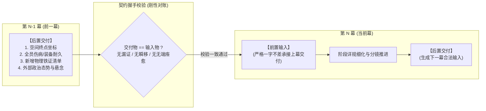
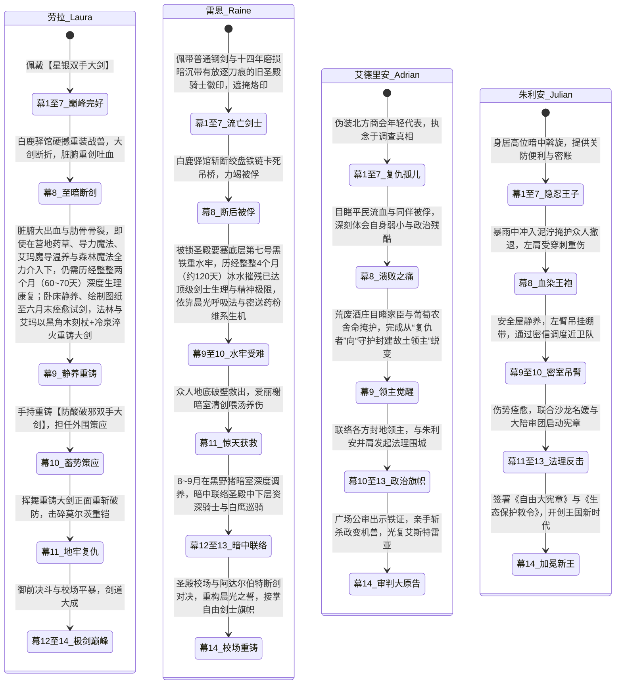

# 第二部主线跨幕连续性与全局物理状态机（管理龙骨）

> **归档位置**：`方案/第二部/主线与世界扩充方案/06_第二部主线跨幕连续性与全局物理状态机.md`  
> **所属体系**：第二部宏篇主线与世界扩充方案集群  
> **关联母案**：
> - [00_第二部宏篇主线总纲与方案管理中枢.md](00_第二部宏篇主线总纲与方案管理中枢.md)
> - [01_宏篇主线剧情总大纲与分幕导航.md](01_宏篇主线剧情总大纲与分幕导航.md)
> - [分阶段详规/](分阶段详规/)（第一幕至第十四幕接口与阶段详规）  
> **核心定位**：**全书第二部宏篇主线十四幕四十四阶段唯一全局权威状态中枢（Single Source of Truth, SSOT）**。专用于穿透分文件夹管理壁垒，彻底消灭剧情前后矛盾、角色状态漂移、时空折叠与物象脱节。

---

## 一、 为什么必须建立跨幕状态中枢？（设计初衷与治理原则）

### 1.1 现状与潜在结构性隐患
在第二部十四幕四十四阶段体系的宏大篇幅创作中，为了防止单个文档字符爆炸（避免 Token 溢出与编辑器卡顿），工程上将各幕方案拆解在独立的文件夹中管理（`分阶段详规/01_第一幕_.../` 至 `14_第十四幕_.../`）。  
然而，这种**物理文件夹解耦**必然伴随两大不可忽视的潜在风险：
1. **信息孤岛（Information Silos）**：在深入细化某一幕的逐章分镜时，创作者的注意力高度聚焦在当前文件夹内，极易凭模糊记忆默认前提，从而忽略前面章节已经固化的物理事实；
2. **隐性剧情漂移（Cascading Inconsistency）**：在某一幕临时调整了证物归属、角色伤情、NPC认知或行程节奏，由于后续幕次的方案存放在其他文件夹中，系统不会自动报错，导致跨幕之间产生静默的逻辑断层。

### 1.2 顶层治理原则：【物理文件夹分治，逻辑状态统一】
* **分文件夹的作用**：仅作为各幕**“逐章分镜与微观剧情血肉”**的容纳容器；
* **本中枢的作用**：作为贯穿全篇十四幕的**“合金龙骨”**，对全书的**证物、角色状态、170公里时空日历、反派情报知晓度、以及平民物象**进行单向强类型约束。
* **写作铁律**：**任何一幕在细化阶段详规前，必须以本中枢的状态为基准；细化过程中产生的任何宏观变动，必须第一时间反哺回写本中枢。**

---

## 二、 幕级双向契约握手协议（Interface Handshake Protocol）

为了确保各文件夹之间严丝合缝，各幕 `00_第X幕大纲与接口.md` 之间的衔接必须执行严格的**输入/交付契约握手**：



### 握手三大铁律：
1. **绝对承接原则**：第 $N$ 幕的 `【前置输入】` 必须完全复印第 $N-1$ 幕的 `【后置交付】`，严禁在幕初凭空刷新装备、让重伤角色无端痊愈、或让人员凭空出现在未跋涉到达的地点；
2. **多米诺联动修规法（Cascade Update）**：若在细化第 $N$ 幕详规时产生突破性构思，改变了交付状态，**绝不允许仅在当前文件夹内自圆其说**，必须立即启动两步联动：
   - 步骤一：检查是否破坏第 $N-1$ 幕交付约定，若破坏需向前复核；
   - 步骤二：立即更新第 $N+1$ 幕的 `【前置输入】`，并同步更新本中枢总表。
3. **零元叙事与客观实体原则**：所有交付物必须是客观物理实体（信件、印章、齿轮、伤痕、关防文书），严禁出现“达成战略目标”、“影响力+10”等抽象游戏化参数。

---

## 三、 全局四大核心物理状态机矩阵（Single Source of Truth）

### 3.1 物理证物与关键道具全局单向传递链（Evidence & Artifact Pipeline）

全篇扳倒教会三十年暗影统治、唤醒骑士团初心的核心支点是严密的**客观物理证据链**。所有核心证物的产生、转移、封存与呈堂必须保持绝对的物理守恒：

| 证物编号 | 证物名称与物理特征 | 获取节点（出处） | 中途保管人与物理存放地 | 关键转移与递交节点 | 终局呈堂与法理生效（第十四幕） |
| :---: | :--- | :--- | :--- | :--- | :--- |
| **EVD-01** | **克莱门特暗印黑血试剂管**<br>（铅封细玻璃管，内装强酸黑血残液） | 第三幕阶段九<br>维里迪亚大门截获 | 菲娜贴身收纳 ➔ 心木商行地窖铅盒 | 第八幕突围由菲带出 ➔ 第九幕酒庄地窖化验比对 | 第十四幕大陪审团广场公审，当庭向十二领主验毒判决 |
| **EVD-02** | **大门守备队长通关铁牌**<br>（铸铁白鹰徽记，带巴恩斯私人印记） | 第三幕阶段九<br>守备队长巴恩斯救孙赠予 | 雷恩随身携带 ➔ 艾德里安出示 | 第七幕凭此合法租下心木商行 ➔ 第八幕伏击中被达米安辨识 | 第十四幕守备队长巴恩斯出庭作证，证明通关合规与教会私兵越权屠杀 |
| **EVD-03** | **艾斯特雷亚夫人临终手札与忠仆册**<br>（十九年前羊皮手卷，附带暗格挖出的镀银首饰盒、半截断剑与母亲血字绝笔“活下去”） | 第五幕阶段十五<br>朱利安王子驿馆签约奉还 | 艾德里安贴身皮袋保管 | 第八幕大溃败中用油布包死死护在胸前 ➔ 第九幕唤醒旧领葡萄农 | 第十四幕艾德里安以苦主原告出庭，当众宣读母亲绝笔，洗雪家门 |
| **EVD-04** | **教廷秘库工匠印号主齿轮**<br>（带维克托秘库暗纹的特种合金主齿轮） | 第五幕阶段十八<br>焦土地窟战技破拆撬下（阶段十六初探惊变，阶段十七机兽破闸，阶段十八刺剑绞轴撬下） | 乔治与法林装入铁盒保管 | 第七幕法林在工坊街比对齿距 ➔ 第十二幕玲破译地下工坊时直接匹配同批号 | 第十四幕铁证当堂砸向克莱门特，击穿“教会不知情机兽”谎言 |
| **EVD-05** | **平民受创救治病历与黑血毒理分析手稿原本**<br>（前院长十四年前亲笔记录的数十位重创平民救治病历、黑血毒理手稿与铅封试剂管） | 第五幕阶段十六<br>晨光修道院祭坛暗格起获（阶段十七月下极剑后抚平心魔，阶段十八向卢卡斯出示赢得放行） | 劳拉代雷恩收纳入剑袋 | 第八幕雷恩被俘前交由艾德里安转移 ➔ 第九幕绝境中坚定全员信念 | 第十一幕大劫狱向被囚骑士与守备出示证实平民幸存；第十四幕大法庭当众向大陪审团呈递击穿谎言 |
| **EVD-06** | **心木碳化残根与商会洗钱暗账**<br>（高密度碳化木块、特许商会双重假账） | 第五幕阶段十七与十八<br>阶段十七海港底舱起获碳化残根，阶段十八货栈起获洗钱暗账 | 亚莉莎与玛格丽特夫人收管 | 第五幕阶段十九亚莉莎以复式记账法穿透资金链 ➔ 第十二幕用于撬动亨里克边境伯倒戈 | 第十四幕作为没收教会非法免税庄园、签署新商贸协约的经济铁证 |
| **EVD-07** | **埃德蒙国王十八年手抄黑账**<br>（浸染微毒汤药药渍的王室私密手记） | 第一至二幕暗线初现<br>第十二幕阶段三十九密室正式移交 | 朱利安王子转交瓦卢瓦伯爵 | 记录三十年间每批矿石流向与教会勒索记录 | 第十四幕埃德蒙国王退位交出《根本宪章》，成为击垮教会神权的终极政治炸弹 |
| **EVD-08** | **纯铜风铃八音盒**<br>（科林打造的薄荷蓝护身小道具） | 第七幕阶段二十三<br>工坊街少年学徒科林相赠 | 玲随身携带 | 第十幕深渊暗河畔转动安抚疲惫 ➔ 第十二幕成为与科林接头暗号 ➔ 第十三幕避难所安抚孩童 | 第十四幕尾声巡礼回赠科林，见证阳光下新铺开张的生活流物象闭环 |
| **EVD-09** | **前任大团长屠杀自白血书绝笔与死牢石壁密录**<br>（泛着暗褐干涸血渍的羊皮手卷，记录十四年前克莱门特与阿达尔伯特密谋屠杀平民与制造假案真相） | 第十一幕阶段三十七<br>死牢深层前副团长戈德弗里贴身缝藏起获 | 艾德里安与黎恩贴身防水铅盒保管 | 第十二幕阶段三十八用于游说亨里克边境伯与王国大法庭 ➔ 阶段四十御前决斗当众出示 | 第十四幕大审判当庭宣读终审判词，彻底平反冤案并摧毁教会法统 |
| **EVD-10** | **达米安亲笔安全通行状与侍从卡尔森认罪供状原本**<br>（加盖异端审问厅黑鸢尾硬火漆印鉴的达米安亲笔通行状原本，附带卡尔森签字盖印且带有指印的认罪供状） | 第十幕阶段三十四<br>亨里克边境伯在布鲁诺城堡马厩亲手人赃俱获内奸卡尔森起获 | 亨里克边境伯随身带锁小铅盒保管，卡尔森被锁闭于布鲁诺城堡地牢 | 第十一幕阶段三十七通过王室密鸽密送供状抄件至王都黑野猪暗室 ➔ 第十二幕阶段三十八亨里克亲携原本入京呈递金鸢尾暗阁瓦卢瓦伯爵 | 第十二幕锁定大陪审团 7 票对 5 票胜局 ➔ 第十四幕真理广场大公审当庭确证教会越权干涉大公领地自治政务，坐实谋逆重罪 |

---

### 3.2 角色生命周期、装备耐久与伤病演进链（Character Status Progression）

为了彻底杜绝“上一幕断剑重伤、下一幕生龙活虎大跳劈”的割裂感，全篇核心角色的物理状态与心路必须遵循严格的时序递进：



* **劳拉脏腑重创与两月（60~70天）深度生理康复铁律**：
  - **伤情物理实质**：白鹿大驿馆舍身正面硬撼三米高发条战兽万钧重锤与强酸喷射，胸腔受剧烈钝击震荡致多发性肋骨骨裂，强酸冲击波导致脏腑内壁撕裂大出血；
  - **康复生理周期**：即便有森林营地顶级药草、艾玛古代魔女魔导温养、菲娜炽天使神圣之光与Eldoria森林魔法的持续多重介入，体内核损伤吸收与骨痂彻底硬化也必须遵循严格的生物力学，**至少需要整整两个月（60~70天）方能恢复全盛**；
  - **三阶生理演进**：
    - ① **4月（繁荫季首月，第1~4周）**：急性期。绝对卧床静养，消炎止血、退烧排毒，严禁任何长途颠簸（阶段二十九地窖避难）；
    - ② **5月（繁荫季次月，第5~8周，满一个月）**：亚急性期。内出血止住，骨裂初步愈合，可在搀扶下轻度走动参与推演研讨图纸，但**严禁提拿重物或挥剑**（阶段三十研讨防酸图纸）；
    - ③ **6月（繁荫季末月，第9~12周，满两个月以上）**：康复重塑期。内伤完全愈合，骨骼坚固，菲运回断刃、矮人地火炉重铸完成，六月下旬新大剑运抵，劳拉双手试剑横斩，重获全盛巅峰战力（阶段三十一）。

* **黎恩与塞拉菲娜（菲娜）的战术状态守则**：
  - **全程零导力守则**：ARCUS 战术导力器皮革遮蔽外壳全程完好，严禁在王国居民面前露出一丝导力电弧；菲娜不展露光翼，全篇以凡人战技与微量克制圣光行动；
  - **第八幕自限逻辑**：白鹿驿馆狭小空间挤满无辜马夫仆役，黎恩为护民无法施展大范围太刀居合，导致被重骑与战兽阵型压制撤退；
  - **第十三幕超自然防火墙**：决战阶段黎恩与菲娜专注于阻断暗影毒流侵蚀地脉、保护平民避难所，绝不介入维里迪亚世俗政权交接。

---

### 3.3 170公里地理动线与绝对时空日历标尺（Spatiotemporal Master Timeline）

维里迪亚王国南北纵深约 170 公里（Eldoria森林大本营 0km ➔ 维里迪亚大门 15km ➔ 法尔肯驿镇 25km ➔ 艾斯特雷亚旧领 70km ➔ 中央王都 120km ➔ 迷雾海港 170km）。  
在零导力中世纪封建社会，四轮重篷车与商队日行仅 25~35 公里，往返需数日甚至数周。全篇十四幕严格锚定在 **68 周（约 476 天 / 近 16 个月）** 的绝对日历时钟内：

```text
【时间轴总览：共68周 (约476天 / 近16个月，四季每季3个月共90天)】
── 第一年（秋末至冬末）：边境破冰、巡礼与降临共盟 ──
W01~02 (第1幕阶段一~二) : 大本营新生、心木再生与帷幕初散、界石密函 (0km)
W03    (第1幕阶段三)     : 朱利安骑马初访营地、有限摸底与诚意信物 (0km)
W04~08 (第2幕阶段四~七) : 密林往返送粮酒、帝都约会见识导力列车、采菌钓鱼狼人萌芽、突袭暗鼠救幼狼、哈根傲娇建屋、四人围炉定盟与商队整装南下 (0km ➔ 帝国往返)
W09    (第3幕阶段八~十) : 荒原车辙边境行商见闻 ➔ 大门暗渠潜行 (15km) ➔ 入驻法尔肯驿镇 (25km) ➔ 驿馆首夜安睡与前哨扎根
W10    (第4幕阶段十一~十四): 晨歇复盘 ➔ 玛格丽特密信 ➔ 领商行身份证明与许可 ➔ 城镇采风与满载回流大本营 ➔ 议事揭开两族之痛 ➔ 王子查封排毒私船捣毁盗猎团、赴营还幼狼立信定共识
W11~14 (第5幕阶段十五~十九): 驿馆王家夜访正式签约、奉还手札雷恩平反、分兵巡礼出征 (旧领70km / 修道院50km / 海港170km / 法尔肯商战后盾) ➔ 起获四大物理铁证晨雾归林回营冬歇
W15~16 (第6幕阶段二十~二十一): 沉眠季末严冬大雪冬歇 (0km) ➔ 亚尔缇娜操控光剑高空夜驰王都密送铁证入白金王宫密室 (120km往返) ➔ 营地晨光降临祭盛大庆典 ➔ 朱利安深冬做客定锚一月大商路总纲

── 第二年·萌芽季（1月至3月 / 春季）：王都商路扎根与血色伏击大溃败 ──
W17~21 (第7幕阶段二十二~二十五): 萌芽季1月中旬至2月下旬，商队轻装南下进抵中央王都 (120km) ➔ 建立心木商行 ➔ 5周商行特许审核期与工坊街生活流
W22~23 (第8幕阶段二十六~二十八): 萌芽季3月中旬至三月下旬（萌芽季末），白鹿大驿馆大公会盟 (95km) ➔ 亨里克边境伯因防汛排涝提前离席 ➔ 暴雨伏击大溃败 ➔ 劳拉正面硬撼机兽战锤、名刃折断脏腑受强酸万钧冲击重创 ➔ 雷恩斩断绞盘被俘入黑铁水牢 ➔ 黎恩劳拉护送受伤中小贵族至林缘分道 ➔ 泥泞护送重伤员突围撤退西线荒废酒庄 (70km)

── 第二年·繁荫季（4月至6月 / 夏季）：绝境流亡、两月伤愈复健与破邪大剑重铸 ──
W24~35 (第9幕阶段二十九~三十一): 繁荫季4月至6月下旬（整整12周/约84天），艾斯特雷亚荒废酒庄地下流亡 (70km) ➔ 劳拉脏腑出血与肋骨骨裂，在营地药草、艾玛魔导温养、菲娜炽天使微光与Eldoria森林魔法介入下，历经整整两个月深度静养调理与生理复健（4月急性期绝对卧床消炎止血 ➔ 5月亚急性期骨痂固化轻度走动推演图纸 ➔ 6月满两个月以上内伤完全痊愈） ➔ 奥蕾莉亚单人断界立威慑圣殿铁骑形成数月对峙 ➔ 菲潜渡大门暗渠北上起获断刃 ➔ 艾玛太古破译与矮人加压地火炉百炼重铸防酸破邪双手大剑 ➔ 繁荫季六月末大剑运抵试剑

── 第二年·金叶季（7月至9月 / 秋季）：千米地底暗河攻坚、惊天劫狱与秋收法理围城 ──
W36~38 (第10幕阶段三十二~三十四): 金叶季7月上旬至下旬（约3周），地底千米暗河盲泉逆流探秘与太古重力石闸密码攻克 ➔ 亚尔缇娜光剑潜入死牢管网逆向测绘与密电送药 ➔ 亨里克边境伯在布鲁诺城堡马厩截获内奸卡尔森起获通行状 ➔ 亚莉莎双层酒桶羊毛商战密运重铸大剑 ➔ 罗恩荒原狼群扫荡暗哨
W39~40 (第11幕阶段三十五~三十七): 金叶季7月末至8月上旬（约2周），黑铁死牢惊天大劫狱 ➔ 哈根破拱顶、加尔潜水斩销、劳拉重剑劈碎莫尔茨重铠复仇 ➔ 营救受囚4个月已至生理极限的雷恩与十四位资深骑士 ➔ 卢卡斯撤桥信义放行 ➔ 战后转移王都黑野猪暗室
W41~48 (第12幕阶段三十八~四十前中段): 金叶季8月中旬至9月下旬（约8周），秋收丰收季领主齐聚 ➔ 雷恩与被囚骑士在黑野猪暗室深度救治清创与修养 ➔ 艾斯特雷亚酒庄采收新葡萄 ➔ 金鸢尾沙龙名媛潜伏与大陪审团十二领主漫长串联游说 ➔ 朱利安调阅王宫十九年地籍暗卷 ➔ 玲破拆维克托工坊

── 第二年·沉眠季至翌年萌芽季（10月至翌年1月 / 冬末春初）：法理决战、平暴与宪章新世界 ──
W49~53 (第12幕阶段四十尾段): 沉眠季10月至11月上旬（约5周），十字竞技场御前大宪章决斗仲裁胜利 ➔ 大陪审团9票终审裁决，三十年首恶同盟决裂
W54~58 (第13幕阶段四十一~四十三): 沉眠季11月中旬至12月上旬（约5周），教会投放生化毒剂于全城水源 ➔ 加尔舍命关闸 ➔ 黎恩菲娜千米超自然防火墙御灾 ➔ 科林八音盒避难所抚慰孩童 ➔ 圣殿要塞与王宫下城双城围城对峙
W59~68 (第14幕阶段四十四): 沉眠季末12月中旬至翌年萌芽季1月（约10周），阿达尔伯特断剑殉道卡死机兽 ➔ 卢卡斯开城救民 ➔ 真理广场九票裁决大公审 (公开质证辩论3周) ➔ 签署《自由大宪章》与新王加冕 ➔ 科林阳光下新铺开张 ➔ 长途篷车逆向告别巡礼归林 (120km ➔ 0km)
```

#### 空间移动三大红线（严防时空折叠）：
1. **严禁“闪现回营地喝汤”**：第七幕至第十三幕期间，大部队深处王国腹地与王都，距离森林大本营超过 120 公里，跨越需数日且沿途布满要塞关卡与通缉哨卡，**战略后方的大本营仅在大幕转折（如第九幕重铸重型兵刃时通过特遣极少数人暗道中继）发生联动**；
2. **三级空间中继站职能不可篡改**：
   - 第一级（战略后方）：森林大本营（科研破译、重伤深度调养、重武器冷泉淬火）；
   - 第二级（经济中继）：法尔肯驿镇与迷迭香商行（物资周转、商行信栈中继、平民庇护所）；
   - 第三级（战术前线）：王都心木商行（LOC_D2_44）、黑野猪酒馆二楼暗室、旧领酒庄地下深窖（战术集结与紧急避险）。
3. **物资辎重耗时必须入账**：凡涉及大批粮草、攻城器械、机兽残骸运输，必须在分镜中计入马车车辙、雨天泥泞减速等物理现实。

---

### 3.4 跨幕关键道具与生活流物象闭环链（Key Items & Props Lifecycle）

除了诉讼与平反核心证物外，贯穿剧情的情感纽带、冬日御寒物象与工坊后勤设备同样构筑了主线不可分割的物理闭环：

| 物理资产 / 关键物象 | 起源产生节点 | 途中传递与交接节点 | 终态与跨幕握手闭环 |
| :--- | :--- | :--- | :--- |
| **菲的雪白北方白隼**<br>（唯一跨界空中信伴与高空天眼） | 第二幕阶段四<br>（路嘉墓前石缝救助濒死幼隼，菲娜炽天使微光愈合羽管，菲起名带回营地抚育） | 第二幕阶段六至七（留守大本营由爱丽榭悉心照料，商队南下整备前在连帽斗篷打盹） ➔ 第四幕阶段十二（商队满载回流大本营，历经一个多月抚育已褪去稚羽，展翅滑翔亲昵迎菲） ➔ 第五幕全幕（正式作为前线高空绝密白羽信伴随菲出征，连接旧领焦土、修道院、海港与法尔肯中枢，并往返大本营） ➔ 第八至九幕（血色大溃败后在艾斯特雷亚酒庄绝境中负笈求援，穿暴雨迷雾单骑飞越大森林，将劳拉重伤求援信与剧毒解药配方飞递营地艾玛与奥蕾莉亚；阶段三十一在白鹿驿馆废墟盘旋侦察教会搜山盲区示警，并携巨剑折断铅笔拓片与酸蚀铁屑薄样先期飞回营地矮人锻炉） ➔ 第十至十一幕（圣殿死牢营救与下城潜行期间，高空侦察要塞哨塔换防与角楼盲区，以短促轻鸣向菲示警） | 第十四幕终态：大公审胜利与晨光复苏后，栖息在下城阳光露台菲的肩头，好奇啄食苹果薄片，成为全队与森林大本营最值得信赖的高空白羽守护与长伴物象。 |
| **爱丽榭深蓝长羊毛围巾** | 第五幕留守组阶段十七<br>（爱丽榭在营地大食堂壁炉旁细心编织，两米一五厚实长羊毛） | 第五幕阶段十七末（亚尔缇娜以战术傀儡【光剑】低空光学隐形快运，飞抵法尔肯老驿舍二楼暗窗交付） ➔ 第五幕阶段十九末（黎恩亲手系上，抵御平原风雪） | 无缝移交至第六幕大本营冬歇与第七幕中央王都下城，作为黎恩在寒季的标准冬装常驻物象。 |
| **两只双层防震铅板手提箱** | 第五幕留守组与乔治阶段十九<br>（乔治与哈根以双层加固铁木衬生铅板打造，内置防震阻燃卡槽） | 第五幕阶段十九起获四大物理铁证装箱 ➔ 第六幕阶段二十亚尔缇娜操控战术壳【光剑】开启光学迷彩与高空降噪力场，以极速高空夜航密送入白金王宫地下密室（LOC_D2_18）安全封存 | 第八幕朱利安一身便服携箱密抵白鹿大驿馆供大公会盟验看；大溃败突围中由艾德里安死死护在胸前带出，转入第九幕旧领酒庄地窖（LOC_D2_37）花岗岩暗格封存，确保关键证据在风雪与战火中毫发无损。 |

---

## 四、 阵营与反派情报认知度读条（Faction & NPC Knowledge State）

各政治阵营与核心反派并非全知全能的上帝视角，其情报获取完全依赖快马斥候、传令兵与政治博弈，具备严格的认知演进读条：

```mermaid
graph TD
    subgraph 异端审问官·达米安的认知升级线
        D1["【第3幕】仅视为边境零星水毒骚乱与违规商队"] --> D2["【第5幕】旧领机兽被拆+修道院调兵令失窃<br/>多方情报交叉：惊觉有高层复仇势力针对教会"]
        D2 --> D3["【第7幕】在王都全城撒网布控，严密监视平原商道"]
        D3 --> D4["【第8幕】获悉大公会盟，亲率生化死士与重骑发动白鹿驿馆血色伏击"]
        D4 --> D4_5["【第10~11幕】线人卡尔森彻底失联，多次派斥候潜入布鲁诺领地皆被严密驱逐，陷入'密不透风'认知盲区"]
        D4_5 --> D5["【第12幕】金鸢尾沙龙惊见亲笔通行状与认罪供状，御前决斗惨败，教会合法性崩塌"]
        D5 --> D6["【第13幕】向全城主水源投放生化毒剂企图同归于尽，被当场制服"]
    end

    subgraph 圣殿大团长·阿达尔伯特的认知与心路
        A1["【第3幕】得知雷恩现身边境大门，严令莫尔茨'修会私律密查'，绝不公开通缉免被教会抓把柄"] --> A2["【第8幕】白鹿驿馆暴雨中亲眼目睹达米安驱使的黑血狂骑臂甲下露出圣殿誓约烙印<br/>灵魂遭受暴击！震开达米安之剑，扣押雷恩作为牵制教会的战略人质"]
        A2 --> A3["【第9幕】艾斯特雷亚旧领界标被奥蕾莉亚一剑断旗，老辣权衡决定自保封锁，将探山脏活推给教会"]
        A3 --> A4["【第12幕】竞技场公开拒绝为教会丑闻陪葬，圣殿与教廷三十年同盟彻底决裂"]
        A4 --> A5["【第14幕】校场与雷恩断剑对决，面对雷恩克制与教会特使暗算在场骑士的疯狂，心底侥幸粉碎<br/>以残躯卡死机兽主轴殉道，以命完成最后的尊严赎罪"]
    end
```

---

## 五、 贯穿十四幕的微观平民世相物象咬合链（Timmy, Hans, Colin）

平民角色杜绝扁平工具化，通过真实的小动作与专属信物，作为齿轮直接推动宏篇主线运转：

| 角色姓名与身份 | 核心微观物象 | 出场幕次 | 物理动作与推动主线运转的咬合细节 |
| :--- | :--- | :--- | :--- |
| **提米（5岁）**<br>守备队长巴恩斯幼孙 | **手工木短笛**<br>（带爱丽榭编织防湿皮绳） | 第3幕 / 第9幕 / 第10幕 / 第14幕 | - **第3幕**：被爱丽榭草药救活，爱丽榭为其换上新皮绳；<br>- **第9幕**：大门干草垛坚守，以小木笛通报死角掩护菲起获断刃；因心疼同伴苛刻节省干粮，终被菲与爱丽榭说动，借六月下旬暴雨暗渠秘密转移至大本营；<br>- **第10幕**：大本营侧厅以木短笛为尺，在图纸上标明排污涵洞流水声掩护点与卫士换岗盲区，为亚尔缇娜规避水银管网逆向测绘死牢提供平民齿轮支撑；<br>- **第14幕**：北归尾声，边境大门常开，哨音再起，向车队抚胸行礼致意呼应。 |
| **汉斯（16岁）**<br>猎鹰与十字跑堂学徒 | **端汤木盘与板车**<br>（手抖但眼神坚定） | 第3幕 / 第5幕 / 第7幕 / 第8幕 / 第14幕 | - **第3幕**：端热麦糊手发抖，被菲指点托盘重心；<br>- **第5幕与第7幕**：协助玛格丽特夫人核对大车行粮簿账册；<br>- **第8幕**：大溃败暴雨夜，手依然发抖，但眼神坚定地推着干草板车冒死向林缘送急救药包；<br>- **第14幕**：成长为沉稳老练的年轻店主，手极稳地倒满香料热苹果酒不洒半滴。 |
| **科林（18岁）**<br>白鸽与游丝工坊学徒 | **纯铜风铃八音盒**<br>（游丝发条机构） | 第7幕 / 第10幕 / 第12幕 / 第13幕 / 第14幕 | - **第7幕**：与玲切磋游丝调校，赠予纯铜八音盒；<br>- **第10幕**：深渊暗河畔玲转动八音盒安抚疲惫；<br>- **第12幕**：被强征调校计时器，暗中在排气阀留下白垩标记与草图；<br>- **第13幕**：避难所角落清脆铃音抚平避难孩童恐慌；<br>- **第14幕**：在阳光倾泻的下城区开起窗明几净的钟表与八音盒小铺。 |

---

## 六、 跨幕详规编写标准操作流水线（SOP）

当开始针对某一个具体幕次（如当前第十幕及后续幕次）编写分阶段详规时，必须无条件执行以下 4 步标准流水线：

```text
【步骤 1：输入核对 (Input Check)】
  └─ 打开本中枢，核对当前幕次的：
     1. 绝对时序周数与地理坐标；
     2. 上一幕移交的 EVD 证物清单与状态；
     3. 角色当前的健康度、武器耐久与在场名单；
     4. 反派对本势力的最新情报认知边界。

【步骤 2：详规起草 (Stage Drafting)】
  └─ 在对应幕次文件夹（如 05_第五幕_.../）内编写《阶段X_...详规.md》：
     1. 严格遵守日式西幻文风与零导力铁律；
     2. 严格遵循情境动态标号与末尾纯物象化收束；
     3. 必须包含主要人物与总情境数；
     4. 嵌入平民小齿轮互动。

【步骤 3：交付物审计 (Deliverable Audit)】
  └─ 编写或复核本幕《00_第X幕大纲与接口.md》中的【后置交付】：
     1. 盘点本幕新增或转移的证物编号（EVD-xx）；
     2. 记录角色新增伤情或武器损毁情况；
     3. 确认人员移动后的最终物理坐标。

【步骤 4：总账回写与后向握手 (Ledger Sync & Forward Handshake)】
  └─ 同步回写本中枢对应矩阵；
  └─ 打开下一幕《00_第X+1幕大纲与接口.md》，将本幕交付物一字不差粘贴为下一幕的【前置输入】。
```

---
*本中枢为第二部宏篇主线常驻最高约束文件，全剧组所有阶段详规与章节实体卡均须以此为基准，确保长卷史诗坚如磐石。*
