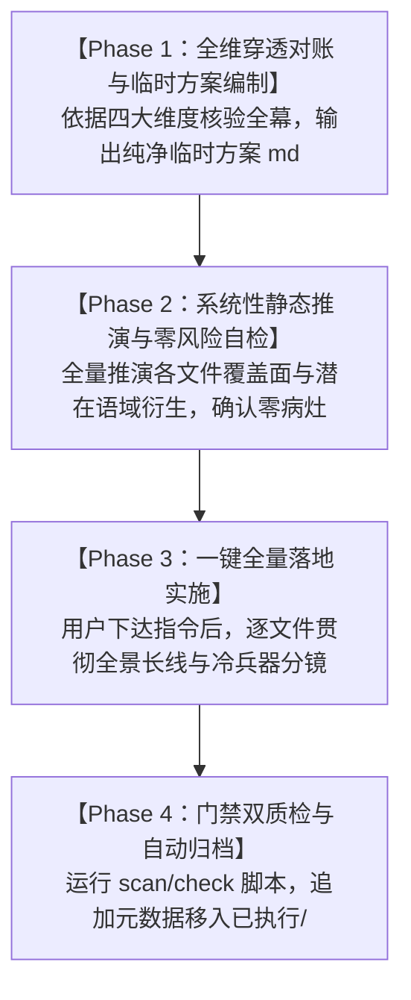

# 第二部主线分幕方案 docs2 穿透对账、剧情矛盾排查与文风深度重塑标准工作流 (Act Refactoring SOP)

> **适用范围**：维里迪亚王国篇（第二部）各幕大纲及分阶段详规的全面体检、设定对账、剧情时空咬合与文风深度重塑。  
> **底层执行中枢**：强制绑定专属技能 [`viridia-writer`](../../.agents/skills/viridia-writer/SKILL.md) 与全局法典 [`AGENTS.md`](../../AGENTS.md)。  
> **权威对账链条 (Single Source of Truth)**：  
> $$\textbf{docs2/ 实体卡档案（第一权威基准）} > \textbf{母案方案集群（00 ~ 06）} > \textbf{幕级大纲} > \textbf{分阶段详规}$$  
> **核心原则（防片面检查铁律）**：本工作流确立的是**系统化、可穷尽、跨角色普适的方法论与审查矩阵**。严禁仅对零散范例词做机械抽查，必须对文本进行四大系统维度的全覆盖穿透审查。

---

## 〇、 全域审查核心原则 (Core Audit Principles)

1. **四维全域穿透**：审查必须严格覆盖“实体溯源、时空因果、文风语域、净室交付”四大完备维度，严禁以局部抽查代替全域核实；
2. **抽象法则生效**：所有审查项均为面向全员、全场景的结构性规则，不依赖孤立词汇匹配；
3. **确定性门禁分离**：词汇级违规由自动化质检脚本刚性拦截，AI 专注审查实体对账、动线连续性、物理受力分镜与声音合同。

---

## 一、 四大系统审查维度与穿透核验矩阵 (The Four-Dimensional Audit Matrix)

每次对某一幕执行体检时，必须逐段按以下四个维度执行无死角穿透核验：

### 维度一：实体卡绝对溯源与人设零 OOC (Entity Grounding Protocol)
严格以 `docs2/` 为第一权威源，核查每一个登场实体：
1. **登场角色三维对账（外貌 / 装备 / 声音）**：
   - **外貌与体态定锚**：发色、瞳色、身高、年龄、体格特征，必须与 `docs2/character/` 或 `docs2/npc/` 逐字对齐，严禁凭经验自造；
   - **武器与战术装备保真**：主武器、副武器、战术配件、护具、特殊构件必须 100% 符合卡片与 `_character_attributes.txt`。严禁擅自给角色增减兵器，严禁使用非设定的兵器类型或防具形态；
   - **声音合同与心智阶段保真**：第一人称、对同伴称谓、口癖、语气节奏必须符合人物档案与篇章演进阶段（如第二部黎恩菲娜为老夫老妻默契，爱丽榭具有学院会长的大气与果决，亚尔缇娜具有细腻真实的少女情感而非机器化）；
2. **零凭空捏造 NPC**：
   - 场景中登场的所有有名有姓角色或特定身份次要人物，必须在 `docs2/npc/` 或 `docs2/character/` 中存在对应建档，或符合该场景合法建制定额；绝对严禁擅自凭空自造未建档的次要角色；
3. **空间舞台与物理建筑保真**：
   - 建筑材质（黑石/花岗岩/玄武岩/砖木）、空间尺度（垂直落差/走廊宽度/阻马设施）、地下水网走势、声学与视线阻隔，必须与 `docs2/location/` 逐字对齐，严禁违反结构力学与空间常理。

### 维度二：剧情时空逻辑与因果连续性 (Continuity & Causality Protocol)
排查剧情发展中的时空漏洞与断层：
1. **角色物理动线全周期闭环（杜绝时空空降）**：
   - 角色出现在当前场景，必须有从前序场景到当前场景的合理位移动线与耗时计算（核对 `06` 物理状态机）；如果跨越了较长距离或封锁线，必须在前序阶段或本阶段起始处交代其行程动因与前置动线，绝对严禁未交代行程凭空瞬移出现在前线；
   - 多线并行推进时，核对各路人马在同一时间节点的物理位置，确保分兵逻辑自洽、无时空分身；
2. **物证与信息传递生命周期闭环**：
   - 核心物证（血书、密信、特许状、通行状原本与抄件、机械构件）的发现、起获、携带、封存、交接，必须形成单向不可逆的严密锁链；
   - 隔空情报共享必须依托符合世界观的实体渠道（王室密鸽、暗桩信使、巡防空档），杜绝角色上帝视角；
3. **生理机理与救护写实化**：
   - 严酷环境（深水、水牢、酷刑、严寒）造成的创伤必须符合现代物理与人体生理机制（失温症、脱水、深层肌肉萎缩、感染）；
   - 救护手段严格基于西幻物质生活与现代常识（高蛋白热汤补充热量与电解质、温水与干爽衣物回温、局部保暖），绝对杜绝中式经络、气血、穴位、中药调理与玄学寒气等文化错位。

### 维度三：语言质感与文风病理全维雷达 (Style & Disease Radar Protocol)
从四个语域层次全面扫描，消灭一切中式武侠、市井方言、仙侠怪谈与机械化通病：
1. **句法结构层（Syntax & Rhythm）**：
   - **根除四字连缀话本律动（四字病）**：连续 3 个及以上四字短语连缀直接判定违规。强制打破 4 字节律，转换为长短舒展交错的现代 JRPG 轻小说散句；
   - **杜绝文言介词倒装句式**：严禁“动词 + 以 + 宾语”及“动词 + 之以”等介词倒装结构，统一转换为现代口语自然动宾散句；
   - **消灭状语重前置话本句**：拆解“就着XX地VV”等结构为“先写状态，再写动作”的自然分镜；
2. **语域与词汇映射层（Lexicon & Register）**：
   - **全量对齐正向映射字典**：词汇、称谓、器物必须 100% 严格对齐 [`lexicon.md`](../../.agents/rules/lexicon.md)；
   - **肃清国术武侠发力与招式体系**：消灭沉腰坐马、力道气劲、身法死穴，全面置换为 JRPG 战技重心位移、踏步惯性、切角格挡偏转（Parry）、弱点破坏（Break）与冷兵器真实重量钝击；
   - **肃清中式市井土俗方言**：消灭时间经历类、状态突变类、市井交际类中式方言，全面置换为纯正 JRPG 清澈现代散句；
   - **物质生活流实体西幻化**：器皿、饮食、家具、度量衡必须严格遵循晨光大陆欧风西幻实体，彻底杜绝中式砂锅、白釉瓷具、中式茶席与传统度量衡；
   - **消灭现代公文通报腔**：杜绝清剿完毕、梳理顺畅、达成共识等会议通报词，置换为现场直接动作与物理交付；
   - **杜绝修饰语堆砌与词义冗余**：清理兵器道具前多余的修饰前缀，剔除修饰语与主词语义重叠的病态组合；
3. **叙事摄影机与沉浸感层（Camera & Narration）**：
   - **Show, Don't Tell**：严禁旁白下场当剧情解说员或替角色定性心绪。一律通过客观物理动作、呼吸节奏与体表细微变化自然呈现；
   - **消灭否定式元叙述**：摄影机只忠实记录发生之事。严禁通过反向声明、否定别家流派或反事实叙述进行自我辩解；
   - **消除单一模式化神态循环**：拒绝机械化反复使用单一微表情动词，依据情境还原鲜活多样的二次元神态；
4. **声音合同与人称法典层（Voice & Person）**：
   - **旁白绝对直呼本名**：叙述中 100% 严格直呼角色本名，绝对禁止使用身份标签、职业头衔或形容词绰号作主语代指；在互动叙述中严禁使用模糊的“他”代指黎恩；
   - **全员拒绝哑剧流水账**：各情境中自然嵌入角色现场直接对白（使用标准引语），融入日轻标志性的可爱吐槽、善意调侃与即时内心独白 `（……）`。

### 维度四：叙事架构与净室交付法典 (Architecture & Clean Delivery)
1. **全景长线剧情叙事模型**：
   - 采用全景长线剧情叙事模型，按因果时序与戏剧张力自然推进；
   - 严格执行双半段命名法则（前半段具象物象——后半段关键行动）与“情境 4~9 条自然伸缩”法典；
   - 末尾情境严格遵循纯物象化余韵收束，严禁残留角色动作或心理总结；
2. **纯净客观交付**：
   - 正文、大纲与方案本体仅记录客观发生的事件与物理设定，严禁包含任何版本修订痕迹、废除声明、改写对照或自卫性阐释；
   - 所有自检、对账比对与质检报告，仅在终端执行并在对话中口头汇报，绝不污染方案或文档本体。

---

## 二、 分幕重塑四阶段标准操作流程 (The 4-Phase SOP)



### Phase 1：全维穿透对账与临时方案编制
1. **调取全套文件与底层卡片**：
   - 当前幕大纲文件 `00_第X幕大纲与接口.md`；
   - 当前幕全部分阶段详规；
   - `docs2/` 对应角色卡、NPC 卡、地点卡；
   - 上一幕交付接口与下一幕输入接口；
2. **穿透审查并输出临时方案**：
   - 依照四大系统审查维度进行穿透对照，整理出清晰的《核心发现清单》；
   - 提取 3~4 个典型高光场景，给出符合 JRPG 轻小说质感的示范分镜；
   - 制定详细的逐文件修改清单与五步走执行计划；
   - 生成《临时方案_第X幕docs2对账、剧情矛盾排查与文风深度重塑方案.md》，保存在 `方案/第二部/主线与世界扩充方案/` 目录下。

### Phase 2：系统性静态推演与零风险自检 (Preflight Verification)
方案生成后，AI 必须主动对方案本体执行全维静态审查：
- **覆盖性推演**：核验五步走计划是否 100% 覆盖了该幕的所有阶段文件以及上下游接口；
- **全域病理自检**：不仅自查零散词汇，而是按四大文风病理层全面推演方案中的所有范例与叙述，确认不存在任何中式武侠、市井方言、成语连缀或倒装病灶；
- **净室核查**：确认方案中绝无“彻底根除、全面统一为”等修订痕迹；
- 确认自检通过后，向用户简要汇报方案编制完成与推演结果，静待用户确认。

### Phase 3：一键全量落地实施 (Execution)
用户确认后，AI 严格按计划执行落地修改：
- **修改幕级大纲**：校准阶段规划规模、获救人员定额、关键物证交接、闭合前后时空接口；
- **修改各阶段详规**：全面贯彻全景长线叙事模型，落地冷兵器物理分镜、日轻生活流呼吸感、现场直接台词与末尾纯物象收束；旁白严格直呼本名。

### Phase 4：门禁双质检与自动归档 (Quality Gate & Archive)
修改完成后，全自动执行质检与归档闭环：
1. **自动化双脚本门禁质检**：
   ```powershell
   python scripts2/scan_viridia_diseases.py
   python scripts2/check_viridia_consistency.py
   ```
   必须确保 0 违规、100% 通过；
2. **临时方案文件归档**：
   - 在临时方案顶部追加执行状态元数据：`> **执行状态**：已执行完毕并完成归档（YYYY-MM-DD）`；
   - 将临时方案移入 [`方案/第二部/已执行/`](file:///d:/Siegfried/世界书/方案/第二部/已执行/) 目录；
3. **关联大纲与周边引用核查**：
   - 同步核查上一层导航 `方案/第二部/README.md` 与前后幕大纲的阶段编号与导航引证，发现历史笔误一并清除；
4. **口头汇报**：向用户汇报落地完成，不把任何质检报告或自检记录残留至方案文档本体。

---

## 三、 用户极简交互指令集 (User Command Shortcuts)

作者在推进新的一幕时，**无需重复编写任何复杂提示词**，直接发送以下极简指令：

### 1. 启动全幕排查（触发 Phase 1 与 Phase 2）
> **“开始第X幕对账与重塑”**  
> 或  
> **“处理第X幕”**

*AI 收到后将全自动调用本 SOP，以四大系统审查维度全面穿透核查，输出临时方案 md 并汇报推演结果。*

### 2. 确认落地实施（触发 Phase 3 与 Phase 4）
> **“开始”**  
> 或  
> **“实施”**

*AI 收到后将全自动修改全部详规与大纲、跑双门禁质检脚本、追加元数据并归档移入已执行目录。*
