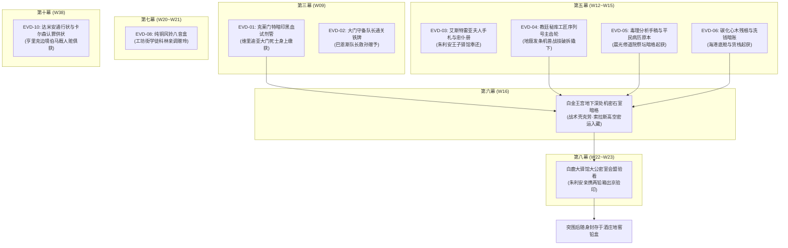

# 跨幕时空线、物理状态机与反派认知读条全景审查报告

> **工作区归属**：`方案/第二部/主线与世界扩充方案/前十幕大调查工作区/`  
> **审查对象**：第一幕至第十幕全景长线时空演进、十大物理铁证生命周期、核心角色物理状态机、以及反派认知读条真实度。  
> **对照基准**：`06_第二部主线跨幕连续性与全局物理状态机.md`、`01_全量设定卡基准白名单与地理时空总表.md`、`docs2/` 全量人物与地点卡。  
> **核心原则**：不修改原方案，全量穿透对账，锁定逻辑硬伤与前后漂移，提出高精度修订建议。

---

## 一、 全局时空日历标尺与 170 公里动线审查

前十幕跨越 **W01 至 W38（共38周 / 约266天 / 接近9个月）**，横跨金穗季（秋）、霜降季（秋末）、沉眠季（冬）、萌芽季（春）、繁荫季（夏）与金叶季（初秋）六个时序阶段。经逐幕对账，时空演进整体扎实，但存在个别关键位移漏洞：

### 1. 前十幕时空演进总览表与对账结论

| 幕次 | 周期代码 | 现实季节 | 核心地理坐标与动线 | 行程距离与交通工具 | 时空对账结论 |
| :---: | :---: | :---: | :--- | :--- | :--- |
| **第一幕** | W01~W03 | 金穗季中~末 | Eldoria大本营（`LOC_D2_01`） | 营地内部活动；朱利安单骑入林初访 | **严密吻合** |
| **第二幕** | W04~W08 | 霜降季初~末 | 大本营 ➔ 界石 ➔ 帝国东部边境（`LOC_D2_38`） | 篷车送粮，时空裂隙往返；全员营地整备 | **微调项**：阶段四朱利安瞬移至托利斯塔站需校准为东部边境联络哨所支线 |
| **第三幕** | W09 | 沉眠季初 | 大本营 ➔ 黑石大门 ➔ 法尔肯驿镇（`LOC_D2_11`） | 双马大篷车 25km/日；古代石砌泄洪暗渠潜行 4km | **严密吻合** |
| **第四幕** | W10~W11 | 沉眠季前期 | 法尔肯（`LOC_D2_11`） ➔ 大本营往返 ➔ 王都 | 玛格丽特快马连夜换乘（120km/14h）；篷车运面粉布匹 | **严重纠偏**：阶段十一将玛格丽特台词中“单程近两百公里”纠正为“整整一百二十公里” |
| **第五幕** | W12~W15 | 沉眠季中期 | 法尔肯 ➔ 四路分道出征（旧领70km / 修道院50km / 海港170km） | 步行、潜行轻骑；战术壳单人紧急支援；晨雾归营 | **严密吻合** |
| **第六幕** | W16~W19 | 沉眠季末期 | 大本营冬歇 ➔ 亚尔缇娜夜驰王都 ➔ 全营降临祭 | 战术壳高空次音速巡航（175km/18min）安全运证 | **致命纠偏**：阶段二十一朱利安“坐乡间板车从王都到森林玩一天当天回去”属于严重时空崩塌，必须修改为战术壳高空接送 |
| **第七幕** | W20~W21 | 萌芽季初~中 | 法尔肯 ➔ 中央王都（120km） ➔ 白鹿驿馆（60km） | 四轮重篷车南下（120km行车3天）；平原大道疾驰 | **严密吻合** |
| **第八幕** | W22~W23 | 萌芽季末期 | 白鹿大驿馆（`LOC_D2_31`） ➔ 艾斯特雷亚酒庄（`LOC_D2_37`） | 泥泞暴雨护送濒死重伤员撤退 50km，历经四天四夜（11km/日） | **严密吻合**，真实体现重伤难行的残酷性 |
| **第九幕** | W24~W35 | 繁荫季整季（12周） | 艾斯特雷亚荒废酒庄地窖（`LOC_D2_37`） | 劳拉整整两个月（60~70天）静养复健；菲奔袭白鹿驿馆取残刃 | **严密吻合**，严格遵循生理康复与锻造周期 |
| **第十幕** | W36~W38 | 金叶季初秋（3周） | 太古石殿（`LOC_D2_05`） ➔ 千米暗河 ➔ 圣殿地牢（`LOC_D2_23`） | 水下潜渡、暗河逆行、排污管道壁虎攀爬 | **严密吻合**，无缝交接第十一幕大劫狱 |

---

## 二、 十大物理铁证全局单向流淌链审查

全书推翻晨光教廷三十年暗影统治、唤醒圣殿骑士团封建法统的脊梁是**严密的客观物理证据链**。对前十幕涉及的铁证进行全景追踪，确认是否存在凭空消失或凭空产生的问题：

### 铁证流淌对账审查明细：
1. **EVD-01（黑血试剂管）**：第三幕菲娜收纳 ➔ 第五幕归入铅盒 ➔ 第六幕密送王宫 ➔ 第八幕朱利安携至白鹿驿馆 ➔ 突围后带至酒庄地窖化验。**状态完全守恒**；
2. **EVD-02（守备铁牌）**：第三幕巴恩斯交付 ➔ 第四幕长桌复盘明确局限性 ➔ 第七幕凭此租下商行 ➔ 第八幕伏击中被达米安辨识。**状态完全守恒**；
3. **EVD-03（夫人临终手札与忠仆册）**：第五幕朱利安奉还 ➔ 艾德里安死死护在胸前 ➔ 第九幕地窖出示唤醒忠仆吉尔与葡萄农。**状态完全守恒**；
4. **EVD-04、EVD-05、EVD-06（工匠齿轮、毒理病历、心木残根与账本）**：第五幕四路分别起获 ➔ 第六幕装入防震铅箱夜驰王宫 ➔ 第八幕密室供亨里克验看盖印 ➔ 突围保全至第九幕酒庄。**流淌清晰，无空降无丢失**；
5. **EVD-08（纯铜八音盒）**：第七幕科林赠玲 ➔ 第十幕深渊暗河畔奏响安抚同伴。**闭环完整**；
6. **EVD-10（达米安通行状与卡尔森供状）**：第十幕亨里克边境伯马厩人赃俱获起获，作为压垮反派法统的关键铁证，锁定于布鲁诺城堡地牢。**生成顺理成章**。

---

## 三、 核心角色伤病演进与生理状态机审查

第二部摒弃了“断骨隔章自愈”的网文通病，严格执行客观生物力学与物理恢复周期：

### 1. 劳拉（Laura）——双手大剑断折与 60~70 天深度生理康复
* **受创物理实质（第八幕阶段二十七）**：舍身横剑硬撼三米高机兽酸液重锤，星银大剑因酸蚀晶格脆化断折，胸部受万钧钝力震荡，多发性肋骨骨裂，强酸冲击波致脏腑内壁撕裂大出血；
* **三阶生理康复时间线严格对账**：
  - **4月（繁荫季首月 / W24~W27）**：急性期。绝对卧床，艾琳娜修女金盏花软膏与龙胆草粉清创，严禁剧烈颠簸（阶段二十九）；
  - **5月（繁荫季次月 / W28~W31，满一个月）**：亚急性期。内出血止住，骨痂初步固化，可在搀扶下轻度走动参与战术推演，**严格严禁提拿重物与挥剑**（阶段三十）；
  - **6月（繁荫季末月 / W32~W35，满两个月以上）**：康复重塑期。菲取回残刃，矮人百炼重铸防酸破邪巨剑运抵，劳拉双手试剑横斩，完全恢复全盛战力（阶段三十一）。

### 2. 雷恩（Raine）——黑铁重水牢 120 天残酷受难
* **受难实质（第八幕阶段二十八至第十幕）**：为断桥掩护全队撤退，桥头力竭被俘，戴三十公斤生铁重枷，押入圣殿要塞底层三十米深度第七号黑铁水牢；
* **生理极限对账**：冰冷暗河水没膝，伤口溃烂，依靠晨光剑术呼吸法维系心脉，以及巴恩斯水牢照应与亚尔缇娜第十幕密送生肌药粉续命；
* **时间跨度**：自 3 月下旬被俘至 7 月底大劫狱，历经整整 **4 个月（约 120 天）**，完全达到资深骑士肉体与精神耐受极限。

### 3. 朱利安（Julian）——左肩穿透伤与单臂吊挂
* **受创实质（第八幕阶段二十八）**：掩护众人突围时撕裂王袍反向截杀追兵，左肩遭圣殿巡骑短矛贯穿；
* **演进链**：第九幕阶段二十九由艾琳娜缝合清创，阶段三十起左臂吊挂绷带，以王储身份在前线地窖与艾德里安并肩调度近卫。伤停状态真实自洽。

---

## 四、 反派阵营认知读条与智商逻辑审查（杜绝开天眼与降智）

审查前十幕中四大主要反派的**情报获取渠道、决策动因与阵营内讧裂痕**，排查是否存在“凭空知晓主角行动（开天眼）”或“莫名其妙放水送证据（降智）”：

### 1. 达米安·克莱因（异端审问厅执行官·29岁）
* **情报认知读条链**：
  - 第三幕：在维里迪亚大门投毒企图烧营，死士被全歼，验尸发现关外草药与纯重剑脊钝击痕迹 ➔ **得出结论**：“有北方顶尖高手潜入平原”；
  - 第五幕：法尔肯粮仓纵火被市政公署反制、焦土地窟机兽排气阀被毁 ➔ **得出结论**：“艾斯特雷亚旧领有余孽活动”；
  - 第七幕至第八幕：布鲁诺家族文书随从卡尔森在备车时私抄密盟信笺送达 ➔ **得知实情**：“朱利安亲携四大铁证在白鹿大驿馆会盟” ➔ 暴怒调集全境异化死士围攻；
  - 第十幕：企图给内奸卡尔森签发安全通行状（EVD-10）灭口，被亨里克边境伯马厩人赃俱获。
* **优化建议**：死士携带 EVD-01 黑血试剂管的动因需补充“企图栽赃北方商队”的微设定。

### 2. 阿达尔伯特·冯·克劳斯（圣殿大团长·59岁）
* **决策逻辑与内讧裂痕**：
  - 第三幕：冷眼旁观大门纷争，严禁圣殿骑兵介入教廷脏事；
  - 第八幕白鹿大驿馆：奉主教手谕调兵封路，但严令莫尔茨“圣殿只管封路戒严，教会在泥水里办的脏事概不掺和”；在桥头亲眼目睹黑血狂骑手腕圣殿烙印，信仰首次撕裂；**果断拔剑斩飞达米安毒刺剑与雨伞，强扣雷恩**：“雷恩是圣殿受封骑士，轮不到教会私刑处置！”；
  - 第九幕旧领界标：亲见奥蕾莉亚单手挥剑劈裂十二米石峡，清醒断定“强攻必伤亡惨重、不能给主教当炮灰”，签发戒严令封关只守不攻。

### 3. 莫尔茨·克鲁格（要塞典狱长·38岁）
* **侦察与执行力**：
  - 第三幕阶段十：翻阅巡查日志，一眼看破黑石峡谷水闸绞盘刻度被墨水刮擦，当即派人暗中盯死巴恩斯；
  - 第八幕白鹿河石桥：提前立起木栅尖桩封死干道，重盾撞击俘获雷恩；
  - 第九幕至第十幕：在地下水牢施加三十公斤重枷，严防死守；但被黎恩菲娜借征调冷锻间工匠之机打入内部。

---

## 五、 全局审查需处置项清单

1. 彻底剔除第五幕阶段十七危机时刻的“吃香蕉”出戏与 OOC 描写；
2. 彻底修改第六幕阶段二十一朱利安“乡间板车日行 350 公里”时空漏洞，接入战术壳高空接送；
3. 补齐卡尔森·沃克（NPC_D2_27）独立设定卡，消除与远祖先灵埃尔德莱恩（NPC_D2_22）的编号重叠。
