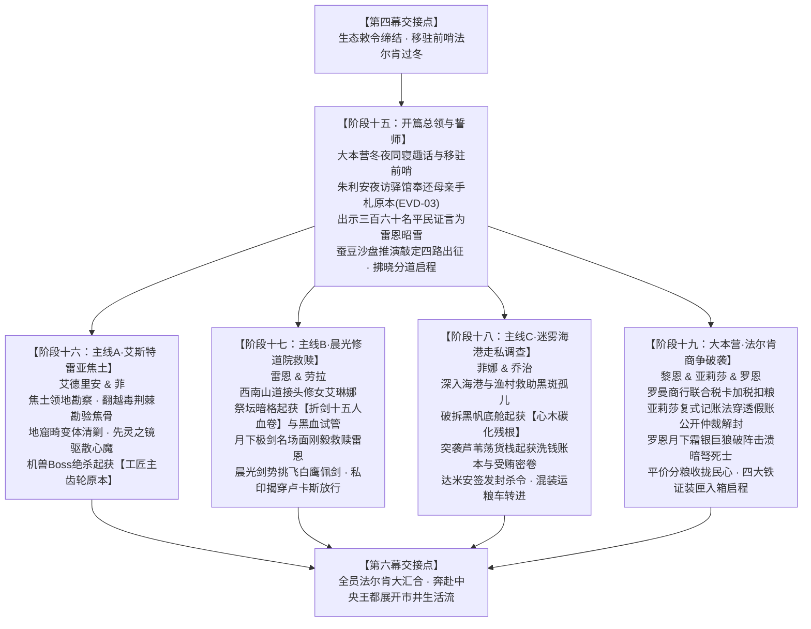

# 当前任务检查点：第五幕分道巡礼剧情推进与分阶段详规研讨

> **文档定位**：第二部宏篇主线核心推进·第五幕【分道巡礼·虚妄的线索】剧情演进、分阶段详规研讨与长线咬合核心检查点备忘录。  
> **建立时间**：2026-10-13  
> **关联母案**：[00_第二部宏篇主线总纲与方案管理中枢.md](00_第二部宏篇主线总纲与方案管理中枢.md) · [01_宏篇主线剧情总大纲与分幕导航.md](01_宏篇主线剧情总大纲与分幕导航.md) · [02_王国地理版图、封建社会阶层与货币经济基准.md](02_王国地理版图、封建社会阶层与货币经济基准.md) · [03_生活流张弛律动、营地温情后勤与工坊反差方案.md](03_生活流张弛律动、营地温情后勤与工坊反差方案.md) · [04_全境三方武装力量、战斗克制链与黑幕权谋博弈方案.md](04_全境三方武装力量、战斗克制链与黑幕权谋博弈方案.md) · [06_第二部主线跨幕连续性与全局物理状态机.md](06_第二部主线跨幕连续性与全局物理状态机.md)  
> **关联详规**：[00_第五幕大纲与接口.md](分阶段详规/05_第五幕_分道巡礼·虚妄的线索/00_第五幕大纲与接口.md) · [阶段十五详规](分阶段详规/05_第五幕_分道巡礼·虚妄的线索/阶段十五_驿馆盟约缔结·母亲手札与蚕豆沙盘分兵详规.md) · [阶段十六详规](分阶段详规/05_第五幕_分道巡礼·虚妄的线索/阶段十六_艾斯特雷亚焦土与炼金机兽详规.md) · [阶段十七详规](分阶段详规/05_第五幕_分道巡礼·虚妄的线索/阶段十七_晨光修道院救赎与折剑十五人详规.md) · [阶段十八详规](分阶段详规/05_第五幕_分道巡礼·虚妄的线索/阶段十八_迷雾海港走私网络与暗影黑帆详规.md) · [阶段十九详规](分阶段详规/05_第五幕_分道巡礼·虚妄的线索/阶段十九_法尔肯迷雾商争与月下破袭详规.md)  
> **核心研讨目标**：聚焦第五幕四路分道巡礼独立调查剧情演进、阶段十五至十九分阶段详规咬合、四大物理铁证流转闭环与前后幕时空接口自洽，确保宏篇主线在十三幕四十二阶段体系下平稳深化推进。  
> **执行状态**：**【🔥进行中·当前核心研讨焦点】**。

---

## 一、 现状全景与演进架构（十三幕四十二阶段体系下的第五幕）

### 1. 幕级宏观定位与戏剧张力
第五幕在全篇十三幕架构中承上启下，处于**【边境扎根完成 ➔ 触碰禁区核心 ➔ 步入王都大舞台前夕】**的至关重要转折点：
* **承接第四幕**：森林五族心结彻底解开，与王储朱利安缔结绝密《生态保护敕令》，大后方大本营稳固隐蔽；商队换装深冬保暖装束，移驻前哨法尔肯驿镇“猎鹰与十字”驿馆落脚过冬；
* **核心戏剧张力**：三轨并进展开深度独立调查，逐步触碰反派核心禁区；自以为步步为营掌握主动、接连攻克据点并缴获铁证，实则逐步踩入反派早已精心编织的政治与军事绞杀罗网；
* **交接第六幕**：四大物理铁证归拢装箱，全员汇聚法尔肯整备四轮重篷车，奔赴中央王都开启繁华市井与反垄断商战长卷。

### 2. 五阶段扩充演进全景架构

---

## 二、 核心研讨课题与戏剧力学推演

### 1. 课题一：分兵战术逻辑与时空同步性（蚕豆沙盘 ➔ 四路出征 ➔ 法尔肯信息汇聚）
* **分兵深层战术动因**：
  1. **地理跨度与严冬封路威胁**：艾斯特雷亚焦土、西南晨光修道院、南方迷雾海港三处核心调查点呈三角分布，纵深达170公里。沉眠季深冬暴雪随时可能封山阻断道路，必须兵分三路赶在雪融封路前核实线索；
  2. **避免全员行动目标过大引发警惕**：全员集体行动必然惊动圣殿关卡与教廷眼线；伪装成商号雇工与零散采办人员分散行动，隐蔽性最高；
  3. **大本营法尔肯的核心调度价值**：法尔肯作为交通十字路口，由黎恩、亚莉莎与罗恩坐镇调度，既是三路外勤的物资与情报中继站，又能在商争危机爆发时守住全员退路。
* **时空同步与通信机制**：
  - 四路行动在历时三至四周的时间窗口内并行推进；
  - 严格依托正规行商传信、信鸽与暗记密码传递简讯，杜绝导力通讯外溢。

### 2. 课题二：四大物理铁证（EVD 证物链）闭环流向与破案链条
* **铁证一（机械制造链）**：【教廷秘库工匠序列号主齿轮原本】（阶段十六起获），实锤教廷秘密制造古代发条机关机兽的罪证；
* **铁证二（受害者名誉与人身链）**：【拒杀平民十五人抗命名册原本】与【暗影黑血试剂管原本】（阶段十七起获），证实十四年前戈德弗里等十五名老骑士因抗命拒杀平民被秘密关押（阿达尔伯特知情扣押于圣殿水牢、教廷欺瞒称其在修院苦役），为雷恩平反昭雪并动摇骑士团年轻世代（卢卡斯）；
* **铁证三（生态罪证链）**：【三十一年前心木树枯萎碳化残根】（阶段十八起获），彻底揭穿教廷掠夺心木核心做禁忌实验、导致大森林枯萎与水源恶化的真相；
* **铁证四（权钱交易链）**：【黑市洗钱账本全卷与受贿贵族往来密卷】（阶段十八起获），揭露特许行会罗曼商行、圣殿贪腐官员与教廷异端审问厅之间的黑金洗钱网络；
* **法尔肯终极装箱**：在阶段十九末尾，四大铁证由黎恩统筹装入特制防震封蜡铁匣，成为进入第六幕后瓦解王都行会垄断、并在第十三幕法理大审判中宣判反派死刑的铁证基石。

### 3. 课题三：势力二元隔离与反派智力防线
* **二元机构严格隔离铁律**：
  - **晨光教廷**（神权、司铎、修道院、发条机兽、地下秘库、异端审问厅达米安/克莱门特三世）；
  - **圣殿骑士团**（修会封建霸权、大要塞、重骑兵、白鹰分队卢卡斯、典狱长莫尔茨、大团长阿达尔伯特）；
  - 严禁出现“教廷骑士 / 圣殿修道院”混用混淆。
* **卢卡斯调令合理性与信义动摇**：
  - 卢卡斯奉调封山并非叛国，而是克莱门特三世私自加盖主教火漆伪造的调兵令；
  - 见证雷恩精妙剑势只击落佩剑不伤一人，以及当面拆穿主教私印后，卢卡斯信义动摇选择恪守古训放行，逻辑严密且人物丰满。
* **虚妄线索的深层阴谋**：
  - 反派特意露出破绽，表面上是各据点防守松懈被主角团逐个击破，实则是教廷特使达米安企图利用主角团搜集证据的动向，将他们精准诱导至王都商业垄断与伏击死局之中。

### 4. 课题四：生活流细节、深冬呼吸感与感情升温
* **沉眠季深冬物候与服饰**：
  - 粗棒针织厚围巾、细呢斗篷、水獭毛大氅、翻领风衣；
  - 石壁炉炭火、热香料苹果红茶、大食堂浓稠燕麦羊肉汤、粗麦饼烘烤香气；
* **情感温情与日轻幽默**：
  - 阶段十五大本营木屋同寝趣话：爱丽榭与亚尔缇娜抱着暖炉求同寝、菲娜两面兼顾的治愈感、黎恩被赶去睡硬木长沙发自嘲家庭地位垫底；
  - 菲娜与黎恩老夫老妻的默契相依与调侃，自然流露老夫老妻特有的眼神与耳语。

---

## 三、 第五幕分阶段详规对账与深化清单

| 阶段文件 | 当前规模与字数 | 核心对账点 | 质检与演进状态 |
| :--- | :---: | :--- | :---: |
| **00_第五幕大纲与接口.md** | 92 行 / 10KB | 全局时序三至四周、四路分道巡礼全景表、四大铁证交接契约对齐 | ✅ 结构完备对齐 |
| **阶段十五_驿馆盟约缔结·母亲手札与蚕豆沙盘分兵详规.md** | 39KB（全景长篇） | 母亲手札（EVD-03）、平民证言、双重生态敕令、蚕豆沙盘分兵推演 | ✅ 完工，宏大生动 |
| **阶段十六_艾斯特雷亚焦土与炼金机兽详规.md** | 17KB（全景长篇） | 焦土勘察、先灵之镜驱散心魔、Boss破拆战起获主齿轮原本 | ✅ 完工，战斗克制自洽 |
| **阶段十七_晨光修道院救赎与折剑十五人详规.md** | 19KB（全景长篇） | 戈德弗里等十五人名册、月下极剑名场面、挑刃不伤人、卢卡斯信义放行 | ✅ 完工，情感张力充沛 |
| **阶段十八_迷雾海港走私网络与暗影黑帆详规.md** | 18KB（全景长篇） | 救助黑斑病患孤儿、破拆底舱起获心木碳化残根、突袭货栈获洗钱账本 | ✅ 完工，生态动因坚实 |
| **阶段十九_法尔肯迷雾商争与月下破袭详规.md** | 17KB（全景长篇） | 复式记账法穿透假账、市政公秤仲裁、月下霜银巨狼破阵、四大铁证装箱 | ✅ 完工，商战生活流兼具 |

---

## 四、 写作法典与红线防御

在后续围绕第五幕展开剧情演进、分章创作与精修时，必须严格恪守以下红线：
1. **文风纯净与语言质感**：以日式轻小说与 JRPG 剑与魔法为基准，轻松有趣的生活流日常，严禁成语密集堆叠与假古雅修辞，严格查验 [`lexicon.md`](../../.agents/rules/lexicon.md)；
2. **零导力与中世纪工程物理**：全境严格遵守零导力隐蔽原则，沙盘采用行商随手可得的马掌钉与干蚕豆，锁具、地窟机关、发条机兽均为纯中世纪机械与发条齿轮，严禁魔法玄学偷懒；
3. **老夫老妻直呼其名**：黎恩与菲娜私下相处严格直呼其名，展现老夫老妻特有的深情默契与调侃，严禁在旁白中使用身份标签，严禁自称幼态；
4. **骑士团体制度**：圣殿全境严禁出现世俗现代军队官僚表述，统一采用“先锋骑兵队、要塞守备、巡防、大团长”。
