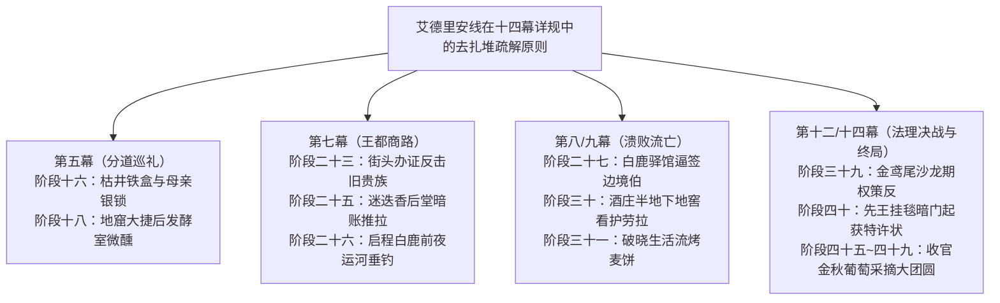
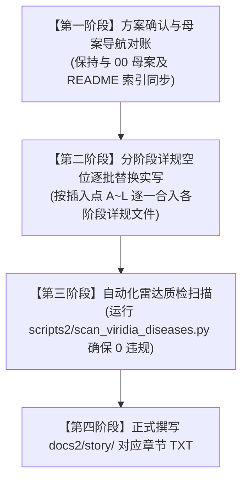

# 艾德里安主线剧情扩充大纲与分阶段详规插入方案

> **所属母案**：[00_第二部宏篇主线总纲与方案管理中枢.md](00_第二部宏篇主线总纲与方案管理中枢.md) · [01_宏篇主线剧情总大纲与分幕导航.md](01_宏篇主线剧情总大纲与分幕导航.md)  
> **文档属性**：第二部主线A（艾德里安线）角色弧线重构与分阶段详规精确定位插入方案  
> **核心基准**：**纯正日式 RPG 剑与魔法（JRPG Western Fantasy）**，轻松有趣的日式轻小说日常与呼吸感，穿插可爱生动的内心独白与吐槽，兼顾成人向情感张力与背德反差。  
> **底层防御**：严格遵循 [`viridia-writer`](../../../.agents/skills/viridia-writer/SKILL.md)、[`writing-guards.md`](../../../.agents/rules/writing-guards.md) 与 [`lexicon.md`](../../../.agents/rules/lexicon.md)。

---

## 一、 艾德里安角色定位与十四幕架构对账

### 1. 核心人设与戏剧资产（docs2 基准）

* **基本属性与外貌**：27岁，维里迪亚王国艾斯特雷亚家族末裔，身高 182cm。银灰色长发随意束在脑后，几缕碎发垂落额前；琥珀色眼睛带着狡黠与玩世不恭的笑意，底色深沉内敛；身穿考究但略显磨损的深色天鹅绒贵族长外套，领口有褪色的双剑鹫鹰家纹刺绣；腰佩精工家传刺剑；家传指环（家督信物）已在第一部赠予劳拉（“带着它回来”）。
* **家庭伦理与三人羁绊定位**：
  * 在营地中以王国后来者风俗成为女主人劳拉排名第二的丈夫，与雷恩及劳拉共同维系着三人家庭；
  * 平时爱调侃劳拉“女主人”，在三人家庭中体贴周到地照顾劳拉；对第一位丈夫雷恩充满敬重，两人在战术与日常配合中极具默契；三人家庭让他重新找回了归宿与生活实感。
* **核心性格反差与心理防线**：
  * **用轻浮掩饰自尊**：外表慵懒浪荡、言语轻佻调侃，嘴角常挂让人捉摸不透的弧度；面对困境习惯摆出“我早就猜到了”的从容模样；
  * **对“失去”具有防备心理**：八岁亲历家族城堡覆灭，痛失双亲与领地，靠浪子面具抵御创伤；内心渴望作为真实的“艾德里安”被同伴需要，排斥空洞的同情；
  * **特有的语言习惯**：从不直接使用“我需要”、“我想要”，习惯将诉求包装为提议（“你想去酒庄看看吗？刚好我也要去”）；眼角在说真话时会微微收紧；被戳穿时会停一息然后笑着转移话题；
  * **面对精灵守护者的敬畏**：面对高洁的精灵守护者 Seraphina（菲娜），他的轻佻假面容易短暂失灵，随后用更夸张的玩笑掩饰内心的敬重。
* **历史使命与诉讼正名之志**：
  * **核心历史节点**：三十一年前教会秘密启动古代暗影实验；十九年前实验失控暴走毁灭城堡，官方构陷定性为“工坊殉爆与境外流寇洗劫”；当时年仅八岁的艾德里安在母亲“活下去”的嘱托中由忠仆护送逃出；
  * **司法大原告定位**：深知暗杀无法洗刷污名，必须凭借物理铁证（冲压齿轮、灭门密令、王家特许状原本），在王国大法庭与大陪审团面前公开推翻伪案，为家族昭雪并合法收复祖地。

### 2. 现有架构失衡点与去扎堆原则

在十四幕四十九阶段主线详规骨架中，艾德里安的专属剧情在具体分布中必须严格遵守**跨阶段自然疏解、切忌单点扎堆**的原则：

---

## 二、 艾德里安专属设计四大原则

### 原则 1：确立专属声音合同与双层声线结构

* **表层对白（幽默调侃与反客为主）**：
  * 面对危险：“真不凑巧，我的刺剑刚擦了昂贵的防锈油，弄脏了可是要扣你报酬的，黎恩。”
  * 被关心时嘴硬心软：“劳拉，不要用那种看着迷路小狗的眼神看我，好歹我也是有爵位继承权的男人……好吧，面包如果再多抹一层黄油，我可以考虑接受女主人适度的同情。”
* **深层内心独白（细腻观察与日轻吐槽）**：
  * *对黎恩*：“（这家伙又在多管闲事了。明明自己身上的麻烦比谁都多，却总是第一眼先看别人有没有受伤。真是个无药可救的烂好人……不过，能把后背交给这种笨蛋，大概是神明对我唯一的恩赐吧。）”
  * *对菲*：“（这只猫系猎兵又从不知道哪个房梁上跳下来了，落地连点灰尘都没扬起来。她是真的把我的斗篷当成了猫抓板吗？）”
  * *对菲娜*：“（每次这位精灵守护者大人露出温柔微笑的时候，我都觉得周围的空气好像都变得高尚起来了……啧，果然正经的气场是我这种泥泞里打滚的浪子最应付不来的东西。）”

### 原则 2：深化三人家庭剑士心魂共鸣与信物闭环

* 劳拉脖颈间系着艾德里安托付的家传戒指；劳拉双手大剑折断后，艾德里安守护其养伤，并在深夜借刺剑助劳拉参悟刚柔相济的剑理；
* 雷恩在死牢受难，艾德里安与劳拉心系长兄；在重铸大剑期间，艾德里安提供家族古代工匠配比配方，将三人的命运紧密相连。

### 原则 3：强化第七幕王都社交修罗场中的贵族风骨

* 艾德里安身着洗得发白但整洁考究的风衣，在商会和旧集市面对当年侵吞家产的远亲旧贵族，以无可挑剔的高阶贵族礼节与辛辣毒舌从容回击，不卑不亢地获取情报。

### 原则 4：深化与第一王子朱利安的双雄羁绊

* 朱利安背负着王室历史的愧疚，艾德里安带着灭门旧创。两人从初见的审慎试探，到第五幕的默契配合，再到第十二幕王宫取证与第十四幕真理广场公审，结成坚固的君臣与挚友盟约。

---

## 三、 逐幕分阶段详规精确定位插入方案

全案 11 个核心高光情境全部采用标准的**双半段命名法**与纯正 **JRPG 简明情境叙述段**（无章节伪编号、无多余列表、台词自然嵌入、结尾纯物象化收束），并精确标注在各阶段详规中的**插入位置与承接逻辑**：

### 1. 第五幕：分道巡礼·虚妄的线索（分散插入阶段十六、阶段十八）

#### 【插入点 A】第五幕·阶段十六（荒原潜行与地窟惊魂）
* **插入位置**：紧接情境 1《荒原棘草——石穴干粮与酒庄暗门》之后、前往主堡废墟之前。
* **戏剧功能**：两人抵达酒庄建立隐蔽据点，艾德里安顺手去后院枯井取回童年铁盒，作为进入沉重废墟前的轻快生活流调剂。

### 枯井旧匣——少主暗记

午后干燥的冷风刮过荒原，艾德里安领着菲踩着碎石穿过艾斯特雷亚庄园干瘪的老葡萄藤架，来到后院一口坍塌半边的石砌枯井旁。艾德里安脱下外套挂在枯枝上，单手攀住井壁凸起的花岗岩轻巧降下数米，在青苔石缝里抠出一枚刻着歪扭鹫鹰图案的生锈铸铁小盒。

菲坐在井沿上晃荡着双腿，嚼着硬燕麦果干歪头看着爬上来的艾德里安：“十九年前的宝藏？只有两枚磨光的河卵石、一枚黄铜哨子，和一颗早就变硬的风干蜜饯。”艾德里安擦去铁盒上的泥污，笑着自嘲：“别小看它们，菲。当年我八岁，可是拿三把木剑从领民铁匠儿子手里换来的好东西——顺便一提，那颗蜜饯我当年舍不得吃，现在看来是个明智的决定。”

菲嘴角微翘，将一片干酪饼塞进艾德里安手中。生锈铁盒被妥善收进皮行囊，井沿边几株野生忍冬草在风中轻轻摇晃。

---

#### 【插入点 B】第五幕·阶段十六（荒原潜行与地窟惊魂）
* **插入位置**：直接融入情境 5《忍冬暗龛——焦骨残垣与学者绝笔》中段。
* **戏剧功能**：与父亲手稿、黄铜小鹫鹰一同起获，作为母亲针线遗物深读，确立为家族正名之志。

### 胎发银锁——母亲的针线

废弃书房的残垣断壁下，艾德里安独自坐在石台上，就着照进窗洞的月光清点起获的旧物。手稿最底层压着一只褪色的深蓝丝绒布包，里面装着一把小铜剪刀、几枚顶针，以及一枚银线缠绕的淡金色小银锁，内圈刻着他八岁时的乳名。

看着母亲留下的遗物，艾德里安收敛起平时的轻浮，坐在石台前沉默了一会儿，眼圈泛红地将小银锁妥善贴身收好。菲抱着双枪剑靠在石门边安静守着，并未出声打扰，只是拉起斗篷替他挡住窗缝钻进来的穿堂风。艾德里安站起身拍掉裤腿上的尘土，目光恢复了平素的从容坚毅。

天边泛起一层白光，门外石阶上一片被晨霜打透的枯叶静静贴在石面上，晨风穿过空荡的石窗。

---

#### 【插入点 C】第五幕·阶段十八（机巧穿轴与白鹰立信）
* **插入位置**：紧接二探地窟战技破拆、成功撬下教廷主齿轮（EVD-04）之后、次日启程归林前的休整夜。
* **戏剧功能**：彻底拉开与阶段十六的距离，安排在胜仗之后酒庄发酵室的深夜张弛与温情吐露，情绪推向治愈高点。

### 熏风微醺——橡木桶之吻

夜幕降临，庄园半地下发酵室内的石壁炉升起栎木炭火，微红火光将高大的橡木桶阵列映照出深沉的剪影。艾德里安用细银针从石槽暗瓮中抽取出一小瓶存放了十九年的红酒陈酿，倒在两只粗陶矮杯里，微酸的发酵果香在暗室内散开。

菲盘腿坐在羊毛垫上小口喝酒，原本绷紧的肩膀慢慢放松下来。艾德里安靠在木桶旁，轻声讲起小时候秋收全村踩葡萄的旧事，目光温和地看着火光映照下菲的侧脸。菲放下酒杯凑过来，直接点破他眼底掩藏的心绪：“你笑的时候，眼睛在哭呢，少爷。”艾德里安愣了愣，随后无奈笑出声，伸手揉乱了菲柔软的短发，轻声承认自己确实忘不掉从前。

壁炉里的炭火轻轻爆出一颗细小的火星，在石板地面上静静熄灭，暗室深处只剩下悠长均匀的呼吸声。

---

### 2. 第七幕：王都商路·繁华市井与暗潮生活流（分散插入阶段二十三、二十五、二十六）

#### 【插入点 D】第七幕·阶段二十三（王都初至与心木商行）
* **插入位置**：陪同亚莉莎前往市政公署办理商行居留与营业许可的路途上。
* **戏剧功能**：初抵王都直面当年侵吞家产的旧贵族男爵，以无可挑剔的高阶贵族礼节优雅反击，展现日轻反差趣味。

### 破烂校袍——昔日公学

王都上城区的大道两侧，贵族宅邸的高耸铁艺栅栏整齐森严。艾德里安身穿浆洗干净的旧公学深色风衣，拿着文书夹与亚莉莎并肩穿过喷泉广场前去办理商行许可。迎面走来一名身穿浮夸紫绸长袍的中年贵族——正是十九年前带头侵吞艾斯特雷亚外围林场的远亲男爵。

男爵停下脚步，傲慢地讥笑落魄少爷如今沦落到在北方做皮毛买卖。艾德里安脚步不停，单手脱帽行了一个标准的宫廷礼节，语气从容地反击：“难得男爵大人还惦记我。不过比起关心我的营生，您最好注意一下袍子领口的紫天鹅绒——那是去年的染料款式，右边褶皱也裁歪了两厘米，看来上城裁缝的做工和男爵府的年金一样缩水不少呢。”

男爵被噎得脸色发青说不出话，引来路过的几位贵妇掩嘴发笑，亚莉莎在一旁也差点没憋住笑声。艾德里安戴好帽子从容走过街角，远处晨光大教堂的钟声在街巷上空回荡。

---

#### 【插入点 E】第七幕·阶段二十五（王都繁华沙龙与市井暗涌）
* **插入位置**：阶段二十五中段，玛格丽特抵京坐镇心木商行，各路展开王都社交与情报刺探期间。
* **戏剧功能**：避免在初至王都时扎堆，安排在夜间赴心木商行二层账房核对暗账，以洗钱漏洞换取两百张免检印花。

### 心木后堂——熟女的算盘

王都下城心木商行二层账房内，厚重的墨绿天鹅绒落地帘隔绝了运河水声，黄铜灯点着雪松精油散发香气。玛格丽特夫人身着深勃艮第红天鹅绒长裙，戴着垂有细金链的单片金丝眼镜，靠在胡桃木软椅上慢慢晃动着水晶杯里的蒸馏酒。艾德里安坐在长木桌前拿着羽毛笔核对账册，将商行暗账里被异端审问厅抽走的漏洞一一挑出。

玛格丽特端着酒杯走过来，倾身打趣艾德里安要是当年没逃去北方而是留在她身边，如今王都南商道的主人说不定就是他了。艾德里安放下羽毛笔同她轻轻碰杯，眼神带着调侃：“在您这位能把大主教私兵算进账本的理事面前，我这点本事不过是赚口饭吃——要是能把报酬换成两百张免检印花，我很乐意陪您多喝几杯。”玛格丽特笑着把盖有商会紫蜡印的信封丢在桌上。

偏厅的水晶吊灯轻轻晃动，光影在墙面上投下两道交错的浅影，室内只剩下桌上烛芯燃烧的轻响。

---

#### 【插入点 F】第七幕·阶段二十六（纯铜八音盒商行托付与白鹿启程）
* **插入位置**：阶段二十六末段，商队启程赴白鹿旅舍的前夜。
* **戏剧功能**：在暴风雨（第八幕血色伏击）来临前夕的静谧码头，与黎恩垂钓夜谈，确立交付后背的生死托付。

### 运河夜舟——两把短剑的影

深夜的王都下城运河水面泛着粼粼波光，沿街商铺早已打烊，心木商行货栈码头的一盏防风马灯映照出一小片黄光。艾德里安与黎恩并排坐在石阶边上，手里握着用麻线和铁钩自制的简易钓竿，脚边放着半坛温热的黑麦酒。

艾德里安打了个哈欠，打趣黎恩每天既要搬运沉重的货箱，又要帮钟表铺修推车，晚上还得给同伴做夜宵，简直像修道院苦行僧转世。黎恩爽朗地笑着喝了一口麦酒，直接指出艾德里安白天办手续被卡住时手背都在暗暗用力。艾德里安无奈失笑，坦言黎恩这种老好人在王都容易吃亏，但真遇到危险自己肯定会拔剑帮他。黎恩笑着拍了拍他的肩膀，两人在带着冷意的夜风中看着水面浮标。

河面上的驳船缓缓划开水波，细浪拍打着台阶上的青苔，远处钟楼的更次声在夜色中慢慢散去。

---

### 3. 第八/九幕：血色伏击、绝境流亡与领主誓约（分散插入阶段二十七、阶段三十、阶段三十一）

#### 【插入点 G】第八幕·阶段二十七（合流会盟与白鹿大驿馆围城）
* **插入位置**：阶段二十七大公会盟前夕，白鹿旅舍二层贵族套房。
* **戏剧功能**：单独面对平原商道大领主亨里克边境伯，以先王密印与地下暗影管网为筹码，迫使其加盖私印加盟。

### 密室筹码——艾斯特雷亚的份量

白鹿旅舍二层石造套房内，大理石壁炉干柴毕剥作响。亨里克边境伯身材魁梧、蓄着铁灰络腮胡，手戴金鹰家徽印戒坐在高背椅上审视着艾德里安，冷淡地表示艾斯特雷亚已成焦土，一个流亡少主的名头不值得平原领主冒着风险出兵。

艾德里安将带有先王金印的关防文书放在桌上，神色沉稳，条理清晰地摆明利害：教廷暗影实验正沿着地下水脉蔓延，一旦决口，最先遭殃的就是边境伯自家的十万亩麦田与庄园。朱利安王子适时入场背书，承诺平原各领战后保留世俗税权，亨里克边境伯思量权衡，终于在同盟盟卷上加盖了私印。

厚呢窗帘被门外涌进来的风吹得剧烈晃动，走廊过道刮过一阵阵冷风，天际深处的闷雷在厚重云层中缓缓滚动。

---

#### 【插入点 H】第九幕·阶段三十（泥泞逃亡、领民相护与领主觉醒）
* **插入位置**：大溃败突围后撤入艾斯特雷亚酒庄半地下地窖的第一夜。
* **戏剧功能**：劳拉重伤断剑卧床，艾德里安以第二位丈夫身份细致看护女主人，守护家传戒指与断刃誓约。

### 冰泉冷敷——戒指与残刃

深夜的艾斯特雷亚酒庄半地下地窖里十分安静，墙角点着一盏微弱的油灯。劳拉因受暗影酸液冲击脏腑发着高烧，艾德里安端来一盆冷泉水，轻轻将湿布换在劳拉额头上。劳拉翻身时，挂在颈间皮绳上的双剑鹫鹰家传戒指从领口滑出，艾德里安伸手将戒指轻轻托住。

劳拉迷迷糊糊睁开眼，认出床边的青年，声音微弱地说大剑虽然折断了但戒指保住了。艾德里安握住劳拉带茧的手掌，神情认真温和地安抚她：“大剑坏了我们找矮人兄弟重铸，女主人要是倒下了，我可没地方再去讨这枚戒指。安心歇着吧，今晚我和雷恩轮流守夜，一只苍蝇都飞不进来。”劳拉呼吸逐渐平稳，合上双眼重新睡去。

石台旁那半截断裂的双手大剑星银残刃在阴影中立着，地窖通风口吹入一丝带着湿意的夜风，在石壁缝隙的青苔上结出水珠。

---

#### 【插入点 I】第九幕·阶段三十一（界标对峙与黄金罗刹重剑威慑）
* **插入位置**：阶段三十一破晓晨间，奥蕾莉亚统帅立界对峙之前的生活流。
* **戏剧功能**：拉开与阶段三十深夜看护的距离，通过晨间生活流烤麦饼展现艾德里安褪去少爷架子、觉醒守护意志。

### 泥炉烤饼——少主的晨间誓言

晨光从地窖通风口透进来，泥炉里的栎木炭散发着热气，铁网架上的野燕麦粗饼与灰块茎烤得滋滋作响。艾德里安卷起衣袖，手里拿着铁夹认真翻动烤饼，脸上蹭了一块黑灰也浑然不觉。

爱丽榭端着刚煎好的草药汤走进来，见状掩嘴轻笑，打趣头一次见到贵族少爷亲自守着炉子下厨。艾德里安把烤得金黄的粗饼掰碎放进木碗，端给裹着破羊皮短袄靠在床头的吉尔，笑着眨了眨眼，说自己流浪荒原时手艺差得连野狼都嫌弃，今天这顿可是领主的特别招待。吉尔紧紧捂着怀里藏了十九年的黄铜印信，捧着热碗感激不已，门边的菲娜微笑着看着他们。

清晨的风把麦饼香气吹出石缝，消散在漫坡的野葡萄藤间，远处的碎石山脊被朝阳照出一片暖色。

---

### 4. 第十二/十四幕：法理围城、王家秘库与终局大丰收（分散插入阶段三十九、阶段四十、阶段四十五至阶段四十九）

#### 【插入点 J】第十二幕·阶段三十九（双城潜流与金鸢尾沙龙外交游说）
* **插入位置**：阶段三十九金鸢尾沙龙爱丽榭奏竖琴期间。
* **戏剧功能**：偏厅以旧领向阳葡萄园特许专营期权策反掌握大陪审团票数的伯爵夫人。

### 旧领酒契——沙龙名媛的倒戈

金鸢尾沙龙大厅里聚集着王都上层的名媛贵妇。爱丽榭在大理石柱旁拨动古竖琴，清脆悦耳的琴声吸引了所有客人的注意。偏厅门洞的阴影处，艾德里安穿着修身礼服与玛格丽特并肩站在小圆桌旁，对面坐着两位掌握大陪审团票数的伯爵夫人。

艾德里安递上三份盖有大法庭草签印章的契纸，说明等战后旧领收复，向阳葡萄园将以极低象征性租金特许由她们的商号专营二十年。玛格丽特接着补上关键一点：只要教会设立的免税修道院被取缔，王都七成的高档红酒专营权都将归入沙龙名下的基金会。两位夫人彼此对视一眼，会心笑着收下契卷，答应说服各自丈夫在表决中投下倒戈票。

偏厅吊灯上的水晶坠子微微晃动，细长酒杯在桌面上映出一抹浅淡的光芒，琴声在走廊深处轻缓回响。

---

#### 【插入点 K】第十二幕·阶段四十（王家秘库档案起获与维克托地下工坊奇袭）
* **插入位置**：阶段四十深夜潜入白金王宫先王寝殿侧厅。
* **戏剧功能**：拉开与沙龙策反的距离，刺剑撬开暗簧起获封存十九年的特许状国玺原本，君臣定下破晓昭雪誓约。

### 挂毯暗门——十九年的灰尘

深夜王宫回廊里巡逻卫兵的脚步声由远及近，朱利安与艾德里安敏捷地闪进先王寝殿侧厅的立柱后方。朱利安依照父王埃德蒙暗中传授的机关拨开挂毯，露出石门。艾德里安用刺剑探入钥匙孔上方的暗簧，随着咔哒一声轻响石门开启，一股封存了十九年的干燥尘土与旧墨水味迎面扑来。

密室石台中央的厚铅盒里，当年先王亲笔签发、盖有红蜡国玺的世袭领地特许状完好无损。朱利安拍了拍艾德里安的肩膀，正色表示当年王室的软弱让艾斯特雷亚蒙冤十九年，等清算之时必定在真理广场当众昭雪。艾德里安深吸一口气，郑重将特许状收进内衬贴身放好，沉声回应要讨还的不仅是家族的清白，更是王国的法理。

石门无声合拢，清冷的夜露凝结在窗外高耸的塔楼尖顶上，天际的晨星在浓黑夜色中静静闪烁。

---

#### 【插入点 L】第十四幕·阶段四十五与阶段四十七（破晓大审判与金秋采收）
* **插入位置**：阶段四十五大公审落幕、加冕典礼，以及阶段四十七艾斯特雷亚庄园金秋采摘。
* **戏剧功能**：大公审洗雪家族冤屈恢复爵位，艾斯特雷亚庄园金秋丰收三人踩葡萄、集市肉桂苹果派与观星长谈，全书生活流温暖大收束。

### 采收之夜——酒桶与星芒

秋日晴朗，艾斯特雷亚庄园漫山遍野的老葡萄藤挂满了深紫色的果实。公审落幕后，全员换上粗麻布工装采摘葡萄，欢笑声在山谷里回荡。院子中间的大橡木桶里，劳拉挽起裤腿认真踩踏葡萄果浆，艾德里安与雷恩一左一右靠在桶边，拿着木勺打趣女主人这动作更像道场晨练。菲冷不防从木架上倒挂下来，用葡萄汁在艾德里安脸上画了道猫胡子，惹得黎恩与菲娜开怀大笑。

入夜后院子里升起篝火，宴席散去，艾德里安与雷恩、劳拉并肩走上二层的观星石台。秋夜带着几分清寒，艾德里安把厚斗篷披在劳拉肩头，雷恩递来温热的新榨甜酒，三人靠着石栏望着重现生机的山谷庄园，艾德里安的神情是十九年未有的轻松坦然。

远处的壁炉青烟缓缓升起，夜风掠过连绵的野葡萄藤，在深蓝色的夜色里留下一片安宁的沙沙声。

---

## 四、 落地执行路线图与交付建议

1. **第一阶段：母案导航与状态机对账**
   * 本文档作为第二部核心扩充方案，收录于 `方案/第二部/主线与世界扩充方案/` 目录；
   * 在 [`方案/第二部/README.md`](../README.md) 与 [`00_第二部宏篇主线总纲与方案管理中枢.md`](00_第二部宏篇主线总纲与方案管理中枢.md) 中保持索引对齐。
2. **第二阶段：按插入点 A~L 分批合入分阶段详规**
   * **批次一（第五幕）**：合入阶段十六（插入点 A、B）与阶段十八（插入点 C）；
   * **批次二（第七幕）**：合入阶段二十三（插入点 D）、阶段二十五（插入点 E）与阶段二十六（插入点 F）；
   * **批次三（第八/九幕）**：合入阶段二十七（插入点 G）、阶段三十（插入点 H）与阶段三十一（插入点 I）；
   * **批次四（第十二/十四幕）**：合入阶段三十九（插入点 J）、阶段四十（插入点 K）与阶段四十五、阶段四十七（插入点 L）。
3. **第三阶段：严格执行 `scripts2/` 工具链质检**
   * 每完成一批次详规合入，立即在终端执行 `python scripts2/scan_viridia_diseases.py`，彻底杜绝仙侠修真、中式度量衡、国术动作与否定式元叙述，确保 100% 净室交付！
