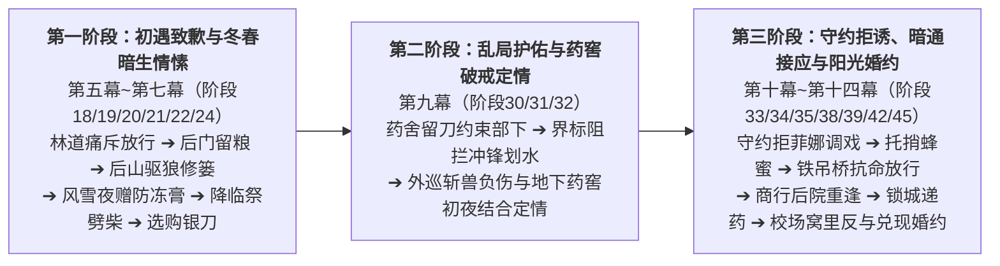

# 卢卡斯×艾琳娜关系线总纲

> **文档定位**：第二部维里迪亚王国篇·卢卡斯×艾琳娜跨幕感情线与骑士团倒戈弧线主线已融入节点位置全景索引总纲  
> **归档位置**：`方案/第二部/卢卡斯NSFW/卢卡斯x艾琳娜关系线.md`  
> **历史原案归档**：原详细企划稿与融入实施方案已全量移至 `方案/第二部/已执行/`（含原 `00_卢卡斯NSFW情境企划全案总纲.md`、`03_晨光药舍创伤破戒篇（卢卡斯×艾琳娜）.md` 及临时实施方案）。

---

## 一、 关系阶段演进结构图

---

## 二、 主线分阶段详规分布与索引总表

| 序号 | 关系阶段 | 节点名称与核心主题 | 所属幕次与分阶段详规文件 | 阶段内精准位置 | 时间与空间锚点 | 关键主线产出与状态交接 |
| :---: | :--- | :--- | :--- | :--- | :--- | :--- |
| **1** | **初遇立信** | **密林古道** （雷恩挑枪点破私印与艾琳娜痛斥） | **第五幕·阶段十八** [`阶段十八_机巧穿轴与白鹰立信·货栈暗账与信义放行详规.md`](../主线与世界扩充方案/分阶段详规/05_第五幕_分道巡礼·虚妄的线索/阶段十八_机巧穿轴与白鹰立信·货栈暗账与信义放行详规.md) | **剧情点 2** `### 2. 密林古道——断枪立威与白鹰之信` | 沉眠季十一月中旬 晨光修道院外林道 | 艾琳娜护手稿痛斥，卢卡斯羞愧致歉、首次抗命收剑放行雷恩 |
| **2** | **冬春情愫** | **铁证汇流** （药舍后门留粮与登门致歉） | **第五幕·阶段十九** [`阶段十九_公秤仲裁与晨雾归林·复式商战与粮道大捷详规.md`](../主线与世界扩充方案/分阶段详规/05_第五幕_分道巡礼·虚妄的线索/阶段十九_公秤仲裁与晨雾归林·复式商战与粮道大捷详规.md) | **剧情点 4** `### 4. 铁证汇流——晨雾归林与前哨收官` | 沉眠季十一月下旬傍晚 晨光修道院药舍后门 | 卢卡斯留下两袋白面粉与止血草药郑重道歉，艾琳娜防备缓和 |
| **3** | **冬春情愫** | **后山驱狼** （驱狼解围与牛皮绳修补药篓） | **第六幕·阶段二十** [`阶段二十_铁证密送与风雪初歇·光剑夜驰与客舍留宿详规.md`](../主线与世界扩充方案/分阶段详规/06_第六幕_霜雪冬歇·冬日庆典与降临共盟/阶段二十_铁证密送与风雪初歇·光剑夜驰与客舍留宿详规.md) | **剧情点 5** `### 5. 后山驱狼——皮绳修篓与巡防哨约` | 沉眠季十二月上旬午后 修道院后山背阴崖壁 | 驱散荒原灰狼、牛皮马具绳修好柳条药篓并约定吹哨顺路护送 |
| **4** | **冬春情愫** | **药舍暖灯** （风雪夜送医与获赠薄荷防冻膏） | **第六幕·阶段二十一** [`阶段二十一_深冬暴雪留宿与冬日共盟·雪仗打铁与晨光降临祭详规.md`](../主线与世界扩充方案/分阶段详规/06_第六幕_霜雪冬歇·冬日庆典与降临共盟/阶段二十一_深冬暴雪留宿与冬日共盟·雪仗打铁与晨光降临祭详规.md) | **剧情点 6** `### 6. 药舍暖灯——风雪送医与薄荷防冻膏` | 沉眠季十二月中旬风雪夜 晨光修道院附属药舍门廊 | 背冻伤老农就医，艾琳娜递热草药茶并赠【薄荷防冻膏】 |
| **5** | **冬春情愫** | **换防劈柴** （降临祭前夜暗劈干柴与蜜渍山楂） | **第六幕·阶段二十二** [`阶段二十二_深冬议事与战略定锚·王子做客与一月大商路总纲详规.md`](../主线与世界扩充方案/分阶段详规/06_第六幕_霜雪冬歇·冬日庆典与降临共盟/阶段二十二_深冬议事与战略定锚·王子做客与一月大商路总纲详规.md) | **剧情点 1 开篇** `### 1. 萌芽季初林地行动与王子的日常闲逛` | 沉眠季十二月下旬前夜 晨光修道院药舍后院 | 换防王都前夕劈满两摞橡木干柴，获赠蜜渍山楂干与执勤叮嘱 |
| **6** | **冬春情愫** | **白鹰铁蹄** （商行抹防冻膏与选购银刃小刀） | **第七幕·阶段二十四** [`阶段二十四_工坊街百工与八音盒之音详规.md`](../主线与世界扩充方案/分阶段详规/07_第七幕_王都商路·繁华市井与暗潮生活流/阶段二十四_工坊街百工与八音盒之音详规.md) | **剧情点 9** `### 9. 白鹰铁蹄——火炉热锻与骑士工匠之谊` | 萌芽季二月上旬午后 王都下城心木商行前院 | 换蹄铁时抹防冻膏，赴工坊街挑选【银刃采药小刀】 |
| **7** | **乱局护佑** | **暗夜求药** （夜奔药舍留刀与约束麾下骑兵） | **第九幕·阶段三十** [`阶段三十_泥泞逃亡、领民相护与领主觉醒详规.md`](../主线与世界扩充方案/分阶段详规/09_第九幕_绝境流亡·篝火重铸与艾斯特雷亚之誓/阶段三十_泥泞逃亡、领民相护与领主觉醒详规.md) | **剧情点 7 末尾** `### 7. 暗夜求药——修女执拗与医者同行` | 繁荫季四月上旬深夜 晨光修道院附属药舍 | 确认艾琳娜平安，将【银刃采药小刀】留在药柜抽屉并严令骑兵不得惊扰 |
| **8** | **乱局护佑** | **纯重风压** （界标阻拦冲锋与巡山消极划水） | **第九幕·阶段三十一** [`阶段三十一_界标对峙与黄金罗刹重剑威慑详规.md`](../主线与世界扩充方案/分阶段详规/09_第九幕_绝境流亡·篝火重铸与艾斯特雷亚之誓/阶段三十一_界标对峙与黄金罗刹重剑威慑详规.md) | **剧情点 3 末尾** `### 3. 纯重风压——白鹰断旗与坚石深裂` | 繁荫季四月中旬清晨 艾斯特雷亚领地界碑路口 | 策马阻止巡防队长冲锋，后续数周带队绕开旧领与修道院方向消极划水 |
| **9** | **破戒定情 （专篇 03）** | **暗夜药窖** （外巡斩兽负伤与草药长木桌初夜） | **第九幕·阶段三十二** [`阶段三十二_太古古库破译与重铸防酸破邪巨剑详规.md`](../主线与世界扩充方案/分阶段详规/09_第九幕_绝境流亡·篝火重铸与艾斯特雷亚之誓/阶段三十二_太古古库破译与重铸防酸破邪巨剑详规.md) | **剧情点 18** `### 18. 暗夜药窖——北上外巡斩兽负伤、草药长木桌破戒初夜与阳光下婚约` | 进要塞第 38~40 天外巡 晨光修道院地下深层药窖 | **两人正式定情**，立下阳光下婚约；获赠【《暗影黑血解毒手记（抄本）》】与【净血草药囊】 |
| **10** | **定情守约** | **水槽廊下 & 武备侧廊** （守约拒绝菲娜调戏与赠哨划水） | **第十幕·阶段三十三 & 三十五** [`阶段三十三详规.md`](../主线与世界扩充方案/分阶段详规/10_第十幕_深渊古道·暗河谍影与地底破壁/阶段三十三_盲泉逆流与太古石闸详规.md) / [`阶段三十五详规.md`](../主线与世界扩充方案/分阶段详规/10_第十幕_深渊古道·暗河谍影与地底破壁/阶段三十五_黑市商道交锋与重器密运详规.md) | **阶段33 剧情点 2** **阶段35 剧情点 7** | 金叶季七月上旬 & 下旬 圣殿大要塞马房 / 武备库侧廊 | 因已向艾琳娜立誓而两次拒绝菲娜调戏；赠出【白鹰镀银私哨】并调开排沙渠夜巡 |
| **11** | **暗通音信** | **值班哨所** （夜读解毒抄本与托黎恩捎蜂蜜报安） | **第十幕·阶段三十四** [`阶段三十四_特务少女与死牢水网逆向测绘详规.md`](../主线与世界扩充方案/分阶段详规/10_第十幕_深渊古道·暗河谍影与地底破壁/阶段三十四_特务少女与死牢水网逆向测绘详规.md) | **剧情点 3 末尾** `### 3. 值班哨所——四人齐上手口身、泄露水闸口令与石柱深嵌占有` | 金叶季七月中旬 要塞白鹰值守室与冷锻间 | 夜值摩挲草药囊研读抄本，托出堡采购的黎恩转交百花蜂蜜报平安 |
| **12** | **抗命放行** | **信义誓约** （铁吊桥当众抗命撤桥与托话报安） | **第十一幕·阶段三十八** [`阶段三十八_信义抉择放行与暗室深夜守候喂汤详规.md`](../主线与世界扩充方案/分阶段详规/11_第十一幕_惊天劫狱·血洗圣殿死牢/阶段三十八_信义抉择放行与暗室深夜守候喂汤详规.md) | **剧情点 3** `### 3. 信义誓约——撤桥放行` | 金叶季八月上旬深夜 圣殿大要塞外围生铁吊桥 | 当众抗命撤桥放行雷恩与受难骑士，托雷恩与黎恩向艾琳娜转达平安与抄本救人 |
| **13** | **微雨重逢** | **双城潜流** （下城商行后院拥抱与城防通气） | **第十二幕·阶段三十九** [`阶段三十九_双城潜流与金鸢尾沙龙外交游说详规.md`](../主线与世界扩充方案/分阶段详规/12_第十二幕_王都暗流·沙龙旧卷与法理围城/阶段三十九_双城潜流与金鸢尾沙龙外交游说详规.md) | **剧情点 1 末尾** `### 1. 双城潜流——宵禁封城` | 金叶季八月中旬微雨傍晚 王都下城心木商行后院廊下 | 艾琳娜检查卢卡斯左臂愈合伤疤，卢卡斯通报内城城防调动与白鹰队暗中接应计划 |
| **14** | **违令递药** | **九门落锁** （违令隔栏私递草药与生铁栏交握） | **第十三幕·阶段四十二** [`阶段四十二_教会投毒水网与炼狱王都详规.md`](../主线与世界扩充方案/分阶段详规/13_第十三幕_王都异化·双城合围决战/阶段四十二_教会投毒水网与炼狱王都详规.md) | **剧情点 2** `### 2. 九门落锁——生铁封城` | 沉眠季十一月中旬黄昏 王都内城生铁吊栅门内侧 | 无视锁城令率队隔铁栅递出卫戍库止血草药与清水，隔栏紧握承诺从内部劈开城门 |
| **15** | **婚约兑现** | **先锋骑兵、家传刺剑 & 麦浪银线** （校场窝里反、广场兑现婚约与十公里送别） | **第十四幕·阶段四十五** [`阶段四十五_校场誓师双城平暴与黎明新世界详规.md`](../主线与世界扩充方案/分阶段详规/14_第十四幕_破晓大审判与黎明宪章/阶段四十五_校场誓师双城平暴与黎明新世界详规.md) | **剧情点 3、7、12** `### 3.` / `### 7.` / `### 12.` | 沉眠季十二月下旬至翌年一月 大校场 / 真理广场 / 平原大道 | 大校场率队窝里反开城平暴；公审落槌后在阳光下兑现婚约；翌年一月与换便装的艾琳娜并肩护送篷车十公里道别 |

