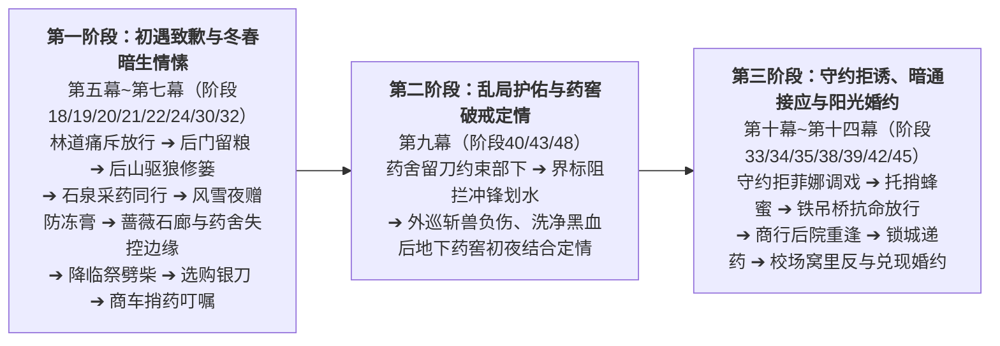

# 卢卡斯×艾琳娜关系线总纲

> **文档定位**：第二部维里迪亚王国篇·卢卡斯×艾琳娜跨幕感情线与骑士团倒戈弧线主线已融入节点位置全景索引总纲  
> **归档位置**：`方案/第二部/卢卡斯NSFW/卢卡斯x艾琳娜关系线.md`  
> **历史原案归档**：原详细企划稿与融入实施方案已全量移至 `方案/第二部/已执行/`（含原 `00_卢卡斯NSFW情境企划全案总纲.md`、`03_晨光药舍创伤破戒篇（卢卡斯×艾琳娜）.md` 及临时实施方案）。

---

## 一、 关系阶段演进结构图

---

## 二、 主线分阶段详规分布与索引总表

| 序号 | 关系阶段 | 节点名称与核心主题 | 所属幕次与分阶段详规文件 | 阶段内精准位置 | 时间与空间锚点 | 关键主线产出与状态交接 |
| :---: | :--- | :--- | :--- | :--- | :--- | :--- |
| **1** | **初遇立信** | **密林古道** （雷恩挑枪点破私印与艾琳娜痛斥） | **第五幕·阶段十八** [`阶段十九_机巧穿轴与白鹰立信·货栈暗账与信义放行详规.md`](../主线与世界扩充方案/分阶段详规/05_第五幕_分道巡礼·虚妄的线索/阶段十九_机巧穿轴与白鹰立信·货栈暗账与信义放行详规.md) | **剧情点 2** `### 2. 密林古道——断枪立威与白鹰之信` | 沉眠季十一月中旬 晨光修道院外林道 | 艾琳娜护手稿痛斥，卢卡斯羞愧致歉、首次抗命收剑放行雷恩 |
| **2** | **冬春情愫** | **铁证汇流** （药舍后门留粮与登门致歉） | **第五幕·阶段十九** [`阶段二十_公秤仲裁与晨雾归林·复式商战与粮道大捷详规.md`](../主线与世界扩充方案/分阶段详规/05_第五幕_分道巡礼·虚妄的线索/阶段二十_公秤仲裁与晨雾归林·复式商战与粮道大捷详规.md) | **剧情点 4** `### 4. 铁证汇流——晨雾归林与前哨收官` | 沉眠季十一月下旬傍晚 晨光修道院药舍后门 | 卢卡斯留下两袋白面粉与止血草药郑重道歉，艾琳娜防备缓和 |
| **3** | **冬春情愫** | **后山驱狼** （驱狼解围与牛皮绳修补药篓） | **第六幕·阶段二十一** [`阶段二十一_铁证密送与风雪初歇·光剑夜驰与客舍留宿详规.md`](../主线与世界扩充方案/分阶段详规/06_第六幕_霜雪冬歇·冬日庆典与降临共盟/阶段二十一_铁证密送与风雪初歇·光剑夜驰与客舍留宿详规.md) | **剧情点 5** `### 5. 后山驱狼——皮绳修篓与巡防哨约` | 沉眠季12月3日午后 修道院后山崖壁雪地 | 驱散荒原灰狼、牛皮马具绳修好柳条药篓并约定吹哨顺路护送 |
| **4** | **冬春情愫** | **石泉采药** （履行哨约与雪地交心） | **第六幕·阶段二十一** [`阶段二十一_铁证密送与风雪初歇·光剑夜驰与客舍留宿详规.md`](../主线与世界扩充方案/分阶段详规/06_第六幕_霜雪冬歇·冬日庆典与降临共盟/阶段二十一_铁证密送与风雪初歇·光剑夜驰与客舍留宿详规.md) | **剧情点 6** `### 6. 石泉采药——履行哨约与雪地交心` | 沉眠季12月6日午后 后山冷杉林道与隐士石泉外围 | 独自脱甲同行采药、分麦饼喝茶交心并改口直呼名字 |
| **5** | **冬春情愫** | **药舍暖灯** （风雪夜送医与获赠薄荷防冻膏） | **第六幕·阶段二十三** [`阶段二十三_晨光降临·全营篝火欢歌与冬日降临共盟详规.md`](../主线与世界扩充方案/分阶段详规/06_第六幕_霜雪冬歇·冬日庆典与降临共盟/阶段二十三_晨光降临·全营篝火欢歌与冬日降临共盟详规.md) | **剧情点 1** `### 1. 药舍暖灯——风雪送医与薄荷防冻膏` | 沉眠季12月15日入夜 晨光修道院药舍门廊 | 背冻伤村民就医，艾琳娜递热草药茶并赠【薄荷防冻膏】 |
| **6** | **冬春情愫** | **蔷薇石廊** （调防告别与药舍失控边缘） | **第六幕·阶段二十三** [`阶段二十三_晨光降临·全营篝火欢歌与冬日降临共盟详规.md`](../主线与世界扩充方案/分阶段详规/06_第六幕_霜雪冬歇·冬日庆典与降临共盟/阶段二十三_晨光降临·全营篝火欢歌与冬日降临共盟详规.md) | **剧情点 5** `### 5. 蔷薇石廊——调防告别与药舍失控边缘` | 沉眠季12月25日午后至傍晚 修道院石廊拐角 / 干草药室 | 赠白鹰镀铜哨卡扣绳约定春天回来修窗；药舍涂膏滑倒相拥反应强烈，差点亲上被打断 |
| **7** | **冬春情愫** | **换防劈柴** （降临祭后夜暗劈干柴与蜜渍山楂） | **第六幕·阶段二十四** [`阶段二十四_隔音长桌·冬日议事复盘与王都商路沙盘推演详规.md`](../主线与世界扩充方案/分阶段详规/06_第六幕_霜雪冬歇·冬日庆典与降临共盟/阶段二十四_隔音长桌·冬日议事复盘与王都商路沙盘推演详规.md) | **剧情点 1 开篇** `### 1. 萌芽季初林地行动与王子的日常闲逛` | 萌芽季1月1日傍晚 晨光修道院药舍后院柴棚 | 调往王都前劈满两摞橡木干柴，获赠蜜渍山楂干与执勤叮嘱 |
| **8** | **冬春情愫** | **白鹰铁蹄** （商行抹防冻膏与选购银刃小刀） | **第七幕·阶段三十** [`阶段三十_铜齿清音·八音盒试音、沙龙前奏与白鹰锻蹄详规.md`](../主线与世界扩充方案/分阶段详规/07_第七幕_王都商路·繁华市井与暗潮生活流/阶段三十_铜齿清音·八音盒试音、沙龙前奏与白鹰锻蹄详规.md) | **剧情点 4** `### 4. 白鹰铁蹄——火炉热锻与骑士工匠之谊` | 萌芽季2月6日傍晚 王都下城心木商行前院 | 换蹄铁时抹防冻膏，赴工坊街挑选【银刃采药小刀】 |
| **9** | **冬春情愫** | **顺路商车** （王都捎药与简短叮嘱） | **第七幕·阶段三十二** [`阶段三十二_密室长卷·王储抚恤密账交接与暗影急症详规.md`](../主线与世界扩充方案/分阶段详规/07_第七幕_王都商路·繁华市井与暗潮生活流/阶段三十二_密室长卷·王储抚恤密账交接与暗影急症详规.md) | **剧情点 3** `### 3. 顺路商车——王都捎药与简短叮嘱` | 萌芽季2月23日上午 王都下城心木商行门前 | 托熟识车夫转送蜂蜡、洋甘菊干花与叮嘱短条，艾琳娜夹入医典扉页 |
| **10** | **乱局护佑** | **暗夜求药** （夜奔药舍留刀与约束麾下骑兵） | **第九幕·阶段四十** [`阶段四十_泥泞长路·荒野伤兵撤退与领民草棚接应详规.md`](../主线与世界扩充方案/分阶段详规/09_第九幕_绝境流亡·篝火重铸与艾斯特雷亚之誓/阶段四十_泥泞长路·荒野伤兵撤退与领民草棚接应详规.md) | **剧情点 7 末尾** `### 7. 暗夜求药——修女执拗与医者同行` | 繁荫季四月上旬深夜 晨光修道院附属药舍 | 确认艾琳娜平安，将【银刃采药小刀】留在药柜抽屉并严令骑兵不得惊扰 |
| **11** | **乱局护佑** | **纯重风压** （界标阻拦冲锋与巡山消极划水） | **第九幕·阶段四十三** [`阶段四十三_界标逼近·圣殿追兵压境与旧领哨卡对峙详规.md`](../主线与世界扩充方案/分阶段详规/09_第九幕_绝境流亡·篝火重铸与艾斯特雷亚之誓/阶段四十三_界标逼近·圣殿追兵压境与旧领哨卡对峙详规.md) | **剧情点 4 末尾** `### 4. 纯重风压——白鹰断旗与坚石深裂` | 繁荫季4月18日清晨 艾斯特雷亚领地界碑路口 | 策马阻止巡防队长冲锋，猜到超期未归的艾琳娜八成在谷内治伤，后续数周带队绕开旧领与修道院方向消极划水 |
| **12** | **破戒定情 （专篇 03）** | **暗夜药窖** （外巡斩兽负伤、洗净黑血后草药长木桌初夜） | **第九幕·阶段四十八** [`阶段四十八_试剑淬火·圣光灌注名刃与死牢劫狱战术总推演详规.md`](../主线与世界扩充方案/分阶段详规/09_第九幕_绝境流亡·篝火重铸与艾斯特雷亚之誓/阶段四十八_试剑淬火·圣光灌注名刃与死牢劫狱战术总推演详规.md) | **剧情点 6** `### 6. 暗夜药窖——向北外巡斩兽负伤、草药长木桌破戒初夜与阳光下婚约` | 繁荫季6月29日深夜~30日清晨 （外巡第四天夜间） 晨光修道院地下深层药窖 | 按毒理手稿洗净黑血包扎喂汤压住余毒，随后害羞打飞机安抚并在药窖**正式破戒结合定情**，立下阳光下婚约并赠【解毒手记抄本】与【净血草药囊】 |
| **13** | **定情守约** | **水槽廊下 & 武备侧廊** （守约拒绝菲娜调戏与赠哨划水） | **第十幕·阶段三十三 & 三十五** [`阶段三十三详规.md`](../主线与世界扩充方案/分阶段详规/10_第十幕_深渊古道·暗河谍影与地底破壁/阶段四十九_顺流盲泉·深渊暗河舟行与钟乳险滩潜渡详规.md) / [`阶段三十五详规.md`](../主线与世界扩充方案/分阶段详规/10_第十幕_深渊古道·暗河谍影与地底破壁/阶段三十五_黑市商道交锋与重器密运详规.md) | **阶段33 剧情点 2** **阶段35 剧情点 7** | 金叶季七月上旬 & 下旬 圣殿大要塞马房 / 武备库侧廊 | 因已向艾琳娜立誓而两次拒绝菲娜调戏；赠出【白鹰镀银私哨】并调开排沙渠夜巡 |
| **14** | **暗通音信** | **值班哨所** （夜读解毒抄本与托黎恩捎蜂蜜报安） | **第十幕·阶段三十四** [`阶段五十一_暗影测绘·特务少女潜行与死牢巡防死角测算详规.md`](../主线与世界扩充方案/分阶段详规/10_第十幕_深渊古道·暗河谍影与地底破壁/阶段五十一_暗影测绘·特务少女潜行与死牢巡防死角测算详规.md) | **剧情点 3 末尾** `### 3. 值班哨所——四人齐上手口身、泄露水闸口令与石柱深嵌占有` | 金叶季七月中旬 要塞白鹰值守室与冷锻间 | 夜值摩挲草药囊研读抄本，托出堡采购的黎恩转交百花蜂蜜报平安 |
| **15** | **抗命放行** | **信义誓约** （铁吊桥当众抗命撤桥与托话报安） | **第十一幕·阶段三十八** [`阶段五十七_信义抉择放行与暗室深夜守候喂汤详规.md`](../主线与世界扩充方案/分阶段详规/11_第十一幕_惊天劫狱·血洗圣殿死牢/阶段五十七_信义抉择放行与暗室深夜守候喂汤详规.md) | **剧情点 3** `### 3. 信义誓约——撤桥放行` | 金叶季八月上旬深夜 圣殿大要塞外围生铁吊桥 | 当众抗命撤桥放行雷恩与受难骑士，托雷恩与黎恩向艾琳娜转达平安与抄本救人 |
| **16** | **微雨重逢** | **双城潜流** （下城商行后院拥抱与城防通气） | **第十二幕·阶段五十八** [`阶段五十八_双城潜流与金鸢尾沙龙外交游说详规.md`](../主线与世界扩充方案/分阶段详规/12_第十二幕_王都暗流·沙龙旧卷与法理围城/阶段五十八_双城潜流与金鸢尾沙龙外交游说详规.md) | **剧情点 1 末尾** `### 1. 双城潜流——宵禁封城` | 金叶季八月中旬微雨傍晚 王都下城心木商行后院廊下 | 艾琳娜检查卢卡斯左臂愈合伤疤，卢卡斯通报内城城防调动与白鹰队暗中接应计划 |
| **17** | **坦白交心** | **药棚露馅 & 麦秆隔墙 & 车棚低语** （暗室坦白、菲娜解开心结、逛集市暗室结合与决斗前夜通气递药） | **第十二幕·阶段五十九** [`阶段五十九_王家秘库档案起获与维克托地下工坊奇袭详规.md`](../主线与世界扩充方案/分阶段详规/12_第十二幕_王都暗流·沙龙旧卷与法理围城/阶段五十九_王家秘库档案起获与维克托地下工坊奇袭详规.md) | **剧情点 1、7、12** `### 1.` / `### 7.` / `### 12.` | 9月5日~10月6日 心木商行后院药棚 / 二层夹层暗室 / 双马篷车 | 药棚撞见卢卡斯心虚后暗室坦白；菲娜道歉并说出黎恩实情；逛集市后暗室主动结合；决斗前夜通报阿达尔伯特动向并收药道别 |
| **18** | **违令递药** | **九门落锁** （违令隔栏私递草药与生铁栏交握） | **第十三幕·阶段六十一** [`阶段六十一_教会投毒水网与炼狱王都详规.md`](../主线与世界扩充方案/分阶段详规/13_第十三幕_王都异化·双城合围决战/阶段六十一_教会投毒水网与炼狱王都详规.md) | **剧情点 2** `### 2. 九门落锁——生铁封城` | 沉眠季十一月中旬黄昏 王都内城生铁吊栅门内侧 | 无视锁城令率队隔铁栅递出卫戍库止血草药与清水，隔栏紧握承诺从内部劈开城门 |
| **19** | **婚约兑现与战后相伴** | **家传刺剑、浅蓝羊毛、炉火长夜 & 旷野银线** （广场兑现婚约、挑裙浴场蒸气室、二层卧房整夜相拥与十公里送别） | **第十四幕·阶段六十四~六十七** [`阶段六十四`](../主线与世界扩充方案/分阶段详规/14_第十四幕_破晓大审判与黎明宪章/阶段六十四_校场誓师公审裁决与黎明宪章详规.md) · [`阶段六十五`](../主线与世界扩充方案/分阶段详规/14_第十四幕_破晓大审判与黎明宪章/阶段六十五_心木晨光工坊赠礼与下城烟火详规.md) · [`阶段六十六`](../主线与世界扩充方案/分阶段详规/14_第十四幕_破晓大审判与黎明宪章/阶段六十六_金秋采收旧领酒庄与观星长谈详规.md) · [`阶段六十七`](../主线与世界扩充方案/分阶段详规/14_第十四幕_破晓大审判与黎明宪章/阶段六十七_逆向巡礼法尔肯热酒与边门哨音详规.md) | **阶段64 `### 5.`** / **阶段65 `### 13.`** / **阶段66 `### 7.`** / **阶段67 `### 1.`** | 沉眠季十二月下旬至翌年一月 真理广场 / 下城成衣铺与圣泉大浴场 / 心木商行 / 平原大道 | 广场兑现婚约；晴日挑浅蓝羊毛长裙并在蒸气室结合；二层起居室商量安家整夜相拥至次晨醒来；换新裙护送十公里道别 |

