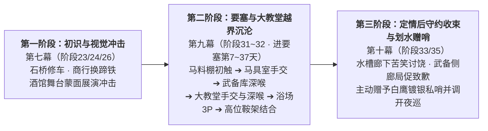

# 卢卡斯×菲娜关系线总纲

> **文档定位**：第二部维里迪亚王国篇·卢卡斯×菲娜主线已融入节点位置全景索引与阶段演进总纲  
> **归档位置**：`方案/第二部/卢卡斯NSFW/卢卡斯x菲娜关系线.md`  
> **历史原案归档**：原详细企划稿与融入实施方案已全量移至 `方案/第二部/已执行/`（含原 `00_卢卡斯NSFW情境企划全案总纲.md`、`01_圣殿马房暗查与骑士戒律沉沦篇.md`、`04_晨光大教堂信仰破戒两部曲篇（卢卡斯×菲娜）.md` 及临时实施方案）。

---

## 一、 关系阶段演进结构图

---

## 二、 主线分阶段详规分布与索引总表

| 序号 | 关系阶段 | 节点名称与核心主题 | 所属幕次与分阶段详规文件 | 阶段内精准位置 | 时间与空间锚点 | 关键主线产出与状态交接 |
| :---: | :--- | :--- | :--- | :--- | :--- | :--- |
| **1** | **前序铺垫** | **断轴惊马** （石桥修车初识工匠夫妻） | **第七幕·阶段二十三** [`阶段二十三_王都初至与心木商行详规.md`](../主线与世界扩充方案/分阶段详规/07_第七幕_王都商路·繁华市井与暗潮生活流/阶段二十三_王都初至与心木商行详规.md) | **剧情点 9** `### 9. 断轴惊马——石桥解围与白鹰初识` | 萌芽季一月下旬 王都下城运河石桥 | 黎恩协助修妥运粮车断轴，卢卡斯初识黎恩与菲娜 |
| **2** | **前序铺垫** | **白鹰铁蹄** （商行换蹄铁结为投缘朋友） | **第七幕·阶段二十四** [`阶段二十四_工坊街百工与八音盒之音详规.md`](../主线与世界扩充方案/分阶段详规/07_第七幕_王都商路·繁华市井与暗潮生活流/阶段二十四_工坊街百工与八音盒之音详规.md) | **剧情点 9** `### 9. 白鹰铁蹄——火炉热锻与骑士工匠之谊` | 萌芽季二月上旬 心木商行前院工棚 | 黎恩为白鹰战马更换蹄铁，双方结下朋友情谊 |
| **3** | **前序铺垫** | **蒙面华舞 & 石桥送行** （舞台展演失控与送行心虚） | **第七幕·阶段二十六** [`阶段二十六_纯铜八音盒商行托付与白鹿启程详规.md`](../主线与世界扩充方案/分阶段详规/07_第七幕_王都商路·繁华市井与暗潮生活流/阶段二十六_纯铜八音盒商行托付与白鹿启程详规.md) | **剧情点 6 & 7** `### 6. 蒙面华舞` / `### 7. 石桥送行` | 繁荫季三月下旬 黑野猪酒馆 / 运河石桥 | 卢卡斯目睹蒙面展演失控梦遗；次晨送行瞥见菲娜身影心虚自责 |
| **4** | **要塞越界 （方案 01）** | **苜蓿初触** （马料棚跌撞与隔衣硬挺顶触） | **第九幕·阶段三十一** [`阶段三十一_界标对峙与黄金罗刹重剑威慑详规.md`](../主线与世界扩充方案/分阶段详规/09_第九幕_绝境流亡·篝火重铸与艾斯特雷亚之誓/阶段三十一_界标对峙与黄金罗刹重剑威慑详规.md) | **剧情点 7** `### 7. 苜蓿初触——马料棚夜巡重逢与干燥苜蓿间的跌撞` | 进要塞第 7 天夜间 要塞外围战马草料棚 | 白花甜香与粉发红唇勾起舞台记忆，怀疑菲娜即舞台蒙面女子 |
| **5** | **要塞越界 （方案 02）** | **马具初露** （点破银铠窘态与解扣手交） | **第九幕·阶段三十一** [`阶段三十一_界标对峙与黄金罗刹重剑威慑详规.md`](../主线与世界扩充方案/分阶段详规/09_第九幕_绝境流亡·篝火重铸与艾斯特雷亚之誓/阶段三十一_界标对峙与黄金罗刹重剑威慑详规.md) | **剧情点 13** `### 13. 马具初露——点破银铠窘态、马油香气里的指尖套弄与蜂蜡拓印` | 进要塞第 15 天午后 白鹰战马马具室 | 确认舞台蒙面女子身份；拓取【夜巡铜印章蜂蜡印模】、获知西侧悬崖暗哨 |
| **6** | **要塞越界 （方案 03）** | **重铠死角** （对黎恩撒谎掩护与初次深喉） | **第九幕·阶段三十一** [`阶段三十一_界标对峙与黄金罗刹重剑威慑详规.md`](../主线与世界扩充方案/分阶段详规/09_第九幕_绝境流亡·篝火重铸与艾斯特雷亚之誓/阶段三十一_界标对峙与黄金罗刹重剑威慑详规.md) | **剧情点 20** `### 20. 重铠死角——武备库冷锻间当面撒谎掩护与板甲架后初次深喉` | 进要塞第 23 天下午 要塞武备库冷锻间板甲架后 | 卢卡斯首次对朋友黎恩撒谎打掩护；菲娜水囊漱净后向黎恩邀功 |
| **7** | **要塞越界 （专篇 04）** | **垂幔风管** （告解室隔板手交与管风琴披风深喉） | **第九幕·阶段三十二** [`阶段三十二_太古古库破译与重铸防酸破邪巨剑详规.md`](../主线与世界扩充方案/分阶段详规/09_第九幕_绝境流亡·篝火重铸与艾斯特雷亚之誓/阶段三十二_太古古库破译与重铸防酸破邪巨剑详规.md) | **剧情点 3** `### 3. 垂幔风管——告解室隔板探秘握抚、管风琴圣咏披风深喉与洗礼堂漱口温存` | 进要塞第 25 天黄昏 晨光大教堂告解室与管风琴台 | 探明【教廷秘库齿轮暗梯卡槽位置】；水囊漱净后黎恩于洗礼堂回收 |
| **8** | **要塞越界 （联动 34）** | **双雄竞夺** （水下双抚、双雄口爆与水台 3P） | **第九幕·阶段三十二** [`阶段三十二_太古古库破译与重铸防酸破邪巨剑详规.md`](../主线与世界扩充方案/分阶段详规/09_第九幕_绝境流亡·篝火重铸与艾斯特雷亚之誓/阶段三十二_太古古库破译与重铸防酸破邪巨剑详规.md) | **剧情点 13** `### 13. 双雄竞夺——主池浓雾水下双抚、双雄口爆与水台 3P 肉搏` | 进要塞第 35 天下午 王都内城西区圣泉大浴场 | 与莫尔茨同场竞夺；黎恩池边全程目击，深夜石舍回收 |
| **9** | **要塞越界 （方案 04）** | **高位鞍架** （面对面托臀悬空贯穿·越界收束） | **第九幕·阶段三十二** [`阶段三十二_太古古库破译与重铸防酸破邪巨剑详规.md`](../主线与世界扩充方案/分阶段详规/09_第九幕_绝境流亡·篝火重铸与艾斯特雷亚之誓/阶段三十二_太古古库破译与重铸防酸破邪巨剑详规.md) | **剧情点 15** `### 15. 高位鞍架——马具库顶层面对面托臀悬空贯穿与巡前沉沦` | 进要塞第 37 天傍晚 白鹰高位马具库顶层 | 「卢卡斯×菲娜」越界剧情至此收束；次日卢卡斯率队北上外巡 |
| **10** | **定情后收束 （简短 A）** | **水槽廊下** （端盆擦肩调戏与苦笑讨饶） | **第十幕·阶段三十三** [`阶段三十三_盲泉逆流与太古石闸详规.md`](../主线与世界扩充方案/分阶段详规/10_第十幕_深渊古道·暗河谍影与地底破壁/阶段三十三_盲泉逆流与太古石闸详规.md) | **剧情点 2** `### 2. 水槽廊下——端盆擦肩的言语调戏与苦笑讨饶` | 金叶季七月上旬午后 要塞外围马房水槽廊下 | 卢卡斯与艾琳娜定情回堡后守约拒诱，向菲娜苦笑讨饶 |
| **11** | **定情后收束 （简短 B）** | **武备侧廊** （坦诚守约致歉与划水赠哨） | **第十幕·阶段三十五** [`阶段三十五_黑市商道交锋与重器密运详规.md`](../主线与世界扩充方案/分阶段详规/10_第十幕_深渊古道·暗河谍影与地底破壁/阶段三十五_黑市商道交锋与重器密运详规.md) | **剧情点 7** `### 7. 武备侧廊——坦诚守约的局促致歉与划水赠哨` | 金叶季七月下旬傍晚 要塞武备库侧廊 | 表明不能对不起黎恩与艾琳娜；交出【白鹰镀银私哨】并调开排沙渠夜巡 |

