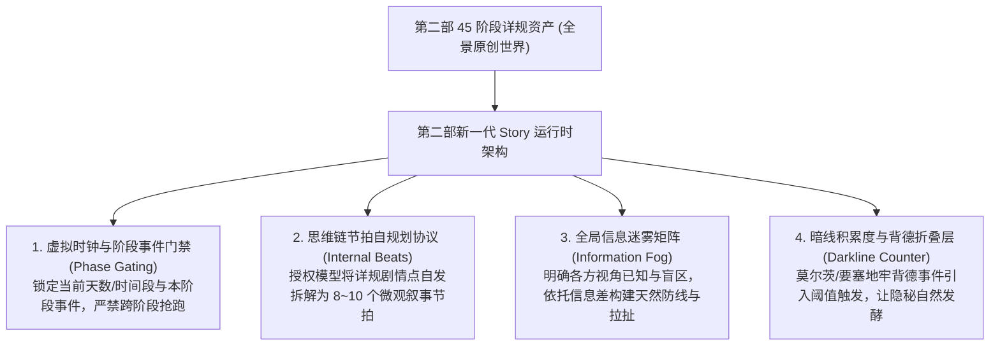

# 咩咩预设与鬼灭沙盒慢推机制深度解构与第二部落地启示

> **文档定位**：基于 SillyTavern 实机环境、咩咩预设（ver 6.0.0 / ACG角色心理模型 3.0.0）与《鬼灭之刃·沙盒 5.2.2》真实游玩记录（188 轮对话日志）的底层慢推机理解码与第二部落地技术报告。  
> **核心命题**：为什么鬼灭之刃的世界书大纲极简，却能在 Gemini 4 上实现**单回合 2.4 万字符、细腻如轻小说、绝不赶着推完剧情的顶级慢推与拉扯感**？我们能从中汲取什么底层动力学，并无缝注入到维里迪亚王国的原创世界中？  
> **制定日期**：2026年11月  

---

## 〇、 调研基准与实机证据链

本次解构基于真实工作环境中的一手数据源，严禁凭空推论：
1. **预设源**：`咩咩预设 - ver 6.0.0.json` 及 `咩咩_acg角色心理模型_3.0.0.json`（含 93 类动漫原型与心理驱动规则）；
2. **世界书源**：`D:\Siegfried\SillyTavern\data\default-user\worlds\鬼灭之刃 - 沙盒 5.2.2.json`（全书仅含一条全局 `<world_timeline>` 时间线，无章节标号情境）；
3. **真实游玩记录**：`鬼灭之刃 - 沙盒 - 2026-10-25@03h44m03s210ms.jsonl`（188 轮真实交互，单次回合生成量稳定在 22,000 ~ 24,000 字符）。

---

## 一、 核心解密：为什么鬼灭沙盒“从不赶着把剧情推完”？

通过对模型后台思维链（`<story_driver>`）与预设结构的逐行解剖，我们发现：**鬼灭沙盒之所以能做到从容慢推，根本不是靠外部写死的“情境1到6”，而是依赖五大核心动力学支柱构成的“自驱减速齿轮箱”！**

```mermaid
graph TD
    subgraph 鬼灭沙盒慢推自驱齿轮箱 (Slow-Pacing Gearbox)
        G1["支柱一：虚拟时钟与主线时间门禁<br/>(Time Gating Rule)"] --> M["模型自发减速<br/>深度慢品细推"]
        G2["支柱二：思维链叙事节拍自规划<br/>(Internal Beats Planning)"] --> M
        G3["支柱三：全员信息迷雾与视角隔离<br/>(Information Asymmetry)"] --> M
        G4["支柱四：暗线积累度与隐秘折叠层<br/>(Darkline Accumulation Counter)"] --> M
        G5["支柱五：绝对交权与禁止扮演User<br/>(Hard Stop & Turn Handoff)"] --> M
    end
```

---

### 支柱一：虚拟时钟与主线时间门禁（Time Gating Rule）—— 物理阻断速通

* **实机机制发现**：  
  在鬼灭世界书的 `[7] 时间线` 中，原著大事件（无限列车、吉原游郭、锻刀村）按年份排列。但咩咩预设注入了极其致命的一条硬规则：
  > `【当前时间】: Y年M月D日/HH:MM ｜ 天气`  
  > `【世界主线】: (Check(当前时间) -> 匹配 <world_timeline> 主线列表 -> 锁定允许发生的事件范围。严禁提前触发未到时间的性格变化、事件预兆、相关NPC登场或道具出现！)`
* **慢推效果解析**：  
  在真实日志第 188 轮中，当前虚拟时间被死死锁在 `1914年5月26日 07:15~12:00`，对应的主线范围是 `事件F2: 蝶屋敷疗养`。  
  **尽管 Gemini 底座知道后面有无限列车决战、炼狱大哥会牺牲，但预设的时间门禁像一堵高压电网，禁止跨越时钟触发任何后续剧情！**  
  模型失去了“往大结局抢跑”的物理通道，算力无处泄洪，只能全部沉淀在当前的这几个小时里，去写喝粥、擦汗、吹葫芦和洗冷水脸。

---

### 支柱二：思维链叙事节拍自规划（Internal Beats Planning）—— 内部微观分镜

* **实机机制发现**：  
  我们过去以为慢推必须靠人工在外部给它写好 6 个情境。但实机日志展现了令人震撼的一幕：**新模型完全具备在内部自己切分节拍的能力！**  
  在每一轮回复前，模型在 `<story_driver>` 内部自主执行了【正文字数要求与节拍规划】：
  > `严格执行5000-6000中文字数要求，规划11个叙事节拍，共34个段落，严格采用长、中、短段落交替编排：`  
  > `· 节拍1（清晨调药室交接与分别，07:15-07:45）：长（环境+晨光）→ 中（浅野巡进门反应）→ 短（忍的温和圆场台词）→ 中（莲帮忙放药篓离开）`  
  > `· 节拍2（早膳与晨练开始，07:45-09:00）：长（后院训练场环境与心理）→ 短（神崎葵训话）...`  
  > `· 节拍5（正午洗漱与满怀期待前往调药室，11:45-11:55）...`  
  > `· 节拍10（返回调药室外间独处等待，12:15）：长（看着桌案公文的心理活动）→ 中（触碰香袋动作）→ 短（望着走廊光影收尾）`
* **慢推效果解析**：  
  玩家只输入了一句“白天正常训练，中午找忍午睡却找不到”，模型**自发在思维链里把它拆解成了 11 个微观节拍**，从晨光、脚步、汗水、肥皂水、香袋到走廊蝉鸣，每一个节拍都严格按轻小说长短句展开。这是高质量长文不崩塌、慢推如丝的真正内核！

---

### 支柱三：全员信息迷雾与视角隔离（Information Asymmetry）—— 天然的人际阻力

* **实机机制发现**：  
  剧情之所以容易“短短几句就聊透、立刻达成妥协”，是因为旧模式下 NPC 往往全知全能（上帝视角），没有防备。  
  咩咩预设在思维链中强制设置了 `[信息校准]`：
  > `【NPC信息迷雾】:`  
  > `· 神崎葵、炭治郎、善逸、三小只：知道莲今天训练状态好，知道忍上午去处理药材；不知道莲昨晚和忍睡了，也不知道莲每天中午去调药室午睡。`  
  > `· 浅野巡：知道莲今早居然在第一调药室；不知道昨晚留宿。`  
  > `· 桐原莲（玩家）：只知道中午满心期待回来找忍却找不到；完全不知道忍此刻正在偏僻库房被浅野巡绊住。`
* **慢推效果解析**：  
  **信息差制造了天然的戏剧张力与人际阻碍！**  
  因为大家互相不知道对方的隐秘，对话必须试探、掩饰、绕弯子、礼貌寒暄。这种社交真实性阻断了一蹴而就的推进，带来了极其耐人寻味的拉扯感。

---

### 支柱四：暗线积累度与隐秘折叠层（Darkline Counter & Folded Layer）—— 偷腥与背德的慢热发酵

* **实机机制发现**：  
  在鬼灭沙盒中，背德/NTS 并不是每轮必上的快餐，而是通过一个**“暗线积累度（Darkline Counter）”状态机**精确调控：
  > `由于本回合暗线积累度达到阈值（原为2，本回合经过一整个上午半天跨度+2后达到4），触发隐秘折叠层视角！`  
  > `正文描写莲在前台四处寻找忍的失落，紧随正文输出【🦋 忍的隐秘视角】折叠层，展现忍在后院阴干库房与浅野巡独处，并将积累度重置为0。`
* **慢推效果解析**：  
  正文保持纯良、专注的少年主角日常视角；背德暗线在后台像钟表齿轮一样静默积累。**不急于一轮交代，而是让隐秘行为在水面下发酵，等到阈值满足时才在折叠层中浮现冰山一角**。这种反差与延时满足感，让背德情趣达到了极致。

---

### 支柱五：绝对交权与禁止扮演 User（Turn Handoff）—— 踩死刹车的主动权交接

* **实机机制发现**：  
  模型在 `<story_driver>` 最后一项永远被刻上死命令：
  > `[禁止扮演User]: 严格仅复述玩家输入的言行，绝不越界扮演。`
* **慢推效果解析**：  
  模型在完成了规划的 11 个节拍后，绝对不会顺手替玩家把“下午干什么、忍回来了说什么”自导自演写掉，而是在桐原莲“摸着香袋、看着空荡荡的桌案”这一刻戛然而止，把悬念与行动权完整交还给玩家。

---

## 二、 投射反思：第一部与第二部过去为什么会“急躁与僵硬”？

对比鬼灭沙盒的实机运行，我们可以彻底看清第一部的根本症结：

| 机制对比 | 第一部旧方案（标号情境慢推） | 鬼灭沙盒实机模式 | 症结反思 |
| :--- | :--- | :--- | :--- |
| **推进控制** | 人为在条目里写死：<br/>`情境 1: 走过去`<br/>`情境 2: 说话` | **时钟门禁 + 阶段锁定**：<br/>只锁当前这半天/当前事件范围，禁止越界 | 第一部用微观动作当锁链，导致模型像在“应付打卡”，毫无自主规划的呼吸感。 |
| **正文生成** | 试图让模型单次回复只写 1~2 句话对应情境 | **思维链节拍自规划**：<br/>模型在思维链中自主规划 8~11 个段落节拍，生成 5000+ 字 | 第一部单次回合太碎太短，像挤牙膏；而鬼灭是单回合长文慢品，单次就把当下的氛围、微动作渲染到极致。 |
| **人际阻力** | 靠人工在情境里反复叮嘱“要害羞、要抗拒” | **信息迷雾（Fog of War）**：<br/>规定谁知道、谁不知道，用信息差自然制造阻力 | 第一部没有信息迷雾概念，NPC 往往知道太多，导致心理抗拒显得虚假生硬。 |
| **背德推进** | 固定在情境里强推身体接触 | **暗线积累度（阈值触发）**：<br/>正文维持日常，后台积累数值，满阈值触发暗线折叠层 | 第一部的背德缺乏后台发酵机制，容易变成“为上而上”。 |

---

## 三、 第二部（维里迪亚王国篇）Story 体系落地的四大升级

结合鬼灭沙盒的成功经验与我们原创世界的特殊性（必须全量保留 45 阶段详规），我们为第二部确立以下四大落地技术：



### 1. 虚拟时钟与阶段事件门禁（替代死板的情境标号）
* **做法**：在 `docs2/chapter/_章节引信与状态锚点.TXT` 中，注入：
  - `当前剧情阶段：第X幕 · 阶段XX（如：第二幕·阶段五 白桦林救幼狼）`
  - `当前时空日历：圣光纪年1124年 4月18日 / 暮色黄昏 17:00`
* **门禁规则**：在重构后的《章节追踪指令》中，下达铁律：
  - **当前回复严格锁定在本阶段剧情详述的事件边界内！严禁跨越时钟或提前触发后续阶段的事件！**
  - 这从根本上拔掉了模型“抢跑大结局”的网线，让模型心无旁骛地在当前阶段精耕细作。

### 2. 激发模型的“叙事节拍自规划”（解放生产力）
* **做法**：我们不需要在 Story 章节里辛苦手写 `情境1...情境6`。
* **转译机制**：我们将分阶段详规里的背景、交锋、对白、伏笔**以完整的剧情详述形式注入 `<章节剧情>`**，同时在《章节追踪指令》中指导模型：
  - **在动笔前，在思维链中自主将本阶段剧情拆解为 6~10 个叙事节拍（Beats），规划长短段落节奏**；
  - 这样，模型就会像鬼灭沙盒一样，自动把哈根的粗话、泥泞的雨水、剑气的破空声、以及菲娜的微光包扎，细腻地拆成一篇数千字的绝美轻小说！

### 3. 在章节中明确“信息迷雾（Fog of War）”
* **做法**：在每个 Story 章节条目中，增设简洁的【信息迷雾矩阵】：
  - 例如：*“哈根：不知道黎恩持有帝国导力器；要塞巡防：不知道商队藏有防酸大剑；莫尔茨：不知道菲娜是避难妻子伪装。”*
* **收益**：有了信息差，模型在自驱动推进时，就会自然而然地让角色去隐瞒、去试探、去演戏、去打掩护，产生极度精彩的心理博弈，绝不会一句话捅破窗户纸。

### 4. 引入“暗线积累度”驱动第二部的背德情趣
* **做法**：针对莫尔茨 47 套、卢卡斯、朱利安等背德企划，借鉴鬼灭的暗线机制：
  - 黎恩与菲娜在明面上始终保持深情相依与避难小夫妻日常；
  - 引入暗线积累度（如要塞服役天数、巡防接触次数、单独送药等）；
  - 只有当积累度达到阈值时，才在正文末尾触发【菲娜的隐秘折叠层视角】，展现背德的私通与被侵犯细节，事后带着红晕与疲惫回到黎恩怀中。这种“明线温情日常 + 暗线发酵偷腥”的架构，正是 NTS 作品的最高境界！

---

## 四、 总结与落地方向

鬼灭之刃沙盒的实操经验，彻底印证了我们的技术判断：
1. **不要试图用微观指令当保姆**：人工切碎的 6 个小情境是低效且僵化的；
2. **要用高维规则建水坝**：通过**时间门禁阻断抢跑、通过信息迷雾制造拉扯、通过思维链规划释放长文字数、通过暗线计数调控背德**；
3. **分阶段详规是我们最强大的弹药库**：把详规中详实的原创剧情点一字不漏地喂给具备节拍自规划能力的新模型，第二部将呈现出远超第一部、比肩甚至超越鬼灭沙盒的殿堂级 JRPG 互动史诗！
