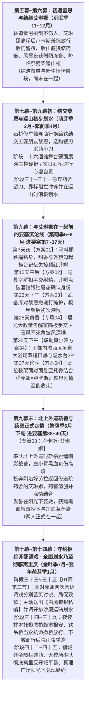

# 第二部卢卡斯NSFW情境企划全案总纲（少壮派誓约骑士与隐秘沉沦）

> **企划定位**：第二部维里迪亚王国篇·核心男性角色散点情境企划（卢卡斯篇）  
> **全卷文档导航**：[`00_全案总纲`](00_卢卡斯NSFW情境企划全案总纲.md) · [`01_圣殿马房暗查与骑士戒律沉沦篇（菲娜×卢卡斯）`](01_圣殿马房暗查与骑士戒律沉沦篇.md) · [`03_晨光药舍创伤破戒篇（卢卡斯×艾琳娜）`](03_晨光药舍创伤破戒篇（卢卡斯×艾琳娜）.md) · [`04_晨光大教堂信仰破戒两部曲篇（卢卡斯×菲娜）`](04_晨光大教堂信仰破戒两部曲篇（卢卡斯×菲娜）.md)

---

## 一、 角色人设与阶段心理机制（对齐 docs2 实体卡）

### 1. 卢卡斯·冯·施密特（`NPC_D2_15`，白鹰先锋骑兵队队长）
* **外貌与体格**：25 岁，身高 182cm，宽肩窄腰，肌肉线条结实分明；金褐色短发，湛蓝色眼睛，身着白银镀层轻装骑兵铠，胸前佩戴白鹰与十字双重纹章，配深蓝披风；下身 **16.5cm**，麦色粗壮，常年恪守晨光之誓与修会戒律，身体反应火热敏感。
* **阶段演进与行为逻辑**：
  * **结识雷恩、结缘艾琳娜与结交黎恩（第五幕至第七幕）**：第五幕修道院林道见识雷恩挑剑不伤人的剑道与克莱门特私印、受艾琳娜当面痛斥后羞愧致歉放行，并在第五至第六幕与艾琳娜结下纯洁好感（尚未在一起）；第七幕在下城运河石桥与心木商行受黎恩修车换蹄铁相助，结为投缘的工匠朋友；阶段二十六在黑野猪酒馆目睹莫尔茨对黑丝蒙面女子（菲娜）的舞台展演失控硬挺、当晚首次梦遗，次日石桥送行瞥见黎恩伴侣的身影而心虚自责。
  * **与艾琳娜定情前的要塞失守（第九幕阶段三十一至三十二·进要塞第 7~37 天）**：在圣殿大要塞重逢做工的黎恩与菲娜，菲娜身上的淡淡白花甜香、及腰粉发与红唇下巴轮廓勾起酒馆舞台记忆；在菲娜的一步步近身捉弄下（草料棚跌撞、马具室解扣手交、武备库对黎恩撒谎深喉、大教堂告解室与管风琴披风深喉、圣泉大浴场 3P、高位鞍架悬空结合），卢卡斯在朋友道义与身体本能的拉扯中步步失守。
  * **外巡药窖定情与定情后的守约、划水至窝里反（第九幕末至第十四幕）**：进要塞第 38~40 天率队北上外巡时斩杀脱缰暗影战兽负伤，在晨光修道院地下药窖与艾琳娜正式破戒定情。定情回堡后（第十幕），面对菲娜的两次言语调戏分别苦笑讨饶（“饶了我吧”）、局促致歉（“真不是菲娜小姐没有魅力，只不过我实在不能对不起黎恩和艾琳娜”）；同时因与雷恩多次接触及与艾琳娜定情，彻底厌恶执行圣殿骑士团的命令，主动交出【白鹰镀银私哨】、调开排沙渠夜巡班次划水，直至第十一幕铁吊桥当众抗命放行、第十三幕锁城违令递药、第十四幕大校场率队彻底窝里反。

### 2. 菲娜（Seraphina，`CHR_D2_01`）与黎恩（`CHR_D2_02`）
* **菲娜**：168cm，C罩杯，及腰粉发，琥珀色眼睛，无尖耳，自带森林晨露与月光百合的清爽甜香（外人只觉是未闻过的淡淡白花甜香）。在卢卡斯尚未与艾琳娜定情前，出于小猫般的恶作剧心性主动捉弄这位正经的年轻队长，每次事后用水囊清水漱净口腔，向黎恩娇声邀功；在卢卡斯与艾琳娜定情后，用两次言语调戏试出他的守约真心，由衷为朋友高兴。
* **黎恩**：178cm，黑发青紫瞳，18cm 粗硕挺拔，伪装成要塞冷锻间修甲工匠。表面对“卢卡斯大人”温和有礼，暗中在近处把风目击全程，事后对菲娜强势深情回收。

---

## 二、 主线时空咬合与全方案总览表

| 方案编号 | 主线阶段与时间锚点 | 核心空间舞台 | 亲密行为与NSFW等级 | 核心主线联动与产出 |
| :---: | :--- | :--- | :--- | :--- |
| **方案 01** | **马料棚初触** *(第九幕阶段三十一 · 进要塞第7天夜 / 5月上旬)* | 圣殿大要塞（`LOC_D2_21`）外围战马草料棚 | **贴身跌撞 / 隔衣硬挺顶触（等级 2）** 菲娜绊倒跌进怀里，淡淡白花甜香与及腰粉发、红唇下巴勾起酒馆舞台记忆，卢卡斯失控硬挺把菲娜顶得脸红 | 怀疑黎恩伴侣即酒馆舞台蒙面女子，连着两晚失眠 |
| **方案 02** | **马具室初露** *(第九幕阶段三十一 · 进要塞第15天午后 / 5月中旬)* | 白鹰战马马具室（黎恩在门外石廊擦马镫望风） | **解扣手交 / 肤触套弄（等级 6）** 菲娜解开骑裤铜扣握住套弄，耳语点破酒馆台下银铠窘态，让卢卡斯彻底确认舞台蒙面女子身份 | 菲娜用薄蜂蜡片拓下夜巡铜印模；卢卡斯愧疚提醒当晚避开西侧悬崖栈道暗哨 |
| **方案 03** | **武备库冷锻间** *(第九幕阶段三十一末 · 进要塞第23天下午 / 5月下旬)* | 圣殿大要塞（`LOC_D2_21`）武备库板甲架阴影 | **隐秘口交 / 初次深喉借位（等级 8）** 黎恩走近板甲架两步外找菲娜，卢卡斯首次对朋友撒谎支开黎恩；菲娜借铁锤巨响掩护初次深喉口爆 | 呼应后续圣泉大浴场 3P；菲娜水囊漱净后向黎恩邀功 |
| **专篇 04 （两部曲）** | **晨光大教堂告解与圣咏** *(第九幕阶段三十二初 · 进要塞第25天黄昏 / 6月上旬)* | 晨光大教堂（`LOC_D2_19`）私人告解室与二层管风琴乐池 | **部曲一：隔板探手手交（等级 6）** **部曲二：管风琴死角披风深喉（等级 8）** 告解室推拉小窗探手套弄并应付执事；二层风管后借圣咏轰鸣披风深喉 | 摸清教廷秘库（`LOC_D2_20`）齿轮暗梯卡槽位置；菲娜水囊漱净后黎恩在洗礼堂阴影深吻回收 |
| **联动方案 （莫尔茨34）** | **圣泉大浴场双雄竞夺** *(第九幕阶段三十二 · 进要塞第35天下午 / 6月下旬)* | [王都内城西区圣泉大浴场（`LOC_D2_33`）](../莫尔茨NSFW/00_莫尔茨主线NSFW剧情分布总纲.md) | **水下双抚 ➔ 争抢深喉 ➔ 温水台3P轮贯（等级 9）** 四人同赴浴场，菲娜水下双抚点燃卢卡斯，与莫尔茨抢嘴口爆后在温水台轮番贯穿 | 打破在同僚面前的清高外壳；黎恩池边全程目击，深夜石舍霸道回收 |
| **方案 04** | **高位鞍架悬空** *(第九幕阶段三十二 · 进要塞第37天傍晚 / 6月下旬)* | 白鹰高位马具库顶层备用重鞍架旁 | **本番插入 / 悬空托臀面对面（等级 9）** 次日北上外巡前夕，卢卡斯托起菲娜悬空一插到底，追问与沉沦内射（『菲娜×卢卡斯』越界剧情至此收束） | 卢卡斯愧对黎恩，次日清早率队出发赴北境干道与西南山麓外巡四天 |
| **专篇 03 （纯爱破戒）** | **晨光药舍创伤破戒** *(第九幕阶段三十二末 · 进要塞第38~40天北上外巡)* | 晨光修道院（`LOC_D2_12`）地下深层药窖 | **初夜结合 / 草药长木桌深情交合（等级 9）** 外巡斩杀暗影战兽左小臂负伤高烧，艾琳娜用银刃采药小刀为他清创，两人在草药长木桌深情结合、正式定情 | **卢卡斯与艾琳娜正式在一起**，发誓在阳光下娶她；获赠《暗影黑血解毒手记（抄本）》与净血草药囊 |
| **01篇第二节 （简短剧情A&B）** | **两次拒绝调戏与划水赠哨** *(第十幕阶段三十三 & 阶段三十五 / 金叶季7月)* | 圣殿大要塞（`LOC_D2_21`）外围马房廊下 / 武备库侧廊 | **纯言语调戏与守约拒绝（无越界）** 阶段三十三马房廊下苦笑讨饶（“饶了我吧”）；阶段三十五武备库侧廊摆手拒绝并局促道歉不能对不起黎恩和艾琳娜 | **主动交出随身【白鹰镀银私哨】**，借换防调开西侧排沙渠夜巡班次划水，衔接后续铁吊桥放行与校场窝里反 |