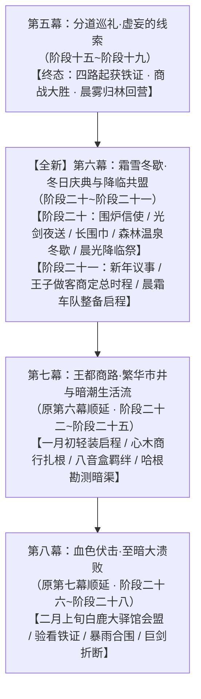

# 临时方案：全新第六幕·霜雪冬歇·冬日庆典与降临共盟总体规划方案

> **所属母案**：[00_第二部宏篇主线总纲与方案管理中枢.md](主线与世界扩充方案/00_第二部宏篇主线总纲与方案管理中枢.md) · [01_宏篇主线剧情总大纲与分幕导航.md](主线与世界扩充方案/01_宏篇主线剧情总大纲与分幕导航.md)  
> **设定库参考基准**：本方案全程以 `docs2/` 实体设定档案库为第一权威基准，相关地点、角色与事件实体严格对齐以下卡片：
> - 地理：`LOC_D2_01` 营地篝火与大食堂 · `LOC_D2_41` 森林温泉 · `LOC_D2_11` 法尔肯驿镇 · `LOC_D2_43` 猎鹰与十字老驿馆 · `LOC_D2_18` 白金王宫地下密室 · `LOC_D2_31` 白鹿大驿馆 · `LOC_D2_44` 心木商行
> - 角色：`CHR_D2_06` 黎恩 · `CHR_D2_04` 菲娜 · `CHR_D2_01` 艾德里安 · `CHR_D2_02` 劳拉 · `CHR_D2_03` 雷恩 · `CHR_D2_18` 朱利安 · `CHR_D2_07` 亚莉莎 · `CHR_D2_08` 菲 · `CHR_D2_09` 乔治 · `CHR_D2_11` 亚尔缇娜 · `CHR_D2_10` 爱丽榭 · `CHR_D2_12` 奥蕾莉亚 · `CHR_D2_05` 艾玛
> - 异族领袖：多尔金（长兄·锻造大师）· 哈根（二哥·建筑工程）· 法林（三弟·魔法工匠）· 鳞母与加尔（蜥蜴人）· 月语者与罗恩（狼人）
> - 核心节庆：沉眠季深冬·【晨光降临祭】（全境与各族最盛大的跨年新年盛典，严格遵循西幻与晨光大陆专属历法）
> - 距离基准：大本营→大门15km；大门→法尔肯10km；法尔肯→王都110km；白鹿大驿馆位于平原大道中段（距王都约90km）

---

## 〇、 方案定位与阶段十九收束改名说明

### 1. 阶段十九收束点重界定与改名
* **原方案症结**：原阶段十九试图在法尔肯商战刚刚打完的同一阶段内，紧接着塞入大本营庆功、信使往还、朱利安老驿舍碰头、亚尔缇娜光剑夜飞王宫、长围巾、大公会盟时程揭晓以及车队启程奔赴王都等七重大戏，导致时空连续过于仓促，剥夺了四路巡礼大胜后应有的深冬冬歇呼吸感；
* **阶段十九精准收束点**：
  - 阶段十九正文严格收束于法尔肯粮仓防守战大捷、公秤官收押纵火打手并查封商馆、四路铁证齐聚：
  > “清晨破晓，大车行粮仓的纵火打手被全部押入法尔肯市政地牢，罗曼商行的全部货栈与商馆被铁锁牢牢查封。四路独立巡礼历经数周严冬奔波，四大核心物理铁证完好无损地汇流齐聚，法尔肯的民心与粮道也彻底安定。为了避免在人多眼杂的驿镇过早暴露行迹，黎恩、菲娜、雷恩、劳拉、艾德里安、菲、乔治、亚莉莎与罗恩一行，在晨雾掩护下将四大铁证安全护送回仅数公里之遥的 Eldoria 大本营休整。晨曦穿透林间薄雾，车轮压碎林间厚雪，四路凯旋的身影渐渐融入苍茫风雪与古树密林之中。”
  - **到此为止，第五幕·分道巡礼·虚妄的线索正式胜利收官！**
* **阶段十九更名对齐**：
  - 原文件名：`阶段十九_公秤仲裁与晨霜启程·复式商战与光剑密送详规.md`
  - **正式重命名为**：[`阶段十九_公秤仲裁与晨雾归林·复式商战与粮道大捷详规.md`](主线与世界扩充方案/分阶段详规/05_第五幕_分道巡礼·虚妄的线索/阶段十九_公秤仲裁与晨雾归林·复式商战与粮道大捷详规.md)
  - 核心任务：彻底聚焦暗窖复式记账攻坚、市政公秤长廊公开仲裁、大车行粮仓夜战破阵生擒打手、以及四路铁证晨雾归林休整。

### 2. 原后续剧情全量无损迁移至【全新第六幕】（100% 照抄原版正文，绝不漏掉任何剧情）
* 原阶段十九后续的**围炉休整、信使密约、朱利安老驿舍取证、亚尔缇娜战术壳光剑高空夜驰王宫送证、爱丽榭两米一五深蓝长围巾毛毛虫趣话、以及晨霜轻装车队启程向王都**等精彩剧情，**100% 完整原封不动照抄收录至【全新第六幕】**；
* 结合深冬大雪封山的时节风土，融入森林温泉、雪地嬉戏与沉眠季末期【晨光降临祭】盛大狂欢，并在新年一月初由朱利安王子做客大本营会议厅正式定锚大公会盟（2月上旬）与王都大商路总时程，随后从容启程！

---

## 一、 幕级拓扑重构与时序衔接

* **时序跨度**：圣光历3472年沉眠季12月下旬至3473年萌芽季1月上旬（跨越约两周半时间）；
* **前置输入（承接第五幕·阶段十九）**：
  - 空间：法尔肯南部荒原雪道 ➔ 晨光大门 ➔ Eldoria大本营；
  - 状态：法尔肯粮仓保卫战全胜，四大物理铁证齐备并由全员在晨雾掩护下护送回大本营；
  - 资产：教廷秘库工匠主齿轮原本（EVD-04）、平民受创救治病历与黑血毒理分析手稿原本（EVD-05）、心木枯萎碳化残根原本（EVD-06）、黑市洗钱账本全卷；全套合规通关凭据与法尔肯商战缴获账册。
* **后置交付（交接第七幕·王都商路）**：
  - 空间：Eldoria大本营 ➔ 晨光大门 ➔ 法尔肯北门中央王都大道；
  - 状态：四大铁证已由亚尔缇娜光剑高空隐匿安全封存入王宫机密石室，商队全员轻装上阵无携带违禁物风险；全员在冬歇中完全恢复精气神，明确掌握白鹿大驿馆大公会盟（2月上旬）与法理大审判的总战略，四轮重型大篷车整备完毕；
  - 承接点：新年一月初，商队轻装踏上中央王都大道，正式驶向王国心脏，进驻王都下城区设立“心木商行”！

---

## 二、 全新第六幕分阶段演进蓝图（全量继承与原版照抄）

本幕由 **2 个长线演进阶段** 构成（阶段二十至阶段二十一）：

### 阶段二十：铁证密送与庆典冬歇·光剑夜驰与【晨光降临祭】
* **所属幕次**：第六幕·阶段二十
* **时间定锚**：圣光历3472年沉眠季12月下旬（约十天）
* **核心剧情演进**：

#### 1. 大本营围炉温情与数日后的信使密约（原文字 100% 照抄继承）
大本营指挥木屋的大食堂内，石砌大壁炉里的松木与耐烧栎木大柴烧得通红旺盛，噼啪作响，融融暖意瞬间驱散了全员身上的朔风严寒。留守组同伴们齐齐迎上前——奥蕾莉亚统帅端坐在长桌主位从容点头，爱丽榭与亚莉莎很快端来了一大锅热气腾腾、飘散着迷迭香与干酪清香的野山菌羊肉炖汤，还有刚出炉的黄油黑麦软面包和温热的丁香肉桂苹果红茶。  
围坐在厚木长桌旁，大家痛痛快快地享受着难得的放松。菲捧着大陶碗小口喝汤，整个人惬意地陷在毛茸茸的羊毛软垫里，舒服得像只冬日暖阳下的小猫；多尔金与哈根大口灌着黑麦酒粗豪大笑，法林细心擦拭着器械，玲咬着甜苹果干调皮打趣，凯尔与艾玛微笑着记录文献，整个大食堂洋溢着属于同伴凯旋的浓厚烟火呼吸感。  
大伙儿在大本营踏实歇息了数日。由于罗曼商行分号主管已逃往王都报信，四大铁证属于特征极其醒目的致命违禁物（教廷工匠序列号青铜主齿轮、黑血毒理分析手稿原本、碳化心木残根与黑市洗钱账册），一旦在城门税卡遭遇开箱抽检便会立刻暴露，如何避开一切眼线安全送达王都一直是必须解决的难题。黎恩与艾德里安通过法尔肯迷迭香商行玛格丽特夫人的王室绝密信道，给王都的朱利安王子捎去了暗信，商榷物证交割对策并顺便邀请王子来营地一同喝上两杯。  
数日后，玛格丽特夫人派心腹近卫送来了朱利安王子的亲笔火漆密信。在密信中，朱利安特别提到：自己身处王都，教会主教与异端审问厅达米安的眼线盯得极紧，现在大张旗鼓赶去森林大本营实在太过麻烦，已经来不及参加营地的庆功宴会了；但他已经做好了周密安排，自己有绝对的办法瞒过教会眼线悄然脱身，与大家定于次日子夜在法尔肯“猎鹰与十字”老驿舍二楼大套间碰头，当面验看并取走四大铁证！  
既然王子有周全的脱身把握并定下取证之约，众人心中大定，在大本营将四件铁证与装备全面检修妥当。到了与王子约定的次日夜里，主角团带着四大铁证再次秘密进驻法尔肯“猎鹰与十字”老驿舍二楼套间，静候王子的到来。

#### 2. 铁证归拢与光剑夜驰（原版正文 100% 照抄继承，不漏一字）
子夜过半，法尔肯“猎鹰与十字”老驿舍二楼的大套间内，石壁炉的炭火泛着宁静的暗红微光。  
粗栎木长桌中央，四路调查组连日奔波起获的四大核心铁证，在厚羊毛毡上整齐排开：  
1. 西线艾德里安与菲斩获的【教廷秘库工匠序列号青铜主齿轮原本（EVD-04）】；  
2. 西南线雷恩与劳拉起获的【平民受创救治病历与黑血毒理分析手稿原本（EVD-05）】；  
3. 南线黎恩与菲娜自黑帆快船底舱截获的【三十一年前心木树枯萎碳化残根（EVD-06）】；  
4. 潮汐草泽水上货栈破拆缴获的【黑市洗钱账本全卷与大贵族往来密卷】。  
木门轻扣两声，身披深灰旅行斗篷的朱利安在两名贴身亲信的护卫下悄然推门而入。此前在阶段十五双方已结下深厚血盟，此番朱利安特意秘密赶赴法尔肯汇合，查验调查战果。当年轻王子的目光落在长桌上并排陈列的四重铁证上时，呼吸不由自主地微微停滞，修长的手指轻轻触碰着冰冷的青铜齿轮与泛黄病历，眼中浮现出难以抑制的震动与庄重。  
“三十一年的黑幕……终于在这里拼凑出了无可辩驳的真相。”朱利安的声音低沉而肃穆。  
然而，战术瓶颈随即摆在眼前：罗曼商行主管已仓皇逃往王都报信，达米安统领的审问厅斥候与税卡卫兵必定在王都各城门与外围货栈严密布控。如果商队拖着四辆大篷车、试图把这些极度敏感的致命违禁物证夹带入城，稍有差池引发开箱严查，便会招致灭顶之灾。  
“整个王国境内，眼下唯一绝对安全的地方，只有白金王宫地下的王室机密石室（`LOC_D2_18`）。”朱利安面色凝重，“父王在王宫深处的私密密室里暗中留存了十八年黑账，在没有彻底撕破脸皮发动武装叛乱前，教会和圣殿的爪牙绝不敢擅闯父王的私邸搜查。但法尔肯距离王都整整一百一十公里，沿途哨卡森严，如何能避开所有眼线把我和这批铁证送回王宫？”  
“——如果是运送物资与人员，克劳·索拉斯可以提供战术支援。”  
一直安静站在窗边的亚尔缇娜平淡开口。小巧的少女抬起纤细的手腕，随着便携终端的微弱提示音，通体银白、线条流畅的【战术壳·克劳·索拉斯】在空气中无声浮现，悬浮在半空之中。  
亚尔缇娜面无表情地抬起头，淡定地汇报参数：“克劳·索拉斯已解除飞行限制。开启光学折射迷彩与高空降噪力场后，可搭载两名乘员与五十公斤物资；自法尔肯经云层上方直飞王宫后方隐秘露台，航程约需十八分钟。被地面目击与拦截的概率为零。”  
乔治赞许地点了点头，迅速从行囊里取出两只特制双层防震铅板手提箱，将四件铁证妥善卡紧在阻燃内衬中，牢牢锁入战术壳侧面的防震挂架。  
朱利安半信半疑地系紧斗篷，跨坐在战术壳后座的乘员固定位上。  
伴随着透明气流护罩的合拢与光学迷彩的瞬间激活，克劳·索拉斯化作一缕连夜视都无法捕捉的微弱波动，自天井无声垂直拔地而起，径直穿透风雪，刺入茫茫天幕！  
接下来展开的，是一段让年轻王子毕生难忘的高空飞行。  
战术壳在数千米的高空云层之上以极其惊人的速度破空巡航！脚下被撕裂的茫茫雪云如狂潮般飞退，狂风在无形气流护罩外发出凄厉刺耳的呼啸。平素只骑过战马与双马大车的朱利安何曾见识过这种来自塞姆利亚大陆导力工业顶峰的非凡机械！向下俯瞰，平原山峦如同一张被急速扯向后方的黑白幕布，强烈的失重与超高速冲击让年轻王子吓得脸色惨白、浑身紧绷得如同一块坚硬的玄武岩，两手死死攥着战术壳冰冷的生铁合金扶手，骨节因为过度用力而发白，牙关止不住地上下打颤：  
“亚、亚尔缇娜小姐……！这、这速度是不是太快了点……？！我们……我们真的不会直接掉下去吗……？！”  
而在前排操控席上，娇巧的亚尔缇娜整个人宛如一尊精致的陶瓷人偶，全程维持着毫无波澜的面瘫扑克脸。少女清澈明亮的大眼睛平静地注视着屏幕上的高度仪与风阻数值，头也不回地用平缓清脆的声线淡定回复：  
“回答殿下：目前飞行巡航速度仅为额定功率的百分之六十五，属于极度平稳的低速巡航状态。另外，请殿下尽量闭紧嘴唇，以免寒冷气流倒灌入呼吸道引发剧烈咳嗽。”  
朱利安吓得赶紧把嘴闭死，整个人在凛冽的高空寒风中度过了人生中最漫长、最心惊肉跳的十八分钟。  
“——目标抵达。开始减速下降。”  
伴随着气流护罩的微弱轻响，战术壳如同一滴无形的雨滴，轻巧平稳地降落在白金王宫后山深处与密室相通的大理石悬空高台上。  
光学迷彩悄然解除，朱利安踩在坚实的石板地面上，两条腿几乎脱力发软，本能地一把扶住旁边高耸的大理石立柱，靠在石柱上大口大口喘着粗气，胸口剧烈起伏，冷汗几乎将内里的羊毛衫全部浸透。  
亚尔缇娜动作利落地将两只特制防震铅箱卸下，稳稳递到朱利安面前。看着眼前这位平日里尊贵从容、此刻却靠着柱子瑟瑟发抖的年轻王子，亚尔缇娜歪了歪小脑袋，清澈的大眼睛轻轻眨了一下，用平板冷淡却分明透着体贴关怀的语调，丢出了一句可爱的即时吐槽：  
“根据战术壳生理监测指标……殿下的心跳速率已达每分钟一百六十八次，双腿肌群处于轻度痉挛状态。为了王国的稳定与未来的法理大审判，建议殿下立刻饮用加糖温热红茶并卧床就寝，请勿继续靠在石柱上发抖……那么，祝您晚安，王子殿下。”  
朱利安靠着立柱愣了片刻，苍白的面庞上终于忍不住浮现出一抹又好笑又感激的苦笑：“呼……真是毫不留情呢……不过，谢谢你的关心，亚尔缇娜……你也路上小心。”  
亚尔缇娜轻轻欠身行礼，转身轻巧跃回战术壳。克劳·索拉斯重新化为无形微光，垂直破空而起，无声消失在茫茫夜色之中。  
朱利安提起两只铅箱，转身推开王宫密室的花岗岩暗门，将这批即将撕碎教廷伪装的致命铁证，稳妥安置在王宫暗格之中！

#### 3. 围巾温情与毛毛虫趣话（原版正文 100% 照抄继承，不漏一字）
大套间的角落里，收拾停当的旅行皮行囊整齐靠在长木椅旁，空气中弥漫着烤苹果与燕麦红茶的暖香。  
出发前夕，亚莉莎双手抱着那个大包裹快步走到黎恩面前，把包裹一把塞进黎恩怀里，双手叉腰故意板起小脸：“喏！拿着！这是爱丽榭特意让亚尔缇娜用光剑给你空运送过来的！”  
黎恩有些茫然地解开包裹，双手将那条又厚又长、毛茸茸的深蓝长围巾在房间里完全抖开。两米一五的夸张长度几乎从长桌的一头拖到了另一头，黎恩忍不住抓了抓头发苦笑自嘲：“这、这也太长了吧……围在脖子上整个人都要被埋进去了，感觉就像一条深蓝色的毛毛虫啊……”  
菲整个人懒散地缩在高背木椅里，晃荡着细长的双腿，面无表情地面瘫补刀：“……大毛毛虫。教官看起来很好吃。”  
长桌旁的同伴们顿时爆发出善意的哄堂大笑。  
亚莉莎见状耳尖唰地红透了，像只炸毛的小猫般双手叉腰，气鼓鼓地跺了跺脚娇嗔威胁：“笨蛋黎恩！你居然敢嫌弃爱丽榭的心意？！这可是她熬了好几个晚上亲手织出来的！你要是敢不围上，今晚我就让罗恩追着咬你哦！”  
罗恩在旁边温和地晃了晃毛茸茸的狼尾巴，苦笑着偏过脸表示无辜。  
菲娜双手捧着陶杯，清澈的琥珀色双瞳里满是宠溺与笑意，柔声打趣：“好啦好啦，黎恩快戴上吧，外面天寒地冻的，有爱丽榭的温暖守护多安心呀~”  
被大家调侃逗弄，黎恩无奈地温和一笑。他收起玩笑的神色，动作格外轻柔地将深蓝长围巾在脖颈上工整地绕了两个厚实的保暖圈，将毛茸茸的流苏抚平，整个人在深蓝风衣与厚实围巾的包裹下更显精神挺拔。  
黎恩揉了揉温暖的流苏，看着身侧欢声笑语的同伴们，心中唯有守护彼此的踏实暖流。

#### 4. 踏雪归营与森林温泉冬歇
铁证已被亚尔缇娜安全密送入王宫密室，法尔肯民生安定。此时已入深冬，凛冽朔风呼啸，漫天暴风雪渐渐封冻了北上平原大道的长途行旅。众人向玛格丽特夫人道别，驾驶四轮重车碾过厚厚积雪，安然返回白雪皑皑的 Eldoria 大本营休整过冬。  
暮色渐浓，位于大本营东北方向、沿银流河上溯约八百米处的森林温泉（`LOC_D2_41`）蒸腾起大片白蒙蒙的热汽，与池边松针上的积雪相映成趣。银流河潺潺水声与温泉池中泉涌咕嘟声交织，天然掩蔽了池内的私语。池中横卧的高大巨石将内外水域自然隔开，大石后侧避风处的水温最是温润舒适。经历了连续数周长途奔波的劳顿，黎恩与菲娜在安静的温水石池中洗去风尘。菲娜一头金发用发带随意挽起，白皙剔透的肌肤在温热泉水中泛着娇嫩的粉红。320岁的精灵守护者舒适地舒展着纤细优美的身躯，像只吃饱喝足的小猫般依偎在黎恩身侧，琥珀色的大眼睛里满是通透柔和的温情。两人轻声耳语，聊起海港暗舱的惊险与法尔肯商战的完胜。黎恩温和调侃菲娜在海港小酒馆被那个黑大个搭讪时脸红无措的娇憨模样、以及后来被按在暗处欺负时又羞又迎合的软语求饶，惹得菲娜又羞又气，伸出白皙小脚在水下轻轻踢了黎恩一脚，嗔怪他“越来越会捉弄人了”；黎恩笑着握住她浸在水里的白皙小脚拉入怀中，两人在漫天飞雪与温热泉水中享受着彼此专属的极致静谧与安心依赖。

#### 5. 雪地嬉闹与沉眠季末期【晨光降临祭】全营狂欢
白昼的林间空地变成了欢乐的海洋。玲团起大雪球出其不意地砸在法林的后脑勺上，引得矮人三弟嗷嗷直叫；菲轻盈地跃上大树枝头，抓起一把把积雪精准投掷，把乔治的大胡子染得雪白；亚莉莎双手叉腰指挥着罗恩堆砌巨大的雪狼雕塑，结果被雷恩不小心弄塌了半边，逗得全场哄堂大笑。傍晚的大食堂长桌上摆满了不可思议的丰盛美食：矮人特制的炭烤羊排外焦里嫩、油脂滋滋作响；蜥蜴人采集的冬眠香草烘焙出清甜的烤鱼；爱丽榭与亚莉莎烘烤出三层高的黄油糖霜水果大蛋糕，空气中弥漫着肉桂、丁香与烤苹果的热烈香气；多尔金与哈根抱出珍藏的大木桶，将泡沫浓郁的黑麦烈酒倒满每一只陶杯，整个大木屋回荡着杯盘撞击与豪爽大笑。  
沉眠季深冬之夜，全境最盛大的传统节日——【晨光降临祭】如期而至。暮色降临后，整座大本营被点缀得宛如梦幻仙境。精灵符文与矮人晶石被点亮，挂满松枝的彩色琉璃灯在雪夜中绽放出暖金与淡紫的柔光；中央空地升起了数米高的冲天篝火，烈焰舔舐着夜空，将飘落的雪花融化为晶莹的水汽。各族首领手挽着手围着篝火起舞：鳞母手持象征丰饶的泉水藤杖为全营祈福，月语者昂首迎着寒冬明月发出苍凉悠扬的祝福长嗥，多尔金挥动大铁锤敲响古老的铸造铜砧，清脆的金属共鸣宛如新年的钟声。在倒数声中，众人一同举起温热的丁香苹果酒杯，齐声高呼新年祝词！整座森林沉浸在无与伦比的温暖与幸福之中。  
当然，外界是绝不可能察觉到森林深处竟然这般灯火通明、热闹非凡的——若是从十五公里外的晨光大门、或是从更南面边境哨卡的眺望塔向北远眺，深冬的 Eldoria 原始密林唯有一片被暴风雪彻底封冻的苍茫与死寂。刺骨的朔风呼啸盘旋，厚重的积雪压弯了松枝，整座森林在外界眼中完全陷入了深冬的长眠，连一丝火星、一缕炊烟或一声异响都没有漏出树冠分毫。  
这份严密的隐蔽，正是菲娜、艾玛、月语者、鳞母与法林、乔治在庆典开幕前便心照不宣布设好的结界手笔：  
- **树冠与魔导的视觉遮蔽**：菲娜以精灵守护者的血脉共鸣唤醒整片古树森林，引导繁茂高耸的树冠在高空紧密搭接，筑成天然的风雪华盖；艾玛则在林冠上层展开了精密的古代魔女幻术与光影折射力场，将数十米冲天篝火的烈焰与琉璃彩灯的暖光全部偏转滤除，从外界高空俯瞰，只能看到平整深厚的厚雪云层与微弱的寒夜星芒；  
- **声波与地脉的声学消融**：月语者引动狼人萨满风语术，使部族的祝福长嗥与众人的欢歌笑语同肆虐的暴风雪达成声波谐振，在蔓延到森林外围前，就自然稀释为呜咽呼啸的纯粹风声；法林与乔治在营地外围哨线钉下了矮人符文吸热石与导力阻尼地桩，消解了铜砧敲击与众人踏地起舞的震颤；鳞母则以水泽秘法升起贴地寒雾，掩去地表残存的温热与足迹气味；  
- **主动遮蔽的多重动机**：在外界常态认知中，教会、异端审问厅与世俗权贵此刻的视线全被王都内部的政治风暴与罗曼商行的经济账目所牵制，根本没有任何理由把注意力投向这片数百年来人迹罕至的极北冻土，更不知道林中收容着各族领民的营地存在。几位守护者之所以未雨绸缪地提前布下重重遮蔽，核心动机在于多重视角：  
  1. *主动维持外界认知定式*：绝不打破数百年来外界对森林“严寒死寂、毫无生机”的既有印象。若是任由冲天火光与长嗥穿透树冠，十五公里外的晨光大门守卫与夜间巡防在黑暗雪原上就能望见北方天际反常的火光倒影，反而会无端激起边境哨卡与过路行商的警惕与好奇窥探；  
  2. *顺应部族传统与林地休眠*：异族向来习惯避世隐居，菲娜与各族先知本能地选择将欢庆能量完全收束在营地界限之内，既不惊扰整片古树与冻土在严冬中的自然休眠，也是对自身家园生态的敬畏；  
  3. *确保全营身心彻底放松，留足年后战略退路*：大家历经一整年的颠沛与连日严冬四路奔波，身心早已紧绷到了极点，唯有在确凿无虞的安全屏障守护下，同伴们才能毫无后顾之忧地卸下防备开怀欢笑；同时也确保了新年一月商队轻装南下王都开设商行时，身后的根据地永远沉没在茫茫风雪的盲区中，享有最稳固的情报与退路安全。

---

### 阶段二十一：深冬议事与战略定锚·王子做客与一月大商路总纲
* **所属幕次**：第六幕·阶段二十一
* **时间定锚**：圣光历3473年萌芽季1月上旬（新年伊始，约一周）
* **核心剧情演进**：

#### 1. 新年晨曦与大本营会议厅集结
晨光降临祭的欢腾渐渐隐入新年的宁静，大陆北方迎来了冰雪渐融前夕的清冽晨曦。大本营指挥木屋的绝密会议厅内，长桌中央铺开了由乔治与凯尔联合绘制的维里迪亚全境最新立体沙盘，以及王都三层立体格局图纸。奥蕾莉亚统帅端坐主位，黎恩、菲娜、艾德里安、劳拉、雷恩、亚莉莎、菲、乔治、艾玛等主力全员就座，休整完毕的精气神达到了巅峰状态。

#### 2. 午后重逢与营地招呼
某日午后，冬日暖阳穿透薄雪洒在营地空地上。朱利安一身整洁厚实的旅行呢绒常服，如往常做客般自然出现在了大本营，踩着积雪微笑着抬手和大家打招呼。没有大张旗鼓的排场，更没有任何护卫随行，年轻王子神色轻松熟稔，宛如远行归来的老朋友直接迈步走入大本营会议厅。  
接过爱丽榭递来的热红茶道了声谢，朱利安坐在长桌旁，微笑着向大家同步王宫近况：四大物理铁证经由亚尔缇娜光剑连夜送达后，已由埃德蒙国王亲手封存入王室机密石室暗格，教廷与异端审问厅毫不知情；罗曼商行分号主管虽逃回王都告状，但苦于没有真凭实据，反被法尔肯市政厅以“纵火行凶与偷税漏税”通报商署，达米安暂时不敢在明面上生事。

#### 3. 正式商定【总时程与重大战略节点】（原版正文 100% 照抄继承，时程校准为一月至二月）
朱利安走到立体沙盘前，取过木雕战棋，**正式向全员揭晓并商定了反抗同盟的核心总时程与三大战略节点**：  
1. **第一节点·全境大公会盟时间地点**：王室与反教廷大领主们（包括西境亨里克边境伯等手握兵权的重臣）已彻底敲定盟约，定于**萌芽季初（圣光历3473年2月上旬）**，在王都以南约九十公里的平原商道要冲——著名的石造贵族大驿馆**【白鹿大驿馆】（`LOC_D2_31`）**举行全境反教廷大公绝密会盟！届时朱利安将亲携四大铁证赴会，当着全境大领主的面启封验看，正式缔结反抗教廷暴政与伪案的政治军事同盟；  
2. **第二节点·法理大审判时机**：会盟确立大势后，反抗同盟将在紧接着的春季王国大典（真理广场朝觐之时），当着全境平民与各旗队骑士的面发动全境法理大审判，彻底推翻教廷三十一年的暗影统治；  
3. **第三节点·商队四周战略窗口与王都立足使命**：从当下（1月上旬，商队启程）到白鹿大驿馆会盟，商队拥有**约四周至五周（一个月左右）的准备窗口期**。朱利安郑重拜托众人：请商队凭借已获批的正规《内陆商道通行状》，轻装进驻王都下城区，租下商馆设立“心木商行”（`LOC_D2_44`），以大宗平准粮油与北方羊毛贸易为掩护扎下脚跟，并暗中探查王都下水暗渠力学结构，作为后续大公会盟期间王都内部唯一的可靠退路与情报后盾！

#### 4. 晨霜破晓车队启程出发（原版正文 100% 照抄继承，不漏一字）
清晨的第一道白霜覆盖在驿馆天井的青石板上，薄冰在微冷的朔风中微微泛着银光。  
四辆经过全面检修、轴承涂满耐寒兽脂、马蹄全部钉好百锻防滑抓地铁钉的四轮重型大篷车，在庭院中整备完毕。  
由于四大铁证已由亚尔缇娜先一步安全密送入王宫密室，车队此时完全是纯粹合规的商队配置。乔治与雷恩利落地将越冬的硬干酪木桶、整捆羊毛线与大宗麦粉袋稳妥固定在货厢内，车体没有夹带任何违禁之物，轻便而扎实。  
全员身披厚保暖冬装跃上马车。庭院门口，玛格丽特夫人与学徒小汉斯并肩立在石阶前，微笑着挥手送行。  
“路上注意安全，各位。”玛格丽特夫人柔声叮嘱，“王都那边的商行分号我已经提前托信打点好了，我们在法尔肯等你们凯旋的消息。”  
“驾——！！”  
伴随着沉稳利落的扬鞭轻喝，四辆大篷车缓缓启动。坚固的铁蹄与木轮踏碎地面上的薄霜，发出规律而清脆的“咯吱”声响。  
车队穿过法尔肯北城门高大厚重的石拱门洞，驶上了笔直延伸向北方地平线尽头的中央王都大道。  
晨曦穿透深冬的薄雾，金色的朝阳洒在车队的生牛皮顶棚上。车辙在银装素裹的平原大道上平稳延展，向着风起云涌的王国政治心脏坚定进发。  
**【完美无缝交接第七幕·王都商路·繁华市井与暗潮生活流】！**

---

## 三、 核心实体与物象核验表

| 维度 | 对应实体与设定 | 功能与防呆规范 |
| :--- | :--- | :--- |
| **地理据点** | Eldoria大本营指挥木屋大食堂（`LOC_D2_01`）、森林温泉（`LOC_D2_41`）、猎鹰与十字老驿馆（`LOC_D2_43`）、白金王宫密室（`LOC_D2_18`）、白鹿大驿馆（`LOC_D2_31`）、心木商行（`LOC_D2_44`） | 严格依据 `docs2/location/` 空间据点，声光质感真实自然。 |
| **导力战术装备** | 【战术壳·克劳·索拉斯】（光剑）、高空光学折射迷彩、高空降噪力场、双层防震铅板手提箱 | 严格执行千米高空零导力外溢规范，确保王国平民与守卡零目击。 |
| **节庆与民俗道具** | 沉眠季末期【晨光降临祭】、彩色琉璃灯、冲天篝火、黑麦烈酒、丁香肉桂热苹果酒、三层水果糖霜蛋糕、两米一五深蓝长围巾 | 纯正 JRPG 剑与魔法轻小说节庆风土道具，严格遵循西幻与晨光大陆专属历法规范。 |
| **重大战略节点** | 圣光历3473年2月上旬【白鹿大驿馆】大公会盟、春季大典法理大审判、商队四周王都立足准备期 | 严密承接第七幕（原第六幕）王都商路四周生活流，彻底解决时间线断层与仓促感。 |

---

## 四、 幕级结构顺延总对照表

| 原幕次编号与名称 | 调整后幕次编号与名称 | 核心定位与阶段变动 |
| :--- | :--- | :--- |
| **第五幕**：分道巡礼·虚妄的线索 | **第五幕**：分道巡礼·虚妄的线索 | 涵盖阶段十五至阶段十九。**终态：四路铁证起获 · 商战大胜 · 晨雾归林回营**（文件名：[`阶段十九_公秤仲裁与晨雾归林·复式商战与粮道大捷详规.md`](主线与世界扩充方案/分阶段详规/05_第五幕_分道巡礼·虚妄的线索/阶段十九_公秤仲裁与晨雾归林·复式商战与粮道大捷详规.md)）。 |
| *无* | **【全新】第六幕：霜雪冬歇·冬日庆典与降临共盟** | **涵盖阶段二十至阶段二十一（共 2 个阶段）**。 1. **阶段二十**：大本营围炉休整、朱利安老驿舍取证、亚尔缇娜光剑高空夜送王宫、爱丽榭长围巾毛毛虫趣话、森林温泉冬歇温存、沉眠季末期【晨光降临祭】全营狂欢与主动隐蔽； 2. **阶段二十一**：新年伊始朱利安王子做客营地议事、正式定锚白鹿大驿馆大公会盟（2月上旬）与一月商路总纲、晨霜轻装车队整备启程驶向王都大道。 |
| **第六幕**：王都商路·繁华市井与暗潮生活流 | **第七幕**：王都商路·繁华市井与暗潮生活流 | 原阶段二十至阶段二十三顺延为**阶段二十二至阶段二十五**。一月初商队抵王都下城建立心木商行、科林八音盒羁绊、卢卡斯交锋、哈根勘测暗渠、四周准备期从容铺展。 |
| **第七幕**：血色伏击·至暗大溃败 | **第八幕**：血色伏击·至暗大溃败 | 原阶段二十四至阶段二十五顺延为**阶段二十六至阶段二十七**。二月上旬白鹿大驿馆大公会盟密室验看四大铁证、异化死士深夜暴雨合围、大剑折断、雷恩被俘。 |
| **第八幕**：绝境流亡·篝火重铸与艾斯特雷亚之誓 | **第九幕**：绝境流亡·篝火重铸与艾斯特雷亚之誓 | 原阶段顺延。 |
| **第九幕**：深渊暗道·暗河谍影与地底破壁 | **第十幕**：深渊暗道·暗河谍影与地底破壁 | 原阶段顺延。 |
| **第十幕**：惊天劫狱·血洗圣殿死牢 | **第十一幕**：惊天劫狱·血洗圣殿死牢 | 原阶段顺延。 |
| **第十一幕**：王都暗流·沙龙旧卷与法理围城 | **第十二幕**：王都暗流·沙龙旧卷与法理围城 | 原阶段顺延。 |
| **第十二幕**：王都异化·双城合围决战 | **第十三幕**：王都异化·双城合围决战 | 原阶段顺延。 |
| **第十三幕**：破晓大审判与黎明宪章 | **第十四幕**：破晓大审判与黎明宪章 | 原阶段顺延。 |

---

## 附录：第五幕迷雾海港专属背德情境点策划案

### 【剧情点一：咸涩海雾——酒馆暗角的黑肤搭讪与货棚暗影推拉】

* **场景时空标尺**：圣光历3472年沉眠季·维里迪亚王国最南端·迷雾海港（`LOC_D2_36`）码头区边缘的“咸鲱鱼与旧锚”木筋酒馆及后巷避风货棚。
* **起因与空间切入**：
  - 连续数日的深冬阴雨让整座海港浸泡在一片冰凉咸湿的浓海雾中。黎恩与菲娜身披深色粗呢旅行斗篷、压低兜帽，走进低矮潮湿的码头木筋酒馆；
  - 室内充斥着劣质麦酒、油煎干鱼、陈旧烟草与潮湿海藻的混杂气味。菲娜在靠墙的一张粗栎木旧方桌前落座，解开斗篷系带透气，露出了一截雪白修长的脖颈与柔美侧脸。在昏暗油腻的码头酒馆里，精灵守护者白皙剔透的肌肤宛如发光的极品明珠；
  - 黎恩起身穿过拥挤喧闹的人群，前往油腻的吧台排队端取刚烤出炉的热鳕鱼块与温热的麦酒。
* **大块头海员搭讪与体格悬殊的压迫感**：
  - 就在黎恩转身离开的短短两三分钟内，一个常年在黑帆走私船上跑深水水运的海员摇晃着醉步踱到了桌旁；
  - 男人三十余岁，身高超过一米九，体格如生铁浇铸的岩石般宽厚魁梧。常年经受外海暴风雨与烈日的洗礼，全身皮肤黝黑如生铁，敞开的粗亚麻脏坎肩下露出大片浓密粗硬的黑胸毛与几道被缆绳和海兽撕扯留下的深色旧疤痕；
  - 男人带着一身外海风浪的咸涩水汽与粗粝酒气大步靠近，高大魁梧的身形投下一片厚重的阴影，粗糙蛮横的体魄带着毫无遮掩的压迫感，让长年居于纯净森林中的精灵少女下意识挺直了后背；
  - 见到独自坐着的绝美女子，男人浑浊充血的眼睛瞬间发直，粗糙得像锉刀般的大手重重撑在方桌边缘，庞大的身躯前倾压下，带着酒气粗声调侃：
    - “哦？真是罕见的稀客啊……在这片满是烂鱼内脏和发霉烂木头的码头，居然能见到这么纯净标致的小姐。”
    - “喂，美丽的小姐，一个人缩在这种阴冷角落里，杯子里的麦酒都要结冰了吧？把这样可爱的美人扔在冷板凳上的男人，根本不配当护卫啊。”
  - 菲娜轻轻皱起好看的秀眉，上身稍稍后仰拉开距离，清澈的琥珀色大眼睛里带着几分冷淡与警惕：
    - “……我有同伴，请不要打扰我。”
  - 少女那清甜柔和的嗓音在嘈杂的酒馆里格外抓耳，听在醉汉耳中更是如同羽毛搔心。男人嘿嘿粗笑，露出被烟叶熏黄的粗牙，不仅没退，反而借着酒劲伸出布满硬茧的黝黑大手，重重按在菲娜白皙小手旁边的桌面上——一黑一白、一粗一嫩的极度视觉反差，在昏暗的煤油灯光下触目惊心：
    - “别这么冷淡嘛。外面雾大风急，不如跟我到后头的避风棚里喝两杯？我那儿可是藏着从南洋走私来的烈酒，保准能让你整个人都暖烘烘的。”
  - 菲娜再次后撤拉开距离，语气冷淡而带着守护者的戒备：
    - “我已经拒绝了，请退后。”
  - 男人被酒劲冲昏了头脑，咧嘴粗笑着一把扣住菲娜娇嫩细滑的手腕：
    - “害羞什么，只是去暖和暖和而已，走吧！”
* **黎恩的暗中目击与两人的纯粹背德共谋**：
  - 黎恩端着木托盘正从吧台转过身，一眼便看到了这一幕；
  - 作为八叶一刀流剑圣，黎恩拔刀斩断其手腕只需一眨眼间；但他深知菲娜拥有浩瀚的神圣魔力，只需动动手指就能将这粗壮水手掀飞出酒馆。就在黎恩脚步微顿的刹那，菲娜仿佛心有灵犀般抬起视线，穿过喧嚣弥漫的人群，与黎恩的目光在半空中猝然对撞；
  - 黎恩没有立刻拔刀走过来。他端着木托盘的手指微微收紧，眼底泛起一抹深邃晦暗的暗芒，喉结在阴影中缓慢而明显地滚动了一下——那是目睹自己最纯洁高贵的伴侣被粗野海员当面抓扯调戏时，强烈的独占欲与禁忌快感在胸膛里疯狂拉扯的危险神色；
  - 而菲娜的心脏也随之猛然漏跳了一拍。她敏锐地捕捉到了黎恩眼中那股发烫的暗火，原本准备凝聚魔力的指尖在袖中悄然松开了；
  - 一股酥麻的战栗顺着脊椎直窜而上。平日里在森林中受尽敬仰的圣洁守护者，此刻在逼仄肮脏的酒馆角落里，竟成了野蛮水手眼中的猎物，而自己最深爱的男人就在不远处注视着这一切。心底属于菲娜特有的狡黠与调皮、以及平日里高贵身份被践踏拉扯的隐秘羞耻，化作强烈的背德电流窜过全身，瞬间点燃了体内的雌性本能。她没有呼救，也没有反抗，只是心虚而慌乱地咬住下唇移开了视线；
  - 黎恩退后半步倚在吧台阴影后，端着陶盘，咽了一下口水，眼神逐渐变兴奋。
* **后巷货棚暗影推拉与沉沦试探**：
  - 男人见菲娜看似“孤立无援”、眼神闪躲且面泛桃花，越发得寸进尺，粗糙发烫的大手扣紧菲娜纤细娇嫩的手腕，半搂半拖着向酒馆后门带去；
  - 菲娜手腕被攥得发紧发红，雪白娇嫩的肌肤在那粗黑掌指下被勒出一道刺目的红痕。她看着阴影里一动不动的黎恩，双腿有些发软，半推半就地被男人拉进了后巷堆满破烂渔网和陈年粗帆布的阴暗避风货棚；
  - 货棚外风雨大作、海浪拍击栈桥轰鸣，棚内逼仄阴冷。男人急不可耐地将菲娜一把按在厚重的干燥旧帆布堆上，高大黝黑的身躯如铁塔般死死笼罩下来：
    - “老子在深海漂了几个月，可算撞见极品了……真香啊，你身上擦了什么香料，怎么比王都的贵族小姐还香？”
  - 男人粗重的酒气扑面而来，庞大高热的身躯如阴云般将狭小的货棚彻底遮蔽。粗糙生茧的大手急不可耐地扯开她的皮坎肩，一把将单薄的内衬暴力扯下，两团雪白饱满、挺翘诱人的浑圆娇乳瞬间毫无遮拦地弹露出来！男人粗黑的大手直接狠狠覆了上去，粗粝带茧的掌心毫无阻隔地直接揉弄揉捏着娇嫩温热的乳肉，肆意将丰满白皙的胸脯抓握成夸张变形的形状；
  - “唔嗯……！”菲娜仰起白皙的脖颈，发出一声甜软微颤的呜咽，修长纤细的十指死死抓紧身下粗糙的旧帆布。男人的力道野蛮粗鲁，手指直接掐揉着敏感娇嫩的粉红乳晕与尖端，可更让她心跳彻底失控的，是门外——
  - 就在货棚半掩的木板门外，暴雨顺着檐口哗哗流淌。黎恩就站在两步之外的雨幕阴影中，双手抱在胸前，幽暗发红的瞳孔透过门板裂缝，死死锁在菲娜被粗暴按压、白皙胸脯在黝黑大手里变形揉弄的画面上；
  - “慢、慢一点……好疼……”菲娜眼里浮起一层湿漉漉的水汽，娇弱发颤的气音既是对男人的无措推拒，更是故意让门外的黎恩听得清清楚楚；
  - 男人被刺激得浑身充血，急躁地掀开菲娜的羊毛长裙，从粗布裤缝里掏出粗硬黝黑的肉棒，抵在温热湿润的大腿内侧胡乱磨蹭：
    - “等会儿保准让你舒服得叫出来……！”
  - 就在快要突破最后防线的临界刹那，货棚后方高处的通风木窗悄无声息地被推开半截——黎恩身形宛如一片无声掠过的轻羽，没有发出一丝声响，极为利落地从窗外翻跃而入，悄然出现在男人毫无防备的宽厚后背之后！
  - 八叶一刀流精悍的手刀挟着沉稳刚劲的风声，精准而沉重地直接斩在男人后颈要害处！男人浑身猛地一僵，连哼都没哼出一声，庞大如铁塔般的高大身躯当场失去知觉，软绵绵地一头栽倒在旁边的旧帆布堆上，昏死过去；
  - 菲娜面颊潮红如醉、长发散乱，胸前衣服大敞，两团被揉捏得泛起粉红指印的雪白娇乳大片暴露在阴冷的空气中。菲娜微喘着撑起身子，抬起水润的大眼睛，正好迎上站在昏迷水手身后、居高临下注视着自己的黎恩；
  - 逼仄昏暗的货棚内，雨声轰鸣。黎恩单手垂在身侧，胸口微喘起伏，眼底烧着快要决堤的滚烫欲火，平日里沉稳克制的嘴角此刻却根本压抑不住，扬起一抹又好气又极度刺激的坏笑；
  - 迎着黎恩那灼热发烫的目光，菲娜心跳兴奋得如同擂鼓，漂亮的脸蛋红扑扑的。她不仅没有半点惊慌，心底反而被这种当面被外人亵玩、又被最爱的男人亲自破窗抓包的强烈刺激彻底填满；在急促的微喘中，菲娜像只恶作剧大获全胜的小猫般扑哧轻笑出声，带着娇憨与狡黠轻轻咬了咬水润泛红的下唇，眸子里满是开心、促狭与心照不宣的雀跃；
  - 两人隔着地上昏死的水手相视而笑，眼神在空气中胶着拉扯，满是心跳狂飙后的兴奋与默契。黎恩快步上前，一把脱下干燥温暖的厚风衣将她连同大敞的胸脯结结实实裹进怀里，低头附在她滚烫发红的耳畔咬牙笑骂：“……贪玩的大精灵小姐，这笔账等回船上再跟你慢慢算。”菲娜顺从地把脸颊埋进他怀里，俏皮地轻哼了一声，顺手替他整理了一下湿漉漉的领口，两人趁着暴雨无声撤出后巷。

---

### 【剧情点二：退潮暗礁——暴雨篷船内的深入对账与彻底回收】

* **场景时空标尺**：迷雾海港外围退潮草泽深处（`LOC_D2_36`），一艘系在隐蔽暗桩避风处的单桅走私篷船狭窄船舱内。
* **时空切入**：
  - 窗外狂风卷起浑浊的黑色浪潮，暴雨如倾盆而下的碎石重重抽打着厚油布船篷。逼仄狭窄的走私篷船船舱内没有点灯，唯有换气木百叶缝隙漏进来的微弱海光；
  - 船身随着外海的大退潮涌浪剧烈摇晃起伏，木质舱板与系缆绳索发出规律而沉闷的撞击声与咯吱声。空气中弥漫着潮湿的雨水水汽与两人压抑的滚烫呼吸。
* **生动交锋台词与深度心理剖析**：
  - 两人原本在木板床上检查整理装备，但昏暗幽闭的逼仄船舱、以及随着波浪不断摇晃起伏的狭小床铺，瞬间将压在彼此心底的背德暗火彻底引燃；
  - 黎恩忽然合上皮箱，反手扣住菲娜纤细的皓腕，顺势将她压在铺着旧羊毛毯的木板铺上；
  - 菲娜背脊陷在柔软的毛毯里，仰头看着欺身压上来的黎恩，眸子里泛起一丝早有预料的促狭笑意，故意偏过头轻哼了一声：
    - “……干嘛呀？突然一副要吃人的样子。海图和黑帆货单还没核对完呢。”
  - 黎恩一手撑在她耳侧，另一只手却慢条斯理地探入她裙摆，掌心的滚烫温度贴上她滑腻冰凉的腿侧，眼底带着一丝玩味的坏笑与掩饰不住的微哑欲火：
    - “那些东西什么时候看都一样。不过……某位大精灵小姐从那天酒馆后巷回来之后，一路上都在偷偷瞄我吧？每次眼神刚对上就慌慌张张移开，心里在盘算什么坏主意呢？”
  - 菲娜耳根瞬间滚烫，小手推着黎恩坚实的胸膛，娇嗔地反唇相讥：
    - “谁偷偷瞄你了！明明是黎恩自己整天心不在焉，看我的眼神简直要把我吞下去一样……大剑圣先生脑子里到底在琢磨什么见不得人的事呀？”
  - 黎恩低笑一声，修长结实的手指顺着她修长的大腿内侧寸寸上移，隔着轻薄的内衬覆上那已然泥泞湿软的核心，引得菲娜身子猛地一颤，喉咙里溢出一声低低的吸气声：
    - “见不得人的事？我可是一直在琢磨，那天在后巷货棚里，那个黑大个把手伸进你衣服里揉你的时候……菲娜叫得可真好听啊。”
  - 菲娜整张娇颜瞬间涨得通红，又羞又恼地扬手想要去捏他的脸，却被黎恩在半空中轻巧捉住手腕按在枕边：
    - “黎恩！你……你果然全都看见了！真是个大坏蛋！”
  - 黎恩俯下身，灼热的气息喷洒在她细嫩发烫的耳廓上，声音低沉霸道中带着一丝隐秘的亢奋：
    - “那是当然，每一眼我都看得清清楚楚。那个粗暴又蛮横的野蛮家伙，把你按在帆布上，衣服全扯开，直接抓着你的胸脯狠揉……连裤子都脱了。要是换作平时，你动动手指就能把他轰进海里喂鱼。要不是我从窗户翻进去敲晕他，你是不是还打算继续被他摸下去？”
    - “菲娜……老实交代，当时隔着门板看着我，你到底在想什么？”
  - 菲娜被黎恩一语戳中要害，眼角泛起晶莹动情的水光。陪伴多年的绝对信任与深情，让她再也藏不住心底的背德恶作剧：
    - “……呜，还不是全怪你！”
  - 菲娜小脸通红地控诉着，修长双腿却顺从地微微分开，主动迎合黎恩探入的掌指：
    - “明明看见那个高大又凶狠的家伙走过来搭讪，你非但不过来拔刀，还故意站在吧台阴影里……眼神那么烫、那么吓人，连喉咙都在咽口水！我怎么可能看不出来你在兴奋呀！”
  - 黎恩坦然地低笑承认，呼吸变得越发粗重炽热：
    - “啊，我承认。看到平日里端庄圣洁的守护者，在那个黑得像铁一样的粗鲁海员身下发抖、被按在帆布堆上任由揉弄……我整个人都快被嫉妒和欲火烧疯了。”
  - 黎恩掌心微微用力，惹得菲娜发出一声甜软微颤的抽泣：
    - “所以呢？菲娜在货棚里，看着快被逼疯的我，心里在打什么坏主意？”
  - 菲娜终于彻底放开心防，双臂主动攀上黎恩宽阔的肩膀，把发烫的脸颊深深埋进黎恩颈窝，带着羞耻战栗与被彻底看穿后的极度兴奋，在他耳畔软糯糯地娇嗔招认：
    - “……大坏蛋，非要逼我说出来……
    那时候……一想到你就隔着两步远的门板看着我被摸……心里就跳得快要炸开了……
    明明被那个粗鲁的家伙按得骨头都在疼，可是……只要一想到黎恩在看着，腿就软得使不上一点力气……这里……早就被刺激得湿透了……
    全都是黎恩的错！是你把我心里的坏心思引出来的……吃醋了吧？难受了吧？
    现在……看你打算怎么惩罚我呀……？”
* **暴烈的身体回收与身心交融**：
  - 菲娜这声带着极致挑逗与依恋的娇嗔“看你打算怎么惩罚我呀”，如同火药引信，彻底引爆了黎恩压抑数日的狂暴独占欲！
  - 黎恩低吼一声，直接扯去阻碍，将自己坚硬如铁的炽热肉棒，毫无保留地悍然一贯到底！
  - “呜啊——！”菲娜仰起雪白修长的脖颈，眼角溢出失控的动情泪光，修长双腿不由自主地死死缠上黎恩精壮的腰际；
  - 伴随着暴风雨中船身的剧烈晃荡，狭窄木床发出沉重密集的咯吱撞击声；
  - 黎恩将目睹伴侣被外人亵玩的狂躁、吃醋与极致爱意，全部化作每一次沉重凶猛的撞击，深抱慢磨与面对面悬空托臀贯入交替，一次次狠狠顶入最深处；
  - 菲娜在暴烈的冲撞中浑身彻底软成一团，双臂死死环住黎恩的脖颈，将发烫的侧脸深埋在他汗湿的颈窝处，在狂暴的顶弄与体温交融中发出破碎失控的娇啼，所有的背德刺激在此刻化作对彼此灵魂与肉体的绝对刻印；
  - 最终，黎恩在压抑的低沉嘶吼中，将滚烫浓稠的白浆全部内射在菲娜的最深处，以滚烫的生命印记将外部的一切痕迹彻底洗刷冲净。
* **事后温存与自然回归正轨**：
  - 潮退浪缓，暴风雨渐渐平息，退潮的海水在草泽中发出细微的汩汩声。黎恩打来干净温水，用柔软细布细心擦拭两人身上的汗渍与湿痕；
  - 菲娜浑身脱力、眼角泛红，像只满足得逞的小猫般缩在黎恩怀中，轻轻用下巴蹭着黎恩的锁骨，嘴角噙着一抹狡黠而娇憨的浅笑：
    - “……这下大剑圣先生满意了吧？心里的醋劲全发泄干净了？”
  - 黎恩忍不住失笑，亲昵地刮了刮她挺翘的小鼻梁：“明明是某位大精灵小姐自己贪玩，现在倒恶人先告状。”
  - 两人相视而笑，心神彻底释怀自洽。穿戴整齐、系好斗篷系带后，两人的神情自然收敛，恢复了平时的沉稳与锐利，轻跃出舱，正式展开针对码头黑帆暗舱与水上货栈的夜探破拆。
