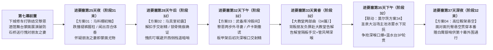

# 第二部卢卡斯NSFW与docs2档案及主线详规深度对账修复临时方案

> **文档定位**：第二部维里迪亚王国篇·卢卡斯 NSFW 企划全案对账排查与主线深度咬合重塑实施方案（临时方案）  
> **存放位置**：`方案/第二部/临时方案_卢卡斯NSFW与docs2及主线详规对账修复方案.md`  
> **涉及目标文件**：
> - [`方案/第二部/卢卡斯NSFW/00_卢卡斯NSFW情境企划全案总纲.md`](卢卡斯NSFW/00_卢卡斯NSFW情境企划全案总纲.md)
> - [`方案/第二部/卢卡斯NSFW/01_圣殿马房暗查与骑士戒律沉沦篇.md`](卢卡斯NSFW/01_圣殿马房暗查与骑士戒律沉沦篇.md)
> - [`方案/第二部/卢卡斯NSFW/03_晨光药舍创伤破戒篇（卢卡斯×艾琳娜）.md`](卢卡斯NSFW/03_晨光药舍创伤破戒篇（卢卡斯×艾琳娜）.md)
> - [`方案/第二部/卢卡斯NSFW/04_晨光大教堂信仰破戒两部曲篇（卢卡斯×菲娜）.md`](卢卡斯NSFW/04_晨光大教堂信仰破戒两部曲篇（卢卡斯×菲娜）.md)
> **权威对账基准**：
> - 核心实体档案：[`docs2/npc/卢卡斯.TXT`](../../docs2/npc/卢卡斯.TXT) · [`docs2/npc/艾琳娜.TXT`](../../docs2/npc/艾琳娜.TXT) · [`docs2/npc/玛格丽特.TXT`](../../docs2/npc/玛格丽特.TXT) · [`docs2/character/Seraphina.TXT`](../../docs2/character/Seraphina.TXT) · [`docs2/character/黎恩.TXT`](../../docs2/character/黎恩.TXT) · [`docs2/location/圣殿要塞.TXT`](../../docs2/location/圣殿要塞.TXT) · [`docs2/location/晨光修道院.TXT`](../../docs2/location/晨光修道院.TXT) · [`docs2/location/晨光大教堂.TXT`](../../docs2/location/晨光大教堂.TXT) · [`docs2/location/圣泉大浴场.TXT`](../../docs2/location/圣泉大浴场.TXT)
> - 主线核心母案与详规：[`00_第二部宏篇主线总纲与方案管理中枢.md`](主线与世界扩充方案/00_第二部宏篇主线总纲与方案管理中枢.md) · [`06_第二部主线跨幕连续性与全局物理状态机.md`](主线与世界扩充方案/06_第二部主线跨幕连续性与全局物理状态机.md) · [`00_莫尔茨主线NSFW剧情分布总纲.md`](莫尔茨NSFW/00_莫尔茨主线NSFW剧情分布总纲.md) · 第五幕、第七幕、第九幕、第十一幕、第十三幕、第十四幕分阶段详规

---

## 〇、 既有冲突与违规问题总览

经穿透核查 `docs2/` 实体卡与十四幕四十五阶段主线详规，现行 `方案/第二部/卢卡斯NSFW/` 存在以下三类核心问题：

1. **卢卡斯与黎恩、菲娜的关系及时间线脱离现行主线**：
   * **相识前提冲突**：主线第七幕（阶段二十三剧情点 5、阶段二十四剧情点 9、阶段二十六剧情点 6~7）中，卢卡斯早已在下城心木商行与黎恩结为坦诚相待的**“骑士与工匠朋友”**（黎恩为其修粮车轴、换战马蹄铁，卢卡斯让黎恩直呼其名），且明确知晓**菲娜是黎恩明媒正娶的妻子**；而 `卢卡斯NSFW` 原案仍将两人写为在要塞才初见的陌生杂役与“同行逃难未婚少女”。
   * **时间轴与幕次编号错位**：原案沿用早期“阶段十九至二十”、“第四幕大劫狱吹响私哨调动哨兵”、“D+03~D+17”等旧锚点，未对齐现行**第九幕（阶段三十一至三十二，进要塞第 1~38 天）**及**莫尔茨方案 34（进要塞第 35 天圣泉大浴场双雄 3P，且明确提及“三天前在武备库板甲架后被菲娜深喉含吮”）**的精确日历。
   * **触犯【男主绝对不间接吞精】红线**：[`04_晨光大教堂信仰破戒两部曲篇`](卢卡斯NSFW/04_晨光大教堂信仰破戒两部曲篇（卢卡斯×菲娜）.md) 第四节中，菲娜在管风琴后刚为卢卡斯深喉吞精完毕（未含水漱净），黎恩便低头与她深吻舌吻“将属于另一个男人的残余痕迹彻底覆写”，直接违反 [`writing-guards.md`](../../.agents/rules/writing-guards.md) 第二章第 6 条核心禁令。
   * **文风禁用词残留**：残留“工具屏风”、“桌案”、“你且去那边寻她”、“圣泉大浴堂（应为圣泉大浴场）”、“花径”、“玉颈”、“白浊”等违规词。

2. **卢卡斯与艾琳娜的关系违背主线第五幕、第六幕、第九幕及 `docs2` 设定**：
   * **初见与过往交集冲突**：主线第五幕·阶段十八（剧情点 2~3）中，卢卡斯奉主教私印调令围堵雷恩，在晨光修道院林道**初次见到艾琳娜**（称其为“修女小姐”），遭艾琳娜痛斥为“教区主教的走狗”，卢卡斯被其骨气震撼后信义退兵；而 [`03_晨光药舍创伤破戒篇`](卢卡斯NSFW/03_晨光药舍创伤破戒篇（卢卡斯×艾琳娜）.md) 却写两人“在过去两年里经常深夜在药舍后门送伤童、早已暗生情愫”。
   * **核心物证 `EVD-05` 流向冲突**：修道院祭坛暗格中的 `EVD-05`（《平民受创救治病历与黑血毒理分析手稿原本》）在第五幕已由艾琳娜交给雷恩、第六幕密送王都朱利安王子；原案却写艾琳娜从地砖暗格取出手稿交给卢卡斯。
   * **角色动线与建制冲突**：主线中白鹰先锋骑兵队建制始终完整，卢卡斯自始至终为圣殿在职队长（经历第九幕界标对峙、第十一幕吊桥放行、第十三幕城门抗议、第十四幕校场誓师开城），且艾琳娜自第九幕·阶段三十起已随亚尔缇娜转移至艾斯特雷亚酒庄地窖常驻；原案写“白鹰巡逻队十余名骑兵全队覆灭、卢卡斯被达米安下令全城搜捕上火刑柱灭口”与主线严重冲突。
   * **艾琳娜外貌服饰偏差**：未对齐 [`docs2/npc/艾琳娜.TXT`](../../docs2/npc/艾琳娜.TXT) 的“深蓝色修女头巾、深棕色长发、浅灰眼睛、胸前细银链垂挂纯银圣十字吊坠与黄铜透镜、深蓝白边修女长裙外罩洁白修女围裙”。

3. **玛格丽特痕迹违规混入（已清理完毕）**：
   * 玛格丽特（`NPC_D2_12`）在 `docs2` 与主线中为艾德里安专属旧交与红颜知己。现已物理删除 `02_迷迭香商行利益迷醉篇（卢卡斯×玛格丽特）.md`，并同步清除 [`00_卢卡斯NSFW情境企划全案总纲.md`](卢卡斯NSFW/00_卢卡斯NSFW情境企划全案总纲.md) 与 [`方案/第二部/README.md`](README.md) 中的相关索引。

---

## 一、 卢卡斯×菲娜×黎恩关系与时间轴重塑方案（对应 `00`、`01`、`04`）

### 1. 人物关系与核心背德心理学重塑

* **前置羁绊锚定（承接主线第七幕）**：
  * **第七幕·阶段二十三 & 二十四**：黎恩在下城石桥与心木商行前院工棚帮卢卡斯排险修车轴、热锻换马蹄铁。卢卡斯由衷敬佩这位年轻工匠的精湛手艺与温和品格，主动让黎恩直呼其名“卢卡斯”，双方建立真挚的**“骑士与工匠朋友之谊”**；卢卡斯亦知晓菲娜是黎恩明媒正娶的温顺妻子。
  * **第七幕·阶段二十六（莫尔茨方案 15 & 石桥送行）**：莫尔茨在黑野猪酒馆包场将戴黑丝半遮眼罩的菲娜拽上舞台托腿展演，台下的卢卡斯在白银轻铠下可耻地硬挺破防、狼狈逃出酒馆并经历人生首次梦遗；次晨运河石桥送行时，卢卡斯望见车辕旁的菲娜，脑海猛地闪过昨夜舞台上的蒙面女人，耳根发烫并在心底严厉自责：**“那是朋友黎恩明媒正娶的妻子，老实本分的普通平民……老盯着朋友的妻子胡思乱想，简直太失礼了！”**
* **要塞重逢与双重背德枷锁（承接主线第九幕）**：
  * **第九幕进驻要塞背景**：第八幕白鹿旅舍事变后，心木商行表面歇业，黎恩与菲娜以避难工匠小夫妻身份凭莫尔茨的通行铜牌进入圣殿大要塞冷锻间与后勤当差。
  * **双重破戒张力（骑士清规 × 朋友之妻）**：卢卡斯在要塞马房重逢黎恩夫妻，原本只想以朋友身份暗中关照两人；然而当菲娜在草料棚“失足”跌入他怀中、扯开骑裤握住他赤裸的 16.5cm 肉棒，且鼻端嗅到与酒馆舞台蒙面尤物完全一致的**月光百合混肥皂清香**时，卢卡斯陷入了**“违背神圣晨光誓约”**与**“背叛敬重的工匠朋友黎恩、贪恋朋友之妻”**的双重道德炼狱！
  * **菲娜的恶作剧猎奇心理与黎恩的掌控回收**：菲娜伪装成温顺怯弱的工匠娇妻，实则享受撕碎正统少壮派骑士理智、看他在朋友黎恩眼皮底下边愧疚边射精的极致反差；黎恩表面对“卢卡斯大人”恭敬道谢，实则在咫尺死角掌控全局，事后在极度吃醋与背德亢奋中对菲娜展开霸道深沉的身体回收。

### 2. 圣殿要塞与大教堂六阶沉沦时间轴（精准对齐第九幕 38 天日历）

将 `01_圣殿马房篇`（四案）、`04_晨光大教堂两部曲`（两案）与 `莫尔茨方案 34`（圣泉大浴场 3P）严丝合缝嵌入**第九幕·阶段三十一至三十二（进要塞第 25 天至第 37 天）**：

| 阶段节点与主线时间锚点 | 对应方案文件与章节 | 核心剧情修正与主线咬合点 |
| :--- | :--- | :--- |
| **进要塞第 25 天夜间** （第九幕·阶段三十一末，界标对峙换防回要塞） | `01_圣殿马房篇` **【方案 01：马料棚初触】** | 卢卡斯从艾斯特雷亚界标前沿大营换防回要塞，夜间复查外围草料棚，偶遇在此帮工的工匠朋友黎恩之妻菲娜。菲娜抱干草捆“失足”跌入怀中，扯开系带将骑裤与衬裤褪至膝弯，小手直接握住赤裸的 16.5cm 肉棒；卢卡斯闻到与黑野猪酒馆舞台蒙面女子一致的月光百合体香，惊怒于自己竟对朋友黎恩的妻子产生剧烈反应。 |
| **进要塞第 28 天午后** （第九幕·阶段三十二，初触后第 3 天） | `01_圣殿马房篇` **【方案 02：马具室初露】** | 黎恩在门外长廊擦拭马镫望风，菲娜借口“黎恩搬沙袋闪了腰”代为送还马鞍缰绳。菲娜解开骑裤铜扣直接握柱套弄；俯身间衣领微敞露出锁骨上方浅粉色微痕，卢卡斯彻底确证黎恩的温顺妻子正是酒馆舞台上的蒙面尤物！卢卡斯泄精后深陷背叛朋友黎恩的负罪感，沙哑叮嘱菲娜“明晚别让黎恩去西侧悬崖栈道搬石料，那里有巡防暗哨”。 |
| **进要塞第 32 天下午** （第九幕·阶段三十二，浴场 3P 前 3 天） | `01_圣殿马房篇` **【方案 03：武备库冷锻间】** | **精准咬合主线阶段三十二剧情点 12“三天前在武备库板甲架后被菲娜深喉含吮”**！黎恩在前台搬运铁砧，走近板甲架两步外询问：“打扰您了，卢卡斯大人……您看到我妻子菲娜了吗？”蹲在卢卡斯胯下握着赤裸肉棒的菲娜耳语胁诱，卢卡斯生平第一次对朋友黎恩撒谎支开他（“她刚端着木盆往东侧汲水石池去了，你去那边找找看”），随即在铁锤轰鸣掩护下体验人生初次深喉口交射精；事后菲娜在工具木架后向黎恩耳语邀功。 |
| **进要塞第 33 天黄昏** （第九幕·阶段三十二，武备库次日） | `04_晨光大教堂篇` **【信仰破戒两部曲】** | 当着朋友黎恩的面撒谎并受其妻深喉，令卢卡斯陷入道德崩溃，次日黄昏借送交王都教区公函之机独赴晨光大教堂（`LOC_D2_19`）闭门告解；恰逢黎恩与菲娜借外出采买之名潜入大教堂摸排告解室下的【教廷秘库】入口。部曲一在告解室镂空木栅隔板下盲摸手交；部曲二在二层管风琴风管死角借受难圣咏轰鸣展开斗篷深喉。**事后菲娜先在洗礼堂侧翼圣水石盆/随身水囊含水彻底漱净口腔**，再由黎恩拥入怀中深吻回收（严守男主绝不间接吞精铁律）。 |
| **进要塞第 35 天下午** （第九幕·阶段三十二·剧情点 12） | `阶段三十二详规` / `莫尔茨方案 34` **【圣泉大浴场双雄 3P】** | 莫尔茨强邀卢卡斯赴城西**圣泉大浴场**（`LOC_D2_33`），黎恩在浅水区装晕，菲娜水下双抚并含糊喊出“好喜欢卢卡斯大人又粗又硬的大鸡巴”，引爆三天前在武备库与前日在大教堂尝过深喉滋味的卢卡斯理智，与莫尔茨争抢口爆后在大理石温水台轮番贯穿菲娜。 |
| **进要塞第 37 天深夜** （第九幕·阶段三十二末，进死牢前夕） | `01_圣殿马房篇` **【方案 04：高位鞍架悬空】** | 白鹰骑兵队拂晓调防外线前夜，卢卡斯在白鹰高位马具库备用重鞍架旁截住菲娜，将她面对面悬空托臀抱起一插到底（本番），咬牙质问：“在黑野猪酒馆戴着面具被莫尔茨展演的是你……明明是黎恩的妻子，现在让我满脑子都是你、连朋友道义与晨光誓约都抛在脑后的也是你……你到底对我施了什么妖术？！”沉沦射精后，卢卡斯交出随身**【白鹰镀银私哨】**（供菲娜与黎恩在第十幕要塞外围与排沙暗渠自由出入免检，删去原案“第四幕大劫狱吹哨调动哨兵”的冲突设定）。 |

---

## 二、 卢卡斯×艾琳娜关系与剧情重塑方案（对应 `03_晨光药舍创伤破戒篇`）

为使 [`03_晨光药舍创伤破戒篇（卢卡斯×艾琳娜）.md`](卢卡斯NSFW/03_晨光药舍创伤破戒篇（卢卡斯×艾琳娜）.md) 与 `docs2` 设定卡及主线第五幕、第八幕、第九幕完全自洽，执行以下 **4 项重构**：

### 1. 相识脉络重构：从“两年旧识”改为“第五幕林道初遇后的暗生情愫”
* **第五幕·阶段十八林道烙印（起点）**：
  * 明确承接主线第五幕阶段十八：深秋清晨的晨光修道院（`LOC_D2_12`）林道上，卢卡斯奉盖有克莱门特私印的越权调令围堵雷恩。年轻修女艾琳娜推门冲出，张开单薄身躯挡在雷恩与骑兵之间，痛斥他们甘当“教区主教的走狗”。卢卡斯被这位手无寸铁却比任何重装骑士都更具誓约骨气的修女深深震撼，当场致歉并信义退兵。回首离去时，艾琳娜清冷坚定的浅灰眼睛深深烙印在卢卡斯心底。
* **第六幕至第八幕前夕的深夜默契（演进）**：
  * 自那次林道交锋后，卢卡斯每逢率小队在北境平原干道长途巡弋，便会在深夜悄悄绕道深山修道院后门，将巡逻途中救下的冻伤流民孩童与自己省下的过冬麦粉、草药放在药舍台阶上，敲响三声木栅门后退入阴影。
  * 艾琳娜认出他是那位在林道按剑放行雷恩的正直白鹰队长，最初的戒备与蔑视逐渐化为心疼与敬慕。她开始提着防风油灯为他留门，用细麻布替他擦去眉骨上的风霜与擦伤，递上亲手调配的薄荷防冻膏。两人在数月间建立起克制而深沉的纯真情愫。

### 2. 突发危机重构：咬合第八幕白鹿旅舍夜袭外围遭遇战（保持在职身份与骑兵建制）
* **删除违规设定**：彻底删除“十余名白鹰骑兵全队覆灭”以及“达米安下令全城搜捕卢卡斯上火刑柱灭口”的冲突情节（确保卢卡斯始终为圣殿在职队长、白鹰先锋骑兵队建制完整）。
* **全新危机动因（无缝解释第九幕阶段三十一“回想起白鹿旅舍遭遇的狂暴战兽”伏笔）**：
  * 时间定锚于**第八幕白鹿旅舍血色伏击之夜的次日深夜（第九幕·阶段三十初期，亚尔缇娜接走艾琳娜赴酒庄地窖的前两天）**。
  * 卢卡斯率两名心腹斥候在北境荒原侧翼巡查异动时，意外撞见达米安麾下失控游荡的教廷自律暗影战兽。卢卡斯命令斥候立刻回撤示警，自己独身断后斩杀机兽，左侧大腿内侧至小腹下沿被带暗影黑血的钢爪划开深可见骨的创口。
  * 卢卡斯深知创口泛出的诡异黑血一旦在要塞医官或教廷审问官面前暴露，不仅自己会被定为“受暗影污染者”秘密处置，整支白鹰先锋骑兵队也会遭到清洗。他在暴雨夜独自策马撑到了晨光修道院附属药舍后门。

### 3. 外貌服饰与清创破戒细节对齐 `docs2/npc/艾琳娜.TXT`
* **外貌服饰精准还原**：
  * 艾琳娜（24岁，身高166cm，B-C罩杯匀称挺拔，处子之身）：深棕色浓密长发自**深蓝色修女头巾**下披散肩头，专注剔透的**浅灰眼睛**，胸前以细银链垂挂着一枚**纯银圣十字吊坠与黄铜透镜**；身着**深蓝白边修女长裙，外罩洁白的修女围裙**，腰系放置草药小瓶的皮质药带，周身弥漫没药、苦艾与野花草药的清苦微甘。
* **清创与深情托付**：
  * 艾琳娜在地下药窖用银术刀与烈酒为卢卡斯清除暗影黏质腐肉，喂服高山颠茄与龙胆草根熬制的“宁神浓汁”。在药力高热与创伤应激下，卢卡斯紧紧抓住艾琳娜微凉的手倾诉对修会黑幕的痛苦迷茫；艾琳娜摘下胸前细银链上的黄铜透镜，主动解开洁白修女围裙与深蓝白边修女长裙领口，在药案上将未谙人事的紧致处子之身温柔交付给这位坚守正义的年轻骑士。

### 4. 事后信物重构：不触碰 `EVD-05` 原本，改为手抄病理笔记与护身药囊
* **删除 `EVD-05` 冲突**：前院长留下的《平民受创救治病历与黑血毒理手稿原本》（`EVD-05`）早已在第五幕交予雷恩并密送王都。
* **全新交付闭环**：
  * 拂晓时分，艾琳娜为卢卡斯包扎好严密的骑兵绷带（掩盖黑血创口），将自己近期整理的**《暗影黑血临床辨识与解毒配伍手记（抄本）》**及一枚装有干燥苦艾与薄荷的**护身草药囊**塞入卢卡斯怀中，告知他两日后自己亦将转移前往安全据点照料重伤同伴，嘱托卢卡斯平安返回圣殿要塞潜伏待机：“留在你的骑兵队里，保护好那些还相信晨光之誓的年轻骑士……等到雷恩大人与真相重回王都的那一天，再拔出你的剑。”
  * 这一约定直接成为卢卡斯在第九幕界标对峙阻止冲锋、第十一幕死牢吊桥放行雷恩、第十四幕校场誓师开城救民的深层情感支柱。

---

## 三、 具体文件修改执行清单

确认本临时方案后，将对以下 3 份文件执行精准重塑，并运行 `python scripts2/scan_viridia_diseases.py` 质检归零：

1. **[`方案/第二部/卢卡斯NSFW/00_卢卡斯NSFW情境企划全案总纲.md`](卢卡斯NSFW/00_卢卡斯NSFW情境企划全案总纲.md)**：
   * 第一节：更新卢卡斯、菲娜、黎恩的关系定锚，明确第七幕下城心木商行“骑士与工匠朋友之谊”及“朋友黎恩之妻”的双重背德心理机制；
   * 第二节决策矩阵：将时间锚点全面更新为**第九幕进要塞第 25 天、第 28 天、第 32 天、第 33 天（大教堂两部曲）、第 35 天（莫尔茨方案 34·圣泉大浴场 3P）、第 37 天**；修正艾琳娜篇摘要（第五幕初遇后情愫、第八幕后荒原战兽受创、抄本笔记交付）；
   * 全文肃清“工具屏风”、“浴堂”等禁用词。

2. **[`方案/第二部/卢卡斯NSFW/01_圣殿马房暗查与骑士戒律沉沦篇.md`](卢卡斯NSFW/01_圣殿马房暗查与骑士戒律沉沦篇.md)**：
   * 第一节：将旧版“阶段十九至二十”、“第四幕大劫狱”、“D+03~D+17”全面更新为**第九幕·阶段三十一至三十二（进要塞第 25/28/32/35/37 天）**，联动编号修正为**莫尔茨方案三十四**，白鹰镀银私哨用途修正为**第十幕要塞外围与排沙暗渠通行免检信物**；
   * 第二、三节（方案 01~04）：将黎恩与菲娜伪装身份统一为**卢卡斯在第七幕下城早已结识的工匠朋友黎恩及其妻子菲娜**；修正方案 02/03/04 中的相关对白与心理活动；将“桌案”、“工具屏风”、“你且去那边寻她”、“圣泉大浴堂”、“花径”、“玉颈”全部替换为合规现代 JRPG 白话散句。

3. **[`方案/第二部/卢卡斯NSFW/03_晨光药舍创伤破戒篇（卢卡斯×艾琳娜）.md`](卢卡斯NSFW/03_晨光药舍创伤破戒篇（卢卡斯×艾琳娜）.md)**：
   * 第一节：重写前置感情线为**第五幕·阶段十八修道院林道初遇与痛斥放行**后的数月深夜送药默契；重写突发危机为**第八幕末/第九幕初荒原遭遇失控暗影战兽独身断后受创**（保持白鹰骑兵队建制完整与在职队长身份）；
   * 第二节：严格对齐 [`docs2/npc/艾琳娜.TXT`](../../docs2/npc/艾琳娜.TXT) 外貌服饰（深蓝修女头巾、深蓝白边修女长裙、洁白修女围裙、纯银圣十字吊坠与黄铜透镜、B-C罩杯）；将“药案”、“花径”等替换为“长木药桌”、“湿软入口”等合规表述；
   * 第三节：将结尾交付物由 `EVD-05` 原本修正为《暗影黑血临床辨识与解毒配伍手记（抄本）》与护身草药囊，并交代艾琳娜即将转移照料重伤同伴、嘱托卢卡斯留在要塞待机策应。

4. **[`方案/第二部/卢卡斯NSFW/04_晨光大教堂信仰破戒两部曲篇（卢卡斯×菲娜）.md`](卢卡斯NSFW/04_晨光大教堂信仰破戒两部曲篇（卢卡斯×菲娜）.md)**：
   * 第一节：时间锚点定为**第九幕·阶段三十二（进要塞第 33 天黄昏，武备库初次深喉次日）**，卢卡斯因当着朋友黎恩的面撒谎并受其妻深喉而负罪赴晨光大教堂告解，黎恩与菲娜借外出采买潜入大教堂摸排告解室下的【教廷秘库】入口；
   * 第四节（事后情感回收）：**严格落实男主绝不间接吞精铁律**——明确写入菲娜在步入洗礼堂束柱阴影前，先用随身皮水囊清水反复彻底漱净口腔与唇齿，黎恩再将其揽入怀中温存亲吻；
   * 全文肃清“白浊”等违禁词与旧版第四幕表述。

