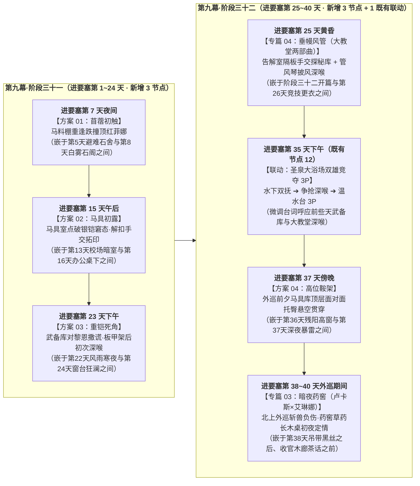

# 临时方案：卢卡斯 NSFW 情境（01/03/04）规范化重排与主线详规体例对齐实施方案

> **文档定位**：针对 [`方案/第二部/卢卡斯NSFW/`](卢卡斯NSFW/) 下属 [`01_圣殿马房暗查与骑士戒律沉沦篇.md`](卢卡斯NSFW/01_圣殿马房暗查与骑士戒律沉沦篇.md)、[`03_晨光药舍创伤破戒篇（卢卡斯×艾琳娜）.md`](卢卡斯NSFW/03_晨光药舍创伤破戒篇（卢卡斯×艾琳娜）.md)、[`04_晨光大教堂信仰破戒两部曲篇（卢卡斯×菲娜）.md`](卢卡斯NSFW/04_晨光大教堂信仰破戒两部曲篇（卢卡斯×菲娜）.md) 融入主线分阶段详规时的**「阶段三十一与三十二分布失衡扎堆」**及**「企划卡元数据格式污染」**两大问题，制定本重排与格式纯化执行方案。  
> **旧版归档**：原旧版临时方案已归档至 [`方案/第二部/已执行/临时方案_卢卡斯NSFW情境全量融入主线详规实施方案.md`](已执行/临时方案_卢卡斯NSFW情境全量融入主线详规实施方案.md)。  
> **核心工作准则**：
> 1. **直接在 IDE 中使用编辑工具修改**：所有文档修改均通过 IDE 直接编辑完成，确保每一处改动痕迹清晰可见，绝不使用脚本批量改写文件；
> 2. **保留原案正文文本，剥离企划外框格式**：100% 保留 `01`、`03`、`04` 已定稿的正文叙事与对白，彻底剥离 `* **情境ID**`、`* **NSFW**`、`#### 部曲`、`【时间·地点】` 等企划卡壳子，统一转化为分阶段详规的**「连续编号三级标题（`### X. 四字主标——副标题`）+ 纯自然叙事段落」**；
> 3. **打破阶段三十二扎堆，实现阶段三十一与阶段三十二 3:3 均衡穿插**：将原本挤压在进要塞第 25～37 天的 6 大核心模块，按时间轴均匀分摊为**阶段三十一（3 个独立剧情点）**与**阶段三十二（3 个独立剧情点 + 1 个既有浴场 3P 联动）**，并全部安排在莫尔茨无事件发生的空档日，彻底杜绝“同一天连轴转两场”与单阶段头重脚轻。

---

## 一、 核心问题诊断与体例转换规范

### 1.1 格式污染清理对照表（企划卡体例 $\rightarrow$ 主线详规体例）

| 污染类型 | 此前误粘入详规的企划格式（待清除） | 主线分阶段详规标准体例（目标格式） |
| :--- | :--- | :--- |
| **1. 独立剧情点标题与编号** | `### 方案 02：马具室初露……` `### 晨光大教堂信仰破戒两部曲（卢卡斯×菲娜）` `### 北上外巡斩兽负伤与地下药窖创伤破戒` `### 简短剧情 A：马房水槽廊下的苦笑讨饶` （未编号，且打断阶段原有 `### 1.` ~ `### 18.` 连续序号） | 严格采用 **`### 数字. 四字主标——副标题`**（如 `### 7. 苜蓿初触——马料棚夜巡重逢与干燥苜蓿间的跌撞`），并将阶段内后续所有小节编号**全局顺延重排**。 |
| **2. 企划卡属性元数据列表** | `* **情境ID**：D2_LUCAS_01` `* **名称**：...` `* **NSFW**：是` `* **性行为等级**：...` `* **涉及角色**：...` `* **时间锚点**：...` `* **空间舞台**：...` `* **情境推进**：` | **全量删除属性列表**。对齐同阶段莫尔茨与主线剧情点写法，在三级标题下**第一段首句直接以自然散句交代进要塞天数、时辰与空间舞台**，随后直接展开正文自然段落。 |
| **3. 四级子标题与粗体分点头** | `04` 篇中的 `#### 一、 宏观动因与时间锚点`、`#### 二、 部曲一……` `03` 篇药窖破戒中的 `* **秘密清创与草药高热**：`、`* **高热噩梦里的呼唤与卸防**：` | **删除 `####` 四级标题与列表粗体前缀**，将多段内容自然衔接为连贯的纯叙事正文段落。 |
| **4. 嵌入式段落的方括号头** | `03` 篇各幕插入段开头的 `【繁荫季三月中旬·午后 · 心木商行后院与晨光修道院药舍前院】` | **删除 `【……】` 方括号提示标签**，将时间与地点自然化入散句开头（或直接承接所在小节的既有场景），与前后文融为一体。 |

---

### 1.2 第九幕（阶段三十一 vs 阶段三十二）去扎堆均衡重排方案

* **原排布失衡原因**：
  - [`阶段三十一`](主线与世界扩充方案/分阶段详规/09_第九幕_绝境流亡·篝火重铸与艾斯特雷亚之誓/阶段三十一_界标对峙与黄金罗刹重剑威慑详规.md) 覆盖**进要塞第 1～24 天**（含主线 6 节点 + 轮休 1 节点 + 莫尔茨 11 节点），原案将卢卡斯回要塞定在第 25 天，导致前 24 天卢卡斯在要塞内线完全空白；
  - [`阶段三十二`](主线与世界扩充方案/分阶段详规/09_第九幕_绝境流亡·篝火重铸与艾斯特雷亚之誓/阶段三十二_太古古库破译与重铸防酸破邪巨剑详规.md) 仅覆盖**进要塞第 26～38 天**（含主线 6 节点 + 莫尔茨 10 节点），原案却将卢卡斯的 5 大段剧情全部塞入这 12 天内，导致第 32、33、36、37 天每天都在连轴转发生两场 NSFW。
* **均衡重排逻辑（3:3 对称分摊 + 100% 错开莫尔茨日期）**：
  - 在 `阶段三十一` 开头（第 1～2 天）奥蕾莉亚于界标断旗裂石、大团长阿达尔伯特下达“闭门封关、只守不攻”戒严令后，白鹰先锋骑兵队无需在界标死守，卢卡斯即随主力轮换回圣殿大要塞驻防（仅定期带队赴西南山麓外巡划水）；
  - 将卢卡斯在第九幕的 **6 个新增独立剧情点** 均匀拆分为 **`阶段三十一` 承载 3 个（第 7 天、第 15 天、第 23 天）** + **`阶段三十二` 承载 3 个（第 25 天、第 37 天傍晚、第 38~40 天外巡）**：

---

## 二、 分阶段详规全量修改与重排明细清单（共 14 份详规文件）

### 2.1 第五幕至第七幕、第九幕初：嵌入式自然段落纯化（共 7 份详规文件）

以下 7 处属于 [`03_晨光药舍创伤破戒篇`](卢卡斯NSFW/03_晨光药舍创伤破戒篇（卢卡斯×艾琳娜）.md) 的感情递进与铺垫段落，保持在当前对应位置，**仅剥离 `【时间 · 地点】` 方括号头，修饰为与上下文浑然一体的自然叙事段落**：

1. **[`05_第五幕.../阶段十九_公秤仲裁与晨雾归林·复式商战与粮道大捷详规.md`](主线与世界扩充方案/分阶段详规/05_第五幕_分道巡礼·虚妄的线索/阶段十九_公秤仲裁与晨雾归林·复式商战与粮道大捷详规.md)**（`### 4. 铁证汇流` 开头）：
   - 剥离 `【沉眠季十一月下旬·午后 · 心木商行后院与晨光修道院药舍前院】`，自然融入十一月下旬前哨收官段落。
2. **[`06_第六幕.../阶段二十_铁证密送与风雪初歇·光剑夜驰与客舍留宿详规.md`](主线与世界扩充方案/分阶段详规/06_第六幕_霜雪冬歇·冬日庆典与降临共盟/阶段二十_铁证密送与风雪初歇·光剑夜驰与客舍留宿详规.md)**：
   - 原文包含 3 个自然段（修道院后山驱狼、牛皮绳修补药篓并约定吹哨帮忙），为其赋予标准编号小节标题 `### 5. 后山驱狼——皮绳修篓与巡防哨约`（原 `### 5. 风雪初歇` 顺延为 `### 6.`），并剥离 `【沉眠季十二月上旬·午后 · 晨光修道院后山林缘】` 方括号头。
3. **[`06_第六幕.../阶段二十一_深冬暴雪留宿与冬日共盟·雪仗打铁与晨光降临祭详规.md`](主线与世界扩充方案/分阶段详规/06_第六幕_霜雪冬歇·冬日庆典与降临共盟/阶段二十一_深冬暴雪留宿与冬日共盟·雪仗打铁与晨光降临祭详规.md)**：
   - 原文包含 3 个自然段（风雪夜送猎户幼子就医、艾琳娜擦拭眉骨划伤并赠送薄荷防冻膏），赋予标准编号小节标题 `### 6. 药舍暖灯——风雪送医与薄荷防冻膏`（原 `### 6.~9.` 顺延为 `### 7.~10.`），剥离 `【沉眠季十二月中旬·风雪夜 · 晨光修道院附属药舍门廊】` 方括号头。
4. **[`06_第六幕.../阶段二十二_深冬议事与战略定锚·王子做客与一月大商路总纲详规.md`](主线与世界扩充方案/分阶段详规/06_第六幕_霜雪冬歇·冬日庆典与降临共盟/阶段二十二_深冬议事与战略定锚·王子做客与一月大商路总纲详规.md)**（`### 1.` 开头）：
   - 剥离 `【沉眠季十二月末·降临祭前夜 · 晨光修道院药舍后院】`，化为自然开篇过渡段。
5. **[`07_第七幕.../阶段二十四_工坊街百工与八音盒之音详规.md`](主线与世界扩充方案/分阶段详规/07_第七幕_王都商路·繁华市井与暗潮生活流/阶段二十四_工坊街百工与八音盒之音详规.md)**（`### 9. 白鹰铁蹄` 内）：
   - 剥离 `【萌芽季二月中旬·午后 · 王都下城心木商行前院工棚】`，直接衔接在黎恩为卢卡斯钉好新马掌、两人喝麦茶闲聊之后。
6. **[`09_第九幕.../阶段三十_泥泞逃亡、领民相护与领主觉醒详规.md`](主线与世界扩充方案/分阶段详规/09_第九幕_绝境流亡·篝火重铸与艾斯特雷亚之誓/阶段三十_泥泞逃亡、领民相护与领主觉醒详规.md)**（`### 7. 暗夜求药` 末尾）：
   - 剥离 `【繁荫季四月上旬·深夜 · 晨光修道院附属药舍】`，化为艾琳娜随亚尔缇娜离开后半小时卢卡斯赶到药舍留刀并约束部下的自然叙事段。
7. **[`09_第九幕.../阶段三十一_界标对峙与黄金罗刹重剑威慑详规.md`](主线与世界扩充方案/分阶段详规/09_第九幕_绝境流亡·篝火重铸与艾斯特雷亚之誓/阶段三十一_界标对峙与黄金罗刹重剑威慑详规.md)**（`### 3. 纯重风压` 末尾）：
   - 剥离 `【繁荫季四月中旬·清晨 · 艾斯特雷亚领地边界石碑路口】`，与前段卢卡斯勒紧缰绳、阻止冲锋并在后续巡山消极划水的段落自然合并。

---

### 2.2 【第九幕·阶段三十一】3 个独立剧情点穿插与全局重编号（18 节点 $\rightarrow$ 21 节点）

* **目标文件**：[`阶段三十一_界标对峙与黄金罗刹重剑威慑详规.md`](主线与世界扩充方案/分阶段详规/09_第九幕_绝境流亡·篝火重铸与艾斯特雷亚之誓/阶段三十一_界标对峙与黄金罗刹重剑威慑详规.md)
* **完整节点重排序列**：
  1. `### 1. 晨霜深谷——峡谷通道与极道威慑`（主线）
  2. `### 2. 粮车篷布——碎石颠簸、双手套弄与假意崇拜`（莫尔茨方案 17 · **进要塞第 1 天早晨**）
  3. `### 3. 纯重风压——白鹰断旗与坚石深裂`（主线 · 含卢卡斯阻拦冲锋与巡山消极划水）
  4. `### 4. 蒸汽石阶——滑油双乳夹弄与百叶窗后暗红双瞳`（莫尔茨方案 18 · **进要塞第 3 天傍晚**）
  5. `### 5. 要塞烛火——闭门戒严与反派裂痕`（主线）
  6. `### 6. 避难石舍——黑灯瞎火口侍、背后贯穿与前后夹击`（莫尔茨方案 19 · **进要塞第 5 天深夜**）
  7. 👉 **`### 7. 苜蓿初触——马料棚夜巡重逢与干燥苜蓿间的跌撞`**（**【新增：卢卡斯方案 01】** · **进要塞第 7 天夜间** · 删去企划元数据卡，首段改为：`进要塞第 7 天夜间，圣殿大要塞外围战马草料棚。干燥的苜蓿草堆到半人高，空气里满是干草甜味、熟皮革味和战马温热的鼻息，棚外石板路上不时响起巡逻骑兵的马蹄声。` 随后接卢卡斯从界标前沿轮换回要塞、提灯喂马重逢黎恩与菲娜，菲娜绊倒跌入怀中，白花甜香与及腰粉发、红唇下巴勾起酒馆舞台记忆，卢卡斯失控硬挺顶红菲娜，连着两晚失眠）
  8. `### 8. 白雾石阁——滑油双乳夹弄、贴脸比大小与乳沟暴射`（原 7 顺延 · 莫尔茨方案 20 · **进要塞第 8 天下午**）
  9. `### 9. 马厩木笛——水牢蓄力与暗渠接头`（原 8 顺延 · 主线）
  10. `### 10. 锻铁工作台——整备台足交踩踏、磨石声掩护与铁砧后入`（原 9 顺延 · 莫尔茨方案 21 · **进要塞第 11 天午后**）
  11. `### 11. 整备油石——黑酸之虞与王都前哨`（原 10 顺延 · 主线）
  12. `### 12. 校场暗室——黑铁架旁手口并用、肉棒枕脸与隔栅眨眼`（原 11 顺延 · 莫尔茨方案 22 · **进要塞第 13 天上午**）
  13. 👉 **`### 13. 马具初露——点破银铠窘态、马油香气里的指尖套弄与蜂蜡拓印`**（**【新增：卢卡斯方案 02】** · **进要塞第 15 天午后** · 删去企划元数据卡，首段改为：`进要塞第 15 天午后，白鹰战马马具室。要塞外下着连绵细雨，四面墙挂满厚皮革缰绳、黄铜马衔与马刺，空气里飘着熟牛皮保养油和铁器的气味，黎恩在马具室门外的避雨石廊下擦拭备用铁马镫把风。` 随后接菲娜替“闪了腰”的黎恩送修好的马鞍缰绳，撞入卢卡斯怀中点破酒馆台下银铠窘态，解开骑裤铜扣握住套弄射精，顺手用薄蜂蜡片拓下夜巡铜印章印模，卢卡斯提醒避开西侧悬崖栈道暗哨）
  14. `### 14. 办公桌下——桌帷暗角极度吞吐与工匠两步外受训`（原 12 顺延 · 莫尔茨方案 23 · **进要塞第 16 天下午**）
  15. `### 15. 白泉石阁——两指门缝绝佳视角、主动深喉与正对后入`（原 13 顺延 · 莫尔茨方案 24 · **进要塞第 18 天上午**）
  16. `### 16. 难得轮休——回酒庄看望同伴`（原 14 顺延 · 主线）
  17. `### 17. 领民暗道——寻刃决意与潜渡启程`（原 15 顺延 · 主线）
  18. `### 18. 主堡高窗——窗帘下全根深喉与中庭高声吆喝施威`（原 16 顺延 · 莫尔茨方案 25 · **进要塞第 20 天午后**）
  19. `### 19. 风雨寒夜——胸膛紧贴重压、借拥抱之名与雨夜狂贯`（原 17 顺延 · 莫尔茨方案 26 · **进要塞第 22 天深夜**）
  20. 👉 **`### 20. 重铠死角——武备库冷锻间当面撒谎掩护与板甲架后初次深喉`**（**【新增：卢卡斯方案 03】** · **进要塞第 23 天下午** · 删去企划元数据卡，首段改为：`进要塞第 23 天下午，圣殿要塞武备库冷锻间与主力甲胄整备库。前面是冷锻工作台和烧得正旺的火炉铁砧，铁匠挥锤砸铁声不断；里面两排两米半高的生铁全身板甲架挡出一道只够站两个人的阴影死角。` 随后接黎恩走到板甲架两步外找菲娜、卢卡斯生平第一次对朋友黎恩撒谎支开他、菲娜借铁锤巨响初次深喉口爆、水囊清水漱净后向黎恩邀功）
  21. `### 21. 窗台狂澜——窗下后入顶弄、探身勉励好处与闻声夹紧`（原 18 顺延 · 莫尔茨方案 27 · **进要塞第 24 天午后**；并删除原第 19 节及多余的 `---`）

---

### 2.3 【第九幕·阶段三十二】3 个独立剧情点穿插与全局重编号（16 节点 $\rightarrow$ 19 节点）

* **目标文件**：[`阶段三十二_太古古库破译与重铸防酸破邪巨剑详规.md`](主线与世界扩充方案/分阶段详规/09_第九幕_绝境流亡·篝火重铸与艾斯特雷亚之誓/阶段三十二_太古古库破译与重铸防酸破邪巨剑详规.md)
* **完整节点重排序列**：
  1. `### 1. 雨夜潜渡——涵洞暗渠与残梁寻刃`（主线）
  2. `### 2. 沼泽验毒——以太微光与药溶除渣`（主线）
  3. 👉 **`### 3. 垂幔风管——告解室隔板探秘握抚、管风琴圣咏披风深喉与洗礼堂漱口温存`**（**【新增：卢卡斯专篇 04】** · **进要塞第 25 天黄昏** · 彻底剥离 `#### 一/二/三/四` 四级标题与元数据列表，转化为纯叙事段落：首段写进要塞第 25 天黄昏，卢卡斯因前日在武备库对朋友黎恩撒谎并受菲娜深喉而愧疚难安，趁休沐独赴王都晨光大教堂晚祷告解；恰逢黎恩与菲娜趁半天假期来大教堂后堂摸排【教廷秘库】入口。随后连贯叙述告解室镂空木隔栅推拉小窗探手套弄并探清地板下齿轮暗梯卡槽位置 $\rightarrow$ 二层管风琴纯锡风管死角借圣咏合唱轰鸣在深蓝披风下深喉口爆 $\rightarrow$ 菲娜在廊柱后用随身小皮水囊清水反复漱净口腔，走进洗礼堂花岗岩束柱阴影扑入黎恩怀中邀功深吻）
  4. `### 4. 竞技更衣——战前拍脸、跪伏托囊细致舔蛋与门外听音`（原 3 顺延 · 莫尔茨方案 28 · **进要塞第 26 天上午**）
  5. `### 5. 极限加压——耐火黑石与太古破译`（原 4 顺延 · 主线；移走原在此处的方案 02）
  6. `### 6. 平原哨所——巡检驻留套房、黑丝足底舔舐与格栅偷窥`（原 5 顺延 · 莫尔茨方案 29 · **进要塞第 28 天暴雨夜**）
  7. `### 7. 千磅铁砧——百炼折叠与冷泉淬火`（原 6 顺延 · 主线）
  8. `### 8. 罗曼主池——水下暗涌潜弄、装晕闭眼与水台正面托举`（原 7 顺延 · 莫尔茨方案 30 · **进要塞第 30 天下午**；移走原在其后的方案 03）
  9. `### 9. 绝壁露台——黑市薄黑丝亲手套弄、高空口乳与哨塔俯瞰`（原 8 顺延 · 莫尔茨方案 31 · **进要塞第 32 天深夜**）
  10. `### 10. 暗河逆流——重剑密运与领主之誓`（原 9 顺延 · 主线；移走原在其后的大教堂篇）
  11. `### 11. 石舍冷月——多体位轮转狂欢、箭垛微光与半米外装睡`（原 10 顺延 · 莫尔茨方案 32 · **进要塞第 33 天深夜**）
  12. `### 12. 私密憩室——薄黑丝温柔揉弄、躺平舒享与深夜光足插叙`（原 11 顺延 · 莫尔茨方案 33 · **进要塞第 34 天午后**）
  13. `### 13. 双雄竞夺——主池浓雾水下双抚、双雄口爆与水台 3P 肉搏`（原 12 顺延 · 莫尔茨方案 34 × 卢卡斯联动 · **进要塞第 35 天下午** · 将原文“三天前在武备库板甲架后被菲娜深喉含吮”微调为“前些天在武备库板甲架后与大教堂管风琴台后被菲娜深喉含吮”）
  14. `### 14. 残阳高窗——粉发背影窗前依偎、微弱娇啼与中庭生疑`（原 13 顺延 · 莫尔茨方案 35 · **进要塞第 36 天傍晚**）
  15. 👉 **`### 15. 高位鞍架——马具库顶层面对面托臀悬空贯穿与巡前沉沦`**（**【新增：卢卡斯方案 04】** · **进要塞第 37 天傍晚** · 删去企划元数据卡，首段改为：`进要塞第 37 天傍晚，白鹰高位马具库最顶层的备用重鞍架旁。第二天一早白鹰先锋骑兵队就要出发去北境干道与西南山麓外线巡逻四天，傍晚马具库空无一人，离地一人高的粗大老栎木横梁上挂满深褐色骑兵毛毡与战马披甲，围出一处悬空又严密挡住视线的高台死角。` 随后接卢卡斯托起菲娜面对面悬空一插到底、追问与内射沉沦，「菲娜×卢卡斯」越界剧情至此收束）
  16. `### 16. 暴雷深夜——侧卧面对面暗贴、枕底双手套弄与同步释放`（原 14 顺延 · 莫尔茨方案 36 · **进要塞第 37 天深夜**）
  17. `### 17. 吊带黑丝——寝居大床极致本番、边做边舔足与清淤日程获取`（原 15 顺延 · 莫尔茨方案 37 · **进要塞第 38 天深夜**）
  18. 👉 **`### 18. 暗夜药窖——北上外巡斩兽负伤、草药长木桌破戒初夜与阳光下婚约`**（**【新增：卢卡斯×艾琳娜专篇 03 正片】** · **进要塞第 38~40 天外巡期间** · 删去 `* **NSFW**`、`【时间·地点】` 与 `* **秘密清创与草药高热**：` 等列表粗体头，将外巡山道独自斩杀脱缰暗影战兽左小臂负伤高烧 $\rightarrow$ 夜叩晨光修道院药舍后门、艾琳娜用银刃采药小刀清创喂药 $\rightarrow$ 高热噩梦倾诉与艾琳娜卸下心防 $\rightarrow$ 解下深蓝修女头巾与洁白围裙在草药长木桌上初夜结合定情 $\rightarrow$ 黎明前发誓在阳光下娶她、获赠《暗影黑血解毒手记（抄本）》与净血草药囊，完整转化为 5 个连贯纯正的自然叙事段落）
  19. `### 19. 木廊茶话——绿荫微风与盛夏之约`（原 16 顺延 · 主线收官节点）

---

### 2.4 第十幕至第十四幕：规范编号与自然段落纯化（共 7 份详规文件）

1. **[`10_第十幕.../阶段三十三_盲泉逆流与太古石闸详规.md`](主线与世界扩充方案/分阶段详规/10_第十幕_深渊古道·暗河谍影与地底破壁/阶段三十三_盲泉逆流与太古石闸详规.md)**：
   - 将 `### 简短剧情 A：马房水槽廊下的苦笑讨饶` 规范编号为 **`### 2. 水槽廊下——端盆擦肩的言语调戏与苦笑讨饶`**，并将原 `### 2.~9.` 顺延为 `### 3.~10.`。
2. **[`10_第十幕.../阶段三十四_特务少女与死牢水网逆向测绘详规.md`](主线与世界扩充方案/分阶段详规/10_第十幕_深渊古道·暗河谍影与地底破壁/阶段三十四_特务少女与死牢水网逆向测绘详规.md)**：
   - 保持在 `### 3. 值班哨所` 之后的自然过渡段（卢卡斯夜值摩挲草药囊研读抄本、托黎恩捎带报安蜂蜜），无方括号污染。
3. **[`10_第十幕.../阶段三十五_黑市商道交锋与重器密运详规.md`](主线与世界扩充方案/分阶段详规/10_第十幕_深渊古道·暗河谍影与地底破壁/阶段三十五_黑市商道交锋与重器密运详规.md)**：
   - 将 `### 简短剧情 B：武备库侧廊的局促致歉与划水赠哨` 规范编号为 **`### 7. 武备侧廊——坦诚守约的局促致歉与划水赠哨`**，并将原 `### 7.~10.` 顺延为 `### 8.~11.`。
4. **[`11_第十一幕.../阶段三十八_信义抉择放行与暗室深夜守候喂汤详规.md`](主线与世界扩充方案/分阶段详规/11_第十一幕_惊天劫狱·血洗圣殿死牢/阶段三十八_信义抉择放行与暗室深夜守候喂汤详规.md)**（`### 3. 信义誓约——撤桥放行` 内）：
   - 保持已融入的纯自然叙事段落（卢卡斯按住怀中抄本与草药囊当众抗命撤桥放行，并托黎恩向艾琳娜报平安）。
5. **[`12_第十二幕.../阶段三十九_双城潜流与金鸢尾沙龙外交游说详规.md`](主线与世界扩充方案/分阶段详规/12_第十二幕_王都暗流·沙龙旧卷与法理围城/阶段三十九_双城潜流与金鸢尾沙龙外交游说详规.md)**（`### 1. 双城潜流` 末尾）：
   - 剥离 `【丰收季八月中旬·雨夜 · 王都下城心木商行后院】` 方括号头，化为纯自然叙事段落。
6. **[`13_第十三幕.../阶段四十二_教会投毒水网与炼狱王都详规.md`](主线与世界扩充方案/分阶段详规/13_第十三幕_王都异化·双城合围决战/阶段四十二_教会投毒水网与炼狱王都详规.md)**（`### 2. 九门落锁` 内）：
   - 剥离 `【落叶季十月中旬·深夜 · 王都内外城交界封锁铁栅栏】` 方括号头，化为纯自然叙事段落。
7. **[`14_第十四幕.../阶段四十五_校场誓师双城平暴与黎明新世界详规.md`](主线与世界扩充方案/分阶段详规/14_第十四幕_破晓大审判与黎明宪章/阶段四十五_校场誓师双城平暴与黎明新世界详规.md)**（`### 7. 家传刺剑` 末尾）：
   - 保持已融入的纯自然叙事段落（校场窝里反开城与真理广场阳光下兑现誓言拥抱艾琳娜）。

---

## 三、 同步更新的母案接口与企划案时间锚点清单

1. **分阶段详规首尾表格与交接说明同步**：
   - 更新 [`阶段三十一`](主线与世界扩充方案/分阶段详规/09_第九幕_绝境流亡·篝火重铸与艾斯特雷亚之誓/阶段三十一_界标对峙与黄金罗刹重剑威慑详规.md)、[`阶段三十二`](主线与世界扩充方案/分阶段详规/09_第九幕_绝境流亡·篝火重铸与艾斯特雷亚之誓/阶段三十二_太古古库破译与重铸防酸破邪巨剑详规.md)、[`阶段三十三`](主线与世界扩充方案/分阶段详规/10_第十幕_深渊古道·暗河谍影与地底破壁/阶段三十三_盲泉逆流与太古石闸详规.md)、[`阶段三十五`](主线与世界扩充方案/分阶段详规/10_第十幕_深渊古道·暗河谍影与地底破壁/阶段三十五_黑市商道交锋与重器密运详规.md) 的 `## 一、 核心关卡设定与约束矩阵` 及 `## 三、 本阶段接口与交接说明`。
2. **`卢卡斯NSFW` 企划案内部时间锚点同步校准**：
   - 同步将 [`00_卢卡斯NSFW情境企划全案总纲.md`](卢卡斯NSFW/00_卢卡斯NSFW情境企划全案总纲.md)、[`01_圣殿马房暗查与骑士戒律沉沦篇.md`](卢卡斯NSFW/01_圣殿马房暗查与骑士戒律沉沦篇.md)、[`04_晨光大教堂信仰破戒两部曲篇（卢卡斯×菲娜）.md`](卢卡斯NSFW/04_晨光大教堂信仰破戒两部曲篇（卢卡斯×菲娜）.md) 中的日历标注校准为重排后的**第 7 天（方案 01）、第 15 天（方案 02）、第 23 天（方案 03）、第 25 天（专篇 04）、第 35 天（浴场 3P）、第 37 天傍晚（方案 04）、第 38~40 天（专篇 03）**，确保企划案与主线详规 100% 严丝合缝。
