# 临时方案：第七幕 docs2 档案对账、剧情矛盾排查与文风升级方案

> **所属幕次**：第七幕·王都商路·繁华市井与暗潮生活流（涵盖阶段二十二至阶段二十五 + 幕级大纲）  
> **关联母案**：
> - [`00_第二部宏篇主线总纲与方案管理中枢.md`](主线与世界扩充方案/00_第二部宏篇主线总纲与方案管理中枢.md)
> - [`01_宏篇主线剧情总大纲与分幕导航.md`](主线与世界扩充方案/01_宏篇主线剧情总大纲与分幕导航.md)
> - [`06_第二部主线跨幕连续性与全局物理状态机.md`](主线与世界扩充方案/06_第二部主线跨幕连续性与全局物理状态机.md)
> - [`00_第七幕大纲与接口.md`](主线与世界扩充方案/分阶段详规/07_第七幕_王都商路·繁华市井与暗潮生活流/00_第七幕大纲与接口.md)
> - [`00_第六幕大纲与接口.md`](主线与世界扩充方案/分阶段详规/06_第六幕_霜雪冬歇·冬日庆典与降临共盟/00_第六幕大纲与接口.md)
> - [`00_第八幕大纲与接口.md`](主线与世界扩充方案/分阶段详规/08_第八幕_血色伏击·至暗大溃败/00_第八幕大纲与接口.md)  
> **对账基准**：`docs2/` 实体设定档案库（第一权威基准）、[`writing-guards.md`](../../.agents/rules/writing-guards.md)、[`viridia-writer`](../../.agents/skills/viridia-writer/SKILL.md) 技能法典、用户特别指示之**【日轻文风基准：以日式轻小说、日式 RPG 剑与魔法为基准，白描与轻松白话，描绘异世界日常与呼吸感，穿插可爱有趣的吐槽与内心独白】**。

---

## 〇、 排查综述与核心发现

依照 `docs2/` 实体设定档案库及日式轻小说文风总控基准，对第七幕全套 5 份文件进行了逐行对账与剧情逻辑审校：
- [`00_第七幕大纲与接口.md`](主线与世界扩充方案/分阶段详规/07_第七幕_王都商路·繁华市井与暗潮生活流/00_第七幕大纲与接口.md)
- [`阶段二十二_王都初至与心木商行详规.md`](主线与世界扩充方案/分阶段详规/07_第七幕_王都商路·繁华市井与暗潮生活流/阶段二十二_王都初至与心木商行详规.md)
- [`阶段二十三_工坊街百工与八音盒之音详规.md`](主线与世界扩充方案/分阶段详规/07_第七幕_王都商路·繁华市井与暗潮生活流/阶段二十三_工坊街百工与八音盒之音详规.md)
- [`阶段二十四_王都繁华沙龙与市井暗涌详规.md`](主线与世界扩充方案/分阶段详规/07_第七幕_王都商路·繁华市井与暗潮生活流/阶段二十四_王都繁华沙龙与市井暗涌详规.md)
- [`阶段二十五_纯铜八音盒商行托付与白鹿启程详规.md`](主线与世界扩充方案/分阶段详规/07_第七幕_王都商路·繁华市井与暗潮生活流/阶段二十五_纯铜八音盒商行托付与白鹿启程详规.md)

### 核心结论摘要：
1. **时空逻辑出现严重季节倒退**：第六幕全幕处于沉眠季12月下旬至萌芽季1月上旬的“严冬大雪冬歇与降临祭”；而第七幕中盘与收尾（1月中旬至2月中旬）竟大面积出现“深秋时节金黄色草浪”、“秋风”、“秋霜”，直接破坏了全书状态机的时空日历标尺。
2. **重要 NPC 玛格丽特王都登场缺失前置动线铺垫**：玛格丽特夫人（`NPC_D2_12`）在第七幕后半程现身王都商行与贵族沙龙。在长达 5 周（37天）的驻留期内，法尔肯至王都 95 公里（轻便马车仅需 3~4 天）在物理与时间上完全从容，但因缺失前置动线交代而呈现“时空闪现”感。应增设双视角前置剧情点，不增设生造新人物，让玛格丽特的惊喜到来合情合理且形成坚实战力。
3. **跨幕大篷车道具数量前后不守恒**：第六幕末尾四辆重装大篷车启程，第七幕从入城开始突然缩减为两辆，缺失分流交接交代。
4. **`docs2` 实体卡人设遭粗暴糙化**：精密钟表学徒科林（`NPC_D2_25`）被描写为“满手老茧机油”，直接与官方卡“双手白净无老茧、指缝干干净净”正面冲突；王都南外门被错误套用帝国边境机房代码（`LOC_D2_27`）。
5. **文风体裁出现严重断层（前小说后大纲）**：阶段二十二具备极佳的日轻小说呼吸感与吐槽；但阶段二十三与二十四突然退化为干瘪冷硬的“条目式事件摘要”，完全丢失了生动对白、内心独白 `（……）` 与二次元日常情趣。

---

## 一、 维度一：剧情时空逻辑与前后矛盾排查（高优先级）

### 1. 季节时令重大颠倒与矛盾（深秋草浪 vs 严冬冬歇与早春破冻）
* **母案与状态机标准**：
  * [`06_第二部主线跨幕连续性与全局物理状态机.md`](主线与世界扩充方案/06_第二部主线跨幕连续性与全局物理状态机.md) 第 3.3 节 68 周绝对时空日历标尺：
    * `W15~16（第6幕阶段二十~二十一）`：严冬大雪冬歇、晨光降临祭（圣光历3472年12月下旬至3473年1月上旬）；
    * `W17~21（第7幕阶段二十二~二十五）`：1月中旬商队南下进抵王都，历经 5 周（约37天）商行特许审核期与市井生活流（萌芽季初，早春冰雪初融）；
    * `W22~23（第8幕阶段二十六~二十八）`：3月上旬平原大道白鹿驿馆会盟与至暗伏击。
  * [`00_第六幕大纲与接口.md`](主线与世界扩充方案/分阶段详规/06_第六幕_霜雪冬歇·冬日庆典与降临共盟/00_第六幕大纲与接口.md) 第 48 行：商队启程时明确为“新年一月初（萌芽季初），迎着早春薄霜出发，冰雪初融，商道解冻”。
* **第七幕文本违背处**：
  * [阶段二十二（第 26、122、164 行）](主线与世界扩充方案/分阶段详规/07_第七幕_王都商路·繁华市井与暗潮生活流/阶段二十二_王都初至与心木商行详规.md)：入城时接连写成“初冬清晨”、“初冬的寒雨”、“初冬带凉的夜雨”；
  * [阶段二十四（第 44 行）](主线与世界扩充方案/分阶段详规/07_第七幕_王都商路·繁华市井与暗潮生活流/阶段二十四_王都繁华沙龙与市井暗涌详规.md#L44)：“看台石缝间一截枯黄的杂草在**秋风**中微微晃动”；
  * [阶段二十五（第 14 行表格）](主线与世界扩充方案/分阶段详规/07_第七幕_王都商路·繁华市井与暗潮生活流/阶段二十五_纯铜八音盒商行托付与白鹿启程详规.md#L14)：“维里迪亚平原大道（LOC_D2_15，**秋风、金色草浪**、石板商道）”；
  * [阶段二十五（第 49 行）](主线与世界扩充方案/分阶段详规/07_第七幕_王都商路·繁华市井与暗潮生活流/阶段二十五_纯铜八音盒商行托付与白鹿启程详规.md#L49)：“凛冽清新的**秋风**迎面扑来”；
  * [阶段二十五（第 53、55 行）](主线与世界扩充方案/分阶段详规/07_第七幕_王都商路·繁华市井与暗潮生活流/阶段二十五_纯铜八音盒商行托付与白鹿启程详规.md#L53)：“金黄草浪——平原疾驰与车辕论剑……两侧是**深秋时节金黄色的大片草浪**，在北风吹拂下起伏如海”；
  * [阶段二十五（第 59 行）](主线与世界扩充方案/分阶段详规/07_第七幕_王都商路·繁华市井与暗潮生活流/阶段二十五_纯铜八音盒商行托付与白鹿启程详规.md#L59)：“**秋霜**在长剑护手与深灰骑装的肩甲上凝结出一层极淡的薄白”。
* **矛盾定性与修正方案**：
  * 严重季节穿越事故。在刚经历完深冬冰雪（第六幕）后，驻扎王都一个多月（进入2月中旬、萌芽季中旬），外部世界绝不可能逆向倒退回“深秋时节”、“秋风秋霜”与“金黄草浪”。
  * **修正方案**：
    1. 阶段二十二入城时间统一定锚为“萌芽季初、冬末初春的微寒晨雾”；
    2. 阶段二十四将看台的“秋风”修正为“早春寒风”；
    3. 阶段二十五彻底清洗“深秋时节”、“秋风”、“金黄草浪”与“秋霜”，置换为**“早春冰雪初融、残雪初消的石砂商道、泛起淡青嫩绿的辽阔原野、融雪后的湿润泥土清香与早春微霜”**。

---

### 2. 玛格丽特夫人（Margaret）王都登场动线合理化与双视角前置设计
* **母案与官方档案**：
  * [`docs2/npc/玛格丽特.TXT`](../../docs2/npc/玛格丽特.TXT) 明确设定：法尔肯商业行会理事、迷迭香商行女主人，掌管法尔肯集贸重镇（距王都 95km）的情报与物流枢纽；具备成熟优雅、精明果决的大商会首脑气场，对亚莉莎格外赏识与偏爱；
  * [阶段二十一（第 120-123 行）](主线与世界扩充方案/分阶段详规/06_第六幕_霜雪冬歇·冬日庆典与降临共盟/阶段二十一_深冬议事与战略定锚·王子做客与一月大商路总纲详规.md#L120-L123)：玛格丽特夫人在法尔肯门前送行并递交信物，车队于1月初出发；
  * **物理时空客观分析**：第七幕大部队在王都驻留整整 5 周（37天，1月中旬至2月中旬）。法尔肯距离王都仅 95 公里，沿途为平坦平原大道，单程轻便快马车仅需 3~4 天。因此在物理时空上，玛格丽特在第七幕中后程抵达王都**完全具备充裕的现实可行性**，核心症结在于**“未交代前置动机与旅途动线，导致读者产生瞬间移动的突兀感”**。
* **第七幕现有文本分布**：
  * [阶段二十四（第 22、62 行）](主线与世界扩充方案/分阶段详规/07_第七幕_王都商路·繁华市井与暗潮生活流/阶段二十四_王都繁华沙龙与市井暗涌详规.md)：主要人物名单将玛格丽特列入王都现场，参与沙龙与商路运筹；
  * [阶段二十五（第 29 行）](主线与世界扩充方案/分阶段详规/07_第七幕_王都商路·繁华市井与暗潮生活流/阶段二十五_纯铜八音盒商行托付与白鹿启程详规.md#L29)：正文写道“回到心木商行，账房内的交割有条不紊地展开。亚莉莎与玛格丽特夫人仔细完成了最后的账目清点。”
* **核心指导原则与双视角前置修正方案**：
  * **坚决不增设无名新人物（拒绝生造“分号主管/驻行主管”等工具人），最大化激活已有经典角色羁绊**；
  * **增设双视角前置剧情点，将玛格丽特的到来塑造为合情合理、充满轻小说暖意与惊喜的高光转折**：
    1. **阶段二十二末/阶段二十三初（前置伏笔）**：亚莉莎在心木商行立足后，以行会密信向法尔肯汇报王都贵族院严苛的特许审核与金鸢尾沙龙的社交壁垒；
    2. **阶段二十三中插入双视角微镜头（法尔肯视角）**：切换至法尔肯迷迭香商行温暖的壁炉旁，玛格丽特夫人手持亚莉莎的密信，轻抿红茶露出既心疼又欣慰的笑意：“这群孩子做事确实雷厉风行，但在王都那群旧贵族面前，光靠算盘和真诚可不够……法尔肯的早春商税公核也该向王都财政厅申报了。”玛格丽特随即果断安排好法尔肯本地的常务运转，轻车简从乘快马车启程北上（95公里路程，耗时仅3天半）；
    3. **阶段二十四（惊喜登场与双剑合璧）**：当亚莉莎在金鸢尾沙龙面对贵族烂账与刁难时，玛格丽特夫人一袭考究华贵的法尔肯商会理事礼服优雅现身！以老牌行会理事的威望与人脉为亚莉莎强势站台。亚莉莎从震惊、羞恼到满心感动的傲娇神态尽显，两人联手在沙龙大获全胜；
    4. **阶段二十五（定海神针与后方托付）**：在大部队启程前往白鹿大驿馆赴险前，由玛格丽特夫人亲自坐镇王都心木商行大本营，在账房完成交割清点，并对黎恩与亚莉莎郑重承诺“只要我还在王都，心木商行的大门与账册便分毫不失”，彻底解决大部队远赴白鹿大驿馆时王都后方无人看守的隐患！

---

### 3. 跨幕大篷车道具数量前后不守恒（四辆出征 vs 两辆入城）
* **前后文本对比**：
  * 第六幕阶段二十一（第 101、119、125、127 行）：反复确认是乔治和雷恩检修并启动**“四辆四轮重型大篷车”**，并留下“四道深沉的车辙”；
  * 第七幕阶段二十二（第 26、48 行）、阶段二十四（第 81、84 行）、阶段二十五（第 40、58、71 行）：全幕一律变成了**“两辆四轮重装篷车”**。
* **矛盾定性与修正方案**：
  * 车队在行进途中凭空消失了两辆马车，未交代去向。
  * **修正方案**：在阶段二十二开头简要补充交代一句行商逻辑：**“在法尔肯采购的另外两辆笨重大宗粮油货车，已由迷迭香商行王都分号学徒就近分流至外围平准粮库，进驻下城商馆的则是两辆轻装精良的核心篷车”**，使 4 辆到 2 辆的物理交接完全合情合理。

---

## 二、 维度二：`docs2` 实体卡核验与设定冲突修复

### 1. 科林（Colin, `NPC_D2_25`）人设糙化违背官方卡
* **`docs2` 官方档案**：[`科林.TXT`](../../docs2/npc/科林.TXT#L10) 白纸黑字严格规定：
  * `骨节匀称修长的双手（指缝永远干干净净，指尖圆润无老茧）`；
  * `因调校工作要求工作台与起居环境一尘不染，养成了极其注重整洁、随手清洗擦拭的自律习惯……工作间隙总会认真用温水和柠檬草皂把双手洗得干干净净。`
* **详规违背处**：
  * [阶段二十四（第 53 行）](主线与世界扩充方案/分阶段详规/07_第七幕_王都商路·繁华市井与暗潮生活流/阶段二十四_王都繁华沙龙与市井暗涌详规.md#L53) 写道：“傍晚科林红着眼圈来到心木商行草料棚旁，坐在干燥的草垛上**看着满手老茧机油**，声音发颤向黎恩倾诉……”
* **问题定性与修正**：
  * 将高精度微型发条游丝校准天才误写成粗笨汽修/粗工，严重 OOC。
  * **修正为**：**“科林低下头，看着自己那双为了校准游丝而洗得干干净净、修长而微颤的手指……”**，凸显少年纯净纤细的天赋与内心煎熬。

---

### 2. 地点代码严重张冠李戴（王都南外门误标为 `LOC_D2_27`）
* **`docs2` 官方档案**：[`边境机房.TXT`](../../docs2/location/边境机房.TXT#L1) 唯一对应 `ID: LOC_D2_27`（跨位面帝国东部边境站地下的地下机房）。
* **详规违背处**：
  * [阶段二十二（表格第 14 行）](主线与世界扩充方案/分阶段详规/07_第七幕_王都商路·繁华市井与暗潮生活流/阶段二十二_王都初至与心木商行详规.md#L14) 将“王都南外门”标注为 `LOC_D2_27外围`。
* **修正为**：王都南外门属于王都都会区外缘与平原大道南端交汇处，应将其代码标识修正为 **“王都南门外围（平原大道 LOC_D2_15 终点 / 王都大都会区外缘）”**，彻底剔除错误的 `LOC_D2_27` 标签。

---

### 3. 自动化扫描器捕获的 4 处词汇瑕疵
在终端执行第二部专属质检雷达 `python scripts2/scan_viridia_diseases.py --file` 时，在阶段二十二中捕获 4 处词汇瑕疵：
1. **行 26 出现古代惊叹词**：原句`“城门赫[然]矗立在眼前”`  
   $\rightarrow$ **置换**：`平原尽头，维里迪亚王都南门那座足有二十米高的青黑玄武岩巨石城门雄伟矗立在晨雾中`
2. **行 134 出现古偶假文雅词**：原句`“亚莉莎蹙[眉]不服输地追问”`  
   $\rightarrow$ **置换**：`亚莉莎有些不服气地微微鼓起腮帮子追问`（完全对齐日轻傲娇神态法典）
3. **行 138 出现市井俚语**：原句`“我们连他的门[槛]都摸不到吧”`  
   $\rightarrow$ **置换**：`艾德里安有些无奈地抓了抓头发：“可那位老法官出了名的油盐不进，我们连沙龙的大门往哪开都摸不着吧？”`
4. **行 157 出现古文词**：原句`“深深按进他的皮[肉]”`  
   $\rightarrow$ **置换**：`将烧红的生铁烙铁残忍地按在他的手腕上`

---

## 三、 维度三：文风基准重铸与轻小说呼吸感升级（核心文学重塑）

### 1. 痛点剖析：体裁断崖式脱节（前详后略、前小说后大纲）
* **现状反差**：
  * **阶段二十二**：采用了极佳的长线全景小说叙事，有生动的对白、有亚莉莎的内心暴风吐槽 `（“开什么玩笑啊！……”）`、有黎恩的温和调侃、菲娜的脸红、朱利安的幽默自嘲、哈根的大胡子鄙视，完全符合日式轻小说生活流！
  * **阶段二十三 & 阶段二十四**：写作风格突然降为**“压缩条目大纲”**（`时序情境推进（共 6 条）：- 1. ... - 2. ...`），角色完全沦为被旁白概括的无声提线木偶！
* **违规定性**：直接违背了用户设定的文风基准：
  > **文风基准**：以日式轻小说、日式 RPG 剑与魔法为基准。采用白描与轻松白话，轻松有趣，描绘异世界日常与呼吸感，穿插可爱有趣的吐槽与内心独白。

---

### 2. 阶段二十三与二十四日轻生活流升级示范

#### 场景 A：玲与科林切磋纯机械游丝（阶段二十三）
* **原案缺陷**：冷冰冰写一句“玲随手拿起一枚有偏差的摆轮擒纵器，指出其摆角存在细微偏差。科林闭眼听音微调千分之一厘，导力少女由衷赞许”。
* **日轻文风重铸示范**：
  > “……喂，我说你啊。”玲双手抱胸，微微扬起下巴，紫色的长发随着动作轻轻晃动。导力天才少女眯起金色的眼瞳，用镊子夹起工作台上的一枚游丝摆轮，语气里带着标志性的挑剔与傲娇，“摆轮在第三次震颤时摆角偏了整整半度哦。既然标榜是王都最好的手工钟表铺，连这么明显的机械误差都听不出来吗？”  
  > 正在工作台前擦拭机油的科林冷不防被呛了一句，有些手足无措地站起身，白净的脸颊涨得通红，手指局促地揉捏着浅灰围裙的下摆：“啊……对、对不起！我刚才只校准了擒纵叉，还没来得及复核游丝摆幅……”  
  > 少年有些慌乱地戴上单眼铜放大镜，闭上双眼，将摆轮凑到耳边屏息听了两秒。他拿起极细的铜针，手指稳如磐石般极微地拨动了一下夹头。  
  > “嗒、嗒、嗒、嗒——”  
  > 清澈、均匀、没有任何杂音的极细微擒纵声在狭小的店铺里响起。  
  > 玲凑过头去盯着指针测量仪，眼睛微微睁大，嘴唇动了动，在心里忍不住疯狂吐槽：  
  > （“……开什么玩笑啊？！明明连导力回路的基本振动公式都不知道，居然单凭肉耳听音和一根破铜针，就把误差抹平到千分之一厘了？！这种纯机械直觉到底是怎么回事啊……！这家伙难道是钟表妖精转世吗？！”）  
  > 看着少年小心翼翼递过来的零件，玲轻哼一声别过头去，耳根微红地把摆轮塞回测试架：“……勉勉强强算你合格啦。笨蛋科林，手艺倒还不算太丢人。”  
  > 旁边的艾玛看着两个同龄孩子较劲的模样，抬手掩住唇角，发出一声温柔而无奈的轻笑。

---

#### 场景 B：黎恩抱台钻与菲娜投喂麦茶（阶段二十三）
* **原案缺陷**：简单写“黎恩屈膝抱起两百磅台钻移入里屋。菲娜端麦茶酥饼出来塞给科林打趣，少年耳尖红透”。
* **日轻文风重铸示范**：
  > “唔……一、二、三——！唔唔唔……”后院工坊门口，科林两只细白的小臂死死抱住那台两百多磅的旧铸铁手摇台钻，整张清秀的小脸憋得通红，台钻底座却只在泥地上磨出了两公分的浅浅痕迹，纹丝不动。  
  > “啊哈哈，稍微等一下，科林。这种重量硬抱可是会闪到腰的。”  
  > 黎恩微笑着走上前，顺手把衣袖利落地挽到手肘上方。他屈膝压低身体重心，双手稳稳卡住生铁台钻的下底盘，双臂肌肉微微一收，整台沉重笨拙的铸铁机械竟然被他举重若轻地一把稳稳托在胸前！  
  > 黎恩脚步沉稳平缓，轻轻松松地穿过门廊，将台钻稳当当地放在操作台上，连呼吸都没乱半拍。  
  > 科林在一旁看得整个人呆在原地，薄荷蓝的眼睛瞪得圆滚滚的，嘴巴张成了小小的圆形：“好、好厉害……！黎恩大哥，你真的是商行的普通工匠吗？！这台机器可是连码头的两个搬运大叔都要拿绳子抬的啊……”  
  > “啊哈哈……以前在分校……咳，以前在老家农庄干杂活习惯了，力气稍微大了一点而已。”黎恩不好意思地抓了抓头发，干笑两声蒙混过关。  
  > 门帘一掀，菲娜端着一盘刚出炉的洋葱软酥饼和热气腾腾的大麦茶轻快地走了出来。  
  > 精灵少女琥珀色的双眼笑成了弯弯的月牙，端着粗陶大茶杯径直凑到科林面前，带着大姐姐独有的调皮调侃道：“辛苦啦，科林弟弟。跑得满头大汗的呢~来，快把这杯刚煮好的大麦茶喝了，不喝完大姐姐可不放你回铺子里去哦~”  
  > 菲娜微笑着微微俯下身，发丝间带着淡淡的草木清香。科林近距离看着少女精致无瑕的容颜，整张脸瞬间像熟透的苹果一样腾地红到了耳根，两只手慌乱得不知道该往哪放，捧着陶杯结结巴巴地低头：“谢、谢谢菲娜姐姐！我、我马上喝完……！”  
  > （“……噗，真是个纯情可爱的孩子呢。”菲娜退回黎恩身旁，俏皮地眨了眨眼，悄悄用手肘轻轻撞了撞黎恩的腰侧，唇角噙着恶作剧得逞般的娇憨笑意。）

---

#### 场景 C：亚莉莎在金鸢尾沙龙暴风算账（阶段二十四）
* **原案缺陷**：直接概括为“亚莉莎现场运用莱恩福尔特复式记账法令贵妇大受震撼”。
* **日轻文风重铸示范**：
  > 奢华的金鸢尾沙龙二层，水晶吊灯洒下明亮的光晕，几位穿着华丽蕾丝蓬蓬裙的贵族夫人们正围着一张摊满账册的茶几唉声叹气。  
  > “哎呀，瓦卢瓦夫人，您瞧瞧这南方的庄园账目……运送羊毛的马车费和给司铎的什一税混在一块，怎么算都差了整整四百银克朗呢……”  
  > 亚莉莎站在旁边，目光扫过羊皮纸上那些歪歪扭扭、连阿拉伯数字都没对齐的鬼画符，大小姐的眼角忍不住微微抽搐，右手在大腿侧面下意识地握成了小拳头，在心底开启了疯狂的暴风吐槽模式：  
  > （“……开什么玩笑啊！这到底是哪个外行账房记的账啊？！买干酪的钱记在固定资产里，预付的工钱居然直接算在坏账折旧里？！两边借贷平衡根本就对不上，差了整整四百银克朗居然写一句‘在路上遗失了’就糊弄过去了？！王都贵族沙龙里的数学难道都是跟鸽子学的吗？！要是雷恩福尔特总部的财务官敢交出这种报表，母亲大人绝对会微笑着把他们全部发配到荒原去修铁轨啊……！”）  
  > 亚莉莎深吸了一口气，收敛心神。她优雅地提起裙摆上前一步，脸上挂着无懈可击的名门千金礼貌微笑：  
  > “夫人，如果不介意的话，能让我稍微看一眼吗？”  
  > 少女从随身精致的手包里抽出炭笔与尺子，在空白羊皮纸上划出清晰的双栏借贷线：“请看这里——将庄园日常经营性支出与教区摊派规费彻底剥离，把流动现金与仓储应收账款按周期分列……瞧，所谓的‘亏空四百克朗’，其实只是上个月预付给修道院的亚麻定金没有冲账而已。”  
  > 短短十分钟，原本乱成一锅粥的账目被拆解得清清楚楚、井井有条。  
  > 贵妇人们目瞪口呆地看着这位金发双马尾的年轻少女，连手中的红茶杯都忘了放下。瓦卢瓦夫人惊喜地拉住亚莉莎的手：“天哪……这位小姐，您简直是商业女神派来的天使！”  
  > （“哼哼，知道莱恩福尔特家精英教育的厉害了吧？”亚莉莎傲娇地扬起小巧的下巴，心里一阵舒爽，唇角掩不住得意的小弧度。）

---

## 四、 逐文件修改与落地实施清单 (Action Items)

为彻底解决上述排查出的所有硬伤与文风缺陷，建议按以下具体实施清单对第七幕 5 份文件进行修改：

```mermaid
graph TD
    A["【修改清单总控】"] --> B["00_第七幕大纲与接口.md"]
    A --> C["阶段二十二详规"]
    A --> D["阶段二十三详规"]
    A --> E["阶段二十四详规"]
    A --> F["阶段二十五详规"]

    B --> B1["修正季节定锚：萌芽季初至中旬"]
    B --> B2["确立玛格丽特王都增援与后方坐镇定位"]
    
    C --> C1["清除 LOC_D2_27 错误代码"]
    C --> C2["清除 4 处扫描器病灶"]
    C --> C3["补充四辆大篷车入城分流与商信伏笔"]

    D --> D1["重构为全景长线轻小说叙事模式"]
    D --> D2["注入玲傲娇吐槽与科林害羞心声"]
    D --> D3["展开黎恩扛台钻与菲娜投喂麦茶名场面"]
    D --> D4["插入法尔肯双视角微镜头：玛格丽特整装北上"]

    E --> E1["重构为全景长线轻小说叙事模式"]
    E --> E2["抹去科林'满手老茧机油'，还原白净无茧精密学徒"]
    E --> E3["展开亚莉莎沙龙暴风算账与大浴堂生活流"]
    E --> E4["呈现玛格丽特沙龙惊喜登场与双剑合璧商战"]

    F --> F1["彻底清洗深秋/秋风/秋霜/金色草浪，重塑早春破冻平原"]
    F --> F2["保留玛格丽特账房交割，确立坐镇王都商行后方"]
```

### 1. `00_第七幕大纲与接口.md`
- **季节与时序定锚**：在元数据与核心定位中，明确时序为“圣光历3473年萌芽季初至中旬（1月中旬至2月中旬，严冬冬歇过后、早春冰雪初融）”，严禁任何“秋风/深秋”字眼；
- **人员清单对账**：维持“重要NPC”中玛格丽特夫人的核心地位，明确其在阶段二十三经双视角前置铺垫、于阶段二十四沙龙惊喜登场，并于阶段二十五亲自坐镇王都商行大本营。

### 2. `阶段二十二_王都初至与心木商行详规.md`
- **清除 `LOC_D2_27` 标签**：将王都南外门修正为标准地理位置，严禁滥用边境机房代码；
- **清零 4 处扫描器病灶**：置换古代惊叹词、古偶假文雅词、市井俚语与古文词；
- **补全马车分流与商信伏笔**：在城门前交代“两辆大宗物资重车由迷迭香商行学徒分流至外围平准仓，核心人员乘两辆精良篷车入城”；同时在商行安顿后，埋下亚莉莎向法尔肯寄送特许审核与沙龙壁垒汇报信的前置伏笔。

### 3. `阶段二十三_工坊街百工与八音盒之音详规.md`
- **体裁全面小说化重塑**：打破 5 小节的冰冷条目大纲，全面扩充为充满对话机锋、即时动作与五感的小说叙事；
- **增补法尔肯双视角微镜头**：在交代完工坊街生活流间隙，切出法尔肯迷迭香商行视角——玛格丽特夫人收到亚莉莎信件，忍不住轻笑出声，决定亲自押车北上兼办王都春税公核，为后文惊喜现身提供严谨的物理动线（95km，历时3天半）；
- **注入日轻神髓**：
  - 增补玲与科林切磋时玲的傲娇心声与科林的腼腆抓头；
  - 展开艾玛与科林同款薄荷蓝双眼的温暖相认与《晨曦森林》哼唱；
  - 展开黎恩单手抱台钻与菲娜端麦茶酥饼投喂少年的二次元轻小说生活流名场面；
  - 展开卢卡斯巡防严明与黎恩炭炉八叶入微修蹄铁的工匠之谊。

### 4. `阶段二十四_王都繁华沙龙与市井暗涌详规.md`
- **体裁全面小说化重塑**：打破条目大纲，转入全景长线剧情叙事；
- **人设保真修复**：抹除科林“满手老茧机油”的严重违背，修正为“白净修长、专注擦拭干净的少年手指”；
- **呈现玛格丽特沙龙惊喜登场**：完整保留玛格丽特现场戏份！将其登场设计为金鸢尾沙龙的“惊喜救场”——玛格丽特以法尔肯商会理事身份优雅现身，强势为亚莉莎撑腰站台。展开亚莉莎娇羞可爱的傲娇反应，以及两人联手算清贵族坏账的轻小说高光场面；
- **注入日轻神髓**：
  - 展开亚莉莎面对贵族烂账时的单手叉腰暴风吐槽与降维打击；
  - 展开圣泉大浴堂中劳拉、爱丽榭、菲娜泡温泉时的少女私房话与可爱吐槽；
  - 展开草料棚旁黎恩对科林的温言点拨。

### 5. `阶段二十五_纯铜八音盒商行托付与白鹿启程详规.md`
- **彻底清洗季节错误**：
  - 表格与正文中全量清除“秋风”、“深秋时节金黄色的大片草浪”、“秋霜”；
  - 全面置换为**“早春凛冽微风、残雪初消的石砂平原大道、破冻泥土的清新气息、泛出淡淡嫩绿的旷野与早春微霜”**；
- **商行退路交接定锚**：维持第 29 行“亚莉莎与玛格丽特夫人仔细完成了最后的账目清点”，进一步丰富两人的惜别温存与托付对白，确立玛格丽特亲自坐镇王都心木商行的大后方防线；
- **保持白鹿大驿馆末尾余韵收束**：维持暴风雨前夕山雨欲来的神级收束分镜不变。

---

## 五、 预期收益与前后对比

| 审查维度 | 原案状态（存在硬伤） | 本方案修复后预期终态（满分达标） |
| :--- | :--- | :--- |
| **季节与时令日历** | 第六幕严冬冬歇（1月） ➔ 第七幕突变为“深秋草浪/秋风/秋霜”，时空日历标尺断裂 | 全程锚定萌芽季（1月中旬至2月中旬），早春冰雪初融、残雪初消、嫩绿萌芽，与全书时空严格闭环 |
| **玛格丽特空间坐标** | 留守法尔肯的玛格丽特夫人未交代动线，直接现身王都商馆账房，呈现“时空闪现”感 | 不增设生造新人物，通过法尔肯双视角前置铺垫（95km/3~4天车程），将玛格丽特现身转化为沙龙惊喜救场的高光剧情，并由其坐镇王都商行后方，情感与逻辑双圆满 |
| **道具物理守恒** | 出征 4 辆大篷车，入城凭空变成 2 辆 | 补齐法尔肯分号分流 2 辆大宗重车、精简 2 辆核心车入城的合规行商逻辑 |
| **科林人设与外貌** | 出现“满手老茧机油”，直接与官方档案“双手白净无老茧”正面冲突 | 还原 18 岁微型游丝天才少年白净修长、一尘不染、专注自律的纯良形象 |
| **地点实体代码** | 王都南外门误标为帝国地下边境机房 `LOC_D2_27` | 纠正为平原大道（LOC_D2_15）与王都大都会区外缘，消除张冠李戴 |
| **文风与轻小说呼吸感** | 阶段二十三与二十四呈现干瘪冷硬的“条目式事件摘要”，无对白无心声 | 全面升级为全景长线轻小说叙事，充满鲜活对白、生动吐槽与内心独白 `（……）` |
| **扫描器病灶指标** | 阶段二十二存在 4 处词汇瑕疵（古代惊叹词/古偶假文雅词/市井俚语/古文词） | 经过脱壳正向置换后，`scan_viridia_diseases.py` 检测达到 100% 纯度 |

---
*本方案作为第七幕深化精修与落地执行的唯一指导依据，待审阅确认后，即可启动对第七幕 5 份文件的正式修改。*
