# 临时方案：第九幕 docs2 档案对账、剧情矛盾排查与文风深度重塑方案

> **所属幕次**：第九幕·绝境流亡·篝火重铸与艾斯特雷亚之誓（涵盖阶段二十九至阶段三十一 + 幕级大纲）  
> **归档位置**：`方案/第二部/临时方案_第九幕docs2对账、剧情矛盾排查与文风深度重塑方案.md`  
> **关联母案**：
> - [`00_第二部宏篇主线总纲与方案管理中枢.md`](主线与世界扩充方案/00_第二部宏篇主线总纲与方案管理中枢.md)
> - [`01_宏篇主线剧情总大纲与分幕导航.md`](主线与世界扩充方案/01_宏篇主线剧情总大纲与分幕导航.md)
> - [`06_第二部主线跨幕连续性与全局物理状态机.md`](主线与世界扩充方案/06_第二部主线跨幕连续性与全局物理状态机.md)
> - [`00_第八幕大纲与接口.md`](主线与世界扩充方案/分阶段详规/08_第八幕_血色伏击·至暗大溃败/00_第八幕大纲与接口.md)
> - [`00_第九幕大纲与接口.md`](主线与世界扩充方案/分阶段详规/09_第九幕_绝境流亡·篝火重铸与艾斯特雷亚之誓/00_第九幕大纲与接口.md)
> - [`00_第十幕大纲与接口.md`](主线与世界扩充方案/分阶段详规/10_第十幕_深渊古道·暗河谍影与地底破壁/00_第十幕大纲与接口.md)  
> **对账权威基准**：`docs2/` 实体设定档案库（第一权威基准）、[`writing-guards.md`](../../.agents/rules/writing-guards.md)、[`lexicon.md`](../../.agents/rules/lexicon.md)、[`viridia-writer`](../../.agents/skills/viridia-writer/SKILL.md) 技能法典、以及用户核心指令：
> 1. **大纲文风和世界观**：以日式轻小说、日式 RPG 剑与魔法为基准，白描与轻松白话，描绘异世界日常与呼吸感，穿插可爱有趣的吐槽与内心独白；
> 2. **剧情前后矛盾**：对比档案库、前八幕剧情以及伏笔，与第九幕全线剧情统合自洽；
> 3. **地点、人设与物象**：对照档案库，检查人物性格内心特征、发色等外貌特征，核实地点和 NPC 是否凭空捏造、是否出自档案库卡片或卡片提及内容。

---

## 〇、 排查综述与核心发现总览

以架空日式西幻 JRPG 世界观为基底，以 `docs2/` 实体档案库为第一权威基准，对第九幕全套 4 份核心文件：
- [`00_第九幕大纲与接口.md`](主线与世界扩充方案/分阶段详规/09_第九幕_绝境流亡·篝火重铸与艾斯特雷亚之誓/00_第九幕大纲与接口.md)
- [`阶段二十九_泥泞逃亡、领民相护与领主觉醒详规.md`](主线与世界扩充方案/分阶段详规/09_第九幕_绝境流亡·篝火重铸与艾斯特雷亚之誓/阶段二十九_泥泞逃亡、领民相护与领主觉醒详规.md)
- [`阶段三十_界标对峙与黄金罗刹重剑威慑详规.md`](主线与世界扩充方案/分阶段详规/09_第九幕_绝境流亡·篝火重铸与艾斯特雷亚之誓/阶段三十_界标对峙与黄金罗刹重剑威慑详规.md)
- [`阶段三十一_太古古库破译与重铸防酸破邪巨剑详规.md`](主线与世界扩充方案/分阶段详规/09_第九幕_绝境流亡·篝火重铸与艾斯特雷亚之誓/阶段三十一_太古古库破译与重铸防酸破邪巨剑详规.md)

展开逐行比对穿透与剧情逻辑审校，梳理出以下核心问题清单：

### 核心发现清单：

| 维度 | 审查项目 | 核心问题定性与严重程度 | 关键修改与重构结论 |
| :--- | :--- | :--- | :--- |
| **维度二：时空季节** | **季节日历严重时空穿越** | 阶段二十九多处出现“深秋冷雨与地窖暗光”、“深秋冷雨连绵”、“干枯老葡萄叶”，严重违反全篇 68 周状态机与第八幕已经锁定的**清风季初（早春3月上旬至下旬）** | 彻底清除深秋旧稿残留，全幕统一锁定为**“早春解冻后的冰冷细雨与泥泞”**、**“残雪初融的湿冷早春山风”**，与全书时空状态机严密闭环 |
| **维度二：战略逻辑** | **反派视线与森林绝对隐蔽逻辑纠偏** | 旧草案出现“圣殿铁骑搜查北境森林边缘”、“达米安主张放火烧林”，严重违反前八幕反派对森林大本营一无所知的铁律，产生严重剧本天眼与全境地缘恐慌 | 彻底推行**路线A（战场移锚·前沿阻截诱敌）**：对峙舞台从维里迪亚大门移至**艾斯特雷亚旧领前沿边界石碑路口（旧领前沿峡谷通道）**；奥蕾莉亚以艾斯特雷亚客卿剑圣身份一剑断帅旗裂坚石，将反派的视线与注意力死死牵制在旧领山谷；维里迪亚大门回归封关常态，菲走石砌暗渠回森林重铸巨剑，大本营享受绝对静默。 **【地理词汇铁律】严格绝缘任何中式险关旧称，统一规范采用“峡谷通道、峡谷哨位、山谷入口、领地边界石碑路口、碎石山道”** |
| **维度一：文风架构** | **详规格式滞后与机械切片** | 三篇详规仍保留旧版按章切片与“时序情境推进（共 7 条）”的孤岛结构，缺失标准 Schema 中的“**阶段全景长线剧情演进**”与“**关键场景动线与分镜细节**” | 彻底升级为**全景长线剧情叙事模型**，增设专门的电影级分镜专章（奥蕾莉亚断旗裂石力学、多尔金加压锻打、吉尔受刑立誓、水牢铁链暗号等） |
| **维度一：文风质感** | **日轻呼吸感与台词市井化** | 范本台词存在明清话本语气（如“踏平她”、“蛮妇”、“断旗即尔等下场”），缺少 JRPG 标志性内视角 `（……）`、角色即时心理独白与同伴生活流生动拌嘴 | 全面推行日轻原声反向回溯原则，注入浓郁的 JRPG 生活流呼吸感、战技物理惯性与同伴温情，台词完全还原《轨迹》风格 |
| **维度一：伪玄学概念** | **生造机械数字与阵法拔毒** | 旧草案出现“480锤锻打”机械死数字，以及脱离设定库的“艾玛光晶卢恩阵拔毒”伪玄学 | 剔除无常识的机械数字，还原矮人反复折叠锻打数十次致密晶格的工艺；切除阵法概念，还原为药溶清洗中和与地火高温除渣的正统工匠逻辑 |
| **维度三：实体对账** | **维里迪亚大门及全库实体ID全面纠偏** | 大纲第 61 行与阶段三十一第 12 行将【维里迪亚大门】写成了 `LOC_D2_04`（`LOC_D2_04` 实为艾斯特雷亚别邸，大门真实 ID 为 [`LOC_D2_10`](file:///d:/Siegfried/世界书/docs2/location/维里迪亚大门.TXT)）；另核验纠偏奥蕾莉亚、法林、太古石殿等真实编号 | 全量纠偏大门为 **`LOC_D2_10`**，太古石殿纠偏为 **`LOC_D2_05`**，矮人锻炉大厅纠偏为 **`LOC_D2_06`**，奥蕾莉亚锁定为 **`CHR_D2_13`**，法林锁定为 **`CHR_D2_12`**，哈根与多尔金锁定为 **`NPC_D2_07 / 08`**，鳞母锁定为 **`NPC_D2_10`** |
| **维度三：人物在场** | **白鹰队长卢卡斯大纲遗漏** | 大纲重要 NPC 列表中漏列了阶段三十担任重要前线大戏的**卢卡斯**（`NPC_D2_15`，卢卡斯·冯·施密特，25岁，金褐短发湛蓝双眼） | 大纲补齐卢卡斯官方编号与外貌参数，强化其目睹奥蕾莉亚神级重斩后内心骑士誓约的深层动摇 |
| **维度四：细节瑕疵** | **阶段旧编号残留与词缀瑕疵** | 阶段二十九末尾误写“衔接【阶段二十三】”（十幕制旧编号，现为阶段三十）；阶段三十第 31 行出现古言词缀“紫眸微抬”；阶段三十一出现叠词“古代古代石砌泄洪暗渠” | 全量纠偏为“阶段三十”、替换为清澈自然的“紫红色双眼微抬”、剔除多余叠词 |

---

## 一、 维度一：大纲文风与世界观深度审查与重塑

### 1. 纯正日式 RPG 剑与魔法轻小说文风定锚
* **世界观基准**：本土世界为架空中世纪剑与魔法 JRPG 世界。坚决切断中式网文、市井说书套话、世俗官府腔调与欧美冷硬史实惯性。
* **语言质感法典**：
  - **白描与轻松白话**：采用长短自然舒展的现代轻小说散句，坚决杜绝成语偷懒与连续四字短语堆砌，消灭单字文言偏正与假古雅代词；
  - **二次元轻小说生动微动作**：抓乱头发苦笑、有些不好意思地别过脸、腮帮子鼓起咀嚼、缩进斗篷长舒一口气、半眯起眼睛嫌弃吐槽；
  - **标志性即时内心独白 `（……）`**：在叙事与对白中自然穿插角色的即时心理活动与轻度吐槽，展现 VII 班同伴、年轻王储与帝国先遣队的真实生活温度；
  - **Show, Don't Tell**：摄影机只忠实记录客观物理动作与现场感官，严禁否定式元叙述与自卫性辩解。

### 2. JRPG 王道信念与“绝境重铸”的精神力量
第九幕是全篇主线从“血色大溃败”触底反弹、完成心性与实力双重质变的枢纽大幕：
- **艾德里安的领主觉醒**：目睹老仆吉尔受尽严苛拷问亦绝不出卖主人，浪子艾德里安彻底收起玩世不恭的轻佻笑容，双手捧起染血的黄铜印信，从调查家族旧事的流亡者，觉醒为甘愿为故土领民背负一切的真正领主；
- **劳拉与重剑的真谛**：经历名刃折断与内脏创痛，劳拉在安静的地窖中反思亚尔赛德极剑的要义，明悟重剑不仅是斩开阻碍的利刃，更是保护珍视之人的坚实盾牌，完成剑心蜕变；
- **奥蕾莉亚的从容威严**：贯彻异界不可知论原则，奥蕾莉亚单手执拿巨剑“阿卡迪亚”，以纯粹肉身力量掀起风压真空裂石断木，展现 JRPG 顶尖贵族强者的优雅与霸气，构筑绝对防卫界线；
- **凡人匠艺与同伴羁绊**：没有天降的神迹奇迹，完全依托矮人地火炉高温重熔、艾玛与法林药溶中和热解除渣、蜥蜴人辨识酸液毒理、太古秘书库机械解构图谱，打造出克制生化强酸的物理神兵。

### 3. 日式轻小说文风高光场景重塑范本

#### 场景 1：艾斯特雷亚酒庄半地下石砌酒窖·初春围炉夜话与同伴温情（阶段二十九）
> 早春冰冷的细雨轻轻拍打着地窖高处的通风石窗。成排两米半高的陈年大橡木桶深处，干燥的栎木炭正散发着融融的橘红暖意，将潮湿冰冷的空气烘烤得格外舒适。  
> 悬挂在生铁支架上的粗陶锅咕嘟咕嘟冒着热气，风干牛肉切片、洋葱与新鲜野山菌在燕麦麦糊里翻滚，散发出让人肚子忍不住咕咕直叫的浓郁香气。  
> “……呼、呼……好烫！但是……真的太好吃了……”  
> 菲像只找到温暖草窝的幼猫一样，整个人裹在宽大的深灰厚羊毛毯里，缩在两只空橡木桶中间的缝隙里。少女双手捧着粗陶大碗，小嘴鼓鼓囊囊地咀嚼着浸透肉汤的面包，头顶那根浅灰色的呆毛满足地轻轻晃动了一下。  
> 黎恩看着这一幕忍不住抓了抓头发苦笑，将铁烤架上刚烘得焦脆的黑麦硬面包切下一块递过去：  
> “慢点吃，菲。汤里加了大家在后山采的干迷迭香，先喝两口汤润润嗓子，免得待会儿噎到。”  
> “……多谢教官。”菲伸手接过烤面包，小口小口咬着，有些含糊地小声嘟囔，“要是能再来一小碟黑醋栗果酱就完美了……”  
> “真是的，菲！都这种时候了还在挑食，你当这是在王都的咖啡馆吗？”坐在对面的亚莉莎单手叉腰开启了习惯性的大小姐吐槽，手上却动作极快地从随身小包里拿出一个油纸小包，轻轻倒了几颗压干的甜果肉进菲的汤碗里。  
> （“……呼，看到大家能坐下来吃上一口热东西，总算能稍微放心一点了呢。”亚莉莎在心底轻轻舒了一口气，唇角不自觉地扬起一抹柔和的弧度。）  
> 另一侧的木板床上铺着厚实的干草与干净羊毛褥。高烧刚刚退下的劳拉正试着活动自己缠满绷带的右臂。  
> 菲娜端着一小碗冒着热气的温热草药汤走上前，轻手轻脚地在床沿坐下，伸手扶住劳拉的肩膀：  
> “劳拉，不可以太勉强自己哦。肋骨骨裂的地方艾玛好不容易才固定好，要是再乱动弄伤了，大姐姐可是真的会生气的呢。”  
> “菲娜小姐……抱歉，让大家为我操心了。”劳拉看着被妥善包扎固定的伤处，深蓝色的长发高马尾有些散乱地垂在肩头，琥珀色的双眼中泛着剑士特有的自责与不甘，“在白鹿石桥前，如果我的剑能够再沉稳一些……”  
> “千万别这么说，劳拉。”黎恩走上前在床边的木墩上坐下，目光清澈而真诚，“如果不是你那记毫不退缩的正面阻截，大家在战兽冲进来的第一波冲击下就已经被冲散了。你保护了我们所有人——现在，大家也会全力保护好你，直到把你的武器完完整整地重新打造出来。”  
> 劳拉微微一怔，指尖轻轻触碰在横放在膝盖上的那截焦黑大剑残柄，苍白的脸颊微微泛起坚毅的红晕，重重地点了点头。  
> 长木桌另一端，朱利安王子解下了厚重的旅行斗篷，受伤的左臂被干净的亚麻绷带稳妥地吊在胸前。年轻王储拿起粗陶杯，向正看着桌上染血黄铜印信发呆的艾德里安轻轻碰了碰杯沿：  
> “喂，艾德里安，别总是一脸愁眉苦脸的表情嘛。虽然老城堡被毁了，但那些葡萄农留在橡木桶里的红葡萄酒，比起王宫宴席上那些冷冰冰的甜酒浆可要实在多了。”  
> 艾德里安抬起头，看着身旁神态自若的年轻王储，有些自嘲地摇了摇头，顺手把散乱的银灰长发束到脑后：  
> “朱利安殿下，您现在可是被全境挂上通缉令的逃亡者啊。居然还有闲心在阴冷的地窖里品尝酸涩的陈年老酒吗？”  
> “逃亡者又怎样？”朱利安毫不在意地笑了笑，深绿色的双眼中透出王室继承人坦荡的从容，“至少只要我们还清醒着，先王留下的法统与誓言，就绝不会被那些自私阴暗的家伙踩在脚下。”

---

#### 场景 2：艾斯特雷亚旧领边界对峙·黄金罗刹奥蕾莉亚惊天重斩（阶段三十）
> 破晓时分，冰冷的早春晨霜覆满了艾斯特雷亚旧领前沿的峡谷通道。  
> 刺骨的早春山风呼啸穿过险峻的花岗岩山壁，整整三队披着深蓝罩袍的圣殿巡防骑手踩着泥泞薄冰疾驰而至，高大的坐骑鼻孔喷吐着白汽，厚重的马蹄踏在碎石路面上的钝响在狭窄的峡谷通道中激起沉闷回声。  
> “全体止步，核对大修会与大团长签发的全境搜捕手令！”排头的巡防队长扬起盖有血红火漆硬印的羊皮公文，语气傲慢地下令，“顺着泥泞蹄印追查，目标直指艾斯特雷亚山谷与旧领地，搜遍每一座农庄，绝对不要放过任何可疑痕迹！”  
> 领头坐骑覆着皮甲的前蹄高高扬起，眼看就要踏过山谷入口路面中央那尊刻有斑驳双剑鹫鹰与葡萄藤纹章的古老领地边界石碑！  
> 就在这一瞬间，前方浓重的晨雾深处，毫无征兆地响起了皮靴踏在坚硬岩石上的沉稳轻响。  
> “嗒、嗒、嗒。”  
> 那步调从容、优雅、带着不紧不慢的节奏，却如同敲击在每个骑手的心口上，清晰地盖过了数十匹坐骑踏地的杂乱声响。  
> 晨风吹散浓重的薄雾，显露出一道独自从雾气深处走来的修长身影。  
> 银灰色的微卷长发披在肩头，那名女子披着深紫色的天鹅绒长斗篷，身着做工考究的挺拔修身外衣。更让所有骑手呼吸一窒的是，她的右手上，竟随意单手提着一柄常人双手都极难端平的暗金色巨剑。那柄沉重的巨刃在她手中轻若无物，就这么不偏不倚地横在了狭窄的石路正中央。  
> 紫红色的双眼微微抬起，冷淡而漠然的视线扫过眼前的骑手队伍。她甚至未曾抬手举剑，仅仅是那股冰冷无声的慑人压迫感弥漫开来，前排领头的坐骑便发出极度惊恐的嘶鸣，前蹄猛然扬起，任凭骑手怎么拉扯缰绳也惊慌失措地拼命向后倒退！骑手队伍顿时一阵骚动，后方的坐骑接连被逼停。  
> “……哎呀。大清早就在别人的领地边界喧哗，圣殿骑士团的年轻人们，礼仪水准可比我想象中要粗糙得多呢。”奥蕾莉亚唇角扬起一抹似笑非笑的弧度，语调轻柔却清晰地响彻峡谷，“这里是艾斯特雷亚家族的领地。没有现任领主的许可文书，擅自踏入者一律视同挑衅。”  
> “少在那装模作样！修会的搜捕手令在此，阻挡巡防者按叛逆同党论处！”巡防队长涨红了脸，猛地拔出佩剑大声呵斥，“跟着我，立刻上前搜查！”  
> 几名年轻骑士硬着头皮压低骑枪，催动坐骑强行踏过了领地边界石碑！  
> 面对数名骑手骑着马冲上来的沉重声势，奥蕾莉亚连脚步都没有挪动一下。她右臂肌肉线条微沉，手腕猛然发力——  
> “轰————！！”  
> 暗金色的巨剑阿卡迪亚在半空中带出一道半月形的耀眼弧光！  
> 没有任何导力装置的光芒，也没有任何魔法术式的波动。那完全是以肉身爆发力配合顶尖重剑战技引爆的纯粹物理真空风压！  
> 狂暴的真空风刃在半空横扫而过，四米高处圣殿白鹰纹章旗的粗木旗杆应声折断，厚重的深蓝旗帜在狂暴气流中被掀飞数米、翻滚着坠入泥泞！与此同时，下压的惊人风压猛烈砸在碎石山道正中央——  
> 坚硬的花岗岩石板在重压下轰然崩开，碎石向两侧激射飞溅！一条深达半米、横贯整条大路达十二米的平整深裂，生硬地横亘在领地边界石碑前侧，将整条峡谷主道从中截断！  
> 奥蕾莉亚顺势将阿卡迪亚巨剑垂直插入裂痕旁的石缝中，双手随意搭在暗金狮首剑柄上，淡漠平缓的声音传遍峡谷：  
> “刚才的话，我想应该已经说得很清楚了。要是谁觉得自己的脖子比那根旗杆更硬，尽管再往前迈一步试试。”  
> 队伍前列，白鹰队长卢卡斯死死勒紧缰绳，愣在原地，难以置信地注视着那道平整光滑的坚石切面，握紧剑柄的右手掌心被冷汗浸透，内心的骑士誓约受到了极其强烈的冲击。  
> （这一剑以绝对武力将追兵死死钉在艾斯特雷亚领地前沿，不仅将反派的全部注意力成功诱骗在旧领山谷，更为后方维里迪亚大门暗渠潜行与大本营重铸大剑赢得了至关重要的时间差。）

---

#### 场景 3：矮人锻炉大厅·加压地火炉与五族神兵重铸（阶段三十一）
> 高大的黑花岗岩穹顶下，空气被熔炉的高温烤得微微晃动，混杂着铁屑与松脂的干燥气味。  
> 多尔金大师叼着石楠木烟斗，拿着一把小生铁锤在大剑焦黑的残刃上轻轻敲击了三下。沉闷沙哑的回音让这位红胡子矮人长者眉头拧成了一团：  
> “唔……星银钢芯微细的晶格结构，完全被那种带有腐蚀性的黑油废液渗透坏了。寻常的熔炼温度根本没法把渗在缝隙里的杂质排干净，反而会让好钢变脆。得用高压熔岩风箱把炉温逼到极限才行。”  
> “交给我吧，大哥！”二哥哈根抓起一根粗铁撬棍，豪迈地指了指连通地热熔岩的石炉，“我把岩丘地下排气口的耐火黑石全部打上生铁锁扣，换上双联大风箱！只要方法用对了，地底的石头和热量就从来不会让人失望！”  
> 黎恩与乔治合力将数块沉重的耐火黑石楔入通风孔，石棉耐火泥迅速将缝隙彻底抹平压实。  
> “呼哧——！呼哧——！！”  
> 两名强壮的矮人工匠全力拉动巨型牛皮风箱，哈根扯开浑厚的嗓门，高声唱诵起沉雄古朴的矮人古歌。密封的熔岩地火在极限加压下狂暴翻滚，观测孔内的暗红火光以惊人的速度转为刺眼夺目的纯白色，铜气压计的指针死死咬在红线中值，连脚下的花岗岩地面都在微微共振。  
> 另一侧的石台前，法林与艾玛正全神贯注地处理残刃表面的污垢。  
> 蜥蜴人鳞母将调配好的沼泽药汁倒在器皿中辨析毒理。法林用接骨木碱液与温热岩盐水反复刷洗剑脊，艾玛手持魔导杖，引导温和的以太微光轻柔包裹住金属表面，将顽固残留在深层的焦黑废渣彻底软化分离，纯净的星银终于显露出如初雪般清冷内敛的灰银光泽。  
> “准备出炉！”  
> 生铁闸门轰然拉起，多尔金戴着浸湿的厚牛皮手套，用两米长铁钳夹出烧得通体纯白发亮的星银残刃与秘金锭，稳稳压在千磅黑花岗岩铁砧正中央。  
> “当————！！”  
> 八十磅的精钢锻锤带着令人耳鸣的巨响重重砸下，金红色的铁火如雨点般向四周飞溅！  
> 乔治与黎恩举起石棉挡板稳稳挡在两侧，哈根手中的长铁钳飞速翻转剑胚。百余次反复折叠、重击锤炼，秘金与星银在反复折叠锻打下彻底交融为致密的整体，逐渐延展成一柄长一米八、厚重沉稳的大剑雏形。  
> 待剑胚退火稍温，三弟法林迅速上前，左手持黑角木刻杖引导温和魔力，右手捏住附魔银刻针，以令人屏息的精度，沿着剑身两侧预留的弧形导酸微槽，沉稳地微雕出矮人古老的防酸微纹；艾玛紧随其后，用细毛笔蘸取光晶矿粉稳妥封孔。  
> 重新加热退火后，多尔金稳稳夹起通体暗红的巨剑，双膝微沉稳住重心，垂直沉入两米深的极寒地下冷泉淬火槽中！  
> “轰————！！”  
> 炽热的剑身瞬间激起翻滚的浓白水汽，刺骨的冷泉在石槽内剧烈沸腾！  
> 多尔金单臂沉稳发力，将大剑从冷泉中猛然拔出！清亮的水珠如同水银圆珠般从剑身滑落，表面没有留下半点水痕。  
> 全长一米八，刃宽十五厘米，暗银亚光的剑脊两侧对称分布着流水般的导酸微槽，剑尖呈四十五度锋锐破甲切角——大剑无需开刃，仅仅是挥过空气便带起一阵沉闷有力的低鸣。  
> “这就对了。”多尔金将沉重大剑垂直立在麻包上，大剑纹丝不动如扎根大地的钢铁磐石，老工匠抹了把满脸的黑灰与汗水，露出了开怀而自豪的大笑，“一把真正能保护人的剑，就该从里到外都透着一股刚硬劲头！”

---

#### 场景 4：事后日常闲聊·黄金罗刹的“跑步”之谜与全员吐槽（阶段三十一·大本营石木工坊休整）
> 大本营工坊旁的木回廊下，午后的阳光穿过初春抽芽的嫩绿树梢，在厚橡木长桌上洒下斑驳暖意。  
> 刚淬火完毕的大剑正静静浸润在保养油槽中，劳拉坐在软垫木椅上，有些不好意思地向正端着白釉红茶杯小口品啜的奥蕾莉亚低头致谢：  
> “奥蕾莉亚将军，旧领边界的事……真的非常感谢您。如果不是您那一剑彻底震慑住追兵，大家在旧领的隐蔽据点恐怕早就被他们强行冲垮了。”  
> “哎呀，能听到亚尔赛德家的小姑娘这么坦率地道谢，倒是一桩让人心情愉快的美事呢。”奥蕾莉亚唇角扬起优雅从容的笑意，轻轻放下红茶杯，“不过，那不过是举手之劳罢了。”  
> 坐在对面的黎恩有些好奇地抓了抓头发，忍不住探过身子压低声音问道：  
> “话说回来，奥蕾莉亚将军，当时我们一接到撤退联络没多久，您就直接出现在几十公里外的旧领前线了……难道是和小亚尔一起搭乘光剑战术壳飞过来的吗？”  
> 正在桌角乖巧小口啃着蓝莓薄饼的亚尔缇娜闻言抬起头，黄绿色的双瞳清澈认真地摇了摇头：  
> “否定。当时亚尔缇娜正按照奥蕾莉亚将军的指示，执行三项高机动战术任务：第一，利用战术壳的高空光学隐蔽，持续追踪黎恩教官与劳拉前辈进入酒庄的隐蔽折返路线；第二，从空中巡视维里迪亚大门要塞的防务换岗死角，为菲前辈后续穿行泄洪暗渠绘制地形图；第三，确保后方没有高空暗影魔兽绕道包抄山谷。因此，当时亚尔缇娜并未在奥蕾莉亚将军身边。”  
> 黎恩与亚莉莎同时一愣。  
> “哎？等等，小亚尔在执行空中侦察的话……”亚莉莎眨了眨眼睛，有些难以置信地看向神情悠闲的奥蕾莉亚，“那……将军您到底是怎么从大本营赶到艾斯特雷亚旧领边界的啊？！”  
> “嗯？这个嘛……”奥蕾莉亚单手托腮，紫红色的双眼微微弯起，用极其随意的语气微笑道，“那种程度的距离，只要迈开步子跑过来就好了吧？”  
> “——跑、跑过来的？！”  
> 亚莉莎整个人猛地从长椅上站了起来，双手撑在桌面上，忍不住大声吐槽起来：  
> “等一下！从大本营翻过两座被冰雪覆盖的险峻山头，穿过泥泞的乱石滩赶到旧领边界，直线距离少说也有将近四十公里吧？！而且手里还拖着常人双手都举不起来的阿卡迪亚巨剑……这怎么可能是普通人‘迈开步子跑过来’就能做到的事情啊？！”  
> （“……这根本不是跑不跑的问题，这完全是移动天灾了吧……”黎恩后脑勺渗出一大滴冷汗，在心底默默地抓狂吐槽。）  
> 缩在走廊立柱阴影里咬着苹果的菲，此时慢吞吞地偏过脑袋，面无表情地补了一刀：  
> “……而且，沿途全都是圣殿骑士团的巡逻骑手和哨卡呢。既然将军是用双腿跑过去的，为什么这一路上连半个发现你的警报都没响过……”  
> 菲半眯起眼睛，像是想到了什么极其可怕的事情一样，咽了咽口水：  
> “……该不会，沿途所有看到你的人，都被你在跑过去的瞬间一拳打晕扔进灌木丛里了吧？”  
> 桌边顿时陷入了一阵微妙的寂静。黎恩与亚莉莎的视线齐刷刷地移向了奥蕾莉亚。  
> 奥蕾莉亚优雅地端起红茶杯，迎着众人的目光微微一笑，眼神狡黠而危险：  
> “……哎呀，谁知道呢？今早山间的清风，吹起来确实让人精神为之一振呢~”  
> （“……绝对是被打晕了吧！那些可怜的巡逻骑手绝对在草丛里躺成一排了吧！！”全员在心底整齐划一地发出绝望的心声吐槽。）

---

## 二、 维度二：剧情时空逻辑与跨幕前后矛盾严密排查

### 1. 彻底定锚清风季初（早春3月），肃清深秋穿越残留
* **母案与状态机标准**：
  - `06_第二部主线跨幕连续性与全局物理状态机.md` 第 150 行明文规定：
    - `W22~23（第8幕）`：萌芽季下旬至清风季初（2月下旬至3月上旬），白鹿大驿馆大公会盟，残雪消融、冰冷暴雨；
    - `W24~35（第9幕）`：**清风季上旬至中旬（3月上旬至下旬）**，初春刺骨春寒、冰冷早春细雨、山道残雪消融泥泞；
* **排查结果与修复**：
  - 阶段二十九原案多处出现“深秋冷雨”、“一片被霜打透的干枯老葡萄叶”等穿越病灶；
  - 本次重构全量清洗，统一替换为：**“初春冰冷细雨与湿冷晨雾”**、**“残雪初融后泥泞难行的林间羊肠小道”**、**“早春坚韧萌发嫩芽的老葡萄藤”**，与全书 68 周时空状态机 100% 严密闭环。

---

### 2. 空间移动三级中继站耗时入账（杜绝闪现与时空折叠）
* **母案三大空间红线约束**：
  - 严禁“闪现回营地喝汤”：酒庄（避难前线庄园·70km） $\rightleftarrows$ 大门古代石砌泄洪暗渠（中继点·15km） $\rightleftarrows$ 大本营（战略后方·0km）；
* **本幕物理动线严密闭环**：
  1. **菲北上取回断刃**：自酒庄出发，借助提米小木笛暗号穿过大门古代石砌泄洪暗渠北上，奔赴白鹿驿馆废墟（95km处）取回受蚀断刃，沿密林暗道折返森林大本营（耗时约2~3天）；
  2. **大本营攻坚重铸**：法林与艾玛药溶清洗中和、凯尔与玲破译机械图谱、矮人加压地火炉反复折叠锻打微雕淬火（耗时约3~4天）；
  3. **加尔与罗恩在暗河逆流护送**：加尔（潜水推艇）与罗恩（嗅探警戒）利用双层防腐水密木箱，经由地下暗河与沼泽浅滩逆流秘密送抵酒庄地窖（耗时约2天）；
  - 全流程耗时约一周半至两周，与劳拉卧床调理骨裂、内脏创伤深度恢复的生理周期完全吻合，动线严丝合缝。

---

### 3. 历史草案残留编号彻底清理
* 阶段二十九第 134 行：`直接衔接【阶段二十三·界标对峙与黄金罗刹重剑威慑详规】`；
* 此处系旧 10 幕制扩充至 14 幕时的历史草案残留笔误（在旧 10 幕制中界标对峙为阶段二十三，现为阶段三十），统一修正为**“阶段三十·界标对峙与黄金罗刹重剑威慑详规”**。

---

### 4. 亨里克边境伯平原暗流线与卡尔森伏笔无缝咬合
* 阶段二十九增设的 `3.5 幕间·平原暗流` 在全景叙事中进一步升华：
  - 亨里克边境伯依照先王宪章的法理封锁布鲁诺城堡大门，与被救归城的中小贵族连成平原防线，严拒异端审问厅进驻；
  - 亨里克以“城堡防务盘点与账目核查”为名，开始秘密排查信鸽日志与追随七年的文书随从卡尔森行踪，为第十幕阶段三十四在马厩当场抓获通敌随从卡尔森，搜出通敌密信等铁证（`EVD-10`）埋下最坚实的前置因果链。

---

### 5. 母案 06 状态机微调协同（战场移锚后界标位置精准归位）
* 母案 [`06_第二部主线跨幕连续性与全局物理状态机.md`](主线与世界扩充方案/06_第二部主线跨幕连续性与全局物理状态机.md) 第 197 行有一句旧设历史描述：“边境大门界标被奥蕾莉亚一剑断旗”；
* 本次全面推行【路线A·战场移锚】后，对峙据点已精准移至**艾斯特雷亚旧领前沿峡谷通道·领地边界石碑路口**，既诱敌牵制视线又保障大本营绝对隐蔽；
* 在落地重构第九幕时，同步将母案 06 第 197 行的该处微调为**“艾斯特雷亚旧领界标被奥蕾莉亚一剑断旗”**，使母案宏观状态机与幕级详规达到 100% 毫无死角的因果闭环。

---

## 三、 维度三：`docs2` 实体卡穿透核验（地点、人设、NPC与生物全量对账）

### 1. 登场角色外貌与生理特征逐项对账纠偏表

对照 `docs2/character/` 官方设定卡，对第九幕登场的全员外貌与核心设定进行逐一核准：

| 角色姓名与卡片编号 | 官方外貌与核心设定 (`docs2`) | 详规原文排查与隐患 | 纠偏与锁定结论 |
| :--- | :--- | :--- | :--- |
| **奥蕾莉亚·勒瑰恩** (`CHR_D2_13`) | 银灰色微卷长发，**紫红色双眼**。常人双手难举暗金巨剑“阿卡迪亚”。深紫天鹅绒长斗篷。 | 阶段三十第 31 行出现古言词缀“**紫眸微抬**” | **更正为“紫红色双眼微抬”与“锐利的目光”**，彻底维护日轻纯净文风 |
| **劳拉·S·亚尔赛德** (`CHR_D2_04`) | **靛蓝色长发扎成高马尾**，前额垂下一缕刘海，银色发环。琥珀色双瞳。170cm。双手大剑。 | 原案符合设定（未出现金发笔误），需巩固其深蓝高马尾 | 严格锁定**“靛蓝色长发扎成高马尾”**与**“深蓝发丝”**，严防复发 |
| **亚尔缇娜·奥莱恩** (`CHR_D2_17`) | 银白色长发及肩，**黄绿色双瞳**清澈冷静。黑色贝雷帽与黑长丝袜。142cm。战术壳光剑。 | 原案符合设定（秘书库记录尺寸） | 确认黄绿色双瞳，展现其三无少女严谨记录几何参数的生动反差萌 |
| **玲·布莱特** (`CHR_D2_15`) | **紫色长发及腰**，**金色双瞳**如琥珀剔透。巨大长镰。145cm。八音盒在怀。 | 原案在秘书库推演齿数、推算45度破甲配重 | 确认紫发金瞳小恶魔在石凳上晃荡双腿、用圆规分度尺严密推演发条咬合的灵动形象 |
| **艾德里安 (Adrian)** (`CHR_D2_05`) | 银灰色长发随意束后，琥珀色瞳孔，佩家传双剑鹫鹰刺剑。182cm。 | 原案核心弧光：目睹老仆断腿受刑，接过染血印信觉醒领主意志 | 强化其握紧带血铜印单膝立誓时从浪子蜕变为封建领主的灵魂震颤 |
| **Seraphina (菲娜)** (`CHR_D2_01`) | **粉色长发及腰**，琥珀色双瞳，**无尖耳**（炽天使血脉隐没与人类形态一致）。168cm。 | 原案符合设定（温水擦拭劳拉、细致包扎、地窖分热汤） | 强化其娇羞可爱、私下对黎恩耳语温存、又极具底气的守护者风采 |
| **黎恩·舒华泽** (`CHR_D2_02`) | 黑色短发微翘，青紫色瞳孔，手背淡紫刻印。178cm。八叶制式太刀。 | 原案符合设定（细油石打磨断口、讲顺势借力、推石筑炉） | 强化其温柔老好人式的团队担当、对菲娜的耳语宠溺与同伴间的亲切吐槽 |
| **雷恩 (Raine)** (`CHR_D2_03`) | 深棕色微卷短发夹杂银丝，深绿色瞳孔，手腕放逐交叉烙印。188cm。 | 水牢视点负重三十公斤闭目调匀晨光呼吸法抵抗刺骨暗河 | 强化其恪守初心誓言、隔栅与戈德弗里相视的硬汉风骨 |
| **法林** (`CHR_D2_12`) | 矮人魔法工匠，约260岁，细长发辫深绿双眼，艾玛正配伴侣。黑角木刻杖与附魔银刻针。 | 阶段三十一持杖引流、银刻针微雕导酸符文 | 完全合规，展现其专注严谨的矮人学术工匠风范 |
| **多尔金** (`NPC_D2_08`) & **哈根** (`NPC_D2_07`) | 长兄多尔金（320岁·石楠木烟斗·千磅铁砧）；二哥哈根（280岁·唱古歌·加压黑石炉） | 阶段三十一中两兄弟配合封炉、高唱古歌、反复折叠锻打 | 严格遵循矮人三兄弟唯一定锚，杜绝矮人部族表述 |

---

### 2. 登场重要 NPC 全量来源与性格声线核验

全幕登场 NPC 共 10 位，经核验均具备清晰法理逻辑与性格声线：

1. **瓦尔特·巴恩斯**（`NPC_D2_13`，大门守备队长，54岁，刀疤脸，灰白络腮胡）：
   - 核验：水牢中嘴硬骨头硬，一口血沫啐在莫尔茨马刺上；晃动粗铁链以三长两短暗号向雷恩传递地下泄洪暗渠走向。完全符合档案中“粗粝疲惫、深具良知”的守备队长人设。
2. **提米**（`NPC_D2_24`，守备队长幼孙，5岁，浅棕卷发，深灰小斗篷与木短笛）：
   - 核验：马厩干草垛后机警接应，吹响两短一长小木笛与菲对上暗号，告知绞盘巡更盲区。完全符合卡片中“机灵早熟、随祖父在哨所生活的孩童”形象。
3. **阿达尔伯特·冯·克劳斯**（`NPC_D2_01`，圣殿大团长，59岁，灰白短发灰蓝眼）：
   - 核验：审视奥蕾莉亚断木剑痕与石裂拓印，经验老道地断定北境有难以测度的隐世强者，断然拒绝为教廷当炮灰，下达大门防务戒严令闭门立木栅。完全符合档案中“自负世故、嫌恶教会暗影兵器、以自保割据为第一要务”的要塞枭雄形象。
4. **达米安·克莱因**（`NPC_D2_16`，异端审问官，29岁，黑卷发暗紫瞳，黑斗篷三棱细剑）：
   - 核验：带队搜查周边农庄被死鱼假坟恶臭逼退；去而复返铁鞭拷打老吉尔打断腿骨；圣殿大要塞主厅叫嚣放火烧林反被大团长冷硬驳回。完全符合档案中“阴狠偏执、毒蛇般残暴”的爪牙特征。
5. **卢卡斯·冯·施密特**（`NPC_D2_15`，圣殿白鹰队长，25岁，金褐短发湛蓝双眼）：
   - 核验：率巡防骑手至界标前勒马止步，劝阻巡防队长轻进；目睹奥蕾莉亚一剑断旗裂石，受命留守关卡帐营，手扶佩剑巡视裂痕边缘，内心骑士誓约深感触动。完全符合档案中“少壮派正直标杆、恪守纯正骑士道”的青年骑士形象。
6. **莫尔茨·克鲁格**（`NPC_D2_19`，要塞典狱长，38岁，生铁碎颅重铠，叼烟斗）：
   - 核验：水牢逼问碰壁反遭巴恩斯冷嘲热讽，又气又恼地加挂了两道厚重的浸油铁锁。完全符合档案中“心狠手辣、粗暴冷酷”的狱官特征。
7. **亨里克·冯·布鲁诺**（`NPC_D2_21`，平原大道大领主·世袭边境伯，52岁，铁灰络腮胡浅褐眼）：
   - 核验：借先王宪章封锁平原大门闭门周旋，抵制教会进驻搜查；暗中借核账排查文书随从卡尔森行踪。完全符合档案中“精明实用派领袖”的人设。
8. **老吉尔**（艾斯特雷亚旧领忠仆老农，68岁，花白短发干瘦身材，破羊皮袄）：
   - 核验：留守旧领十九年，认出家传双剑鹫鹰刺剑泣不成声；率领民堆死鱼假坟退犬；受尽达米安铁鞭拷打被碾断小腿骨宁死不招；怀揣十九年染血黄铜领地印信交还艾德里安。人设忠诚坚毅，纯粹作为推动艾德里安领主觉醒的触媒。
9. **蜥蜴人鳞母**（`NPC_D2_10`，南部沼泽部落首领，金色竖瞳鳄牙项链）：
   - 核验：粗石钵投入酸蚀草与角蛙液验明暗影废液机理，完全符合档案中“通晓草药剧毒的沼泽智者”形象。
10. **戈德弗里**（`NPC_D2_17`，前圣殿副团长，62岁，须发皆白枯槁蓬乱）：
    - 核验：第七号水牢隔栅激励雷恩，完全符合档案中“修会之光、前代誓约象征”的人设。

---

### 3. 物理地点与空间舞台核验

全幕涉及的 7 大地理舞台，100% 严格依照 `docs2/location/` 空间规格：

1. **维里迪亚大门**（**`LOC_D2_10`**）：
   - 包含：双层箭楼门楼（生铁绞盘吊闸门）、下层防雨重装马厩（四轮大车与干草垛掩护死角）、底层基座古代石砌泄洪暗渠（枯水期粗砂青苔、避开巡夜守备）、北界大理石界标（古老白色界石、两侧百米绝壁）。
2. **艾斯特雷亚酒庄**（`LOC_D2_37`）：
   - 艾斯特雷亚堡东南五公里，单层带地下酒窖的深灰石板坡顶农庄；半地下发酵室两排高达两米半的陈年大橡木桶阵列、深处起居暗室（厚羊毛褥木板床、掩蔽酒桶墙）；后坡荒芜老葡萄藤与碎石乱坡。
3. **太古石殿与暗河长廊**（`LOC_D2_05`）：
   - 坚硬黑石高大拱廊，奔腾咆哮的地下暗河与避光干燥石笋盲区，特遣水艇滑入点。
4. **太古秘书库**（`LOC_D2_29`）：
   - 山腹数十米高层叠石板架，陈列太古封印语厚重石板，设木质研磨台与简易防潮折叠木床，发光地衣散发清冷绿晕。
5. **矮人锻炉大厅**（`LOC_D2_06`）：
   - 黑花岗岩穹顶拱厅，中央联通地热熔岩的石炉，千磅黑花岗岩铁砧，地下两米极寒冷泉淬火槽。
6. **圣殿地牢 / 黑铁重水牢**（`LOC_D2_23`）：
   - 黑石地下三十米，第七号水牢冰冷暗河死水及大腿，生铁连体手颈重枷锁壁。
7. **白鹿大驿馆焦土废墟**（`LOC_D2_31` 遗迹）：
   - 平原商道九十五公里处，倾塌的花岗岩石拱门与焦黑碳化重梁，前半截断刃插于中庭主柱基座深裂中。

---

## 四、 逐文件修改与落地实施清单 (Action Items)

```mermaid
graph TD
    A["【第九幕全套文件修复落地总控】"] --> B["00_第九幕大纲与接口.md"]
    A --> C["阶段二十九详规"]
    A --> D["阶段三十详规"]
    A --> E["阶段三十一详规"]

    B --> B1["【时空定锚】明确清风季初（早春解冻残雪泥泞）"]
    B --> B2["【实体纠偏】修正大门 LOC_D2_10、太古石殿 LOC_D2_05、锻炉大厅 LOC_D2_06"]
    B --> B3["【名单补齐】第四节主要 NPC 补回白鹰队长卢卡斯（NPC_D2_15）"]

    C --> C1["【架构升级】废弃7条情境切片，转入全景长线剧情叙事模型"]
    C --> C2["【时空清洗】深秋冷雨全面置换为早春解冻细雨与刺骨春寒"]
    C --> C3["【编号纠偏】末尾'阶段二十三'纠偏为'阶段三十'"]
    C --> C4["【高光分镜】增设专门分镜专章：酒庄围炉夜话、吉尔断骨受刑与艾德里安领主誓言"]

    D --> D1["【架构升级】废弃8条情境切片，转入全景长线剧情叙事模型"]
    D --> D2["【文风纠偏】剔除'紫眸微抬'，更正为'紫红色双眼微抬'"]
    D --> D3["【高光分镜】增设专门分镜专章：奥蕾莉亚单手执拿巨剑纯物理风压断旗裂石力学分镜"]
    D --> D4["【暗语分镜】水牢巴恩斯铁链敲击声学暗语与小提米白桦木短笛接头分镜"]

    E --> E1["【架构升级】废弃8条情境切片，转入全景长线剧情叙事模型"]
    E --> E2["【文字纠偏】剔除'古代古代'叠词与大门错号 LOC_D2_04"]
    E --> E3["【工艺重塑】切除480锤与卢恩阵拔毒，还原为矮人反复折叠锻打百层晶格与药溶中和除渣"]
    E --> E4["【收束美学】地窖壁炉火星余烬与暗银巨剑纯物象化收束"]
```

### 1. `00_第九幕大纲与接口.md` 修改点：
- **时空时令正位**：第一节时序跨度明确标定为：清风季初（早春3月上旬至下旬），残雪消融、道路泥泞；
- **实体 ID 纠偏**：第四节物理地点中，将大门 `LOC_D2_04` 修正为 **`LOC_D2_10`**，太古石殿 `LOC_D2_03` 修正为 **`LOC_D2_05`**，矮人锻炉大厅 `LOC_D2_35` 修正为 **`LOC_D2_06`**；
- **补全关键 NPC 编制**：第四节重要 NPC 补齐漏列的白鹰队长**卢卡斯**（`NPC_D2_15`，25岁，金褐短发湛蓝双眼）；
- **导航与演进全面对齐**：第五节演进摘要全面剔除深秋字样与“480锤/卢恩阵”杂质，统一升级为早春全景演进。

### 2. `阶段二十九_泥泞逃亡、领民相护与领主觉醒详规.md` 修改点：
- **架构全面重构**：废弃旧版按章切片与“时序情境推进（共 7 条）”模式，严格执行第二部白名单 Schema，转入**全景长线剧情叙事模型**；
- **肃清深秋穿越病灶**：
  - 第 16 行：`**深秋冷雨与地窖暗光**` $\rightarrow$ **`**早春细雨、泥泞商道与地窖暗光**`**；
  - 第 26 行：`深秋冷雨连绵` $\rightarrow$ **`早春冰冷细雨连绵，残雪初融的山道泥泞不堪`**；
  - 第 32 行：`一片被霜打透的干枯老葡萄叶` $\rightarrow$ **`一片残雪消融后沾满春泥的干枯老葡萄藤枯叶`**；
- **修正转出阶段编号笔误**：
  - 第 134 行：`直接衔接【阶段二十三·界标对峙与黄金罗刹重剑威慑详规】` $\rightarrow$ **`直接衔接【阶段三十·界标对峙与黄金罗刹重剑威慑详规】`**；
- **增设“三、关键场景动线与分镜细节”专章**：
  - 细化分镜 1：地窖安顿与初春围炉夜话（壁炉无烟栎木炭火、热香料红葡萄酒与野山菌牛肉汤的温暖治愈、黎恩菲娜默契耳语、亚莉莎傲娇倒果肉、菲猫系萌吃）；
  - 细化分镜 2：达米安铁鞭拷打与老吉尔断骨不招、艾德里安握紧带血黄铜印信单膝立誓觉醒领主意志的灵魂特写；
  - 细化分镜 3：第七号黑铁水牢巴恩斯铁链暗语声学分镜。

### 3. `阶段三十_界标对峙与黄金罗刹重剑威慑详规.md` 修改点：
- **架构全面重构**：废除旧版切片情境，全面升级为**全景长线剧情叙事模型**；
- **战略舞台全面移锚（推行路线A）**：
  - 核心对峙舞台由“维里迪亚大门界标”正式移锚至**“艾斯特雷亚旧领前沿峡谷通道·领地边界石碑路口”**；
  - 彻底肃清旧草案中“直扑北境森林边缘”、“达米安放火烧林”等破坏大本营隐蔽的严重剧本天眼；
  - 明确反派搜捕队死咬逃亡蹄印追至旧领边界，奥蕾莉亚以“艾斯特雷亚家族客卿剑圣”身份现身阻截，将反派兵力与视线 100% 死死钉在艾斯特雷亚山谷，以佯攻牵制反派视线，掩护后方大本营安全；
  - 维里迪亚大门回归封门关闸常态防务，为菲借提米小木笛暗号穿行基底古代石砌泄洪暗渠提供安全窗口；
- **【极道强者压迫感与骑手视角隔离】奥蕾莉亚登场去繁就简**：
  - 彻底删除现场赶路与马匹描写，严禁“没有任何前置说明”等出戏元叙述与“帝国名将”等破坏沉浸感的上帝视角标签；严格从圣殿巡防骑手现场视线客观白描（晨雾中信步走出的银灰发深紫斗篷女子、单手轻提暗金巨剑），突兀而自然地横亘在峡谷中央，不言不语拉满绝对武力压迫感；赶路原委全部留待后续日常篇章；
- **【地理词汇红线】彻底杜绝中式险关旧称与杂质词汇**：
  - 全文统一规范采用“峡谷通道”、“峡谷哨位”、“山谷入口”、“领地边界石碑路口”、“碎石山道”等纯正日轻西幻地理用语；
- **剔除古言假文雅词缀**：
  - 第 31 行：“只是那双**紫眸微抬**扫过骑兵方阵” $\rightarrow$ **“只是那双紫红色的双眼微微抬起，漠然扫过眼前的巡防骑手队伍”**；
- **增设“三、关键场景动线与分镜细节”专章**：
  - 细化分镜 1：艾斯特雷亚旧领边界奥蕾莉亚单手挥动巨剑阿卡迪亚，纯物理爆发撕裂空气、风压真空在半空中直接斩断四米高圣殿白鹰纹章旗、在花岗岩碎石山道轰开深半米宽三十厘米长十二米坚石深裂的顶尖战技物理分镜；
  - 细化分镜 2：大门马厩深处小提米白桦木短笛两短一长清脆哨音与菲轻盈倒挂接头的空间声学分镜；
  - 细化分镜 3：地窖内劳拉指尖抚过断面焦黑发脆晶格、艾玛展开古羊皮纸绘制导酸微槽的学术整备分镜。

### 4. `阶段三十一_太古古库破译与重铸防酸破邪巨剑详规.md` 修改点：
- **架构全面重构**：废除旧版情境小节，全面升级为**全景长线剧情叙事模型**；
- **清理叠词与错号**：
  - 第一节物理地点中，将大门 `LOC_D2_04` 纠偏为 **`LOC_D2_10`**，太古石殿 `LOC_D2_03` 纠偏为 **`LOC_D2_05`**，矮人锻炉大厅 `LOC_D2_35` 纠偏为 **`LOC_D2_06`**；
  - 全文彻底消灭“古代古代”多余叠词；
- **彻底重塑重铸工艺（切除生造机械与玄学阵法）**：
  - 彻底删除“480锤”刻板数字，还原为多尔金与哈根根据铁胚火候、反复折叠锻打百余层致密晶格的硬核工匠手法；
  - 彻底删除“魔女卢恩阵拔毒”玄学，还原为艾玛与法林以接骨木碱液调配药溶清洗中和、地火炉高温彻底炭化除渣的正统工匠物理逻辑；
- **增设“三、关键场景动线与分镜细节”专章**：
  - 细化分镜 1：白鹿驿馆焦黑残梁下菲借野兔动静引开猎犬、取回受蚀九十厘米断刃的夜行潜行分镜；
  - 细化分镜 2：加压黑石地火炉双联风箱拉动、哈根高唱雄浑矮人古歌逼出纯白熔温、千磅铁砧反复折叠锻打火星如雨喷溅的宏大锻造分镜；
  - 细化分镜 3：法林黑角木刻杖引流、附魔银刻针精细微雕出防酸微槽与极寒冷泉淬火暗银亚光巨剑出水分镜；
  - 细化分镜 4：特遣小艇暗河逆流潜渡与地窖火星余烬纯物象化收束；
  - 细化分镜 5：事后日常闲聊与黄金罗刹的“跑步”之谜（全员感谢奥蕾莉亚解围、询问如何赶到、亚尔缇娜高机动制空侦察报告、奥蕾莉亚轻描淡写“跑过来的”、全员惊呼吐槽40公里雪山路与巡防骑手全被打晕扔草丛的经典日轻幽默分镜）。

---

## 五、 实施验证与质量门禁对比

| 审查与修复维度 | 修复前状态 | 本方案落地后终态 |
| :--- | :--- | :--- |
| **时空季节定锚** | 阶段二十九残留“深秋冷雨连绵”、“干枯老葡萄叶”，严重时空穿越 | 全幕彻底定锚为清风季初（早春3月上旬至下旬），残雪初融泥泞、早春冰冷细雨，与母案 06 状态机严密咬合 |
| **战略逻辑与隐蔽** | 旧草案出现“反派搜查森林边缘”、“达米安放火烧林”，暴露大本营产生严重剧本天眼 | 彻底推行**路线A（战场移锚·前沿阻截诱敌）**：对峙舞台移至艾斯特雷亚旧领前沿峡谷通道，反派视线与注意力被死死钉在旧领山谷；大本营绝对隐蔽 |
| **词汇与禁词红线** | 存在中式假古雅词缀，且旧稿易误触地理禁词 | **严格绝缘任何中式险关旧称**，统一规范采用“峡谷通道、峡谷哨位、领地边界石碑路口”；消灭“紫眸微抬”等假古雅词，台词完全还原清澈 JRPG 白话散句 |
| **文风架构模式** | 三篇详规全为旧式章节切片与情境1~7条机械填空，缺少连贯史诗感 | 全面升级为第二部白名单 Schema 的【全景长线剧情叙事模型】，增设独立的电影级分镜细节专章 |
| **实体编号对账** | 大门写错为 LOC_D2_04（实为别邸）；大纲漏列重要 NPC 卢卡斯；部分实体编号错位 | 大门统一修正为 `LOC_D2_10`，太古石殿修正为 `LOC_D2_05`，矮人锻炉大厅修正为 `LOC_D2_06`；大纲补齐卢卡斯（`NPC_D2_15`）；全量纠偏奥蕾莉亚（`CHR_D2_13`）、法林（`CHR_D2_12`）、哈根（`NPC_D2_07`）、多尔金（`NPC_D2_08`）、鳞母（`NPC_D2_10`）等真实卡片编号 |
| **工艺与魔法真实感** | 残留“480锤”死板数字与“卢恩阵拔毒”虚假玄学 | 彻底还原为矮人工匠反复折叠锻打百层晶格、药溶清洗中和与高温炭化除渣的正统日式西幻物理逻辑 |
| **日轻文风与呼吸感** | 台词带明清话本与北方市井腔（如“踏平她”、“带劲”），缺少内视角独白 | 彻底执行日轻原声反向回溯，融入生活流呼吸感、二次元微表情、生动内心独白与温馨拌嘴，还原清澈现代散句 |
| **自动化雷达质检** | 终端运行 `python scripts2/scan_viridia_diseases.py` 严格保持 100% 纯度通过 | 全面执行正向词表映射，保持 0 病灶纯净交付 |

---
*本临时方案为第九幕全套大纲与三阶段详规全面深度重塑的基准指导总案。*
