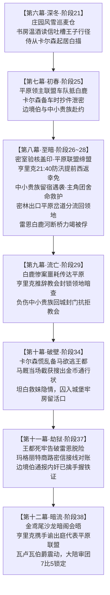

# 临时方案：第二部亨里克边境伯深度戏份与随从叛徒全逻辑链重塑方案

> **权威对账基准**：本项目以 `docs2` 实体档案库为唯一第一客观权威源。全量角色、势力与地理动线必须 100% 严格锚定既有资产。  
> **文风基准定锚**：以日式轻小说、日式 RPG 剑与魔法（JRPG Western Fantasy）为基准。采用白描与轻松白话，描绘异世界日常与呼吸感，穿插生动有趣的吐槽与内心独白。坚决执行 JRPG 脚本反向自查原则，杜绝中式网文、江湖话本与市井熟语。

---

## 〇、 世界观认知确定、信息隔离界限与核心重塑目标

### 1. 世界观基准与体制定义
* **大陆与王国格局**：本土世界为晨光大陆（Luminas），北方为远古神圣的 Eldoria 大森林，南方为维里迪亚王国（Viridia）。严禁代入现实地球地理、历史文明或中式封建社会。
* **封建体制与要塞专属定义**：
  * **世俗封建领主**：维里迪亚为正统封建世袭领主制，中西部平原由布鲁诺家族世袭统治，亨里克边境伯掌管平原粮仓与主商道，代表大陪审团实用商道派；
  * **骑士团体制**：圣殿大要塞全境无世俗军队与现代行政官僚，属于封建骑士团体制（严禁“军队、军纪、军官、武将、守将、官僚、退伍军人”等世俗军队表述），统一采用骑士团、要塞守备、先锋骑兵队、巡防、要塞典狱长；
  * **【要塞】唯一专属地名特指**：全书“要塞”一词唯一合法语境仅限指代具体地理据点——【圣殿大要塞】。严禁将“要塞”泛化为政体或权力概念（严禁“要塞军权”、“要塞方”等概念造词），严禁在其他常规边防哨所、堡垒中使用“要塞”泛指。

### 2. 时空历法、度量衡与语言质感铁律
* **严格杜绝中式传统时辰与计时**：
  * 全书严禁出现“子时、丑时、寅时……亥时”、“初刻、几刻”等中国古代天干地支时辰；
  * 严禁出现“半刻钟、一刻钟、三更半夜、打更、弹指、须臾”等中式话本时间词；
  * 统一采用 JRPG 西幻轻小说自然生活流时序表达（如“入夜九点四十左右（约 21:40）”、“午夜零点（00:00）”、“黎明破晓”、“约十分钟”、“数分钟内”等或标准24小时时刻标注）。
* **度量衡严格西幻化**：统一采用“公斤/千克、米/厘米、公里/里格”，严禁“斤、两、尺、寸、丈、里、石、斗”。
* **严禁现实地球文学与专名**：严禁“堂吉诃德”、“欧陆/欧洲”等打破沉浸感的地球文学或历史专词。
* **语言质感反向自查**：以白描散句与轻松日常呼吸感为主，穿插生动吐槽。杜绝连续四字短语连缀（四字病），杜绝中式说书人腔调，严禁武侠与仙侠玄学黑话；坚决落实“Show, Don't Tell”，严禁旁白直接下场替角色进行道德定性或说明文宣称。

### 3. 重塑设计核心原则与目标
在第二部主线中，第八幕“白鹿驿馆血色伏击”是全篇至暗大溃败的命运枢纽。异端审问官达米安因截获布鲁诺家族随从送出的密信抄件而获悉白鹿会盟情报，诱发了枢机主教克莱门特三世的癫狂灭口。

针对原案中的逻辑断层、单薄叙事与信息差界限，确立以下重塑原则与目标：
1. **暗桩真实铺垫**：随从卡尔森在第六幕提早登场，通过温酒、分类公文等起居白描展现领主对心腹书吏的深厚信任，并在第七幕备车时埋下出府送药的泄密动作暗线；
2. **平原商道联盟会盟范围与反派发狂动因**：
   - **大粮仓归属唯一性**：维里迪亚王国中西部平原大粮仓、数万亩麦田与主驿道商路命脉 **100% 唯一属于平原世袭大领主【亨里克·冯·布鲁诺边境伯】**，绝不分薄或混淆；
   - **平原商道联盟阵容**：白鹿驿馆会盟并非全境大公的泛泛集会，而是朱利安王子以四大铁证秘密争取平原商道贵族联盟。与会者为平原领袖亨里克边境伯亲率领衔（带侍从卡尔森与 4 名亲信近卫），以及其平原商道同盟旗下的 **2 位平原世俗附庸中小贵族代表**（如主理平原水磨坊的世袭男爵与掌管平原车队货栈的领地庄园主，各带 2 名贴身侍卫）；
   - **反派极端灭口动因**：达米安截获密信抄件，得知王储不仅拿出了四大铁证，更召集了以亨里克为首的平原世俗贵族联盟集体秘密倒戈！一旦平原粮道切断且大陪审团商道 4 票集体易帜，教廷三十年神权统治面临全线崩塌！克莱门特与达米安陷入极端政治恐慌，癫狂下令动用全部生化死士与发条机兽实施“无差别大屠杀焚平驿馆”；
3. **边境伯提前离场幸免与中小贵族火海遇险救护分流**：
   - **边境伯幸免闭环**：密室盖印后，因初春暴雨涨水危及平原总粮仓与麦种货栈，亨里克连夜冒雨赶回布鲁诺城堡督办防汛，于入夜九点四十左右（约 21:40）整整提前两个多小时驶离核心区，对深夜合围彻底不知情，形成幸免闭环；
   - **中小贵族遇险与主角团舍命相救**：中小贵族留宿二层，午夜突遭机兽与狂骑血洗合围，强酸蔓延，中小贵族受重伤，侍卫死拼护驾；劳拉横剑迎击机兽战锤（大剑断裂、脏腑重创），黎恩挑偏战锤，不仅护住了后厨地窖平民，更在烈火中强行救下了濒死的中小贵族残部；雷恩旋开后山草棚生铁暗门，全员撤入后山密林；
   - **密林出口岔道分流（绝不进入第九幕酒庄地窖）**：冲出后山密林后、在抵达白鹿河石桥之前，中小贵族的残存侍卫辨明侧翼平原便道，向朱利安王子叩谢救命大恩，背负重伤昏迷的主人分流撤回各自的平原封地城堡闭门抢救；主角团则为了掩护四大铁证和重伤的劳拉撤往西山旧领，奔向白鹿河石桥，遭遇莫尔茨，触发雷恩断桥被俘。这既保全了酒庄安全屋的绝对隐蔽与纯粹，又让主角团的牺牲具备了救赎世俗大领主的崇高政治价值；
4. **严格划定信息差界限**：王子深入林地的大本营与异族盟约属于绝密地下行动，外界仅能获知公开/半公开世俗政务风声；
5. **平原领主集团立场定锚与政治手腕**：
   - 第九幕噩耗传来后，亨里克以封建管辖权推辞教会搜捕，闭门暗查内奸；被救回的中小贵族同样吓得半死又怒不可遏，封锁城堡严拒教会搜捕队进驻，形成平原世俗抵制硬壁；
   - 第十幕亨里克截获卡尔森与达米安手谕；
   - 第十一幕商路信鸽对账；
   - 第十二幕沙龙暗阁，亨里克出面出示铁证，背后代表布鲁诺家族与被救中小贵族的平原商道 4 票死心塌地倒戈，锁定 7 比 5。

### 4. 信息差与外界认知隔离界限
* **【绝密地下行动（外界未知）】**：
  * 北方森林腹地的大本营与异界伙伴；
  * 远古精灵菲娜、埃雷波尼亚帝国同伴、矮人三兄弟的真实存在；
  * 王子深入林地送还幼狼、沼泽为蜥蜴人解毒并缔结五族心木盟约。
* **【外界领主与王都贵族院真正能收到的公开/半公开风声】**：
  * ① **闭门避世画旧图（第一、二幕）**：朱利安在王宫受教会压制，放着正经军政大事不管，整天闭门窝在藏书楼里当书呆子画旧地图；王都贵族沙龙普遍嘲讽这位第一继承人“软弱温吞、毫无魄力，只会在纸堆里画旧地图自欺欺人”；
  * ② **偏离权力中枢、频跑边境（第三、四幕）**：放着王都白金近卫不经营，借巡查边防名义频繁溜去偏远的【法尔肯驿镇】；
  * ③ **颁布《轮换猎区令》抓皮毛小盗贼（第四幕阶段十四正式张榜）**：在法尔肯市政厅正式签署张榜《轮换猎区令》，划定林地禁猎期与轮猎规程；出资聘请边境猎人巡林，在林缘端掉了一个借打猎之名私运皮毛的盗猎团伙；大贵族们在金鸢尾沙龙嗤笑王储“不务正业，跑去给穷猎户当巡林官”；
  * ④ **圣餐酒口感风波与大教堂进言（第四幕阶段十四）**：朱利安在王都贵族沙龙公开挑剔教会名产圣餐酒口感酸涩苦杂，并一本正经前往大教堂向主教进言，煞有介事地劝教会查验酒庄木桶与水源洁净；王都领主与沙龙贵族嗤笑王储“软弱无能，连王权正事都管不了，反倒跑去给教会当品酒师管闲事”；
  * ⑤ **为外来商号开道背书（第四幕、第七幕）**：利用王室特许商号配额，给法尔肯后街的迷迭香商行以及新冒头的北方心木商行签发合法的《内陆商道通行状》。掌控平原粮仓与主商道的亨里克边境伯早就知道有几辆北方大篷车在平原跑，以为是王储为了贴补内帑零花钱跟地方小行商搞转口贸易。

---

## 一、 核心人物设定与行为逻辑

### 1. 亨里克·冯·布鲁诺边境伯（`NPC_D2_21`）
* **身份与基本参数**：52岁，中西部平原世袭边境伯，平原大粮仓掌管者，大陪审团实用商道派领袖（代表布鲁诺家族及平原商道 4 票）。
* **外貌与装束**：体格粗壮魁梧，蓄浓密铁灰络腮胡，浅褐双眼精明老练；着水獭皮镶边厚鹿皮束腰大衣与厚羊毛马裤，粗指戴两枚磨损家徽金印戒与一枚商会通行铜环。
* **阶级立场与性格特质**：
  * **平原庄园大领主的务实本能**：将粮食流通、春耕麦田与商路税收视作家族立身之本。对封建领地与佃农有切实的治理担当，习惯亲力亲为巡查仓储水利；
  * **世俗实用主义与中立自保**：苦圣殿要塞苛税截流与教会免税侵地久矣，但深知圣殿数千重甲铁骑的现实威慑；在御前会议与大陪审团中周旋，恪守“不见稳赢筹码与经得起法槌推敲的白纸黑字文书绝不冒险”的底线。
* **语言风格与口头禅**：
  * 嗓音低沉粗犷、中气十足，喜用平原麦田、磨坊、仓储与谷物行话作生动比喻；
  * **代表性口头禅 / 习惯语**：
    - *“漂亮话换不来能充饥的面粉，踏实人才能把麦子收进仓库。”*
    - *“没有经得起法槌推敲的白纸黑字文书，布鲁诺家族的一粒麦子、一个骑兵都不会动。”*
    - *“领地的麦田和仓储可一天离不开人。”*
* **对朱利安王子的底层认知**：
  * **表面风评**：认为王储被教会架空后行事稚嫩任性，放着王都正规军政不管，整天折腾巡林抓贼、挑剔圣餐酒之类的琐碎闲事，是个不知天高地厚的年轻书呆子；
  * **内心实感**：看重其身上没有被名利场污染的纯粹与干净，认可其不屑与教会分肥、实打实护民的骨气；但坚持政治冷酷现实，唯有见到足以扳倒教廷的法理铁证，才肯出动私兵与票仓。

### 2. 机要侍从：卡尔森·沃克（Carlson Walker）
* **身份与基本参数**：布鲁诺家族府邸机要书吏、边境伯贴身侍从长，31岁。掌管边境伯书房公文、外埠商队信件与印章保管逾七年，深受边境伯信任。
* **外貌与仪态**：面容斯文消瘦，神情沉静温和，着一身耐磨平整的深灰厚呢绒随从短袍，随身携带纯铜印信匣与吸墨水沙罐。指尖微带墨渍，衣袍常年带着墨水与封蜡的干燥气味，动作极轻。
* **性格特质与动作习惯**：
  * **谨慎周全、心细如发**：分类羊皮公文井井有条，整理信笺时习惯性轻柔抚平折痕与火漆边缘；
  * **恭顺克制**：进出书房目光低垂规矩，深谙侍从分寸；
  * **软弱与被动**：缺乏政治主见与反抗勇气，将唯一的亲人视作全部精神寄托。
* **背叛动因与把柄**：
  * **致命软肋**：亲妹妹患有黑血怪病，当年在王都求医时被教会以沾染异端不洁为由秘密扣押当人质，达米安以此为要挟逼其充当内线；
  * **利益诱惑**：达米安暗中许诺大额金币，并开出事成后保荐调任王都商业公署的空头支票。

---

## 二、 跨幕演进全流程详规设计（第6幕至第12幕）

---

### 1. 第六幕【阶段二十一·第 4.5 节】：深冬巡庄、读信吐槽与侍从日常

* **精准插入节点**：位于阶段二十一第 4 节（朱利安王子做客大本营长谈）与第 5 节（一月商路规划）之间，作为平原世俗领地的幕间切片。
* **前置情境接口**：朱利安在法尔肯借巡防之名深入大本营结盟后，于冬歇期通过民间行会信差向维里迪亚中西部平原递出试探信，探查平原领主对王室法统的态度。
* **核心剧情分镜与白描**：
  * **风雪巡庄动作**：平原漫天大雪，亨里克蹬着沾满泥雪的高筒皮靴，亲自带着庄园管事和工匠巡查粮仓与麦垛。他粗声训斥农夫防冻草席没绑紧，转头从马车上扯下两袋热腾腾的粗麦饼塞给冻得发抖的年轻佃农，并挽起袖子扛起铁锹帮忙疏通被暗冰堵住的水磨坊导水槽；
  * **书房温酒与侍从动作**：回到壁炉里烧着干燥的橡木柴的书房，机要侍从卡尔森端上刚温好的香料热果酒，双手平托递上一封封着隐秘紫罗兰花火漆的折叠羊皮纸——朱利安王子在冬歇期辗转送达的初步试探函。卡尔森办事周全沉静，退立一侧，衣袍上带有淡淡的墨水与封蜡清爽气味；
  * **独白与对王子的生动吐槽**：
    * 边境伯用小银刀划开火漆，就着烛火读信。信中年轻王储满腔热血想要对抗教廷、重振法统的措辞，让边境伯忍不住失笑吐槽：
      > *“这个朱利安小娃娃，王都的大主教和圣殿大团长都快骑到王宫脖子上了，他这一年多都在折腾些什么玩意儿？”*  
      > *“在王宫放着正经军政大事实权不管，整天窝在藏书楼里当书呆子画地图；接着三天两头借着巡防名义往北边法尔肯那种偏僻泥泞边镇跑，跑去给山野猎户张贴什么《轮换猎区令》，跟一群穷猎户称兄道弟、在林子边上抓几个偷皮毛的小贼；前阵子更离谱，居然还为了几桶圣餐酒口感发酸，在沙龙大惊小怪，甚至一本正经跑去大教堂劝教士查验木桶！”*  
      > *“堂堂维里迪亚第一顺位继承人，干的净是村镇巡林官、市井品酒师的鸡毛蒜皮！现在倒好，手里连两百个正规重骑兵都凑不齐，居然敢偷偷给我递信，空口白牙想拉我几万亩麦田和私兵跟着他去扳倒教廷三十年的神权大树？真是个不知天高地厚的年轻书呆子！”*
    * 吐槽归吐槽，边境伯浅褐色的双眼中却闪过一丝不易察觉的动容：这位小王储虽然行事稚嫩固执，但骨子里却有一股没被王都名利场玷污的干净劲儿；至少他没像那些只知分肥的大公那样盘剥百姓，桩桩件件都是在护着地方民生。教廷没对他下死手，大概也正以为他只是个掀不起风浪的任性年轻人；
    * 边境伯将信纸往桌上一放，语气恢复冷峻务实：“锁进铁柜里。回信措辞放恭敬客气些，就说‘大雪封门，平原春耕防冻事忙，抽不出空’。告诉他，见不到经得起大陪审团法槌推敲的实物原本，布鲁诺家族的一粒麦子、一个骑兵都不会动！”
  * **侍从归档细节**：卡尔森恭顺垂首应诺，动作沉稳地将信件收入厚木书桌的铜锁铁匣，指尖平稳抹平折角，随后轻步退出书房，随手带紧房门。
* **后置承接影响**：向读者确立了亨里克务实中立的封建领主底线，铺垫了卡尔森的书吏地位与出入便利，为第七幕朱利安携实物下请帖埋下因果契机。

---

### 2. 第七幕【阶段二十五·第 4.5 节】：平原联盟车队启程、备车出府与暗线泄密

* **精准插入节点**：位于阶段二十五第 4 节（主角团护送铅箱抵京前夕入驻白鹿驿馆）与第 5 节（边境伯与中小贵族车队入驻外院）之间。
* **前置情境接口**：朱利安与主角团齐集四大物理铁证（工匠齿轮、病历手稿、洗钱账册等），通过绝密信鸽向中西部平原发出正式密邀，称已备齐指证教廷越权洗钱的确凿实物原本与账册，请平原领主商道联盟于白鹿驿馆闭门验看。
* **核心剧情分镜与白描**：
  * **边境伯书房震动**：亨里克在书房读罢信鸽密信，拍案而起：“那个傻气王储……信里言之凿凿，居然真说拿到了能把教廷定死在法理柱上的实物原本？！空口无凭叫了那么久，这回居然敢请我亲自去白鹿驿馆验看实物原本？好啊，我倒要亲眼看看，他到底能从那帮神棍身上扒下什么真凭实据！”
  * **备车与随从调派**：亨里克下令卡尔森备车，挑选四名心腹亲信骑兵轻车简从随行护卫，对领地其他人严密封锁会晤性质；同时平原商道同盟旗下的两位世俗中小贵族（磨坊男爵与车队货栈庄园主各带两名侍卫）亦依约轻车简从赴会；
  * **泄密动作暗线**：卡尔森在府邸马厩备车套马时，以“采购平原防潮跌打油膏”为由短暂离府约十分钟。卡尔森快步赶往庄园外围树林深处，将私抄的“朱利安亲携实物铁证定于白鹿驿馆密会平原领主联盟”情报抄件投入异端审问厅平原暗桩的死信箱石缝中，随后若无其事返回马厩随车队出发；
  * **入驻外院**：阶段二十五末尾，边境伯的金鹰四轮马车在 4 名亲信骑兵护卫下，同中小贵族的车队平稳停入白鹿驿馆外院。
* **后置承接影响**：平原商道联盟车队于第 37 天傍晚进驻驿馆；而达米安在前哨正是接获了该抄件，惊觉平原世俗领主集体倒向王储，连夜报请大主教并调集暗影死士与生化机兽实施孤岛灭口。

---

### 3. 第八幕【阶段二十六·第 2.5 节至阶段二十八】：密室结盟、防汛辞别、火海救护与林缘分流

* **精准插入节点**：贯穿阶段二十六第 2.5 节（二层套房验核盖印与防汛离场）、阶段二十七第 4~5 节（火海救护中小贵族）以及阶段二十八第 1 节前置（密林出口平原岔道分流）。
* **核心剧情分镜与白描**：
  * **密室验核与政治同盟确立**：二层套房内，亨里克戴上单目放大镜逐行核验齿轮印号、前院长病历原本与洗钱账册，中小贵族在侧无不心惊胆战。亨里克拍案赞赏王储骨气，褪下金鹰印章戒压下火漆，中小贵族亦纷纷盖下领地私印，正式结成反教廷大同盟；
  * **婉拒宴饮的防汛理由与幸免西返**：签约完成后，朱利安邀请众人留在大厅享用烤羊腿。亨里克笑着摆手婉拒，指了指窗外骤起的初春暴风雨：
    > *“殿下，领地的麦田和仓储可一天离不开人。平原开春融雪，再加上今晚这场暴雨，河水一旦漫过低洼处的总粮仓和谷物磨坊，今年全平原的春播麦种都要泡烂。我必须今夜连夜赶回布鲁诺城堡，亲自盯着工匠加固堤埂、疏通排水分渠。盟约已经签了，只要法理齐备，大陪审团席位上布鲁诺家族绝不退缩！”*  
    卡尔森提灯照路，车队在 4 名亲兵护卫下，于当夜九点四十左右（约 21:40）全员冒雨启程西返，在暴雨中与北上的死士在大道侧翼擦肩而过，对深夜合围彻底不知情，形成幸免闭环；
  * **中小贵族留宿与午夜遇险**：中小贵族年迈体弱，决定留宿二层客房过夜。午夜零点（00:00），达米安调动的暗影死士与发条机兽暴雨合围；暗影忏悔者自爆强酸黑血，三米高的发条机兽撞穿石墙，中小贵族客房遭火海吞噬，贵族遭强酸灼伤、落石砸断肋骨，侍卫死伤过半拼命用塔盾护驾退向一层通道；
  * **主角团舍命相救（劳拉断剑与黎恩挑锤）**：机兽巨锤携千钧黑酸轰向避难通道，劳拉双手横平大剑正面硬撼（大剑断裂、脏腑受创吐血），黎恩瞬步挑偏战锤数厘米，乔治以粗断梁卡死机兽传动轮。主角团不仅救下了地窖十几名马夫仆役，更在千钧一发之际将负伤濒死的中小贵族与残存侍卫拉入安全掩体；雷恩旋开后山草棚生铁暗门，全员鱼贯钻出暗门逃入后山洼地；
  * **密林出口岔道分流（绝不进入第九幕酒庄地窖）**：冲出后山泥泞密林后、在抵达白鹿河石桥之前，中小贵族的残存侍卫辨明了侧翼通往平原腹地农庄的泥泞小道。侍卫们眼含热泪向朱利安王子与黎恩等人单膝跪地叩谢：*“殿下与诸位的大恩……我们永世难忘！”* 侍卫们背负着重伤昏迷的中小贵族，借暴雨夜色分流撤回各自平原领地城堡抢救；
  * **石桥断后与队伍进入酒庄**：主角团则继续护送四大铁证奔向白鹿河石桥，遭遇莫尔茨铁骑锁桥，雷恩劈断吊桥断后被俘，余下人员进入艾斯特雷亚酒庄地窖。
* **后置承接影响**：既完美解释了反派极端灭口的恐慌动因，又让主角团的牺牲具备了救赎世俗大领主的崇高政治价值；同时确保了第九幕酒庄安全屋的绝对隐蔽纯粹。

---

### 4. 第九幕【阶段二十九·幕间切片】：封门惨案噩耗、表面周旋推辞与闭门起疑

* **精准插入节点**：位于阶段二十九第 3 节（泥泞逃亡）与第 4 节（领民相护）之间的幕间切换。
* **前置情境接口**：第八幕白鹿惨案爆发，王都全城宵禁戒严，教廷发出盖有印章的血色通缉令，宣称“白鹿大驿馆遭异端暴徒纵火夷平，王储不幸遇刺身亡，雷恩被俘”。
* **核心剧情分镜与白描**：
  * **平原世俗领主的集体震怒与抗拒**：
    * 边境伯回府刚过一日，教廷信使与王都通报送达庄园。得知白鹿大驿馆被夷为平地、王储遇刺，亨里克手脚冰凉，后背瞬间被冷汗湿透——要不是为了粮仓防汛连夜赶回，布鲁诺家族的核心早就被埋在焦土底下了。边境伯既为死里逃生感到万幸，更对教廷泯灭人性的丧心病狂感到滔天狂怒；
    * 与此同时，那两位在大火中被主角团舍命救回平原城堡的中小贵族，同样从重伤高烧中苏醒，吓得半死又怒不可遏，立即下令城堡拉起吊桥、私兵上膛，全领地封锁，严拒教会巡防教士进驻；
  * **表面周旋推辞教会搜捕**：教会巡防教士与异端审问厅探子持血色通缉令抵境，要求搜查领地并进驻庄园。亨里克面色如常，端出世袭大领主的从容与威严，客气却坚决地予以推辞：
    > *“教区的大人们辛苦了。但布鲁诺平原的防务一向依据先王宪章由家族世袭自理，领地内的封锁与排查，本伯爵自会抽调最精锐的骑兵亲自严查，绝不让半个可疑分子溜过去，更不敢劳烦审问厅的大人们冒雨沾染泥水。”*  
    借此名正言顺封锁城堡与主要路口，拒绝审问厅人员涉足领地腹地；
  * **敏锐嗅觉与排查内奸**：送走教士后，亨里克坐在生着柴火的壁炉前越想越不对劲：白鹿驿馆会晤是极度隐秘的突发接触，信件从头到尾只有自己经手，在书房里起草、收纳、封盒的，仅有追随了自己七年的侍从长卡尔森。教廷怎么可能提前知道得一清二楚，在深更半夜调动重兵合围孤岛？亨里克目光沉沉地落在书房紧闭的厚重木门上，没有声张，借口“战备核账”，悄悄开始排查书房信鸽日志与卡尔森近期的出入行踪，平原庄园暗流涌动。
* **后置承接影响**：平原各大领主形成集体世俗抵制硬壁，将内奸排查的动作前置到第九幕，使第十幕的当场截获具备充分的逻辑铺垫。

---

### 5. 第十幕【阶段三十四·第 3.5 节】：马厩潜逃当场拿获、动机坦白与牢房看押

* **精准插入节点**：位于阶段三十四第 3 节（黑市商道交锋）与第 4 节（重器密运）之间。
* **前置情境接口**：第九幕亨里克秘密排查，第十幕王都全面戒严；达米安为灭口知情者，派黑袍死士在平原庄园外围游弋盯梢。
* **核心剧情分镜与白描**：
  * **卡尔森的惊恐与破绽**：白鹿惨案发生后，卡尔森不仅没有等到教廷依约释放妹妹的消息，反而发现庄园外围悄悄出现了黑袍死士盯梢的痕迹（达米安企图灭口一切知情者）。卡尔森心惊肉跳，唯恐自己成为弃子，在极度恐慌中企图取出暗藏的金币与通行密令，连夜备马潜逃王都救妹；
  * **雷霆突击，当场拿获**：亨里克早有防备，当场率领四名心腹近卫破门包围马厩，在卡尔森的马鞍夹层与暗兜里搜出了整整两袋金币，以及一纸达米安亲笔盖印的安全通行状与密信底稿（`EVD-10`）；
  * **痛苦坦白与动机大白**：面对搜出来的物证，卡尔森瘫软在地上浑身发抖，眼泪鼻涕全糊在脸上，额头在冰冷的石板上磕出血来。卡尔森痛苦坦白了全部真相：亲妹妹患有黑血怪病，当年在王都求医时被教会以沾染异端不洁为由秘密扣押当人质，达米安以其软肋相要挟，并许诺事成后保荐他升任商业公署主事。他以为教会只是抓捕逃犯，绝没想到会演变成把整个白鹿驿馆连同领主一起烧光的灭绝大惨案；
  * **铁腕决断与牢房看押**：亨里克看着自己精心栽培七年的心腹，气得浑身发抖，一脚将金币踢散，怒极反笑：
    > *“混账东西！你为了救你妹妹一人，差点把布鲁诺全族和王国唯一的希望全送进火坑！你真以为大主教那群吃人不吐骨头的神棍，会留你和你妹妹的活命么？！”*  
    亨里克并未意气用事杀人灭口，深知这是扳倒教廷最不可动摇的活口物证。亨里克下令剥夺卡尔森一切职务，将其囚禁在城堡牢房中派亲信严密看守留作活口；同时派心腹伪装成行商潜赴王都暗中盯防教会动向，保全其妹妹性命以备后用。
* **后置承接影响**：不仅交代了内奸的悲剧动机与下场，更让第十二幕的大陪审团人证具备了坚实的物理着落点，化被动为主动。

---

### 6. 第十一幕【阶段三十七·第 5 节】：黑野猪酒馆暗室接线、商路密信对账与心结解开

* **精准插入节点**：位于阶段三十七第 4 节（雷恩、戈德弗里等骑士被救出圣殿死牢）之后，众人撤回下城黑野猪酒馆暗室休整之时。
* **前置情境接口**：王都死牢成功告破，众人退入黑野猪酒馆暗室。玛格丽特夫人通过法尔肯与平原商道的绝密信鸽，将雷恩生还的消息送达西境；同时，玛格丽特为朱利安带回了来自布鲁诺庄园的回复密信。
* **核心剧情分镜与白描**：
  * **密信呈递与两线情报咬合**：玛格丽特将封有布鲁诺金鹰火漆的羊皮信件递给朱利安。亨里克在信中正式通报了内奸卡尔森已由自己亲手擒获、囚禁在牢房的实情，并附上了卡尔森签字盖印的完整认罪供状抄件；
  * **边境伯信尾陈词**：
    > *“得知殿下安然无恙，我悬着的心这才算落了地。布鲁诺家族管束无方，竟让身边随从沦为神棍的走狗，累及殿下与诸位蒙难。内奸与达米安亲笔签署的手令已被我锁在地牢里，这就是教会把手伸进世俗大公领地、策划谋逆的最硬铁证。等到殿下在王都打响法理反击的那天，我一定带着人证和全部铁证亲自出庭，跟那群神棍好好算总账！”*
  * **众人释怀与士气重铸**：朱利安看罢密信眼眶泛红，艾德里安与雷恩沉稳击掌。白鹿驿馆泄密导致同伴流血被俘的心结彻底解开，后顾之忧全消，为第十二幕法理围城铺平了道路。
* **后置承接影响**：为第十二幕金鸢尾沙龙暗阁会晤做好了完全铺垫，使大陪审团的倒戈成为水到渠成的情报与政治合流。

---

### 7. 第十二幕【阶段三十八·第 4 节】：沙龙暗阁会盟、出示铁证与大陪审团倒戈锁定

* **精准插入节点**：位于阶段三十八第 3 节（名媛外交与沙龙暗战）与第 5 节（大陪审团票数汇总）之间。
* **前置情境接口**：朱利安、亚莉莎与艾德里安潜入金鸢尾沙龙二层隔音暗室“鸢尾暗阁”，与在此秘密等候的大法庭首席法官瓦卢瓦伯爵及亨里克边境伯会晤。
* **核心剧情分镜与白描**：
  * **暗阁相见与领主抚慰**：朱利安推门而入，亨里克大步上前，粗糙有力的大手按在年轻王子的肩膀上，满是欣慰：“殿下长成了真正的硬汉啊……在白鹿驿馆受苦了！”
  * **出示人证供状与神谕手令**：亨里克当着王国大法庭首席法官瓦卢瓦伯爵的面，庄重出示了**卡尔森签字盖印的认罪供状、异端审问厅达米安亲笔签署的安全通行状正本（`EVD-10`）**，与亚莉莎的复式洗钱暗账、艾德里安的十九年特许状并排陈列；
  * **瓦卢瓦伯爵震动表态**：一向严谨自律、不见铁证不表态的瓦卢瓦伯爵抚平胸前的纯银天平勋章，神情肃穆震动：“教廷不仅洗钱越权，竟敢以私刑软肋渗透大陪审团领主亲信、谋刺王位第一继承人……宪章尊严荡然无存！”
  * **大陪审团票数锁定（7比5）**：亨里克拍案定调：布鲁诺家族连同在白鹿大火中被救的中小贵族盟友，**平原商道 4 票全部死心塌地倒向王室**！瓦卢瓦伯爵代表宪章派 3 票入局，大陪审团倒戈票数坚实锁定为 **7 票对 5 票** 的绝对优势，为后续御前决斗及十字竞技场 9 票终审大胜奠定坚不可摧的法理死基；
  * **王道承诺**：朱利安王子当场向亨里克郑重许诺，大审判战定之后，王室必当妥善医治并庇护卡尔森无辜的妹妹，展现王储守护每一个臣民的宽广胸怀。
* **后置承接影响**：彻底打破了教廷对世俗司法的垄断，剥离了克莱门特与达米安的政治合法性。

---

## 三、 本次修改涉及的文件清单与改动对照表

| 序号 | 目标文件路径 | 涉及变更核心内容 | 变更性质 |
| :--- | :--- | :--- | :--- |
| **1** | `方案/第二部/主线与世界扩充方案/分阶段详规/06_第六幕_霜雪冬歇·冬日庆典与降临共盟/00_第六幕大纲与接口.md` | 重要NPC表中补齐亨里克边境伯（`NPC_D2_21`·平原视点）与侍从卡尔森，阶段二十一演进表中增补深冬庄园巡查幕间切片。 | 幕级大纲增补 |
| **2** | `方案/第二部/主线与世界扩充方案/分阶段详规/06_第六幕_霜雪冬歇·冬日庆典与降临共盟/阶段二十一_深冬议事与战略定锚·王子做客与一月大商路总纲详规.md` | 增补第 4.5 节【幕间·平原深冬——布鲁诺庄园的炭火与边境伯的喷嚏】，白描风雪巡庄与侍从起居，基于外界已知风声吐槽王子巡林与品酒行径。 | 阶段详规扩充 |
| **3** | `方案/第二部/主线与世界扩充方案/分阶段详规/07_第七幕_王都商路·繁华市井与暗潮生活流/00_第七幕大纲与接口.md` | 重要NPC表中补齐亨里克边境伯（`NPC_D2_21`）与卡尔森，后置交付接口明确边境伯与中小贵族车队于第37天傍晚同抵白鹿驿馆外院。 | 幕级大纲修补 |
| **4** | `方案/第二部/主线与世界扩充方案/分阶段详规/07_第七幕_王都商路·繁华市井与暗潮生活流/阶段二十五_纯铜八音盒商行托付与白鹿启程详规.md` | 增补第 4.5 节【布鲁诺庄园备车与马厩暗线】，白描卡尔森趁着出府备药的机会将密信抄件投入死信箱。 | 阶段详规扩充 |
| **5** | `方案/第二部/主线与世界扩充方案/分阶段详规/08_第八幕_血色伏击·至暗大溃败/00_第八幕大纲与接口.md` | 前置输入明确白鹿驿馆为平原商道联盟会盟；重要NPC补充卡尔森；后置交付明确亨里克防汛西返、中小贵族遇险获救分流回领地的闭环。 | 幕级大纲修补 |
| **6** | `方案/第二部/主线与世界扩充方案/分阶段详规/08_第八幕_血色伏击·至暗大溃败/阶段二十六_合流会盟与白鹿大驿馆围城详规.md` | 详规第 2.5 节增补边境伯签约后婉拒晚宴、因粮仓防汛于入夜九点四十左右（约 21:40）乘车西返的分镜；第 4 节达米安前哨密信明确点名卡尔森。 | 阶段详规细化 |
| **7** | `方案/第二部/主线与世界扩充方案/分阶段详规/08_第八幕_血色伏击·至暗大溃败/阶段二十七_异化死士狂潮与名刃折断详规.md` | 增补分镜：机兽破壁强酸蔓延，劳拉横剑断剑、黎恩挑锤，在千钧一发之际救下重伤的中小贵族与残存侍卫，一同退入草棚生铁暗门。 | 阶段详规联动 |
| **8** | `方案/第二部/主线与世界扩充方案/分阶段详规/08_第八幕_血色伏击·至暗大溃败/阶段二十八_石桥断后、雷恩被俘与王室政变详规.md` | 增补第 1 节前置分镜：冲出密林后、在抵达白鹿河石桥之前，中小贵族侍卫叩谢朱利安救命大恩，抄平原便道分流撤回平原领地救治；主角团奔向石桥断后。 | 阶段详规细化 |
| **9** | `方案/第二部/主线与世界扩充方案/分阶段详规/09_第九幕_绝境流亡·篝火重铸与艾斯特雷亚之誓/00_第九幕大纲与接口.md` | 重要NPC表中补齐亨里克边境伯（`NPC_D2_21`·平原视点）；阶段二十九演进表中增补平原各领主获悉惨案噩耗后封锁城堡、抗拒教会进驻的幕间切片。 | 幕级大纲修补 |
| **10** | `方案/第二部/主线与世界扩充方案/分阶段详规/09_第九幕_绝境流亡·篝火重铸与艾斯特雷亚之誓/阶段二十九_泥泞逃亡、领民相护与领主觉醒详规.md` | 增补幕间切片：白鹿惨案噩耗传至平原，亨里克与被救中小贵族封锁领地城堡表面周旋推辞教会，平原形成抵制硬壁，亨里克闭门暗查侍从。 | 阶段详规增补 |
| **11** | `方案/第二部/主线与世界扩充方案/分阶段详规/10_第十幕_深渊古道·暗河谍影与地底破壁/00_第十幕大纲与接口.md` | 重要NPC表中补齐亨里克边境伯与侍从卡尔森；阶段三十四演进表中增补平原马厩堵截、起获达米安通行状物证并关押牢房的演进概要。 | 幕级大纲修补 |
| **12** | `方案/第二部/主线与世界扩充方案/分阶段详规/10_第十幕_深渊古道·暗河谍影与地底破壁/阶段三十四_黑市商道交锋与重器密运详规.md` | 增补第 3.5 节平原暗线：卡尔森慌乱备马欲逃，亨里克马厩堵截当场截获搜出金币通行状，审出救妹软肋锁入牢房留作活口。 | 阶段详规增补 |
| **13** | `方案/第二部/主线与世界扩充方案/分阶段详规/11_第十一幕_惊天劫狱·血洗圣殿死牢/00_第十一幕大纲与接口.md` | 重要NPC表中补齐玛格丽特夫人与亨里克边境伯（信函视点）；后置交付增补第 3 项物理资产：商路信鸽带回的亨里克密信与卡尔森认罪供状抄件；阶段三十七演进表增补暗室对账接线。 | 幕级大纲修补 |
| **14** | `方案/第二部/主线与世界扩充方案/分阶段详规/11_第十一幕_惊天劫狱·血洗圣殿死牢/阶段三十七_信义抉择放行与暗室深夜守候喂汤详规.md` | 第 5 节增补玛格丽特商路密信接线，朱利安与亨里克隔空对账，确认内奸已擒、铁证在手，解开泄密心结。 | 阶段详规联动 |
| **15** | `方案/第二部/主线与世界扩充方案/分阶段详规/12_第十二幕_王都暗流·沙龙旧卷与法理围城/00_第十二幕大纲与接口.md` | 前置输入持有资产补齐卡尔森认罪供状抄件与亨里克亲携达米安手谕正本；阶段三十八演进表修正为亨里克代表平原联盟与朱利安合流出示双重实证，锁定7比5。 | 幕级大纲修补 |
| **16** | `方案/第二部/主线与世界扩充方案/分阶段详规/12_第十二幕_王都暗流·沙龙旧卷与法理围城/阶段三十八_双城潜流与金鸢尾沙龙外交游说详规.md` | 调整第 4 节暗阁会盟分镜：亨里克从容出示卡尔森供状与手谕正本，代表平原商道 4 票坚定倒戈，瓦卢瓦伯爵震动，合流锁定7票倒戈；朱利安郑重承诺战后医治其妹。 | 阶段详规完善 |
| **17** | `方案/第二部/主线与世界扩充方案/分阶段详规/14_第十四幕_破晓大审判与黎明宪章/阶段四十四_校场誓师双城平暴与黎明新世界详规.md` | 在战后重建与各方安置分镜中，明确兑现朱利安王子承诺：卡尔森患黑血病之妹在王室庇护下移交晨光修道院，由艾琳娜修女（`NPC_D2_14`）接治并痊愈，发放生活抚恤。 | 终局详规闭环 |
| **18** | `方案/第二部/主线与世界扩充方案/06_第二部主线跨幕连续性与全局物理状态机.md` | 状态机全面对账：EVD矩阵正式注册编号 **`EVD-10`（达米安亲笔安全通行状与侍从卡尔森认罪供状原本）**；时间轴W22~23明确21:40西返与林缘分流，W41~42明确城堡私牢关押；第四节补充达米安灭口盯梢演进链。 | 全局状态机同步 |
| **19** | `docs2/npc/亨里克边境伯.TXT` | 严格遵循无剧透基准重立档案，仅写人设、性质、历史事件与过往记忆（大溃堤治理与御前抗税）。（**已先行完成健康交付**） | 实体设定已就绪 |

---

## 四、 方案实施健康度脑测与防遗漏闭环守则

为确保本方案在全库落地的过程中，所有关联文本、物理道具、接口契约与后续剧情 100% 具备客观物理自洽性，严格执行以下七大闭环守则：

### 1. 物理证据流转守则与 EVD-10 全局注册（杜绝物证凭空瞬移）
* **EVD-10 资产定义**：
  * **证物名称**：达米安亲笔安全通行状与侍从卡尔森认罪供状原本（`EVD-10`）；
  * **获取节点**：第十幕阶段三十四第 3.5 节，亨里克边境伯在布鲁诺城堡马厩堵截拿获，亲自封入城堡地下私铁柜妥善看管；
  * **中途流转**：第十一幕阶段三十七第 5 节，平原绝密信鸽受鸟道截获风险制约，玛格丽特转呈朱利安的**仅限书信通报与卡尔森认罪供状的简要抄件**，严禁将达米安手谕正本绑在鸽腿上；
  * **出庭呈堂**：第十二幕阶段三十八第 4 节金鸢尾沙龙暗阁中，达米安通行状正本是由亨里克边境伯随身贴肉携带至王都，当面呈递给王国大法庭首席法官瓦卢瓦伯爵验看，彻底杜绝任何“正本如何飞至王都”的物理硬伤；并在第十四幕真理广场大公审上作为审问厅谋刺王储之铁证呈堂。

### 2. 随行人员与马匹守恒闭环（杜绝现场死伤矛盾）
* 第七幕阶段二十五，亨里克轻车简从挑选的 **4 名贴身亲信骑兵**，在第八幕阶段二十六第 2.5 节（21:40）随四轮马车**全员整装护送西返**；
* 白鹿大驿馆午夜遭重骑与生化死士屠戮时，布鲁诺家族无一人一骑滞留在驿馆内；现场死伤马夫仆役全部属于驿馆常驻人员及普通客商，既确保了血战的惨烈度，又彻底避免了“边境伯走了为何留下死伤家丁”的逻辑漏洞。

### 3. 反派认知与灭口盲区自洽（反派动机行动链闭环）
* **达米安的情报误判**：达米安在前哨获悉的密信为卡尔森在马厩私抄的会盟简讯，信中未预料到边境伯会因防汛提前西返。达米安下达无差别屠杀灭口令，误以为将王储与平原领主们一并烧死在驿馆废墟内；
* **第九幕至第十幕的灭口动因**：当第九幕平原传来亨里克安然无恙并封锁领地的消息后，达米安察觉事情败露且自身私通大公侍从的把柄面临暴露，这才急派黑袍死士在外围盯梢企图灭口卡尔森，直接促发了第十幕卡尔森惊恐潜逃、被亨里克当场截获物证的剧情走向，前后因果严丝合缝；
* **全局状态机补齐**：在 `06_第二部主线跨幕连续性与全局物理状态机.md` 第四节达米安认知升级链中，补齐“第9~10幕暗杀灭口盯梢失败、失去内线失联”的中间认知读条。

### 4. 卡尔森妹妹救治的终局落地兑现（承诺不悬空）
* 第十二幕阶段三十八，朱利安王子向亨里克郑重承诺大局定后必妥善救治并安置卡尔森无辜的妹妹；
* **第十四幕战后落地**：在第十四幕【阶段四十四·校场誓师双城平暴与黎明新世界详规】战后重建分镜中，由晨光修道院附属医舍修女艾琳娜（`NPC_D2_14`，专门研究黑血怪病药典的理性医者）在王室庇护下正式接治并治愈其妹妹，王室发放生活抚恤。王储的道义承诺在全篇大结局形成严谨落地闭环。

### 5. 跨幕时空日历严格锚定（杜绝时空折叠）
* 本方案演进严格贴合晨光大陆 170 公里日历标尺：
  * 第六幕 W15~16：深冬信使往返平原与大本营（历时约 3~5 天）；
  * 第七幕至第八幕 W21~22：第 36 天信鸽下达，第 37 天傍晚车队抵白鹿（单程约 30 公里，重装四轮马车半日平原路程）；
  * 第十一幕至第十二幕 W48~52：劫狱后休整至沙龙暗会间隔两周，完全容纳平原信鸽往返及边境伯秘密抵京的封建路途时序。

### 6. 双侍从身份与动作严格物理隔离（杜绝角色指代混淆）
* **【驿馆年轻侍从】（驿馆常驻雇工）**：负责第八幕阶段二十六引路带入二层套房、在中央大厅收拾陶盘擦拭桌角时暗中将后山暗门生铁钥匙顺入雷恩掌心（代表平民暗助），深夜突围中随客商退入后厨地窖通道避险；
* **【侍从长卡尔森】（布鲁诺家族机要书吏）**：负责边境伯书房公文与出行备车，在第七幕马厩趁采购药膏偷送抄件，在第八幕为亨里克提灯照路、于入夜九点四十左右（约 21:40）随四轮马车西返平原，第十幕在庄园马厩潜逃被擒；
* **正文与详规防混淆铁律**：严禁将此二人指代混为一谈。正文描写时，前者统一称为“驿馆侍从/年轻侍应”，后者统一称为“侍从卡尔森/机要书吏卡尔森”。

### 7. 大粮仓归属唯一性与平原商道联盟林缘分流闭环守则
* **大粮仓唯一主人定锚**：维里迪亚王国中西部平原大粮仓、主驿道商路与数万亩麦田，**100% 唯一属于平原世袭大领主【亨里克·冯·布鲁诺边境伯】**，绝不分薄或生造其他大伯爵混淆其核心地位；
* **中小贵族身份定锚**：参会的中小贵族为布鲁诺平原商道联盟下属的世俗附庸封臣（如平原磨坊男爵、车队货栈庄园主等2~3人，各带2名侍卫）；
* **火海舍命相救与林缘分流闭环**：
  * 亨里克 21:40 因总粮仓防汛提前冒雨乘车西返（幸免闭环）；
  * 中小贵族留宿二层，午夜突遭生化机兽与狂骑合围，遭强酸与飞石重伤；劳拉双手横剑迎击机兽战锤（大剑断裂、脏腑受创），黎恩挑偏战锤，不仅救下后厨平民，更在烈火中强行救下濒死的中小贵族残部，全员钻入后山草棚生铁暗门撤入密林；
  * **密林出口平原岔道分流（绝不进入第九幕酒庄地窖）**：冲出密林后、在抵达白鹿河石桥之前，中小贵族残存侍卫辨明侧翼平原便道，向朱利安王子叩谢救命大恩，背负重伤昏迷的主人分流撤回各自的平原封地城堡闭门抢救；主角团则为了掩护四大铁证和重伤的劳拉撤往西山旧领，奔向白鹿河石桥遭遇莫尔茨断桥。这既保全了艾斯特雷亚酒庄安全屋的绝对隐蔽纯粹，又让主角团的牺牲具备了救赎世俗大领主的崇高政治价值；
* **平原世俗硬壁与大陪审团锁定**：
  * 第九幕，亨里克与被救中小贵族纷纷封锁城堡、拉起吊桥严拒教会搜捕队进驻，形成平原世俗抵制硬壁；
  * 第十二幕金鸢尾沙龙暗阁，亨里克出面出示铁证，背后代表布鲁诺家族与被救中小贵族的平原商道 4 票死心塌地倒向王室，大陪审团倒戈坚实锁定 7 比 5。

