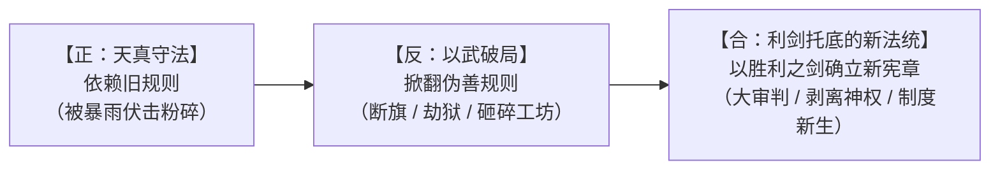

# 临时方案：第八幕挫败后心智觉醒与破局演进方案（已执行归档）

> **归档状态**：【已执行并落地】  
> **归档位置**：`方案/第二部/已执行/临时方案_第八幕挫败后心智觉醒与破局演进方案.md`  
> **落地目标**：
> - [阶段二十八_石桥断后、雷恩被俘与王室政变详规.md](../主线与世界扩充方案/分阶段详规/08_第八幕_血色伏击·至暗大溃败/阶段二十八_石桥断后、雷恩被俘与王室政变详规.md)（酒庄地窖艾德里安与朱利安觉醒独白微镜头）
> - [阶段三十六_奇袭深层水牢与重剑斩碎莫尔茨重铠详规.md](../主线与世界扩充方案/分阶段详规/11_第十一幕_惊天劫狱·血洗圣殿死牢/阶段三十六_奇袭深层水牢与重剑斩碎莫尔茨重铠详规.md)（劳拉重铸神兵破铠高光动作）
> - [00_第二部宏篇主线总纲与方案管理中枢.md](../主线与世界扩充方案/00_第二部宏篇主线总纲与方案管理中枢.md) · [06_第二部主线跨幕连续性与全局物理状态机.md](../主线与世界扩充方案/06_第二部主线跨幕连续性与全局物理状态机.md)  
> **核心规范守则**：
> 1. 【要塞唯一地名铁律】：全书“要塞”一词**唯一合法语境仅限指代具体据点——【圣殿大要塞】**。严禁将“要塞”泛化为政体或权力概念（严禁“要塞势力/要塞方/要塞军权”），对抗王权的武装垄断统称为“圣殿骑士团割据/骑士团特权”；常规关卡一律使用边防关卡、边防哨所；
> 2. 【肃清“老XX”滥套词】：彻底剔除“老团长、老仆、老看守、老哨长、老副团长、老国王、老行商、老驿馆”等廉价古风/网文套板词，一律直呼其名、具体官职或身份（如大团长阿达尔伯特、前副团长戈德弗里、守备队长巴恩斯、管事吉尔、国王埃德蒙、资深骑士、石造大驿馆）。

---

## 一、 核心立论：规则制定者的暴力撕破与主角团的“政治成人礼”

### 1. 第八幕前的认知局限（天真期与规则宿主）
在第一幕至第七幕中，主角团（尤其是艾德里安、朱利安、雷恩）由于各自的人生际遇与道德操守，在行动底层始终潜藏着一种**“体制内合规”的惯性思维**：
* **艾德里安**：将平反家族冤屈寄托于“商会身份证明、合规通行文书、复式记账穿透洗钱暗账、凑齐四大物理铁证”；误以为只要把铁证呈送至贵族盟友面前盖下火漆私印，就能在王国体制内迫使晨光教廷低头认罪；
* **朱利安**：身为受制于礼制的王子，在教会神权与骑士团特权的夹缝中试图温和斡旋，寄希望于父王密藏的手抄黑账与《王国根本宪章》的大陪审团裁决；
* **雷恩**：恪守晨光誓约的精神自律，面对要塞巡骑宁可剑脊卸力也不伤人要害，背负十四年前的愧疚枷锁，寄希望于修会内部的良知与法统公道。

### 2. 第八幕血色溃败的残酷洗礼（规则的彻底破灭）
白鹿大驿馆的暴雨合围与王都政变，以血淋淋的代价彻底撕碎了上述一切幻觉：
* **规则制定者的本质**：晨光教廷枢机主教克莱门特三世不仅是修会的幕后操纵者，更是维里迪亚王国的实际裁判。当他发现主角团试图掀开三十一年与十九年前的真相时，**他根本不需要在法庭上反驳证据，甚至不需要在规则内自辩，而是直接动用异化死士、黑酸生化武器与发条机兽，在暴雨夜实行物理抹杀！**
* **神权的终极底牌**：夺走国玺、将国王埃德蒙软禁于悬崖石塔、全境贴满血色通缉令、将守法者构陷为弑君叛国死囚。
* **沉痛代价**：密室盖印的盟约成了一纸空文，劳拉舍身挡锤导致双手大剑断折吐血，雷恩被扣上生铁重枷关入水牢，朱利安左肩负伤，全员沦为东躲西藏的通缉犯。

### 3. 核心认知蜕变：正义若无对等暴力，只是任人宰割的羊羔
这场至暗惨败让所有人完成了心智上的关键飞跃：
> **“只靠签订合约和法规是不能解决问题的，因为教会他们根本不会按照规则来，或者说游戏规则制定者是可以随时用武力撕破伪装的。”**  
> 裁判就是庄家本人。当你试图通过对方制定的法规去赢取正义时，对方随时会拔出屠刀砸烂桌子。要想让正义落地，唯一的途径是——**先用无可抗拒的武力打碎对方的暴力爪牙，剥夺对方掀桌子的资本！**

---

## 二、 关键角色的四重心智蜕变弧光

```mermaid
graph TD
    subgraph 第八幕之前：天真与合规
        A1["艾德里安：行商与真相搜集者<br/>（依靠特许状与贵族盖印）"]
        B1["朱利安：温和改良派王子<br/>（依托宫廷法统与大陪审团）"]
        C1["雷恩：戒律受困者<br/>（背负背誓枷锁，恪守修会道义）"]
        D1["黎恩与同伴：克制守望者<br/>（点到即止，不干涉世俗主权）"]
    end

    subgraph 第八幕洗礼：暴力撕破伪装
        Strike["【白鹿大驿馆伏击 + 王都政变】<br/>合约成废纸 / 巨剑断折 / 雷恩被俘 / 国王遭软禁"]
    end

    subgraph 第八幕之后：心智觉醒与战略掀桌
        A2["艾德里安：觉醒领主统帅<br/>（不再求告，以剑夺回主权与领民生机）"]
        B2["朱利安：铁血救国新王<br/>（手撕王袍，决意彻底拔除教会毒瘤）"]
        C2["雷恩：真誓言自由剑士<br/>（砸碎伪善戒律，长剑只为公道出鞘）"]
        D2["黎恩与同伴：钢铁守护后盾<br/>（战技全开，以工程与神兵直接破壁）"]
    end

    A1 --> Strike --> A2
    B1 --> Strike --> B2
    C1 --> Strike --> C2
    D1 --> Strike --> D2
```

### 1. 艾德里安：从“搜集证据的流亡末裔”到“背负领民生死的真正领主”
* **心智转折点**：第九幕酒庄地窖，目睹世代守候的管事吉尔被异端审问官达米安用铁鞭抽断小腿骨仍誓死不供出藏匿点。
* **思维飞跃**：他终于明白，自己过去所谓的“查明真相、讨回公道”，本质上依然带有受害者的软弱与自怜。掌权者从不在意真相，他们只在意权位是否稳固。接过管事吉尔递上的染血黄铜仓储印信后，艾德里安不再以“申诉者”自居，而是以艾斯特雷亚领主的身份立誓：**不再向仇人证明清白，而是以主君之名，带领领民拿起武器把侵略者赶尽杀绝**。

### 2. 朱利安王子：从“隐忍温和的改良者”到“决意重构国家秩序的铁血新王”
* **心智转折点**：第八幕石桥泥泞中撕裂华贵王袍包扎伤口，面对逼近的死士反向拔剑截杀。
* **思维飞跃**：晨光教廷寄生在维里迪亚王国的躯体上三十余年，连国王都能随意软禁，所谓的“君权神授”和“虔诚信仰”不过是束缚王室的绞索。朱利安彻底抛弃了与教会妥协共存的幻想，他清醒地意识到：**要想救这个国家，必须动用外科手术式的雷霆手段，彻底铲除教廷的私兵与武装垄断，把暴力机器彻底收归王国**。

### 3. 雷恩：从“戒律自缚的戴罪骑士”到“重构晨光之誓的自由剑士”
* **心智转折点**：被扣上三十公斤生铁重枷押入圣殿大要塞底层第七号水牢，与被秘密囚禁的前副团长戈德弗里、守备队长巴恩斯隔栅相见。
* **思维飞跃**：圣殿骑士团的腐朽不在于底层骑士，而在于高层大团长阿达尔伯特与教廷长达二十年的肮脏交易。遵守一份建立在平民屠杀和谎言之上的“誓言”，不是忠诚，而是对晨光女神神圣信义的亵渎。雷恩在水牢中傲然挺直脊梁：**长剑应当守护的是无辜平民的麦田，而不是权贵的牢笼。真正的晨光之誓，由他自己的剑来定义**。

### 4. 黎恩与 VII 班伙伴：从“克制自持的客卿”到“粉碎生化邪恶的攻坚战队”
* **心智转折点**：目睹劳拉横剑硬撼黑酸重锤导致双手大剑悲鸣折断、胸口淤血受创。
* **思维飞跃**：在纯粹的邪恶面前，任何拘泥于“客卿分寸”的犹豫都会害死挚友。面对反派的机关兽与黑酸毒雾，众人不再做被动的防守防御，而是全面发挥工程破拆、特种潜渡与战技连携：**你敢掀桌子抓走雷恩，我们就敢挖通千米暗河，当场砸烂你的死牢！**

---

## 三、 行动主轴的力学转向：第九幕至第十一幕的“以力破局”

心智蜕变不是抽象口号，必须直接体现在第九至十一幕的**行动主线与叙事动力学**上：

| 幕次 | 阶段定位 | 旧思维（若未觉醒）可能出现的软弱操作 | 觉醒后（当下方案）坚决贯彻的硬核行动 |
| :--- | :--- | :--- | :--- |
| **第九幕** | **绝境流亡·篝火重铸** | 试图写申诉信给其他平原贵族，请求出面调解与圣殿骑士团的误会 | **绝对武力威慑 + 凡人重铸神兵**：<br/>① 奥蕾莉亚单手挥动阿卡迪亚巨剑斩落圣殿先锋帅旗，在关卡界标前轰开十二米坚石深堑，以纯粹重斩威慑逼退搜捕；<br/>② 多尔金与哈根构筑极限加压地火炉，法林以附魔银刻针微雕防酸符文，重铸防酸破邪双手大剑，在物理层面彻底克制生化战兽。 |
| **第十幕** | **深渊秘道·暗河谍影** | 试图通过王都法律顾问打听死牢探视权，寻找保释途径 | **深渊潜渡与特务侦察**：<br/>完全切断对世俗程序的幻想，特遣组深入千米盲泉逆流破译太古石闸，亚尔缇娜光剑静音攀附测绘死牢地下管网，亚莉莎与罗恩以商战走私掩护神兵运抵前线，全面完成武装劫狱准备。 |
| **第十一幕** | **惊天劫狱·血洗死牢** | 尝试在圣殿大要塞外部喊话谈判，寄希望于大团长讲信义换俘 | **雷霆突防与暴力救人**：<br/>哈根爆破地下薄弱石拱，加尔潜入冰冷激流斩断水牢传动销，劳拉双手紧握新生防酸巨剑正面迎击，一剑劈碎典狱长莫尔茨的重型板甲并将其震落激流，以无可辩驳的绝对战力强行踏平第七号水牢，解救雷恩与十四位资深同伴。 |

---

## 四、 辩证终局：为什么第十二至十四幕最终还要走向“法理大审判”？

核心哲学张力：**“以武破局”不等于“军阀篡权”**。



### 1. 剥离爪牙后的“降维公审”
第十二至十四幕的法理审判，与第八幕前“向权贵乞求公道”有着本质的不同：
* **第八幕前**：主角团是弱者，裁判是敌人，证据是引来灭顶之灾的催命符；
* **第十四幕**：通过第九至十一幕的残酷肉搏，反派的武装牙齿已经被主角团一根根生生拔掉——
  - 雷恩在大校场挑断大团长佩剑，唤醒底层旗队，令圣殿骑士团全体保持中立；
  - 维克托地下生化机兽工坊被玲与法林物理爆破摧毁；
  - 达米安的暗部斥候网被狼群和游击剑士扫荡一空；
  - 黎恩与菲娜构筑千米超自然防火墙，彻底阻断了克莱门特三世最后的生化投毒玉石俱焚计划。
* **当主教失去了机关兽、失去了狂骑、失去了骑士团私兵，他才真正变成了只能坐在被告席上的普通老者**。

### 2. 《自由大宪章》的终极本质：利剑护航的社会契约
主角团最后把四大铁证呈堂、推动大法官敲响法槌、由新王朱利安签署《自由大宪章》，绝非是对“纸面规则”的盲信，而是：
* **用凡人所能达到的最清澈正义，替代神权的黑暗垄断**；
* 这份新契约能够被全境遵守，不是因为主教良心发现，而是因为**它的背后站着觉醒的领主艾德里安、重获晨光佩剑的雷恩、誓死守卫领土的新王朱利安，以及由凡人鲜血与神兵铸就的不可撼动的防御屏障**。
* **“正义需要利剑，利剑亦需归鞘于良知。”** 这才是正统日式 RPG 剑与魔法王道精神的至高殿堂。

---

## 五、 对分阶段详规的渗透与落地执行成果

本心智成长已在以下具体节点精准注入对应神髓并完成实装：

### 1. 阶段二十八（第八幕终局·酒庄地窖收容安置）
* **微镜头定锚**：在艾斯特雷亚荒废酒庄地窖安顿重伤的劳拉与朱利安后，黎恩与菲娜在石台旁照料。艾德里安久久凝视着两只完好无损的铅盒与劳拉断成两截的星银巨剑残柄。
* **台词机锋落地**：
  > 艾德里安用拇指抹去铅封上的黑血污渍，低声冷笑了一下，眼神中所有的游移与商行周旋的客套彻底消退：  
  > *“……我们带着盖满封印的账本和特许状敲他们的门，以为法规和契约能让他们认罪，他们却直接在门后架起机关兽砸碎了劳拉的大剑。规则是他们定的，当他们发现谎言被戳穿时，根本不会按规则来，只会拔出屠刀撕破伪装。从今天起，收起所有找执政官抗议的念头。雷恩还在圣殿大要塞的水牢里，我们要做的只有一件事——用剑把那座地牢彻底砸穿。”*

### 2. 阶段二十九至三十（第九幕·艾斯特雷亚之誓与界标威慑）
* **微动作定锚**：面对管事吉尔被铁鞭拷打致残的小腿，艾德里安不再有任何贵族式虚礼，单膝跪在泥泞里为管事固定夹板。当管事颤抖着奉上十九年前封存的铜印时，艾德里安握紧的是领民的生计，言语极短却重若千钧。
* **奥蕾莉亚的威压呈现**：在维里迪亚大门界标前，黄金罗刹单手挥动阿卡迪亚巨剑，不吐一个废字，仅凭纯粹重斩风压斩裂帅旗并在坚石地面犁出深堑。这一剑的叙事功能，就是给圣殿骑士团上一堂最直观的“权力物理学”——**能划定界限的从来不是文书，而是斩断旗杆的实力**。

### 3. 阶段三十六至三十七（第十一幕·劫狱破铠与黑野猪暗室温汤）
* **战技碰撞与卸甲分镜**：劳拉重铸大剑出鞘，面对典狱长莫尔茨的生铁重铠，不再有任何骑士决斗的套招与言语相劝，双手重心下沉，一记刚柔并济的重斩如雷霆般砸在胸甲受力轴线上，伴随刺耳的金属扭曲脆响将重铠当场震裂！这是对反派强权体制最纯粹的物理回敬。
* **黑野猪暗室的战略沉静**：撤回黑野猪暗室后，爱丽榭温汤喂饭带来极致的生活流治愈；朱利安与艾德里安围炉对坐，不再探讨“向大法庭递交状纸”，而是铺开王都下水道与供粮路线羊皮纸，以冷峻成熟的统帅姿态，推演切断教廷黑金暗道的战术行动。
