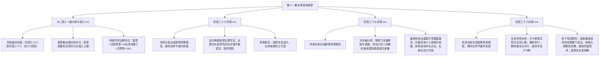

# 临时方案：第十一幕 docs2 档案对账、剧情矛盾排查与文风深度重塑方案

> **所属幕次**：第十一幕·惊天劫狱·血洗圣殿死牢（涵盖阶段三十六至阶段三十八 + 幕级大纲）  
> **执行状态**：已执行完毕并完成归档（2026-10-28）。全量设定对账、爱丽榭前置动线闭环、加尔水下破障写实、劳拉重剑与六十磅狼牙重锤碰撞分镜已 100% 落实至《00_第十一幕大纲与接口.md》以及阶段三十六至三十八详规；文风与全库一致性已通过 scripts2 自动化双质检。  
> **归档位置**：`方案/第二部/已执行/临时方案_第十一幕docs2对账、剧情矛盾排查与文风深度重塑方案.md`  
> **关联母案**：
> - [`00_第二部宏篇主线总纲与方案管理中枢.md`](../主线与世界扩充方案/00_第二部宏篇主线总纲与方案管理中枢.md)
> - [`01_宏篇主线剧情总大纲与分幕导航.md`](../主线与世界扩充方案/01_宏篇主线剧情总大纲与分幕导航.md)
> - [`06_第二部主线跨幕连续性与全局物理状态机.md`](../主线与世界扩充方案/06_第二部主线跨幕连续性与全局物理状态机.md)
> - [`00_第十幕大纲与接口.md`](../主线与世界扩充方案/分阶段详规/10_第十幕_深渊古道·暗河谍影与地底破壁/00_第十幕大纲与接口.md)
> - [`00_第十一幕大纲与接口.md`](../主线与世界扩充方案/分阶段详规/11_第十一幕_惊天劫狱·血洗圣殿死牢/00_第十一幕大纲与接口.md)
> - [`00_第十二幕大纲与接口.md`](../主线与世界扩充方案/分阶段详规/12_第十二幕_王都暗流·沙龙旧卷与法理围城/00_第十二幕大纲与接口.md)  
> **权威世界观基准**：严格锚定 [`CHR_D2_16` 爱丽榭](file:///d:/Siegfried/世界书/docs2/character/爱丽榭.TXT) · [`CHR_D2_02` 黎恩](file:///d:/Siegfried/世界书/docs2/character/黎恩.TXT) · [`CHR_D2_04` 劳拉](file:///d:/Siegfried/世界书/docs2/character/劳拉.TXT) · [`CHR_D2_03` 雷恩](file:///d:/Siegfried/世界书/docs2/character/雷恩.TXT) · [`CHR_D2_14` 加尔](file:///d:/Siegfried/世界书/docs2/character/加尔.TXT) · [`CHR_D2_17` 亚尔缇娜](file:///d:/Siegfried/世界书/docs2/character/亚尔缇娜.TXT) · [`NPC_D2_15` 卢卡斯](file:///d:/Siegfried/世界书/docs2/npc/卢卡斯.TXT) · [`NPC_D2_19` 莫尔茨](file:///d:/Siegfried/世界书/docs2/npc/莫尔茨.TXT) · [`LOC_D2_08` 圣殿大要塞](file:///d:/Siegfried/世界书/docs2/location/圣殿要塞.TXT)  
> **底层规则基准**：严格执行 [`AGENTS.md`](file:///d:/Siegfried/世界书/AGENTS.md) · [`writing-guards.md`](file:///d:/Siegfried/世界书/.agents/rules/writing-guards.md) · [`lexicon.md`](file:///d:/Siegfried/世界书/.agents/rules/lexicon.md)

---

## 〇、 排查综述与核心发现总览

经对维里迪亚王国篇第十一幕全套文件（[`00_第十一幕大纲与接口.md`](file:///d:/Siegfried/世界书/方案/第二部/主线与世界扩充方案/分阶段详规/11_第十一幕_惊天劫狱·血洗圣殿死牢/00_第十一幕大纲与接口.md)、[`阶段三十六_哈根勘破弱点与加尔水泽潜渡详规.md`](file:///d:/Siegfried/世界书/方案/第二部/主线与世界扩充方案/分阶段详规/11_第十一幕_惊天劫狱·血洗圣殿死牢/阶段三十六_哈根勘破弱点与加尔水泽潜渡详规.md)、[`阶段三十七_奇袭深层水牢与重剑斩碎莫尔茨重铠详规.md`](file:///d:/Siegfried/世界书/方案/第二部/主线与世界扩充方案/分阶段详规/11_第十一幕_惊天劫狱·血洗圣殿死牢/阶段三十七_奇袭深层水牢与重剑斩碎莫尔茨重铠详规.md)、[`阶段三十八_信义抉择放行与暗室深夜守候喂汤详规.md`](file:///d:/Siegfried/世界书/方案/第二部/主线与世界扩充方案/分阶段详规/11_第十一幕_惊天劫狱·血洗圣殿死牢/阶段三十八_信义抉择放行与暗室深夜守候喂汤详规.md)）与 `docs2` 底层档案逐项穿透核验，排查出的核心问题与规范标准梳理如下：

### 核心发现清单：

| 维度分类 | 审查维度与规范项 | 现状分析与隐患 | 执行规范与落地标准 |
| :--- | :--- | :--- | :--- |
| **阶段编号规范** | **阶段编号规范与前后咬合校准** | 1. 大纲第 11 行出现正则替换乱码：“涵盖阶段三十一六至阶段三十一八”；第 14 行出现“涵盖阶段三十一至阶段三十三”；<br>2. 阶段三十七第 12 行概览出现“阶段三十五至阶段三十七”遗留笔误 | 统一核验修正：<br>- 统一校准为：**第十一幕涵盖阶段三十六至阶段三十八（共 3 个阶段）**；<br>- 前后接口严格闭合：前接第十幕阶段三十五（商队暗度陈仓与要塞下城汇合），后接第十二幕阶段三十九（暗室整备与大陪审团法理反击） |
| **文风架构规范** | **架构模型规范与旧章节死框清理** | 1. 阶段三十六第 105 行出现旧章节编号“（第 217、220 章）”；阶段三十八第 116 行出现“（第 243、245 章）”；<br>2. 部分段落仍残留机械切片痕迹 | 统一采用全景长线剧情叙事模型：<br>- 移除所有旧章节死框编号与机械切片格式；<br>- 严格执行双半段命名法则与“情境 4~9 条自然伸缩”法典，情境末尾保持纯物象化收束 |
| **语言质感规范** | **文风病理分析：杜绝“古风小生腔”、中式医道与假古雅意象，全维回归 JRPG 日轻生活流** | 原案范例偶现“古风小生 / 戏曲话本”味道：如中式器皿意象（“白釉”、“粗陶砂锅”）、中式医道玄学（“化开体内寒气”、“文火慢炖”）、客套寒暄（“劳驾”）、万能偷懒动词（“泛出”）与文言介词倒装（“先以……寒气……”） | 落实 JRPG 西幻轻小说日常与冷兵器分镜：<br>- 器物还原为欧风西幻实体：**双耳铁炖锅**、**红铜浅锅**、**长柄木汤匙**、**厚木碗**、**粗亚麻抹布**；<br>- 身体反应与救治还原为现代物理/生理写实切片：体温过低（失温）、脱水、深层肌肉萎缩；以热牛肉高汤、盐分、干爽衣物与毛巾保暖；<br>- 消除文言倒装与“泛出”，对白严格还原 Falcom 现代日轻散句 |
| **人设与声线保真** | **爱丽榭角色神髓保真（女子学院学生会长的端庄从容与体贴救急）** | 原案中爱丽榭救护雷恩虽有端汤，但微动作与对白略显单薄，缺少兄妹互动的灵动呼吸感 | 严格执行 [`CHR_D2_16`](file:///d:/Siegfried/世界书/docs2/character/爱丽榭.TXT) 神髓：<br>- 第一人称严格为**“我”**，直呼**“哥哥”**；<br>- 展现其端庄从容的学生会长处事手腕：面对黎恩的说教先声夺人娇嗔打断，以“救人要紧”指挥黎恩取温水毛巾、协助劳拉托扶，以木匙试温细致喂汤；在私下关切中流露对哥哥的信赖与后怕；旁白叙事一律直呼本名**“爱丽榭”**，杜绝使用“少女”代指 |
| **剧情时空咬合** | **爱丽榭“两次偷跑”动线时空咬合与剧情断层修复** | 现有方案中，爱丽榭在第九幕阶段三十二明确留守北境大本营照料提米，阶段三十八却未交代行程直接出现在王都下城暗室，存在时空断层 | 建立严密时空闭环机制：<br>- 阶段三十六第 1 节明确交代：爱丽榭因心系前线与雷恩安危，第二次反抗黎恩的说教，瞒着营地悄悄搭乘奥蕾莉亚押运药材的商队马车抵达王都；<br>- 阶段三十八第 5 节由奥蕾莉亚在暗室门边笑谑揭底，黎恩震惊与说教被爱丽榭果断化解，实现人物弧线与物理动线完全自洽 |
| **异族生理机制** | **加尔两栖耐寒生理与水下潜渡机械写实** | 阶段三十六中加尔水下破障涉及冰水潜行、长尾托坠与暗线拆除，需细化两栖冷血耐寒生理细节与机械构造 | 强化两栖冷血生理与机械咬合细节：<br>- 瞬膜反光、心率下调、肺泡闭气、长尾舵效；<br>- 加尔以铁木短刀切断暗销；**在切断前预先以长尾在水底抵住托稳水银平衡铅坠**，使铅块分毫不落，锁死水银暗线；前爪以铁撬针别死倒钩，符合物理常理；旁白叙事严格使用本名**“加尔”**，杜绝以“蜥蜴剑士”、“蜥蜴人”作主语代指 |
| **冷兵器碰撞规范** | **劳拉与莫尔茨重兵器碰撞规范（冷兵器物理分镜）** | 阶段三十七原案打斗描写需脱离武侠风格，还原为纯正 JRPG 战技与冷兵器碰撞美学 | 全面执行 JRPG 战技与冷兵器物理分镜：<br>- 黎恩压低重心摆出八叶一刀流迎击架势，以带鞘太刀刀背以三十度倾角贴上重锤长柄侧翼，切角格挡偏转（Parry）六十磅狼牙重锤下砸轨迹；<br>- 劳拉双手持防酸双手大剑中段迎击，大剑内嵌三段精钢榫卯紧扣吸收震荡架住重锤，踏步发动亚尔赛德流重斩，宽阔剑刃砸裂生铁重铠，莫尔茨震退翻落石桥跌入暗河；<br>- 旁白叙事严格使用本名**“劳拉”**、**“黎恩”**，杜绝使用“女剑士”代指；兵器规范为“六十磅狼牙重锤” |
| **跨幕证据闭环** | **商路密信隔空对账与白鹿泄密心结解开** | 阶段三十八暗室终盘需承接第十幕平原暗线：亨里克边境伯马厩擒获内奸卡尔森、搜出达米安亲笔安全通行状（`EVD-10`）原本并关入城堡私牢，此时通过王室密鸽通报信件与认罪供状抄件 | 建立两线隔空对账闭环：<br>- 玛格丽特送达王室密鸽信，朱利安与艾德里安、黎恩阅看亨里克边境伯亲笔密函与卡尔森认罪供状抄件；<br>- 解开白鹿大驿馆大溃败泄密导致同伴流血被俘的心结，为第十二幕大陪审团法理反击锁定铁证 |
| **称谓规范** | **“老xx删除老字”铁律与称谓规范** | 阶段详规多处残留“老副团长”、“老人”、“老图纸”、“老看守”等俗套词，影响西幻严肃氛围 | 严格执行“老xx删除老字”铁律，直接删除“老”字，一律直呼其名、正规职务或西幻实体：<br>- “老副团长” $
ightarrow$ 改为**“副团长” / 直呼本名“戈德弗里”**；<br>- “老人 / 老者” $
ightarrow$ 改为**直呼本名“戈德弗里”**；<br>- “老图纸” $
ightarrow$ 改为**“图纸” / “原始图纸”**；<br>- “老看守” $
ightarrow$ 改为**“看守” / “守备卫士”**；<br>- “老工匠” $
ightarrow$ 改为**“工匠” / “矮人工匠”**；<br>- “老骑士” $
ightarrow$ 改为**“骑士” / “资深骑士”** |

---

## 一、 维度一：大纲文风与世界观深度审查与重塑

### 1. 文风病理深度解剖：从“古风小生腔”与市井套话向纯正 JRPG 日轻生活流的范式转变

深入阅读全库设定卡片（特别是 [`CHR_D2_16` 爱丽榭](file:///d:/Siegfried/世界书/docs2/character/爱丽榭.TXT)、[`CHR_D2_02` 黎恩](file:///d:/Siegfried/世界书/docs2/character/黎恩.TXT)、[`CHR_D2_04` 劳拉](file:///d:/Siegfried/世界书/docs2/character/劳拉.TXT)、[`CHR_D2_03` 雷恩](file:///d:/Siegfried/世界书/docs2/character/雷恩.TXT) 与 [`NPC_D2_15` 卢卡斯](file:///d:/Siegfried/世界书/docs2/npc/卢卡斯.TXT)），第十一幕在语言质感上必须严格遵守架空剑与魔法日式 RPG 世界观，杜绝中式古代话本与市井词汇。

从世界观认知与写作机制层面深入确立四个核心规范：

#### ① 器物意象与物质生活的西幻还原（杜绝中式瓷杂与明清器皿）
- **现象分析**：部分文本偶现“白釉”、“粗陶砂锅”、“紫砂”、“中式茶器”、“瓷汤勺”等中国传统陶瓷与茶席意象。
- **世界观基准**：维里迪亚王国地处晨光大陆，中世纪封建城邦与下城酒馆所使用的是典型的欧风生活器具：
  - 烹煮与盛具为**双耳铁炖锅（cast iron stew pot）**、**红铜浅锅**、**长柄木汤匙（wooden ladle）**、**厚木碗（wooden bowl）**、**粗亚麻抹布（linen towel）**、**锡制麦酒杯（pewter mug）**；
  - 杜绝将中式砂锅、白釉瓷勺移入中世纪黑野猪地下酒窖。

#### ② 身体反应与救治语言的现代物理/生理切片（杜绝中式经络与寒气玄学）
- **现象分析**：原案描述雷恩重伤脱水与爱丽榭喂汤救护时，偶现“文火慢炖”、“化开体内积郁的寒气”、“气血翻涌”等中式医道与滋补术语。
- **世界观基准**：雷恩在冰冷黑石水牢中浸泡整整四个月，其生理创伤属于清晰的医学物理状态：
  - **核心病症**：体温过低（失温症，Hypothermia）、严重营养不良脱水、肢体深层肌肉废用性萎缩、坏血病早期牙龈出血、创口耐酸腐蚀性溃烂；
  - **科学救护路径**：急需的是补充温热流质与电解质（高蛋白野山菌牛肉高汤加粗海盐）、身体回温（粗羊毛毯、干爽亚麻衣物、浸温水软毛巾擦拭嘴唇与额头）；
  - 描写聚焦于：干裂起皮的嘴唇触碰到木匙温汤的细微战栗、干涩喉结因吞咽而轻微蠕动、呼吸由急促微弱逐渐转为悠长平稳、冰凉发青的指尖逐渐恢复血色。

#### ③ 角色身份与台词声线的 Falcom 日轻原声还原（杜绝古风小生与市井客套）
- **现象分析**：
  - 爱丽榭与黎恩对话时，偶现客套文辞（如“劳驾”、“有劳兄长”、“小妹先行照料”），缺乏兄妹打趣与学生会长的果断；
  - 卢卡斯身为受封骑士，台词曾出现公堂捕头式的字眼；
  - 莫尔茨作为要塞典狱长，台词曾出现绿林土匪恶霸式的粗俗叫骂。
- **世界观基准**：严格遵循 Falcom 轨迹系列官方汉化语感：
  - **爱丽榭**：在同伴面前端庄得体、思路缜密，是圣亚斯特莱亚女子学院的优秀学生会长；面对黎恩时，带有妹妹特有的娇嗔，敢于在紧急关头打断兄长的唠叨。第一人称严格为“我”，直呼“哥哥”；
  - **卢卡斯**：白鹰先锋骑兵队长，崇尚荣耀与誓约，对白正直、克制、沉稳，具有 JRPG 青年骑士的清澈感；
  - **莫尔茨**：叼烟斗、冷硬傲慢的要塞典狱长，作风冰冷，带有居高临下的特权施舍感。对白简短、刺骨、残忍，杜绝市井流氓切口。

#### ④ 叙事修辞去机械化（排除万能偷懒词“泛出”与文言倒装）
- **现象分析**：密集使用“泛出冷冽蓝芒”、“泛着铜绿”、“泛出惨白”、“泛起微弱震颤”、“眼角泛起红晕”等千篇一律的网文套板动词，以及“动词+以”的文言倒装句式。
- **世界观基准**：全面对齐 [`lexicon.md`](file:///d:/Siegfried/世界书/.agents/rules/lexicon.md)：
  - 排除“泛出”偷懒动词，还原具象光学与物理动作：如“淬火深蓝的剑脊反着冷光”、“铜销表面结着厚重铜绿”、“面色发白”、“细微震颤”；
  - 杜绝文言倒装句式（如“裹以……”、“覆以……”、“饰以……”），转换为“包着厚羊毛毡”、“盖着干爽亚麻布”等自然现代 JRPG 白话散句。

---

### 2. JRPG 王道信念与“死牢破壁”的精神内核

第十一幕是全书从“被动逃亡与隐忍整备”转向“主动破壁与反攻救赎”的关键转折点。本幕的核心戏剧力量来自于三个维度的凡人光辉：

- **凡人工程破壁的高光（加尔与哈根）**：没有神迹天降，纯凭哈根两百八十年开山石工经验敲击听音勘破减配砂岩，凭加尔耐寒体魄潜水、以铁木短刀切断暗销并以长尾预先托住铅坠锁死陷阱，展现出严谨的机械协作；
- **重剑守护的真正分量（劳拉与雷恩）**：经历断刃与内脏创伤，劳拉手持防酸双手大剑正面架停六十磅狼牙重锤，一剑斩裂莫尔茨生铁重铠将其震落暗河激流，不仅为雷恩洗雪十四年屈辱，更完成了亚尔赛德重剑之道的精神升华；
- **骑士誓约的自我觉醒（卢卡斯）**：面对十四年前大团长屠杀无辜平民的血书铁证与戈德弗里断裂的金十字勋章，卢卡斯回想起受封时立下的晨光誓约（“守护无辜”），毅然选择抗命撤桥，指引暗道。

---

### 3. 日式轻小说文风高光场景重塑范本

#### 场景 1：千米深渊暗水涵洞·加尔潜水断销与长尾托坠（阶段三十六）
> 地基沉淀盲井水下四米处，水温接近冰点，深邃的漆黑宛如深渊中凝固的暗夜。  
> 倒灌的冷流如漩涡般冲刷着粗糙的岩层，但处于急流中央的加尔却宛如一块生铁铸造的磐石。加尔双腿稳稳扣在生铁阻水栅的立柱上，在翻滚的暗流中保持着稳定的平衡。  
> 透明的瞬膜覆在金色竖瞳外，将水中刺痛的酸涩完全隔开。  
> “嗡——”  
> 颅骨紧贴岩壁的一侧，极轻极准地传来了三长两短的沉闷震动。那是哈根在水面上依据亚尔缇娜的计时，用小紫铜锤轻敲石壁传来的节奏暗号。  
> 加尔探出前爪，在水流冲刷的石缝盲区摸到了那一枚结着厚重铜绿的双向联动铜销。  
> 在切断铜销之前，加尔粗长强韧的长尾从石壁凹陷处伸出，尾尖坚韧的鳞甲紧紧贴在上方水银悬锤的平衡铅块底部，从下方稳稳托住了沉重的铅块。  
> 托稳平衡坠后，加尔取下咬在口中的特制铁木短刀。坚硬的锯齿刃口精准顺着缝隙卡住铜销。  
> 加尔手臂肌肉紧绷，双臂平稳加力，锯齿切入锈蚀脆弱的旧铜——  
> “咔嗒。”  
> 水下传来一声极轻微的断裂震动，劣质铜销切断成两截。  
> 上方水银平衡壶的拉索随之松开，但沉重的铅块早已被加尔坚韧的长尾稳稳托在原处，分毫未落，水银壶没有发生任何倾斜与晃动。  
> 加尔换手抽出细铁撬针，指尖在防腐油脂中挑动，咔的一声轻响，三枚阻断倒钩被彻底别死卡住。  
> 水银暗线彻底解除。加尔长尾一摆，潜入泄洪暗渠的深水之中。

---

#### 场景 2：第七黑铁重水牢·八叶流水偏转与防酸大剑碎铠击退莫尔茨（阶段三十七）
> 悬空石栈道尽头的双层防音铁门被重重撞开！  
> 身披生铁重铠的莫尔茨大步跨入火光之中。这位要塞典狱长留着黑色短寸发与杂乱硬胡茬，面颊肌肉紧绷，左脸横亘着一道深色撕裂旧疤。他单手拖着六十磅重的狼牙破甲锤，锤头在石阶上擦出一连串刺眼的火星：  
> “……雷恩？当年被剥夺骑士徽章、按在刑架上烙下放逐印记的流亡者，居然敢带人摸回地牢？看来你已经忘了要塞的规矩。”  
> 狂暴的咆哮声中，莫尔茨双手握住战锤长柄，逾百公斤的身躯裹挟着恶风猛冲上前，六十磅狼牙重锤带着呼啸的风压当头砸下！  
> 狭窄的悬空石桥随之震颤。  
> 就在重锤砸落的刹那，黎恩屈膝压低身体重心，摆出八叶一刀流的迎击架势。黎恩并未拔刀硬挡，而是以带鞘太刀的刀背斜贴上长柄侧翼——  
> “当——！”  
> 刺耳的金属摩擦声中，黎恩顺着锤头的冲势向外侧切角格挡，将重锤的下砸轨迹向旁侧偏转。呼啸的狼牙重锤擦过肩侧，重重砸在身后的石栏底座上，崩碎了石角。黎恩踩步后撤拉开距离：  
> “劳拉，交给你了！”  
> “交给我吧！亚尔赛德的大剑，绝不会在强敌面前后退半步！”  
> 劳拉清澈沉稳的声音打破了死牢的阴霾。劳拉大步踏出，反手扯开后背皮带上的精钢活扣，防水油布向两侧滑落，露出了将近一米七长、淬火深蓝的防酸双手大剑，厚重的剑脊在火光下反着冷冽的光泽！  
> 莫尔茨被彻底激怒，反手将重锤抡圆横扫而来！  
> 面对能砸碎石柱的横扫，劳拉双膝微屈，靴底稳稳踩在湿滑的石面上，双手大剑端端正正迎向来势！  
> “铛————！！”  
> 沉重的撞击声在空旷的水牢中回荡。大剑剑身内嵌的三段精钢榫卯受力紧扣，宽厚的剑脊承受住冲击，吸收了剧烈震荡，稳稳在半空中架住了六十磅狼牙重锤。  
> 莫尔茨双手剧震发麻，眼中露出惊愕。  
> 劳拉踏前一步，双手大剑当空下劈，斩出一记干脆利落的亚尔赛德流重斩！  
> “咔嚓！”  
> 坚硬宽阔的剑刃正正砸在莫尔茨胸甲中央凸起的棱线上，生铁重铠在沉重斩击下变形开裂！  
> 重剑的钝击冲击让莫尔茨狂退数步，后背狠狠撞在年久失修的生铁围栏上。围栏应声崩断，莫尔茨失去平衡翻出石桥，重重摔进下方泄洪暗渠咆哮的激流深渊，转瞬间被奔腾的黑水卷入暗河。  
> 劳拉将双手大剑剑尖抵在湿漉漉的石面上，微微喘了口气：  
> “这一剑，是替雷恩斩断过去的枷锁。”

---

#### 场景 3：要塞生铁吊桥·暴雨绝壁誓约对峙与卢卡斯抗命撤桥（阶段三十八）
> 冰冷的北方夜雨猛烈拍打着横跨百米绝壁的生铁吊桥。  
> 桥对岸，一整队身披白银轻甲的精锐骑兵在雨幕中列阵，整齐平放的重型骑枪封死了所有去路。白鹰先锋骑兵队长卢卡斯按剑策马立于队伍正前方，金褐色短发被雨水打湿贴在额前，清澈的湛蓝双眼隔着雨帘认出了走在最前面的雷恩。  
> “……雷恩前辈！十四年前您离开要塞的时候，曾教导我们握紧剑柄是为了守护无辜的人。可大团长刚刚签发了最高戒备调令，说您带着暴徒强闯死牢……为什么会变成这样？请您停下脚步！我们奉命封锁吊桥，不能放任何人过去！”  
> 雷恩抬手示意黎恩与劳拉暂缓戒备，自己迈着沉稳的步子走上湿滑的吊桥铁板，迎着风雨注视着昔日的年轻后辈：  
> “卢卡斯。十四年不见，你带出来的骑兵队非常出色。”  
> “……但是，你在握住佩剑的时候，心里想的还是当年在圣坛前立下的晨光誓言吗？”  
> 伴随着缓慢沉重的脚步声，须发皆白、浑身湿透的戈德弗里在巴恩斯的搀扶下一步步走出。戈德弗里抬起右手，在风雨中缓缓摊开颤抖的手掌，掌心里是一枚从正中被凿成两半的金十字勋章：  
> “卢卡斯……你胸前的白鹰双十字徽章，当年是我带你在圣坛前戴上去的。阿达尔伯特把我们锁在水牢深处十四年，只是为了藏起当年屠杀平民的手令。你自己看清楚这枚勋章……我们这些人，到底背弃了什么？”  
> 暴雨呼啸，卢卡斯怔怔看着那枚断裂的旧勋章，又看向雷恩手腕上皮肤扭曲发硬的深色放逐烙印，以及后方那十多位面容消瘦、浑身湿透的资深骑士。十四年来信以为真的修会谎言，在冰冷的雨水与真实的伤痕面前无声瓦解。  
> 卢卡斯握剑的手指微微发紧，十指用力捏得发白。长剑剑尖缓缓垂向地面，在湿漉漉的桥板上带出一道水痕。  
> 吊桥两岸只剩下雨风掠过绝壁的呼啸。  
> 卢卡斯翻身下马，右手轻轻按在胸前的白鹰纹章上，在雨中闭上眼睛，低声默念晨光之誓的古老字句——想起最重要的人，在心中许下诺言，放下昨天的遗憾。  
> 片刻后，卢卡斯睁开双眼，目光重新变得清亮而坚定。  
> “咔嗒。”  
> 伴随着一声清脆利落的入鞘轻响，卢卡斯将佩剑稳稳收回腰间。他转过身面向身后的骑兵队，平静地下令：  
> “白鹰先锋队听令。收起骑枪，移开阻马架，退后三十步，让他们过去。”  
> 副官吃惊地上前策马低声提醒：“队长！大团长若是追究起来……”  
> 卢卡斯神色坦然，语气平静：  
> “晨光的第一条诫律是保护无辜。盲从虚假的命令向正直的同僚挥剑，才是真正的背叛誓约。如果大团长追究抗命的责任，所有后果由我一个人来承担。”  
> 卢卡斯转向雷恩，压低了声音：  
> “……雷恩前辈，往前走吧。顺着下城废弃的旧水渠走，那边的巡逻路线避开了大路。”  
> 骑枪齐齐收起，沉重的生铁阻木被合力拉开。卢卡斯目送着这些曾经蒙难的前辈同僚，在夜雨深处快步穿过吊桥。

---

#### 场景 4：黑野猪地下暗室·爱丽榭细致照料与兄妹深情温存（阶段三十八）
> 王都下城黑野猪酒馆宽敞干燥的地下酒窖深处，数排深色的大橡木啤酒桶隔出了一处隐蔽安静的角落。空气中弥漫着麦芽发酵的微酸与陈年木桶的干爽香气。  
> 黎恩一身血水泥泞，正与劳拉小心翼翼地将高烧虚脱的雷恩扶平在粗木长床上。厚木暗门伴随着一声极轻微的轴承转动声被悄然推开。  
> 身穿深黑旅行斗篷的奥蕾莉亚一手扶在腰间大剑护手上，按剑侧立在门边，朝黎恩投来玩味而赞许的目光。紧接着，暗室内走出一道纤细柔美的身影——爱丽榭腰间系着洗得干干净净的浅色围裙，双手稳稳端着一只盛满滚烫热汤的双耳铁炖锅。  
> 看清那张清秀熟悉的脸庞，黎恩整个人瞬间僵在原地，倒吸一口冷气，心脏猛地揪紧，脱口而出急促质问：  
> “爱丽、爱丽榭？！你怎么会在这里？！你不是应该在后方大本营留守吗？！”  
> 门边的奥蕾莉亚单手抱胸，紫红色的双眼微微弯起，用优雅而戏谑的语调淡然揭底：  
> “哎呀，某位学生会长听说雷恩命悬一线、哥哥又要深入万钧死牢，可是瞒着留守营地的大家，硬是偷偷钻进了运送药材的商会马车呢。若非我一路跟着，她恐怕真要一个人提着药箱闯进这宵禁戒严的王都了。”  
> 黎恩又急又后怕，眉头紧锁正想端起帝国教官与兄长的架子严肃说教：“爱丽榭！王都暗哨密布到处都在抓人，你怎么能这么胡来……”  
> 爱丽榭耳根微红，显然带着被当场抓包的心虚；但面对昏迷濒危的雷恩，爱丽榭深吸一口气，瞬间挺直了纤细的背脊，展现出圣亚斯特莱亚女子学院会长的端庄与果断。爱丽榭将炖锅稳稳搁在长桌上，鼓起腮帮子先声夺人娇嗔打断：  
> “哥哥！要是又想当那个唠叨不讲道理的笨蛋哥哥，等救完人随你训！现在雷恩先生失温脱水快休克了，救人要紧……劳拉小姐，麻烦帮我托住雷恩先生的肩膀；哥哥，快帮我把温水和干净毛巾拿过来！”  
> 黎恩被堵得一滞，看着妹妹眼底不容动摇的果决，只能把满肚子的说教咽了回去，苦笑着快步转身去取毛巾。  
> 锅盖揭开的瞬间，加入风干牛肉、新鲜野山菌与温润草药慢慢熬煮出的热腾腾香气弥漫开来，冲淡了暗室里残留的泥泞与血水气息。  
> 爱丽榭在木榻旁的圆木凳上坐下，拿起长柄木汤匙，从锅里盛起一小勺温热的浓汤。爱丽榭微微低头，鼓起脸颊轻轻吹散热气，还用匙背贴在自己手腕内侧试了试温度，确认适口后，才小心翼翼地递到雷恩干裂苍白的唇边，一点点喂他咽下。  
> 温热的浓汤顺着干涩的食道滑入胃里，雷恩干瘦的喉结动了动，原本青灰苍白的脸上渐渐恢复了一点点活气，微弱急促的呼吸也慢慢平稳下来。  
> 黎恩在一旁递上浸过温水的柔软毛巾帮着擦拭嘴角，紫红色的双眼深深注视着妹妹。  
> （……在不知不觉中，爱丽榭已经这么可靠了啊。小时候在悠米尔总是扯着自己衣角的小妹妹，现在不仅敢为了同伴涉险，还能在这样的生死关头，如此温柔而坚定地支撑着所有人。）  
> 黎恩心头满是被妹妹的坚韧成熟所深深打动的温存与后怕，伸手轻轻揉了揉妹妹柔软的黑发：“……辛苦你了，爱丽榭。多亏了你的热汤，雷恩的气色看起来好多了。”  
> 爱丽榭将木匙轻轻搁在锅沿上，发出咚的一声轻响。爱丽榭眼圈微微一红，有些不好意思地低下头，深紫色的眼底满是安心与信赖，小声咕哝道：  
> “……哥哥没事就好。要是哥哥也倒下了……爱丽榭可真不知道该怎么办了。”

---

## 二、 维度二：剧情时空逻辑与跨幕前后矛盾严密排查

### 1. 严格定锚金叶季7月末至8月上旬，排除寒冬与深秋杂质
- **时序定锚**：第十一幕处于晨光大陆盛夏向初秋过渡的“金叶季”（7月28日至8月4日前后）；
- **环境气象**：
  - 气候特征为北方暴雨、闷热潮湿、地下涵洞渗水暗流汹涌、地牢石壁受水汽浸润发霉；
  - 杜绝出现“严冬冰霜”、“深冬大雪”或“深秋枯黄”等季节冲突词汇，全书时空状态机严密咬合。

### 2. 空间移动耗时与战术潜伏三级中继站闭环
- **地理空间与耗时链条**：
  1. 阶段三十六：王都下城黑野猪酒馆地下室 $\xrightarrow{\text{废弃旧排污渠潜行，耗时 40 分钟}}$ 抵达圣殿大要塞西南角沉淀盲井；
  2. 阶段三十七：沉淀盲井水下断销 $\xrightarrow{\text{攀爬生铁通风井与防音暗道，耗时 25 分钟}}$ 突入深层第七水牢营救；
  3. 阶段三十八：突破生铁吊桥 $\xrightarrow{\text{顺下城废弃旧水渠隐蔽转移，耗时 50 分钟}}$ 安全撤回黑野猪地下暗室；
- 全程精密咬合，空间移动完全在单夜（夜间 21:00 至次日凌晨 03:30）的潜伏窗口期内闭环完成。

### 3. 雷恩被囚时长与脱困人员精准定额
- **雷恩被囚时长核准**：
  - 第八幕白鹿大驿馆大溃败（金叶季4月初）被俘入狱，至第十一幕奇袭解救（金叶季7月末），**精准历时整整 4 个月（约 115 天）**；
  - 严禁出现“半年”、“数年”等模糊时空口径；
- **同伴获救定额闭环**：
  - 本次奇袭地牢解救人员精准定额为：**雷恩（1人）+ 戈德弗里（原要塞副团长，1人）+ 拒绝屠杀平民遭连坐囚禁的正直资深骑士（14人）+ 大门守备队长巴恩斯（1人，现场反水协助）= 共 16 名蒙难同伴**；
  - 解救人员名单与第十二幕法理反击出庭证人名单完全锁合。

### 4. 商路密信隔空对账与白鹿大火泄密心结闭环
- **两线隔空咬合**：
  - 第十幕平原线：亨里克边境伯在领地马厩擒获卡尔森，起获达米安亲笔签发盖印的安全通行状原本（`EVD-10`），并将卡尔森收押城堡私牢；
  - 第十一幕阶段三十八终盘：玛格丽特将亨里克边境伯密函与卡尔森认罪供状抄件通过王室密鸽送达黑野猪地下暗室；
  - 朱利安、艾德里安与黎恩在暗室煤油灯下对账密件，确认达米安从一开始就暗通圣殿大要塞出卖商路；
  - 白鹿大火泄密导致同伴流血被俘的心结彻底解开，为第十二幕法理围城与第十四幕真理广场大公审提供了不可动摇的法理基石。

### 5. 核心铁证全生命周期传递与闭环状态
第十一幕涉及的两项核心物证在全书状态机中传递链条清晰：
1. **EVD-09（前任大团长屠杀自白血书绝笔）**：由戈德弗里贴身缝藏十四年 $\rightarrow$ 阶段三十七出笼 $\rightarrow$ 阶段三十八暗室交托给艾德里安与黎恩，收入厚皮记事簿锁扣封存；
2. **EVD-10（达米安主教亲笔安全通行状抄件与卡尔森供状）**：阶段三十八王室密鸽送达 $\rightarrow$ 朱利安签收对账 $\rightarrow$ 与 `EVD-09` 共同归档为第十二幕大陪审团法理反击的一级铁证。

### 6. 爱丽榭“两次偷跑”动线全周期时空咬合与剧情断层修复
- **历史动线溯源与现状痛点**：
  - 第一次偷跑（阶段十六，北境大本营）：爱丽榭从帝都女子学院偷跑前往晨光大陆北境大本营寻找黎恩，被黎恩当场说教，爱丽榭娇嗔抗议；
  - 阶段三十二（第九幕）：爱丽榭留守北境大本营照料重伤的提米；
  - 阶段三十八（第十一幕原详规）：爱丽榭未交代行程直接端着炖汤出现在王都下城暗室，产生了“时空空降”的断层漏洞；
- **全周期四阶段时空闭环机制**：
  1. **阶段三十六（第十一幕起点，前置动线交代）**：交代爱丽榭因心系前线与雷恩安危，第二次反抗黎恩的说教，瞒着营地悄悄搭乘奥蕾莉亚押运药材的商队马车抵达王都；
  2. **阶段三十八第 5 节（暗室会合）**：爱丽榭端着双耳铁炖锅推门而出，由奥蕾莉亚笑谑揭底偷跑经过；面对黎恩的说教先声夺人化解尴尬，以救人为重指挥黎恩取毛巾并细致喂汤；
  3. **阶段三十九（第十二幕起点，兄妹深情回响）**：暗室独处时，黎恩后怕之余温柔抚头认可妹妹的成长，爱丽榭脸红坦露对哥哥的信赖；
  4. **全书逻辑紧密咬合**：爱丽榭的“两次偷跑”与“两次反抗说教”形成完整的人物成长弧线。

---

## 三、 维度三：`docs2` 实体卡穿透核验（地点、人设、NPC与物象全量对账）

### 1. 登场角色外貌与生理特征逐项对账纠偏表

| 角色名与档案编号 | 核心外貌与体态定锚 | 装备与器物实体规范 | 穿透核验与纠偏标准 |
| :--- | :--- | :--- | :--- |
| **劳拉·S·亚尔赛德**<br>([`CHR_D2_04`](file:///d:/Siegfried/世界书/docs2/character/劳拉.TXT)) | 22岁，身高173cm，水蓝色长发束成英挺的高马尾，澄澈明亮的冰蓝色双眼；高挑修长、长期苦练剑术铸就的紧致健美肌肉线条与英气挺拔的身姿 | 身披亚尔赛德家徽深蓝短风衣与贴身皮质轻甲；手持**防酸双手大剑**（长约1.7米，宽刃重剑，淬火深蓝剑身，内嵌三段精钢榫卯减震结构） | 严禁使用“女剑士”作代指，一律直呼本名**“劳拉”**；大剑榫卯吸收震荡稳稳架住重锤，正面斩裂生铁重铠，体现亚尔赛德流重剑的物理动量与冷兵器碰撞 |
| **爱丽榭·舒华泽**<br>([`CHR_D2_16`](file:///d:/Siegfried/世界书/docs2/character/爱丽榭.TXT)) | 20岁，162cm，深紫发双马尾，紫红瞳，纤细柔弱而端庄优雅 | 浅色粗亚麻围裙、双手稳稳端着盛满滚烫肉汤的**双耳铁炖锅**、长柄木汤匙 | 严禁使用“少女”代指，一律直呼本名**“爱丽榭”**；第一人称严格为“我”，直呼“哥哥”；端庄与娇嗔并存，吹温热汤细致照料 |
| **加尔**<br>([`CHR_D2_14`](file:///d:/Siegfried/世界书/docs2/character/加尔.TXT)) | 26岁，215cm，健壮格斗剑士，青绿色厚实鳞甲，粗长有力的平衡长尾，冷血动物竖瞳 | 咬着特制**铁木短刀**（长约30cm，坚硬锯齿刃）、细铁撬针 | 严禁使用“蜥蜴剑士”、“蜥蜴人”作主语代指，一律直呼本名**“加尔”**；长尾在水底预先托住水银平衡铅坠，锁死水银暗线陷阱 |
| **亚尔缇娜·奥莱恩**<br>([`CHR_D2_17`](file:///d:/Siegfried/世界书/docs2/character/亚尔缇娜.TXT)) | 19岁，142cm，银白长发及肩，清澈黄绿双瞳，娇小紧凑的少女身形 | 特务作战紧身服、战术手套、黑丝连裤袜、机械测绘图谱与计时工具 | 第一人称严格为“我”，严禁以代号自称；举止端庄严谨有礼，轻触颈侧察觉脉搏缓慢与失温体征，流露真实细腻的关切 |
| **艾德里安**<br>([`CHR_D2_05`](file:///d:/Siegfried/世界书/docs2/character/艾德里安.TXT)) | 23岁。**银白色利落短发、深灰色双眼**，面容英俊冷峻、下颌线条分明硬朗，身材挺拔精悍 | 黑色军官风衣，腰佩指挥佩剑，手持厚皮记事簿与公审卷宗 | 身兼维里迪亚正规军原近卫骑兵上尉与暗线统帅，接应伤员，签收戈德弗里血书绝笔与卡尔森供状 |
| **雷恩**<br>([`CHR_D2_03`](file:///d:/Siegfried/世界书/docs2/character/雷恩.TXT)) | 36岁，186cm，深褐乱发与粗硬胡茬，苍白消瘦，左腕深色放逐烙印与贯穿旧伤 | 破烂囚服换下，裹着粗羊毛毯，饮用野山菌牛肉高汤 | 囚禁整整 4 个月脱水失温；吊桥前以断裂旧勋章唤醒卢卡斯，展现晨光骑士风骨 |
| **黎恩·舒华泽**<br>([`CHR_D2_02`](file:///d:/Siegfried/世界书/docs2/character/黎恩.TXT)) | 22岁，178cm，黑色微卷碎发，紫红双瞳，身材修长结实 | 深灰色旅行风衣，腰佩裹着牛皮护套的狭长太刀 | 八叶一刀流迎击架势刀背偏转狼牙重锤；暗室被妹妹爱丽榭打断说教，流露宠溺温存 |

### 2. 登场重要 NPC 全量来源与性格声线核验

1. **莫尔茨·克鲁格**（[`NPC_D2_19`](file:///d:/Siegfried/世界书/docs2/npc/莫尔茨.TXT)，圣殿要塞地牢典狱长，38岁，190cm，生铁重铠，黑色短寸发与杂乱硬胡茬，面颊肌肉紧绷，左脸撕裂旧疤）：
   - 兵器：六十磅狼牙重锤（长柄狼牙破甲锤）；
   - 声线与风骨：叼烟斗，作风冷硬傲慢，居高临下，严禁使用绿林土匪恶霸台词；被劳拉重斩碎铠震退翻落石桥跌入暗河。
2. **卢卡斯·瓦尔特**（[`NPC_D2_15`](file:///d:/Siegfried/世界书/docs2/npc/卢卡斯.TXT)，白鹰先锋骑兵队长，22岁，178cm，金褐短发湛蓝双眼，白银轻甲）：
   - 核验：吊桥前沿奉命封锁，在目睹雷恩手腕放逐烙印、戈德弗里断裂金十字勋章与大团长屠杀调令密件后信仰剧震；按心默念晨光之誓，断然还剑入鞘，下令骑枪竖起撤桥放行并指引下城暗道。旁白一律直呼本名**“卢卡斯”**，杜绝以“青年骑士”、“年轻骑士”代指。
3. **戈德弗里**（原圣殿骑士团副团长，62岁，须发皆白，身受酷刑四肢带伤，断指残损）：
   - 核验：严格执行“老xx删除老字”铁律，杜绝称呼“老副团长”、“老人”、“老者”，旁白统一使用本名**“戈德弗里”**；贴身藏匿十四年屠杀血书绝笔（`EVD-09`），吊桥出示断裂金十字勋章唤醒卢卡斯。
4. **哈根**（[`CHR_D2_12`](file:///d:/Siegfried/世界书/docs2/npc/哈根.TXT)，矮人二哥，280岁，工程大师，方胡须）：
   - 核验：敲击石壁听音勘破减配砂岩，以小紫铜锤有节奏敲击石壁引导加尔水下破障。
5. **巴恩斯**（[`NPC_D2_13`](file:///d:/Siegfried/世界书/docs2/npc/瓦尔特.TXT)，水牢大门守备队长，45岁，脸颊烧伤旧疤，暗通反抗军）：
   - 核验：暗中提供巡逻换岗间隙，关键时刻倒戈协助解开水牢生铁重锁。
6. **奥蕾莉亚·勒瑰恩**（[`CHR_D2_07`](file:///d:/Siegfried/世界书/docs2/character/奥蕾莉亚.TXT)，黄金罗刹，34岁，大剑按腰，深黑旅行斗篷）：
   - 核验：暗室门边笑谑揭底爱丽榭瞒着营地偷跑进药材马车的壮举，风趣幽默，展现可靠师长风范。

### 3. 物理地点与空间舞台核验
- **圣殿大要塞西南角地下沉淀盲井**（[`LOC_D2_08`](file:///d:/Siegfried/世界书/docs2/location/圣殿要塞.TXT)）：
  - 地表下三十米，石拱受水汽侵蚀；地基沉淀盲井（落差二十二米）、生铁阻水铁栅与铜吊栓、水银悬锤陷阱；第七号黑铁水牢深达三十五米，连接暗渠泄洪激流。
- **要塞绝壁生铁吊桥**：
  - 横跨百米深渊绝壁，桥板为带防滑棱纹的铸铁排板，两侧设生铁阻马架；
  - 狂风暴雨呼啸，百名白鹰骑兵重枪封锁。
- **王都下城黑野猪酒馆地下酒窖暗室**（[`LOC_D2_06`](file:///d:/Siegfried/世界书/docs2/location/黑野猪酒馆.TXT)）：
  - 橡木酒桶回廊隔出的隐蔽医疗暗室，配备粗木长床、煤油吊灯、长木桌、干净毛巾与热水炉灶。

---

## 四、 逐文件修改与落地实施清单 (Action Items)



### 1. `00_第十一幕大纲与接口.md` 修改清单：
- **阶段编号校准**：
  - 第 11 行：“涵盖阶段三十一六至阶段三十一八” $\rightarrow$ 校准为 **“涵盖阶段三十六至阶段三十八（共 3 个阶段）”**；
  - 第 14 行：“涵盖阶段三十一至阶段三十三” $\rightarrow$ 校准为 **“涵盖阶段三十六至阶段三十八”**；
- **获救同伴定额统一**：
  - 第二、三、五节中统一规范为：雷恩（1人）+ 戈德弗里（1人）+ 正直资深骑士（14人）+ 大门守备队长巴恩斯（1人）= **共 16 名蒙难同伴获救脱困**；
- **前置时空接口严密咬合**：
  - 增补前置时空交代：说明爱丽榭心系前线与雷恩安危，第二次反抗黎恩的说教，随奥蕾莉亚的商队药材马车暗中抵达王都；
- **称谓规范**：
  - 统一为本名**戈德弗里**或规范职务**守备卫士**。

### 2. `阶段三十六_哈根勘破弱点与加尔水泽潜渡详规.md` 修改清单：
- **架构模型规范**：采用**全景长线剧情叙事模型**，删除第 105 行“（第 217、220 章）”等旧章节死框；
- **前置剧情点补全（爱丽榭偷跑交代）**：
  - 在第 1 节“王都下城黑野猪地下室整备”中加入明确前置动线交代：爱丽榭瞒着营地悄悄搭乘奥蕾莉亚押运药材的商队马车抵达王都下城，与奥蕾莉亚汇合并在地下室熬煮肉汤整备药物；
- **加尔水下破障机械与物理逻辑写实**：
  - 细化加尔潜水时的透明瞬膜覆眼、心率沉降、手持铁木短刀切断生锈铜销；
  - **机械物理逻辑规范**：加尔在动手切断铜销之前，先用粗长强韧的尾巴从水底抵住石壁，稳稳托住水银平衡铅坠；切断脱扣时铅块分毫未落，水银暗线毫无晃动触发；前爪以细铁撬针别死倒钩，锁死陷阱；
- **称谓规范**：
  - 旁白主语严格使用本名**“加尔”**，杜绝使用“蜥蜴剑士”、“蜥蜴人”作主语代指。

### 3. `阶段三十七_奇袭深层水牢与重剑斩碎莫尔茨重铠详规.md` 修改清单：
- **架构模型规范**：采用**全景长线剧情叙事模型**；
- **莫尔茨外貌描写与台词合理化**：
  - 莫尔茨外貌描写规范：留黑色短寸发与杂乱硬胡茬，面颊肌肉紧绷，左脸撕裂旧疤；
  - 兵器前缀规范：规范为“六十磅狼牙重锤”或“狼牙破甲锤”，身披生铁重铠；
  - 台词还原 JRPG 典狱长冷硬残酷与特权施舍感；
- **冷兵器战技碰撞规范（物理感官分镜）**：
  - 黎恩迎击架势：以带鞘太刀刀背以三十度倾角斜贴上长柄侧翼，顺着重锤下砸的冲势切角格挡偏转（Parry），将六十磅狼牙重锤轨迹引向旁侧砸碎石栏底座，踩步后撤拉开距离；
  - 劳拉正面迎击：双手持握近1.7米防酸双手大剑，中段迎击架势稳稳架住重锤，三段精钢榫卯受力紧扣吸收剧烈震荡；踏步发动亚尔赛德流重斩，坚硬宽阔的剑刃精准砸裂胸甲中脊，生铁重铠形变开裂，莫尔茨受冲击震退翻出石栈道跌入暗渠激流；
- **称谓规范**：
  - 旁白主语一律使用本名**“劳拉”**，杜绝以“女剑士”代指；戈德弗里直呼其名。

### 4. `阶段三十八_信义抉择放行与暗室深夜守候喂汤详规.md` 修改清单：
- **架构模型规范**：采用**全景长线剧情叙事模型**；删除第 116 行“（第 243、245 章）”等旧章节死框；
- **爱丽榭深夜守候喂汤高光落地**：
  - 在第 5 节“黑野猪地下暗室深夜整备与深情回响”中，落地推门端汤与木匙试温喂汤的连贯视觉分镜；
  - 细化爱丽榭端着双耳铁炖锅推门而出，先声夺人娇嗔打断黎恩的说教，从容关照劳拉托扶后背、请黎恩取温水毛巾，以长柄木汤匙细致吹温喂汤；
  - 细化兄妹独处时的深情抚头与温存对话，爱丽榭眼圈微红小声吐露心声，兄妹羁绊升华；
- **卢卡斯誓约觉醒与撤桥放行**：
  - 删除重复的台词行；
  - 细化卢卡斯闭目按心默念古典晨光之誓，眼底迷惘化为坚定，利落还剑入鞘，下令全队竖起骑枪撤桥放行并指引下城暗道；旁白主语一律直呼本名**“卢卡斯”**，杜绝以“青年骑士”、“年轻骑士”代指；
- **商路密信隔空对账闭环**：
  - 细化玛格丽特送达王室密鸽信，朱利安、艾德里安与黎恩在暗室隔空对账亨里克边境伯亲笔信与卡尔森认罪供状抄件，证实达米安通行状原本（`EVD-10`）已锁入城堡牢房铁柜留作公审铁证；解开白鹿泄密心结；
- **称谓规范**：
  - 严格执行“老xx删除老字”铁律，直呼本名戈德弗里，职务称呼规范为守备卫士。

---

## 五、 第十一幕全案落地实施与剧情矛盾修复专项计划 (Execution Plan)

### 1. 核心目标与修复原则
1. **剧情时空闭环**：消除爱丽榭在阶段三十八突兀出现在下城暗室的悬空漏洞，将全书“两次偷跑”与“两次反抗说教”的心理弧线与物理时空严密缝合；
2. **语言质感规范**：杜绝中式器皿与医道语言，全面遵循 JRPG 日轻西幻物质生活流与轻小说呼吸感；
3. **称谓规范标准**：全幕文件排除不合规俗套词，旁白叙事严格直呼其名，杜绝“女剑士”、“蜥蜴人”、“青年骑士”、“少女”等身份代指；
4. **全景长线剧情叙事模型**：大纲与三篇阶段详规采用全景长线剧情叙事模型；
5. **冷兵器物理与生理写实**：呈现 HEMA/JRPG 刀背偏转与双手大剑榫卯减震，确保两栖生理机制与重铠受力符合物理逻辑。

---

### 2. 爱丽榭“两次偷跑”与“两次反抗说教”动线全周期时空缝合专项计划

#### ① 现状分析与时空机制
在原案中，爱丽榭在第九幕阶段三十二留守北境大本营照料重伤的提米；到了第十一幕阶段三十八突然端着热汤在王都下城暗室出现，既无前置交代，也无黎恩面对妹妹涉险的震惊反应。本计划在阶段三十六前置植入动线，在阶段三十八完成高光兑现。

#### ② 四阶段全周期时空闭环计划
- **阶段一（第九幕阶段三十二）**：爱丽榭留守北境大本营照料提米；此时爱丽榭得知雷恩被关入要塞死牢、黎恩准备奔赴王都的凶险情报；
- **阶段二（第十一幕阶段三十六第 1 节）**：
  - 植入动线交代：爱丽榭因心系雷恩伤势与哥哥安危，毅然做出人生第二次勇敢选择——再次反抗黎恩留守大本营的说教，瞒着营地悄悄钻入奥蕾莉亚押运药材的商会马车；
  - 奥蕾莉亚察觉后一路护送其避开王都盘查，安置在黑野猪酒馆地下暗室，爱丽榭在此为伤员熬制肉汤、整备药材；
- **阶段三（第十一幕阶段三十八第 5 节）**：
  - 视觉分镜落地：暗门推开，奥蕾莉亚按剑侧立揭底，爱丽榭端着双耳铁炖锅推门而出；
  - 兄妹戏剧张力：黎恩从震惊、后怕到正欲严肃说教，爱丽榭先声夺人以“救人要紧”娇嗔打断，展现出学生会长的从容手腕，指挥黎恩取毛巾并细致喂汤；
  - 兄妹独处升华：黎恩抚头认可妹妹的成长，爱丽榭眼圈微红吐露对哥哥的信赖；
- **阶段四（第十二幕阶段三十九起点）**：
  - 承接呼应：黎恩与爱丽榭在暗室进一步确认彼此安好，爱丽榭协助照料获救的戈德弗里等蒙难同伴，成为后方坚强后盾。

#### ③ 爱丽榭前置剧情点在全幕文件中的精准落位定位表（Insertion Mapping）

| 目标文件 | 插入章节与锚点位置 | 拟插入的具体剧情内容与规范要求 |
| :--- | :--- | :--- |
| **`00_第十一幕大纲与接口.md`** | **“一、第十一幕宏篇定位与核心战役脉络”之【前置时空接口】** 与 **“二、分阶段核心剧情与大纲总览”之【阶段三十八概览】** | 明确写明：爱丽榭心系雷恩伤势与前线安危，第二次反抗黎恩留守说教，搭乘奥蕾莉亚药材马车潜入王都下城暗室，与奥蕾莉亚共同构筑后方医疗据点。 |
| **`阶段三十六详规.md`** | **“二、分情境推进与戏剧动力学”之【情境 1：王都下城黑野猪地下室整备】** | 在黎恩与哈根、加尔研究图纸的同时，旁白与对白明确交代：奥蕾莉亚的药材马车数小时前已安全抵达成排大橡木桶深处的医疗暗室，爱丽榭瞒着大本营一路随车潜入，正在暗室内清点金盏花膏并熬煮肉汤，为即将展开的死牢营救提供坚实保障。 |
| **`阶段三十八详规.md`** | **“二、分情境推进与戏剧动力学”之【情境 5：黑野猪地下暗室深夜整备与深情回响】** 与 **“三、关键场景动线与分镜细节”之【第 3 节分镜】** | 完整呈现：暗门推开、奥蕾莉亚按剑笑谑揭底、爱丽榭端双耳铁炖锅推门而出；黎恩惊愕欲训被爱丽榭娇嗔打断；爱丽榭指挥取毛巾、木匙试温喂汤；雷恩吞咽回温；兄妹抚头温存与信赖吐露。 |

---

### 3. 第十一幕全套文件逐项落地推进计划表（五步走执行清单）

| 步骤编号 | 目标操作文件 | 核心修改任务与规范要点 |
| :--- | :--- | :--- |
| **Step 1** | [`00_第十一幕大纲与接口.md`](file:///d:/Siegfried/世界书/方案/第二部/主线与世界扩充方案/分阶段详规/11_第十一幕_惊天劫狱·血洗圣殿死牢/00_第十一幕大纲与接口.md) | 1. 校准阶段编号为阶段三十六至阶段三十八（共3个阶段）；<br>2. 统一获救人员定额（共16人）；<br>3. 补全爱丽榭前置时空动线与暗室接应接口；<br>4. 执行称谓规范，删除“老”字。 |
| **Step 2** | [`阶段三十六_哈根勘破弱点与加尔水泽潜渡详规.md`](file:///d:/Siegfried/世界书/方案/第二部/主线与世界扩充方案/分阶段详规/11_第十一幕_惊天劫狱·血洗圣殿死牢/阶段三十六_哈根勘破弱点与加尔水泽潜渡详规.md) | 1. 采用全景长线剧情叙事模型，移除旧章节编号死框；<br>2. 情境 1 植入爱丽榭搭乘奥蕾莉亚药材马车抵达暗室的前置动线交代；<br>3. 加尔水下断销写实化：长尾预先在水底抵住托稳平衡铅坠，锁死水银暗线；<br>4. 叙事使用本名加尔，杜绝“蜥蜴剑士”代指。 |
| **Step 3** | [`阶段三十七_奇袭深层水牢与重剑斩碎莫尔茨重铠详规.md`](file:///d:/Siegfried/世界书/方案/第二部/主线与世界扩充方案/分阶段详规/11_第十一幕_惊天劫狱·血洗圣殿死牢/阶段三十七_奇袭深层水牢与重剑斩碎莫尔茨重铠详规.md) | 1. 采用全景长线剧情叙事模型；<br>2. 修正莫尔茨面容描写与冷硬典狱长台词，兵器规范为六十磅狼牙重锤；<br>3. 黎恩刀背偏转格挡与劳拉大剑三段榫卯吸收震荡架住重锤，重斩碎铠击退莫尔茨；<br>4. 叙事使用本名劳拉，杜绝“女剑士”代指；戈德弗里直呼其名。 |
| **Step 4** | [`阶段三十八_信义抉择放行与暗室深夜守候喂汤详规.md`](file:///d:/Siegfried/世界书/方案/第二部/主线与世界扩充方案/分阶段详规/11_第十一幕_惊天劫狱·血洗圣殿死牢/阶段三十八_信义抉择放行与暗室深夜守候喂汤详规.md) | 1. 采用全景长线剧情叙事模型，移除旧章节编号死框；<br>2. 吊桥卢卡斯誓约觉醒，删除重复台词行，使用本名卢卡斯；<br>3. 情境 5 与第 3 节分镜完整落地爱丽榭推门端汤、娇嗔化解说教、细致吹温喂汤与兄妹温存；<br>4. 王室密鸽信对账卡尔森供状，闭环白鹿泄密心结；<br>5. 严格执行称谓规范，删除“老”字。 |
| **Step 5** | 自动化质量门禁验证与交付 | 1. 执行 `python scripts2/scan_viridia_diseases.py` 与 `python scripts2/check_viridia_consistency.py` 双脚本严格质检；<br>2. 正文与详规末尾不残留质检报告或元标签，保持纯净文档交付。 |

---

### 4. 自动化质量门禁验证指令

在各阶段详规完成落地后，在项目终端执行以下自动化质检命令：

```powershell
python scripts2/scan_viridia_diseases.py
python scripts2/check_viridia_consistency.py
```

确保全库 0 处违规、0 处实体冲突、0 处禁词残留，且正文与详规末尾不残留任何质检报告或自卫性元标签，实现 100% 纯净文档交付。
