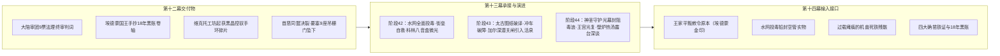

# 临时方案：第十三幕 docs2 档案对账、剧情矛盾排查与文风深度重塑方案

> **所属幕次**：第十三幕·王都异化·双城合围决战（涵盖阶段四十二至阶段四十四 + 幕级大纲）  
> **执行状态**：已执行完毕并完成归档（2026-10-29）  
> **方案路径**：`方案/第二部/已执行/临时方案_第十三幕docs2对账、剧情矛盾排查与文风深度重塑方案.md`  
> **关联母案**：
> - [`00_第二部宏篇主线总纲与方案管理中枢.md`](00_第二部宏篇主线总纲与方案管理中枢.md)
> - [`01_宏篇主线剧情总大纲与分幕导航.md`](01_宏篇主线剧情总大纲与分幕导航.md)
> - [`06_第二部主线跨幕连续性与全局物理状态机.md`](06_第二部主线跨幕连续性与全局物理状态机.md)
> - [`00_第十二幕大纲与接口.md`](分阶段详规/12_第十二幕_王都暗流·沙龙旧卷与法理围城/00_第十二幕大纲与接口.md)
> - [`00_第十三幕大纲与接口.md`](分阶段详规/13_第十三幕_王都异化·双城合围决战/00_第十三幕大纲与接口.md)
> - [`00_第十四幕大纲与接口.md`](分阶段详规/14_第十四幕_破晓大审判与黎明宪章/00_第十四幕大纲与接口.md)  
> **权威世界观基准**：严格锚定 [`CHR_D2_02` 黎恩](file:///d:/Siegfried/世界书/docs2/character/黎恩.TXT) · [`CHR_D2_01` 菲娜](file:///d:/Siegfried/世界书/docs2/character/Seraphina.TXT) · [`CHR_D2_18` 朱利安](file:///d:/Siegfried/世界书/docs2/character/朱利安.TXT) · [`CHR_D2_03` 雷恩](file:///d:/Siegfried/世界书/docs2/character/雷恩.TXT) · [`CHR_D2_04` 劳拉](file:///d:/Siegfried/世界书/docs2/character/劳拉.TXT) · [`CHR_D2_05` 艾德里安](file:///d:/Siegfried/世界书/docs2/character/艾德里安.TXT) · [`CHR_D2_08` 菲](file:///d:/Siegfried/世界书/docs2/character/菲.TXT) · [`CHR_D2_09` 亚莉莎](file:///d:/Siegfried/世界书/docs2/character/亚莉莎.TXT) · [`CHR_D2_07` 凯尔](file:///d:/Siegfried/世界书/docs2/character/凯尔.TXT) · [`CHR_D2_14` 加尔](file:///d:/Siegfried/世界书/docs2/character/加尔.TXT) · [`CHR_D2_10` 罗恩](file:///d:/Siegfried/世界书/docs2/character/罗恩.TXT) · [`CHR_D2_17` 亚尔缇娜](file:///d:/Siegfried/世界书/docs2/character/亚尔缇娜.TXT) · [`CHR_D2_15` 玲](file:///d:/Siegfried/世界书/docs2/character/玲.TXT) · [`CHR_D2_16` 爱丽榭](file:///d:/Siegfried/世界书/docs2/character/爱丽榭.TXT)（大本营留守与心念牵挂） · [`NPC_D2_25` 科林](file:///d:/Siegfried/世界书/docs2/npc/科林.TXT) · [`NPC_D2_01` 阿达尔伯特](file:///d:/Siegfried/世界书/docs2/npc/阿达尔伯特.TXT) · [`NPC_D2_02` 克莱门特三世](file:///d:/Siegfried/世界书/docs2/npc/克莱门特三世.TXT) · [`NPC_D2_03` 埃德蒙国王](file:///d:/Siegfried/世界书/docs2/npc/埃德蒙.TXT) · [`NPC_D2_15` 卢卡斯](file:///d:/Siegfried/世界书/docs2/npc/卢卡斯.TXT) · [`NPC_D2_16` 达米安](file:///d:/Siegfried/世界书/docs2/npc/达米安.TXT) · [`NPC_D2_20` 瓦卢瓦伯爵](file:///d:/Siegfried/世界书/docs2/npc/瓦卢瓦伯爵.TXT) · [`NPC_D2_21` 亨里克边境伯](file:///d:/Siegfried/世界书/docs2/npc/亨里克边境伯.TXT) · [`NPC_D2_12` 玛格丽特夫人](file:///d:/Siegfried/世界书/docs2/npc/玛格丽特.TXT) · [`LOC_D2_19` 晨光大教堂](file:///d:/Siegfried/世界书/docs2/location/晨光大教堂.TXT) · [`LOC_D2_32` 王都下水道](file:///d:/Siegfried/世界书/docs2/location/王都下水道.TXT) · [`LOC_D2_44` 心木商行](file:///d:/Siegfried/世界书/docs2/location/心木商行.TXT) · [`LOC_D2_30` 黑野猪酒馆](file:///d:/Siegfried/世界书/docs2/location/黑野猪酒馆.TXT) · [`LOC_D2_16` 真理广场](file:///d:/Siegfried/世界书/docs2/location/真理广场.TXT) · [`LOC_D2_17` 白金王宫](file:///d:/Siegfried/世界书/docs2/location/白金王宫.TXT) · [`LOC_D2_21` 圣殿大要塞](file:///d:/Siegfried/世界书/docs2/location/圣殿大要塞.TXT)  
> **底层规则基准**：严格执行 [`AGENTS.md`](file:///d:/Siegfried/世界书/AGENTS.md) · [`writing-guards.md`](file:///d:/Siegfried/世界书/.agents/rules/writing-guards.md) · [`lexicon.md`](file:///d:/Siegfried/世界书/.agents/rules/lexicon.md)

---

## 〇、 排查综述与核心发现总览

经对维里迪亚王国篇第十三幕全套文件（[`00_第十三幕大纲与接口.md`](分阶段详规/13_第十三幕_王都异化·双城合围决战/00_第十三幕大纲与接口.md)、[`阶段四十二_教会投毒水网与炼狱王都详规.md`](分阶段详规/13_第十三幕_王都异化·双城合围决战/阶段四十二_教会投毒水网与炼狱王都详规.md)、[`阶段四十三_太古水网主闸破译与冲车破障详规.md`](分阶段详规/13_第十三幕_王都异化·双城合围决战/阶段四十三_太古水网主闸破译与冲车破障详规.md)、现存 [`阶段四十四_黎恩菲娜超自然防火墙与黑野猪长夜谈详规.md`](分阶段详规/13_第十三幕_王都异化·双城合围决战/阶段四十四_黎恩菲娜超自然防火墙与黑野猪长夜谈详规.md) —— 本次将重塑为《阶段四十四_黎恩菲娜神圣守护光幕与黑野猪酒馆长夜详规》）并逐张对照 docs2 底层设定卡片严格复核，排查出的核心问题与具体规范整理如下：

### 核心发现清单：

| 维度分类 | 审查维度与规范项 | 现状分析与隐患 | 执行规范与落地标准 |
| :--- | :--- | :--- | :--- |
| **叙事架构规范** | **详规格式违规：提纲切片骨架残留** | 阶段四十二、四十三、四十四正文仍保留早期大纲切片符号：`* **剧情路线**`、`* **主要人物**`、`* **核心意图**`、`* **时序情境推进**` 以及 `- 1. **...**` 列表条目，导致编译级门禁 `scan_viridia_diseases.py` 报错拦截 | **100% 展开为小说级连续全景长叙述散文**：<br>- 彻底消除全部提纲切片与列表条目；<br>- 每一个 `### X. 物象——关键行动` 展开为由完整大段落构成的小说级散文，直接嵌入现场对白、日轻神态、内心独白与物理受力分镜；<br>- 严格执行双半段命名与情境 4~9 条自然伸缩，末尾纯物象化余韵收束 |
| **语域学术病排查** | **肃清现代工业冶金与学术教材伪写实（JRPG 奇幻工匠与轻小说感官化）** | 方案草案中曾出现现代工科教材生硬词汇与化学指标，脱离 JRPG 剑与魔法西幻轻小说语域与读者代入感 | **全面置换为 JRPG 西幻工匠与感官写实语言**：<br>- 冶金与材料：置换为**“矮人精钢 / 百炼硬钢 / 重淬精铁 / 厚铸青铜 / 古代青铜 / 沉重生铁 / 加厚耐酸铅皮”**；<br>- 机械机巧：置换为**“齿牙规制 / 齿牙尺寸 / 齿轮咬合比例 / 排气回转阀 / 铜管泄压阀”**；<br>- 理化与灾厄：置换为**“生石灰遇水剧烈沸腾翻滚腾起大片滚烫白沫与热汽”、“暗影吸聚涡流 / 狂暴黑风暴 / 能量失控漩涡”**；<br>- 规则防线已同步注入工作流 SOP、`writing-guards.md`、`lexicon.md` 与自动化扫描门禁 |
| **时空剧情闭环** | **终极机兽自爆与神圣守护光幕的时空定锚** | 原案草案中，第十三幕阶段四十四与第十四幕阶段四十五均出现了“广场终极机兽过载与神圣光幕隔离”，产生跨幕剧情倒挂与重复嫌疑 | **明确两幕分工与时空因果链条**：<br>- **第十三幕阶段四十四（决战前夜·灾难绝境阻断）**：水网净化后，达米安在王都中心强行让发条机兽过载暴走企图释放强酸与暗影涡流同归于尽；菲娜（炽天使纯净圣光）双手十指在胸前轻扣祈祷撑开笼罩整座广场的巨大半圆形神圣守护光幕，黎恩（八叶一刀流·神气合一）在光幕核心以太刀斩碎渗透的暴乱冲击余波，将剧烈爆炸彻底锁死在光幕之内净化殆尽，拯救王都并收回王宫；废弃机兽成为冰冷死铁物证；<br>- **第十四幕阶段四十五（黎明破晓·法理审判与政治决战）**：大公审在阳光下进行，克莱门特困兽犹斗，艾德里安以原告身份剑指教廷完成家门正名，阿达尔伯特在校场舍命卡死齿轮殉道，两幕剧情绝无重复 |
| **身体特性与潜水机巧** | **加尔深潜关闭古代水闸的身体特性与物理细节** | 阶段四十三加尔深潜关闭太古水闸时，原案略偏神化或粗略，生造“耐酸厚鳞”，未充分展现蜥蜴人沼泽体质与物理水闸特性 | **物理与沼泽身体特性结合**：<br>- 依凭 [`CHR_D2_14`](file:///d:/Siegfried/世界书/docs2/character/加尔.TXT)，加尔将躯干与双腿紧紧缠上加厚耐酸浸油皮套，胸口贴合菲娜加持的避毒圣石，金色竖瞳在浑浊深水中专注收缩成细线，凭借沼泽亚人强韧的闭气耐力与有力的长尾摆动深潜；<br>- 结合亚尔缇娜操控战术壳“光剑”借由微弱共鸣敲击石壁并以精密逻辑演算定位水闸空腔；<br>- 用矮人精钢撬棍撬动三十年沉积水垢，扳倒重达数吨的厚铸青铜水闸总阀，冰冷纯净的雪山活泉奔涌倒灌冲刷地下水道 |
| **平民微光与声音** | **科林纯铜八音盒的人性救赎与声学反差** | 阶段四十二黑野猪地下储酒窖避难所中，外界毒雾弥漫、暗影刺客爪击通风孔，原案对科林八音盒的展开较为简略，平民微光未达情感峰值 | **深化钟表学徒的纯良手艺与生活流质感**：<br>- 依凭 [`NPC_D2_25`](file:///d:/Siegfried/世界书/docs2/npc/科林.TXT)，18岁少年科林身着素净亚麻衬衫，薄荷蓝瞳澄澈无辜，极其爱干净；<br>- 面对瑟瑟发抖的哭泣孩童，科林从随身的软鹿皮工具袋中取出巴掌大的纯铜发条八音盒（`EVD-08`），用一块柔软的鹿皮布擦拭盒角微尘，轻转两圈半发条；清脆、空灵如融雪滴泉的民间牧歌童谣在阴暗石穹下流淌，抚平恐惧，与外界刺客利爪刮擦声形成强烈反差 |
| **部族偏见消融** | **罗恩月光护盾退敌与救护孩童** | 阶段四十三狼人若仅写撕咬，易沦为工具人野蛮肉搏，背离温和法师学者设定 | **践行多族同盟誓约与文明学者神髓**：<br>- 依凭 [`CHR_D2_10`](file:///d:/Siegfried/世界书/docs2/character/罗恩.TXT)，罗恩作为狼人族唯一的魔法传承者与温和学者，在夜色笼罩的碎石街道上手握月光短杖，在受惊孩童身前及时撑起冰蓝色的月光护盾，随后凌厉光弧震飞异端审问厅刺客；<br>- 罗恩冒死从利爪下救出受困的7岁人类男孩，主动收敛法术与指爪，扯开厚实的毛皮斗篷将孩子紧紧护在胸前；男孩由惊恐转为主动抱住狼人毛茸茸的脖颈，以纯洁的肢体语言粉碎千百年部族偏见 |
| **生活流呼吸感** | **大战前夕黑野猪酒馆壁炉热汤与天台长夜深谈** | 阶段四十四后半段进入战前宁静，原案偶现空洞口号与公文通报腔，缺乏二次元日轻经典的生活温度 | **强化日轻经典战前宁静生活流**：<br>- 酒馆侍应生在石砌壁炉前用铸铁深锅炖煮野山菌牛肉浓汤，香气驱散寒意，分发刚烤热的黑麦硬面包厚片，用温水为加尔清理包扎伤口；众人围在壁炉前喝着热汤，心中深切牵挂着远在北方 Eldoria 大本营留守的爱丽榭（依凭 [`CHR_D2_16`](file:///d:/Siegfried/世界书/docs2/character/爱丽榭.TXT)，爱丽榭作为营地篝火最温暖的灵魂，默默守护着大家的后方归宿）；<br>- 劳拉正安静地用棉布擦拭大剑，菲像猫一样蜷缩在麦酒桶上小憩，科林专心擦拭心爱的发条八音盒；<br>- 黎恩与朱利安在阁楼红陶瓦露台倚靠石栏远眺王都，锡制麦酒杯轻轻碰撞，探讨王权与剑道的守护誓约，从容迎向拂晓决战 |
| **语言质感与禁忌** | **杜绝文言倒装、成语连缀、假古雅与中式器物** | 文本偶现文言单字动作，偶现中式器物与中医滋补药膳词汇 | **全面执行 [`writing-guards.md`](file:///d:/Siegfried/世界书/.agents/rules/writing-guards.md) 与 [`lexicon.md`](file:///d:/Siegfried/世界书/.agents/rules/lexicon.md)**：<br>- 坐具器皿西幻化：长木桌、小圆桌、木凳、高背椅、粗陶、锡制麦酒杯、粗锻生铁炉；<br>- 消灭文言倒装与成语连缀，还原为现代口语动宾散句；<br>- 严禁中医疗效、调息或滋补用语，还原客观西幻草药与食物；<br>- 圣殿绝缘“军”字，旁白 100% 严格直呼角色本名 |

---

## 一、 维度一：大纲文风与世界观深度审查与重塑

### 1. 文风病理深度解剖：从“现代工业教材与修仙结界”向纯正 JRPG 剑与魔法轻小说的范式转变

深入对照底层设定卡片（特别是 [`CHR_D2_02` 黎恩](file:///d:/Siegfried/世界书/docs2/character/黎恩.TXT)、[`CHR_D2_01` 菲娜](file:///d:/Siegfried/世界书/docs2/character/Seraphina.TXT)、[`CHR_D2_14` 加尔](file:///d:/Siegfried/世界书/docs2/character/加尔.TXT)、[`CHR_D2_10` 罗恩](file:///d:/Siegfried/世界书/docs2/character/罗恩.TXT)、[`CHR_D2_16` 爱丽榭](file:///d:/Siegfried/世界书/docs2/character/爱丽榭.TXT)（营地留守）、[`NPC_D2_25` 科林](file:///d:/Siegfried/世界书/docs2/npc/科林.TXT) 与 [`NPC_D2_03` 埃德蒙国王](file:///d:/Siegfried/世界书/docs2/npc/埃德蒙.TXT)），第十三幕在语言质感与情境叙事上必须彻底斩断现代工科教材学术词汇、修仙阵法与公文战报感，回归日式 RPG 剑与魔法轻小说的清澈质地。

从世界观认知与写作机制层面深入确立四个核心规范：

#### ① 城市水网与地下攻坚的西幻工程感官化（厚铸青铜、矮人精钢与活泉倒灌）
- **现象分析**：排污渠道偶现中式运河水磨坊，或堆砌现代工科金属材质牌号、机械装配数值与无机化学方程式指标，产生严重的阅读出戏感。
- **世界观基准**：王都下水道（`LOC_D2_32`）是建国两百八十年前由初代矮人工匠与人类石匠修筑、带有粗砺花岗岩巨大拱顶的双层排污地下水网：
  - **物理实体**：地下二十米处的水路枢纽——**三号环形蓄水大井**、**粗砺花岗岩蓄水石槽**、**古代厚铸青铜对开重型闸门**、**咬合齿轮与生铁传动长杆**、**矮人精钢撬棍**；
  - **救赎逻辑**：加尔将躯干紧紧缠上加厚耐酸浸油皮套，胸口贴合菲娜加持的避毒圣石，金色竖瞳在浑浊深水中专注收缩成细线，凭借水泽亚人强韧的闭气耐力与有力的长尾摆动，毫不迟疑地一头扎进冰冷刺骨的深水，用矮人精钢撬棍全力扳下青铜大闸侧面的生铁传动长杆，切断蓄满腐蚀性剧毒黑水的地下排水渠，引入王都北境雪山溶洞汇聚而来的纯净冰泉；借助上游雪山积聚的巨大冲力，冰冷的山泉轰鸣着奔涌而出，清澈而狂暴的急流冲刷过每一处石砌渠道，把沉积在底部的毒水冲洗得干干净净；
  - 杜绝符箓避水、灵气护体与中式水利工程称谓，杜绝现代工科金相学与化学方程式术语。

#### ② 守护之力的神圣纯净感（澄澈鬼之力与纯净圣光，杜绝修仙结界与高维物理）
- **现象分析**：描写千米光幕与机兽过载自爆时，偶现仙侠式的玄门法阵或内劲催动，或生硬套用现代天体物理学的引力场方程、高维空间与粒子坍缩学说。
- **世界观基准**：黎恩与菲娜的力量源自《英雄传说 轨迹系列》与炽天使神圣位面的守护法则：
  - **菲娜（炽天使神圣血脉·千米神圣守护光幕）**：双手十指在胸前轻扣祈祷，内敛纯净的温暖晨曦金芒如破晓初阳般冲天而起，撑开了一道笼罩整座广场的巨大半圆形金色神圣守护光幕，暴虐的强酸黑风暴与失控冲击被纯净的金芒彻底阻绝消解，在温和的圣光中被净化蒸发，最终化为大片温热的白色水汽；外面的平民抬起头时，视野里只能看到像晨曦朝霞一样柔和温暖的光晕；
  - **黎恩（八叶一刀流·神气合一·光幕核心近战断空）**：历经漫长历练后从容驾驭的澄澈鬼之力，周身升腾起深邃紫光与苍蓝火焰交织的透亮辉芒，手握太刀在光幕核心以惊人速度挥斩，将剧烈爆炸渗透出的残余震荡与呼啸飞溅的灼热金属破片全部斩碎消解；
  - 严格恪守“绝不介入王国内部的权力纷争，只专心守护大家免遭灭顶之灾”的王道守护原则。

#### ③ 平民生活的治愈温度与二次元微语言（科林八音盒、壁炉热汤与远方大本营的牵挂）
- **现象分析**：避难所与战前描写易滑向假大空的口号汇报，缺乏具体角色的生活微动线。
- **世界观基准**：JRPG 最动人之处在于宏大史诗灾难下的凡人温情：
  - **科林的发条八音盒**：纯铜发条带动八音盒叮咚轻响，混着清凉的薄荷草油香气与低声哼唱的童谣，一点点抚平了大家心底的恐慌与战栗，展现出邻家工匠少年那份单纯而执着的心愿；
  - **石砌壁炉热汤与大本营的灯火牵挂**：架在黑野猪酒馆大厅壁炉吊钩上的铸铁深锅里，酒馆侍应生煮的野山菌牛肉浓汤翻滚着腾腾热气，刚烤热的黑麦硬面包散发着麦香；大家围在壁炉前喝着热汤、用温水擦拭伤口时，心中深切牵挂着远在北方 Eldoria 大本营留守的爱丽榭（依凭 [`CHR_D2_16`](file:///d:/Siegfried/世界书/docs2/character/爱丽榭.TXT)，爱丽榭作为营地篝火最温暖的灵魂，默默守护着大家的后方归宿，让远征王都的同伴心头有了坚实的心灵港湾）；
  - 菲像猫一样蜷缩在麦酒桶顶上小憩、耳尖警惕微动，同伴间的善意打趣与低声交谈，让大战前夕洋溢着鲜活的呼吸感。

#### ④ 语言质感去机械化（消灭文言偏正倒装、成语连缀与“泛出”）
- **现象分析**：密集使用“泛出、溢出、透出”等单一动词，以及“动词+以+宾语”文言倒装句式。
- **世界观基准**：全面对齐 [`lexicon.md`](file:///d:/Siegfried/世界书/.agents/rules/lexicon.md)：
  - 排除“泛出”万能偷懒词，写实还原物理光影与材料反应；
  - 杜绝文言倒装，还原为现代自然口语动宾散句；
  - 消除四字连缀话本病，句式长短舒展交错。

---

### 2. JRPG 王道信念与“全域突破决战”的精神内核

第十三幕是全书从“各自分头侦察突破”汇聚为“王都的平民、工匠与近卫骑士们紧紧站在一起，与各族同伴赌上一切并肩奋战到最后一刻”的史诗高潮。本幕的核心戏剧力量来自于三个层次的王道信念：

- **守护之剑与开创黎明的誓言（黎恩与朱利安）**：半圆形的纯净金色光幕彻底封死了毁灭性的大爆炸，黑风暴被完全净化消散。城防巡防骑士们终于看清了教会的阴谋，毫不犹豫地调转剑尖指向反叛者，与王宫白金近卫队汇合，重新向埃德蒙国王单膝下跪宣誓效忠。战后深夜的阁楼露台上，粗麦黑啤的酒杯轻轻碰在了一起——这一杯不是为了庆祝胜利，而是为了确认彼此明天挥剑的理由。凡人守护明天的意志绝不会向践踏生命的狂信者与伪善神权低头，黎明必将在破晓时分降临。

---

### 3. 日式轻小说文风高光场景重塑范本

#### 场景 1：晨光大教堂地下竖井·铅筒破封与黑水蔓延（阶段四十二·投毒爆发）
> 晨光大教堂后堂地下二十米深处，潮湿冰冷的花岗岩石肋拱顶下，奔涌的下水暗渠发出令人心悸的沉闷轰鸣。  
> 刚从十字竞技场沙池狼狈逃回来的克莱门特三世脚步踉跄，深红色枢机主教袍下摆沾满了灰黄的尘土。七十一岁的老人干枯的手掌死死抠住生铁旋转扶手，胸膛剧烈起伏，深陷的眼眶中跳动着狂乱的可怖血丝：  
> “倒进去……一滴都不许留！既然那群愚民甘愿信奉伪王子的胡言乱语，那就让他们在这神圣的黑水里彻底烂掉！”  
> 站在竖井铁栅旁的异端审问厅执行官达米安脸色煞白，连嘴唇都失去了血色。他握紧手中的生铁长火钳，毫不犹豫地夹断了铅皮重桶顶端的黄铜封销。  
> 随着密封铅盖被强行掀开，一股混杂着刺鼻硫磺与腐烂内脏的焦臭在石厅内猛地炸开。墨绿近黑的黏稠黑晶原液如同沸腾的沥青，大股大股顺着下水竖井冲进湍急的暗渠里。  
> 滋啦——  
> 冰冷的地下水与剧毒原液激烈碰撞，猛地激起大团大团翻滚沸腾的黄白酸泡。剧毒原液沿着高大粗砺的双层花岗岩拱道呼啸扩散，原本浑浊的暗流在短短几秒内变成了翻滚着诡异紫黑油光的浊浪。石壁上的潮湿青苔转眼就被腐蚀黑水烧成了焦黑粉末，刺鼻滚烫的湿冷毒雾贴着石板缝隙，向着地表街道的泄水铁栅栏疯狂喷涌。  
> 公用水井旁的铺路石板上，一滩泼洒的黑水嘶嘶腐蚀着石缝中的枯草。最后几个细小的墨绿色酸泡在泥水表面无声破裂，留下指甲盖大小的深褐色焦灼凹痕，散发出令人窒息的辛辣焦糊味。

---

#### 场景 2：黑野猪地下酒窖·清脆铃音与至暗微光（阶段四十二·科林八音盒）
> 黑野猪酒馆底层阴凉干燥的深层储酒窖内，简易铸铁取暖炉里的木炭散发着微弱的暗红余热。  
> 两米多高的巨大麦酒桶整齐成排，将三十多名避难的妇女和小孩挡在最内侧的干燥麻袋堆后。门外街道上，隐隐传来下水道铁栅栏被利爪刮擦的刺耳尖啸，伴随着异端审问厅刺客非人般的低沉嘶鸣。缩在母亲怀里的五岁小女孩浑身剧烈颤抖，小手死死攥着母亲粗糙的布裙，压抑的啜泣声在狭窄阴暗的酒窖死角中低低回荡。  
> 一直安静坐在一旁石阶上的钟表学徒科林站起身来。  
> 少年身上穿着洗得干干净净的素色亚麻衬衫，浅亚麻色的微卷短发在暗淡烛光下泛着柔和的光泽。他低头看了看那个哭泣的小女孩，他那双像清晨泉水般透亮的薄荷蓝眼睛微微弯起，目光温和而轻柔。科林把手伸进随身的软鹿皮工具袋里，捧出了一枚仅有巴掌大的纯铜发条八音盒。  
> 科林的手指修长白净，指缝永远干干净净。他取出一块柔软的鹿皮布，细心擦去盒角沾上的一粒微尘，随后捏住顶端的黄铜发条拧柄，平稳而克制地顺时针旋转了两圈半。  
> 嗒、嗒——  
> 纯铜机芯内的微小发条轻微咬合。紧接着，一串空灵如高山融雪滴落石泉、清亮纯澈如林间晨风般的单音旋律，从黄铜音梳间悠扬地流淌出来。  
> 那是维里迪亚民间古老的牧歌童谣，音色清脆而柔和，没有丝毫机械的滞涩，宛如一道无形的温热清泉悄然漫过压抑潮湿的酒窖。哭泣的小女孩慢慢止住了眼泪，怯生生地从母亲臂弯间探出小脑袋，呆呆望着科林掌心那座微微旋转的铜制小机芯。酒窖内原本紧绷窒息的妇人们纷纷松开死死攥住的手帕，眼眶微红，嘴角浮现出久违的释然微笑。  
> 随着发条最后一节游丝平缓舒展，最后一个清脆的音符在拱顶石缝间轻柔散去。纯铜机芯在微弱的烛火照耀下缓缓停滞，铜齿轮表面反射出一圈柔和如月晕般的小小光斑。

---

#### 场景 3：地下二十米第三深层分流井·加尔舍命关闸与雪山活泉倒灌（阶段四十三·水网救赎）
> 王都下水总渠深处二十米的花岗岩沉淀池旁，浑浊恶臭的黑酸污水已漫过膝盖。  
> 冲车三角铁撞角撕裂的石缝前，刺鼻的酸性水汽在火把照耀下翻滚弥漫。亚尔缇娜将战术壳“光剑”贴在粗糙的湿冷岩壁上，战术壳释放出的微弱脉冲震颤在黑水深处激荡出清晰的探测回波：“分水井深度二十一点五米。水下三组联动齿轮已被毒泥彻底卡死，单凭通常的人力无法强行扳动。”  
> 蜥蜴人水泽勇士加尔沉稳上前一步，暗绿色的坚硬鳞甲在冷风中收紧。他咬碎口中清凉的防酸蜂蜡油膏，深吸一口气压低胸口，凭着水生亚人悠长平稳的闭气耐力，抓起身旁那柄长达一米二的矮人精钢撬棍。  
> “部族的誓言，绝不会在污泥中沉没。”  
> 加尔的声音低沉而有力。金色竖瞳在昏暗火光下专注地收缩成一道锐利的细线，粗长的尾巴在石板上猛地一蹬，矫健的身躯破开水面，一头扎进了剧毒翻滚的深水分水井深处！  
> 冰冷刺骨的水流夹杂着强酸拼命侵蚀着鳞甲缝隙。加尔在光线无法穿透的漆黑深水中，凭借敏锐的水压感应急速游动，精准摸到了那座百年前古矮人锻造的重型厚铸青铜水闸总阀。水闸的核心转轴与青铜连杆早已被数十年的水垢与剧毒残渣彻底卡死。加尔把矮人精钢撬棍卡进齿条空隙，粗壮双臂上的肌肉死死绷紧，硬得像铸铁一样，粗大的尾巴借力卷住水底巨石，全身肌肉猛然发力，狠狠向前死命压下！  
> 嘎啦啦——刺耳沉重的金属巨响在水底剧烈震荡开来！  
> 锈蚀断裂，配重铁块轰然下坠，排污暗渠主闸咔哒一声死死落槽锁死！几乎在同一刹那，古代的重锤联动机构猛烈反弹，上游蓄积百年的雪山地下冰泉主闸被轰然冲开！  
> 轰——！  
> 雪山溶洞积蓄的纯净冰泉奔涌而出，冰冷清冽的急流咆哮着冲刷过每一处石砌渠道，一口气将管道内的恶臭毒水冲得干干净净，顺着纵横交错的地下水网席卷全城！  
> 湿漉漉的石台边缘，加尔破水而出，双手扒住石沿抹去脸上的水迹，大口喘着粗气。  
> 冰冷纯净的雪山冰泉奔腾着漫过浸湿的石阶，将石厅内的窒息与恶臭彻底冲散。翻滚的白沫拍打着古老的石墙，在火把微光下泛起一片粼粼的水光。

---

#### 场景 4：真理广场千米光幕与黑野猪露台长夜深谈（阶段四十四·守护与宁静）
> 真理广场上空，暗影吸聚涡流形成的狂暴黑风暴将四周白花岗岩碎石卷向百米高空。达米安强行过载暴走的重型机兽核心开裂，强酸狂风即将在市中心彻底爆发。  
> 环形骑道前，黎恩与身旁的菲娜并肩向前迈出一步。  
> 黎恩双手握紧太刀刀柄，压低身体重心。『神气合一』的澄澈气流在体内运转，深邃的紫光与纯净的苍蓝火焰在周身跳动升腾，刀身发出清脆激越的嗡鸣；菲娜站在黎恩身侧，双手十指在胸前轻扣祈祷，轻轻闭上双眼，纯净神圣的炽天使金光如同破晓晨曦般耀眼绽放！  
> 菲娜指尖的纯净圣光冲天而起，在广场上空化作千百道交织的璀璨光带，撑开了一座足足千米范围的半球形金色神圣守护光幕，将整座广场与失控机兽严严实实地笼罩了进去！  
> 几乎在光幕合拢的刹那，核心轰然爆裂！狂暴的强酸毒浪在结界内疯狂冲撞，但在菲娜纯净圣光的全力净化与守护结界的坚固阻隔下，被层层净化消解；而渗透撕裂出的残余狂暴冲击与金属碎片，则被黎恩在光幕核心挥动的太刀快若闪电般全部凌空斩碎，化作漫天升腾消散的无害白汽。片刻之后金色光幕渐渐消散，失去动力的庞大机兽化作一堆冰冷死铁瘫倒在广场中央，周围的街道与石屋在清凉的夜风中静静矗立，没有溅落半点酸液。  
> 
> 后半夜，黑野猪酒馆二楼阁楼露台上，清凉的夜风吹拂着红陶瓦上的微湿夜露。  
> 黎恩推开小木门，走到铸铁栏杆前。朱利安早已倚在栏杆旁，将一只装满粗麦黑啤的锡制麦酒杯递到黎恩手中。两只锡杯轻轻碰撞，发出沉闷而踏实的轻响。  
> 朱利安喝了一大口麦酒，凝视着夜色下沉睡的王都，目光清澈而坚定：“从小到大，王宫对我来说就像是一座冰冷的鸟笼。明天过后，维里迪亚绝不会再有神权与特权领主的容身之地。我要让所有在暗渠里吃尽苦头的孩子们，都能堂堂正正走在阳光下。”  
> 黎恩靠在栏杆边，单手托着酒杯，脸上露出温和又坚定的笑容：“在我的故乡，我也曾见过无数被纷争撕裂的土地。八叶一刀流的剑，从来不是为了审判他人，仅仅是为了守护身边珍视之人的笑容，守护大家平静的生活。朱利安，你所追寻的那片黎明，值得我们并肩挥剑到底。”  
> 两人的手在晨风中用力握紧。天边启明星的光芒逐渐融入拂晓的微光，清凉的风掠过砖石矮墙，晨光斜照在锡杯边缘，泛着安宁而明亮的光晕。

---

## 二、 维度二：剧情时空逻辑与因果连续性推演

### 1. 跨幕前后接口严密咬合 (Interface Handshake)



1. **第十二幕终盘至第十三幕开局（前置输入闭环）**：
   - 十字竞技场大陪审团宣判 9 票终审裁决，克莱门特与达米安走投无路，暴怒绝望下退入大教堂地下向水网倾倒最高纯度暗影原液；
   - 圣殿大要塞的大团长阿达尔伯特为自保修会领地与部属，冷酷地下达了手令，守备卫队斩断绞盘放下全城外围九座生铁吊栅门，隔绝下城平民；
   - 瓦卢瓦伯爵与亨里克边境伯领地卫队在下城街口会合平民工匠，用运粮大车、厚木板与成袋生石灰构筑第一道防酸街垒；全员在黑野猪酒馆集结。
2. **第十三幕终盘至第十四幕开局（后置交付闭环）**：
   - 阶段四十三加尔潜入深水分水井关闭主闸、开启古代盲泉，雪山冰泉奔腾倒灌冲刷全城，暗渠与街道中的毒液被彻底冲刷排净；
   - 阶段四十四达米安强行让机兽过载暴走企图同归于尽，菲娜撑开笼罩全场的巨大半圆形金色神圣守护光幕，黎恩在光幕核心挥动太刀斩碎冲击余波与破片，将狂暴的冲击与毒雾彻底阻隔在光幕之内、完全净化消散，机兽化为冰冷死铁；朱利安突袭王宫斩杀狂信徒刺客救出幽禁的埃德蒙国王，国王当场签署《王家平叛敕令原本》，先前受教会虚假调令蒙蔽的城防巡防骑士们认清教会阴谋，调转剑尖指向反叛者，与王宫白金近卫队汇合，肃清殿前刺客，全员整肃单膝跪地重新向埃德蒙国王立誓；
   - 全员在黑野猪暗室围在石砌壁炉前休整喝热汤，黎恩与朱利安在阁楼露台长谈至深夜；在拂晓前完成最后的整备集结，队伍分成两路同时出击：一路前往骑士团操演场阻止暴动，一路押解克莱门特与确凿证据前往真理广场大公审；
   - 移交给第十四幕的物证确凿完备，足以彻底坐实罪行：王家平叛敕令原本、投毒铅封空管、报废机兽残骸、四大确凿铁证与手抄黑账。

### 2. 身体特性与现场救护细节 (Physical Traits & Field Treatment)
- **水毒与酸蚀救护**：
  - 黑酸毒雾散发着剧烈刺鼻的酸臭，吸入口鼻会引起剧烈呛咳与喉咙灼痛。同伴们连忙按照菲娜与凯尔的提醒，用醋水与薄荷草药水浸湿粗亚麻布，充当防酸面巾紧紧捂住口鼻；
  - 街面泼洒大批生石灰扑灭强酸，石灰遇水剧烈沸腾翻滚，腾起大片滚烫白沫与浓烈白汽，将刺鼻酸雾强行压下；
  - 加尔深潜关闭水闸后受到酸液轻微灼伤，同伴们用细棉布和温水为加尔仔细擦洗伤口洗去黑泥，菲娜以温和圣光抚平刺痛，涂抹蜂蜡金盏花软膏妥善包扎。

---

## 三、 维度三：语言质感与文风病理全维雷达

针对全幕正文与详规，执行四层次文风病理拉网式排查：

1. **句法结构层（Syntax & Rhythm）**：
   - **根除四字连缀与成语偷懒**：全面拆解“心急如焚、惊慌失措、万念俱灰”等四字短语，转换为生动真实的微动作（指节用力捏紧、紧按剑柄、呼吸急促）；
   - **杜绝文言介词倒装句式**：严禁“以……为由”、“动词+以+宾语”及“动词+之以”等句式，还原为现代自然口语动宾散句；
   - **消除状语重前置话本句**：拆解“就着XX地VV”为“先写状态，再写动作”的自然分镜。
2. **语域与词汇映射层（Lexicon & Register）**：
   - **实体正向映射字典严格对齐 [`lexicon.md`](file:///d:/Siegfried/世界书/.agents/rules/lexicon.md)**：
     - 家具与坐具：严禁中式案台、坐卧用具、室内遮挡屏障或东方陶器，统一使用“长木桌、小圆桌、边桌、木凳、高背椅、粗陶、锡制麦酒杯、粗锻生铁炉”；
     - 动词与微动作：严禁文言单字位移动作与倒装介词，统一使用“快步走到……身边 / 坐在……上 / 垂在身侧”；
     - 饮食与草药：严禁中医疗效、调息或滋养用语，统一使用“野山菌牛肉浓汤、烤黑麦面包、热香料苹果酒、接骨木草药水”；
     - 材料与工程：严禁现代工科材料牌号、公差参数、化学中和反应与坍缩物理学术语，统一使用“矮人精钢、厚铸青铜、加厚耐酸铅皮、齿牙规制咬合、石灰沸腾白沫、暗影吸聚涡流”；
     - 体制防呆：圣殿骑士团严禁带涉军字眼（统一使用圣殿骑士团、要塞守备卫士、先锋骑兵队、巡防铁骑；指令为“调令/手令/戒律”），全境唯有维里迪亚王室正规武装合法称为【王国军/白金近卫队】。
3. **叙事摄影机与沉浸感层（Camera & Narration）**：
   - **Show, Don't Tell**：严禁旁白下场当解说员替角色定性心绪；完全通过客观动作、呼吸节奏、声响与体表微反应自然展开；
   - **消除模式化动词循环**：杜绝“泛出”泛滥，依据材质真实反射光线（火光映照、冷冽光泽、泛白、微湿夜露）。
4. **声音合同与人称法典层（Voice & Person）**：
   - **旁白绝对直呼本名**：叙述中 100% 直呼“黎恩、菲娜、朱利安、加尔、科林、罗恩、劳拉”，严禁使用身份标签或形容词代称；在互动叙述中严禁使用模糊的“他”指代黎恩；
   - **角色对白真实回合制（Ping-Pong Beats）**：自然嵌入日轻标志性的可爱吐槽、即时内心独白 `（……）`，杜绝大段背诵剧本的说明性台词。

---

## 四、 逐文件修改与重塑实施规划

### 1. `00_第十三幕大纲与接口.md`
- **规模与接口核准**：核验阶段规划规模为阶段四十二至阶段四十四（共 3 个阶段）；
- **前后时空接口闭合**：前置承接第十二幕阶段四十一大陪审团 9 票胜果与投毒封城危机，后置无缝交付第十四幕阶段四十五大公审与操演场决战；
- **格式规范**：幕级大纲保持结构化条目推进，作为宏观战术导航。

### 2. `阶段四十二_教会投毒水网与炼狱王都详规.md`
- **格式 100% 散文化重塑**：彻底清除全部提纲切片与列表条目，每一个 `### X. 物象——关键行动` 展开为连贯小说级散文大段落；
- **重点场景深度展开**：
  - 晨光大教堂地下竖井达米安夹断铅封、倾倒未经稀释的浓缩剧毒，激起刺鼻滚烫的沸腾酸雾；
  - 圣殿大要塞的大团长阿达尔伯特冷酷地下达了调令，守备卫队斩断绞盘放下九座沉重生铁吊栅门，粗铁链沉重砸落门槽，卢卡斯用力握紧佩剑的剑柄，誓约撕裂的剧痛让他死死咬紧了牙关，下颌骨绷得发硬，从喉咙深处挤出一声压抑的低沉闷哼；
  - 瓦卢瓦伯爵快步登上运粮大车，高高举起金柄法槌向人群大声呐喊、亨里克边境伯率领家族护卫推运粮大车封堵、合力倾倒生石灰扑灭强酸，平日里衣着体面的贵族与满身煤灰的市民并肩抵住大车，双手沾满灰白石灰，谁也没有后退一步；
  - 黑野猪地下储酒窖避难所中，十八岁的钟表学徒科林用柔软的鹿皮细细擦拭纯铜发条八音盒，转动两圈半流淌出清脆空灵的牧歌童谣，让避难所里缩成一团的孩子们渐渐止住抽泣，抬起通红的小脸静静聆听；
  - 数名教会暗影狂热刺客借着夜色扑向后巷通风口，黎恩居合瞬步斩断扑来的骨刺，菲娜指尖纯净圣光蒸发黑血，彻底截断了自爆的气浪；强烈的圣光冲击迫使剩下的黑衣刺客连连后退，残余的几道黑影见势不妙，迅速没入后巷深处的黑暗中；
  - 埃德蒙国王派近卫冒死从王宫密道中逃出，送出太古导水图谱羊皮残卷，凯尔与玲连夜破译，终于在泛黄的图谱上准确标出了地下二十米深处泉眼主闸的具体位置；
  - 情境末尾纯物象化收束。

### 3. `阶段四十三_太古水网主闸破译与冲车破障详规.md`
- **格式 100% 散文化重塑**：彻底消除提纲标记，展开为连贯小说级散文长段落；
- **重点场景深度展开**：
  - 凯尔戴着单目放大镜，仔细辨读古代矮人机械图谱上的铭文，玲摆弄着精密的黄铜齿轮圆规，飞快推算出古代齿轮齿牙的咬合规律与旋转方向，哈根确认心木商行斜下方三百米分水井位置；
  - 心木商行后院里，锻炉中的炭火烧得正旺，哈根与多尔金抡起重锤，将烧得通红的粗铆钉狠狠砸进加厚耐酸铅皮与三角生铁撞角，加固组装防酸重冲车，劳拉双手紧按剑柄，用沉重力道狠狠推撞，检验冲车防酸装甲是否牢靠；
  - 夜色笼罩的碎石街道上，罗恩手握月光短杖，在受惊孩童身前及时撑起冰蓝色的月光护盾挡下扑击，凌厉光弧震飞刺客，菲双手反握双铳刃，极快地挑开对方架在身前的单手佩剑，顺势扯散敌人的重心与架势，亚莉莎拉满长弓凭直觉松弦，飞射而出的羽箭擦过敌人的耳际，精准贯穿咽喉；罗恩冒死救出受惊的7岁男孩，主动收敛法术与指爪，反手扯开厚实的毛皮斗篷将孩子一把裹紧护在胸前，男孩由惊恐转为主动抱住狼人毛茸茸的脖颈，原本惊恐防备的市民下意识低下了头，随后快步上前伸出双手；
  - 亚尔缇娜操纵战术壳“光剑”释放微弱的脉冲震颤，探明分水井深处卡死齿轮的位置；
  - 加尔将躯干紧紧缠上加厚耐酸浸油皮套，胸口贴合避毒圣石，金色竖瞳在昏暗火光下专注收缩成细线，深吸一口气压低胸口，凭着水泽亚人强韧的闭气耐力与有力的长尾摆动，一头扎进剧毒黑水深处，用矮人精钢撬棍全力扳动锈死的古代厚铸青铜水闸总阀，冰冷清澈的雪山活泉奔涌倒灌，猛烈冲刷着整座王都的地下水道；
  - 同伴们在支起的厚帆布防雨棚下用温水与细棉布为加尔清理包扎伤口，菲娜以温和圣光抚平酸液刺痛；众人捧起冰凉清澈的活泉水，痛快地大口大口灌下，在劫后余生的喘息中，众人只是抹了把脸上的水珠，看着彼此有些狼狈的模样忍不住笑出声来；谁也没有多说什么，但迎上视线的那一刻，彼此眼底那份将背后托付给对方的信任已经足够清晰；末尾纯物象化收束。

### 4. `阶段四十四_黎恩菲娜神圣守护光幕与黑野猪酒馆长夜详规.md`
- **格式 100% 散文化重塑**：彻底消除提纲标记，展开为小说级连贯长叙述散文；
- **时空与因果定锚（彻底平滑跨幕因果闭环）**：
  - 达米安投毒瘫痪王都的阴谋被众人彻底挫败后，整个人歇斯底里地狂叫着，像发了疯一样冲进真理广场，一把拉下动力过载拉杆，企图引发大爆炸把整座广场与所有人全部炸碎；
  - 菲娜双手合十轻声祈祷，体内沉睡的炽天使圣光温和亮起，金色光幕如巨大穹顶般展开，将整座真理广场与周边街区完全笼罩在内；黎恩周身升腾起深邃紫光与苍蓝火焰，在电光石火间拔刀出鞘，凌厉的刀光如疾风般将冲击余波与飞溅破片凌空斩碎，狂暴的冲击与毒雾狠狠撞击在光幕内壁上激起剧烈波纹，被纯净圣光全力抵御、层层净化消融，保全全城民众与古老街区，废弃机兽化为冰冷死铁残骸作为后续大公审的确凿铁证；
  - 朱利安突袭王宫大议事厅斩杀狂信徒刺客，救出幽禁的埃德蒙国王，国王在议事厅中当场签署了《王家平叛敕令原本》；看清教会阴谋的城防巡防骑士们果断调转剑锋，与白金王宫近卫侍卫队联手制服了陷入疯狂、拼死反扑的狂信徒刺客。殿前的骚乱平息后，骑士们齐声叩击胸甲、整齐划一地单膝跪地，郑重向埃德蒙国王重新宣誓效忠；
  - 战前宁静生活流：全员退回黑野猪酒馆暗室休整，酒馆侍应生在石砌壁炉前用铸铁深锅炖煮野山菌牛肉浓汤，将刚烤热的黑麦硬面包厚片端上长木桌，同伴围在壁炉前喝着热汤，心中深切牵挂着远在北方 Eldoria 大本营留守的爱丽榭（依凭 [`CHR_D2_16`](file:///d:/Siegfried/世界书/docs2/character/爱丽榭.TXT)，爱丽榭作为营地篝火最温暖的灵魂，守护着大家坚实的归宿）；劳拉安静地用棉布擦拭大剑，菲像猫一样蜷缩在麦酒桶顶上小憩，科林专心擦拭心爱的纯铜发条八音盒与精巧齿轮，展现二次元日轻经典战前烟火温情；
  - 阁楼斜倾石板顶延伸出的木制露台外微冷的夜风吹过，黎恩与朱利安手里的锡制麦酒杯轻轻碰在一起，两人靠在粗木栏杆边长谈了整整一夜，聊起王权背负的觉悟与剑道最初的守护信念，结下能够托付性命的誓约与信赖；
  - 拂晓晨雾弥漫，全员整备集结，队伍分成两路同时出击，一路前往操演场阻止暴动，一路押解克莱门特前往真理广场大公审；末尾纯物象收束。

---

## 五、 实施五步走执行计划与门禁预检 (Execution Plan)

- **第一步：校准幕级大纲**（`00_第十三幕大纲与接口.md`）
  - 核验阶段规划规模为阶段四十二至阶段四十四（共 3 个阶段）；
  - 严密闭合前置输入（承接第十二幕阶段四十一）与后置交付（交接第十四幕阶段四十五）；
- **第二步：重塑阶段四十二详规**（`阶段四十二_教会投毒水网与炼狱王都详规.md`）
  - 100% 转换为小说级连续全景长叙述散文，清除提纲列表符号；
  - 强化大教堂地下王都全面清洗灭口的毒杀指令、沉重生铁吊栅门轰然坠下封死通道隔绝、瓦卢瓦与边境伯两家的家族护卫联手街垒工匠扑灭强酸、科林纯铜八音盒微光童谣救赎、黎恩菲娜后巷击退狂信徒追兵与埃德蒙国王从密道送出太古图谱；末尾纯物象收束；
- **第三步：重塑阶段四十三详规**（`阶段四十三_太古水网主闸破译与冲车破障详规.md`）
  - 100% 转换为小说级连续全景长叙述散文，清除提纲列表符号；
  - 强化凯尔玲研读古代矮人图谱定位分水井、哈根多尔金工坊重锤加固防酸冲车、罗恩手握月光短杖撑起冰蓝月光护盾震退刺客、救护受惊孩童打破部族隔阂、亚尔缇娜战术壳脉冲震颤测绘、加尔将躯干紧紧缠上耐酸浸油皮套，胸口贴合避毒圣石，金色竖瞳在浑浊深水中专注收缩成细线，凭借水泽亚人强韧的闭气耐力与有力的长尾摆动深潜，用矮人精钢撬棍全力扳动古代厚铸青铜水闸总阀引入雪山活泉、同伴与菲娜在防雨棚下为加尔清理包扎伤口；末尾纯物象收束；
- **第四步：重塑阶段四十四详规**（`阶段四十四_黎恩菲娜神圣守护光幕与黑野猪酒馆长夜详规.md`）
  - 100% 转换为小说级连续全景长叙述散文，清除提纲列表符号；
  - 彻底平滑跨幕因果：真理广场机兽过载暗影吸聚涡流、菲娜双手合十祈祷展开金色神圣守护光幕笼罩整座广场，黎恩在核心挥刀斩碎冲击余波与破片，纯净圣光全力抵御并彻底净化毒雾冲击、朱利安突袭王宫救出埃德蒙国王签署平叛敕令，城防骑士看清阴谋并与白金王宫近卫侍卫队联手制服刺客，整齐划一地单膝跪地重新向国王宣誓效忠；
  - 强化战前宁静生活流：黑野猪石砌壁炉前热腾腾的野山菌牛肉浓汤与烤黑麦面包、围炉喝汤时深切牵挂远方大本营留守的爱丽榭、劳拉用棉布擦拭大剑、菲在酒桶上打盹小憩、科林细心擦拭心爱的纯铜发条八音盒、黎恩朱利安露台锡制麦酒杯彻夜长谈、拂晓集结分路出击；末尾纯物象收束；
- **第五步：门禁双质检与自动归档**
  - 启动独立子 Agent 执行对抗性语域质检：
    ```powershell
    python scripts2/audit_with_subagent.py --file 方案/第二部/主线与世界扩充方案/分阶段详规/13_第十三幕_王都异化·双城合围决战/阶段四十二_教会投毒水网与炼狱王都详规.md
    ```
  - 运行自动化双脚本门禁：
    ```powershell
    python scripts2/scan_viridia_diseases.py
    python scripts2/check_viridia_consistency.py
    ```
    确保 0 违规、100% 通过；
  - 在本方案顶部追加执行状态元数据（`> **执行状态**：已执行完毕并完成归档（2026-10-29）`）；
  - 将本临时方案移入 `方案/第二部/已执行/` 目录；
  - 同步核验大纲与周边引用，向用户口头汇报完成。
