# 临时方案：第十二幕 docs2 档案对账、剧情矛盾排查与文风深度重塑方案

> **所属幕次**：第十二幕·王都暗流·沙龙旧卷与法理围城（涵盖阶段三十九至阶段四十一 + 幕级大纲）  
> **执行状态**：已执行完毕并完成归档（2026-10-29）  
> **归档路径**：`方案/第二部/已执行/临时方案_第十二幕docs2对账、剧情矛盾排查与文风深度重塑方案.md`  
> **关联母案**：
> - [`00_第二部宏篇主线总纲与方案管理中枢.md`](00_第二部宏篇主线总纲与方案管理中枢.md)
> - [`01_宏篇主线剧情总大纲与分幕导航.md`](01_宏篇主线剧情总大纲与分幕导航.md)
> - [`06_第二部主线跨幕连续性与全局物理状态机.md`](06_第二部主线跨幕连续性与全局物理状态机.md)
> - [`00_第十一幕大纲与接口.md`](分阶段详规/11_第十一幕_惊天劫狱·血洗圣殿死牢/00_第十一幕大纲与接口.md)
> - [`00_第十二幕大纲与接口.md`](分阶段详规/12_第十二幕_王都暗流·沙龙旧卷与法理围城/00_第十二幕大纲与接口.md)
> - [`00_第十三幕大纲与接口.md`](分阶段详规/13_第十三幕_王都异化·双城合围决战/00_第十三幕大纲与接口.md)  
> **权威世界观基准**：严格锚定 [`CHR_D2_16` 爱丽榭](file:///d:/Siegfried/世界书/docs2/character/爱丽榭.TXT) · [`CHR_D2_09` 亚莉莎](file:///d:/Siegfried/世界书/docs2/character/亚莉莎.TXT) · [`CHR_D2_13` 奥蕾莉亚](file:///d:/Siegfried/世界书/docs2/character/奥蕾莉亚.TXT) · [`CHR_D2_06` 朱利安](file:///d:/Siegfried/世界书/docs2/character/朱利安.TXT) · [`CHR_D2_05` 艾德里安](file:///d:/Siegfried/世界书/docs2/character/艾德里安.TXT) · [`CHR_D2_03` 雷恩](file:///d:/Siegfried/世界书/docs2/character/雷恩.TXT) · [`CHR_D2_15` 玲](file:///d:/Siegfried/世界书/docs2/character/玲.TXT) · [`CHR_D2_02` 黎恩](file:///d:/Siegfried/世界书/docs2/character/黎恩.TXT) · [`CHR_D2_01` 菲娜](file:///d:/Siegfried/世界书/docs2/character/菲娜.TXT) · [`CHR_D2_04` 劳拉](file:///d:/Siegfried/世界书/docs2/character/劳拉.TXT) · [`NPC_D2_25` 科林](file:///d:/Siegfried/世界书/docs2/npc/科林.TXT) · [`NPC_D2_18` 维克托](file:///d:/Siegfried/世界书/docs2/npc/维克托.TXT) · [`NPC_D2_20` 瓦卢瓦伯爵](file:///d:/Siegfried/世界书/docs2/npc/瓦卢瓦伯爵.TXT) · [`NPC_D2_21` 亨里克边境伯](file:///d:/Siegfried/世界书/docs2/npc/亨里克边境伯.TXT) · [`NPC_D2_03` 埃德蒙](file:///d:/Siegfried/世界书/docs2/npc/埃德蒙.TXT) · [`NPC_D2_02` 克莱门特三世](file:///d:/Siegfried/世界书/docs2/npc/克莱门特三世.TXT) · [`NPC_D2_01` 阿达尔伯特](file:///d:/Siegfried/世界书/docs2/npc/阿达尔伯特.TXT) · [`LOC_D2_40` 金鸢尾沙龙](file:///d:/Siegfried/世界书/docs2/location/金鸢尾沙龙.TXT) · [`LOC_D2_33` 圣泉大浴堂](file:///d:/Siegfried/世界书/docs2/location/圣泉大浴堂.TXT) · [`LOC_D2_35` 十字竞技场](file:///d:/Siegfried/世界书/docs2/location/十字竞技场.TXT)  
> **底层规则基准**：严格执行 [`AGENTS.md`](file:///d:/Siegfried/世界书/AGENTS.md) · [`writing-guards.md`](file:///d:/Siegfried/世界书/.agents/rules/writing-guards.md) · [`lexicon.md`](file:///d:/Siegfried/世界书/.agents/rules/lexicon.md)

---

## 〇、 排查综述与核心发现总览

经对维里迪亚王国篇第十二幕全套文件（[`00_第十二幕大纲与接口.md`](分阶段详规/12_第十二幕_王都暗流·沙龙旧卷与法理围城/00_第十二幕大纲与接口.md)、[`阶段三十九_双城潜流与金鸢尾沙龙外交游说详规.md`](分阶段详规/12_第十二幕_王都暗流·沙龙旧卷与法理围城/阶段三十九_双城潜流与金鸢尾沙龙外交游说详规.md)、[`阶段四十_王家秘库档案起获与维克托地下工坊奇袭详规.md`](分阶段详规/12_第十二幕_王都暗流·沙龙旧卷与法理围城/阶段四十_王家秘库档案起获与维克托地下工坊奇袭详规.md)、[`阶段四十一_十字竞技场御前仲裁决斗详规.md`](分阶段详规/12_第十二幕_王都暗流·沙龙旧卷与法理围城/阶段四十一_十字竞技场御前仲裁决斗详规.md)）以及 `docs2` 底层卡片逐项穿透核验，排查出的核心问题与规范标准梳理如下：

### 核心发现清单：

| 维度分类 | 审查维度与规范项 | 现状分析与隐患 | 执行规范与落地标准 |
| :--- | :--- | :--- | :--- |
| **阶段编号规范** | **阶段编号规范与前后咬合校准** | 1. 阶段三十九第 4 行规划规模写成“阶段三十八核心剧情全景长线详规”，第 6 行紧承写成“阶段三十七”，第 9 行和第 140 行误写为“交接阶段三十九”；<br>2. 阶段四十第 4 行误写为“阶段三十九详规”，第 6 行误写为“紧承阶段三十八”，第 9 行和第 142 行误写为“交接阶段四十”；<br>3. 阶段四十一第 4 行误写为“阶段四十详规”，第 6 行误写为“紧承阶段三十八” | 全面核验修正：<br>- 统一校准为：**第十二幕涵盖阶段三十九至阶段四十一（共 3 个阶段）**；<br>- 阶段三十九紧承第十一幕阶段三十八，后接阶段四十；<br>- 阶段四十紧承阶段三十九，后接阶段四十一；<br>- 阶段四十一紧承阶段四十，后接第十三幕阶段四十二 |
| **文风架构规范** | **架构模型规范与旧章节死框清理** | 1. 阶段四十第 120 行小标题出现旧章节死框编号“（第 260、261 章）”；<br>2. 部分情境叙述仍残留机械切片痕迹 | 统一采用全景长线剧情叙事模型：<br>- 移除全部旧章节死框编号与孤立章节切片；<br>- 严格执行双半段命名法则与“情境 4~9 条自然伸缩”法典，情境末尾保持纯物象化收束 |
| **沙龙去重与因果继承** | **消解沙龙同质化，补齐险境前因后果，保留名媛茶叙寒暄与暗阁密谋** | 第七幕阶段二十五初到王都无人关注，爱丽榭以茶艺和复式记账法赢得夫人赞赏；第十二幕时局大变（死牢被破、全城搜捕、大主教亲临），原案仍写玛格丽特重新引荐与质疑教养，剧情节奏过赶且角色记忆倒退 | 彻底适配前后剧情因果与舒展生活流：<br>- **险境倍增与行前分歧**：第十一幕血洗死牢后达米安暗影死士挨家盘查，黎恩因危险系数剧增极力反对爱丽榭涉险；爱丽榭读懂哥哥担忧，条理清晰指出生面孔男子靠近必被疑为密探，唯有身为女生的她们以茶叙入场才最合情理；黎恩苦笑担忧但在全员支持下妥协，玛格丽特提供宵禁特许篷车转运；<br>- **舒展从容的名媛茶叙**：继承人际因果，入场后保留热切寒暄与红茶茶叙日常；爱丽榭现场优雅展现托尔兹茶道，以甘冽红茶化解全城戒严阴霾，深得贵妇信任；<br>- **递进破局与暗阁锁定**：茶叙后以古竖琴折服全场，顺势曝光达米安黑鸢尾私印勒索密件引爆贵妇圈，克莱门特仓皇离席；二层【鸢尾暗阁】四人会合锁定 7 票大陪审团胜局 |
| **语言质感规范** | **文风病理分析：杜绝“名媛宫斗腔”、古代话本腔与虚妄玄学，全维回归 JRPG 西幻轻小说日常与冷兵器碰撞** | 原案范例偶现市井套板词汇，偶现“眼角泛起红晕”等偷懒动词与“动词+以”文言倒装句式 | 确立纯正 JRPG 西幻轻小说生活流与冷兵器分镜：<br>- 社交器物与名媛礼仪还原为西幻欧风实体：**古典立式枫木竖琴**、**柔韧琴弦**、**无烟梨木炭壁炉**、**细瓷茶碟**、**银茶匙**；<br>- 领主经济与司法交涉还原为封建法统与复式记账法：**《王国根本宪章》古卷**、**大陪审团仲裁决斗法权**、**复式记账偷逃关税底册**；<br>- 机械与黑客破拆还原为古典钟表机巧与锻铁工学：**气动换向阀**、**纯铜延展韧性**、**反向棘轮齿牙缺陷与粗劣铁渣**；<br>- 消除文言倒装与“泛出”，对白严格还原 Falcom 现代日轻散句 |
| **人设与声线保真** | **爱丽榭“反客为主”与兄妹生活流羁绊保真** | 阶段三十九黑野猪暗室“兄妹修罗场”，爱丽榭在黎恩严肃端架说教时，果断执行菲娜秘传的反客为主委屈落泪绝招，更借亚莉莎反将一军，亚莉莎满头黑线吐槽又耳根红透反水帮腔训黎恩，平日里沉着冷静的黎恩瞬间阵脚大乱、手忙脚乱掏手帕求饶，展现相濡以沫的家庭温情与轻小说修罗场喜剧呼吸感 | 严格执行 [`CHR_D2_16`](file:///d:/Siegfried/世界书/docs2/character/爱丽榭.TXT) 与 [`CHR_D2_02`](file:///d:/Siegfried/世界书/docs2/character/黎恩.TXT) 声线：<br>- 爱丽榭第一人称严格为**“我”**，直呼**“哥哥”**；端庄学生会长与可爱妹妹双重魅力自然流露；旁白叙事一律直呼本名**“爱丽榭”**，杜绝使用“少女”代指；<br>- 黎恩在妹妹的眼泪面前毫无剑圣架子，慌忙拿手帕道歉，展现二次元老好人教官的反差萌；旁白严格直呼本名**“黎恩”**，杜绝以“他”模糊代指 |
| **手艺与人性微光** | **科林纯良学徒手艺与白垩暗记写实** | 阶段四十中科林被强征至地下秘密车间，需展现其钟表学徒的天赋与纯真善良，杜绝任何超自然武力加成 | 强化钟表学徒的专业细节与少年纯真：<br>- 依凭 [`NPC_D2_25`](file:///d:/Siegfried/世界书/docs2/npc/科林.TXT)，18岁，浅亚麻色卷发，薄荷蓝瞳；平日专注于游丝校准与机芯清洗；<br>- 借排气管道送风空档，以私藏的硬质白垩石画下钟表游丝形状箭头暗记，并用擦表皮纸画下车间走势草图，展现工匠学徒的机智与坚守 |
| **物理黑客机理** | **玲三秒听辨换向齿轮与纯铜长发夹物理卡死自毁** | 阶段四十工坊奇袭中，自毁阻断需脱离武功与魔法，转换为纯机械与材料力学细节 | 强化机械物理拆解逻辑：<br>- 依凭 [`CHR_D2_15`](file:///d:/Siegfried/世界书/docs2/character/玲.TXT)，玲金瞳如月牙，天才机械直觉；仅听三秒齿轮咬合声音，判断气动换向阀换向死点；<br>- 拔出发髻上的特制纯铜长发夹，利用纯铜高韧性与不易脆断特性卡死主动反向齿轮槽，安全减压阀自动泄压弹出，完美阻断自毁；旁白严格直呼本名**“玲”** |
| **工匠自尊降维** | **哈根痛斥炉火生铁粗劣与生铁硬渣，击碎维克托虚妄自尊** | 阶段四十中多尔金重锤砸碎引擎主轴后，哈根对维克托的批判彻底脱离现代工业机械学术词汇，展现出两百八十年矮人工匠对粗制滥造的鄙夷与降维打击 | 展现古老锻造名匠对外行伪作的降维打击：<br>- 多尔金手持锻造重锤砸弯直径二十厘米精钢主轴；<br>- 哈根拾起断裂齿轮扔在铁砧上，当面直斥齿牙咬合歪扭、炉火火候粗劣导致生铁内生外焦、脱模铁渣连刮都懒得刮平，指出发条一旦吃重必定从齿根崩裂，粉碎维克托自命“神圣机巧”的病态自尊 |
| **王道骑士决斗** | **雷恩沙池晨光试炼阔剑一击挑飞敌刃，仁恕完胜** | 阶段四十一沙池决斗打斗描写需脱离国术武侠套路，还原正统 JRPG 骑士剑术与王道风范 | 确立 JRPG 战技与冷兵器碰撞分镜：<br>- 雷恩手持未开锋的重型晨光试炼阔剑（长1.3米，重6.5公斤），以中段起手式横架防守，沉稳招架裁决剑士的淬毒突刺；<br>- 跨步发力划出一记沉稳的晨光剑法弧月重挑，钝剑尖精准击中敌剑护手薄弱点，震飞长剑斜插黄沙；点到即止悬停喉前，不伤性命而克敌制胜；旁白叙事严格直呼本名**“雷恩”** |
| **大宪章法统胜利** | **埃德蒙国王手抄黑账、艾德里安绝杀令与 9 票终审裁决** | 阶段四十一高台审判需强化封建领主大陪审团法理程序与首恶同盟崩塌的戏剧张力 | 严密法理闭环：<br>- 埃德蒙国王亲临高台，当众怒掷手抄十八年偷税与侵地黑账；艾德里安出示十九年前达米安签发灭门绝杀令真迹；<br>- 瓦卢瓦伯爵与亨里克边境伯领衔大陪审团以 **9 票对 3 票** 做出历史性终审判词；<br>- 克莱门特失控逼迫调兵封门，阿达尔伯特拔阔剑拒当屠夫，下令先锋骑兵队收枪撤防，首恶同盟当众决裂 |
| **体制称谓规范** | **圣殿与教会绝缘“军”字铁律，世俗军队唯一合法化** | 文本偶现“教廷卫军”、“要塞军权”等混淆词 | 严格执行体制防呆铁律：<br>- 圣殿为武装修会：**“圣殿骑士团/要塞守备卫队/先锋骑兵队”**，指令为**“调令/手令”**；<br>- 教会为宗教文职与裁判机构：**“异端审问厅/首席裁决剑士/随行司铎/暗影死士”**，指令为**“教令/手谕”**；<br>- 全境唯有维里迪亚王室正规武装合法称为**【王国军/白金近卫骑士】** |

---

## 一、 维度一：大纲文风与世界观深度审查与重塑

### 1. 文风病理深度解剖：从“名媛宫斗与古代公案”向纯正 JRPG 西幻轻小说与封建法统的范式转变

深入对照底层设定卡片（特别是 [`CHR_D2_16` 爱丽榭](file:///d:/Siegfried/世界书/docs2/character/爱丽榭.TXT)、[`CHR_D2_09` 亚莉莎](file:///d:/Siegfried/世界书/docs2/character/亚莉莎.TXT)、[`CHR_D2_15` 玲](file:///d:/Siegfried/世界书/docs2/character/玲.TXT)、[`CHR_D2_03` 雷恩](file:///d:/Siegfried/世界书/docs2/character/雷恩.TXT)、[`NPC_D2_20` 瓦卢瓦伯爵](file:///d:/Siegfried/世界书/docs2/npc/瓦卢瓦伯爵.TXT) 与 [`NPC_D2_21` 亨里克边境伯](file:///d:/Siegfried/世界书/docs2/npc/亨里克边境伯.TXT)），第十二幕在语言质感与情境叙事上必须彻底斩断中式古代公案、差役行贿与深闺宫斗惯性，回归日式 RPG 剑与魔法轻小说的清澈质地。

从世界观认知与写作机制层面深入确立四个核心规范：

#### ① 贵族沙龙与宫廷礼仪的西幻还原（舒展节奏，保留名媛茶叙寒暄与爱丽榭红茶手艺）
- **现象分析**：原案剧情节奏过赶，入场后直奔破拆爆破，削弱了贵族沙龙的生活流质感；或偶现东方茶席、市井套话与刻板言情意象。
- **世界观基准**：金鸢尾沙龙（`LOC_D2_40`）是维里迪亚王都内城典型的罗曼式二层独立石构公馆，其文化依托于晨光大陆上层社会的古典沙龙：
  - **生活流器具**：**古典立式枫木竖琴**、**柔韧琴弦**、**无烟梨木炭壁炉**、**深红天鹅绒防风垂帘**、**骨瓷茶碟与纯银茶匙**、**黄油酥饼**；
  - **社交礼仪与托尔兹茶道艺术**：继承第七幕因果，开明夫人们对爱丽榭念念不忘，翘首期盼再次喝到她亲手冲泡的高山雪松红茶；入场后保留热切寒暄与红茶茶叙日常，爱丽榭温杯、润茶、注水出汤，以甘冽醇厚的茶香化解全城戒严的紧绷阴霾；
  - **递进叙事节奏**：剧情从“久别重逢的温润茶叙”自然过渡到“古典立式枫木竖琴圣咏”，再顺水推舟曝光达米安勒索密件，层层递进，绝不赶场；
  - 杜绝将东方茶具、行礼与市井寒暄移入公馆沙龙。

#### ② 领主博弈与经济证据的西幻封建化（复式记账法穿透洗钱账册，杜绝中式公堂与师爷口吻）
- **现象分析**：游说大陪审团领主时，偶现东方话本诉讼与市井俗套口吻。
- **世界观基准**：维里迪亚王国属于封建大宪章与领邦自治法统：
  - **博弈核心**：不是靠道德感化，而是基于领主切身利益与法律契约。亚莉莎利用莱恩福尔特现代复式记账法，梳理教廷十四座免税庄园与洗钱账册，直击亨里克边境伯被扣押小麦与麦酒关税的数十万银克朗亏空；
  - **法统武器**：建国两百八十年的《王国根本宪章》古卷、古代决斗仲裁权、大陪审团十二领主独立表决权；
  - 呈现出晨光大陆封建大领主在王权、神权与骑士团夹缝中算盘严密的务实博弈。

#### ③ 机械工艺与黑客破拆的真实物理机理（钟表游丝、气动换向阀、纯铜韧性延展，杜绝玄学抽象）
- **现象分析**：捣毁地下车间时，偶现偏离机械常识的玄学抽象表述。
- **世界观基准**：维里迪亚王国处于绝对零导力环境，教廷秘密研发的暗影机兽属于纯粹的古代发条差速机械与黑晶蒸汽动力构件：
  - **科林暗记**：依凭钟表学徒对微小发条游丝的敏感，用私藏白垩石在生铁管道外侧刻下精密游丝箭头，以软皮纸画出排气主阀草图；
  - **玲的物理黑客**：不靠魔法光芒，纯凭绝对音感在三秒内听辨换向齿轮咬合节奏，以特制纯铜长发夹卡入主动齿轮槽，利用纯铜的延展性卡死气动换向阀，触发泄压保护阻断自毁；
  - **矮人工匠降维打击**：哈根直斥齿牙咬合歪七扭八、炉火火候粗劣导致生铁内生外焦、脱模铁渣连刮都未曾刮平，体现矮人古法锻造对粗制滥造的鄙夷。

#### ④ 叙事修辞去机械化（排除万能偷懒词“泛出”、消灭文言倒装与成语连缀）
- **现象分析**：密集使用“泛出冷光”、“泛着杀气”、“泛出惨白”等千篇一律的网文套板动词，以及“以……为由”、“动词+以+宾语”文言倒装结构。
- **世界观基准**：全面对齐 [`lexicon.md`](file:///d:/Siegfried/世界书/.agents/rules/lexicon.md)：
  - 排除“泛出”偷懒动词，还原具象光学与物理反应：如“纯银日轮在火光下反射着冷冽光泽”、“面色惨白”、“手指微不可察地颤动”；
  - 杜绝文言倒装，还原为现代自然口语动宾散句。

---

### 2. JRPG 王道信念与“法理围城”的精神内核

第十二幕是全书从“暗中潜伏反抗”走向“阳光下合法清算”的决胜转折点。本幕的核心戏剧力量来自于三个层次的王道信念：

- **程序正义与凡人理性的胜利（朱利安、瓦卢瓦与埃德蒙国王）**：面对神权与骑士团割据三十年的阴霾，全员没有选择暗杀或武装暴动，而是手持《王国根本宪章》古卷，在全王国贵族与平民众目睽睽之下，以手抄十八年的真实黑账与四大物理铁证，在大陪审团前以 9 票对 3 票完成合法审判。这是属于凡人理性与法律契约的崇高光辉；
- **家庭日常与二次元生活流的治愈（黎恩与爱丽榭）**：暗室归队后的“兄妹修罗场”，面对黎恩试图端起教官架子的严肃说教，爱丽榭按菲娜秘传绝招委屈落泪反客为主，瞬间让黎恩手忙脚乱彻底告饶。战前紧绷的肃杀氛围在家人温馨的打趣与憋笑中彻底消融，展现日轻标志性的生活温度；
- **晨光誓言的高洁与仁恕（雷恩）**：雷恩站在十字竞技场沙池中，面对十四年前将自己陷害流放的恶毒势力与淬毒双刃长剑，没有被复仇的怒火吞噬。他手持未开锋的晨光试炼阔剑，以纯正晨光剑法一记弧月重挑挑飞敌刃，点到即止悬停喉前而不取人性命。以绝对的克制与高贵，为自己和十四位蒙难同伴洗雪冤屈，重铸了真正的骑士荣光。

---

### 3. 日式轻小说文风高光场景重塑范本

#### 场景 1：黑野猪地下暗室·险境倍增的坚决反对与红茶请缨（阶段三十九·行前）
> 王都下城黑野猪酒馆二楼最深处的密室内，生铁炭盆发出微弱的轻响。  
> 黎恩看着粗木桌面上那封玛格丽特刚送来的沙龙烫金请柬，脑海中不断闪过这几日下城街道上频繁呼啸而过的异端审问厅巡查骑兵与宵禁铜锣——死牢余波未平，整座王都如今暗哨密布，稍有差池便会引来暗影死士的扑杀。  
> 黎恩的手掌按在请柬上，手背青筋微绷，抬起头直接斩钉截铁地沉声开口：  
> “不行。现在的王都太危险了，我绝不同意你去。”  
> 爱丽榭站在桌旁微微一怔，有些意外地反问：“为什么？之前去沙龙的时候，大家相处得不是很融洽吗？而且我也……”  
> 话说到一半，爱丽榭注意到了黎恩紧紧按在桌面上发白的手指，以及那双青紫色双眼中毫不掩饰的紧绷与焦虑。  
> 爱丽榭的神情柔和了下来，轻轻摇了摇头，改口道：  
> “……不，我知道哥哥在担心什么。现在的局势和先前不同了，对不对？”  
> 爱丽榭缓步走到黎恩身旁，条理清晰地轻声分析：  
> “正因为到处都在搜捕，各大领邦的夫人们神经才会高度紧绷。哥哥你们任何一个生面孔的男子或骑士靠近，都会被当场怀疑是可疑密探；但是，名媛之间的聚会不同，只有身为女生的我们出面才最合情合理。上周玛格丽特夫人便悄悄捎来信，说夫人们一直念念不忘上次我泡的高山雪松红茶，都在眼巴巴盼着我再去呢……只要以茶叙和切磋琴艺的名义入场，教会暗哨根本挑不出半点刺来。”  
> 面对妹妹条理清晰的陈述，黎恩苦笑着抬手用力揉了揉眉心，长长叹了口气，还是满心担忧：  
> “话是这么说……可克莱门特那老狐狸万一今晚也亲自去沙龙试探人心呢？万一宵禁哨卡强行搜查马车……我实在放心不下。”  
> 坐在门边石凳上的奥蕾莉亚轻抿了一口粗陶碗里的热茶，挑眉淡笑：  
> “灰之骑士，收起你那过度保护的多余顾虑吧。有我和亚莉莎贴身跟着，加上迷迭香商行的特许封闭马车，王都里还没有哪个不长眼的司铎敢掀我的门帘。”  
> 菲娜也敏捷地滑下草垫凑到爱丽榭身边，拉着爱丽榭的手狡黠眨眼，压低声音咬耳朵：“放心去吧，爱丽榭。至于教官这边……菲娜有对付他的秘密法宝哦，一会儿悄悄教你~”  
> 爱丽榭耳根微红，忍着笑轻轻点头。黎恩看着全员都支持爱丽榭，有些无奈地揉了揉头发，最终只得咬牙退让，但在马车出发那一刻起，整个人便在暗室内神经紧绷地来回踱步。

---

#### 场景 2：金鸢尾沙龙·茶香暖意、名媛久盼与暗阁法理密谋（阶段三十九·沙龙）
> 侍从轻轻推开两扇厚重的双层栎木大门，迎面扑来壁炉中无烟梨木炭散发的微甜木香与上等红茶的醇厚香气。  
> 下沉式清谈大厅铺着吸音的加厚羊毛提花地毯，数十名王都贵妇与开明学者围坐在丝绒扶手椅间。当侍从轻声通报爱丽榭与亚莉莎入内时，原本轻声交谈的大厅顿时泛起一阵惊喜的轻呼。  
> 瓦卢瓦伯爵夫人率先放下银茶匙快步迎上前来，握住爱丽榭的手，眼角眉梢满是热忱与亲近：  
> “爱丽榭小姐！自从上次品尝过您亲手调配的高山红茶，这半个月来，我们喝着自家的锡兰茶总觉得少了一股高山雪松的清冽风味，大家可都眼巴巴盼着您能再来呢！”  
> 周围几位领主夫人也围拢过来，语气亲切热络，全无生硬做作的虚伪应酬。爱丽榭端庄屈膝致礼，月白色提花礼裙轻柔摆动。爱丽榭在贵妇们的簇拥下走向大厅中央的茶歇长桌，优雅挽起蕾丝袖口，取出随身锦缎包中带来的高山雪松红茶干叶与温润骨瓷茶具。  
> 滚水注入细瓷茶壶中，干燥微卷的深红茶叶在翻滚的水汽中舒展，一股混合着高山冷冽与果木温甜的香气在壁炉木香中弥散开来。爱丽榭温杯、润茶、滤渣、出汤，动作宛如行云流水，举手投足间尽显名门教养与治愈人心的从容。  
> 当爱丽榭微笑着将盛有金黄澄澈茶汤的茶杯一一奉到夫人们面前时，连日来笼罩在全城戒严与宵禁下的肃杀阴霾，在这一口微温甘甜的红茶中悄然消融。夫人们轻抿着温润甘甜的红茶，纷纷由衷称赞，沙龙的气氛彻底柔和欢畅起来。  
> 茶叙正浓，主位侧门悄然打开，身披纯白羊毛宽袍的大主教克莱门特三世在数名司铎簇拥下现身，端着慈爱长者的威严，试图以神权庇护安抚贵族夫人们对死牢暴动的惶恐。  
> 爱丽榭神色平静，缓步走到百年枫木古典竖琴前优雅坐下，手指轻拂柔韧琴弦。一曲高山融雪般的空灵圣咏倾泻而出，清澈纯净的旋律瞬间将大主教居高临下的布道节奏消解于无形。曲歇掌声雷动之际，爱丽榭在瓦卢瓦伯爵夫人倾诉自家庄园被黑袍修士盘查的忧虑时，沉静地自缎面手袋中取出了达米安签发黑鸢尾私印的勒索密件抄卷递出：  
> “大主教阁下所言的神圣庇护，不知是否包括异端审问厅长年私设暗桩、记录在座每一位领主夫人母家家族的领地账目与私密信件？”  
> 纸卷展开，各大名门的私密隐私与私粮据点历历在目，全场哗然震怒，贵妇人人自危。克莱门特假面碎裂仓皇离席，爱丽榭与亚莉莎借机脱身，顺侧廊登上二楼鸢尾暗阁，与早已等候的亨里克边境伯、瓦卢瓦伯爵会合，呈递 EVD-10 通行状原本并以复式记账法穿透洗钱庄园，将大陪审团票数坚实锁定为 7 票胜局！

---

#### 场景 3：黑野猪地下暗室·深夜归队与爱丽榭委屈落泪绝杀（阶段三十九·归队）
> 王都下城黑野猪酒馆二楼最深处的密室内，生铁炭盆里的木炭散发着微红的暗芒。  
> 黎恩腰佩太刀端坐在粗木长凳前，神情严肃紧绷，手边放着早已冷透的粗陶茶杯；菲娜坐在一旁的草垫边缘，纤细的小腿在半空中轻轻晃荡，嘴角挂着得逞小猫般狡黠的浅笑。  
> 笃、笃笃——暗室木门传来三声轻重有序的叩击，菲娜敏捷地滑下草垫拉开铁栓。奥蕾莉亚、亚莉莎与爱丽榭披着深色防风斗篷悄然走进室内，屋里紧绷的空气随着三人的归来微微一松。  
> 黎恩快步迎上前去，确认爱丽榭周身毫无伤痕后长舒一口气，可悬了一整晚的焦急与后怕随即涌上心头。他板起面孔，试图拿出帝国教官与兄长的沉稳威严：  
> “爱丽榭，你知不知道这几个小时我有多提心吊胆？克莱门特是何等阴险狡诈的人，沙龙里到处都是教会的暗哨。出发前明明说好只是借茶叙探听风向，你怎么能当着大主教的面直接掏出达米安的勒索信？万一教廷当场撕破脸动手，万一……”  
> 未等黎恩说完，爱丽榭迅速回想起出发前菲娜在耳边的悄悄传授——“哥哥要严肃说教时，千万别顶嘴，只要表现得比他更委屈就好啦”。爱丽榭脚步微顿，轻轻咬住下唇，一双清澈的大眼睛里刹那间蓄满了晶莹的泪光，长长的睫毛轻轻发颤，两颗泪珠啪嗒一声砸在礼裙的丝绒缎带上。  
> 爱丽榭微微低下头，声音带着极度克制的轻微抽噎与娇柔：  
> “哥哥总是这样……不管面对多可怕的怪物与权谋，永远只想一个人把所有危险和重担扛在肩上……在哥哥眼里，爱丽榭永远只是个需要被保护的任性包袱，根本不值得信任，对不对？”  
> 说到这里，爱丽榭吸了吸微红的鼻尖，泪眼汪汪地抬起头反将一军：  
> “而且……为什么哥哥觉得亚莉莎姐姐可以独当一面、承担起重任，爱丽榭就永远不可以呢？虽然我知道自己在经验和手腕上，和优秀的亚莉莎姐姐相比还有很大差距，但我也是托尔兹的学生会长，我也在努力成长啊……难道我就真的这么让哥哥不放心吗？”  
> 坐在一旁刚端起热茶润喉的亚莉莎冷不防被点名，手一抖茶水险些溅出来，额角瞬间挂满黑线，在心底抓狂吐槽：  
> （等、等等……为什么这兄妹俩闹别扭，平白无故要把我也扯进去啊？！）  
> 可对上爱丽榭那双满是真诚崇拜、闪烁着泪光的清澈大眼睛，听到那句“优秀的亚莉莎姐姐”，亚莉莎白皙的耳根顿时悄悄红透了，又是害羞又是开心，完全架不住这记绝杀。亚莉莎轻咳一声放下茶杯掩饰慌乱，转头恶狠狠瞪了黎恩一眼，忍不住替爱丽榭倒戈帮腔：  
> “虽、虽然被这么夸挺不好意思的……但黎恩！你也太过分了吧！爱丽榭今晚明明立下了天大的功劳，甚至拿到了关键证据，你怎么能一进门就板着脸训她！”  
> 面对妹妹滚落的泪珠、委屈有力的反问，以及亚莉莎的反水指责，平日里沉着冷静的黎恩瞬间阵脚大乱。黎恩双手僵在半空，慌乱地从怀中掏出细亚麻手帕，手忙脚乱地低声告饶：  
> “不、不是的！爱丽榭，我绝对没有那个意思！我是说……你今晚做得非常好，比任何人都出色！别哭了，是我不好……”  
> 门边的奥蕾莉亚从容接过热茶轻抿一口，唇角扬起一抹耐人寻味的弧度：  
> “灰之骑士，面对千百强敌都不曾退缩的剑圣，在妹妹的泪水面前竟如此不堪一击。这份器量，倒真让人刮目相看呢。”  
> 身旁的菲娜用手背紧紧捂住嘴唇，双肩剧烈耸动；整座暗室弥漫着全员憋笑到浑身颤抖的极致温情。

---

#### 场景 4：深层地下车间·玲三秒听辨换向节奏与纯铜发夹卡死联动阀（阶段四十）
> 顺着科林草图指引的排水涵道，哈根手持锻铁撬棍、法林背负药剂包、玲与菲轻身随行，在温热的排污水流中无声穿行。  
> 前方传来越发震耳的蒸汽轰鸣与机油气味，哈根将撬棍卡入铰链缝隙沉稳发力，两扇厚木门轰然弹开。守在门后的三名黑袍守卫尚未来得及拔刀，菲的身影如灵猫般瞬步滑入，枪剑握柄连续击中颈侧，守卫软倒在地。  
> 开阔的地下车间内，数十座煤气喷灯照得一片通明。维克托右眼戴着黄铜多级变焦齿轮透镜，见到突袭者闯入不仅不逃，反而发出一阵神经质的怪笑，干枯的手掌猛地扑向中央蒸汽锅炉控制台上的红色生铁拉杆：  
> “想破坏我的杰作？全给我在这两千度的高压蒸汽里化成焦炭吧！”  
> 拉杆推下，整个地下车间的气动阀门同时发出刺耳的尖啸。连通整排机兽黑晶动力炉的气动自毁联动机构开始高速运转，数十组精钢齿轮疯狂咬合转动，倒计时发条指针以肉眼可见的速度向极限滑去。  
> 法林失声惊呼危险，而玲的身形已如疾风般掠至控制台基座旁。玲那双清澈的金色双瞳凝视着飞速旋转的换向齿轮组，仅仅侧耳倾听了三秒齿轮咬合的金属回响，右手闪电般拔出发髻上一枚特制的高强度纯铜长发夹。  
> 伴随着一声清脆的金属撞击，长发夹带着玲精准的巧劲，斜向两毫米死死楔入气动换向阀最核心的主动反向齿轮槽内。纯铜具有极强的韧性，高速运转的齿轮被发夹死死别住，传动连杆发出一声沉闷的金属扭曲声，整套自毁联动机构瞬间卡死抱紧。  
> 安全减压阀在侧面噗的一声自动弹开，一股浓白的冷却蒸汽呼啸喷出，吹乱了维克托蓬乱的灰发。狂热炼金术士伸出的双手僵在半空，透镜后的双眼彻底陷入呆滞。  
> 紧接着，多尔金单手提起重型双头锻造铁锤大步跨入，重锤在空中划出一道厚重的弧线，带着沉重风压轰然砸在蒸汽主引擎的双向曲轴箱上。伴随着金石巨响，铸铁外壳崩碎，精钢主轴断成两截。十二台重装机兽骨架稀里哗啦倾倒坍塌。  
> 哈根俯身从地上捡起一枚断裂的主动齿轮，当啷一声重重扔在维克托面前的铁砧上，毫不客气地指着断口冷笑：  
> “就凭这也敢吹成神圣机巧？睁大你的眼睛好好瞧瞧吧！齿牙咬合得歪七扭八，连弧度都没找正；炉火的火候粗劣得像小孩子玩泥巴，整块生铁烧得内生外焦，脆得跟块冻硬的生硬干饼没两样！脱模时挂着的生铁粗渣连刮都懒得刮平，齿牙坑坑洼洼，转起来像嚼着一嘴粗沙子！只要发条多吃上两圈重劲，卡巴一声从齿根崩断是迟早的事。就这半吊子的破铜烂铁，连我家三弟法林平时在桌角随手敲出来的小发条玩具都比不上，多尔金大哥连瞧一眼都嫌脏了眼珠子！真亏你还有脸把这当成神圣杰作！”  
> 维克托颤抖着捡起断齿，看着那三道从齿根撕开的裂痕，技术自尊彻底粉碎，双手无力垂落，瘫坐在地交代出了达米安的原液储备仓库。

---

#### 场景 5：十字竞技场沙池·晨光试炼阔剑一击挑飞毒刃与大陪审团九票终审裁决（阶段四十一）
> 正午的十字竞技场沙池中央，细黄沙被烈日晒得滚烫。  
> 雷恩单手握着未开锋的重型晨光试炼阔剑垂在身侧，目光平静伫立。对面十步外，异端审问厅首席裁决剑士拔出一柄狭长锋利的淬毒双刃长剑，剑身在烈日下反射着淬毒的幽绿油光。  
> 当——高台上纯铜仲裁锣重重敲响。裁决剑士蹬地加速迅猛突进，脚下黄沙飞溅，细长利刃化作连环突刺带着尖锐风声刺向咽喉与心口。  
> 雷恩未退分毫，左腿屈膝稳住身体重心，双手握紧阔剑剑柄，以正统晨光中段起手式横架身前。当当当三声清脆利落的金属撞击声炸响，雷恩纯凭阔剑的厚重剑脊与沉稳腕力，毫厘不差地将攻势全部封在身前，脚下黄沙仅向下陷落两厘米。  
> 裁决剑士见攻势落空，手腕一抖企图切向雷恩手指，右侧腋下露出一瞬破绽。雷恩跨步向前半步，全身力量顺着双臂贯注于剑身，双手阔剑并非直刺，而是自左下方向右上划出一道纯净温润的弧月重挑。  
> 阔剑沉重的钝头剑尖精准撞在对手长剑最薄弱的护手根部。伴随着沉闷的骨骼错位轻响，裁决剑士皮手套虎口震裂见血，淬毒长剑呜咽着脱手飞出，在二十米高空中翻转数圈，噗的一声斜插在沙池边缘的黄沙中，剑柄剧烈震颤。  
> 雷恩回转阔剑，厚重的钝剑尖稳稳悬停在对手咽喉前两厘米处，目光中毫无杀意，唯有一片坦荡平静。裁决剑士双腿发软颓然跪地。  
> 胜负既定，御前御座后方天鹅绒珠帘被白金近卫骑士缓缓掀开。埃德蒙国王在朱利安的搀扶下走出，五十岁的国王两鬓染霜，在大理石护栏前因病剧烈咳嗽，抓起两本磨损严重的牛皮纸黑账，狠狠砸在克莱门特脚下的石阶上。厚重账册散架开裂，记录着教会偷逃商税与侵占田产的数千页账单在狂风中漫天飞卷。  
> 艾德里安身穿黑色礼服大步踏上石阶，单手展平达米安当年签发的灭门绝杀令真迹，逼到主教面前质问。亨里克边境伯按剑怒吼表态，瓦卢瓦伯爵手持纯银天平大勋章起身宣告：  
> “大陪审团核验无误，最终票数：九票支持，三票反对！裁决生效！艾斯特雷亚家族完全昭雪，教廷维里迪亚大教区侵占田产与私设武装罪证确凿，自即日起剥夺克莱门特大主教司法仲裁权与免税特权！”  
> 法槌接连三记重击，震落木屑。克莱门特脸色青紫，抓起权杖扑向阿达尔伯特大团长逼其调兵血洗看台。阿达尔伯特如铁雕般冷冷抽回斗篷，拔出半截阔剑逼退达米安，声音沉冷沙哑：  
> “克莱门特，收起你的疯话吧。圣殿骑士团守的是要塞大门和维里迪亚边境，不是给异端审问厅看门的恶犬。今天九票终审裁决生效，圣殿绝不会为教会的丑事多流一滴血。”  
> 阿达尔伯特断然下令先锋骑兵队收枪撤防归营，老团长头也不回阔步离去。纯银日轮权杖沿石阶滚落，在阴影角落停滞，宣告了神权同盟的彻底解体。

---

## 二、 维度二：剧情时空逻辑与跨幕前后矛盾严密排查

### 1. 时序跨度定锚与气候严密咬合
- **时序定锚**：第十二幕处于晨光大陆秋收丰收季向初冬过渡的“金叶季8月中旬至沉眠季11月上旬”（约十三周时间跨度）；
- **环境气象**：
  - 气候特征为金秋枫叶初落、天气转凉、王都内城紫杉葱郁、夜风微寒；
  - 室内活动依托无烟梨木炭壁炉与厚羊毛地毯，更衣室与地下车间维持干爽与温热；
  - 杜绝出现“严冬暴雪”或“盛夏酷暑”等季节冲突词汇，与前后幕时空状态机严密咬合。

### 2. 空间移动耗时与三大主战场闭环
- **地理空间与动线链条**：
  1. 阶段三十九：王都下城黑野猪酒馆 $\xrightarrow{\text{商行特许黑木篷车，耗时 25 分钟}}$ 王都内城金鸢尾沙龙（`LOC_D2_40`），深夜撤回暗室；
  2. 阶段四十：圣泉大浴堂罗曼式石池（无武装接头，耗时 1 小时） $\rightarrow$ 白金王宫西翼角楼密室（潜入起获特许状底卷，耗时 2.5 分钟） $\rightarrow$ 工坊街运河涵道（哈根、多尔金、法林、玲奇袭地下车间，耗时 40 分钟）；
  3. 阶段四十一：王都南郊平原十字竞技场（`LOC_D2_35`），沙池决斗、御前仲裁与高台大公审（正午 12:00 至下午 15:30）；
- 全程动线具备清晰的交通工具与耗时交代，杜绝角色时空瞬移。

### 3. 大陪审团倒戈票数读条全周期锁合（3 ➔ 5 ➔ 7 ➔ 9 票）
- **票数演进逻辑链条**：
  - **初始底盘（3 票）**：王国大法庭首席法官瓦卢瓦伯爵领衔的宪章法理派（3 票），恪守大宪章法统，但坚守证据洁癖，等待不可推翻的白纸黑字铁证；
  - **沙龙破防中盘（5 票）**：爱丽榭出示达米安黑鸢尾私印勒索密件，引发贵族人人自危，剥离教会社交盘，中西部两位开明领主暗中表态倾向（增至 5 票）；
  - **暗阁游说收官（7 票）**：亨里克边境伯亲临二层暗阁呈递达米安通行状原本（`EVD-10`），亚莉莎以复式记账法穿透十四座免税庄园洗钱底账，平原商道四大家族与商行代表锁定 4 票；与宪章派 3 票合流，大陪审团倒戈票数在阶段三十九坚实锁定为 **7 票对 5 票** 的多数胜局；
  - **竞技场终审收官（9 票）**：阶段四十一雷恩沙池决斗完胜洗清异端污名，埃德蒙国王当众怒掷手抄十八年黑账，艾德里安出示十九年灭门绝杀令真迹；北境大领主被彻底撼动倒戈，最终以 **9 票赞同对 3 票反对** 形成宪章规定的不可翻转之绝对多数终审判词！

### 4. 核心铁证全生命周期传递链条与闭环状态
第十二幕是全书核心物证的全面交汇与决战起获节点：
1. **EVD-04（维克托秘库暗纹工匠主齿轮）**：第五幕地窟撬下 $\rightarrow$ 第七幕法林比对齿距 $\rightarrow$ 第十二幕阶段四十玲破拆车间时直接匹配同批号零件，哈根当面砸在铁砧上批驳其铁料粗劣与脱模硬渣；
2. **EVD-06（商会洗钱暗账与复式记账底册）**：第五幕起获 $\rightarrow$ 阶段三十九亚莉莎在鸢尾暗阁摊开，成为撬动亨里克边境伯倒戈的经济铁证；
3. **EVD-07（埃德蒙国王十八年手抄黑账）**：埃德蒙国王十八年心血手记 $\rightarrow$ 阶段四十一高台亲手砸碎在克莱门特脚下，漫天飞页成为击垮神权的政治炸弹；
4. **EVD-08（纯铜风铃八音盒）**：第七幕科林相赠 $\rightarrow$ 阶段四十成为指引玲锁定科林安全与草图制图笔迹的情感纽带；
5. **EVD-09（前任大团长屠杀自白血书绝笔）**：第十一幕戈德弗里出笼交托 $\rightarrow$ 阶段三十九向雷恩托付昭雪之望 $\rightarrow$ 阶段四十一高台呈递大法庭归档；
6. **EVD-10（达米安亲笔安全通行状原本与卡尔森认罪供状）**：第十幕亨里克搜获 $\rightarrow$ 阶段三十八密鸽传抄件 $\rightarrow$ 阶段三十九亨里克携原本入京呈递瓦卢瓦伯爵 $\rightarrow$ 阶段四十一当堂钉入终审判词；
7. **EVD-11（先王亲笔艾斯特雷亚特许状底卷原本）**：阶段四十艾德里安潜入王宫密室从铁柜暗格中起获，带双头鹰金印与先王朱墨批注，完成四大物理铁证最终闭环。

### 5. 反派首恶同盟裂痕与决裂因果线
- **教廷与圣殿内在矛盾**：
  - 晨光教廷（克莱门特、达米安）是神权文职与特权掠夺者，暗中指使维克托制造机兽并企图武力暴动；
  - 圣殿骑士团（阿达尔伯特）是守土自重的独立武装修会，将要塞大门和麾下铁骑视作立足根本，极度鄙夷达米安的刺杀与机兽脏活；
- **裂痕激化与决裂终局**：
  - 阶段四十：达米安在要塞指挥所要求全城戒严搜查，阿达尔伯特按剑冷拒，严禁骑士替教会收拾烂摊子；
  - 阶段四十一：审判崩盘后克莱门特歇斯底里逼迫调兵封门屠杀，阿达尔伯特拔出半截阔剑震退达米安，断然下令先锋骑兵队收枪撤防归营，关闭要塞九座吊栅门独善其身，三十年首恶同盟彻底粉碎。

---

## 三、 维度三：`docs2` 实体卡穿透核验（地点、人设、NPC与物象全量对账）

### 1. 登场角色外貌与生理特征逐项对账纠偏表

| 角色名与档案编号 | 核心外貌与体态定锚 | 装备与器物实体规范 | 穿透核验与纠偏标准 |
| :--- | :--- | :--- | :--- |
| **爱丽榭·舒华泽**<br>([`CHR_D2_16`](file:///d:/Siegfried/世界书/docs2/character/爱丽榭.TXT)) | 20岁，158cm，黑色柔顺长发微卷垂肩，深紫色双瞳清澈文雅，纤细柔美的贵族少女体态 | 月白色绣金滚边提花礼裙、细丝绒发带；暗室换利落素色布裙、黑石药臼与高山草药干叶 | 严禁使用“少女”代指，一律直呼本名**“爱丽榭”**；第一人称严格为“我”，直呼“哥哥”；演奏古竖琴折服名媛，暗室以委屈落泪绝杀黎恩说教，展现日轻生活流反差萌 |
| **亚莉莎·莱恩福尔特**<br>([`CHR_D2_09`](file:///d:/Siegfried/世界书/docs2/character/亚莉莎.TXT)) | 22岁，164cm，金色长发扎成高挑双马尾，**绯红色双瞳**明澈灵动，千金小姐的干练贵气 | 暗湖蓝收腰天鹅绒长裙，手持复式记账法整理的双重关税账本底册 | 严禁使用“少女”、“千金”代指，一律直呼本名**“亚莉莎”**；穿透免税庄园资金链，主导鸢尾暗阁经济游说 |
| **奥蕾莉亚·勒瑰恩**<br>([`CHR_D2_13`](file:///d:/Siegfried/世界书/docs2/character/奥蕾莉亚.TXT)) | 32岁，178cm，银灰色长发垂腰，紫色锐利双瞳，高挑挺拔的王者气场 | 深紫色帝国贵族常服，金狮耳饰，手持细瓷茶杯 | 严禁使用“贵妇”、“统帅”代指，一律直呼本名**“奥蕾莉亚”**；沙龙从容压阵，暗室慢饮热茶调侃黎恩，风趣从容 |
| **朱利安·维里迪亚**<br>([`CHR_D2_06`](file:///d:/Siegfried/世界书/docs2/character/朱利安.TXT)) | 24岁，184cm，深棕色短发，深绿色清澈双眼，挺拔俊秀的年轻王子 | 简朴游侠披风换整洁藏青色王家骑装，佩戴双头狮鹰金勋章，手持《王国根本宪章》古卷 | 旁白严格直呼本名**“朱利安”**；承诺战后特赦并医治卡尔森之妹，在御前沙池用王室名誉为雷恩作保 |
| **艾德里安**<br>([`CHR_D2_05`](file:///d:/Siegfried/世界书/docs2/character/艾德里安.TXT)) | 23岁，银灰色长发随意束在脑后，几缕碎发垂落额前，琥珀色双瞳，英俊冷峻而深邃 | 黑色艾斯特雷亚正式礼服，佩戴黑铁十字钥匙，手持四大物理铁证铅盒 | 旁白严格直呼本名**“艾德里安”**；潜入王宫密室起获十九年特许状底卷，竞技场当面出示绝杀令对质 |
| **雷恩**<br>([`CHR_D2_03`](file:///d:/Siegfried/世界书/docs2/character/雷恩.TXT)) | 32岁，188cm，深棕色微卷短发夹杂银丝，深绿色双眼，左腕圣殿交叉放逐铁烙 | 素色粗亚麻武装短上衣、双排青铜锁扣牛皮武装带、未开锋晨光试炼阔剑（长1.3米，重6.5公斤） | 旁白严格直呼本名**“雷恩”**；暗室接受戈德弗里誓约托付，沙池以晨光剑法弧月重挑挑飞毒刃，仁恕克制不伤性命 |
| **玲·布莱特**<br>([`CHR_D2_15`](file:///d:/Siegfried/世界书/docs2/character/玲.TXT)) | 19岁，145cm，紫色长发及腰微卷，金色双瞳灵动机敏，黑紫哥特萝莉风格 | 特制高韧性纯铜长发夹、微型钟表镊子、改装机械收纳镰刀 | 旁白严格直呼本名**“玲”**；三秒听辨换向节奏卡死气动阀，俏皮自信展现物理黑客高光 |
| **黎恩·舒华泽**<br>([`CHR_D2_02`](file:///d:/Siegfried/世界书/docs2/character/黎恩.TXT)) | 22岁，178cm，黑色微卷短发，青紫色双瞳，身材修长结实 | 深灰色旅行风衣，腰佩裹着牛皮护套的狭长太刀，常备细亚麻手帕 | 旁白严格直呼本名**“黎恩”**，严禁使用“他”代指；暗室严肃端架被爱丽榭眼泪瞬间破防，手忙脚乱温柔告饶 |
| **菲娜（Seraphina）**<br>([`CHR_D2_01`](file:///d:/Siegfried/世界书/docs2/character/菲娜.TXT)) | 320岁精灵守护者·炽天使血脉，外貌如20岁年轻女性，粉色及腰长发柔软如丝，琥珀色双瞳温和深邃，体态纤细优美，无尖耳 | 深色旅行斗篷与贴身软皮甲 | 旁白严格直呼本名**“菲娜”**；与黎恩老夫老妻默契相依，私下传授爱丽榭反客为主绝招，暗室缩在草垫上捂嘴憋笑 |
| **劳拉·S·亚尔赛德**<br>([`CHR_D2_04`](file:///d:/Siegfried/世界书/docs2/character/劳拉.TXT)) | 22岁，173cm，靛蓝色长发扎成高马尾，前额垂落刘海，琥珀色澄澈双瞳，英气修长 | 亚尔赛德深蓝短风衣，防酸双手大剑 | 旁白严格直呼本名**“劳拉”**；更衣室为雷恩横捧试炼阔剑，眼神坚定守护伴侣 |
| **菲·克劳赛尔**<br>([`CHR_D2_11`](file:///d:/Siegfried/世界书/docs2/character/菲.TXT)) | 20岁，156cm，纯白色及背长发微带呆毛，黄绿色清澈双瞳，猫系身手敏捷 | 游击士轻便作战服，双短枪剑 | 旁白严格直呼本名**“菲”**；运河涵道敏锐捕捉科林白垩箭头暗记，抹平痕迹掩护潜入 |
| **亚尔缇娜·奥莱恩**<br>([`CHR_D2_17`](file:///d:/Siegfried/世界书/docs2/character/亚尔缇娜.TXT)) | 19岁，142cm，银白色长发及肩，黄绿色双瞳清澈冷静，娇小紧凑 | 特务作战服，精密测绘笔录本 | 严格使用本名**“亚尔缇娜”**，第一人称“我”，杜绝同伴直呼黑兔；暗室工整记录工坊齿轮参数 |

---

### 2. 登场重要 NPC 全量来源与性格声线核验

1. **弗朗索瓦·德·瓦卢瓦**（[`NPC_D2_20`](file:///d:/Siegfried/世界书/docs2/npc/瓦卢瓦伯爵.TXT)，王国大法庭首席法官，65岁，银白卷发一丝不苟，鹰钩鼻，深灰色双眼，大理石般古板威严，佩戴先王纯银天平大勋章）：
   - 核验：大陪审团宪章派领袖。在暗阁指出不可打草惊蛇，让亨里克将 EVD-10 通行状塞回靴筒，布下法庭大伏击；竞技场御前依法受理朱利安作保，做出 9 票终审判决。
2. **亨里克·冯·布鲁诺**（[`NPC_D2_21`](file:///d:/Siegfried/世界书/docs2/npc/亨里克边境伯.TXT)，平原大领主，52岁，体格粗壮，铁灰络腮胡，浅褐色双眼，穿水獭皮鹿皮大衣）：
   - 核验：大粮仓务实领主，口头禅“没有经得起法槌推敲的白纸黑字文书，布鲁诺家族的一粒麦子都不会动”；暗阁呈递 EVD-10 通行状原本，高台率先按剑怒吼倒戈，锁定平原商行票仓。
3. **埃德蒙·维里迪亚**（[`NPC_D2_03`](file:///d:/Siegfried/世界书/docs2/npc/埃德蒙.TXT)，维里迪亚国王，50岁，181cm，棕短发已现灰白、双鬓染霜，深褐色双眼，面容清瘦病弱，深蓝常服）：
   - 核验：隐忍十八年的王权守望者；高台剧烈咳嗽，怒掷手抄十八年偷税侵地黑账砸碎在大理石阶上，痛斥克莱门特。
4. **科林**（[`NPC_D2_25`](file:///d:/Siegfried/世界书/docs2/npc/科林.TXT)，钟表工坊学徒，18岁，浅亚麻色微卷短发在阳光下泛淡金光泽，清澈明润的薄荷蓝眼睛，纯良无害）：
   - 核验：被强征至地下秘密车间调校机兽发条，借排气管道留下游丝形状白垩箭头与草图；纯粹工匠初心，坚决不加任何超能力或武功打斗。
5. **维克托·格拉斯**（[`NPC_D2_18`](file:///d:/Siegfried/世界书/docs2/npc/维克托.TXT)，禁忌炼金首席，35岁，蓬乱微卷灰褐色短发，眼窝深凹，右眼多级变焦齿轮透镜，厚牛皮围裙）：
   - 核验：偏执自负，视机械为神圣；企图拉下自毁联动杆玉石俱焚；被玲卡死机构、多尔金砸断主轴、哈根当面痛斥生铁生脆与粗劣脱模铁渣后技术自尊崩溃，全盘供认。
6. **克莱门特三世**（[`NPC_D2_02`](file:///d:/Siegfried/世界书/docs2/npc/克莱门特三世.TXT)，大主教，71岁，178cm，满头银发梳向脑后一丝不乱，浅褐色双眼藏在浓密白眉下，雪白纯羊毛宽袍，纯银日轮圣徽）：
   - 核验：沙龙维持慈爱学者假面，密件曝光后仓皇离席；高台面对 9 票裁决失控，逼迫阿达尔伯特调兵封门血洗，被拒后落荒而逃退入地下投毒。
7. **阿达尔伯特**（[`NPC_D2_01`](file:///d:/Siegfried/世界书/docs2/npc/阿达尔伯特.TXT)，圣殿大团长，59岁，185cm，灰白短发剃得极短，眼窝深陷露出一双冷硬灰蓝色双眼，近两米生铁重铠与黑斗篷）：
   - 核验：恪守圣殿明面名誉，指挥所痛斥达米安，高台拔半截阔剑逼退达米安，冷拒为教会丑闻流血，撤防关闭九座要塞关防。
8. **达米安**（[`NPC_D2_16`](file:///d:/Siegfried/世界书/docs2/npc/达米安.TXT)，异端审问厅执行官，29岁，漆黑微卷中长发半掩额头，暗紫色双瞳冰冷阴鸷）：
   - 核验：签发灭门令与通行状（EVD-10），指挥所叫嚣全城搜捕，高台拔短剑威逼大团长被阔剑震退。
9. **巴恩斯**（水牢守备队长，45岁）与 **戈德弗里**（副团长，62岁，须发皆白枯槁蓬乱，深陷眼眶中一双灰褐色双眼如火炬般坚毅）：
   - 核验：暗室接受爱丽榭换药照料，向雷恩托付昭雪十四年沉冤之望；杜绝使用“老副团长”、“老人”。
10. **玛格丽特夫人**（[`NPC_D2_05`](file:///d:/Siegfried/世界书/docs2/npc/玛格丽特.TXT)，迷迭香商行主理人，32岁，168cm，栗色大波浪长卷发挽于颈后，琥珀色双眼，配单片金丝眼镜）：
    - 核验：以特许篷车在全城宵禁下掩护转运名媛至紫杉林，终盘送达水网异动警报。

---

### 3. 物理地点与空间舞台核验

1. **金鸢尾沙龙**（[`LOC_D2_40`](file:///d:/Siegfried/世界书/docs2/location/金鸢尾沙龙.TXT)）：
   - 王都内城东南林荫街区二层独立石构公馆，下沉式清谈大厅铺加厚羊毛提花地毯，双层彩绘铅条花窗，无烟梨木炭壁炉；二层“鸢尾暗阁”设双层深红天鹅绒防风垂帘，更衣角柜后暗藏通往排污空腔的回旋石梯。
2. **圣泉大浴堂**（[`LOC_D2_33`](file:///d:/Siegfried/世界书/docs2/location/圣泉大浴堂.TXT)）：
   - 王都内城西区高耸罗曼式石构公共温水大浴场，下沉式白色大理石主池，高热矿物蒸气将能见度压制在两步之内；天然喷泉水声构成声音真空，内层设独立高温蒸气石室与更衣石台，严禁携带铁器。
3. **白金王宫西翼密室**（[`LOC_D2_18`](file:///d:/Siegfried/世界书/docs2/location/白金王宫.TXT)）：
   - 角楼夹墙内室，马毛毡隔音墙体，四米高羊皮纸卷轴架；艾斯特雷亚黑铁十字钥匙开启暗槽，封存先王亲笔特许状底卷原本。
4. **教廷地下秘密车间**：
   - 王都地下深层工坊，高压蒸汽锅炉、熔炉铁砧、大型齿轮传动机构；生铁排气通风管道，设有自毁气动联动机构与减压阀。
5. **十字竞技场**（[`LOC_D2_35`](file:///d:/Siegfried/世界书/docs2/location/十字竞技场.TXT)）：
   - 王都南郊平原边缘环形露天石构竞技场，中央长方形黄沙沙池，四周依山层叠升起数十圈石砌看台；地下更衣石室配栎木门、挂钩与皮革擦油；御前遮阳高台设大理石遮阳回廊与法官审判席。
6. **黑野猪酒馆二楼暗室**（[`LOC_D2_30`](file:///d:/Siegfried/世界书/docs2/location/黑野猪酒馆.TXT)）：
   - 下城石木酒馆，楼下碰杯声构筑声学掩护；粗木长凳、生铁炭盆、粗草垫、医疗长榻。

---

## 四、 逐文件修改与落地实施清单 (Action Items)

```mermaid
graph TD
    A["第十二幕全案落地重塑"] --> B["00_第十二幕大纲与接口.md"]
    A --> C["阶段三十九详规.md"]
    A --> D["阶段四十详规.md"]
    A --> E["阶段四十一详规.md"]

    B --> B1["阶段编号核定：阶段三十九至阶段四十一（共3个阶段）"]
    B --> B2["闭合前置输入（承接第十一幕阶段三十八黑野猪暗室）"]
    B --> B3["闭合后置交付（交接第十三幕阶段四十二水网投毒危机）"]

    C --> C1["修正规模说明：阶段三十九，承接阶段三十八，交接阶段四十"]
    C --> C2["行前因果：死牢劫狱全城戒严危险剧增，黎恩坚决反对，爱丽榭红茶请缨"]
    C --> C3["金鸢尾沙龙：名媛翘首期盼，爱丽榭展现托尔兹茶道，古竖琴与达米安密件爆破"]
    C --> C4["暗阁法理与深夜归队：复式记账锁定7票，暗室爱丽榭委屈落泪绝杀黎恩说教"]

    D --> D1["修正规模说明：阶段四十，承接阶段三十九，交接阶段四十一"]
    D --> D2["彻底清除第120行旧章节死框编号（第260、261章）"]
    D --> D3["科林钟表学徒纯真：排气管留下游丝形状白垩箭头与草图"]
    D --> D4["地下车间物理黑客：玲三秒听辨换向齿轮，纯铜长发夹卡死联动阀"]
    D --> D5["工匠自尊瓦解：多尔金重锤砸弯主轴，哈根痛斥生铁生脆与粗劣脱模铁渣"]

    E --> E1["修正规模说明：阶段四十一，承接阶段四十，交接第十三幕阶段四十二"]
    E --> E2["沙池决斗：雷恩未开锋晨光试炼阔剑，弧月重挑挑飞毒刃，不伤性命仁恕克敌"]
    E --> E3["大宪章高台裁决：埃德蒙国王怒掷十八年黑账，艾德里安出示灭门绝杀令"]
    E --> E4["大陪审团9票终审裁决生效，阿达尔伯特拔半截阔剑拒当屠夫，同盟决裂撤防封门"]
```



### 1. `00_第十二幕大纲与接口.md`
- **阶段规模校准**：明确界定涵盖阶段三十九至阶段四十一（共 3 个阶段）；
- **前后接口严密咬合**：
  - 前置输入：承接第十一幕阶段三十八终态（黑野猪酒馆暗室休整，雷恩伤势好转，玛格丽特送达亨里克边境伯密信与卡尔森供状抄件）；
  - 后置交付：交接第十三幕阶段四十二终态（大陪审团 9 票终审裁决确立，克莱门特政治破产潜入地下倾倒暗影原液，阿达尔伯特关闭要塞九座关防，全城水网保卫战打响）；
- **实体索引核准**：对齐 docs2 角色卡、NPC 卡与地点卡编号。

### 2. `阶段三十九_双城潜流与金鸢尾沙龙外交游说详规.md`
- **元数据与规模纠偏**：修正第 4 行“规划规模”为阶段三十九，修正第 6 行紧承为阶段三十八，修正第 9 行和第 140 行交接为阶段四十；
- **行前因果与险境定锚**：第十一幕血洗死牢后全城严苛宵禁、达米安暗影死士挨家盘查，局势极度危险；黎恩坚决反对爱丽榭涉险；爱丽榭读懂哥哥担忧，逻辑清晰指出生面孔男子靠近必被怀疑，唯有身为女生的她们以茶叙入场最合情合理；黎恩苦笑担忧但在全员支持下妥协；奥蕾莉亚与亚莉莎随行，玛格丽特特许篷车转运；
- **沙龙与暗阁分镜重塑**：继承第七幕人际因果，入场后保留热切寒暄与红茶茶叙日常，爱丽榭现场优雅展现托尔兹茶道，以甘冽红茶化解全城戒严阴霾；茶歇后以古竖琴空灵圣咏消解大主教布道节奏，顺势曝光达米安私印勒索密件引爆贵妇圈，克莱门特仓皇离席；重心压入二层鸢尾暗阁，亚莉莎复式记账法穿透十四座免税庄园，亨里克呈递 EVD-10 通行状原本，瓦卢瓦伯爵布下司法伏击，锁定 7 票对 5 票胜局；
- **兄妹修罗场生活流**：深夜归队后黎恩试图端起教官架子训话，爱丽榭执行菲娜秘传委屈落泪绝杀并借亚莉莎反将一军，亚莉莎满头黑线吐槽又害羞反水帮腔训黎恩，黎恩阵脚大乱手忙脚乱掏手帕求饶，奥蕾莉亚从容调侃，菲娜捂嘴憋笑，展现修罗场喜剧生活流；
- **人称规范**：旁白 100% 直呼本名（爱丽榭、亚莉莎、奥蕾莉亚、黎恩、菲娜、雷恩），杜绝使用“少女”、“他”代指。

### 3. `阶段四十_王家秘库档案起获与维克托地下工坊奇袭详规.md`
- **元数据与规模纠偏**：修正第 4 行“规划规模”为阶段四十，修正第 6 行紧承为阶段三十九，修正第 9 行和第 142 行交接为阶段四十一；
- **死框清理**：彻底删除第 120 行遗留的旧章节编号“（第 260、261 章）”；
- **物理黑客与工匠批判分镜重塑**：
  - 圣泉大浴堂无武装接头，白金王宫角楼密室起获先王特许状底卷原本；
  - 科林钟表学徒纯真坚守，排气管道留下游丝白垩箭头与草图；
  - 玲三秒听辨换向节奏，纯铜长发夹卡死气动换向阀阻断自毁；
  - 多尔金重锤轰断主轴，哈根直斥生铁火候不足与脱模铁渣，彻底击碎维克托虚妄自尊；
- **人称规范**：旁白严格直呼本名（朱利安、艾德里安、黎恩、科林、玲、菲、多尔金、哈根、法林、维克托）。

### 4. `阶段四十一_十字竞技场御前仲裁决斗详规.md`
- **元数据与规模纠偏**：修正第 4 行“规划规模”为阶段四十一，修正第 6 行紧承为阶段三十九与阶段四十，修正第 142 行交接为第十三幕阶段四十二；
- **沙池决斗与高台公审分镜重塑**：
  - 朱利安手持《王国根本宪章》古卷现身高台作保，启动古代决斗仲裁权；
  - 雷恩更衣室穿素色武装衣，手持未开锋晨光试炼阔剑，弧月重挑挑飞淬毒长剑，点到即止悬停喉前，彰显高洁风骨；
  - 埃德蒙国王亲临高台怒掷手抄十八年黑账，漫天飞页；艾德里安出示灭门绝杀令真迹；瓦卢瓦伯爵与亨里克边境伯领衔大陪审团宣判 **9 票对 3 票** 终审判词；
  - 阿达尔伯特拔半截阔剑逼退达米安，冷拒充当屠夫，先锋骑兵队撤防封门，首恶同盟崩塌；克莱门特绝望退入地下下达水网倾倒原液绝户令；
- **人称规范**：旁白严格直呼本名（雷恩、朱利安、埃德蒙、艾德里安、瓦卢瓦、亨里克、克莱门特、阿达尔伯特、达米安、黎恩、菲娜）。

---

## 五、 实施五步走执行计划与门禁预检 (Execution Plan)

- **第一步：校准幕级大纲**（`00_第十二幕大纲与接口.md`）
  - 核验阶段规划规模为阶段三十九至阶段四十一（共 3 个阶段）；
  - 闭合前置输入（承接第十一幕阶段三十八）与后置交付（交接第十三幕阶段四十二）；
- **第二步：精修阶段三十九详规**（`阶段三十九_双城潜流与金鸢尾沙龙外交游说详规.md`）
  - 修正规划规模与前后阶段编号衔接；
  - 强化险境倍增下的行前因果与黎恩坚决反对，强化金鸢尾沙龙名媛翘首期盼与爱丽榭展现托尔兹茶道的舒缓生活流；茶歇后以古竖琴与达米安私印密件定点爆破，重心转入二层暗阁亨里克边境伯呈递 EVD-10 通行状原本、复式记账穿透免税庄园与大陪审团 7 票优势锁定；
  - 展现黑野猪暗室深夜归队后爱丽榭委屈落泪绝杀黎恩说教的生活流喜剧温情；
- **第三步：精修阶段四十详规**（`阶段四十_王家秘库档案起获与维克托地下工坊奇袭详规.md`）
  - 修正规划规模与前后阶段编号衔接；
  - 彻底清除第 120 行旧章节死框编号；
  - 强化圣泉大浴堂无武装接头、王宫密室先王特许状起获、科林钟表游丝白垩暗记、玲纯铜长发夹卡死联动阀、多尔金重锤砸弯主轴与哈根痛斥生铁粗劣的古法工匠批判；
- **第四步：精修阶段四十一详规**（`阶段四十一_十字竞技场御前仲裁决斗详规.md`）
  - 修正规划规模与前后阶段编号衔接；
  - 强化朱利安携大宪章现身作保、雷恩更衣室心境澄澈、沙池晨光试炼阔剑一击挑飞毒刃仁恕克敌；
  - 强化埃德蒙国王怒掷十八年手抄黑账漫天飞页、艾德里安当面出示绝杀令、大陪审团 9 票终审裁决、阿达尔伯特拔半截阔剑冷拒屠夫并撤防封门；
- **第五步：门禁双质检与自动归档**
  - 运行自动化双脚本门禁：
    ```powershell
    python scripts2/scan_viridia_diseases.py
    python scripts2/check_viridia_consistency.py
    ```
    确保 0 违规、100% 通过；
  - 在本方案顶部追加执行状态元数据（`> **执行状态**：已执行完毕并完成归档（2026-10-29）`）；
  - 将本临时方案移入 `方案/第二部/已执行/` 目录；
  - 同步核验全景大纲与周边引用，向用户口头汇报完成。
