# 临时方案：第十四幕 docs2 档案对账、剧情矛盾排查与文风深度重塑方案

> **所属幕次**：第十四幕·破晓大审判与黎明宪章（涵盖阶段四十五全景 + 幕级大纲）  
> **方案路径**：`方案/第二部/主线与世界扩充方案/临时方案_第十四幕docs2对账、剧情矛盾排查与文风深度重塑方案.md`  
> **执行状态**：已执行完毕并完成落地归档（2026-10-30）  
> **关联母案**：
> - [`00_第二部宏篇主线总纲与方案管理中枢.md`](00_第二部宏篇主线总纲与方案管理中枢.md)
> - [`01_宏篇主线剧情总大纲与分幕导航.md`](01_宏篇主线剧情总大纲与分幕导航.md)
> - [`06_第二部主线跨幕连续性与全局物理状态机.md`](06_第二部主线跨幕连续性与全局物理状态机.md)
> - [`00_第十三幕大纲与接口.md`](分阶段详规/13_第十三幕_王都异化·双城合围决战/00_第十三幕大纲与接口.md)
> - [`00_第十四幕大纲与接口.md`](分阶段详规/14_第十四幕_破晓大审判与黎明宪章/00_第十四幕大纲与接口.md)  
> **权威世界观基准**：严格锚定 [`CHR_D2_03` 雷恩](file:///d:/Siegfried/世界书/docs2/character/雷恩.TXT) · [`CHR_D2_04` 劳拉](file:///d:/Siegfried/世界书/docs2/character/劳拉.TXT) · [`CHR_D2_05` 艾德里安](file:///d:/Siegfried/世界书/docs2/character/艾德里安.TXT) · [`CHR_D2_18` 朱利安](file:///d:/Siegfried/世界书/docs2/character/朱利安.TXT) · [`CHR_D2_02` 黎恩](file:///d:/Siegfried/世界书/docs2/character/黎恩.TXT) · [`CHR_D2_01` 菲娜](file:///d:/Siegfried/世界书/docs2/character/Seraphina.TXT) · [`CHR_D2_08` 菲](file:///d:/Siegfried/世界书/docs2/character/菲.TXT) · [`CHR_D2_16` 爱丽榭](file:///d:/Siegfried/世界书/docs2/character/爱丽榭.TXT) · [`CHR_D2_09` 亚莉莎](file:///d:/Siegfried/世界书/docs2/character/亚莉莎.TXT) · [`CHR_D2_11` 艾玛](file:///d:/Siegfried/世界书/docs2/character/艾玛.TXT) · [`CHR_D2_15` 玲](file:///d:/Siegfried/世界书/docs2/character/玲.TXT) · [`CHR_D2_17` 亚尔缇娜](file:///d:/Siegfried/世界书/docs2/character/亚尔缇娜.TXT) · [`CHR_D2_07` 凯尔](file:///d:/Siegfried/世界书/docs2/character/凯尔.TXT) · [`CHR_D2_14` 加尔](file:///d:/Siegfried/世界书/docs2/character/加尔.TXT) · [`CHR_D2_10` 罗恩](file:///d:/Siegfried/世界书/docs2/character/罗恩.TXT) · [`CHR_D2_06` 乔治](file:///d:/Siegfried/世界书/docs2/character/乔治.TXT) · [`NPC_D2_01` 阿达尔伯特](file:///d:/Siegfried/世界书/docs2/npc/阿达尔伯特.TXT) · [`NPC_D2_02` 克莱门特三世](file:///d:/Siegfried/世界书/docs2/npc/克莱门特三世.TXT) · [`NPC_D2_03` 埃德蒙国王](file:///d:/Siegfried/世界书/docs2/npc/埃德蒙.TXT) · [`NPC_D2_17` 戈德弗里](file:///d:/Siegfried/世界书/docs2/npc/戈德弗里.TXT) · [`NPC_D2_15` 卢卡斯](file:///d:/Siegfried/世界书/docs2/npc/卢卡斯.TXT) · [`NPC_D2_20` 瓦卢瓦伯爵](file:///d:/Siegfried/世界书/docs2/npc/瓦卢瓦伯爵.TXT) · [`NPC_D2_21` 亨里克边境伯](file:///d:/Siegfried/世界书/docs2/npc/亨里克边境伯.TXT) · [`NPC_D2_04` 卡尔森](file:///d:/Siegfried/世界书/docs2/npc/卡尔森.TXT) · [`NPC_D2_14` 艾琳娜](file:///d:/Siegfried/世界书/docs2/npc/艾琳娜.TXT) · [`NPC_D2_05` 玛格丽特夫人](file:///d:/Siegfried/世界书/docs2/npc/玛格丽特.TXT) · [`NPC_D2_25` 科林](file:///d:/Siegfried/世界书/docs2/npc/科林.TXT) · [`NPC_D2_10` 瓦尔特·巴恩斯](file:///d:/Siegfried/世界书/docs2/npc/瓦尔特.TXT) · [`LOC_D2_22` 骑士团操演场](file:///d:/Siegfried/世界书/docs2/location/骑士团操演场.TXT) · [`LOC_D2_21` 圣殿大要塞](file:///d:/Siegfried/世界书/docs2/location/圣殿大要塞.TXT) · [`LOC_D2_16` 真理广场](file:///d:/Siegfried/世界书/docs2/location/真理广场.TXT) · [`LOC_D2_17` 白金王宫](file:///d:/Siegfried/世界书/docs2/location/白金王宫.TXT) · [`LOC_D2_37` 艾斯特雷亚酒庄](file:///d:/Siegfried/世界书/docs2/location/艾斯特雷亚酒庄.TXT) · [`LOC_D2_11` 法尔肯驿镇](file:///d:/Siegfried/世界书/docs2/location/法尔肯驿镇.TXT) · [`LOC_D2_10` 维里迪亚大门](file:///d:/Siegfried/世界书/docs2/location/维里迪亚大门.TXT) · [`LOC_D2_24` 时空裂隙](file:///d:/Siegfried/世界书/docs2/location/时空裂隙.TXT)  
> **底层规则基准**：严格执行 [`AGENTS.md`](file:///d:/Siegfried/世界书/AGENTS.md) · [`writing-guards.md`](file:///d:/Siegfried/世界书/.agents/rules/writing-guards.md) · [`lexicon.md`](file:///d:/Siegfried/世界书/.agents/rules/lexicon.md)

---

## 〇、 排查综述与核心发现总览

经对维里迪亚王国篇第十四幕全套文件（[`00_第十四幕大纲与接口.md`](分阶段详规/14_第十四幕_破晓大审判与黎明宪章/00_第十四幕大纲与接口.md)、[`阶段四十五_操演誓师救援与拂晓新世界详规.md`](分阶段详规/14_第十四幕_破晓大审判与黎明宪章/阶段四十五_操演誓师救援与拂晓新世界详规.md)）并逐张对照 docs2 底层设定卡片严格复核，排查出的核心问题与具体规范整理如下：

### 核心发现清单：

| 维度分类 | 审查维度与规范项 | 现状分析与隐患 | 执行规范与落地标准 |
| :--- | :--- | :--- | :--- |
| **叙事架构规范** | **详规格式规划：小说级连续长叙述** | 阶段四十五原案保留了早期大纲切片符号：`* **主要人物**`、`* **核心意图**`、`* **时序情境推进**` 以及 `- 1. **...**` 列表条目 | **100% 展开为小说级连续全景长叙述散文**：<br>- 阶段四十五重塑为 15 个连续小说级散文小节；<br>- 每一个 `### X. 物象——关键行动` 展开为完整大段落，直接嵌入现场对白、日轻神态、内心独白与物理受力分镜；<br>- 严格执行双半段命名与情境末尾纯物象化余韵收束（切除角色动作尾巴，纯以客观环境、光影、声响收尾） |
| **跨幕时空闭环** | **消解与第十三幕神圣守护光幕的重复倒挂** | 原案草案中第三阶段再次出现“广场机兽自爆与千米光幕”，与第十三幕阶段四十四夜间化解机兽过载完全重复倒挂 | **明确两幕职能分工，消灭重复剧情**：<br>- 第十三幕阶段四十四（前夜决战）：达米安夜间触发发条机兽企图释放强酸毒潮，远征队出发前菲娜预先交付的精灵守护圣石被激发化解暗影毒浪，王都前线的劳拉双手巨剑与雷恩圣盾将机兽斩断阻绝，机兽报废成为冰冷死铁物证；黎恩与菲娜留在森林大本营负责跨界联络与后方防守；<br>- 第十四幕阶段四十五（白天公审）：公开审判在清晨阳光下开庭，克莱门特面对如山铁证垂死挣扎，暗中按死发条音叉的机关卡榫，触发停靠在广场边缘奢华马车底部的残余突袭机兽；潜伏在暗处策应的菲压低重心如敏捷的小猫般贴地跃出，两柄双枪剑利落交错挑断咬合齿轮的发条铁链与粗铜导管；艾德里安以家传刺剑如疾风般刺出，精准斜切击碎黑晶核心摧毁机兽，亲手为家族彻底洗刷污名并讨回公理；瓦卢瓦伯爵手持审判木槌在大理石桌面上平稳落下，依据《王国根本宪章》判定克莱门特重罪成立，在维里迪亚世俗法统下剥夺克莱门特在王国境内享有的一切世俗领地支配权、免税权与司法豁免特权，王室近卫侍卫上前当众扯下主教圣徽与深红主教法袍，扣上生铁手镣押入王室地下重牢；不再重复一公里结界剧情，彻底消除现代天体物理生硬词汇 |
| **语域学术病排查** | **肃清现代工科工业教科书与伪写实** | 方案草案中多次出现“引力坍缩”、“高碳钢”、“特殊合金”、“防漏齿印”、“高压蒸汽”、“动力主轴”等现代工业物理概念，脱离 JRPG 剑与魔法轻小说语域 | **全面置换为 JRPG 西幻物理感官描写**：<br>- 将天体物理词汇置换为客观物理分镜：**“暗影吸聚涡流 / 狂暴黑风暴 / 能量失控漩涡 / 激荡飞溅的金属破片与滚烫黑油”**；<br>- 武器机械置换为奇幻工匠语言：**“矮人精钢 / 百炼硬钢 / 制式精钢佩剑 / 铜制传动连杆 / 加厚排汽铜管 / 粗铜导管 / 百炼硬钢打磨的发音簧片 / 齿牙咬合规制 / 飞速旋转的发条轴心 / 咬合的铅齿与加厚耐酸铅皮”** |
| **文风病理排查** | **肃清中式武侠公案、成语偷懒与文言倒装** | 文本中容易残留“掌门人”、“分肥”、“策马奔去”、“生生”、“破风突刺”、“齐根刺入”、“立于”、“置于”、“其自负”、“泉畔私语”等中式公案说书、武侠黑话与文言代词 | **全面执行 [`writing-guards.md`](file:///d:/Siegfried/世界书/.agents/rules/writing-guards.md) 与 [`lexicon.md`](file:///d:/Siegfried/世界书/.agents/rules/lexicon.md)**：<br>- 人物指代直呼其名：阿达尔伯特、克莱门特、戈德弗里、雷恩、艾德里安；<br>- 消除中式武侠黑话，置换为西幻法统与日轻口语散句（出示铁证、驳倒狡辩、宣判重罪成立押入王室地下重牢、亲手为家族彻底洗刷污名并讨回公理、王都市民、挺直腰杆行礼致意、可靠新店主、利益瓜分密约卷轴）；<br>- 拆解四字成语为具体物理微动作与呼吸神态，消除介词倒装结构 |
| **骑士打破自欺欺人** | **阿达尔伯特反手把佩剑扎进石板缝隙交出钥匙** | 大团长一生自负与妥协，动作时序必须严丝合缝，彻底消除“未伤先残”的逻辑硬伤 | **展现 JRPG 誓约骑士最后的傲骨与尊严，理顺物理时序**：<br>- 面对雷恩的沉稳陈述与戈德弗里出示的受害者誓约名册，阿达尔伯特心底残存的骑士理想被教会密探的恶毒嘲弄彻底点燃；<br>- 伸手扯下左胸佩戴的大团长纯银十字白鹰圣徽，狠狠砸在坚硬的花岗岩石板上，金属撞出刺耳的脆响扭曲变形；从沾满尘土的骑士大氅内侧取出一柄磨损严重的古旧黄铜钥匙抛给雷恩，指明圣殿驻所主楼顶层书房第三个铁柜封存的秘密手令底档与出卖同伴的密约卷轴；<br>- 突击机兽冲破排水渠盖板扑向观礼台下的年轻侍从与传令随从，重踏踏碎卡在石缝中的精钢佩剑，剑身在狂暴压力下崩折，半截断刃弹飞在石坑边缘；发条机芯深处的暗紫黑晶急剧膨胀发烫，失控的暗影浊流夹杂着刺耳的金属蜂鸣；雷恩架起重盾迎头顶撞冲击波，劳拉双手猛然发力从身后拔出巨剑斜切而过，亚尔赛德巨剑呼啸斩落，沉重霸道的剑刃一击劈断了机兽右侧钢爪；阿达尔伯特在震荡瞬间抓住唯一空隙，大步前冲双手抓起弹落的半截断刃，咬紧牙关将断刃死死卡进飞旋咬合的发条铜轴，强行卡死了传动齿轮；崩碎的齿轮与传动轴发出凄厉的扭曲悲鸣，暗影黑晶在接缝处猛烈炸开，失控气流撕碎钢铁躯壳，阿达尔伯特与残骸一同倒在碎石之中；雷恩左手稳稳提着重盾，右手握剑垂在身侧，剑尖低垂向地面，用低沉有力的声音唤醒全场骑士最初的晨光誓言 |
| **法理公审严谨度** | **公开大审判的西方封建大陪审团法统** | 公审依托《王国根本宪章》古老法统与实物铁证，收敛世俗管辖权边界，杜绝越权剥夺教皇神职 | **依托《王国根本宪章》与实物铁证的封建法统**：<br>- 埃德蒙穿着滚嵌黑斑白鼬皮毛的深红天鹅绒披风，戴着嵌有鸽血红宝石的纯金王冠，手肘斜倚在高背审判椅雕金扶手边，姿态看似萎靡倦怠，深邃的双眼却透出冰冷锐芒；近卫侍卫手扶佩剑在两侧挺拔站立，朱利安快步走到大理石长桌前展开《王国根本宪章》，瓦卢瓦伯爵穿着一身整洁庄重的深黑羊毛长袍，领口端正系着白色细亚麻领饰，胸前佩戴纯银天平大勋章，手握审判木槌主持审理；<br>- 两名法庭侍从端着厚铅托盘走上石台，雷恩作为十四年前抗命事件中唯一被剥夺佩剑驱逐流放的受封骑士，神色刚毅沉稳，将装有封印物证的托盘稳稳放在大理石长桌中央（刻有教会工坊密印的构装机兽青铜齿轮、三十一年前暗影实验绝密手谕、十九年前艾斯特雷亚堡纵火灭口手谕真迹、埃德蒙历经十八年手抄的教会免税侵地与走私黑账、从王都废弃供水井搜出的投毒空铅管）；十二位世袭大陪审领主戴白鹿皮手套仔细检查封铅印记；法庭书记官随即起身确认手札密档上的王家双头狮火漆印；大陪审团商道派领袖亨里克边境伯翻阅平原商道关卡底册与大货栈三十年来封存的免税通关凭证，以麦仓掌管者的严谨指出咬合的铅齿与加厚耐酸铅皮正是教会工坊运送违禁药水的专属暗号；<br>- 艾德里安换上那件略显陈旧却打理得干干净净的深色天鹅绒外套，领口带有磨损痕迹的【双剑鹫鹰】刺绣在晨光下依稀可见，神色从容走上高台，从怀中贴身皮囊取出带着焦黑断口的黄铜家徽稳稳放在长桌中央，书记官当众核验家徽背面熔损却依然清晰的鹫鹰刻痕，彻底打碎了克莱门特傲慢的面具；克莱门特暗中按死发条音叉的机关卡榫激发马车下残存机兽，暗处策应的菲贴地跃出挑断发条铁链与粗铜导管，艾德里安家传刺剑斜切击碎黑晶核心；瓦卢瓦伯爵平稳敲下审判木槌，依据《王国根本宪章》第三章第七条与先王法统，宣布恢复艾斯特雷亚家族名誉世袭爵位与封地，全面剥夺克莱门特在王国境内享有的一切世俗领地支配权、免税权与司法豁免特权，近卫侍卫上前当众扯下主教圣徽与深红主教法袍，扣上生铁手镣押入王室地下重牢 |
| **逆向巡礼生活流** | **四轮重篷车北归的四大平民微光长镜头** | 原路北上逆向告别，雕琢凡人生活的崭新篇章与烟火治愈感 | **电影级长镜头雕琢凡人生活的崭新篇章**：<br>- **下城区**：王都老牌工坊“白鸽与游丝”内，年轻学徒科林系着素色围裙，在厚实的橡木整备台上细心校准着微小风叶、百炼硬钢打磨的发音簧片与纯铜齿轮，微笑着双手递上全新调校的发条八音盒；<br>- **法尔肯驿镇**：“猎鹰与十字”旅舍内，昔日端麦糊手抖的怯弱学徒换上合身皮背心，成了能独自撑起整间旅舍的可靠新店主，熟练地用长柄锡勺将滚烫的香料热苹果酒倒满大号麦酒锡杯，不洒半滴；<br>- **平原大道**：白鹰先锋骑兵队长卢卡斯带着十二名白鹰骑兵沿着麦浪护送十公里，在古旧的界标石柱旁收拢战马缰绳停下，双手握紧剑柄将双刃骑士阔剑竖在胸前，向雷恩、劳拉、艾德里安，以及正趴在马车顶棚上微笑着轻轻摆手的菲递出肃穆的骑士剑礼；拉动缰绳调转马头，整支骑队如疾风般掠过原野，踏着整齐的马蹄声奔向王都方向；<br>- **维里迪亚大门**：重型吊栅高高悬起，老守卫巴恩斯带着城门卫兵在厚重的橡木门梁下挺直腰杆抬手按胸行礼致意，哨卡前巡防骑士交班的清澈笛音穿过苍翠峡谷，在远山层叠的森林微风中悠长回荡 |
| **留守同伴相聚** | **森林温泉治愈夜话与纯净生活流** | 纯粹展现远行归来的劳拉、菲与大本营迎候的菲娜、爱丽榭及同伴们的真挚羁绊，彻底理顺主客动线 | **纯粹展现生死患难后的知心相聚**：<br>- 银流河畔大片温热纯净的白汽弥漫在花岗岩石池间，空气中散发着湿润苔藓与新鲜月见草的清淡草木香气，两米多高的天然巨石挡住了外面的视线，浓密的水汽让周围只能看清几步远的池面；<br>- 劳拉和菲解下了带着长途尘霜的旅行斗篷与护具。在营地里等候多时的菲娜、爱丽榭与同伴们立刻迎上前去，与远行归来的两人紧紧相拥，围坐在一起轻声互诉思念与路途平安；大家一起舒舒服服地泡进了温热的花岗岩石池里；爱丽榭拿着柔软的亚麻巾，动作格外轻柔地替远行归来的劳拉擦拭肩背与后颈，菲娜微笑着坐在一旁，伸手帮劳拉轻轻梳理着披散在肩头的长发；劳拉惬意地闭上双眼，长长地呼出一口气：“压在雷恩心头十四年的重担总算卸下来了，艾德里安也终于堂堂正正替家族讨回了公理”；菲像只被温水泡软了身子的小白猫一样，懒洋洋地浮在水面上吐着小水泡；亚莉莎双手捧起温热泉水泼在泛红脸颊上，笑着问起运回营地的旧齿轮；艾玛微笑着看向大家，柔声聊起乔治正对着机兽残骸的发条机械发愁量尺寸，凯尔在一旁推着眼镜、翻着厚厚的古遗迹笔记比对上面的蚀刻文字呢；池里的玲金色的眼睛淘气地弯成了月牙，忍不住坏心眼地笑出声来，坐在浅水区的卵石上摆弄漂浮在水面的轻巧小木桶；亚尔缇娜安静地抱膝坐在浅水区的石阶上，及肩的银白长发垂在水面上，清澈的黄绿色眼睛静静注视着泉水。远行归来的疲惫，终于在温热的水流中一点点舒缓下来 |
| **跨界异界伏笔** | **机兽黑晶共鸣与时空裂隙漆黑微痕** | 理顺王都缴获黑晶残片带回大本营的因果链条，严谨对齐黎恩体内澄澈鬼之力与世界外侧混沌源头 | **以 JRPG 奇幻法则埋下伏线**：<br>- 远征小队从王都决战战场缴获机兽黑晶核心残片，班师归乡后带回大本营工坊交给工程大师乔治进行技术拆解；<br>- 深夜篝火欢宴后，在工坊内乔治借着灯光仔细打量着残片；黎恩靠近时，残片突然发出微弱尖鸣；残片发出的微弱尖鸣回荡在工坊内，牵引着黎恩体内沉淀的澄澈鬼之力随之激荡共鸣，青紫色的双眼深处掠过一抹微光；空气中的时空裂隙撕开了一道十几厘米长的漆黑裂口，世界外侧混沌源头的冰冷气息一闪而逝，菲娜伸出温暖的手掌轻轻贴在黎恩手背上柔声安抚；工坊暗处撕开的漆黑微痕悄然闭合消散，只剩下炉火余烬在夜风中发出微弱的噼啪轻响 |

---

## 一、 维度一：大纲文风与世界观深度审查与重塑

### 1. 文风病理深度解剖：从“现代工业教科书与武侠公案戏腔”向纯正 JRPG 剑与魔法轻小说的范式转变

深入对照底层设定卡片（特别是 [`CHR_D2_03` 雷恩](file:///d:/Siegfried/世界书/docs2/character/雷恩.TXT)、[`NPC_D2_01` 阿达尔伯特](file:///d:/Siegfried/世界书/docs2/npc/阿达尔伯特.TXT)、[`CHR_D2_04` 劳拉](file:///d:/Siegfried/世界书/docs2/character/劳拉.TXT)、[`NPC_D2_15` 卢卡斯](file:///d:/Siegfried/世界书/docs2/npc/卢卡斯.TXT)），第十四幕作为全篇收官终局，在语言质感与情境叙事上必须彻底斩断现代工科教材生硬词汇、武侠与公案说书感，回归日式 RPG 剑与魔法轻小说的清澈质地。

从世界观认知与写作机制层面深入确立五个核心规范：

#### ① 骑士对决与断剑殉道的冷兵器物理分镜（晨光剑誓、偏斜盾面与发条卡死）
- **现象分析**：对决易滑向武侠式的内劲比拼、花哨翻腾，或反派死前的痛哭忏悔与说教，以及动作时序倒挂。
- **世界观基准**：骑士团操演场（`LOC_D2_22`）是晨光大陆最古典的封建骑士操演场：
  - **物理动作**：雷恩右手握稳长剑，左手架起重盾，摆出端正沉稳的骑士守备架势，迎向操演场中央的阿达尔伯特。阿达尔伯特披挂全套镜面冷光的圣殿重装板铠，肩胸浮雕的展翅白鹰与神圣十字在阴云下泛着如霜雪般的冰冷光泽，深蓝缎面的统御大氅随风翻卷；他双手握紧近两米长的金色神圣十字巨剑，眼神沉冷如铁，踏步重斩而下，剑刃撕开空气带起骇人的呼啸风压！雷恩侧身迎上半步，倾斜左臂重盾顺势偏斜重剑的锋刃，右手长剑借势精准敲击巨剑护手，沉闷的撞击声中，巨剑脱手砸落在地，深深卡进花岗岩石缝间；雷恩手中的单手剑稳稳架在阿达尔伯特颈侧，冰冷的剑刃停在距离咽喉不到一厘米处，左臂重盾微沉封死角度，嗓音低缓有力：“十四年前的大雨夜，我们在神前立下的不是保全权位的誓言。戈德弗里副团长他们在水牢里关了整整十四年……阿达尔伯特，你手里的剑，已经什么都守不住了。”雷恩注视着昔日的大团长，手指收紧剑柄，嘴唇紧紧抿成一条直线；
  - **打破自我欺瞒与舍身赴难**：潜伏在观礼台高处的教会密探撕破伪装，企图启动暗影重甲机兽屠戮操演场灭口；阿达尔伯特眼神没有丝毫慌乱，低缓的语调平静得发冷：“教会的手，伸得未免太长了。我们圣殿的剑，还轮不到躲在阴沟里的耗子来差遣。”阿达尔伯特一把扯下肩后代表权位的大团长统御大氅狠狠摔在石板上，眼底彻底斩断了十四年的虚妄妥协；
  - **分镜时序严谨与钥匙交接**：狂暴的重甲机兽撞碎石阶，扑向石阶下方惊慌退避的见习侍从们，钢铁利爪直接踏碎了石缝中的巨剑，伴随着刺耳脆响，剑身在蛮力下崩断成数截；机芯深处的暗紫黑晶急剧膨胀，失控的暗影气浪与尖锐蜂鸣呼啸席卷！雷恩架盾硬抗浊流，劳拉扣住肩后剑柄猛然踏步抽剑，双手合握巨剑自下而上斜斩而出，骇人的剑风一击将机兽的右钢爪彻底斩飞；阿达尔伯特抓住这转瞬即逝的空隙飞扑上前，双手死死握住折断的半截厚重剑刃，咬紧牙关捅入飞速咬合的粗大铜齿缝隙！崩裂的齿轮发出扭曲悲鸣，机芯在接缝处猛烈爆裂，四散的气浪撕碎了战铠，将阿达尔伯特震飞在碎石堆里；白鹰先锋骑兵队长卢卡斯策马飞奔冲到近前，拔出双刃阔剑精准压住密探脖颈；身后的巡防骑士迅速翻身下马，反扣住密探双手死死按在地上，利落扣上了沉重的生铁手铐；战乱平息后，雷恩快步上前扶住血泊中的阿达尔伯特；阿达尔伯特颤抖着从战铠内衬摸出一柄磨损严重的古旧黄铜钥匙，塞进雷恩掌心，沙哑低笑：“圣殿主楼顶层书房，第三个铁柜。克莱门特三十一年来所有的教令底档，还有……当年我签下的那些密约与调令，全锁在里面。雷恩，去把那个柜子打开吧……我们欠下的东西，也是时候做个彻底的了断了。”卢卡斯收剑回鞘，抚胸端正行礼；雷恩攥紧尚带余温与血迹的钥匙，右手握剑垂在身侧，剑尖低垂向地面，声音浑厚地传遍整座操演场，带领在场的圣殿骑士重拾最初的晨光誓言。

#### ② 公开大审判的西方封建大陪审团法统定锚（纯银天平、白鹿皮手套与实物出示）
- **现象分析**：审判易写成中式公案衙门审案、拍惊堂木喝令跪下，或现代法院的文书宣读，或世俗法庭非法越权剥夺全大陆教皇任命的神职。
- **世界观基准**：维里迪亚大法庭基于《王国根本宪章》古老法统：
  - **仪式与道具**：三十米高的白色真理之柱下搭建黑色大理石审判台，首席法官瓦卢瓦伯爵穿着一身整洁庄重的深黑羊毛长袍，领口端正系着白色细亚麻领饰，胸前的纯银天平大勋章散发着冷硬的金属光芒，单手沉稳按在大理石长桌正中的审判木槌上，年过六旬的背脊依旧笔直如剑，从不倚靠软垫；
  - **物理鉴证**：两名法庭侍从端着厚铅托盘走上石台，雷恩作为十四年前抗命事件中唯一被剥夺佩剑驱逐流放的受封骑士，神色刚毅沉稳，将装有封印物证的托盘稳稳放在大理石长桌中央（刻有教会工坊密印的构装机兽青铜齿轮、三十一年前暗影实验绝密手谕、十九年前艾斯特雷亚堡纵火灭口手谕真迹、埃德蒙历经十八年手抄的教会免税侵地与走私黑账、从王都废弃供水井搜出的投毒空铅管）；十二位世袭大陪审领主戴着白鹿皮手套仔细检查封铅印记，法庭书记官随即起身确认手札密档上的双头狮火漆印；大陪审团商道派领袖亨里克边境伯翻阅着平原商道关卡底册，以及平原大货栈三十年来封存的免税通关凭证。他抬起粗大的手指，重重按在厚重的账册上，嗓音粗犷而低沉：“这支耐酸空铅管接口处的咬合齿痕，全王国除了教廷的专属麦仓与秘密工坊，绝找不出第二家！布鲁诺家族世代看管平原的麦田与仓储，没有经得起法槌推敲的白纸黑字文书，布鲁诺家族的一粒麦子、一个骑兵都不会动。但管底加盖的教会工坊专属铸印清清楚楚，昨夜倒进王都供水井里的这批铁证，教会休想推得一干二净！”；艾德里安换上那件略显陈旧却打理得干干净净的深色天鹅绒外套，领口带有磨损痕迹的【双剑鹫鹰】刺绣在晨光下依稀可见，神色从容走上高台，从怀中贴身皮囊里取出那枚带着焦黑断口的黄铜家徽，稳稳放在大理石长桌中央，书记官当众核验家徽背面熔损却依然清晰的鹫鹰刻痕，彻底打碎了克莱门特傲慢的面具；克莱门特嘴角原本那从容而冰冷的微笑彻底僵住了，老人枯瘦的手指猛地收紧，浅褐色的瞳孔猛地收缩，死死盯住长桌上那枚带着焦黑裂痕的黄铜家徽，喉咙深处溢出一声极微弱的抽气声。

#### ③ 逆向长途篷车巡礼的电影美学长卷（沿着商道一路向北驶回与凡人生活的崭新篇章）
- **现象分析**：告别巡礼易写成走马观花的流水账，缺乏具体角色的生活微动线，或出现夜间出太阳的穿帮。
- **世界观基准**：JRPG 最动人之处在于宏大史诗落幕后的凡人温情：
  - **加冕庆典当晚**：王都近郊艾斯特雷亚旧庄园内，葡萄园举行欢畅的采收庆功聚会，劳拉挽起裤脚站在大木桶里，一脸严肃地踩着葡萄，动作端正得像在练习步法；菲在一旁调皮地眨了眨眼，趁着劳拉正专心踩葡萄没注意，悄悄伸出沾满紫红葡萄汁的指尖蹭在劳拉脸颊上；艾德里安则举着提灯走在凉爽的酒窖深处，笑着敲了敲崭新的橡木桶；木质大酒桶四周弥漫着浓郁甘甜的紫红葡萄浆果香，挂在葡萄藤架下的防风提灯洒下斑驳温暖的昏黄光芒，在秋夜的凉风中微微晃动；
  - **次日清晨队伍启程离京**：
    - **下城区老牌工坊“白鸽与游丝”**：有着一双薄荷蓝瞳、浅亚麻短发的少年科林系着素色围裙，在厚实的橡木整备台上细心校准着发条八音盒里飞速旋转的微小风叶、百炼硬钢打磨的发音簧片与纯铜齿轮，微笑着双手递上全新调校的发条八音盒；
    - **郊外商道法尔肯马车旅店**：昔日端麦糊手抖的怯弱学徒换上合身皮背心，成了能独自撑起整间旅舍的可靠新店主，熟练地用长柄锡勺将滚烫的香料热苹果酒倒满大号麦酒锡杯，不洒半滴；
    - **平原大道卢卡斯**：辽阔金黄麦浪中，白鹰先锋骑兵队长卢卡斯摘下白银骑士头盔挂在鞍侧，率领十二名白鹰骑兵拉紧战马缰绳，纯白战马稳稳停在古旧的界标石柱旁。卢卡斯双手握紧双刃骑士阔剑竖在胸前，剑身折射出笔直而耀眼的银白反光，向雷恩、劳拉、艾德里安，以及正趴在马车顶棚上微笑着轻轻摆手的菲递出肃穆的骑士剑礼；拉动缰绳调转马头，整支骑队如疾风般策马奔驰穿过原野，伴着整齐有力的马蹄声疾驰向王都方向；
    - **维里迪亚大门**：重型吊栅高高悬起，老守卫巴恩斯带着手下的城门卫兵在厚重的橡木门梁下挺直腰杆抬手按胸行礼致意，哨卡前巡防骑士交班的清澈笛音穿过苍翠峡谷，在远山层叠的森林微风中悠长回荡。

#### ④ 森林温泉治愈夜话的纯净温存（热汽弥漫、解开风尘斗篷与知心相伴）
- **现象分析**：温泉场景易滑向低俗窥视、男性视角评判或现代水疗会所感，且极易混淆留守人员与随行人员动线。
- **世界观基准**：银流河畔凹进山壁的花岗岩石池：
  - **空间与氛围**：大片温热纯净的白汽弥漫在花岗岩石池间，空气中散发着湿润苔藓与新鲜月见草的清淡草木香气，两米多高的天然巨石正好挡住了外面的视线，浓密的水汽让周围只能看清几步远的池面；
  - **情感核心**：劳拉和菲解下了带着长途尘霜的旅行斗篷与护具。在营地里等候多时的菲娜、爱丽榭与同伴们立刻迎上前去，与远行归来的劳拉、菲紧紧相拥，围坐在一起轻声互诉思念与路途平安；大家一起舒舒服服地泡进了温热的花岗岩石池里；爱丽榭拿着柔软的亚麻巾，动作格外轻柔地替远行归来的劳拉擦拭肩背与后颈，菲娜则微笑着坐在一旁，伸手帮劳拉轻轻梳理着披散在肩头、还带着水汽的长发；劳拉惬意地闭上双眼，长长地呼出一口气：“压在雷恩心头十四年的重担总算卸下来了，艾德里安也终于堂堂正正替家族讨回了公理。”；菲像只被温水泡软了身子的小白猫一样，懒洋洋地浮在水面上吐着小水泡；亚莉莎双手捧起温热泉水泼在泛红脸颊上，靠在池边笑着问起运回营地的那些旧齿轮和矿石；艾玛微笑着看向大家，柔声聊起乔治正对着机兽残骸的发条机械发愁量尺寸，凯尔在一旁推着眼镜、翻着厚厚的古遗迹笔记比对上面的蚀刻文字呢；池里的玲金色的眼睛淘气地弯成了月牙，忍不住坏心眼地笑出声来，坐在浅水区的卵石上摆弄漂浮在水面的轻巧小木桶；亚尔缇娜安静地抱膝坐在浅水区的石阶上，及肩的银白长发垂在水面上，清澈的黄绿色眼睛静静注视着泉水。劳拉与菲远行归来的疲惫，终于在温热的水流中一点点舒缓下来。

#### ⑤ 跨界异界之楔的 JRPG 奇幻语域（黑晶残片、共鸣微光与世界外侧混沌源头）
- **现象分析**：收尾连接后续篇章易生硬塞入现代高维物理名词或修仙玄幻黑话，且残片来源容易逻辑颠倒。
- **世界观基准**：依托 Falcom 轨迹系列与架空西幻神魔位面法则：
  - 远征小队从王都决战战场缴获机兽黑晶核心残片，带回大本营工坊交给工程大师乔治进行技术拆解；深夜篝火欢宴后，在工坊内乔治借着灯光仔细打量着残片；黎恩走近时，残片突然发出了一阵尖细刺耳的共鸣轻响；那阵尖锐的鸣颤在安静的工坊内回荡，牵引着黎恩体内沉淀的澄澈鬼之力随之激荡共鸣，青紫色的双眼深处掠过一抹微光；
  - 空气中的时空裂隙撕开了一道十几厘米长的漆黑裂口，一缕属于世界外侧混沌源头的冰冷气息只泛起了一瞬便彻底散去，菲娜伸出温暖的手掌轻轻贴在黎恩手背上柔声安抚；工坊暗处撕开的漆黑微痕悄然闭合消散，只剩下炉火余烬在夜风中偶尔爆出几点细碎的噼啪轻响。

---

### 2. JRPG 王道信念与“第二部史诗大收官”的精神内核

第十四幕是维里迪亚王国篇从“暗流涌动与至暗大溃败”最终迈向“洗清污名、法统立国与温暖还乡”的恢弘终卷。本幕的核心戏剧力量来自于三个层次的王道信念：

- **从世俗妥协到誓约重铸（雷恩与阿达尔伯特）**：十四年间压在心底的屈辱与一次次的妥协逃避，在断剑清脆刺耳的碰撞声中彻底走向了终点。决战关头，阿达尔伯特咬紧牙关，拼尽全力将半截断剑死死楔进飞旋咬合的发条铜轴，强行卡死了传动齿轮，用最后的呼吸为十四年前的软弱妥协彻底赎罪；雷恩左手稳稳提着重盾，右手握剑垂在身侧，剑尖低垂向地面，用低沉有力的声音唤醒全场骑士的誓言，带领操演场上的圣殿骑士们重拾最初的晨光誓言，圣殿骑士剥离神权附庸地位，重归庇护平民与弱者的初心；
- **从流亡复仇到法统昭雪（艾德里安与朱利安）**：公开审判关头，克莱门特暴动激活机兽，艾德里安拔剑迎击，手中的家传刺剑如疾风般刺出，精准从机甲外壳的接合死角斜切刺入，瞬间挑断传动齿轮并击碎黑晶核心，彻底粉碎教会武装暴动，亲手为家族彻底洗刷了污名、讨回了公理；随着王都的混乱彻底平息，在白金王宫的王座厅内，埃德蒙签署退位敕令，朱利安举行加冕仪式即位，依据《王国根本宪章》载明的律法程序正式剥离教会特权裁判，签署《领地恢复敕令》与《边境森林庇护敕令》，正式宣布赦免卡尔森，并把他的妹妹托付给王家救济所悉心照料；救济所内医师取来远征队随身携带、由艾玛事先调配好的月见草净化药水，小心翼翼地喂进少女嘴里。药水清冽纯净的药效很快发挥了作用，逐渐驱散了少女体内残留的阴影毒素，她脸上原本毫无生气的惨白渐渐褪去，面颊终于泛起了一丝微弱的血色，安稳地呼出一口温热的气息；
- **从漫长动荡到烟火归宿（全员还乡与生活流治愈）**：收起长剑、巨剑与刺剑，乘着四轮篷车沿着商道一路向北驶回大本营；沿途领民的生活终于因他们的奋战驱散了阴霾，迎来久违的平静，温泉升腾的腾腾热气洗去了远行归来的疲惫，大本营夜晚的篝火在夜风中安静地燃烧着，为第二部的漫长冒险画上最温暖坚实的句号。

---

### 3. 日式轻小说文风高光场景重塑范本

#### 场景 1：骑士团操演场·雷恩挑飞佩剑与阿达尔伯特断剑殉道（第一阶段）
> 清晨凛冽的寒风呼啸吹过操演场平整的花岗岩石面，卷起几片枯黄的落叶盘旋飘落。  
> 数以千计身穿全套重装板铠的受封骑士，在高耸的灰石内城墙下列成整齐的方队，数千柄十字阔剑斜指向地面，整座操演场死一般寂静。雷恩右手握着缠有磨损皮革的单手长剑，左手架起厚重的重盾，与身旁的劳拉并肩走入操演场中央。沉重的战靴踩在石板上，发出坚实而平稳的踏步声。  
> 观礼台阶前，阿达尔伯特身穿深海蓝底色的大团长修会礼服，双排金扣在晨光下泛着冷光，灰蓝色的眼睛深陷在刀削般的面颊间。十四年来，阿达尔伯特第一次当着全团的面低沉开口：“你终究还是回来了，雷恩。”  
> 雷恩没有立刻答话，只是右手握稳长剑，左手架起重盾，摆出端正沉稳的骑士守备架势，正面迎向阿达尔伯特。阿达尔伯特眼神猛地一沉，拔出了腰间那柄没有任何多余装饰的无鞘冷钢佩剑。  
> 阿达尔伯特踏步直刺，凌厉的剑锋卷起风压，带着十四年前那般毫不留情的沉重力道。雷恩侧身踏前半步，左手重盾微微倾斜，顺着盾面将刺来的剑刃斜向滑开，右手长剑顺势下压，借着前冲的力道重重砸在冷钢佩剑的十字护手上。  
> 铿——！刺耳的金属撞击声猛然在操演场上空炸响。沉重的震荡瞬间顺着剑柄贯穿手腕，阿达尔伯特整条右臂剧烈发麻，手中的佩剑脱手甩出，重重砸在石板上撞出清脆的金属锐响，弹进了后方的花岗岩缝隙里，剑刃在冷风中嗡嗡震颤。  
> 雷恩手中的单手长剑稳稳架在阿达尔伯特颈侧，冰冷的剑锋紧贴着咽喉停住，左臂重盾微沉封死角度，沉重而低缓地开口：“十四年前的大雨夜，我们在神前立下的不是保全权位的誓言。戈德弗里副团长他们在水牢里关了整整十四年……阿达尔伯特，你手里的剑，已经什么都守不住了。”雷恩深绿色的眼睛定定注视着阿达尔伯特，握着剑柄的手掌无声收紧，喉结微微滚动。  
> 尖锐的机关齿轮摩擦声猛地从观礼台后方炸响，石柱后一名身披深灰斗篷的教会密探拽下生铁拉杆，地下排水渠的生铁盖板伴着刺耳的爆鸣被狂暴撞得粉碎。发条机兽胸甲接缝处泛着污浊的暗紫荧光，呼啸着扑向观礼台下毫无防备的年轻侍从与传令随从，沉重的钢铁利爪猛然踩进石板缝隙，直接踏碎了卡在石缝中的冷钢佩剑，剑身承受不住狂暴的重量，当场崩断成数片碎铁，半截断剑翻转着飞了出去，重重弹落在石坑边缘。发条机芯深处的暗紫黑晶急剧膨胀发烫，失控的暗影浊流夹杂着刺耳的金属蜂鸣，整具发条构装眼看就要彻底爆裂。狂暴的气浪夹杂着碎铁迎面横扫过胸口，阿达尔伯特闷哼一声踉跄退开半步，单手死死按住侧肋，指缝间渗出暗红的血迹。  
> 面对教会密探，阿达尔伯特眼底没有半分慌乱，低缓的语调平静得令人发寒：“教会的手，伸得未免太长了。我们圣殿的剑，还轮不到那些躲在阴沟里的老鼠来差遣。”阿达尔伯特一把扯下左胸的大团长纯银十字白鹰圣徽，狠狠砸在坚硬的石板上，金属撞出刺耳的脆响，扭曲变形成一团废铁，随即从礼服内侧取出一柄磨损严重的古旧黄铜钥匙抛给雷恩，嗓音沙哑却带着决绝的寒意：“圣殿驻所主楼顶层书房，第三个铁柜。克莱门特这三十一年来所有的教令底档，还有……十四年前我签下的那些密约，以及那道调令。我曾以为那是为了保全修会唯一的‘妥协’。”阿达尔伯特低头扯了扯嘴角，发出一声自嘲的沙哑干笑，随即重新抬起头看向雷恩：“去把那个柜子打开吧。我们欠下的东西，也是时候做个彻底的了断了。”  
> 重甲机兽带着狂暴的风压碾压扫击而来，雷恩架起重盾迎头顶住狂暴的气浪，劳拉双手发力，从身后拔出那柄带有蓝色刀槽花纹的亚尔赛德巨型双手剑，借着冲势自下而上斜切而过，沉重霸道的剑刃呼啸斩落，一击劈断了机兽右侧钢爪。阿达尔伯特在震荡瞬间抓住唯一空隙，大步前冲双手抓起地上的半截断刃，迎着嘶嘶溢出漆黑浊流的沉重钢铁躯壳扑上，咬紧牙关拼尽全力将半截断剑死死卡进飞旋咬合的发条铜轴，强行卡死了传动齿轮。崩碎的齿轮与传动轴发出凄厉的扭曲悲鸣，暗影黑晶在接缝处猛烈炸开，失控的狂暴气流将厚重的钢铁躯壳撕得粉碎，阿达尔伯特与破碎的发条残骸一同倒在碎石堆里。  
> 白鹰先锋骑兵队长卢卡斯带着精锐骑兵队，策马飞快冲进操演场中央。卢卡斯拔出双刃阔剑，顺势用剑脊稳稳压住密探肩颈；巡防骑士翻身跃下马背将密探死死按在地上，顺势扣紧沉重的生铁锁链。看着碎石堆里冒着黑烟的发条残骸与倒在血泊中的阿达尔伯特，卢卡斯死死勒住战马，握剑的手指剧烈发颤，脸色惨白得没有半点血色。但他很快看到了地上被亲手砸扁的纯银圣徽，以及雷恩手中的黄铜钥匙；卢卡斯强行咽下喉咙里的苦涩与剧痛，深吸了一口气压住眼底翻涌的动摇，缓缓将阔剑插回剑鞘；他的手掌还在剧烈颤抖，却依然用力按在胸前的白鹰与十字双重纹章上，朝雷恩低下了头。  
> 雷恩紧紧攥住手里尚带余温的黄铜钥匙，掌心贴着金属硬质的棱角。目光落在石坑中碎成两截的断剑与血迹上，雷恩嘴唇紧抿，深深吸了一口气，再次睁开双眼时呼吸已经重新沉稳下来；左手稳稳提着重盾，右手握剑自然垂在身侧，剑尖斜指地面，低沉而有力的声音传遍了整座操演场：“十四年前，我们按着心脏立下的誓言……是为了守护这片土地上的弱者，而不是沦为某些人掩盖罪恶的盾牌。握紧你们的剑。圣殿未竟的誓约与公义，由我们亲手接续。”操演场上数千柄阔剑整齐撞击胸甲的金属轰鸣，如同重锤敲击般在石墙间久久回荡。散落的金属碎屑与崩裂的碎石粉末混杂在断阶缝隙间，在清晨凛冽的冷风中泛着点点暗紫色的微光。

---

#### 场景 2：真理广场·家徽与艾德里安刺剑绝杀机兽（第三阶段）
> 真理广场三十米高的白色真理之柱下，搭起了一座宏大的黑色大理石审判台。  
> 广场四周聚集了王都内外数以万计的平民与各行会代表，王室近卫军侍卫与卢卡斯率领的白鹰先锋骑兵队肃穆列阵。黑色大理石审判台中央，埃德蒙穿着滚嵌纯白黑斑白鼬皮毛的深红天鹅绒披风，头戴嵌有鸽血红宝石的纯金王冠，手肘斜倚在高背审判椅雕金扶手边，姿态看似萎靡倦怠，深邃的双眼深处却透出一丝冰冷的锐芒。近卫侍卫手扶佩剑在两侧挺拔站立，朱利安快步走到大理石长桌前展开《王国根本宪章》。  
> 王国大法庭首席法官瓦卢瓦伯爵穿着一身整洁庄重的深黑羊毛长袍，领口端正系着白色细亚麻领饰，胸前的纯银天平大勋章散发着冷硬的金属光芒，单手沉稳按在大理石长桌正中的审判木槌上，年过六旬的背脊依旧挺拔笔直如剑。瓦卢瓦伯爵手中的审判木槌在大理石桌面上平稳落下，沉静有力的声音压下了全场的嘈杂：“依照《王国根本宪章》与历代先王盟约法统，王国大法庭公开大审判正式开庭。”  
> 两名法庭侍从端着厚铅托盘走上石台。作为十四年前抗命事件中唯一被剥夺佩剑、驱逐流放的受封骑士，雷恩面容刚毅沉稳，将装有封印物证的托盘稳稳放在大理石长桌中央。十二位世袭大陪审领主戴着白鹿皮手套，仔细检验刻有教会工坊密印的构装机兽青铜齿轮，核验两份手谕封口残存的克莱门特主教纯金首脑印戒火漆印，法庭书记官肃穆起立核验手札密档上的双头狮火漆印，高声宣布封铅完好无损的证言。  
> 大陪审团商道派领袖亨里克边境伯翻阅着平原商道关卡底册，以及大货栈三十年来封存的免税通关凭证。他抬起粗大的手指，重重按在厚重的账册上，嗓音粗犷而低沉：“这支耐酸空铅管接口处的咬合齿痕，全王国除了教廷的专属麦仓和秘密工坊，绝找不出第二家！布鲁诺家族世代看管平原的麦田和仓储，要不是手里攥着经得起大陪审团核验的白纸黑字账册，我绝不会拿领地的名誉多说半个字。但管底加盖的教会工坊专属铸印清清楚楚，昨夜倒进王都供水井里的这笔烂账，教会休想赖掉！”  
> 广场上先是一阵死一般的寂静，随即爆发出一片如海啸般的愤怒呼喊。克莱门特坐在长桌对面的被告席高背椅上，双手交叠在膝前，面容冰冷紧绷。艾德里安换上那件略显陈旧却打理得干干净净的深色天鹅绒外套，领口带有磨损痕迹的【双剑鹫鹰】刺绣在晨光下依稀可见。作为艾斯特雷亚家族最后的继承人，艾德里安迈开脚步，从容走上大理石高台，从怀中贴身皮囊里取出那枚带着焦黑断口的黄铜家徽，稳稳放在大理石长桌中央。法庭书记官肃穆核验家徽背面熔损却依然清晰的鹫鹰刻痕，当众宣读确认其正是十九年前艾斯特雷亚家族嫡传信物的证言。  
> 艾德里安俯下身，看着克莱门特那双僵硬发怔的眼睛，压低嗓音轻声吐出一句话：“十九年前艾斯特雷亚城堡在大火里彻底烧成了废墟。今天，艾斯特雷亚最后的继承人带着铁证站在了这里——十九年前欠下的真相与公道，主教大人，也是时候彻底清算了。”  
> 克莱门特嘴角原本从容冰冷的微笑彻底僵住了。主教枯瘦的手指猛地收紧，浅褐色的瞳孔剧烈收缩，死死盯住长桌上那枚带着焦黑裂痕的黄铜家徽，喉咙深处溢出一声极微弱的抽气声。他暗中发力，一把捏碎了藏在袖口暗袋里的音叉机关锁扣；真理之柱下方停靠的四轮马车底盘处，隐藏的发条机件受到刺耳的音叉共鸣刺激，内部齿轮瞬间剧烈咬合转动起来。  
> 伴随着机件崩裂的巨响，木屑四溅，钢铁机兽从浓烟中猛冲而出。飞扬的烟尘中，菲头顶翘起的呆毛在疾风中微微一动；她像灵巧敏捷的小猫般压低重心贴地掠出，双手反握的双枪剑交错横斩，瞬间切断了装甲外壁固定的一排粗铜导管，借着回旋的力道顺势挑飞咬合齿轮的发条铁链，让机兽沉重的身躯剧烈失衡。  
> 艾德里安银灰色的长发在狂风中扬起，顺着突进的气流蹬地前冲，手中的家传刺剑快如闪电般刺出，精准穿透机甲外壳的接合死角，顺着缝隙瞬间挑断传动齿轮，细长坚韧的剑尖笔直刺穿胸口正中那枚跳动着暗紫光芒的黑晶核心。机兽庞大的钢铁身躯猛地一僵，轰然砸在石板地上扬起一片尘土。艾德里安拔出刺剑，轻轻甩去剑刃上的机油污痕，咔哒一声将佩剑稳稳推回鞘中。  
> 瓦卢瓦伯爵面容古板威严，手中的审判木槌在大理石桌面上平稳落下。瓦卢瓦伯爵语调平缓沉静，咬字清晰有力，带着不容置疑的沉稳分量：“依照《王国根本宪章》第三章第七条，以及历代先王所立之古代盟约法统，王国大法庭正式宣布终审判决——撤销十九年前针对艾斯特雷亚家族的所有不实指控，全面恢复其家族世袭爵位与原有封地。以维里迪亚世俗法统之名，全面剥夺被告克莱门特在王国境内享有的一切世俗领地支配权、免税权与司法豁免特权，即刻收押王室地下重牢。”王室近卫侍卫随即上前，当众剥下克莱门特的主教圣徽与深红法袍，锁上沉重的生铁锁链押解下台。  
> 广场四周爆发出的欢呼声如雷鸣般响彻王都上空。高耸的白色石柱顶端，双头狮雕像沐浴在明媚温暖的晨光中；一片被剑风卷起的干枯榆树叶在微风中盘旋，静静飘落在一截失去生气的废弃发条连杆上。

---

#### 场景 3：维里迪亚平原·金黄麦浪与卢卡斯持剑崇高送别（第四阶段）
> 维里迪亚平原辽阔的大道两侧，沉甸甸的金黄麦浪在秋风中翻涌如金色海浪。  
> 四轮重装篷车平稳行驶在坚实的碎石路上，车厢左侧五六米外，白鹰先锋骑兵队长卢卡斯带着十二名身披深蓝披风的白鹰骑兵，战马迈着相同的稳健步子，一路默默护送了整整十公里。  
> 辽阔的商道前方，一座刻着开国双头狮徽记的古老界标石柱，静静矗立在道路边缘。金黄的麦浪间，白鹰先锋骑兵队长卢卡斯摘下白银骑士头盔挂在鞍侧。纯白战马打了个响鼻，稳稳停在古旧的界标石柱旁；后方的车夫也随之拉紧刹车木闸，让四轮篷车缓缓停了下来。  
> 卢卡斯金褐色的短发在平原大风中飞扬，湛蓝的双眼如高山湖泊般清澈而坚定。卢卡斯双手握紧双刃骑士阔剑剑柄竖在胸前，迎着晴朗的天空，剑身折射出笔直而耀眼的银白反光。卢卡斯高亢清朗的声音在辽阔平原上传开：“雷恩阁下，劳拉阁下！白鹰先锋骑兵队全体骑士在此铭记——晨光之誓，将永远照耀自由与正直之人！”  
> 身后十二名白鹰骑兵同时举起佩剑，动作整齐地横在胸前致敬，剑刃在日照下连成一道耀眼的银线。  
> 雷恩稳稳站在车厢前踏板上，魁梧的身躯在秋风中如磐石般沉稳。雷恩右手重重按在左胸心脏位置，向卢卡斯行了这一生中最庄严的晨光回礼；劳拉单手扶着身侧立在车厢底板上的双手巨剑，向卢卡斯轻轻点头，眼底满是坦荡的赞许。  
> 卢卡斯拉动缰绳调转马头，战马奔腾间旗帜猎猎作响。整支骑队如疾风般策马奔驰穿过原野，伴着整齐有力的马蹄声疾驰向王都方向，渐渐融化在天际线那道跳动的银光之中。秋风吹过界标石柱的深凹刻痕，麦穗在风中沙沙作响，翻涌起层叠起伏的金色波涛。

---

#### 场景 4：森林温泉·热汽弥漫中的轻声细语（第四阶段）
> Eldoria 森林深处大本营东北方约八百米处，银流河水声潺潺。  
> 凹进山壁的花岗岩石池上方，蒸腾起大片温热纯净的白汽，空气中散发着湿润苔藓与新鲜月见草的清淡草木香气。两米多高的天然巨石正好挡住了外面的视线，浓密的水汽让周围只能看清几步远的池面。  
> 劳拉和菲解下了带着长途尘霜的旅行斗篷与护具。在营地里等候多时的菲娜、爱丽榭与同伴们立刻迎上前去，与远行归来的劳拉、菲紧紧相拥，围坐在一起轻声互诉思念与路途平安。大家一起舒舒服服地泡进了温热的花岗岩石池里。爱丽榭拿着柔软的亚麻巾，动作格外轻柔地替远行归来、肌肉仍有些紧绷的劳拉擦拭肩背与后颈，菲娜则微笑着坐在一旁，伸手帮劳拉轻轻梳理着披散在肩头、还带着水汽的长发。劳拉惬意地闭上双眼，长长地呼出一口气：“压在雷恩心头十四年的重担总算卸下来了，艾德里安也终于堂堂正正替家族讨回了公理。”  
> 菲像只被温水泡软了身子的小白猫一样，懒洋洋地浮在水面上吐着小水泡，纯白及背发丝在水面上轻轻散开。  
> 菲娜嘴角泛起柔和的浅笑：“大家……都平平安安相聚了呢，爱丽榭的手还是这么温柔~”  
> 池水另一端，亚莉莎双手捧起一捧温热的泉水泼在泛红的脸颊上，靠在池边笑着问起运回营地的那些旧齿轮和矿石；艾玛微笑着看向大家，柔声聊起乔治正对着机兽残骸的发条机械发愁量尺寸，凯尔在一旁推着眼镜、翻着厚厚的古遗迹笔记比对上面的蚀刻文字呢。池里的玲金色的眼睛淘气地弯成了月牙，忍不住坏心眼地笑出声来，坐在浅水区的卵石上摆弄漂浮在水面的轻巧小木桶；亚尔缇娜安静地抱膝坐在浅水区的石阶上，及肩的银白长发垂在水面上，清澈的黄绿色眼睛静静注视着泉水。劳拉与菲远行归来的疲惫，终于在温热的水流中一点点舒缓下来。  
> 皎洁的月光穿透茂密的树冠，将浓郁的热水白汽散射成一片梦幻般的乳白薄纱。银流河潺潺的流水声与石池咕嘟的泉涌声交织回荡，一圈轻柔的水波荡漾开去，在月光下映出细碎晃动的银白光斑。

---

## 二、 维度二：剧情时空逻辑与因果连续性推演

### 1. 跨幕前后接口严密咬合 (Interface Handshake)

```mermaid
flowchart LR
    subgraph Act13["第十三幕交付物（前夜决战）"]
        A1["王家平叛敕令原本（埃德蒙【双头狮】金印火漆）"]
        A2["水网投毒空铅管（盲井搜出）"]
        A3["一公里神圣光幕内报废的机兽残骸"]
        A4["关键物证铅盒与埃德蒙历经十八年手抄的教会免税侵地与走私黑账"]
    end
    
    subgraph Act14["第十四幕承接与演进（破晓大审判与黎明宪章）"]
        B1["第一阶段：操演场对决·誓约名册·阿达尔伯特断刃殉道交出钥匙·雷恩重铸誓约"]
        B2["第二阶段：白鹰先锋骑兵队与王室近卫军合流架盾封锁教廷·拉起严密的审判警戒线"]
        B3["第三阶段：真理广场公开大审判·亨里克举证通关凭证·艾德里安出示家徽摧毁机兽正名"]
        B4["第四阶段：新王即位签署宪章·金秋采收·全员巡视边境重访故地·温泉夜话"]
    end
    
    subgraph ActFinal["终局与深层异象伏笔"]
        C1["领地恢复敕令与边境森林敕令确立两界和平"]
        C2["全员平安返回森林大本营"]
        C3["黑晶残片与鬼之力共鸣·异界裂痕浮现"]
    end
    
    Act13 --> Act14 --> ActFinal
```



1. **第十三幕终盘至第十四幕开局（前置输入承接）**：
   - 第十三幕前夜水网净化成功，达米安机兽被王都前线的劳拉双手重剑与雷恩圣盾阻绝，远征队出发前菲娜预先交付的精灵守护圣石被激发化解暗影毒浪，机兽报废成为死铁残骸作为物证；黎恩与菲娜留在森林大本营负责跨界联络与后方防守；
   - 朱利安突袭王宫救出埃德蒙签署平叛敕令，城防巡防骑士看清了阴谋真相，立刻收回佩剑调转马头，主动上前掩护并协助王室近卫军封锁街巷，重新向王室宣誓效忠；
   - 队伍在拂晓晨雾中分成两批展开行动：雷恩、劳拉与戈德弗里全速赶往骑士团操演场；朱利安、艾德里安、瓦卢瓦伯爵与大陪审领主则在潜伏于暗处策应的菲的掩护下，迅速赶到真理广场，设立好公开大审判的警戒线与大理石长桌席位。
2. **第十四幕核心情节推进与因果闭环**：
   - 操演场一线：雷恩挥盾震开突刺而来的长剑，戈德弗里随即大步上前当众展开受害者誓约名册；阿达尔伯特凝视着熟悉的签名，看清了十四年来誓言背后的谎言，反手将长剑扎进石板缝隙中，交出贴身保管的古旧黄铜钥匙，指引封存在圣殿驻所主楼顶层书房第三个铁柜里的秘密手谕底档与出卖同伴的密约卷轴；机兽冲破排水渠扑向年轻侍从，雷恩架盾顶住狂暴气浪，劳拉双手拔出带有蓝色刀槽花纹的双手巨剑斩断机兽右爪，阿达尔伯特在震荡瞬间抓住唯一空隙，大步前冲将半截断剑死死卡入飞旋咬合的发条铜轴，强行卡死齿轮，在钢铁挤压爆裂的轰鸣中一同倒在碎石堆里；雷恩左手稳稳提着重盾，右手握剑自然垂在身侧，剑尖斜指地面，用低沉有力的声音唤醒全场骑士的誓言，带领操演场上的圣殿骑士们重拾最初的晨光誓言；白鹰先锋骑兵队长卢卡斯带着精锐骑兵队穿过主街驱散城内的暗影死士、沿途护送慌乱逃跑的市民退入沿街石屋；雷恩则率队在主街交汇处迎上，架起重盾稳稳撑开钢铁盾墙，自外围彻底锁死了晨光大教堂的所有出入口；
   - 广场一线：白色真理之柱下公开审判开庭，两名法庭侍从端着厚铅托盘走上石台，雷恩作为抗命骑士代表将装有物证的托盘稳稳放在大理石长桌上；大陪审团商道派领袖亨里克边境伯坐在审判席上，翻阅平原商道关卡底册与大货栈免税凭证，用粗犷低沉的嗓音直指要害，指出咬合铅牙与加厚耐酸铅皮正是教会工坊运送违禁药水的专属铸印，激起全场民众席爆发出一片愤怒呼喊；艾德里安换上那件略显陈旧却打理得干干净净的天鹅绒外套，以艾斯特雷亚家族最后继承人的身份从容走上前，将【烧焦边缘黄铜家徽】稳稳放在大理石长桌中央，书记官当众核验家徽背面熔损却依然清晰的鹫鹰刻痕，克莱门特嘴角那抹向来从容自若的虚伪微笑猛地僵住，垂在深红主教袍宽袖下的双手下意识攥紧了拳头；克莱门特捏碎发条音叉的机关卡榫激发奢华马车底部的残余机兽，暗处策应的菲像灵巧的小猫般贴地跃出挑断发条铁链与粗铜导管，艾德里安家传刺剑精准斜切击碎黑晶核心摧毁机兽，亲手为家族彻底洗刷了污名、讨回了公理；瓦卢瓦伯爵平稳敲落审判木槌，依据《王国根本宪章》第三章第七条宣布撤销艾斯特雷亚家族不实指控恢复爵位封地，在维里迪亚世俗法统下全面剥夺克莱门特在王国境内享有的一切世俗领地支配权、免税权与司法豁免特权，近卫侍卫上前当众扯下主教圣徽与深红主教法袍，扣上沉重的生铁锁链押入王室地下重牢；
   - 王宫一线：在白金王宫的王座厅内，埃德蒙签署了退位敕令，朱利安举行加冕仪式即位，依据《王国根本宪章》载明的律法程序正式剥离教会特权裁判，签署《领地恢复敕令》与《边境森林庇护敕令》，正式宣布赦免卡尔森，并把他的妹妹托付给王家救济所悉心照料；救济所医师取来远征队随身携带、由艾玛事先调配好的月见草净化药水，小心翼翼地将药水喂进少女嘴里，药水清冽纯净的药效很快发挥了作用，逐渐驱散了少女体内残留的阴影毒素，她脸上那层毫无生气的惨白渐渐褪去，面颊终于泛起了一丝微弱的血色，在沉睡中安稳地呼出一口温热的气息；
   - 归途一线：加冕庆典当晚在艾斯特雷亚旧庄园举行欢畅的葡萄采收庆典；次日清晨队伍启程离京，依次走过故地的一幕幕画面（王都老牌工坊“白鸽与游丝”门前年轻学徒科林制作的发条八音盒、法尔肯酒馆可靠新店主为众人倒满大杯麦酒、在平原干道上卢卡斯率领白鹰骑兵收拢战马缰绳郑重致敬、边防石木大门前巡防骑士交班的清澈笛音）；
   - 营地一线：森林温泉升腾着白濛濛的水汽，在营地里等候多时的菲娜、爱丽榭与同伴们立刻迎上前去，与远行归来的劳拉、菲紧紧相拥，围坐在一起轻声细语互诉思念与路途平安；深夜篝火欢宴后，在工坊内乔治借着灯光仔细打量着远征小队从王都带回的机兽黑晶核心残片；当黎恩走近时，残片突然发出了一阵尖细刺耳的共鸣轻响；那阵尖锐的鸣颤在安静的工坊内回荡，牵引着黎恩体内沉淀的澄澈鬼之力随之激荡共鸣，青紫色的双眼深处掠过一抹微光；空气中的时空裂隙撕开了一道十几厘米长的漆黑裂口，一缕属于世界外侧混沌源头的冰冷气息只泛起了一瞬便彻底散去；工坊暗处撕开的漆黑微痕悄然闭合消散，只剩下炉火余烬在夜风中偶尔爆出几点细碎的噼啪轻响。

---

## 三、 维度三：语言质感与文风病理全维雷达

针对全幕正文与详规，执行四层次文风病理拉网式排查：

1. **句法结构层（Syntax & Rhythm）**：
   - **消灭四字成语偷懒与四字病**：拆解“心急如焚、惊慌失措、万念俱灰、拼死一搏、切中要害、同归于尽、熠熠生辉、巍然矗立、全神贯注、双手立剑、挺身而出、指节泛白、四分五裂、轰然坍塌、化作焦土、一丝不苟、若隐若现”等四字短语，转化为具体的微动作（用力握紧手心、剑尖微顿、喉结滚动、反射出银白反光、静静站在路旁、目光警惕地扫过街角阴影里每一处微小的晃动、低头看着名誉恢复文书、往前迈开脚步）；
   - **杜绝文言介词倒装句式**：严禁“以……为由”、“动词+以+宾语”（如致以、之以）、“动词+于+处所”（如置于、立于、坐于、倒插于）等句式，还原为现代自然口语动宾散句；
   - **消除状语重前置话本句**：拆解“就着XX地VV”与“以XX的方式VV”为“先写状态，再写动作”的自然分镜；
   - **陈述落地统一用句号**：旁白叙事绝对严禁连续感叹号叫嚷腔，通篇落地为句号。
2. **语域与词汇映射层（Lexicon & Register）**：
   - **实体正向映射字典严格对齐 [`lexicon.md`](file:///d:/Siegfried/世界书/.agents/rules/lexicon.md)**：
     - 家具与器皿：严禁案台、软榻、茶几、案桌、石案、案头与瓷器，统一使用“沉重的大理石长桌、大理石长桌、厚实的橡木整备台、小圆桌、边桌、木凳、高背椅、粗陶、双耳粗陶杯、锡制麦酒杯、双耳陶碗、橡木大酒桶、大理石审判台”；
     - 动词与动作：严禁文言单字动作（行至/移步至/走至/立于/端坐于/身着/身披/直没至/踏入/端坐/掬起/迈步/置于/擒拿/端详/勒马/双手奉上/反剪/抄起/立剑），统一使用现代口语自然动宾散句（快步走上高台、坐在大理石长桌旁、穿着深黑羊毛长袍、斜切击碎、走到操演场中央、坐在高背审判椅上、双手捧起、轻轻放在、顺势反拧住密探手臂扣上生铁镣铐、仔细打量、收拢战马缰绳、熟练地将热酒倒满麦酒锡杯、双手递上、顺手捡起、将剑横在胸前致敬）；
     - 饮食与草药：严禁中医滋补用语与凭空捏造草药，统一使用“香料热苹果酒、烤黑麦面包、炖鹿肉、干燥月见草、高山接骨木根、止血苔、月见草净化药水”；
     - 材料与工程：严禁现代工科教材指标与天体物理词汇（引力坍缩、特殊合金、防漏齿印、高压蒸汽、机件、动力主轴、动力链条、高碳钢、调速风轮、音梳、密匙），统一使用“矮人精钢、厚铸青铜、粗铜导管、挑断咬合齿轮的发条铁链、微小风叶、百炼硬钢打磨的发音簧片、咬合铅牙与加厚耐酸铅皮、暗影吸聚涡流、精钢佩剑、铁柜钥匙”；
     - 体制称谓防呆：圣殿骑士团严禁带“军”字与世俗军史词汇（如传令官、军官、会师、铁骑、老兵），统一使用圣殿骑士、圣殿守备卫士、巡防骑士、白鹰先锋骑兵队、传令随从、老守卫；指令为“调令/手令/戒律/誓约”，全境唯有维里迪亚王室正规武装合法称为【王国军/近卫军】（王宫内驻防部队为白金王宫近卫侍卫队）。
3. **叙事摄影机与沉浸感层（Camera & Narration）**：
   - **Show, Don't Tell**：严禁旁白下场当解说员替角色定性心绪；完全通过客观动作、呼吸节奏、声响与体表微反应自然展开；
   - **消除否定式元叙述与玩家黑话**：摄影机只忠实记录发生之事，严禁出现“全女组”、“非战斗”、“第二部故事落下帷幕”、“为……更深层异象埋下伏笔”、“落幕后”等元标签或解释性说明。
4. **声音合同与人称法典层（Voice & Person）**：
   - **旁白绝对直呼本名**：叙述中 100% 直呼“黎恩、菲娜、雷恩、劳拉、艾德里安、朱利安、卢卡斯、阿达尔伯特、克莱门特、埃德蒙”，严禁使用身份标签（大团长、主教、青年、少女、年轻骑兵队长、骑士、精灵守护者、众人、大家、国王）或“老者”等公案代称；在互动叙述中严禁使用模糊的“他”指代黎恩；
   - **角色对白真实回合制（Ping-Pong Beats）**：自然嵌入日轻标志性的可爱吐槽、即时内心独白 `（……）`，杜绝大段背诵剧本的说明性台词。雷恩严格执行从不反问的说话风格铁律。

---

## 四、 逐文件修改与重塑实施规划

### 1. `00_第十四幕大纲与接口.md`
- **阶段定位与规模**：作为第十四幕的顶层纲领，全面统领第四十五阶段剧情，与前序第十三幕阶段四十四（王都异化与双向决战）紧密咬合；
- **决战主线推进**：承接第十三幕在骑士团操演场的对决线索，将清算推向清晨的公开审判；
- **剧情脉络与前后承接**：操演场中央，雷恩沉默地上前半步，左臂沉稳地托起布满划痕的沉重圣盾，右手紧握那柄陪伴了十四年的长剑，剑身微垂，目光平静而坦荡地迎上阿达尔伯特的视线。阿达尔伯特的灰蓝瞳孔猛地收缩了一下，按在冷钢佩剑护手上的手指不自觉攥紧，原本紧绷的面孔，一瞬间褪去了所有血色。近卫侍卫手扶佩剑在操演场两侧挺拔站立，朱利安快步走到大理石长桌前，双手展开泛黄沉重的《王国根本宪章》羊皮纸卷，宣布大陪审团公开审理正式开启。紧接着，艾德里安迈步上前，将昨夜查获的发条机盒与沾血账册整齐摆在大理石长桌上，当着大团长与全体陪审官的面，一字一句揭穿了被教会封存整整十九年的阴谋谎言。埃德蒙身披滚嵌黑斑白鼬毛的绛红天鹅绒大氅，头戴雕有晨曦双头狮的纯金王冠，右手稳稳按着象征法统的王权短杖，手肘斜靠在王室高背椅雕金扶手旁，姿态看似疲倦萎靡，那双凹陷深邃的深褐色眼睛微微抬起，深处掠过一丝平静而冰冷的锐利光芒。当操演场上的喧嚣渐渐平息，晨风穿过操演场的碎石，黎恩把手掌按在太刀刀柄上，青紫色的眼睛望向北方森林深处。他能清晰地感觉到，体内澄澈的鬼之力，正在与地脉深处残留的世界外侧混沌气息产生轻微的共鸣。

### 2. `阶段四十五_操演誓师救援与拂晓新世界详规.md`
- **格式 100% 散文化重塑**：彻底清除全部提纲切片与列表条目，重塑为 15 个连续小说级长叙述散文小节；
- **小节规划与双半段命名法则（共 15 节，末尾纯物象收束）**：
  1. `### 1. 晨光断刃——操演对决`：雷恩右手握稳长剑，左手架起重盾，摆出端正沉稳的骑士守备架势，正面迎向阿达尔伯特；重盾顺势斜向卸开斩击力道，砸在十字护手上挑飞佩剑，戈德弗里出示受害者誓约名册；晨风穿过操演场的高耸灰石城墙，几片枯黄的落叶悄然盘旋飘落在花岗岩缝隙间；
  2. `### 2. 残躯铁楔——斩断执念`：教会密探放出地下机兽扑向侍从与传令随从，踩碎卡在石缝中的冷钢佩剑，半截断刃弹飞在石坑边缘；发条机芯深处的暗紫黑晶急剧膨胀发烫，失控的暗影浊流夹杂着刺耳的金属蜂鸣；阿达尔伯特眼神冷硬下来，伸手扯下左胸的纯银十字白鹰圣徽重重砸在石板上，随即从制式胸甲内衬掏出贴身的古旧黄铜钥匙抛向雷恩；雷恩架起重盾迎头顶住狂暴气浪，劳拉双手发力从身后拔出带有蓝色刀槽花纹的亚尔赛德巨型双手剑斩断机兽右爪；阿达尔伯特在震荡瞬间抓住唯一空隙，大步前冲抓起断刃死死卡进发条铜轴强行卡死齿轮，阿达尔伯特与残骸在金属悲鸣中一同重重砸在碎石堆里；雷恩左手稳稳提着重盾，右手握剑自然垂在身侧，剑尖斜指地面，低沉有力的声音传遍整座操演场：“十四年前，我们按着心脏立下的誓言……是为了守护这片土地上的弱者，而不是沦为某些人掩盖罪恶的盾牌。握紧你们的剑。圣殿未竟的誓约与公义，由我们亲手接续。”带领操演场上的圣殿骑士们重拾最初的晨光誓言；散落的金属碎屑与崩裂的碎石粉末混杂在断阶缝隙间，在清晨凛冽的冷风中泛着点点暗紫色的微光；
  3. `### 3. 先锋骑兵——整队驰援`：卢卡斯带着白鹰先锋骑兵队穿过主街斩碎暗影死士，拔出双刃阔剑顺势用剑脊稳稳压在密探肩颈，巡防骑士迅速跳下马背将密探死死按在地上扣上生铁锁链押下；卢卡斯收剑入鞘，按胸致敬，沿途护送慌乱逃跑的市民退入沿街石屋；主街两侧紧闭合拢的厚重橡木窗板下，清晨清凉的风穿过空旷的石板路，回荡着远方圣殿钟楼沉闷的钟声；
  4. `### 4. 佩剑相击——主道合流`：中央大道的白鹰先锋骑兵队与朱利安率领的王室近卫军在主街汇合，双方佩剑在半空中清脆碰击；雷恩手持沉重重盾稳稳顶在最前列，与倒戈的圣殿少壮派骑士以及赶来策应的王室近卫们并肩架起生铁大盾，在街心稳稳撑开一道密不透风的钢铁盾墙锁死晨光大教堂出入口；两面绣着白鹰与双头狮的纹章旗在秋风中并排舒展，投在晨光大教堂紧闭的青铜大门上；
  5. `### 5. 沉重木槌——公审开庭`：真理之柱下公开审判开庭，埃德蒙穿着滚嵌纯白黑斑白鼬皮毛的深红天鹅绒披风手握王权短杖坐在高背审判椅上，瓦卢瓦伯爵手中的审判木槌在大理石桌面上平稳落下，语调平缓严谨宣读针对克莱门特的控罪书；三十米高的白色真理之柱沐浴在清晨的阳光下，石柱顶端的双头狮浮雕在地面投下一道笔直而庄严的长长阴影；
  6. `### 6. 铅管家徽——出示铁证`：十二大陪审领主戴白鹿皮手套核验封铅印记，亨里克边境伯翻阅平原商道关卡底册与大货栈通关凭证指出咬合铅牙与加厚耐酸铅皮特征；艾德里安穿着那件略显陈旧却打理得干干净净的天鹅绒外套，神色从容走上前，将带着焦黑断口的黄铜家徽稳稳放在长桌中央，书记官当众核验家徽背面熔损却依然清晰的鹫鹰刻痕，宣读确认信物的证言；大理石长桌上的火漆印与铅管在晨光下静静泛着冷冽的金属反光，广场四周只有秋风吹动厚重帷幔翻卷拍打的声响；
  7. `### 7. 家传刺剑——击碎核心`：克莱门特捏碎袖口暗袋里的发条音叉的机关卡榫激发奢华马车底部的残余机兽，暗处策应的菲像灵巧的小猫般贴地跃出挑断发条铁链与粗铜导管，艾德里安修长的家传刺剑如疾风般刺出，剑尖精准避开死角斜向切入挑断齿轮击碎黑晶核心；瓦卢瓦伯爵手中的审判木槌平稳落下，依照《王国根本宪章》第三章第七条当场宣告终审判词，全面剥夺克莱门特在王国境内享有的一切世俗领地支配权、免税权与司法豁免特权，由近卫侍卫扯下他那件沉重的深红主教法袍，扣上沉重的生铁锁链押入王室地下重牢；真理之柱顶端的双头狮石雕沐浴在明亮的日照之下，一片被剑风卷起的干枯榆树叶，静静飘落在一截失去生气的废弃发条连杆之上；
  8. `### 8. 金印火漆——宪章立盟`：随着王都的混乱彻底平息，在白金王宫的王座厅内，埃德蒙签署退位敕令，朱利安举行加冕仪式即位，依据《王国根本宪章》载明的律法程序正式剥离教会特权裁判，签署《领地恢复敕令》与《边境森林庇护敕令》，正式宣布赦免卡尔森，并把他的妹妹托付给王家救济所悉心照料；救济所医师取来远征队随身携带、由艾玛事先调配好的月见草净化药水，小心翼翼地将药水喂进少女嘴里，药水清冽纯净的药效很快发挥了作用，逐渐驱散少女体内残留的阴影毒素；王家救济所高大的彩绘木窗外，金色的晨光洒在整齐排列的药草罐上，庭院里的古老接骨木在清风中沙沙作响；
  9. `### 9. 丰收紫浆——欢畅踏浆`：加冕庆典当晚在王都近郊艾斯特雷亚旧庄园的葡萄园内举行庆功欢聚，劳拉挽起裤脚站在大木桶里，一脸严肃地踩着葡萄，动作端正得像在练习步法；菲在一旁调皮地眨了眨眼，趁着劳拉正专心踩葡萄没注意，悄悄伸出沾满紫红葡萄汁的指尖蹭在劳拉脸颊上；艾德里安则举着提灯走在凉爽的酒窖深处，笑着敲了敲崭新的橡木桶；木质大酒桶四周弥漫着浓郁甘甜的紫红葡萄浆果香，挂在葡萄藤架下的防风提灯洒下斑驳温暖的昏黄光芒，在秋夜的凉风中微微晃动；
  10. `### 10. 纯澈音梳——八音新铺`：次日清晨队伍启程离京，逆向巡礼一·穿过下城区时，王都老牌工坊“白鸽与游丝”内有着薄荷蓝瞳、浅亚麻短发的年轻学徒科林系着素色围裙，在厚实的橡木整备台上细心校准微小风叶、百炼硬钢打磨的发音簧片与纯铜齿轮，微笑着双手递上全新调校的发条八音盒；阳光穿过店铺明净的玻璃窗，投在宽大的工作台面上整齐排列的齿轮与发条工具上，金属簧片在微风中泛着柔和的金属反光；
  11. `### 11. 锡制麦酒杯——熟练热酒`：逆向巡礼二·郊外商道法尔肯马车旅店年轻店长换上合身皮背心，成了能独自撑起整间旅舍的可靠新店主，熟练地将咕嘟冒泡的香料热苹果酒倒满厚实的大号麦酒锡杯，不洒半滴；旅舍厚重的橡木大门边，铜锅里的苹果酒咕嘟冒着腾腾热气，肉桂与丁香的甜香在温暖昏黄的炉火光影中静静弥散；
  12. `### 12. 麦浪银线——致意送行`：逆向巡礼三·平原大道白鹰先锋骑兵队长卢卡斯带着十二名白鹰骑兵护送十公里，在古旧界标前收拢战马缰绳停下脚步，双手握紧剑柄将双刃骑士阔剑竖在胸前，向雷恩、劳拉、艾德里安，以及正趴在马车顶棚上微笑着轻轻摆手的菲递出肃穆的骑士剑礼；秋风吹过古老界标石柱的深凹刻痕，道路两侧连绵的金黄麦浪在风中沙沙作响，翻涌起层叠起伏的金色波涛；
  13. `### 13. 高悬吊栅——岩崖哨音`：逆向巡礼四·边境维里迪亚大门重型吊栅高高悬起，老守卫巴恩斯带着手下的城门卫兵在厚重的橡木门梁下挺直腰杆抬手按胸行礼致意；维里迪亚大门沉重的黑铁链条悬停在深灰岩壁间，哨卡前巡防骑士交班的清澈笛音穿过苍翠峡谷，在远山层叠的森林微风中悠长回荡；
  14. `### 14. 蒸腾泉雾——温泉夜话`：银流河畔露天温泉热水白汽弥漫，在营地里等候多时的菲娜、爱丽榭与同伴们立刻迎上前去，与远行归来的劳拉、菲紧紧相拥，轻声细语聊着远行与留守的日常；皎洁的月光穿透茂密的树冠，将浓郁的热水白汽散射成一片梦幻般的乳白薄纱，银流河潺潺的流水声与石池咕嘟的泉涌声在夜色中静静回荡；
  15. `### 15. 旋转光流——异界裂口`：营地深夜工坊内，乔治借着灯光仔细打量着小队从王都带回的机兽黑晶核心残片，那阵尖锐的鸣颤在安静的工坊内回荡，牵引着黎恩体内沉淀的澄澈鬼之力随之激荡共鸣，青紫色的双眼深处掠过一抹微光，空气中的时空裂隙撕开了一道十几厘米长的漆黑裂口，一缕属于世界外侧混沌源头的冰冷气息只泛起了一瞬便彻底散去；工坊暗处撕开的漆黑微痕悄然闭合消散，只剩下炉火余烬在夜风中偶尔爆出几点细碎的噼啪轻响；
- **末尾纯物象收束**：每一个小节末尾严格只保留环境、静物、光线与远近声响，严禁残留角色动作或心理总结。

---

## 五、 分步实施执行计划与门禁预检 (Execution Plan)

- **第一步：校准幕级大纲**（`00_第十四幕大纲与接口.md`）
  - 明确阶段四十五标题与分段导航，全面清除违规词汇（引力坍缩、玉石俱焚）；
  - 严密承接第十三幕前夜的大胜与实物铁证，完整交代维里迪亚王国内乱平息与世界外侧微痕浮现；
- **第二步：重塑阶段四十五前半部分**（`阶段四十五_操演誓师救援与拂晓新世界详规.md` 第 1 至第 8 节）
  - 100% 转换为小说级连续全景长叙述散文，清除提纲列表符号；
  - 聚焦操演场晨光对决。阿达尔伯特交出贴身保管的古旧黄铜钥匙，指引存放机密底档与密约的铁柜；雷恩拿着钥匙打开驻所书房铁柜，取出克莱门特三十一年来的手谕底档与密约卷轴，重铸晨光之誓；
  - 卢卡斯带着白鹰先锋骑兵队穿过主街，护送慌乱逃跑的市民退入沿街石屋；雷恩手持沉重重盾与白鹰骑兵队在街心正面并肩架起钢铁盾墙，挡下突袭的暗影死士，年轻侍从则在后方妥善搀扶照料老骑士们；
  - 遵循《王国根本宪章》所确立的正式审判法理开启公开大审判，艾德里安以家族继承人身份当众出示【烧焦边缘黄铜家徽】与枢机主教克莱门特亲笔盖印的调兵灭口手令；克莱门特脸上的温和笑容没有褪去，嘴角却微不可察地抿紧了一瞬，藏在深红主教袍长袖中的手指缓缓收紧，金质印戒深深勒进指根皮肤里；
  - 克莱门特暗中按碎袖口暗袋里的音叉机关锁扣激发马车底部的残余机兽猛扑向审判台，艾德里安握紧家传刺剑沉身踏步疾冲上前，剑尖精准刺入疯狂反扑的机兽核心，亲手斩断笼罩故土十九年的暗影梦魇，彻底推翻强加在家族头上的谎言与污名，正式收复祖辈代代相传的家族领地；新王即位依据《王国根本宪章》正式确立领地恢复敕令；
- **第三步：重塑阶段四十五后半部分**（`阶段四十五_操演誓师救援与拂晓新世界详规.md` 第 9 至第 15 节）
  - 100% 转换为小说级连续全景长叙述散文，清除提纲列表符号；
  - 聚焦艾斯特雷亚旧庄园秋日葡萄采摘的丰收庆典、次日清晨启程依次走过故地的一幕幕画面（王都老牌工坊“白鸽与游丝”门前年轻学徒科林制作的发条八音盒、酒馆老板熟练倒满大杯热苹果酒、卢卡斯收拢战马缰绳率队把佩剑横在胸前郑重致敬、边防石木大门前巡防骑士交班的清亮木笛哨音）、温泉水汽里的私密耳语、时空裂隙深处机兽黑晶共鸣所浮现的世界外侧微痕；末尾纯物象收束；
- **第四步：门禁双质检与自动化对抗审计**
  - 启动独立子 Agent 执行对抗性语域质检：
    ```powershell
    python scripts2/audit_with_subagent.py --file 方案/第二部/主线与世界扩充方案/分阶段详规/14_第十四幕_破晓大审判与黎明宪章/阶段四十五_操演誓师救援与拂晓新世界详规.md
    ```
  - 运行自动化双脚本门禁：
    ```powershell
    python scripts2/scan_viridia_diseases.py
    python scripts2/check_viridia_consistency.py
    ```
    确保 0 违规、100% 通过；
- **第五步：临时方案归档与状态回写**
  - 在本方案顶部追加执行状态元数据（`> **执行状态**：已执行完毕并完成归档（YYYY-MM-DD）`）；
  - 将本临时方案移入 `方案/第二部/已执行/` 目录；
  - 同步核验大纲与周边引用，向用户口头汇报完成。
