# 临时方案：第十幕 docs2 档案对账、剧情矛盾排查与文风深度重塑方案

> **所属幕次**：第十幕·深渊古道·暗河谍影与地底破壁（涵盖阶段三十二至阶段三十四 + 幕级大纲）  
> **执行状态**：【已全部落地执行完成 · 全量对账通过】  
> **归档位置**：`方案/第二部/已执行/临时方案_第十幕docs2对账、剧情矛盾排查与文风深度重塑方案.md`  
> **关联母案**：
> - [`00_第二部宏篇主线总纲与方案管理中枢.md`](../主线与世界扩充方案/00_第二部宏篇主线总纲与方案管理中枢.md)
> - [`01_宏篇主线剧情总大纲与分幕导航.md`](../主线与世界扩充方案/01_宏篇主线剧情总大纲与分幕导航.md)
> - [`06_第二部主线跨幕连续性与全局物理状态机.md`](../主线与世界扩充方案/06_第二部主线跨幕连续性与全局物理状态机.md)
> - [`00_第九幕大纲与接口.md`](../主线与世界扩充方案/分阶段详规/09_第九幕_绝境流亡·篝火重铸与艾斯特雷亚之誓/00_第九幕大纲与接口.md)
> - [`00_第十幕大纲与接口.md`](../主线与世界扩充方案/分阶段详规/10_第十幕_深渊古道·暗河谍影与地底破壁/00_第十幕大纲与接口.md)
> - [`00_第十一幕大纲与接口.md`](../主线与世界扩充方案/分阶段详规/11_第十一幕_惊天劫狱·血洗圣殿死牢/00_第十一幕大纲与接口.md)  
> **对账权威基准**：`docs2/` 实体设定档案库（第一权威基准）、[`writing-guards.md`](../../../.agents/rules/writing-guards.md)、[`lexicon.md`](../../../.agents/rules/lexicon.md)、[`viridia-writer`](../../../.agents/skills/viridia-writer/SKILL.md) 技能法典、以及核心指令：
> 1. **大纲文风和世界观**：以日式轻小说、日式 RPG 剑与魔法为基准，白描与轻松白话，描绘异世界日常与呼吸感，穿插可爱有趣的吐槽与内心独白；
> 2. **剧情前后矛盾**：对比档案库、前九幕剧情以及伏笔，与第十幕全线剧情统合自洽；
> 3. **地点、人设与物象**：对照档案库，检查人物性格内心特征、发色瞳色等外貌特征，核实地点和 NPC 是否凭空捏造、是否出自档案库卡片或卡片提及内容。

---

## 〇、 排查综述与核心发现总览

以架空日式西幻 JRPG 世界观为基底，以 `docs2/` 实体档案库为第一权威基准，对第十幕全套 4 份核心文件：
- [`00_第十幕大纲与接口.md`](../主线与世界扩充方案/分阶段详规/10_第十幕_深渊古道·暗河谍影与地底破壁/00_第十幕大纲与接口.md)
- [`阶段三十二_盲泉逆流与太古石闸详规.md`](../主线与世界扩充方案/分阶段详规/10_第十幕_深渊古道·暗河谍影与地底破壁/阶段三十二_盲泉逆流与太古石闸详规.md)
- [`阶段三十三_特务黑兔与死牢水网逆向测绘详规.md`](../主线与世界扩充方案/分阶段详规/10_第十幕_深渊古道·暗河谍影与地底破壁/阶段三十三_特务黑兔与死牢水网逆向测绘详规.md)
- [`阶段三十四_黑市商道交锋与重器密运详规.md`](../主线与世界扩充方案/分阶段详规/10_第十幕_深渊古道·暗河谍影与地底破壁/阶段三十四_黑市商道交锋与重器密运详规.md)

展开逐行穿透对账与剧情逻辑审校，梳理出以下核心问题清单：

### 核心发现清单：

| 维度 | 审查项目 | 核心问题定性与严重程度 | 关键修改与重构结论 |
| :--- | :--- | :--- | :--- |
| **维度三：实体对账** | **核心登场角色瞳色重大笔误（红瞳/紫瞳/深褐瞳）** | 1. 阶段三十二第 54 行将黄绿双瞳的亚尔缇娜误写为“**红瞳**”；<br>2. 阶段三十二第 98 行将金瞳的玲误写为“**紫瞳**”；<br>3. 阶段三十四第 52 与 77 行将平时即为绯红瞳的罗恩误写为“**深褐色瞳孔**，月圆才变绯红”。严重违反 `docs2/character/` 官方设定卡，属于严重人设 OOC | 全量纠偏锁定：<br>- 亚尔缇娜锁定为 **黄绿色双瞳**（[`CHR_D2_17`](../../../docs2/character/亚尔缇娜.TXT)）；<br>- 玲锁定为 **紫色长发及腰、金色双瞳**（[`CHR_D2_15`](../../../docs2/character/玲.TXT)）；<br>- 罗恩常态与满月均锁定为 **绯红色双瞳**（[`CHR_D2_10`](../../../docs2/character/罗恩.TXT)）；<br>- 凯尔补齐 **天生异色瞳（左深蓝右淡褐）**（[`CHR_D2_07`](../../../docs2/character/凯尔.TXT)） |
| **维度三：人设与声线** | **亚尔缇娜人称严重 OOC：严禁自称“黑兔”** | 阶段三十三第 31 行等处让亚尔缇娜对提米发言时出现“**将成为黑兔潜行规避……**”的自称。在官方设定与 JRPG 原作声线中，“黑兔”是帝国情报局代号与同伴（玲、亚莉莎等）打趣代称，**亚尔缇娜本人说话严谨干练、公事公办，第一人称绝对严格使用“我（私）”，绝不会以第三人称代号自称“黑兔”** | 彻底肃清自称“黑兔”的严重 OOC：<br>- 亚尔缇娜第一人称严格锁定为**“我”**（例如：“将成为我潜行规避水银震动报警管网的核心参数”）；<br>- “黑兔”一词仅限旁白特务身份指引、同伴调侃互动（如玲打趣“可别小看黑兔的洁癖哦”）或敌方代号识别使用，少女本人绝对严禁开口自称“黑兔” |
| **维度三：实体对账** | **物理地点 ID 严重错位与历史残留** | 1. 大纲第 62 行将【法尔肯驿镇】误写为 `LOC_D2_05`（`LOC_D2_05` 实为太古石殿，法尔肯实为 `LOC_D2_11`）；<br>2. 大纲第 63 行将【维里迪亚大门】误写为 `LOC_D2_04`（`LOC_D2_04` 实为艾斯特雷亚别邸，大门实为 `LOC_D2_10`）；<br>3. 阶段三十四第 15 行将【维里迪亚平原】误写为 `LOC_D2_02`（`LOC_D2_02` 实为心木圣坛，平原实为 `LOC_D2_15`） | 全量纠偏锁定官方真实编号：<br>- 法尔肯驿镇：**`LOC_D2_11`**<br>- 维里迪亚大门：**`LOC_D2_10`**<br>- 维里迪亚平原：**`LOC_D2_15`**<br>- 太古石殿：**`LOC_D2_05`**<br>- 迷迭香商行：**`LOC_D2_39`**<br>- 圣殿地牢：**`LOC_D2_23`** |
| **维度二：时空季节** | **时令定锚与深秋衰败穿越杂质** | 母案 06 明确规定 W36~38 为 **金叶季7月（初秋）**，但阶段三十四多处出现“秋风刺骨”、“枯黄荆棘齐腰”、“枯黑荆棘硬枝”等晚秋深秋甚至初冬杂质词 | 彻底清洗深秋晚秋笔误，统一锁定为**“金叶季初秋（7月）”**：平原白昼尚带夏末余温，入夜后盐沼与地底千米暗河升腾起湿冷夜雾与刺骨深渊寒气，地表草木初染淡金微黄，严密闭环全篇 68 周时空日历 |
| **维度一：文风架构** | **详规格式滞后与机械切片残留** | 三篇详规在“二、阶段剧情演进”中仍旧套用旧版“时序情境推进（共 6~7 条）”的断裂列表模式，缺失标准白名单 Schema 中气势磅礴的连贯长线剧情展开 | 彻底升级为**全景长线剧情叙事模型**，废除机械数字切片列表，围绕地底潜渡逆测与重器密运展开连贯全景大叙事，并设专门的高光分镜专章 |
| **维度一：文字排版** | **阶段三十四出现严重复读叠句笔误** | 阶段三十四第 129 行出现肉眼可见的排版重复笔误：`双腿深锁狼肋，双腿深锁狼肋` | 彻底删除重复短句，修正为流畅舒展的 JRPG 骑乘弓战分镜 |
| **维度一：武侠脱壳** | **武侠发力词与古言腔调残留** | 出现“双臂运力”、“眼底寒意”、“寸步不退”等偏中式古风武侠短语，缺少 JRPG 标志性内视角 `（……）`、二次元生动微动作与战技物理受力 | 全面执行日轻原声反向回溯原则，置换为机械滑轮组拉伸、受力重心下移、关节锁死等纯物理冷兵器与工程学分镜，注入轻小说呼吸感与同伴生活流吐槽 |
| **维度二：跨幕咬合** | **大剑重铸传递与平原卡尔森伏笔闭环** | 阶段三十四需精准承接第九幕劳拉伤愈后的大剑重铸终态（大本营地火炉百炼 ➔ 酒庄地窖），并在平原马厩严密咬合亨里克边境伯截获内奸卡尔森起获达米安通行状（`EVD-10`）的完整因果链 | 建立大剑“拆解 ➔ 桶装 ➔ 运抵 ➔ 组装 ➔ 试锋”的全生命周期物理闭环，并将卡尔森认罪供状原本（`EVD-10`）与城堡牢房羁押严丝合缝对齐母案状态机与第十一、十二幕交接 |

---

## 一、 维度一：大纲文风与世界观深度审查与重塑

### 1. 纯正日式 RPG 剑与魔法轻小说文风定锚
* **世界观基准**：本土世界为架空中世纪剑与魔法 JRPG 世界。坚决切断中式网文、武侠发力、市井私斗、世俗官府军队腔调与欧美冷硬史实惯性。
* **语言质感法典**：
  - **白描与轻松白话**：采用长短自然舒展的现代轻小说散句，坚决杜绝四字短语密集连缀与成语偷懒，消灭单字文言偏正与假古雅代词；
  - **二次元轻小说生动微动作**：少女害羞鼓起腮帮吹气、狼人学者不好意思地用短杖敲额头（“我又搞砸了”）、三无少女一本正经用战术指标掩饰害羞、千金大小姐单手叉腰习惯性吐槽、黎恩抓抓头发苦笑与温柔揉头；
  - **标志性即时内心独白 `（……）`**：在叙事与对白中自然穿插角色的即时心理活动与轻度吐槽，展现 VII 班同伴、年轻学者与异族战士真实的呼吸感与生活温度；
  - **Show, Don't Tell**：摄影机只忠实记录客观物理动作与现场感官，严禁否定式元叙述与自卫性辩解。

### 2. JRPG 王道信念与“工程技术破壁”的精神内核
第十幕是全篇主线从“篝火重铸”走向“惊天劫狱”的战术潜入与工程破壁巅峰大幕：
- **学者组的真正价值（凯尔与玲）**：凯尔不是文弱的累赘，危急关头展现出以凡人之躯替玲抵挡落石的炽热守护意志；玲将对凯尔的关切化为娇嗔与温柔包扎，以天才机械学验算古矮人水利天险，纯铜八音盒的清脆音律抚平深渊黑暗；
- **特务黑兔的高光与成长（亚尔缇娜）**：从昔日纯粹服从命令的情报局工具，到如今以卓越战术素养手绘立体水脉图、以第二分校密电码给雷恩送去希望与救治药粉的可靠同伴；在营地中捧着热汤被黎恩夸奖时，悄然展露出少女特有的纯澈温情；**【绝对声线铁律】亚尔缇娜说话严谨干练、公事公办，第一人称绝对严格使用“我（私）”，绝不会以第三人称代号自称“黑兔”；“黑兔”仅能作为外界/同伴代称**；
- **现代物流与商业智慧（亚莉莎）**：跳出封建关卡的死胡同，以莱恩福尔特现代物流管理与复式记账法，利用关税对冲与特许商行双层酒桶完成巨型重器的神级密运；
- **跨越种族的并肩作战（罗恩与亚莉莎）**：满月银狼的野性威压与机械复合弓的高速精准骑射完美连携，战后罗恩害羞敲额头与轻扫尾巴的学者狼人反差萌，展现深厚真挚的跨种族羁绊；
- **重铸巨剑的灵魂试锋（劳拉）**：三枚精钢卡销清脆锁死，亚尔赛德流重剑劈浪两断，宣告帝国最强女剑士彻底从血色大溃败中涅槃归来，为所爱雷恩凝聚绝对决意。

---

### 3. 日式轻小说文风高光场景重塑范本

#### 场景 1：千米深渊暗滩台地·清创药膏吹气与纯铜风铃八音盒（阶段三十二）
> 黑色鹅卵石浅滩后方，一处天然凹陷的背风方解石台地上，折叠舟上拆下的干燥栎木块正散发着融融的橘红炭火微光。  
> 空气中弥漫着清凉苦涩的接骨木药膏香气，混杂着地下暗河微咸的水汽。  
> “真是的……凯尔这个大笨蛋！大书呆子！明明连挥拳都不会，到底是谁给你的勇气学别人当肉盾挡碎石的啊？！”  
> 玲把盛放消毒软麻布的扁锡盒在平整石板上砸得“当啷”作响，紫色的长发马尾气鼓鼓地甩到胸前，金色双瞳狠狠瞪着坐在石凳上的年轻学者。  
> “啊哈哈……那个，玲，当时石柱倒下来得太快了……”凯尔有些不好意思地抬手想要推一下细框眼镜，却因为扯动了后背被石棱犁出的血口，疼得倒吸了一口凉气，“嘶——！身、身体不自觉就扑上去了嘛……毕竟，绝对不能让玲受伤啊。”  
> “笨蛋，别乱动啦！”  
> 玲没好气地轻哼了一声，手上的动作却轻柔得不可思议。少女跪坐在凯尔身侧，用银镊子小心翼翼地挑出创口深处残留的细微石屑，软麻布蘸着温水一点一点擦净翻卷创口边缘的污血。在将爱丽榭特制的金盏花草药膏抹在伤口上的瞬间，玲甚至下意识鼓起软乎乎的腮帮子，凑到凯尔后颈边轻轻地吹着凉气：  
> “呼……呼……痛痛都飞走……哼，才不是特意为你吹的呢，只是怕药膏被体温烘干失效罢了！”  
> 近在咫尺的少女温热呼吸与发梢淡淡的紫罗兰香气，让老实的学者整张脸以肉眼可见的速度涨得通红，镜片后那一深蓝一淡褐的异色双瞳不知所措地左右乱晃，两只手僵硬地按在膝盖上，连大气都不敢喘一口。  
> （“……好、好近！玲的脸……离得太近了啊啊啊！心脏跳得比刚才面对五米长的巨蜥还要快十倍啊！！”凯尔在心底抓狂地大声哀嚎，后背肌肉绷得像一块坚硬的黑石。）  
> 亚麻绷带利落地打上平整的小蝴蝶结后，溶洞内重新安静下来，只有炭火微弱的噼啪轻响。  
> 玲别过通红的小脸，伸手从内怀防水皮袋里摸出了工坊街学徒科林手作相赠的纯铜风铃八音盒（`EVD-08`）。  
> 少女纤细的指尖轻轻拧动发条旋钮三圈半。  
> “叮……咚……叮咚……”  
> 清脆、纯澈、宛如高山初雪滴落泉石般的剔透音符，随之自薄荷蓝的铜盒内悠扬流淌开来。乐音穿透千米地底的死寂，在数十米高的方解石溶洞穹顶与回音壁上层层共鸣，化作一圈圈荡涤疲惫的温和波纹。  
> 靠在石笋旁的亚尔缇娜静静环抱着战术外壳，清澈冷静的黄绿色双眼注视着水面上倒映的橘红火光，纤细笔直的黑丝长腿微微收拢，头顶贝雷帽的边缘被火光染上一抹柔和的暖金。  
> 溶洞深处那股仿佛能吞噬一切的极寒，在这一方小小的铜铃乐音中彻底消融沉淀。

---

#### 场景 2：要塞死牢排污暗格·特务黑兔倒悬逆测与密电隔空送药（阶段三十三）
> 圣殿大要塞最底层的第七黑铁重水牢，空气潮湿阴冷得如同浸透了冰水的裹尸布。  
> 粗壮的生铁吊链自十米高处的石头穹顶垂下，将十四座黑铁囚笼半浸在深不见底的刺骨黑水潭中。中央第七号囚笼内，雷恩赤裸的精壮上身布满水毒浸泡出的暗紫淤痕，深棕色短发湿漉漉地贴在前额。但他那宽阔如岩石般的胸膛依旧保持着沉稳坚毅的呼吸节律，深绿色的双眼在昏暗的火把死角中清亮如古井深潭。  
> “嗒、嗒、嗒——嗒——嗒、嗒、嗒。”  
> 极度微弱、却带着奇特长短间歇的指节敲击声，突然自上方生铁通风立柱深处顺着水汽传导而至。  
> 那是……托尔兹第二分校特务科专属密电码！  
> 雷恩霍然抬头！  
> 十米高处的生铁检修暗格内，一道娇小纤细的身影正宛如静音壁虎般倒悬在粗橡木横梁阴影中。黑色贝雷帽下，银白色的长发顺着重力垂落，亚尔缇娜那双黄绿色的眼瞳在黑暗中如精密传感器般闪烁着冷静的微芒。  
> 一根细若蛛丝的哑光合金游丝顺着投水孔无声垂降，底端悬吊着一只用软油布严密包裹的密封铅筒，稳稳停在雷恩胸前。  
> 雷恩单手接住铅筒拧开蜡封。一股清冽的苦薄荷与接骨木芬芳扑鼻而来，里面是四罐专克阴冷水毒烂疮的浓缩生肌急救药粉，以及一张用防水油纸书写的熟悉字迹：  
> 『同伴皆安，大剑已重铸。静候地底破壁。——黎恩』  
> 雷恩深绿色的瞳孔深处掀起一阵剧烈的情感狂澜。这位在绝境中苦撑数月的硬汉紧紧攥住信纸，迅速将三罐药粉塞进浸水的腰带暗层留给同牢的资深骑士，随即伸出坚硬如铁的大拇指指甲，在柔软的铅筒内壁飞速划刻出莫尔茨总绞盘卡槽盲区与底层排水阀位置。  
> 就在铅筒被合金游丝收回暗格的同一瞬间——  
> “哐当————！！”  
> 悬空石栈道尽头的双层防音铁门被狂暴地踹开！  
> 身披生铁碎颅重板铠、身高一米九零的典狱长莫尔茨大步走上悬空吊桥，左颊横贯的旧战斧撕裂疤在火把照耀下狰狞蠕动，腰间一大串精钢钥匙碰撞出刺耳的金属尖鸣：  
> “喂，雷恩！大半夜的不睡觉，在这瞪着眼睛装什么雕像呢？手腕上的放逐烙印，难道泡了这么久的死水还没烂透吗？！”  
> 高空的通风壁龛内，亚尔缇娜的战术外壳在半秒内平滑展开为深灰色的哑光曲面，整个人严丝合缝地化作黑石岩层的一部分，呼吸与心跳瞬间压制归零。  
> 面对莫尔茨带有挑衅的侮辱，雷恩在冰冷的水潭中缓缓直起脊梁，目光平静坦荡得宛如无垠晴空：  
> “莫尔茨……骑士的誓言铭刻在血肉深处，任凭这要塞的死水再冷十倍，也洗不掉正直者的名字。”雷恩迎着典狱长阴鸷嗜血的视线，唇角扬起一抹冰冷从容的弧度，“倒是你……腰间那串钥匙挂得越多，夜里梦到前任老团长的时候，恐怕就越难闭上眼睛吧？”  
> “你找死——！！”  
> 莫尔茨被戳中痛处，脸色猛地阴沉下来，手中浸过冷水的粗铁索狠狠抽在铁栅栏上，爆裂出一串耀眼的火花。但他看着雷恩那毫无惧色的眼神，终究恨恨地朝水面啐了一口血沫，骂骂咧咧地带着卫士摔门而去。  
> 铁门重重锁死的闷响在空旷的水牢中回荡，暗格里的亚尔缇娜收拢战术翼板，无声滑入泄洪暗渠。

---

#### 场景 3：深渊千米方解石营火·黎恩口琴与玲八音盒双重奏（阶段三十三·深渊长夜）
> 暗河上游幽深的水门处，一艘轻便的硬木拼接折叠舟破水而至，平稳地靠泊在石码头边缘。  
> 黎恩掀开深蓝色的厚羊毛旅行斗篷自船头稳步跃下，两只沉甸甸的加厚双层保温木提盒被他稳稳放在石台上。  
> 锁扣开启的刹那，刚出炉的黄油黑麦烤面包焦香、以及热气腾腾的野山菌牛肉浓汤气味瞬间在阴冷潮湿的溶洞内弥漫开来。  
> “哇啊……是刚烤好的面包！还有热汤！肚子早就咕噜咕噜抗议好久了！”原本趴在石桌上的玲欢呼一声，伸手抓起一块烤得焦黄脆嫩的面包，毫不客气地大口咬了下去。  
> 黎恩温和地笑了笑，走到正规规矩矩坐在石凳上整理羊皮纸卷的亚尔缇娜身旁，伸出手极其轻柔地揉了揉少女头顶柔软的黑色贝雷帽：  
> “辛苦你了，亚尔缇娜。一个人潜入那种极度危险的死牢绘制水网，做得很出色。”  
> 亚尔缇娜微微仰起小脸，清澈的黄绿色双眼眨了眨，耳根悄悄泛起了一抹极淡的绯红。银发少女挺直腰板，像汇报公事一样极其认真地板起小脸：  
> “……报告教官。根据特务科潜行规程，此项任务属于常规情报收集与环境逆向测绘范畴，执行成功率为百分之九十八点六，并不存在需要被特殊夸奖的战术附加值……不、不过，根据体能监测指标，我现在的确急需摄入优质碳水化合物与温热流质食物……”  
> “哈哈，好啦好啦，知道啦。”黎恩忍不住抓了抓头发苦笑，将盛满大块牛肉与浓郁汤汁的粗陶大碗递到少女手里，“快趁热喝吧，爱丽榭在里面放了双份的干酪哦。”  
> “……非常感谢教官。那么，我开始摄入了。”亚尔缇娜双手捧着大碗，像只小仓鼠一样小口小口喝着热汤，白净的脸颊鼓成可爱的小圆包。  
> 吃饱喝足后，避风方解石台地上的无烟栎木炭火散发着融融暖意。  
> 黎恩靠坐在平整的石柱旁，低头看着羊皮纸上那张由亚尔缇娜手绘、精确到毫米级等角透视的立体水脉剖面图。当看到图纸边缘那些用尺子画得一丝不苟的细微标注时，黎恩忍不住打趣道：  
> “说真的，亚尔缇娜，你这图画得比帝都工务省的大工程师还要标准……要是退伍之后去建筑行会接图纸，估计能赚上一大笔旧银克朗吧？”  
> “哎呀，黎恩教官，你可别小看黑兔的洁癖哦。”捧着热红茶的玲晃荡着双腿笑嘻嘻地插嘴，“刚才在水银管旁边画受力点的时候，她连零点一毫米的误差都要用卡尺量上三次呢，我都差点忍不住把她的卡尺当柴火烧掉啦~”  
> “玲同学，战术测绘的严谨性是破壁行动全员生还的底线前提，请不要发表非理性言论。”亚尔缇娜面无表情地反驳，小嘴里还塞着半片面包。  
> 黎恩看着这一幕，心底涌起一阵难以言喻的温情。他从怀中取出那柄随身携带的银质口琴，轻轻抵在唇边，吹奏起帝国乡间悠远明朗的欢快民谣。  
> 围坐在火堆旁的玲唇角微弯，纤细的手指顺势转动了怀里的纯铜风铃八音盒。  
> 清脆灵动的纯铜发条音符与低回悠扬的银质口琴旋律，在深渊千米之下的花岗岩回音壁上完美交织共鸣。没有神迹与虚妄的魔法，只有同伴之间彼此交付后背的绝对信赖，在漫长而冰冷的黑暗中，沉淀出王道生活的极致安宁。

---

#### 场景 4：灌木荒原冷雾盐沼·满月银狼骑射与战术破网（阶段三十四）
> 维里迪亚平原北境边缘，金叶季初秋的晚风卷着白垩盐沼的冰冷水雾，在齐腰深略带焦黄的灌木丛中呼啸穿行。  
> 浓密夜雾深处，七道披着黑色罩袍的身影如幽灵般散开，四只眼眶深凹、嘴角流淌着浑浊黏液的嗜血细犬死死咬住地面车辙，短促的犬吠在死寂的石林中激起阵阵回声。  
> “发现目标！是重型四轮篷车！包抄两翼，不要放过任何活口！”  
> 就在异端审问厅斥候拔出淬毒刺剑的一刹那——  
> 苍穹之上，翻滚的乌云被烈风狠狠撕开一道裂口，一轮冰冷纯澈的银白满月毫无保留地洒下清辉！  
> “嗷呜————！！”  
> 站在风化白垩巨石顶端的罗恩仰首望向月轮，常态下温和如学者的身躯内部传出骨骼错动暴涨的沉闷爆鸣！灰色的法师长袍寸寸崩裂，肌肉在月光下疯狂膨胀隆起，化作一头体长超过两米半、肩高逾两米零五的银毛巨狼！月白色的长毛在夜风中如银色波浪般狂乱翻滚，两枚如炽烈余烬般的绯红色双瞳锁定下方的猎犬！  
> “砰————！！”  
> 巨狼从十米高空悍然踏落，沉重的冲击波直接将两名黑袍死士震得仰面翻滚！水桶粗的银色巨爪如生铁重锤横扫，两只迎面扑咬的细犬甚至来不及哀鸣，便在凌厉的破风掌压下倒飞数米，重重砸碎在花岗岩石壁上化作一滩肉泥！  
> 另一侧，残存的斥候头目见状惊骇欲绝，仓皇跃上一座独立的花岗岩石柱顶端，颤抖着点燃手中的火折子，企图引燃黑火油求援火箭！  
> “休想得逞！！”  
> 一道清亮而充满威严的少女娇喝声撕裂夜空！  
> 亚莉莎轻灵的身影在乱石堆中疾步飞跃，单手在巨狼脊背借力一按，身姿矫健地翻身跨骑在银狼宽阔雄壮的背脊之上！  
> 金色的双马尾在狂风中烈烈狂舞，少女修长的大腿稳稳深锁住巨狼坚实的身躯。面对颠簸起伏的乱石深谷，亚莉莎双手平端起特制的莱恩福尔特全机械高磅数合金复合弓，背部肌肉瞬间紧绷，借助精钢滑轮组的机械杠杆，将重达两百磅的机械弦瞬间拉成一轮惊心动魄的满月！  
> 银狼在石林间狂暴冲刺，四爪蹬地猛然凌空越过一道两米宽的幽深裂谷！  
> 就在战马般失重腾空的电光石火间，亚莉莎绯红色的双瞳如最精密的机械游标卡尺般死死咬住百米外石柱顶端那一抹微弱的火星！  
> “崩————！！”  
> 机械弓弦的沉闷震鸣如同闷雷般轰鸣！  
> 沉重冰冷的黑色三棱淬火破甲重箭离弦破空，撕裂冰冷夜雾！  
> “噗嗤！！”  
> 重箭自斥候头目的咽喉贯穿而过，狂暴的物理动量带着残躯倒飞数米，顺势将那枚刚刚冒出橘红火星的求援火箭狠狠钉死在坚硬冰冷的石缝深处！火苗噗的一声彻底湮灭在岩石夹缝之中，唯余一缕刺鼻的硫磺轻烟消散于夜风。  
> 四周的敌人被彻底解决，罗恩身上的银毛缓缓收敛退去，重新变回了身披灰袍、温文尔雅的狼人法师。青年擦了擦脸颊上的泥水，头顶的两只深灰狼耳害羞地贴紧后脑，有些不好意思地用月光短杖轻轻敲了敲自己的额头：  
> “啊……亚莉莎小姐，刚才……刚才我没有把你的靴子弄脏吧？又变回那种野蛮粗鲁的样子……真是太失礼了。”  
> 亚莉莎利落地收起合金复合弓，跳下马车，看着面前这位害羞得连脖子都红透的狼人学者，忍不住单手叉腰开启了习惯性的大小姐吐槽：  
> “真是的，罗恩！明明刚才一巴掌拍死恶犬的时候帅气得像个战神一样，怎么一变回来就又开始道歉啊？我才没有那么娇气呢！”  
> 少女虽然嘴上不饶人，纤细的手指却已经从口袋里拿出一方干净的手帕，极其自然地伸手替罗恩擦去耳尖沾染的草屑。  
> 罗恩身后的狼尾巴诚实地在泥地上轻轻摆动，悄悄在亚莉莎的小腿边蹭了蹭，换来少女唇角一抹藏不住的甜美笑意。

---

## 二、 维度二：剧情时空逻辑与跨幕前后矛盾严密排查

### 1. 彻底定锚金叶季初秋（7月），清洗深秋衰败穿越杂质
* **母案状态机标准**：
  - `06_第二部主线跨幕连续性与全局物理状态机.md` 第 165~167 行明文锁定：
    - `W36~38（第10幕阶段三十二~三十四）`：**金叶季7月上旬至下旬（约3周）**，千米地底暗河盲泉逆流探秘与太古重力石闸密码攻克 ➔ 亚尔缇娜光剑潜入死牢管网逆向测绘与密电送药 ➔ 亨里克边境伯在布鲁诺城堡马厩截获内奸卡尔森起获通行状 ➔ 亚莉莎双层酒桶羊毛商战密运重铸大剑 ➔ 罗恩荒原狼群扫荡暗哨；
* **排查结果与修复**：
  - 阶段三十四原案多处出现“秋夜刺骨”、“齐腰深的枯黄荆棘丛彻底吞没”、“枯黑荆棘硬枝”等套用深秋晚秋的词汇；
  - 本次重构全量清洗，统一替换为：**“金叶季初秋（7月）”**、**“初秋微凉的晚风与早秋盐沼湿冷夜雾”**、**“初染微黄的灌木丛”**，白昼尚有夏末余温，入夜后平原升起湿冷薄雾与千米暗河刺骨深渊寒气，与全书 68 周时空日历严格咬合。

---

### 2. 空间移动三级中继站耗时入账（杜绝闪现与时空折叠）
* **母案三大空间红线约束**：
  - 严禁“闪现回营地喝汤”：大本营（战略后方·0km） $\rightleftarrows$ 维里迪亚大门（中继点·15km） $\rightleftarrows$ 法尔肯驿镇（商业中继·25km） $\rightleftarrows$ 艾斯特雷亚旧领酒庄（战术前线·70km）；
* **本幕物理动线严密闭环**：
  1. **地底攻坚组（凯尔、玲、亚尔缇娜、加尔、罗恩）**：自艾斯特雷亚酒庄半地下石砌酒窖启航，沿太古盲泉暗河千米逆流溯源，破闸后建立外壁石码头前哨并潜入测绘，全流程耗时约一周半（7月上旬至中旬）；
  2. **地表密运组（亚莉莎、玛格丽特夫人、乔治、法林、劳拉）**：酒庄地窖大剑精密拆解封入双层红橡木桶，亚莉莎与玛格丽特在法尔肯商行对冲关税账目，车队经水磨坊税卡通关，穿越北境灌木荒原，抵废弃白垩盐矿竖井吊降，耗时约一周（与地底测绘同步进行）；
  3. **黎恩水路补给中继**：黎恩以硬木折叠舟自酒庄经太古已通航水路往返运送热汤食物，单程航行数小时，完全符合物理时空常理；
  4. **全幕终态汇合**：7月下旬，三大要素（立体水网图、复制钥匙、组装完毕的大剑）在千米暗河前哨石码头完满汇合，无缝交接第十一幕劫狱。

---

### 3. 大剑重铸全生命周期物理闭环
* **从受损到组装试锋的完整闭环链**：
  - 第八幕：白鹿大驿馆大溃败，双手大剑遭暗影机兽重锤与强酸腐蚀折断；
  - 第九幕：菲潜行取回受蚀断刃，大本营太古石殿破译防酸图谱，矮人加压地火炉百炼重铸防酸破邪双手大剑，加尔罗恩暗水运回酒庄地窖；
  - 第十幕（本幕）：
    - 阶段三十四前盘：乔治、法林与劳拉在酒庄地窖将大剑拆解为配重剑柄、强化主脊刃体与防酸外鞘三段构件，裹油蜡布塞入特制双层红橡木酒桶暗层，外层注满陈年葡萄酒糟与果泥遮蔽气味与金属音；
    - 阶段三十四后盘：车队抵废弃盐矿，加尔哈根以生铁滑轮组吊降酒桶入暗河；劳拉在暗河前哨石台亲手将三枚精钢定位销锁死，跨步双手劈浪试锋，重回全盛战力。

---

### 4. 亨里克边境伯平原暗流线与卡尔森伏笔无缝咬合
* **平原暗线闭环**：
  - 承接《第二部亨里克边境伯深度戏份与随从叛徒全逻辑链重塑方案》与第九幕平原暗流：
    - 达米安因白鹿驿馆灭口失败、私通大公随从面临败露，派死士在布鲁诺城堡外围盯梢企图灭口；
    - 卡尔森惊恐连夜备马欲逃王都救妹，亨里克率近卫在马厩雷霆堵截，人赃俱获搜出两袋金币与达米安亲笔安全通行状（`EVD-10`）；
    - 卡尔森痛哭坦白救妹软肋，亨里克铁腕将其囚于城堡牢房留作活口，并派心腹暗保其妹；
    - 此案直接为第十一幕密鸽通报抄件、第十二幕大陪审团出示正本锁定 7 比 5 胜局埋下无可动摇的铁证基石。

---

## 三、 维度三：`docs2` 实体卡穿透核验（地点、人设、NPC与生物全量对账）

### 1. 登场角色外貌与生理特征逐项对账纠偏表

对照 `docs2/character/` 官方设定卡，对第十幕登场的全员外貌与核心设定进行逐一核准：

| 角色姓名与卡片编号 | 官方外貌与核心设定 (`docs2`) | 详规原文排查与重大隐患 | 纠偏与锁定结论 |
| :--- | :--- | :--- | :--- |
| **亚尔缇娜·奥莱恩**<br>(`CHR_D2_17`) | 银白色长发及肩，**黄绿色双瞳**清澈冷静。黑色贝雷帽与**黑色长筒丝袜**。142cm。战术壳光剑。 | 阶段三十二第 54 行误写为“**红瞳**注视着微弱炭火” | **彻底纠偏为“清澈冷静的黄绿色双眼”**，严防红瞳笔误复发 |
| **玲·布莱特**<br>(`CHR_D2_15`) | **紫色长发及腰**，**金色双瞳**如琥珀剔透。巨大长镰。145cm。纯铜风铃八音盒（`EVD-08`）。 | 阶段三十二第 98 行误写为“**紫瞳**眼底冷若寒霜” | **彻底纠偏为“金色双瞳”与“琥珀色金瞳”**，发色紫长发与瞳色金瞳绝对隔离 |
| **罗恩**<br>(`CHR_D2_10`) | 灰袍学者，深灰狼耳与蓬松尾巴，**绯红色双瞳**（温润带学者专注）。满月形态高205cm纯银巨狼。 | 阶段三十四第 52 与 77 行误写为“**深褐色瞳孔**，月圆转为深绯红” | **彻底纠偏为平时即为“绯红色双瞳”**；保留其害羞敲额头、尾巴轻扫脚踝的萌态动作 |
| **凯尔**<br>(`CHR_D2_07`) | 深蓝色短发整齐利落，**天生异色瞳（左深蓝右淡褐）**，戴细框眼镜。磨损学者长袍。175cm。 | 原案未充分点明异色瞳神髓，仅写推镜架 | **全面补齐“镜片后认真专注的异色双眼（左深蓝右淡褐）”**，强化学者守护神髓 |
| **亚莉莎·莱恩福尔特**<br>(`CHR_D2_09`) | 金色长发高挑双马尾，**绯红色双瞳**。黑色过膝丝袜，白色长筒靴。高磅数全机械合金复合弓。164cm。 | 阶段三十四第 129 行出现严重重复叠句“双腿深锁狼肋，双腿深锁狼肋” | **彻底删除重复叠句**；锁定金发双马尾、绯红双瞳与机械复合弓骑射分镜 |
| **劳拉·S·亚尔赛德**<br>(`CHR_D2_04`) | **靛蓝色长发扎成高马尾**，银色发环。**琥珀色双瞳**。佩戴艾德里安赠予的双剑鹫鹰家传戒指。双手大剑。 | 原案符合设定，需巩固其重铸大剑组装试锋神髓 | 严格锁定**“靛蓝色长发高马尾”**与家传戒指，展现劈浪两断的极道重剑威严 |
| **加尔**<br>(`CHR_D2_14`) | 蜥蜴人第一剑士，深绿色坚硬鳞甲，**金色竖瞳**，背脊棘与粗长有力长尾。千年铁木剑与短篙。 | 原案符合设定（赤足吃石、水中潜行、斩断卡销） | 确认其精短干脆的口吻与尾巴敲打地面的肢体语言 |
| **雷恩 (Raine)**<br>(`CHR_D2_03`) | 深棕色微卷短发夹杂银丝，**深绿色双瞳**，手腕放逐交叉烙印。第七水牢坚毅挺立。 | 原案符合设定（受刑待机、密电接头、划刻回执） | 强化其晨光骑士道磐石意志与面对莫尔茨时的威严机锋 |
| **黎恩·舒华泽**<br>(`CHR_D2_02`) | 黑色短发微翘，青紫色瞳孔。银质口琴。水路运粮中继与战术中枢。 | 原案符合设定（送热汤、抚摸亚尔缇娜帽子、吹奏口琴） | 强化其温柔老好人式的团队担当与对同伴的生动打趣 |
| **Seraphina (菲娜)**<br>(`CHR_D2_01`) | **粉色长发及腰**，琥珀色双瞳，无尖耳（人类形态）。后方酒庄统筹协调。 | 原案符合设定（后方坐镇、与黎恩眼神交汇默契） | 旁白严格直呼本名“菲娜”，杜绝模糊代词与生硬标签 |
| **乔治·诺姆**<br>(`CHR_D2_06`) | 棕色短发，工匠体魄，雕锉三把异形精钢水牢主钥匙。 | 原案符合设定（大本营/酒庄拆剑、手工雕锉钥匙） | 强化其憨厚老练的顶尖工匠风骨 |
| **法林**<br>(`CHR_D2_12`) | 矮人魔法工匠，细长发辫深绿眼。注酒糟封桶隔绝气味。 | 原案符合设定（酒窖灌注果泥封桶） | 严格遵循矮人学术工匠风范 |
| **哈根**<br>(`NPC_D2_07`) | 二哥哈根（280岁·方胡子·工程与爆破大师）。递定位销、准备微量炼金炸药。 | 原案符合设定（竖井吊装、水牢爆破规划） | 严格遵循矮人三兄弟唯一定锚 |

---

### 2. 登场重要 NPC 全量来源与性格声线核验

全幕登场重要 NPC 经核验均具备清晰法理逻辑与性格声线：

1. **玛格丽特·德·拉菲尔**（`NPC_D2_12`，法尔肯商业行会理事、迷迭香商行女主人，32岁，深勃艮第红天鹅绒长裙，单片金丝眼镜，迷迭香冷香）：
   - 核验：手持鹅毛笔签署虚假羊毛转口对冲单，亲自乘着轻便马车在水磨坊税卡以大修会特许公牒冷面施压税官盖印放行。完全符合卡片中“精明风情、深谙封建规则、艾德里安旧交”的设定。
2. **提米**（`NPC_D2_24`，守备队长幼孙，5岁，浅棕卷发浅褐大眼睛，深灰小斗篷与白桦木短笛）：
   - 核验：在大本营以短笛当尺子在图纸上指点大门伙房倒水声学掩护与卫士嫌硌脚的换岗盲区，人设机灵早熟、童趣真实。
3. **莫尔茨·克鲁格**（`NPC_D2_19`，圣殿要塞地牢典狱长，38岁，190cm，生铁碎颅重铠，左颊撕裂疤，叼烟斗）：
   - 核验：手持黑油火把巡更底层水牢，双槽七齿钥匙遭拓光测绘；挑衅雷恩反遭机锋刺痛暴怒摔门。完全符合档案中“心狠手辣、粗暴自负、贪婪两头下注”的典狱长人设。
4. **亨里克·冯·布鲁诺边境伯**（`NPC_D2_21`，平原大道大领主·世袭边境伯，52岁，铁灰络腮胡浅褐眼）：
   - 核验：平原暗线马厩率近卫堵截内奸卡尔森，人赃俱获起获达米安通行状（`EVD-10`），铁腕囚于城堡牢房留作公审活口。完全符合档案中“老练精明实用派领袖”的人设。
5. **瓦尔特·巴恩斯**（`NPC_D2_13`，大门守备队长，54岁，刀疤脸，灰白络腮胡）：
   - 核验：水牢深处沉着待机，与雷恩互相扶持保存体力。完全符合卡片设定。
6. **戈德弗里**（`NPC_D2_17`，前圣殿副团长，62岁，须发皆白枯槁蓬乱）：
   - 核验：第七水牢隔壁默默领受生肌药粉，暗中活动手腕关节准备劫狱。完全符合卡片设定。
7. **达米安·克莱因**（`NPC_D2_16`，异端审问官，29岁）：
   - 核验：地表全境商道极度戒严，派黑袍死士与细犬在平原商道拉网盘查大宗铁器；外围盯梢布鲁诺庄园企图灭口卡尔森。完全符合档案中“阴狠偏执、毒蛇般残暴”的爪牙特征。
8. **阿达尔伯特·冯·克劳斯**（`NPC_D2_01`，圣殿大团长，59岁）：
   - 核验：退守吊桥封锁大门，严防死守地面，对地底千米暗河与死牢暗渠一无所知。完全符合卡片设定。
9. **卡尔森·沃克**（布鲁诺家族机要侍从/书吏，31岁）：
   - 核验：因妹妹被教会扣押沦为内奸泄密，因恐遭灭口连夜备马欲逃，被亨里克人赃俱获；坦白全部隐情并签署认罪供状，锁入城堡牢房留作活口。

---

### 3. 物理地点与空间舞台核验

全幕涉及的 7 大地理舞台，100% 严格依照 `docs2/location/` 空间规格并全量纠偏 ID：

1. **太古石殿与暗河长廊**（**`LOC_D2_05`**）：
   - 挑高十余米的粗粝坚硬黑石拱廊，发光地衣散发蓝绿微芒，奔腾咆哮的地下冷泉与折叠硬木舟组装泛水点。
2. **盲泉千米暗河裂谷与太古矮人巨闸**：
   - 垂直高度数十米的地底断裂带，两岸倒悬钟乳石笋；高达十二米的整块黑石升降闸，门枢两侧悬吊直径逾两米的球形坚硬黑石配重石球与青铜导流槽。
3. **圣殿地牢 / 黑铁重水牢**（**`LOC_D2_23`**）：
   - 外壁生铁排污管（两米半口径），坚硬黑石渗透层水银震动报警网络；底层负四层黑铁重水牢，水深及腰，十四座粗生铁囚笼悬吊半空，盲井垂直落差八点五米。
4. **法尔肯驿镇·迷迭香商行与羊毛货栈**（**`LOC_D2_11`** / **`LOC_D2_39`**）：
   - （大纲误写为 `LOC_D2_05`，全量纠偏为 **`LOC_D2_11`** 与 **`LOC_D2_39`**）；双层半木石结构商馆，二层密闭账房，迷迭香与干雪松暗香；水磨坊税卡粗木原木顶棚横木与生铁探针。
5. **维里迪亚平原北境灌木荒原与白垩盐矿**（**`LOC_D2_15`** 边缘）：
   - （阶段三十四误写为 `LOC_D2_02`，全量纠偏为 **`LOC_D2_15`**）；早秋清冷薄雾，风化白垩石林，直径四米的废弃盐矿垂直通风竖井与吊装滑轮组。
6. **艾斯特雷亚酒庄**（**`LOC_D2_37`**）：
   - 半地下石砌发酵深窖，成排陈年大橡木桶，大剑拆解与双层木桶灌酒糟伪装现场。
7. **太古秘书库**（**`LOC_D2_29`**）：
   - 凯尔携带《太古封印语辞典》手稿与太古机关齿轮逆向受力图谱。

---

## 四、 逐文件修改与落地实施清单 (Action Items)

```mermaid
graph TD
    A["【第十幕全套文件修复落地总控】"] --> B["00_第十幕大纲与接口.md"]
    A --> C["阶段三十二详规"]
    A --> D["阶段三十三详规"]
    A --> E["阶段三十四详规"]

    B --> B1["【时令定锚】标定金叶季初秋（7月），清洗晚秋衰败杂质"]
    B --> B2["【实体纠偏】法尔肯LOC_D2_11、大门LOC_D2_10、补全迷迭香LOC_D2_39与平原LOC_D2_15"]
    B --> B3["【名单补齐】补全玛格丽特NPC_D2_12、提米NPC_D2_24、莫尔茨NPC_D2_19等编号"]

    C --> C1["【架构升级】废弃列表切片，全面转入全景长线剧情叙事模型"]
    C --> C2["【瞳色纠偏】亚尔缇娜'红瞳'纠偏为黄绿双瞳、玲'紫瞳'纠偏为金瞳"]
    C --> C3["【人设补齐】补全凯尔天生异色瞳（左深蓝右淡褐）与细框眼镜"]
    C --> C4["【高光分镜】增设专门分镜专章：暗滩清创吹气、纯铜八音盒深渊安宁、巨闸水力平衡破解"]

    D --> D1["【架构升级】废弃列表切片，全面转入全景长线剧情叙事模型"]
    D --> D2["【反差萌塑造】亚尔缇娜特工专业与少女感反差、吃热面包揉头、对白生动二次元化"]
    D --> D3["【机锋高光】雷恩水牢平静机锋刺痛莫尔茨、特务科密电码隔空托药"]
    D --> D4["【生活流终态】深渊营地黎恩口琴与玲八音盒双重奏的极致治愈分镜"]

    E --> E1["【架构升级】废弃列表切片，全面转入全景长线剧情叙事模型"]
    E --> E2["【文字纠偏】彻底删除第129行重复叠句'双腿深锁狼肋'，纠偏平原错号LOC_D2_02为LOC_D2_15"]
    E --> E3["【瞳色纠偏】纠偏罗恩平时即为绯红色双瞳，巩固害羞敲额头萌态"]
    E --> E4["【武侠脱壳】'双臂运力'还原为机械复合弓滑轮组与背肌发力"]
    E --> E5["【大剑闭环】暗河石台三卡销锁死组装、劳拉劈浪试锋雪耻"]
    E --> E6["【平原暗线】亨里克马厩堵截卡尔森起获EVD-10原本与私牢留存活口"]
```



### 1. `00_第十幕大纲与接口.md` 修改点：
- **时序跨度正位**：第一节时序跨度标定为：金叶季初秋（7月上旬至下旬，约三周），千米暗河逆流潜渡、太古石闸破解、水网逆向测绘与重器密运；早秋清冷、草木初黄，严禁出现深秋晚秋衰败杂质；
- **实体 ID 纠偏**：第四节物理地点中，将法尔肯驿镇 `LOC_D2_05` 修正为 **`LOC_D2_11`**，维里迪亚大门 `LOC_D2_04` 修正为 **`LOC_D2_10`**，维里迪亚平原修正为 **`LOC_D2_15`**，补全迷迭香商行 **`LOC_D2_39`**，太古石殿 **`LOC_D2_05`**；
- **补全主要人物与 NPC 官方编号**：
  - 角色：亚尔缇娜（`CHR_D2_17`）、凯尔（`CHR_D2_07`）、玲（`CHR_D2_15`）、罗恩（`CHR_D2_10`）、亚莉莎（`CHR_D2_09`）、劳拉（`CHR_D2_04`）、加尔（`CHR_D2_14`）、雷恩（`CHR_D2_03`）、黎恩（`CHR_D2_02`）、菲娜（`CHR_D2_01`）、乔治（`CHR_D2_06`）、法林（`CHR_D2_12`）、哈根（`NPC_D2_07`）；
  - NPC：玛格丽特夫人（`NPC_D2_12`）、提米（`NPC_D2_24`）、莫尔茨（`NPC_D2_19`）、瓦尔特·巴恩斯（`NPC_D2_13`）、戈德弗里（`NPC_D2_17`）、亨里克边境伯（`NPC_D2_21`）、卡尔森·沃克（机要侍从）、达米安（`NPC_D2_16`）、阿达尔伯特（`NPC_D2_01`）；
- **导航与演进全面对齐**：第五节演进摘要全面剔除深秋枯竭字样，统一升级为长线全景演进。

### 2. `阶段三十二_盲泉逆流与太古石闸详规.md` 修改点：
- **架构全面重构**：废弃旧版按章切片与“时序情境推进（共 6~7 条）”列表模式，严格执行第二部白名单 Schema，转入**全景长线剧情叙事模型**；
- **核心主角外貌与瞳色重大纠偏**：
  - 第 54 行：`亚尔缇娜静静环抱着光剑外壳倚在石笋旁，**红瞳**注视着微弱炭火映在清澈泉水中的倒影` $\rightarrow$ 彻底纠偏为 **“亚尔缇娜静静环抱着光剑外壳倚在石笋旁，清澈冷静的黄绿色双眼注视着微弱炭火映在清澈泉水中的倒影”**；
  - 第 98 行：`玲自凯尔怀中轻巧滑出，**紫瞳**眼底冷若寒霜` $\rightarrow$ 彻底纠偏为 **“玲自凯尔怀中轻巧滑出，金色双瞳眼底闪过刺骨的寒芒”**；
- **补全凯尔外貌特征**：
  - 增补凯尔天生**异色双眼（左深蓝右淡褐）**与细框眼镜，生动刻画其推镜架频率等于紧张程度的学者神髓；
- **增设“三、关键场景动线与分镜细节”专章**：
  - 细化分镜 1：盲泉千米暗河裂谷与逆流潜渡水文声学测绘；
  - 细化分镜 2：冲积浅滩暗影巨蜥突袭、凯尔舍身肉盾与玲机关逆刃反杀；
  - 细化分镜 3：暗滩石台清创抹药、少女鼓腮吹气与纯铜风铃八音盒安宁；
  - 细化分镜 4：太古矮人双球重力巨闸水力自平衡机关破译与千钧升闸。

### 3. `阶段三十三_特务黑兔与死牢水网逆向测绘详规.md` 修改点：
- **架构全面重构**：废除旧版列表切片，全面升级为**全景长线剧情叙事模型**；
- **亚尔缇娜人称严重 OOC 彻底纠偏（绝不自称“黑兔”）**：
  - 彻底纠正第 31 行等处亚尔缇娜对提米发言时“将成为黑兔潜行规避……”的严重 OOC 错误，恢复官方第一人称“我”：“**将成为我潜行规避水银震动报警管网的核心参数**”；全篇严格杜绝亚尔缇娜自称“黑兔”，坚决维持其三无特务公事公办的少女声线；
- **三无少女与特工专业反差萌重塑**：
  - 强化亚尔缇娜在执行任务时的精密冷静如标尺，与在大本营受提米小木笛声学启发、在暗河营地大口喝热浓汤、被黎恩揉贝雷帽、听八音盒与口琴合奏时的少女纯澈反差；
- **死牢潜伏与机锋张力升华**：
  - 细化通风暗格倒悬、针孔拓光捕捉莫尔茨双槽七齿主钥匙齿纹、锁定42分钟换巡时隙；
  - 细化第二分校密电码（短、短、长……）指节敲击声学传导、合金游丝垂降爱丽榭生肌药粉；
  - 细化莫尔茨轰门查监时雷恩坦荡威严机锋（“你腰间的钥匙越重，夜里便睡得越不安稳吧”）刺痛典狱长软肋化险为夷；
- **增设“三、关键场景动线与分镜细节”专章**：
  - 细化分镜 1：生铁排污涵洞逆流攀爬与坚硬黑石水银震动报警管网零震动突破；
  - 细化分镜 2：顶梁通风死角莫尔茨巡更监视与负四层立体水网剖面图手绘；
  - 细化分镜 3：第七黑铁重水牢密电隔空送药与雷恩指甲划刻水牢回执；
  - 细化分镜 4：滑翔逆脱归队与深渊营火黎恩口琴八音盒双重奏的极致治愈。

### 4. `阶段三十四_黑市商道交锋与重器密运详规.md` 修改点：
- **架构全面重构**：废除旧版切片情境，全面升级为**全景长线剧情叙事模型**；
- **时令与环境词汇纠偏**：
  - 清除“秋夜刺骨”、“齐腰深的枯黄荆棘丛彻底吞没”、“枯黑荆棘硬枝”等晚秋杂质，置换为“金叶季初秋（7月）”早秋清冷薄雾与初染淡黄的灌木草木；
- **文字排版与复读笔误彻底清除**：
  - 彻底清除第 129 行严重复读叠句笔误：`双腿深锁狼肋，双腿深锁狼肋`；
- **角色外貌与实体纠偏**：
  - 纠偏罗恩瞳色：第 52 行与第 77 行将“深褐色瞳孔”纠偏为官方“**绯红色双瞳**”，巩固其害羞敲额头、尾巴轻扫脚踝的狼族学者萌态；
  - 纠偏平原 ID：第 15 行 `LOC_D2_02` 纠偏为 **`LOC_D2_15`**；
- **武侠发力修辞脱壳（去武侠化）**：
  - 将“双臂运力”等武侠字眼还原为现代机械工程发力：“背部肌肉瞬间紧绷，借助精钢滑轮组杠杆将两百磅机械合金复合弓拉成满月”；
- **平原暗线马厩堵截卡尔森闭环巩固**：
  - 细化亨里克边境伯马厩堵截卡尔森、起获达米安亲笔安全通行状（`EVD-10`）、坦白救妹软肋并关入城堡私牢留作活口，与全书状态机严丝合缝闭环；
- **大剑暗河组装与试锋高光分镜**：
  - 细化千米暗河前哨石台乔治法林撬开红橡木酒桶夹层取出大剑构件，哈根递上精钢定位销，劳拉亲手扣合锁死三枚卡销，跨步双手劈浪将暗河白浪从中劈开两半的试锋高光；
- **增设“三、关键场景动线与分镜细节”专章**：
  - 细化分镜 1：迷迭香商行复式账册对冲与水磨坊税卡智斗；
  - 细化分镜 2：布鲁诺城堡马厩堵截内奸卡尔森起获 EVD-10原本；
  - 细化分镜 3：满月白垩石林银狼肉搏撕裂死士与亚莉莎两百磅机械弓盲区爆头；
  - 细化分镜 4：暗河石码头大剑合体试锋与三大劫狱要素齐备肃杀收束。

---

## 五、 实施执行与自动化门禁验证规划

### 1. 落地执行路线图
1. **第一步**：审校修改 `00_第十幕大纲与接口.md`，纠偏实体 ID、时令定锚与主要人物 NPC 编制；
2. **第二步**：重构重塑 `阶段三十二_盲泉逆流与太古石闸详规.md`，纠偏亚尔缇娜黄绿瞳与玲金瞳，转入全景长线剧情叙事并补充高光分镜；
3. **第三步**：重构重塑 `阶段三十三_特务黑兔与死牢水网逆向测绘详规.md`，强化少女特工反差萌与水牢机锋，转入全景长线剧情叙事并补齐口琴八音盒治愈分镜；
4. **第四步**：重构重塑 `阶段三十四_黑市商道交锋与重器密运详规.md`，纠偏罗恩绯红瞳与平原编号，删除叠句复读，脱壳武侠修辞，转入全景长线剧情叙事并充实平原暗线与大剑试锋分镜；
5. **第五步**：终端执行质量门禁扫描验证，确保 0 违规净室交付。

### 2. 自动化质量门禁验证指令
所有文件重构落地后，严格在项目根目录终端执行自动化扫描验证：
```bash
python scripts2/scan_viridia_diseases.py
python scripts2/check_viridia_consistency.py
```
确保全库 0 处违规、0 处实体冲突、0 处禁词残留，且正文与详规末尾坚决不残留任何质检报告或自卫性元标签，实现 100% 纯净文档交付。
