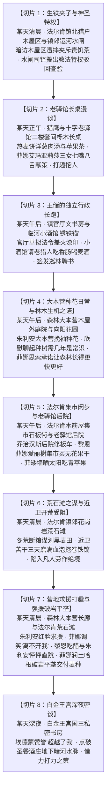

# 临时方案：第四幕阶段十三改造与独立生活流节点重构方案

> **所属母案**：[`00_第四幕大纲与接口.md`](分阶段详规/04_第四幕_商道初通·行商许可与部族共识/00_第四幕大纲与接口.md) · [`01_宏篇主线剧情总大纲与分幕导航.md`](01_宏篇主线剧情总大纲与分幕导航.md)  
> **定位说明**：本方案为第四幕“阶段十三”专项重构与叙事扩充的指导规范。重点解决原阶段剧情推进偏快、事件密度过于紧凑、因果转折缺乏沉淀等结构性问题，确立“时空切片独立起笔”、“写实行政长跑”、“纯生活流闲适穿插”、“近卫受阻与营地求援解耦”的重构标准，用以指导后续阶段十三详规的改写与落地。  
> **状态说明**：【已实施完毕并归档】本临时方案的核心设计已全量落地至《阶段十三详规》与《阶段十四详规》中，后续内容演进与维护直接以分阶段正式详规为准。  
> **核心文风**：纯正日式 RPG 剑与魔法轻小说（JRPG Western Fantasy），强调生活流呼吸感、独立时空切片、物理感官与微反应，严格恪守 [`viridia-writer`](../../.agents/skills/viridia-writer/SKILL.md) 技能规范与 [`writing-guards.md`](../../.agents/rules/writing-guards.md)。

---

## 一、 阶段十三整体改造目标与设计准则

阶段十三的重构必须打破“几天内连续赶场”的紧迫节奏，将其重塑为充满时间流逝感、扎实劳作与经典 JRPG 生活流温情的宏大篇章，具体遵循以下四大设计准则：

### 1. 时空切片独立起笔原则
* **杜绝相对时间推移词**：严禁在节点衔接处使用“数日后”、“两天后”、“日后”等模糊、跳跃的时间副词；
* **具象时空独立定锚**：每一个剧情节点的开篇必须以具象的时空切片独立起笔，明确标定具体时间与具体物理场景（例如：“某天清晨，在法尔肯镇北猎户木屋区；某天正午，在老驿馆二楼长木桌旁”），让读者感知到各个事件之间有着真实的日子在流逝。

### 2. 王权落地与写实行政长跑原则
* **做实朱利安的凡人苦功**：彻底剥离王子的政治光环，通过写实的行政长跑展现年轻王储的蜕变；
* **物理化行政长跑**：不仅要写朱利安在老驿馆听取同伴建议，更要为其设立独立的个人主场——顶着镇官厅官僚的冷眼草拟公文、用王室年俸私账垫付津贴、加盖双头狮红火漆印、冒雨走进底层嘈杂的小酒馆请老猎人们吃香肠喝麦酒，把每一道法令的推行做成磨破靴底的扎实苦工。

### 3. 营地羁绊与经典二次元生活流穿插
* **大本营种花与凡人常识碰撞**：行政长跑后穿插朱利安在营地与大家一起种花的生活流，通过朱利安“树林花几年成林很正常”的踏实欣慰，自然引出菲娜以守护者身份主动承诺引地脉生机助长林木；
* **经典城镇市井日常还原**：保留法尔肯木筋屋集市石板街的纯正生活流切片（乔治汉斯修板车、黎恩菲娜爱丽榭集市买干果、菲在石矮墙晒太阳啃青苹果），展现经典的日式 RPG 队伍闲适呼吸感。

### 4. 挫折与外援独立解耦（求援修罗场趣味）
* **受阻与求援彻底拆分**：近卫开荒受阻与回营地求援作为两个在时间跨度上严格分开的独立事件，做实近卫苦干三天挖卷铁镐的凡人艰难；
* **日轻修罗场趣味互动**：朱利安红脸求援时，菲娜调笑“朱利安已经离不开菲娜了”，黎恩吃醋抗议，年轻王储心脏怦怦直跳偷看菲娜，为沉重的劳作注入极具生气的恋爱喜剧色彩；
* **末尾纯物象化收束**：每个节点的结尾严禁出现定性总结或说明性旁白，镜头必须收束于现场的环境物象、光影变幻与远近声响。

---

## 二、 阶段十三全新 8 大独立剧情切片规划

---

### 【剧情切片 1：生铁夹子与神圣特权】

* **切片定位与时空坐标**：
  * 起笔定锚：某天清晨，在法尔肯镇北猎户木屋区与镇郊运河水闸。
  * 环境物象：湿冷白雾弥漫在低矮的木屋屋顶，泥泞道路与枯草表面结着一层灰白色的薄霜。
* **剧情演进与必须承载的关键信息**：
  * 承接玛格丽特夫人经由密道送达的铅封铜管密信，艾德里安与黎恩手书的沼泽强酸剧毒与狼族幼崽被捕险情让朱利安如坐针毡；
  * 朱利安换上没有王家徽饰的粗羊毛旧外套，带两名便装近卫乔装暗访猎户木屋区。年轻王储以王家宣谕官的温和口吻劝说猎人停止捕狼，宣称“森林深处的灵狼是有灵性的生灵，是这片土地的古老朋友，伤害它们会招致荒野的报应”；
  * 一位面容枯槁、手指生满冻疮的老猎人把锈迹斑斑的生铁捕兽夹重重摔在粗木墩上，浑浊的眼睛满是悲愤与嘲弄，痛斥教会麦粉上月又涨了三个便士、家中三个孩子饿得直啃树皮，不抓狼皮换口粮明天全家就得饿死；木屋窗缝中探出饥饿孩童苍白消瘦的脸庞；朱利安喉咙发紧，僵在原地无言以对；
  * 朱利安随后转道前往镇郊运河水闸，出示王室腰牌要求登船查验黑水河上游两艘黑色平底木船；守闸的秃顶司铎皮笑肉不笑地躬身，语气却冷硬如铁，搬出“修道院运送制作圣油残料的神圣教产受大陆教规全面庇护”，宣称无枢机主教亲笔手谕，王储也无权阻拦教产通航；
  * 双重碰壁彻底击碎了朱利安单纯依靠王室特权与道德说教的幻想。
* **出场人物与声线动作要点**：
  * 朱利安：真诚温和却缺乏基层实务经验，碰壁后抓头发、脸色微红，内视角流露深刻的自我反思；
  * 老猎人：声音沙哑冰冷，动作粗暴决绝，透着底层平民为生存挣扎的决绝与悲凉；
  * 守闸司铎：虚伪客套中带着教法特权的傲慢与冷酷。
* **结尾物理物象收束**：
  * 朱利安拉紧厚斗篷在冷风中哈出一口白气，靴底踩着结霜的枯草无声离去，浑浊的泥水在生锈的生铁捕兽夹表面慢慢冻结。

---

### 【剧情切片 2：老驿馆长桌漫谈】

* **切片定位与时空坐标**：
  * 起笔定锚：某天正午，在法尔肯驿镇“猎鹰与十字”老驿馆二楼套间栎木长桌旁。
  * 环境物象：干冷北风呼啸拍打着厚橡木窗扇，室内壁炉中的松木柴烧得通红噼啪作响，空气中弥漫着烤黑麦硬面包、洋葱炖肉汤与热苹果红茶的踏实香气。
* **剧情演进与必须承载的关键信息**：
  * 黎恩用木勺给每人盛满洋葱炖肉汤，推过去一碗热气腾腾的苹果红茶；朱利安坐在长桌一角抓耳挠腮，大口咬着焦脆麦饼，就着热茶将清晨的两处碰壁一五一十倒了出来，懊恼于自己把世事想得太简单；
  * **三位女生七嘴八舌献策（经典 JRPG 群像互动）**：
    * **菲娜（大森林守护者）**：捧着粗陶大茶杯，以守护者的长远视野率先指出根源在于几百年来森林边缘的树木被人类不断砍伐，野兽无处容身才只能退向深林，提出由王国出面重新向外大面积栽种树木，正常增加森林面积，给生灵留下繁衍生息的繁茂绿荫；
    * **艾玛（博学魔女学者）**：轻推眼镜，以严密学术逻辑接力补充，指出树木成林前没有食物猎户依然挨饿，必须向新林区放养繁殖极快的动物幼崽（平原斑纹灰兔、林地白尾矮鹿、红角山雉），建立起外围可持续猎捕的小生态圈；
    * **亚莉莎（现代商会继承人）**：双手抱胸微扬下巴，以法制与管理眼光直击痛点，指出必须颁布王室《轮换猎区令》，划定休猎繁育期、严禁打母兽幼兽；同时设立王国正式职位“皇家巡林游侠”，聘用老猎人发放王室稳定津贴，让破坏规则的人转变为规则的守护者；
  * **打趣挖人生活流互动**：朱利安嘴里含着食物听得目瞪口呆，猛拍大腿站起惊呼三人是天生的政务官，要封“农林大臣、内政顾问、首席法官”；菲娜掩口轻笑打趣“要是关在王宫里黎恩在壁炉前喝茶要寂寞叹气啦”、亚莉莎傲娇嫌王家年俸买不起工坊一台精密测试仪、黎恩抓头苦笑称当面挖人要加收商道保卫费，全员笑声冲散阴霾。
* **出场人物与声线动作要点**：
  * 菲娜：温柔通透，带着守护者的睿智与小女孩般的调皮狡黠；
  * 艾玛：条理清晰、知性温婉，学者式的严密与温厚；
  * 亚莉莎：精明干练、微微傲娇，法理意识敏锐；
  * 黎恩：温和包容、爱开玩笑调侃，细心照顾同伴饮食。
* **结尾物理物象收束**：
  * 粗陶杯里的橙红茶汤随着笑声泛起微澜，朱利安用羽管笔在羊皮纸角落画下第一道树林草图，厚橡木窗扇将室外的呼啸寒风彻底隔绝。

---

### 【剧情切片 3：王储的独立行政长跑】

* **切片定位与时空坐标**：
  * 起笔定锚：某天午后，在法尔肯镇官厅文书房与临河小酒馆“锈铁锚”。
  * 环境物象：铅灰色阴雨连绵，雨水打湿文书房泛黄的油布窗纸，小酒馆内弥漫着劣质烟草、湿羊毛与酸黑麦酒的浑浊热气。
* **剧情演进与必须承载的关键信息**：
  * **官厅周旋与法令草拟**：朱利安在法尔肯镇官厅文书房内，顶着地方保守官僚的推诿拖延与税务官冷眼，以王储身份强行压下阻挠；动用王室年俸私账划拨第一批巡林津贴，亲自用羽管笔草拟《轮换猎区令》，并在公文末尾重重盖下王室双头狮红火漆密印；
  * **深入底层酒馆推心置腹**：傍晚时分，朱利安撑着油布雨伞独自走进底层老酒馆“锈铁锚”，没有摆王室架子，拿出两枚旧银克朗点了一大盘烤油渣香肠和两壶黑麦酒，坐到几位面容沧桑的老猎人身旁；
  * **推行契约与冰坚融化**：朱利安一边给老猎人们倒酒，一边将《轮换猎区令》、休猎期规则以及王室聘请他们担任“皇家巡林游侠”的差事逐字逐句解释清楚；老猎人们从最初的戒备怀疑，到看见刻有巡林铜牌的正式聘书与推到面前的两百枚紫铜便士定金，眼底的坚冰终于融化，布满老茧的手颤抖着在名册上按下手印；
  * **走访苗圃**：离开酒馆后，朱利安顺道拜访镇郊苗圃商，自费订购首批用来扩充森林面积的树苗。
* **出场人物与声线动作要点**：
  * 朱利安：脱下浮华辞藻，以质朴、诚恳而坚定的态度对待底层平民，动作干脆利落；
  * 老猎人们：警惕、戒备，在实打实的利益与尊重面前逐渐流露淳朴与感激。
* **结尾物理物象收束**：
  * 昏暗的煤油灯光下，两枚磨损的紫铜便士在油腻的粗木桌面上滑过，老猎人粗糙的大手慢慢覆在上面，窗外细雨在油布窗纸上发出沙沙轻响。

---

### 【剧情切片 4：大本营种花日常与林木生机之诺】

* **切片定位与时空坐标**：
  * 起笔定锚：某天午后，在 Eldoria 森林大本营木屋外庭院与向阳花圃旁。
  * 环境物象：初冬少见的和暖晴阳，空气中弥漫着翻开的新土湿气与干燥松针的清香，几只林间山雀在木栅栏上跳跃啼鸣。
* **剧情演进与必须承载的关键信息**：
  * **大本营种花治愈日常**：朱利安在完成了镇官厅文书与猎户签约之后，来到大本营放松紧绷的神经。年轻王储脱下厚披风只穿粗麻衬衫，挽起袖子和大家（爱丽榭、艾玛等）一起蹲在泥土前栽种高山野花与药草幼苗；朱利安手里握着小铁铲，笨拙却认真地把一株紫花幼苗培入土中，脸上沾了一小抹泥土，享受着与朝堂完全不同的踏实安宁；
  * **朱利安欣慰聊起常识认知**：朱利安一边用手掌轻轻按实泥土，一边很开心地向大家聊起扩建森林的进度：“老猎人们带着猎户和近卫开始挖坑扎苗了，苗木供应商也按时送到了首批树苗，一切都走上了正轨。原本在王国的规矩里，要这样大面积栽种树木、向外增加几十公里的森林面积，花上好几年成林是很正常的事情，大家本来就是这么熬过来的。现在能顺顺利利迈出第一步，我已经觉得无比踏实开心了。”；
  * **菲娜的思索与生机之诺**：菲娜蹲在花圃一侧，手里捧着粗陶热茶杯，听着这位年轻王子的凡人感慨，眨了眨碧绿的双眼，单手托腮微微思索了片刻。菲娜露出温和又俏皮的笑意：“唔……虽然对人类来说，几年成林是很正常的自然时间，但小树苗要是只靠自己熬过即将到来的第一场冬霜，来年还是会冻死很多呢，而且要想真正长成能容纳野兽的繁茂大森林也太久啦。既然树是大家辛辛苦苦栽下的，菲娜也来帮个忙吧~”；
  * **守护者的承诺**：菲娜主动提出，等全部树苗在林缘栽种合拢之日，她会以森林守护者血脉深入沟通地脉，引大森林底层沉淀的古老生机与温润水汽滋养整片树林的根系，帮树苗抵御严冬冻土，让新生的森林长得更快更好，提前唤醒繁茂生机；朱利安听后既震撼又感激。
* **出场人物与声线动作要点**：
  * 朱利安：质朴赤诚、笑容明朗，沾着泥巴却充满凡人奋斗的自豪感；
  * 菲娜：温柔通透，带着守护者的自然威严与少女特有的轻快调皮；
  * 爱丽榭、艾玛、黎恩：在旁微笑递工具、浇水，洋溢温馨恬淡的营地羁绊。
* **结尾物理物象收束**：
  * 铜喷壶洒出的水珠在阳光下折射出微小的七彩光晕，浸湿的黑色泥土散发出甘甜的芬芳，一朵刚栽下的淡紫野花在微风中轻轻摇曳。

---

### 【剧情切片 5：法尔肯集市闲步与老驿馆后院】

* **切片定位与时空坐标**：
  * 起笔定锚：某天午后，在法尔肯木筋屋集市石板街与老驿馆后院。
  * 环境物象：阳光晴朗，微风不燥，石板路上人声熙攘，空气中飘着炒栗子、焦糖与刚出炉烤麦饼的香甜热气。
* **剧情演进与必须承载的关键信息**：
  * **老驿馆后院修板车**：老驿馆宽敞的青石后院里，乔治脱了厚外套只穿粗麻衬衫，挽起袖子帮店主奥托维修一辆车轴开裂的运菜双轮板车；学徒汉斯在旁边忙前忙后递扳手，两人满手都是黑乎乎的牛油机油，有说有笑地聊着镇上老矮人铁匠铺打铁手艺的八卦；
  * **集市漫步与喂食互动**：黎恩陪着菲娜和爱丽榭漫步在热闹的集市石板路上。菲娜在一处香料干果摊前驻足，清澈的双眼好奇地打量着风干甜无花果、肉桂皮与风干迷迭香；黎恩笑着买下两小包塞进菲娜手里，菲娜俏皮地捏起一颗甜无花果塞进黎恩嘴里，两人相视一笑；爱丽榭则在毛线摊前专注地比对着深灰色的羊毛线团，想要为哥哥织一副厚实保暖的骑行手套；
  * **菲在矮墙晒太阳啃青苹果**：菲像一只回到窝里的猫咪一样盘腿坐在老驿馆后院的石矮墙上晒太阳，半眯着眼睛，手里抱着一颗酸脆的青苹果小口小口啃着，懒洋洋地注视着街巷里嬉闹追逐的镇上孩童与慢慢走过的送奶毛驴；
  * 整段情境完全脱离主线危机，专注呈现伙伴之间温馨无间的日常呼吸感与治愈氛围。
* **出场人物与声线动作要点**：
  * 乔治、汉斯：踏实轻松的工匠闲聊；
  * 黎恩、菲娜：老夫老妻般的默契与清甜投喂；
  * 爱丽榭：细心体贴的妹妹姿态；
  * 菲：猫系少女特有的慵懒闲适。
* **结尾物理物象收束**：
  * 斜阳将木筋屋的木梁阴影拉得很长，后院传来生铁榔头敲击木楔的清脆“笃笃”声，集市空气中弥漫着炒栗子、焦糖与烤麦饼的香甜气息。

---

### 【剧情切片 6：荒石滩之谋与近卫开荒受阻】

* **切片定位与时空坐标**：
  * 起笔定锚：某天清晨，在法尔肯镇郊干硬的花岗岩荒石滩。
  * 环境物象：初冬薄雾尚未散尽，石缝与枯草表面结着厚厚的白霜，寒风刮过空旷荒凉的石滩发出呼啸。
* **剧情演进与必须承载的关键信息**：
  * **生计断档之谋**：扩建森林虽然开工，但树木成林与野兽繁育终究需要时间，法尔肯猎户下个月就面临断粮危机；艾德里安在长木桌前用树枝在简图上圈出法尔肯镇郊三十余亩抛荒河滩石荒地，指出必须抢在初雪前开垦出平整田垄种上耐寒早熟黑麦，让猎户整个冬天有工钱口粮；朱利安决意先带十二名近卫骑兵去啃下这块硬骨头；
  * **近卫苦干受阻（时间流逝与凡人极限）**：十二名忠诚的王家近卫骑兵脱下板甲穿着粗麻短衣，挥汗如雨地抡动十字镐；然而荒石滩下全是深埋的花岗岩乱石与枯死百年的铁荆棘，坚硬得如同铁板；近卫们擅长骑射冲锋，面对顽石却有力使不出；
  * **残酷受阻特写**：近卫们在石滩上苦苦蛮干了整整三天，掌心磨满了血泡，挖卷了整整七把生铁镐刃，三天下来才勉强翻平了不到半亩地；入冬寒流眼看要到，若翻不平土地一旦彻底冻硬，今年播种将完全无望；朱利安和近卫们精疲力竭地坐在乱石堆上，面对严酷的自然与凡人体能的极限，陷入了真正的困顿绝境。
* **出场人物与声线动作要点**：
  * 近卫骑兵：忠诚质朴、吃苦耐劳，满手血泡却喘着粗气满脸愧疚；
  * 朱利安：看着卷刃的铁镐与疲惫的下属，体会到现实劳作的沉重艰难。
* **结尾物理物象收束**：
  * 冷风卷起地面的碎草屑，七把卷刃断裂的铁镐横七竖八堆在石堆旁，阴沉的铅云在天际缓缓压低，冻土在靴底发出冰冷的脆响。

---

### 【剧情切片 7：营地求援打趣与强援破岩平垄】

* **切片定位与时空坐标**：
  * 起笔定锚：近卫受阻数日后的某个清晨，在森林大本营指挥木屋外长廊，随后转至法尔肯荒石滩。
  * 环境物象：林间晨雾带着湿润冷意，大本营木廊下的火盆微亮；随后的荒石滩上升起清晨薄雾。
* **剧情演进与必须承载的关键信息**：
  * **朱利安红脸求援**：万般无奈之下，朱利安满身泥尘、带着两名精疲力竭的近卫快马赶回大本营求援。年轻王储站在木长廊前，脸色微红，有些窘迫不好意思地说明了近卫三天挖卷七把铁镐、开荒陷入死局的遭遇；
  * **菲娜的调笑名场面（日轻恋爱修罗场趣味）**：
    * 菲娜捧着热茶走上前，见状忍不住掩口轻笑，清澈碧绿的双眼俏皮地弯起，带着守护者的狡黠调笑道：“哎呀，朱利安殿下现在已经完全离不开菲娜了呢~”；
    * 黎恩坐在一旁抓了抓头发，故意露出酸溜溜的苦笑吐槽吃醋：“喂喂，当着正牌伴侣的面这么大张旗鼓地依赖我的守护者，我可是要吃醋抗议的哦。”；
    * 年轻单纯的王子朱利安被这句调笑击中，脸颊瞬间涨得通红，心脏怦怦直跳，窘迫得手足无措连连摆手，眼神却忍不住悄悄偷看眼前圣洁美丽又狡黠可爱的精灵少女菲娜；
  * **强援出动·神圣润土与矮人破岩**：
    * 调笑过后全员果决出动赶赴石滩。清晨薄雾中，菲娜赤着双足踏上冰冷石滩，单膝触地，纤细手掌按在泥土上，温润水汽顺着深层地脉扩散，坚硬如铁的枯死荆棘根系在水汽浸润下迅速软化腐烂化为深黑土壤；
    * 大地传来沉重踏步声，矮人二哥哈根叼着熄灭烟斗，推着生铁双轮破岩铁犁大踏步赶到；哈根大嗓门嚷嚷王家小子使偏了力气，粗壮铁犁切入乱石，沉重铁锤连环猛砸，将暗藏的花岗岩硬生生震裂崩碎平垄；
    * 近卫骑兵与闻讯赶来的老猎人们士气大振，合力平整沟垄，傍晚整整十余亩松软黑麦田垄奇迹成型；黎恩与艾德里安卸下大食堂支援的耐寒早熟黑麦种子与两大罐粗盐，老猎人们热泪盈眶深深致谢。
* **出场人物与声线动作要点**：
  * 菲娜：落落大方、俏皮调戏，单膝触地时展现神圣守护者威严；
  * 黎恩：温和宠溺，恰到好处的吃醋打趣化解尴尬；
  * 朱利安：少年王储的纯情与面红耳赤，怦怦直跳的微妙心理；
  * 哈根：豪迈粗犷的大嗓门，展现老矮人工匠的震撼伟力。
* **结尾物理物象收束**：
  * 晚霞将平整的田垄染成温暖的深橘色，近卫骑兵坐在石堆上用汗巾擦汗相视而笑，几只寒鸦落在新翻的湿泥上觅食草籽，空气中尽是泥土翻开后的清新微温。

---

### 【剧情切片 8：白金王宫深夜密谈】

* **切片定位与时空坐标**：
  * 起笔定锚：某天深夜，在王都白金王宫深处的国王私密书房。
  * 环境物象：铅云遮月，高耸的白石拱窗倒映着冷月清辉，书房壁炉里的红炭散发着微弱暖意。
* **剧情演进与必须承载的关键信息**：
  * **深夜求见与疲惫君王**：猎户生计、麦田开垦与扩林大计全面走上正轨，但教会黑木船向下游沼泽偷排强酸毒渣的铁壁依旧无法撼动；朱利安快马潜回王都，在深夜敲响国王书房；五十岁的埃德蒙国王披着深蓝旧羊毛常服，身前堆满手抄黑账与羊皮纸法典，神色疲惫却目光深邃，温和地为满身泥土的儿子倒了一杯热燕麦茶；
  * **王储倾诉困惑**：父子私下以“你”平视对话；朱利安倾诉心底迷茫：在教廷和大贵族眼里，自己整天在法尔肯忙着巡林植树、整饬荒野生态，为了排查边境山泉水质和底层麦田在泥地里打滚，完全是可笑荒唐的不务正业，且看起来与复兴王权毫无关系，为何父亲收到密报却一直在暗中调拨钱粮全力支持；
  * **“超越了我”的父爱与帝王心术**：埃德蒙国王按住儿子的肩膀，动情剖析朱利安的成长：十年前御前会议争夺关卡通行税权、八年前整顿王都近卫武备，看似无比正确但锋芒太露，教廷与骑士团一眼看穿，因而屡屡碰壁；后来父子隐忍伪装被视作软弱；但如今朱利安在法尔肯做的事，连埃德蒙国王也看不懂了——“因为当你做的事连我也看不懂时，说明你已经超越了我！只有超越我，你才有可能做到我这个无能国王做不到的事情！”；
  * **点破教廷水脉致命软肋**：埃德蒙国王走回书桌铺开全境水网水力图，点破黑水河下游暗流分支正浇灌晨光教廷名下最赚钱的核心财路——【圣多米尼克修道院葡萄庄园】（全王国大贵族争购的一桶上百枚银克朗的“高阶圣餐酒”），以及王都元老贵族庄园饮水井；
  * **借力打力之策**：埃德蒙国王传授政治智慧：森林深处的秘密绝不能向外界漏出半个字，既然教廷与贵族只当你在整饬边境生态，就顺水推舟，以最虔诚王储的姿态替教廷“分忧”，借贵族信徒害怕喝到毒酒的恐慌，让其贪婪与面子化作斩断排毒船的无形绞索。
* **出场人物与声线动作要点**：
  * 埃德蒙国王：隐忍悲剧君王，眼神深邃疲惫却内蕴雷霆，对儿子的爱深沉而克制；
  * 朱利安：真情流露、眼眶泛红，从单纯的热血青年蜕变为具备深邃政治格局的成熟王储。
* **结尾物理物象收束**：
  * 烛火爆开一朵微小的灯花，羊皮纸上的黑水河支流在阴影中蜿蜒，朱利安眼中的迷雾彻底消散。

---

## 三、 本阶段接口契约与实物交付

在改写阶段十三详规时，必须确保以下前后文接口与物理凭证严密咬合：

### 1. 前置承接契约（承接阶段十二）
* **物理位置**：法尔肯老驿馆与迷迭香商行；
* **人员状态**：全员持有合法的正式雇工证明与行商许可，大食堂聚餐后接获沼泽排毒与幼狼危机密报；
* **前置输入凭证**：玛格丽特夫人密道送达的铅封铜管密信、埃德蒙国王十八年手抄平民抚恤暗账卷轴原本。

### 2. 后置交付契约（交接阶段十四）
完成本阶段 8 大独立剧情切片后，必须向阶段十四交付以下四大不可逆的物理凭证：
1. **平整黑麦田与播种契约**：法尔肯镇郊十余亩完成翻整并播下耐寒黑麦的田垄，老猎人们由衷认可王室诚意；
2. **七位巡林游侠名单与王室聘书**：加盖王室双头狮红火漆印的《轮换猎区令》拓本与猎人手印名册；
3. **维里迪亚全境水网图与水脉标记**：标注有黑水河潜流贯穿圣多米尼克葡萄庄园与元老饮水井的实物图纸；
4. **圣餐酒借力打力谏书方案**：朱利安准备以虔诚信徒身份向教廷大教堂递交的质询与请愿文书。

---

## 四、 落地执行规范与红线约束

后续改写阶段十三详规时，必须无条件执行以下执行规范：

1. **绝对零导力防护**：本阶段所有民生与开荒场景均为纯物理劳作，严禁任何原住民目击导力机械；
2. **二元机构严格隔离**：排毒私船与暗影黑产严格归属于晨光教廷异端审问厅名下，与圣殿骑士团封建霸权严格区分；
3. **旁白直呼本名**：旁白视角一律使用本名“黎恩、菲娜、雷恩、劳拉、艾德里安、朱利安、哈根”，严禁使用身份标签或模糊代词；
4. **语言质感与词汇正位**：
   * 货币统一使用“紫铜便士、旧银克朗”；
   * 严禁出现四字短语密集连缀与古风文言词汇，具体器物与用语严格遵循 [`lexicon.md`](../../.agents/rules/lexicon.md)；
   * 杜绝任何解释性自保标签（如“非战斗”、“未插入”、“非敌意”等），正文只记录现场发生之事。
