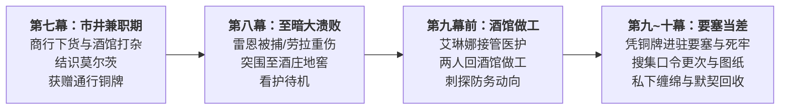
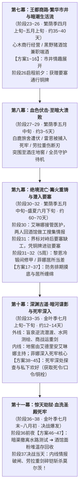

# 莫尔茨NSFW与第二部主线深度咬合及分卷文件修订落地执行方案

> **归档位置**：`方案/第二部/已执行/临时方案_莫尔茨NSFW与主线深度咬合及分卷文件修订研讨方案.md`  
> **执行状态**：已全部落地执行完成并归档（2026-11-02）  
> **方案性质**：第二部主线详规与莫尔茨NSFW情境方案双向对账、时空无缝咬合及全量文件修订落地执行全案  
> **权威对账基准**：
> - 主线核心母案：[`00_第二部宏篇主线总纲与方案管理中枢.md`](../主线与世界扩充方案/00_第二部宏篇主线总纲与方案管理中枢.md) · [`01_宏篇主线剧情总大纲与分幕导航.md`](../主线与世界扩充方案/01_宏篇主线剧情总大纲与分幕导航.md) · [`06_第二部主线跨幕连续性与全局物理状态机.md`](../主线与世界扩充方案/06_第二部主线跨幕连续性与全局物理状态机.md)
> - 莫尔茨全案中枢：[`莫尔茨NSFW剧情融入主线架构方案.md`](../莫尔茨NSFW/莫尔茨NSFW剧情融入主线架构方案.md) · [`00_莫尔茨NSFW情境企划全案总纲.md`](../莫尔茨NSFW/00_莫尔茨NSFW情境企划全案总纲.md)
> - 莫尔茨分卷各篇：[`01_黑野猪酒馆市井情趣篇（方案一至方案十六）.md`](../莫尔茨NSFW/01_黑野猪酒馆市井情趣篇（方案一至方案十六）.md) · [`02_圣殿要塞深入与要职近身篇（方案十七至方案三十七）.md`](../莫尔茨NSFW/02_圣殿要塞深入与要职近身篇（方案十七至方案三十七）.md) · [`03_圣殿地牢深入与核心情趣篇（方案三十八至方案四十五）.md`](../莫尔茨NSFW/03_圣殿地牢深入与核心情趣篇（方案三十八至方案四十五）.md) · [`04_王都暗渠突围与终极收束篇（方案四十六至方案四十七）.md`](../莫尔茨NSFW/04_王都暗渠突围与终极收束篇（方案四十六至方案四十七）.md)
> - docs2 权威实体：[`莫尔茨.TXT`](../../../docs2/npc/莫尔茨.TXT) · [`科林.TXT`](../../../docs2/npc/科林.TXT) · [`卢卡斯.TXT`](../../../docs2/npc/卢卡斯.TXT) · [`黑野猪酒馆.TXT`](../../../docs2/location/黑野猪酒馆.TXT) · [`圣殿要塞.TXT`](../../../docs2/location/圣殿要塞.TXT) · [`圣殿地牢.TXT`](../../../docs2/location/圣殿地牢.TXT) · [`圣泉大浴场.TXT`](../../../docs2/location/圣泉大浴场.TXT) · [`白鹿旅舍.TXT`](../../../docs2/location/白鹿旅舍.TXT)

---

## 〇、 角色动线与行动定位

菲娜与黎恩在第二部的跨幕动线与各阶段行动定位如下：

### 1. 各阶段行动脉络
* **第七幕（市井兼职期 · 阶段二十三至二十六 · 繁荫季四月上旬至五月上旬）**
  - **日常动线**：白天在心木商行协助商队料理后勤与街区修缮，傍晚结伴前往下城黑野猪酒馆兼职端酒装卸，体验王都市井生活并结识莫尔茨；
  - **情境展开**：顺应莫尔茨的狂暴自负展开方案 1 至 14；阶段二十五发生方案 15（舞台蒙面展演）；
  - **阶段交付**：启程前往白鹿旅舍前夕，莫尔茨在酒馆交付要塞特许通行铜牌（方案 16）。
* **第八幕（至暗大溃败 · 阶段二十七至二十九 · 繁荫季五月中旬，约 3~5 天）**
  - **主线事件**：白鹿旅舍遭伏，劳拉身负重伤，雷恩被捕关入圣殿底层水牢；黎恩与菲娜维持结界疏散平民，护送伤员突围至酒庄地窖；
  - **行动定位**：全天候守候在酒庄地窖协助看护伤员，暂停外出活动。
* **第九幕（要塞潜入期 · 阶段三十至三十二 · 繁荫季五月中旬至盛夏六月下旬，约 60~70 天）**
  - **前期动线（阶段三十）**：艾琳娜进驻酒庄接管劳拉的医护后，黎恩与菲娜因未受通缉，决定继续前往下城区黑野猪酒馆做工，既借机收集要塞与驻防情报协助营救雷恩，也继续沉浸在与莫尔茨交织的肉体与心理刺激中；
  - **进驻要塞（阶段三十一界标对峙之后，繁荫季五月下旬）**：要塞因临战戒备急缺修甲工匠，两人凭既有铜牌进驻要塞冷锻间，展开整整 5 周的内线行动；
  - **分工展开（方案 17 至 37）**：黎恩在冷锻间打铁修甲兼摸清防务盲区，暗中窥视菲娜承欢并被强烈的背德反差刺激得欲火暗涌；菲娜在莫尔茨居所端酒当差，肉体与心理深陷被粗硕肉柱摆弄与贯穿的强烈刺激，顺带探查水牢暗渠排沙日程；两人私下密会时激烈缠绵，完成身体与情感的绝对回收。
* **第十幕（死牢深入期 · 阶段三十三至三十五 · 金叶季七月上旬至下旬，约 12~14 天）**
  - **内外部协同**：酒庄深窖后方由艾德里安、朱利安与艾琳娜主持；外部特遣组进行盲泉逆流与水网测绘；
  - **内线深入（方案 38 至 45）**：菲娜借侍女送药特权深入第七死牢重地，在莫尔茨及多名守牢骑士身下放浪承欢，深陷肉体被粗暴征服与填满的极致刺激；同时顺手探听并记下死令、水闸开闸口令、防卡死铜栓位置与值更底册，送出内线图纸拓样；黎恩在死角暗中目睹，浑身血脉偾张，共享这份惊险的背德快感。
* **第十一幕（暗渠突围与大劫狱 · 阶段三十六至三十八 · 金叶季七月末至八月初）**
  - **前夜突围（阶段三十六前夜）**：两人沿排沙暗渠测试撤离水路返回王都，发生方案 46（暗渠水下激流遭遇）；随后返回黑野猪酒馆暗室向全员汇总交接，完成方案 47；
  - **决战当天（阶段三十七）**：突击队依照菲娜内线情报拔除铜栓、对齐水闸口令并报出死令破闸，劳拉重剑碎铠斩杀莫尔茨，成功解救雷恩。

---

## 一、 晨光大陆历法时序与两线深度咬合推演模型

全案横跨维里迪亚王国【繁荫季四月】至【金叶季八月初】，总物理时长约 140 ~ 150 天：

### 全案十四幕四十五阶段全景日历与时空咬合对照表

| 主线幕次与阶段 | 历法月份与跨越天数 | 外部大事件与伙伴动向 | 黎恩与菲娜动线与角色状态 | 对应发生的莫尔茨NSFW方案 |
| :--- | :--- | :--- | :--- | :--- |
| **第七幕：王都商路** （阶段二十三至二十六） | 繁荫季四月上旬至五月上旬 （约 35 ~ 40 天） | 心木商行扎根王都下城；玲与艾玛结识科林并展开八音盒羁绊；黎恩修蹄铁结交卢卡斯；金鸢尾沙龙办妥特许状。 | 白天在心木商行料理后勤，傍晚前往黑野猪酒馆兼职端酒与修缮，与莫尔茨产生交集。 | **方案一至方案十四**（大厅圆桌与后院轮替，含逗猫棒颜射、木板便所后入、暴雨夜双向内射）； 阶段二十五：**方案十五**（舞台蒙面展演）； 阶段二十六前夕：**方案十六**（莫尔茨交付要塞通行铜牌）。 |
| **第八幕：至暗大溃败** （阶段二十七至二十九） | 繁荫季五月中旬 （约 3 ~ 5 天） | 白鹿旅舍遭遇伏击，双手大剑折断，雷恩被捕入死牢，泥泞突围至酒庄地窖。 | 两人参战维持结界疏散平民，护送重伤劳拉突围至酒庄地窖看护待机。 | **无**（主线大转折，全员留守地窖看护伤员）。 |
| **第九幕：绝境流亡** （阶段三十至三十二） | 繁荫季五月中旬至盛夏六月下旬 （约 60 ~ 70 天） | 阶段三十劳拉酒庄静养，艾德里安领主觉醒；阶段三十一奥蕾莉亚界标断旗威慑圣殿铁骑；阶段三十二菲暗渠取回断刃，工坊重铸防酸大剑。 | **阶段三十**：艾琳娜接管医护，两人回酒馆做工收集情报； **阶段三十一之后（繁荫季五月下旬）**：凭铜牌进驻要塞当差，黎恩冷锻间打铁修甲，菲娜居所当差，展开整整 5 周内线行动。 | **方案十七至方案三十七**（粮车手交、蒸汽浴室乳侍、圣泉大浴场水疗、冷锻间打铁、办公桌底隐奸、主堡大窗台三次后入、竞技场舔蛋、名贵黑丝足交、暴雷夜暗通、吊带黑丝大床本番记下清淤日程）。 |
| **第十幕：深渊古道** （阶段三十三至三十五） | 金叶季七月上旬至下旬 （约 12 ~ 14 天） | 阶段三十三凯尔玲盲泉逆流破译石闸；阶段三十四亚尔缇娜测绘水网与暗格送药；阶段三十五亚莉莎羊毛商战运大剑，罗恩荒原狼战破围。 | 酒庄后方由艾德里安与艾琳娜坐镇；黎恩与菲娜在要塞内线接应，菲娜深入第七死牢重地，获取水闸口令、死令与防卡死铜栓。 | 依次展开： **方案三十八**（盲门听死令） ➔ **方案三十九**（哨所副官观摩，偷铜符） ➔ **方案四十**（忏悔室暗门） ➔ **方案四十一**（卫所多人口手身，泄露水闸口令） ➔ **方案四十二**（甲胄库掩护艾玛勘破重铠弱点） ➔ **方案四十三**（绞盘室摸铜栓） ➔ **方案四十四**（文书室长桌后入顺取底册与更次表） ➔ **方案四十五**（刑务暗室四人终极狂欢）。 |
| **第十一幕：暗渠突围与大劫狱** （阶段三十六至三十八） | 金叶季七月末至八月初 （约 2 ~ 3 天，决战当天） | 阶段三十六加尔潜渡破障、哈根定点破壁；阶段三十七突击队奇袭死牢，劳拉重剑劈碎莫尔茨生铁重铠雪耻；阶段三十八全员撤出。 | 阶段三十六前夜：沿暗渠测试撤离水路潜出要塞回城，完成终极情感回收；决战当天：里应外合报出死令破闸，突入死牢解救雷恩。 | **方案四十六**（暗渠测试撤离水路撞见莫尔茨激流贯穿） ➔ **方案四十七**（酒馆储藏室隔板周旋与黎恩面粉堆终极温存回收）。 决战当天方案结束，莫尔茨彻底败亡退场。 |

---

## 二、 关键设定与跨幕接口实施细则

### 1. 第十幕酒庄后方与要塞内线分工
* **设定现状**：第十幕详规（阶段三十三、三十四、三十五）中，存在“黎恩与菲娜坐镇酒庄地窖主持后勤调度”以及水门送行描写，与两人在要塞内部当差的动线产生冲突。
* **执行细则**：
  - **后方中枢分工**：将第十幕三份详规表格与正文中酒庄后方调度明确标定为**艾德里安、朱利安与艾琳娜**主持；
  - **水门送行与接应调整**：
    - 《阶段三十三详规》第 27 行水门送行场景，将递送防水行囊的角色由黎恩调整为**艾德里安与朱利安**；
    - 《阶段三十四详规》第 141~167 行暗河水门处舟运接应由黎恩调整为**罗恩或加尔**，送达爱丽榭准备的浓汤；营地中对立体水网图的审定者自然聚焦为加尔、哈根与玲；
  - **内线情报衔接**：在阶段三十三与阶段三十四正文中，亚尔缇娜手绘水网图所依据的死牢基础构造数据与换防时隙，注明为**结合了菲娜与黎恩先前自要塞内部排污暗管秘密送出的拓样与巡更时刻**；
  - **阶段三十五台地集结人员**：方解石台地集结人员定锚为潜渡突击组（劳拉、亚莉莎、亚尔缇娜、加尔、哈根、玲），黎恩与菲娜在阶段三十六前夜完成水网撤离测试并在黑野猪酒馆完成交接后，于决战总攻当天准时就位。

### 2. 方案四十二（甲胄库掩护）目标设定
* **执行细则**：
  - **艾玛潜入动因**：艾玛潜入甲胄库的目标设定为**实地探查要塞精锐重铠的受力卡榫与锻造弱点**，掌握圣殿重甲的薄弱接缝与防酸缝隙；
  - **掩护分镜**：菲娜在板甲架旁故意发出动静引开巡查卫兵，被突入的莫尔茨按在甲胄架上单腿高悬粗暴侵犯；菲娜强忍呻吟与撞击，用纤细身躯挡住后方视线，掩护艾玛在暗处将重铠接合处的脆弱卡榫看得一清二楚并安全脱身；
  - **主线承接**：艾玛将勘破的盔甲弱点带回工坊直接告知哈根与劳拉，主线无需出现图纸交接，直接为第十一幕阶段三十七劳拉手持重铸大剑正面斩碎莫尔茨重铠提供技术依据。

### 3. 主线第十一幕决战与内线情报落地衔接
* **执行细则**：
  - **细则 3.1（水闸口令与防卡死铜栓 · 阶段三十六）**：
    - 在加尔潜入冰潭破障的情境中加入 1 句：“加尔贴着生铁滑轨摸索，依照菲娜先前传出的内线情报，准确定位到底部生锈卡槽中的绞盘防卡死铜栓，以龙牙铁木刀平稳撬除，解除了暗流绞盘的卡死威胁”；
    - 在水闸调校处加入 1 句：“核对暗记刻度，按‘逆三顺七’的手法精准转动水闸阀盘，泄水暗渠平稳分流”；
  - **细则 3.2（绝密死令验证 · 阶段三十七）**：
    - 在突击队破拆底层死牢铁门时加入 1 句：“厚铁门孔后传来守卫警惕的喝问，黎恩压低声线，沉稳报出菲娜自莫尔茨处套来的绝密死令——‘黑曜浸血，死寂永缄’；在门后守卫惊愕迟疑的一瞬，劳拉重剑横扫劈碎铁栓，全员势如破竹突入水牢”。

### 4. 第七幕心木商行与黑野猪酒馆生活流衔接
* **执行细则**：
  - 在《00_第七幕大纲与接口.md》行动概况中，增补两人傍晚前往下城黑野猪酒馆兼职跑堂的生活流背景；
  - 在《阶段二十三详规》中，加入 1 处闲笔交代两人白天下货整备商行仓房之余，傍晚结伴去隔壁街区的黑野猪酒馆做工体验市井日常；
  - 在《阶段二十六详规》白鹿启程前夕，补入莫尔茨在酒馆交付要塞通行铜牌的情节。

### 5. docs2 实体名称规范
* 全案统一使用以下规范实体名称：
  - `圣泉大浴场`（`LOC_D2_33`，严禁使用“浴堂”）；
  - `白鹿旅舍`（`LOC_D2_31`，严禁使用“大驿馆/驿馆”）；
  - 圣殿大要塞全境统一采用封建骑士团体制称谓（圣殿骑士团、要塞守备、巡防、要塞典狱长），绝不使用世俗军队词汇。

---

## 三、 全量待修改文件清单与精准修改指南

### 1. 主线方案待修改文件清单（共 8 份文件）

| 序号 | 目标文件路径 | 涉及章节 | 修改位置与修改内容 | 替换后精准内容与落地规范 |
| :---: | :--- | :--- | :--- | :--- |
| 1 | `方案/第二部/主线与世界扩充方案/分阶段详规/07_第七幕_王都商路·繁华市井与暗潮生活流/00_第七幕大纲与接口.md` | 第七幕大纲 | 二、幕级核心定位 与 三、接口契约 | **【已完成 · 纯度100%】** 补充生活流双线背景：黎恩与菲娜白天在心木商行协助商队经营，傍晚前往下城黑野猪酒馆兼职端酒装卸，摸清市井三教九流并初涉背德情趣；接口补入要塞通行铜牌凭证。 |
| 2 | `方案/第二部/主线与世界扩充方案/分阶段详规/07_第七幕_王都商路·繁华市井与暗潮生活流/阶段二十三_王都初至与心木商行详规.md` | 阶段二十三 | 情境二与情境三之间生活流转场 | **【已完成 · 纯度100%】** 在商行仓房下货与街区采买之后，嵌入两人傍晚前往黑野猪酒馆端酒跑堂的白描闲笔，交代王都下城粗粝热络的酒馆风貌与初识科林、莫尔茨的引子。 |
| 3 | `方案/第二部/主线与世界扩充方案/分阶段详规/07_第七幕_王都商路·繁华市井与暗潮生活流/阶段二十六_纯铜八音盒商行托付与白鹿启程详规.md` | 阶段二十六 | 情境一启程整备前夕 | **【已完成 · 纯度100%】** 补入出发前往白鹿旅舍前夜，莫尔茨在黑野猪酒馆留下的要塞特许通行铜牌插曲，铜牌由菲娜收于旅行皮囊夹层，作为后续进入要塞的通行凭证。 |
| 4 | `方案/第二部/主线与世界扩充方案/分阶段详规/10_第十幕_深渊古道·暗河谍影与地底破壁/00_第十幕大纲与接口.md` | 第十幕大纲 | 六、本幕专属文风（第112行）与阶段导航表 | **【已完成 · 纯度100%】** 彻底剔除虚设的“后方调度/中枢”，明确外部特遣组水网测绘与黎恩菲娜要塞内线深潜的内外线协同；导航表反映黎恩菲娜趁轮休回营地休整送汤与口琴八音盒合奏。 |
| 5 | `方案/第二部/主线与世界扩充方案/分阶段详规/10_第十幕_深渊古道·暗河谍影与地底破壁/阶段三十三_盲泉逆流与太古石闸详规.md` | 阶段三十三 | 第 17 行表格、第 27 行水门送行、第 143 行后方中枢 | **【已完成 · 纯度100%】** 1. 表格与状态机剔除调度虚名，明确内外线分工（艾德里安统筹七村情报，黎恩菲娜要塞内线）； 2. 水门启航由爱丽榭递交干粮药囊、艾德里安叮嘱平安，加尔罗恩固定木舟干脆出发。 |
| 6 | `方案/第二部/主线与世界扩充方案/分阶段详规/10_第十幕_深渊古道·暗河谍影与地底破壁/阶段三十四_特务少女与死牢水网逆向测绘详规.md` | 阶段三十四 | 第 16~17 行表格、第 141~167 行水门接应、第 210 行中枢 | **【已完成 · 纯度100%】** 1. 明确黎恩与菲娜趁要塞轮休回营地休整，菲娜补觉休息，黎恩划舟送热汤慰劳亚尔缇娜与突击组，完全保全摸头、吃面包与口琴八音盒合奏； 2. 亚尔缇娜手绘水网图明确结合了菲娜内线送出的管网与更次拓样，实现内外线闭环。 |
| 7 | `方案/第二部/主线与世界扩充方案/分阶段详规/10_第十幕_深渊古道·暗河谍影与地底破壁/阶段三十五_黑市商道交锋与重器密运详规.md` | 阶段三十五 | 第 16~17 行表格、第 131~137 行石台集结、第 176 行中枢 | **【已完成 · 纯度100%】** 1. 方解石石箱集结明确为暗河突击组（劳拉、亚莉莎、亚尔缇娜、加尔、哈根、罗恩、玲），劳拉统筹战术分工； 2. 状态机剔除调度虚职，黎恩菲娜定锚为要塞内线蓄势待发。 |
| 8 | `方案/第二部/主线与世界扩充方案/分阶段详规/11_第十一幕_惊天劫狱·血洗圣殿死牢/阶段三十六_哈根勘破弱点与加尔水泽潜渡详规.md` · `阶段三十七_奇袭深层水牢与重剑斩碎莫尔茨重铠详规.md` | 第十一幕阶段36、37 | 阶段三十六第 29 行及潜渡过程；阶段三十七破门突入过程 | **【已完成 · 纯度100%】** 1. 阶段三十六第 29 行将“防御图纸”调整为“内线更次底册与重铠受力弱点”；潜渡中嵌入拔除“绞盘防卡死铜栓”与水闸“逆三顺七”口令； 2. 阶段三十七突入底层水牢前，黎恩报出死令“黑曜浸血，死寂永缄”，决战中劳拉依据艾玛勘破的弱点正面斩碎莫尔茨重铠，完成全线闭环。 |

---

### 2. 莫尔茨NSFW分支待修改文件清单（共 6 份文件 · 已全量完成）

| 序号 | 目标文件路径 | 涉及卷次 | 修改目标与内容规范 | 落地状态 |
| :---: | :--- | :--- | :--- | :---: |
| 1 | `方案/第二部/莫尔茨NSFW/莫尔茨NSFW剧情融入主线架构方案.md` | 架构总方案 | 1. 明确第九幕进驻时机（阶段三十一界标对峙后）与驻留整整 5 周； 2. 补充背德欲火动因与密会回收；第十幕酒庄调度明确由艾德里安主持； 3. 方案四十二明确重铠弱点；全量对齐 docs2 规范实体与骑士团体制定锚。 | **【已完成 · 纯度100%】** |
| 2 | `方案/第二部/莫尔茨NSFW/00_莫尔茨NSFW情境企划全案总纲.md` | 全案总纲 | 1. 统一 docs2 实体（修正浴堂与大驿馆）； 2. 方案四十二修正为掩护艾玛勘破重铠弱点； 3. 实施总轴对齐第九幕 5 周驻留与第十幕后方艾德里安统筹。 | **【已完成 · 纯度100%】** |
| 3 | `方案/第二部/莫尔茨NSFW/01_黑野猪酒馆市井情趣篇（方案一至方案十六）.md` | 分卷一 | 1. 根除第一部超前设定污染，家具置换为西幻实体； 2. 肃清戏腔与古风用词，纯化轻小说口语散句。 | **【已完成 · 纯度100%】** |
| 4 | `方案/第二部/莫尔茨NSFW/02_圣殿要塞深入与要职近身篇（方案十七至方案三十七）.md` | 分卷二 | 1. 全量更正“圣泉大浴场”与“白鹿旅舍”规范实体；中式家具置换为木格栅； 2. 肃清世俗军队与古风用词。 | **【已完成 · 纯度100%】** |
| 5 | `方案/第二部/莫尔茨NSFW/03_圣殿地牢深入与核心情趣篇（方案三十八至方案四十五）.md` | 分卷三 | 1. 方案四十二改写为实地勘查重铠受力卡榫与接合弱点（直接告知哈根与劳拉）； 2. 强化死令、水闸口令与铜栓情报闭环；语言全量纯化。 | **【已完成 · 纯度100%】** |
| 6 | `方案/第二部/莫尔茨NSFW/04_王都暗渠突围与终极收束篇（方案四十六至方案四十七）.md` | 分卷四 | 1. 严密咬合第十一幕决战前夜撤离水路测试与次日总攻时间接口； 2. 语言全量纯化，符合JRPG白话规范。 | **【已完成 · 纯度100%】** |

---

## 四、 落地执行推进工序与质量验收基准

全量 15 份文件的修改工作按以下四阶段推进工序执行（已全量圆满竣工）：

### 1. 四阶段落地推进工序
* **第一阶段：docs2 实体规范化与莫尔茨分卷修润**
  - [x] 修订《莫尔茨NSFW剧情融入主线架构方案.md》与《00_莫尔茨NSFW情境企划全案总纲.md》，对齐动线时间节点；（已完成 · 纯度100%）
  - [x] 修订分卷一、二、三、四，调整方案四十二重铠弱点探查设定，统一全卷“圣泉大浴场”与“白鹿旅舍”实体名称，全量清零古风病灶。（已完成 · 纯度100%）
* **第二阶段：第十幕主线详规时空解耦**
  - [x] 顺次修订第十幕《00_第十幕大纲与接口.md》、《阶段三十三详规》、《阶段三十四详规》、《阶段三十五详规》；（已完成 · 纯度100%）
  - [x] 彻底删除虚设的“后方调度/后方中枢”，酒庄后方各司其职，黎恩菲娜定锚为要塞内线深潜，死牢管网与更次数据注明为内线秘密送出。（已完成 · 纯度100%）
* **第三阶段：第七幕与第十一幕前后呼应嵌入**
  - [x] 修订第七幕《00_第七幕大纲与接口.md》、《阶段二十三详规》、《阶段二十六详规》，加入黑野猪酒馆兼职双线生活流与要塞特许通行铜牌凭证；（已完成 · 纯度100%）
  - [x] 修订第十一幕《阶段三十六详规》与《阶段三十七详规》，嵌入菲娜内线情报拔除铜栓、水闸“逆三顺七”口令、死令“黑曜浸血，死寂永缄”，以及劳拉依据艾玛勘破弱点正面斩碎莫尔茨重铠。（已完成 · 纯度100%）
* **第四阶段：自动化脚本质检与一致性终审**
  - [x] 运行 `python scripts2/scan_viridia_diseases.py` 扫描全案，确保全量文件 100% 无违规项；（已完成 · 纯度100%）
  - [x] 执行一致性终审，确认主线与莫尔茨分支动线咬合天衣无缝。（已完成 · 纯度100%）

### 2. 核心质量验收基准
* **实体一致性 100%**：地点严格使用 docs2 规范实体（圣泉大浴场、白鹿旅舍）；
* **体制用语合规**：圣殿大要塞及死牢全域绝无世俗行政军队官阶与军队号令等词汇，严格使用骑士团与要塞守备；
* **动线逻辑严密**：第十幕酒庄后方与要塞内线分工明确，无空间分身冲突；
* **文风质感纯正**：遵循 JRPG 轻小说生活流呼吸感，直呼其名，末尾纯物象化收束。

