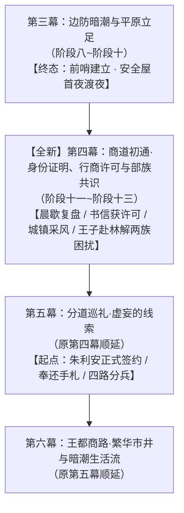

# 新增第四幕方案：商道初通·身份证明、行商许可与部族共识

> **设定库参考基准**：本方案全程以 `docs2/` 实体设定档案库为第一权威基准，相关地点、角色与事件实体严格对齐以下卡片：
> - 地理：`LOC_D2_11` 法尔肯驿镇 · `LOC_D2_39` 迷迭香商行 · `LOC_D2_01` 营地篝火 · `LOC_D2_00` 地点总览
> - 角色：`CHR_D2_18` 朱利安·维里迪亚 · `CHR_D2_01` 艾德里安 · `CHR_D2_06` 黎恩 · `CHR_D2_04` 菲娜
> - NPC：玛格丽特·德·拉菲尔（迷迭香商行商业行会理事）· 汉斯（猎鹰与十字老驿馆学徒）
> - 距离基准：营地→大门15km；大门→法尔肯10km；营地→王都约130km

> **方案定位**：第二部宏篇主线核心调整方案。在第三幕（阶段十·前哨立足）与后续大幕（正式签约·四路分兵巡礼）之间，正式确立全新大幕。  
> **核心动因**：
> 1. **经典日轻生活流与战役间歇期**：承接老驿馆首夜安睡，展开清晨同伴互动；劳拉与两位丈夫同榻大床的晨起慌乱小插曲，乔治开启战术导力隔音屏蔽，全员从容复盘当前处境与迷茫；
> 2. **书信隐秘往来与身份顺理成章**：朱利安王子通过玛格丽特夫人以密信沟通，在王都动用王室渠道替众人办妥一切通关文书。主角团无需纠结官僚手续，在日常采风的某一天自然接获玛格丽特送来的正规《商号雇工印照》与《内陆商道通行状》；
> 3. **森林与城镇双向通畅的日常底色**：本幕以轻松有趣的日常为主轴，一半在法尔肯集镇采风、体验风土与采购物资，一半在森林大本营享受爱丽榭大食堂与多族相聚；
> 4. **朱利安亲赴大本营与彻底根除两族困扰**：正式签约不能操之过急，必须先切实解决异族燃眉之急。朱利安王子在王国端亲自出手，彻底解决**教会私船向沼泽偷排炼金废料毒水**以及**黑市猎人潜入边境偷捕幼狼**的两大恶行，并亲自再赴森林大本营立信。两族心结彻底化解，为下一幕正式签约铺平道路。

---

## 〇、 幕级拓扑重构与时序衔接

* **时序跨度**：入境法尔肯后约一周至两周（W10 ~ W11）；
* **前置输入（承接第三幕·阶段十）**：
  - 空间：法尔肯“猎鹰与十字”老驿馆二楼安全套间（`LOC_D2_11`）与迷迭香商行（`LOC_D2_39`）；
  - 状态：全员在老驿馆安心度过抵达平原的首夜，冷兵器完成防酸涂装，化解初次夜巡排查；
  - 资产：大门缴获的黑血铅管原本（EVD-01）、守备队长巴恩斯的通关铁牌（EVD-02）、三百枚流通紫铜便士与商行通券、埃德蒙国王十八年手抄抚恤暗账卷轴原本。
* **后置交付（交接第五幕·分道巡礼）**：
  - 空间：法尔肯老驿馆与迷迭香商行；
  - 状态：全员持有合法的正式身份证明与行商许可；蜥蜴人与狼人两族的燃眉困扰被朱利安王子彻底解决，全森林对王室建起真正信任；
  - 承接点：下一幕开篇，朱利安王子在老驿馆与众人从容相聚，正式举行森林与王国签约仪式、奉还十九年前手札（EVD-03），并兵棋推演四路分兵出征！

---

## 一、 全新第四幕核心主题与戏剧张力

### 1. 核心主题
老驿馆清晨敲门的可爱慌乱与脸红日常、乔治战术导力隔音回路下的全员复盘、玛格丽特暗中传递王子密信与身份证明、行商许可自然到手、持证走进法尔肯集市体验轻松城镇生活流、见闻教会兼并与麦粉涨价之苦、采购大批精盐面粉布匹顺畅回流大本营、爱丽榭大食堂新鲜白面水果馅饼的温馨欢聚、菲娜提出结盟构想牵出蜥蜴人黑水之痛与狼人被捕幼狼之危、密信联动朱利安雷霆整治排毒私船与捕狼猎队、朱利安亲赴大本营送还幼狼立信、两族心结彻底化解达成签约共识、为下一幕正式签约与分兵做好坚实铺垫。

### 2. 核心瓶颈与现实阻力
* **处境迷茫与无方向感**：成功入境后前路未定，艾德里安故地在中西部废墟，雷恩旧案在西南修道院，王都在两百公里外，且全员缺乏王国合法身份证明与通行许可；
* **蜥蜴人的沼泽黑水之痛**：教会背景的私船长期在边境河道与沼泽上游偷偷倾倒炼金废料废酸，沼泽水质受损，族人健康遭受持续威胁；
* **狼人幼崽被捕危机**：平原黑市贪婪猎人越界潜入森林外围下套设陷，偷捕狼人幼崽贩往王都贵族庄园充当异兽，狼人部族极度敌视人类；
* **信任前提缺失**：若不先解决切肤之痛，任何白纸黑字的条约在各族眼中都毫无意义。

### 3. 核心破局主角与手段
* **劳拉 + 雷恩 + 艾德里安（三人家庭生活流温馨担当）**：三人同榻大床晨起穿衣的手忙脚乱与劳拉的微红脸颊，冲淡了长途紧绷；
* **乔治（技术保密屏障）**：在老驿馆套间展开便携式战术导力隔音屏蔽，确保全员复盘绝密安全；
* **玛格丽特夫人 + 朱利安王子（暗线文书与实权运作）**：通过商行密信保持联络，王子在王都动用特许渠道办齐正规身份证明与行商许可，众人某天自然接获证件，解除后顾之忧；
* **朱利安王子（王室雷霆手腕与亲赴大本营）**：
  - 调动近卫与地方密探，当场查扣并封堵偷排炼金废料的教会黑船，斩断排毒源头；
  - 捣毁边境走私捕兽团伙，亲手解救受惊的狼人幼崽；
  - 亲自再次深入森林大本营，向鳞母呈交查封文书，将幼狼完好送还月语者，以实打实的善政化解两族积怨；
* **五族联军（心意相通与完全认可）**：鳞母手抚清澈泉水、月语者拥抱幼狼，两族首领由衷认可王室诚意，全员达成结盟共识。

---

## 二、 全新第四幕分阶段演进蓝图

本幕由 **3 个长线演进阶段** 构成（阶段十一至阶段十三）：

### 阶段十一：晨歇复盘与隔音长桌·玛格丽特密信与身份许可就绪
* **所属幕次**：第四幕·阶段十一
* **核心剧情演进**：
  1. **清晨敲门与大床晨起的可爱慌乱**：
     - 在老驿馆度过安心一夜后，清晨的阳光透过铅条玻璃窗洒在走廊石板上。黎恩与菲娜梳洗整齐，来到劳拉、雷恩与艾德里安三人所在的套间门前轻扣门扉；
     - 门内大床上突然传来一阵激烈的被褥翻卷声与撞翻圆凳的闷响，紧接着是劳拉带着慌乱与羞恼的轻喊：“等、等一下！我们还没穿好衣服！”以及三人手忙脚乱穿衣的窸窣动静；
     - 门外黎恩苦笑抓头，菲娜则像抓到把柄的小猫一样凑到黎恩耳边咬耳朵偷笑。门内折腾了好一会儿，房门才咔哒一声拉开；
     - 走进去一瞧，室内那张宽大的橡木大床上被褥凌乱，劳拉正强装镇定地背对着众人检查双手剑挂带，耳根通红；雷恩温厚老实地摸着鼻梁坦承自己手笨把披肩系带弄反了，艾德里安领口微敞不紧不慢地端着茶水上前慵懒护短调侃“我们家女主人难得睡个好觉”，房间里洋溢着三人夫妻生活流的甜蜜温馨；
  2. **乔治启动战术导力隔音屏蔽与全员复盘**：
     - 乔治在桌角安置好特制便携导力组件，激活微弱而稳定的隔音屏蔽，将室内的交谈声彻底隔绝在套间之内；
     - 黎恩在栎木长桌上摊开手绘地图——这张地图还粗糙得很，连法尔肯往南的主道都只画了大概走向，大门以南一片空白。大家一边吃着热气腾腾的早餐，一边认真整理当下的处境：虽然已在法尔肯立足，却对王国腹地几乎一无所知——艾德里安家族旧领在哪个方向、雷恩旧案的线索该从何入手、王都距此到底有多远，眼下统统是两眼一抹黑；加上全员缺乏在王国内自由行动的正规身份证明与通行许可，贸然深入只会自投罗网；
  3. **玛格丽特密信引线与身份证明、行商许可顺理成章送达**：
     - 众人无需费心官僚运作。艾德里安通过迷迭香商行的后堂渠道（女主人玛格丽特夫人为商业行会理事，亦是艾德里安落难时的生死患难故交），与远在王都周旋的朱利安王子建立起隐秘的书信往来；
     - 王子在密信中通报王国内情，并承诺通过王室特许商号的权力为全员打点好一切合法手续；
     - 在法尔肯停留的某一天，玛格丽特夫人笑盈盈地送来一口精致的牛皮公文盒——全套合法的《迷迭香商行特聘雇工印照》（身份证明）与《内陆商道通行状》（行商许可）已然齐备！乔治拿到工坊学徒证明，劳拉与雷恩领到佣兵护卫通行许可。众人自此有了堂堂正正行走在王国阳光下的正规身份。

### 阶段十二：城镇风土与营地回流·大食堂馅饼与两族心结
* **所属幕次**：第四幕·阶段十二
* **核心剧情演进**：
  1. **持证集市采风与城镇生活流大舒展**：
     - 拥有正规身份证明与行商许可后，众人不再拘束，分头走进法尔肯的大街小巷，全景体验 JRPG 城镇生活；
     - 黎恩陪着菲娜漫步在木筋屋集市，给菲娜买到了刚出炉的肉桂杏仁酥饼和甜苹果茶；菲娜像好奇的小猫一样打量着各种摊位，黎恩温柔宠溺地替她擦去嘴角的酥皮屑；
     - 菲在镇中暗巷轻巧穿行，观察巡防骑士的换岗规律；雷恩与劳拉在镇郊麦田看到被教会兼并土地后沦为农奴的自耕农，艾德里安调查出罗曼商行垄断麦粉暴涨四成的民生困局；
  2. **满载生活物资与随时回流营地**：
     - 众人用兑换的紫铜便士与银克朗，在商行协助下大批量采购大本营急缺的人类物资：精盐、大袋雪白小麦粉、棉麻布匹与生铁农具；
     - 众人驾驶两辆满载大篷车，持着崭新的正规身份证明与行商许可堂堂正正从大门通行，随时往返大本营（营地与前哨之间，从此正大光明地来去自如！）；
     - 大本营林间空地爆发欢呼。爱丽榭与亚莉莎惊喜迎上，当晚营地升起篝火，爱丽榭用新鲜白面粉烘烤了焦香诱人的水果馅饼，炖煮热气腾腾的野山菌浓汤，全员在欢声笑语中享受难得的团聚；
  3. **大本营议事与两族切肤困扰浮出水面**：
     - 晚餐后，在指挥木屋召开议事，菲娜与黎恩提出朱利安王子希望森林与王国签署《生态保护敕令》的设想；
     - 异族首领并未被一纸空文打动，两族的现实痛点彻底摆上桌面：
       - **蜥蜴人部族**：加尔与鳞母指出，教会私船长期在上游将黑血与炼金废料偷偷倾倒入河，沼泽水质日渐恶化，危及族人繁衍；
       - **狼人部族**：罗恩与月语者沉重透露，近期有人类贪婪捕兽队潜入边境林地设伏，偷捕了两只无辜的狼人幼崽，意图贩往王都贵族庄园牟利；
     - 各族态度明确：若这些切身之害得不到解决，所谓的王权敕令不过是一句空话。
   4. **【专项节点】连夜赶赴迷迭香商行·玛格丽特传信**：
      - 议事散场后，艾德里安与黎恩两人连夜返回法尔肯，专程登门迷迭香商行——这里的女主人，正是艾德里安当年旧交、暗中为王子搭线的玛格丽特夫人；
      - 两人将两族的切身困扰原原本本说给玛格丽特听，请她动用商行的隐秘信道把话捎进王都，转达朱利安王子；
      - 玛格丽特以惯常的风情从容挑了挑眉，拿起羽管笔，在账册里夹好一封私信，放心，这封信明天就能出发。

### 阶段十三：王子赴林立信·两族困扰根除与大盟约前奏
* **所属幕次**：第四幕·阶段十三
* **核心剧情演进**：
  1. **朱利安雷霆出手：断排毒、捣猎团**：
     - 接获大本营密信后，朱利安王子在王国内部果断采取秘密行动：
     - 王子派出忠诚的近卫骑士突袭了上游秘密码头，当场查扣封存了偷排暗影炼金废料的教会私船，斩断排毒源头，并严惩了涉事黑心工头；
     - 顺藤摸瓜端掉了潜伏在边境集镇的非法捕兽黑市据点，将设套捕狼的偷猎团伙一网打尽，成功解救出被关在铁笼里的两只受惊幼狼；
  2. **朱利安亲赴大本营：呈递文书与送还幼崽**：
     - 朱利安王子再次轻装简从、秘密深入森林大本营；
     - 在大本营议事厅内，王子当着各族首领的面，郑重呈递了盖有王室大印的查封排毒船只处置文书，并亲手打开藤筐，将两只完好无损、毛茸茸的狼人幼崽送还到月语者和罗恩怀中；
     - 幼狼发出亲昵的呜咽声扑入族人怀抱，狼人们眼中的戒备彻底化作感激；
  3. **两族心结彻底化解与全员共识确立**：
     - 鳞母抚摸着取来的上游清澈水样，看着行事果决的人类王子，缓缓点头：“水变干净了，做出来的事骗不了人”；
     - 月语者单手抚胸向王子致以古老的荒野敬礼：“月光见证了你的公道，王储”；
     - 矮人多尔金也狠狠拍了拍王子的后背：“是个带种的人类小伙子！”；
     - 奥蕾莉亚与全员相视而笑，双方互信的基石彻底夯实，各族一致同意在随后正式签署同盟敕令；
  4. **围炉共饮与蓄力待发**：
     - 议事圆满落幕，全员在壁炉与篝火旁共饮黑麦酒，畅谈未来的平原调查计划。大家目标明确、士气高昂；
     - 众人再次整备行装返回法尔肯前哨；
     - **【完美交接第五幕】**：下一幕（原第四幕顺延）开篇，便是在老驿馆正式举行签约仪式、朱利安奉还十九年前手札（EVD-03）、雷恩恢复名誉、羊皮纸地图与木雕战旗推演并四路分兵出征！

---

## 三、 核心实体与物象核验表

| 维度 | 对应实体与设定 | 功能与防呆规范 |
| :--- | :--- | :--- |
| **地理舞台** | 法尔肯驿镇（`LOC_D2_11`）、老驿馆二楼套间、迷迭香商行（`LOC_D2_39`）、Eldoria大本营（`LOC_D2_01`） | 严格依据 `docs2/location/` 空间声光构筑，展现林国通畅的往返生活流。 |
| **合法公文凭证** | 《迷迭香商行特聘雇工印照》、《法尔肯自由市镇居留特许证》、《内陆商道通行状》、商会紫蜡火漆 | 解决外来偷渡者的身份危机，全员持证合法通行。 |
| **核心事件物象** | 便携导力隔音屏蔽器、肉桂杏仁酥饼、大袋食用精盐与白小麦粉、被解救的毛茸茸狼人幼崽、查扣排毒私船处置文卷 | 扎实的日轻生活流道具与推动部族信任的核心物理凭证。 |
| **部族诉求闭环** | 蜥蜴人沼泽排毒源头被斩断查封、狼人被捕幼狼完好送还、矮人与奥蕾莉亚见证诚意 | 彻底解决异族被架空的政治逻辑缺陷，让盟约具备绝对法理深度。 |

---

## 四、 幕级结构顺延总对照表

| 原幕次编号与名称 | 调整后幕次编号与名称 | 核心定位与阶段变动 |
| :--- | :--- | :--- |
| **第三幕**：边防暗潮与平原立足 | **第三幕**：边防暗潮与平原立足 | 涵盖阶段八至阶段十。**终态：首夜安睡与安全屋建立**。 |
| *无* | **【全新】第四幕**：商道初通·身份证明、行商许可与部族共识 | **涵盖阶段十一至阶段十三**。劳拉脸红与晨歇复盘、密信获许可、营地采风回流、朱利安赴营解决两族困扰。 |
| **第四幕**：分道巡礼·虚妄的线索 | **第五幕**：分道巡礼·虚妄的线索 | 原阶段十一至阶段十四顺延。**起点：朱利安正式签约 / 奉还手札 / 四路分兵出征**。 |
| **第五幕**：王都商路·繁华市井与暗潮生活流 | **第六幕**：王都商路·繁华市井与暗潮生活流 | 原阶段十五至阶段十八顺延。 |
| **第六幕**：血色伏击·至暗大溃败 | **第七幕**：血色伏击·至暗大溃败 | 原阶段十九至阶段二十一顺延。 |
| **第七幕**：绝境流亡·篝火重铸与艾斯特雷亚之誓 | **第八幕**：绝境流亡·篝火重铸与艾斯特雷亚之誓 | 原阶段二十二至阶段二十四顺延。 |
| **第八幕**：深渊古道·暗河谍影与地底破壁 | **第九幕**：深渊古道·暗河谍影与地底破壁 | 原阶段二十五至阶段二十七顺延。 |
| **第九幕**：惊天劫狱·血洗圣殿死牢 | **第十幕**：惊天劫狱·血洗圣殿死牢 | 原阶段二十八至阶段三十顺延。 |
| **第十幕**：王都暗流·沙龙旧卷与法理围城 | **第十一幕**：王都暗流·沙龙旧卷与法理围城 | 原阶段三十一至阶段三十三顺延。 |
| **第十一幕**：王都异化·双城合围决战 | **第十二幕**：王都异化·双城合围决战 | 原阶段三十四至阶段三十六顺延。 |
| **第十二幕**：破晓大审判与黎明宪章 | **第十三幕**：破晓大审判与黎明宪章 | 原阶段三十七顺延。 |
