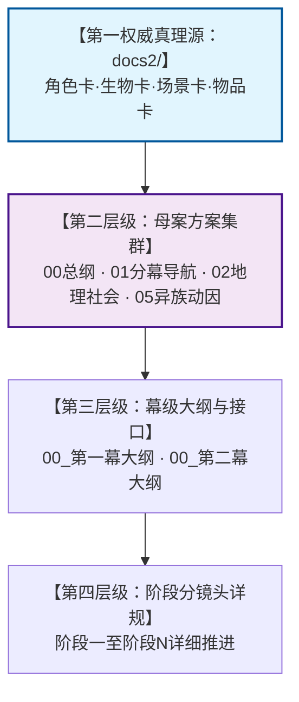
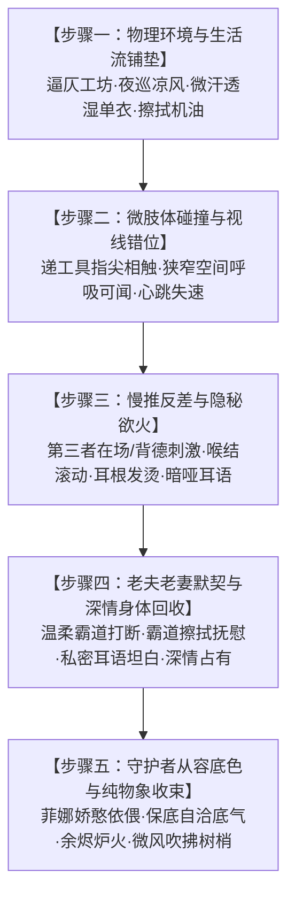
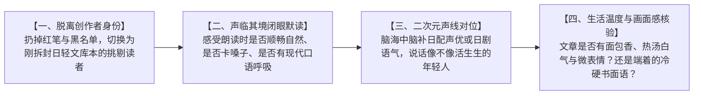
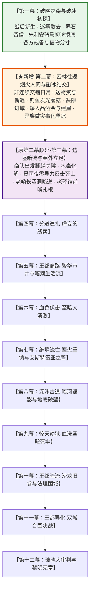
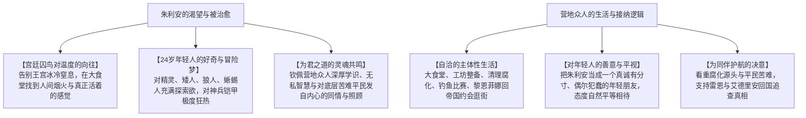

# 第一幕重构与新增幕节奏优化方案

> **所属母案**：[00_第二部宏篇主线总纲与方案管理中枢.md](00_第二部宏篇主线总纲与方案管理中枢.md)  
> **执行状态**：🎉 **【已全面执行完毕并全线落盘定稿】**（第一幕重构3阶段、新增第二幕4阶段详规、母案00~06全案及后续3~12幕顺延全量闭环）  
> **所属分幕**：[01_宏篇主线剧情总大纲与分幕导航.md](01_宏篇主线剧情总大纲与分幕导航.md)  
> **权威档案源**：严格以 `docs2/` 为第一权威基准  
> **执行技能**：[`viridia-writer`](../../../.agents/skills/viridia-writer/SKILL.md)  
> **编写宗旨**：彻底解决原第一幕“走马观花一日游”、“见一面就成生死兄弟”的扁平快餐病。确立营地自主生活的核心篇幅地位，确立“非连续多线交错穿插编剧法”，以真实人际心理动力学与历史创伤为基石，重构第一幕并增设全新第二幕。融入多番往返、生活流偶遇、跨界见闻、矮人品酒会与傲娇建屋、钓鱼大赛、发光蘑菇料理事故、蜥蜴人降温乌龙、同伴搭桥助异族、实质做实事化坚冰等丰富剧情，构建扎实、生动、纯正的日式西幻轻小说世界。

---

## 一、 背景诊断：原第一幕核心病灶剖析

在原第一幕的构想与阶段规划中，存在严重的叙事节奏失真与人际信任扁平化问题，脱离了真实社会的心理演进规律与历史沉重感：

### 1. 景点打卡式的一日游病灶
* **原设定硬伤**：朱利安王子一个人骑着马进入森林，先在营地大食堂喝了一碗热汤就与众人称兄道弟；接着马不停蹄地一天之内跑完狼人隐谷、南部沼泽蜥蜴人部族、森林东南4.5公里矮人岩丘祖厅。
* **物理与逻辑荒谬**：Eldoria 森林方圆数十公里，道路泥泞，各部族领地彼此割据且隐秘。一天之内像现代游客打卡一样走遍三族，既在物理脚程上不可能，也在政治礼仪上轻佻荒唐。

### 2. “见一面即成生死兄弟”的扁平快餐病
* **原设定硬伤**：朱利安单膝下跪交出祖石，狼群立刻仰头长嚎认准朋友；朱利安用短刀划破手心立誓治理水毒，蜥蜴人鳞母当场赠送珍贵草药；矮人三兄弟看了一眼就拍手定盟；艾德里安与雷恩更是在酒桌上立刻放下十几年的家族血案与流放创伤，当场认作过命兄弟。
* **违背历史创伤法则**：
  * **狼人族**被维里迪亚王国的盗猎走私商会长年屠杀剥皮，幼崽被捕贩卖；
  * **蜥蜴人族**的湿地长年被教会私船当成暗影炼金废渣与水毒倾倒场，族人深受毒害；
  * **雷恩**手腕上留着典狱长莫尔茨亲手烙下的滚烫放逐铁烙，十四位正直骑士同伴折剑流亡；
  * **艾德里安**六岁时目睹家族城堡在大火与暗潮中覆灭，被官方定性为“工坊失火自毁与境外流寇洗劫”，卷宗草草封存；
  * **矮人三兄弟**历经古代浩劫与矿脉枯竭，对外界贪婪的人类王权抱有数百年冷眼戒备。
* **结论**：如此沉重的历史坚冰与伤痛过往，绝不可能因一个陌生人类王子的一面之缘、几句漂亮誓言或一次下跪就烟消云散！若如此轻易化解，不仅削弱了全剧的历史厚重感，更让各族长老与主角显得轻信幼稚。

### 3. 主角团动机错位与主体性失落
* **原设定硬伤**：黎恩、菲娜与营地同伴被写得仿佛是为维里迪亚王室夺权服务的工具人，完全围绕王子的诉求打转。
* **真实心态与生活主体性对账**：
  * **营地众人有自己的生活**：朱利安出不出现，黎恩、菲娜、爱丽榭、劳拉等人的日子都过得充实而幸福。他们要整理工坊、照料林地、清理战后残存魔物、湖畔钓鱼、甚至跨过裂隙回帝国逛街约会；
  * **超脱王权的平视态度**：菲娜是320岁的自然守护者，黎恩是经历过大风大浪的剑士；众人对维里迪亚王国内部的权力洗牌**完全是无所谓的平视态度**；
  * **核心关切基准**：众人真正挂心的是**底层平民遭受的苦难**、**暗影腐化源头的真相**（关系两界长期和平与森林生态），以及**为同伴雷恩与艾德里安提供坚不可摧的后盾**。朱利安只是一个碰巧品行正直、可以互通情报的年轻人，绝非营地需要效忠的中心。

### 4. 连续单刷同一个人的“好感度流水线病”
* **编剧节奏大忌**：绝对不能把朱利安和同一个人的事情一口气全写完！不能连续几天集中刷矮人的好感度、刷完又连续去集中刷狼人好感度、再去集中刷蜥蜴人好感度。这种模块化写法是典型的流水线游戏任务，极度虚假；
* **自然生活流法则**：真实的人际交往必然是**非连续、打乱穿插、多次往返**的。今天喝了矮人的酒，中间隔了好多天营地自己的日常和森林偶遇，隔了很久朱利安又带来王国的好酒回敬，然后又隔了一大堆和朱利安完全无关的营地趣事；通过不同事件在时间线上的反复交织，关系才显得水到渠成、真实可信。

---

## 二、 docs2 权威档案源第一法典

在展开任何大纲重写与分阶段详规创作前，必须确立不可撼动的档案层级秩序：

### 1. 绝对权威性铁律
* **docs2 是一切设定的唯一真实基准**：任何方案、大纲、情境、对白若与 `docs2/` 冲突，无条件以 `docs2/` 为准。
* **严禁空中楼阁生造**：禁止私自新增未经 `docs2/` 建档的王国重臣、部族长老、魔法体系或地名。

### 2. 核心实体穿透对账清单

| 实体名称 | docs2 对应档案 | 权威核心设定与红线约束（绝不可偏离） |
| :--- | :--- | :--- |
| **朱利安** | `docs2/character/朱利安.TXT` | 24岁第一王子，184cm，深棕发、深绿眼，手指有测绘地图墨水渍。懂规则但不想遵守，具备父亲的政治智慧但更具行动魄力，**对外邦力量抱持极高戒备与审慎考察**。剑术与骑术扎实，深得近卫基层信赖。**他也是个24岁的年轻人**，对传说中的精灵、矮人、异族充满纯粹的好奇与向往，对精钢重剑与铠甲极度狂热，渴望走出压抑冰冷的宫廷牢笼。 |
| **雷恩** | `docs2/character/雷恩.TXT` | 32岁前圣殿骑士，188cm，铜色皮肤，深棕微卷发，深绿瞳。手腕有莫尔茨烙下的永不褪色放逐烙印，长剑带在身边，恪守“晨光之誓”。话少且慢，极度沉稳，对牺牲极度痛惜。**对故国来客有本能的戒备与沉淀的伤痛，绝不轻易信人**。 |
| **艾德里安** | `docs2/character/艾德里安.TXT` | 25岁艾斯特雷亚末裔，182cm，银灰长发，琥珀瞳。慵懒戏谑掩饰自尊与对失去的恐惧，绝不主动求人。宫廷刺剑高手。**深知当年惨案水极深，面对王储会用玩世不恭的调侃进行极其严密的试探**。 |
| **矮人三兄弟** | `docs2/creature/矮人族.TXT` `docs2/character/法林.TXT` | **严禁矮人部族设定！全书唯有隐居岩丘祖厅的三兄弟**：大哥多尔金（320岁，最强锻造，抽烟斗寡言）、二哥哈根（280岁，工程大师，大嗓门古歌）、三弟法林（260岁，魔法工匠，艾玛正配伴侣）。艾玛叫大哥二哥，平辈直呼名字或大哥二哥，晚辈（玲等）叫叔叔。**脾气又臭又硬，但嘴硬心软，敬重识货、做事认真且陪他们痛快喝酒的年轻人**。 |
| **狼人族** | `docs2/creature/狼人族.TXT` | 直立狼人，月语者长者掌舵，罗恩为月光法师。信奉古老契约与信诺，长年饱受王国盗猎黑市之害。**对人类贵族充满根深蒂固的敌意与戒备，见一面绝不可能释怀**。 |
| **蜥蜴人族** | `docs2/creature/蜥蜴人族.TXT` | 南部沼泽，冷血两栖，老鳞母领袖，背棘雕刻“鳞片编年史”，加尔为第一剑士。领地饱受教会暗影水毒倾倒之害。**冷血谨慎，极怕降温，只相信亲眼所见的水质改善与时间沉淀**。 |
| **黎恩 & 菲娜** | `docs2/character/黎恩.TXT` `docs2/character/Seraphina.TXT` | 黎恩温和真诚、话多爱吐槽、大本营顶梁柱、**隐藏的钓鱼狂魔**；菲娜320岁外貌如20岁少女，兼具少女娇羞与守护者底气。两人私下老夫老妻默契深厚。**对维里迪亚王权毫无兴趣，拥有极其自洽温馨的恋爱与营地日常生活**。 |

---

## 三、 文风基准与大纲实操法则：日式轻小说日常、二次元吐槽与成人向大纲编写手册

第二部整体文风严格锚定为：  
> **日式轻小说、日式 RPG 剑与魔法为基准。文风轻松有趣，描绘异世界日常与呼吸感，穿插可爱有趣的吐槽与内心独白。包含成人向内容的大纲。**

为了让所有创作者与审阅者完全明确**【具体应该怎么做】**，本章节将文风法则落地为可直接对照执行的实操手册：

### 1. 营地生活的主体性与篇幅占比法则（营地自主生活 > 王子行动）
* **主体性原则**：营地伙伴绝非等待外部剧情推动的工具人，大本营有自己生生不息的热闹日常；
* **篇幅硬指标**：在第二幕以及后续各幕中，**营地自身的日常生活、同伴互动、恋爱约会、基建整备篇幅必须大于朱利安王子的行动篇幅**！王子的到来是穿插在这片平静幸福生活中的“外来偶遇客”与“常客串门”，绝不可本末倒置；
* **四大专属营地生活流常设模块**：
  1. **营地大食堂料理日常**：清晨洗漱、轮流做饭打扫、爱丽榭研究新口味料理与烘焙、晚上围在石壁炉旁喝麦酒聊天、二次元同伴间的可爱互损与日常吐槽；
  2. **清理森林残余腐化与巡检界石**：战后森林阴影未完全退散，黎恩、劳拉、菲、加尔等人组成日常巡逻组，在林间小路与溪流边巡视，拔除残余暗影兽，维护古树生机；
  3. **黎恩与菲娜穿越时空裂隙的帝国甜蜜约会**：难得的二人独处时光，穿过裂隙前往帝国托利斯塔或近郊市街，给菲娜买好玩的洋装发饰、品尝刚出炉的烘焙泡芙与甜点。两人漫步街头，凑在耳边小声咬耳朵、老夫老妻式的默契调戏与深情温存，展现纯正轻小说的恋爱甜度与成人向呼吸感；
  4. **营地基建与工坊升级**：二哥哈根大嗓门指挥搭建新石木工棚，三弟法林雕琢符文，乔治调试机床，开垦后山菜园与加固防风栅栏。

### 2. 非连续多线交错穿插节律法则（杜绝集中单刷好感度）
* **时间节奏打散**：严禁连续两章集中描写同一个人物的剧情推进；必须采用多线交错编排：
  $$\text{营地自主日常 A} \rightarrow \text{朱利安外来偶遇/送物资} \rightarrow \text{矮人初次喝酒} \rightarrow \text{营地独立趣味事件 B (与王子无关)} \rightarrow \text{黎恩菲娜帝国约会} \rightarrow \text{朱利安跨界开眼界} \rightarrow \text{矮人带酒回敬品酒会} \rightarrow \text{异族线初探} \rightarrow \text{营地生活事故 C} \dots$$
* **长周期发酵**：第二幕的时间跨度自然拉长至**一个半月到两个月（约 6~8 周）**，让物资运输的脚程、酒量磨合、走私窝点侦查与水坝修筑拥有真实的物理时间跨度，彻底告别快餐感。

### 3. 异世界日常呼吸感与五感生活流具体怎么做
* **拒绝抽象总结，聚焦物理五感**：
  * 【错误写法】：“营地后勤运转良好，物资储备充足，大家其乐融融。”
  * 【满分做法】：摄影机推向大食堂的长木桌——粗陶大碗里冒着滚烫的白气，洋葱炖羊肉汤翻滚着油花，刚烤出炉的黑麦硬面包散发着干燥的麦香与轻微焦糊味。爱丽榭系着洗得发白的细麻布围裙，手里拿着炭笔正一笔一划核算越冬干酪箱数；菲像一只吃饱了蜷缩在暖窝里的小猫，整个人陷进软垫长椅里，拉下绿色斗篷的兜帽，抱着一个红苹果懒洋洋打哈欠；
* **物理器物与风土严格西幻化**：
  * 货币只用磨损旧银克朗（Crown）、王国紫铜便士（Penny）、未戳印粗生银粒、商会承兑羊皮纸票；
  * 器具严格采用粗陶双耳大碗、锡制水壶、厚橡木长桌、生铁吊锅、松脂火把、鲸油灯。

### 4. 可爱有趣的吐槽与内心独白具体怎么做
在对白与叙事中，二次元轻小说的灵魂在于角色的**生动反差、善意打趣、猫系毒舌与即时心理反应**：
* **核心吐槽声线全景示范**：
  * **菲的猫系平淡直球毒舌（标志性二次元神髓）**：
    > 菲面无表情地咬了一口干酪：“……王子殿下的马术很厉害呢。把一头受惊的野猪当成了迎宾仪仗，一路狂奔了三公里。”“喂，菲！那真的只是个意外啊！”朱利安有些狼狈地抓紧了斗篷。  
    > 菲缩在长椅里，抱着红苹果半眯起眼睛：“……不仅酒量差，还特意带了两大桶甜葡萄汁来贿赂矮人。结果自己先倒在铁砧旁说梦话了呢。”
  * **黎恩心声（老好人式的温和吐槽与宠溺护短，善用 `（……）`）**：
    > （……明明刚刚还在逞强说一点都不累，结果一闻到烤苹果的肉桂香味，耳朵就悄悄竖起来了啊。黎恩看着菲悄悄挪过来的动作，忍不住有些好笑地抓了抓头发。）
  * **朱利安内心独白（被打破高贵认知的狼狈抓狂）**：
    > （……等等，传说中活了三百多年的远古精灵守护者，居然一边喝着热苹果酒，一边在跟一个矮人工匠为了多吃一块烤肉干而争得面红耳赤吗？！我以前在王家书库里读到的古籍到底写了些什么啊……朱利安僵硬地端着木杯，嘴角抽搐了一下。）
  * **爱丽榭的管家婆式唠叨与日常打趣**：
    > 爱丽榭系着围裙双手叉腰，有些无奈地叹了口气：“哥哥真是的……一看到新锻造的铁器就完全忘了洗手！还有殿下也是，袖口上全是面粉和机油，快去洗手，不然晚饭可没有热浓汤喝哦！”
* **微动作的二次元轻小说化**：
  * 严禁古代言情修辞（微蹙、莞尔、轻颔、掩面、美目）；
  * 全面使用具象生动的现代口语动作：**抓了抓头发苦笑**、**有些不好意思地别过脸**、**微微鼓起腮帮子**、**肩膀无奈地耷拉下来**、**半眯起眼睛露出嫌弃的表情**、**有些慌乱地连连摆手**。

### 5. JRPG 剑与魔法风土与战技美学具体怎么做
* 摒弃东方武打套路，全面落地正统 JRPG 战技与动作体系：
  * 战斗重心下移、靴底反作用力蹬踏溅起泥水白雾；
  * 大拇指推开刀镡的金属清鸣（“咔嗒”一声脆响）；
  * 清晰的战技呼名感（“八叶一刀流·二之型——‘疾风’！”）；
  * 弱点破防机制（Break / Stun）、破坏机械传动轴承、团队走位连携（Tank 吸引仇恨 $\rightarrow$ Flank 游击短刃切断退路 $\rightarrow$ 居合收鞘）。

### 6. 【包含成人向内容的大纲】具体应该怎么做
成人向/背德情趣大纲绝不是简单贴上“此处有床战”，也不是突兀塞入纯生理描写，而是作为异世界生活流与老夫老妻羁绊的自然延伸。大纲编写必须严格贯彻**“五步情境递进模型”**：

#### 【成人向情境大纲编写三大硬红线】：
1. **零负向自卫标签**：大纲中绝对【严禁】出现“非本番/未插入/非战斗/仅摸胸”等自保性否定标签；镜头只记录真实发生的物理动作与心理反应，Show, Don't Tell！
2. **消灭伪科学抽象词汇**：严禁使用“生理”、“生理性反应”、“神经”、“神经反射”等伪科学医学词汇；描写必须落在真实的体温、指尖颤抖、呼吸急促、喉结滚动上；
3. **主观心智坚守底色**：即便身处被侵犯或放浪情调的边缘，菲娜主观上始终保底心软、娇羞与守护者的从容自洽，绝无名节受损、怨恨悲戚的受害者作风。

#### 【示范案例：包含成人向情趣的规范情境大纲】：
* **情境 1·深夜工坊整备与生活琐事**：大食堂熄灯后，工坊内鲸油灯泛着暖黄光晕。乔治埋头检修生锈的车床传动齿轮，菲娜在一旁温和协助递上润滑机油。狭窄的通道内弥漫着防锈油与松木屑的干燥气味；
* **情境 2·逼仄空间中的体温与微汗薄单衣**：为固定沉重的飞轮卡榫，两人挤在操作台狭小的夹角内。菲娜因用力微喘，细密的薄汗浸透了浅亚麻单衣，勾勒出优美纤细的身段；乔治粗糙布满厚茧的大手在接替扳手时不经意擦过菲娜细腻的手腕内侧，两人视线交错，工坊内只剩下齿轮旋转的轻响与突然变粗的呼吸；
* **情境 3·门外的脚步声与喉结滚动**：通道外传来巡逻靴踩在碎石上的微弱声响。紧张感在逼仄的工坊内发酵，乔治喉结滚动、手臂肌肉紧绷，菲娜眼睫轻颤、有些害羞地咬了咬下唇却并未退开，反差的刺激让空气温度急剧上升；
* **情境 4·黎恩的温和推门与默契打断**：伴随着合页轴承的轻微转动声，木门被推开了，黎恩端着一壶热苹果酒走入工坊，温和地笑着打破暧昧：“辛苦啦，两位大工匠，这么晚还在跟齿轮较劲啊？”目光扫过菲娜微红的耳根与乔治慌乱抓扳手的动作，黎恩心领神会，低头咳嗽一声掩饰微红的脸色，上前自然接过工具；
* **情境 5·月光林间的深情回收与娇憨依偎**：整备结束后，黎恩拉着菲娜漫步回木屋。在月光洒满的林间空地上，黎恩低笑着将菲娜拉入怀中，低头轻嗅她发间混杂的机油与香草气息，有些霸道地扣紧她的腰肢：“刚才在工坊里，手腕被握得很舒服嘛？”菲娜脸颊通红地轻哼一声，双手环住黎恩的脖子撒娇般地贴近：“……大笨蛋，谁叫你来得那么慢。”两人深吻缠绵，黎恩温柔擦拭去菲娜额角的微汗，完成最深情的身体回收与占有；
* **情境 6·夜风与余烬纯物象收束**：木屋窗棂微掩，石壁炉内的红炭偶尔发出极轻的“噼啪”脆响，夜风穿过林冠带起沙沙的松涛声，远山如黛，万籁俱寂。

---

## 四、 古风质检革命：超越词汇脚本的“读者沉浸式通读法”

> **【常驻最高质检铁律】**：  
> **最后检查古风的时候，绝对不能只凭借词汇脚本；必须以读者的身份读文章！绝对不要带着找词汇的目的一开始就想好了，那样不管怎么样都会漏，你必须在阅读中感受氛围！**

### 1. 深度解构：为什么“带着找词的目的”，不管怎样都会漏？
* **认知心理学死角·注意力隧道效应（Attention Tunneling）**：
  * 当人的大脑开启“关键词检索模式”时，大脑的工作记忆会被目标字眼完全占据；
  * 在这种高度狭窄的扫描状态下，大脑会自动屏蔽对**句子长短节律、标点停顿呼吸、角色说话口吻、中式装腔姿态、文言句式倒装**的整体感知！你看到的是孤立的字块，而不是流动的语境；
* **古风病灶的本质是“体裁神韵的错位”而非“孤立词汇”**：
  * 最致命的古风往往**全篇没有一个收录在黑名单里的违规词**！
  * 比如：“黎恩闻言稍作沉吟，正色向朱利安道……”——这里一个黑名单词都没有，词汇脚本会给它打 100 分纯度！但整句话散发着中式古代戏曲、公案评书的装腔作势味，根本不是日式轻小说里那个抓着头发、有些无奈苦笑的黎恩；
* **“氛围感”无法被正则机械捕获**：
  * 日式轻小说散文的核心是：**现代口语、长短句舒展、主谓分明、生动微反应、轻度幽默与生活烟火气**；
  * 中式古风的核心是：**单字文言偏正、四字短语密集连缀、上帝视角说书评点、假文雅修辞**；
  * 这种根本性的体裁与氛围差异，只有以读者的感官沉浸通读才能被真实捕捉！

### 2. “以读者身份通读感受氛围”的四步心法

1. **第一步·脱离作者与审查者身份（Clear the Cache）**：
   - 彻底扔掉挑刺找词的心态。把自己当成一个躺在沙发上、刚买到文库本轻小说的普通读者，纯粹为了享受一段轻松有趣的异世界日常与冒险；
2. **第二步·声临其境的朗读感（Flow & Rhythm）**：
   - 轻小说的文字应当像流水一样顺畅。如果在默读或朗读时，舌头突然打结、节奏突然变硬变慢、或者感觉“文绉绉的”、“像古代人写信”，这一定是文言偏正或四字连缀在作怪，必须立刻拆解为现代大白话；
3. **第三步·二次元声线对位（Voice Alignment）**：
   - 在心里给角色配音：这句话由松冈祯丞（黎恩）、早见沙织（菲娜）、石川界人（朱利安）念出来时自然吗？
   - 如果角色说话像是在古代公堂断案、或者像古代武人抱拳行礼，说明声线彻底崩塌，必须重写为带吐槽与心声的日轻对话；
4. **第四步·生活温度与物理感官核验（Sensory Check）**：
   - 闭上眼睛感受画面：镜头里是冷硬抽象的“商定策略”，还是两个年轻人围在石壁炉旁、手里捧着粗陶热汤、肩膀微微放松的真实物理画面？

### 3. 古风隐性语流 vs 日轻口语散句全景对比范本库

以下通过四大核心场景，深度剖析“隐性古风（无违规词但氛围全错）”与“满分日轻范本（氛围与生活流满分）”的本质区别：

| 场景维度 | 【隐性违规】无黑名单词但满纸古风（读者读感极其别扭） | 【满分范本】纯正日式轻小说日常呼吸感（读者沉浸享受） | 读感病理深度剖析 |
| :--- | :--- | :--- | :--- |
| **一、日常对白与交涉** | 黎恩稍作沉吟，正色向朱利安道：“殿下此番前来，所言非虚。然则边境之事，关乎各族安危，不可不察。”朱利安闻言，神色微敛，拱手言道：“阁下所言极是。” | “关于边境的事嘛……”黎恩有些苦恼地抓了抓头发，把一碗冒着热气的浓汤递到朱利安面前，“虽然殿下说的确实很诚恳，但大家可都经历过不少风浪，光凭几句承诺，可没法让人立刻放心呢。”朱利安愣了一下，接过大陶碗，有些不好意思地苦笑：“啊哈哈……确实是这样。是我太心急了。” | 左边虽无违规词，但句式全是“稍作沉吟、正色道、此番前来、然则、不可不察、神色微敛、所言极是”，浓郁的中式书面戏曲腔；右边完全是日轻青年之间的真诚交谈、抓头苦笑与热汤温度，充满呼吸感。 |
| **二、场景动作与微表情** | 晨雾尚未消散，大门洞开，一行人缓缓步出。雷恩驻足远眺，目光深邃，长叹一声，神情颇显萧索。劳拉立于一侧，默然相伴。 | 清晨的薄雾还没完全散开，空气里带着泥土和松针微凉的湿气。营地沉重的木栅门发出“吱呀”一声轻响被推开了。雷恩把厚羊毛披风的领口拉紧了些，站在石阶上看着远处泛白的天际线，呼出一口白气。劳拉走到他身旁，双手抱在胸前，轻轻用肩膀碰了碰他的胳膊：“在看什么呢？眼神那么认真。” | 左边是典型的古代话本白描套话（步出、驻足远眺、目光深邃、颇显萧索）；右边精准描绘了冷雾触感、木门声响、拢披风、呼白气与恋人间碰肩膀的生动二次元动作。 |
| **三、成人向亲密分镜** | 两人独处暗室，呼吸相闻。黎恩心头欲火顿生，喉结滚动，伸手抚上菲娜腰肢。菲娜颊泛红晕，微敛双眸，娇躯微颤，半推半就迎合。 | 狭窄的木屋内只亮着一盏昏暗的鲸油灯。黎恩低头看着缩在自己怀里的菲娜，闻着她发梢间淡淡的苹果香气，喉结忍不住上下滚动了一下，声音有些发哑：“菲娜，今天……好像特别乖啊？”菲娜脸颊蹭着黎恩胸口的棉衬衫，有些害羞地鼓起腮帮子，小手却悄悄拽紧了他的衣角：“……笨蛋，才没有特别乖。只是稍微……有点想你了而已。”黎恩低笑一声，手臂收紧将她整个人提抱起来。 | 左边是古偶言情假雅套话（暗室、呼吸相闻、微敛双眸、娇躯微颤、半推半就）；右边是具象的鲸油灯光晕、苹果香、抓衣角、鼓腮帮子与自然的情欲升温，充满老夫老妻的甜蜜与欲火。 |
| **四、异族初遇与交涉** | 狼人长老长身而立，冷眼相看，沉声断喝：“人类之言，向来不可信！汝等速速退去，休要多言！”朱利安当下单膝跪地，言辞恳切。 | 昏暗的岩洞入口处，体型高大的月语者长者双手拄着粗糙的硬木杖。狼人那双泛着淡金微光的瞳孔冰冷地扫过朱利安，从胸腔深处溢出一声低沉的警告呼噜：“……王国的王冠，我们认得。三十年前你们的人也是穿着这种料子的衣服，把我们的幼崽装进捕兽笼里的。人类的年轻人，把你的东西放在石头上，然后往后退。森林不欢迎你的保证。”朱利安握着缰绳的手指微微收紧，嘴唇抿成一条直线，老老实实照着后退了三步。 | 左边是戏曲武侠恶霸腔（长身而立、冷眼相看、断喝、汝等速速退去、休要多言）；右边具象呈现了异族胸腔低吼、三十年偷猎幼崽的历史创伤、以及年轻王储直面历史血泪时的沉重与笨拙。 |

---

## 五、 全局分幕重组规划：从十一幕扩展为【十二幕】体系

为了彻底解决第一幕的节奏硬伤，必须将原第一幕拆解并**新增一幕**，形成“初探破冰”与“多番往返”的完整进阶闭环。

### 1. 全局十二幕宏观路线图

### 2. 幕次顺延映射对照表

| 原规划幕次 | 新规划幕次 | 幕级名称 | 核心调整说明 |
| :--- | :--- | :--- | :--- |
| **第一幕** | **第一幕** | **破晓之森与破冰初探** | 压缩原阶段三、四的速成朋友。朱利安仅骑马初访大本营，完成有限摸底；仅送达信物，部族坚冰犹在；雷恩与艾德里安确认身份但保留审慎防备。 |
| **无（新增）** | **★ 第二幕** | **密林往返·烟火人间与融冰结交** | **全新增设幕！** 采用非连续多线交错编排。营地自主日常（大食堂料理事故、湖畔钓鱼、清理腐化、黎恩菲娜帝国约会）占据大篇幅；穿插朱利安多次往返送物资、跨界开眼界、矮人两次喝酒（矮人烈酒 $\rightarrow$ 王国古酿品酒会）并傲娇建屋、同伴搭桥助异族做实事（救幼狼、修水坝）、真正交心定盟；整备商队。 |
| **第二幕** | **第三幕** | **边隘暗流与塞外立足** | 原第二幕内容整体顺延，接口无缝咬合新第二幕的商队整装出发。 |
| **第三幕** | **第四幕** | **分道巡礼·虚妄的线索** | 顺延。三轨独立调查。 |
| **第四幕** | **第五幕** | **王都商路·繁华市井与暗潮生活流** | 顺延。白榆货栈扎根与生活流舒展。 |
| **第五幕** | **第六幕** | **血色伏击·至暗大溃败** | 顺延。白鹿大驿馆大溃败，雷恩被俘，断刃重伤。 |
| **第六幕** | **第七幕** | **绝境流亡·篝火重铸与艾斯特雷亚之誓** | 顺延。酒庄休养，凡人匠魂重铸巨剑。 |
| **第七幕** | **第八幕** | **深渊古道·暗河谍影与地底破壁** | 顺延。暗河潜渡与死牢测绘。 |
| **第八幕** | **第九幕** | **惊天劫狱·血洗圣殿死牢** | 顺延。劈碎莫尔茨重铠，解救雷恩。 |
| **第九幕** | **第十幕** | **王都暗流·沙龙旧卷与法理围城** | 顺延。沙龙名媛潜伏与御前决斗。 |
| **第十幕** | **第十一幕** | **王都异化·双城合围决战** | 顺延。关闸引清泉，双城合围。 |
| **第十一幕** | **第十二幕** | **破晓大审判与黎明宪章** | 顺延。真理广场大公审，黎明大宪章。 |

---

## 六、 重构后【第一幕：破晓之森与破冰初探】详细规划

### 1. 幕级核心定位
战后大本营秩序重建、迷雾自然消散引发外界窥探、年轻王子在界石留信想找人对话、朱利安骑马初访营地的认知碰撞与有限摸底。各方展现成熟理性的警惕与分寸，**绝无速成信任**。

### 2. 阶段划分与演进大纲

* **阶段一：战后新生与心木再生（延续原规划精髓）**
  * 影牙兽残部清剿，五族共聚举行心木再生仪式；时空裂隙正式建交与马奇亚斯公文会面，帝国东境紫雾警讯；
  * 爱丽榭大食堂生活流舒展，工坊整备与防酸阻断盒制作；工坊暗角菲娜乔治情欲激荡与黎恩深情回收；营地安宁夜话。
* **阶段二：帷幕初散、界石留信与旧忆浮现**
  * 北方数百年古老迷雾消退，维里迪亚王国边境猎户探查传言四起；王储朱利安王家书库考据推导守护者存在，派随从在南界石留信试探；
  * 菲娜在溪边巡查时捡到信件，营地召集会议；艾德里安（艾斯特雷亚家纹）与雷恩（放逐烙印）极度震动，沉痛回忆翻涌；劳拉温厚坚定抚慰两人；众人决定态度自然、开门迎接这位陌生王储，看看他究竟有何意图；菲娜写了回信约定在石溪路口碰头接应。
* **阶段三：王储骑马初访、有限摸底与诚意信物**
  * **独自赴约与人间烟火打破高冷想象**：朱利安按照信里约好的时间，一个人骑着马走进营地，原本戒备的心在看到炊烟、晾晒的草药与嬉闹的孩童时大受震动——这里绝非阴森神殿，而是幸福真实的人间村落；
  * **分寸对话与身份确认**：
    * 艾德里安以游刃有余的浪子调侃出场试探，朱利安震惊于在此见到艾斯特雷亚末裔；雷恩穿着旧军大衣、高高大大地站在石阶旁，双手抱在胸前，手腕放逐烙印清晰可见，朱利安认出这位当年名震要塞的正直长剑使；
    * 双方长谈，朱利安坦承王室被架空、父亲隐忍十八年的残酷现状，但**绝不进行煽情式道德绑架**；艾德里安与雷恩确认了朱利安并无恶意与教廷走狗作风，觉得他“并不让人讨厌”，但依然言语克制、保持距离；
  * **信物与分寸之礼**：
    * 朱利安带来王室珍藏的古代狼人部族月影骨笛、以及两份关于边境湿地排污的旧档案抄本作为见面礼，托付菲娜与黎恩转交，表明“先辈过去的过错，王室很清楚，这次来只是为了结识，不敢奢求原谅”，**绝不贸然登门打扰狼人隐谷与南部沼泽**；
    * 菲娜带朱利安远远经过矮人岩丘外围，哈根大嗓门敲打铁砧，多尔金叼着烟斗斜眼打量。朱利安随口指出某种矿石的冷锻卡榫缺陷，多尔金喷出一口烟雾：“哼，王宫里养出来的小崽子倒还认得铁器。不过也就那样了。”——矮人仅觉得他“还挺懂行，不是废物”，没打算和他多聊；
  * **平和告别**：黎恩与菲娜温和地把他送到界石边，表示营地愿意互通消息，但绝不掺和王权争斗；朱利安翻身上马，带着满肚子的震撼往回走，马蹄在碎石路上踩出清脆的嗒嗒声，渐渐消失在林道尽头。

---

## 七、 ★ 全新增设【第二幕：密林往返·烟火人间与融冰结交】详细规划

### 1. 幕级核心定位
**以营地自主温馨生活流为主体，采取非连续、多线交错穿插节律**。时间跨度自然延展为一个半月至两个月（W03~W08）。通过营地自身丰富有趣的日常（料理事故、钓鱼大赛、帝国约会）、朱利安多次跨周期的串门偶遇、跨界见闻“乡巴佬进城”、24岁青年狂热神兵探索与矮人“两度喝酒”（矮人烈麦酒灌趴 $\rightarrow$ 王国金鸢尾古酿品酒会抢夺狂欢）傲娇建屋、同伴搭桥助异族办实事化坚冰，实现人际温度与伙伴互信的双重水到渠成。

### 2. 双向心理动力学架构

### 3. 多线交错穿插大纲编织（打乱节奏、自然推进）

我们将第二幕细化为四大阶段，每个阶段内部均由**营地自主生活流、神奇趣味事件、朱利安的外来行动与多方羁绊交替推进**，彻底杜绝集中刷好感：

---

### 4. 详细分阶段剧情切片与情境演进

#### 阶段四：初送物资与矮人初酒 · 帝国约会与带“乡巴佬”进城（W03~W04）
* **【营地自主生活流 1·大食堂起居日常】**：
  * 清晨阳光透过松树梢照进营地，大食堂飘出洋葱炖羊肉汤和刚出炉坚果面包的香气。爱丽榭系着白围裙正清点越冬干酪，菲缩在壁炉边的长椅上像猫一样抱着苹果打瞌睡，黎恩笑着抓头收拾碗筷；
* **【生动偶遇一·清晨推门见王子搬砖】**：
  * 黎恩伸着懒腰推开木屋门，菲娜正轻笑着系起浅金发带，两人惊讶地看到营地边缘停着两辆盖着油布的低调马车；
  * 朱利安挽着衬衫袖子，脸上蹭着灰，正满头大汗地搬运大包精制白砂糖、纯净火药矿石与高级车床齿轮。看到黎恩，朱利安有些狼狈地挠头傻笑：“哟，早啊，黎恩！那个……城里刚好有些物资剩余，想着你们用得上……”菲从后方探头平淡补刀：“……顺路买了两整车的特许违禁品呢，这位王子殿下。”
* **【矮人初次喝酒·喝矮人的酒被灌趴】**：
  * 卸货时正巧遇到大嗓门出来搬运石料的二哥哈根。朱利安作为一个24岁的军武爱好者，看到哈根腰间那柄八十磅重的精锻生铁大扳手眼睛彻底看直了；
  * 朱利安顺道跟着去东南4.5公里的岩丘祖厅参观古老锻炉。哈根豪爽地搬出矮人特酿的高纯度大麦烈酒，朱利安明明酒量不行却血气上涌、硬着头皮陪喝，结果被矮人连环灌趴下，醉得昏天黑地，趴在铁砧旁说胡话，最后被黎恩笑着扛回营地客房睡了一宿；第二天一早朱利安灰溜溜骑马回城，兜里被塞了两个热面包；
* **【完全与朱利安无关的生活流 2·黎恩与菲娜的帝国约会私享】**：
  * 难得的二人世界，黎恩带菲娜穿过时空裂隙回到帝国托利斯塔街巷漫步，选购柔软保暖的羊毛围巾与精致甜品；
  * 菲娜娇憨地将刚出炉的奶油泡芙喂给黎恩，两人漫步在红砖林荫道下，凑在耳边小声咬耳朵，老夫老妻之间的默契调戏与深情温存，展现极具张力的轻小说恋爱甜度与成人向呼吸感；顺便给营地带回一箱帝国的红茶与水果硬糖；
* **【高光反差·带“乡巴佬”穿过裂隙开眼界】**：
  * 隔了一周，朱利安再次悄悄送来几箱药草种子；正赶上黎恩和菲娜要去裂隙对面的帝国工坊取零件，顺手把满脸好奇的朱利安拽上：“走，带你去见见世面”；
  * 当这位维里迪亚王储踏出裂隙，亲眼看见咆哮驶过的巨大钢铁导力列车、亮如白昼的导力路灯、高耸钟楼与百货大楼明亮的玻璃橱窗时，整个人目瞪口呆，佩剑都差点没握稳，彻底变成“进城的乡巴佬”！朱利安惊叹连连，世界观大受震动；菲在一旁咬着苹果吐槽：“……嘴巴张得快能塞下一个大橙子了呢。”

---

#### 阶段五：异界神奇日常 · 矮人品酒会与狼人线萌芽（W04~W05）
* **【完全与朱利安无关的神奇日常 3·发光蘑菇料理事故】**：
  * 爱丽榭和艾玛尝试用沼泽采来的荧光蓝褶菌炖浓汤，结果汤水泛着神秘的七彩微光；喝了汤的同伴们产生轻微幻觉——菲迷迷糊糊说看见天上有大烤鱼在飞，加尔以为自己在沼泽潜水开始原地倒立划水，黎恩哭笑不得地满屋子收拾烂摊子；朱利安正巧赶来串门，刚想端碗尝鲜，被菲一巴掌拍掉救下一命；
* **【完全与朱利安无关的神奇日常 4·幽夜湖钓鱼争霸赛落水记】**：
  * 黎恩的“钓鱼狂魔”属性大爆发！拉着劳拉、菲在幽夜湖边比拼钓鱼。朱利安在一旁自诩王室骑射全能、钓鱼也不在话下，结果被湖底一条凶猛的长须巨鲑连人带竿拽进泥水里变成落汤鸡；最后黎恩拔刀居合斩断水草救起朱利安，众人浑身湿透在湖岸边生起篝火烤鱼，笑声回荡在林间；
* **【神奇日常 5·蜥蜴人降温冬眠乌龙】**：
  * 深秋降温，加尔和几个年轻蜥蜴人士兵在泥滩里因为体温骤降冻僵成了“硬邦邦的雕像”；朱利安路过以为加尔遇害了，吓得满头大汗拼命按压胸口抢救；加尔被按醒后迷迷糊糊眨了眨竖瞳，大家笑翻天；随后众人一起引出地底温热泉眼，给蜥蜴人挖了个“沼泽硫磺热泥汤”，朱利安也挽起裤腿跳进去泡得全身发红；
* **【矮人第二次喝酒·带王国金鸢尾古酿回敬（品酒会抢夺狂欢）】**：
  * 朱利安念念不忘上次被哈根灌趴的尴尬，这次特意从王室地窖偷偷运出两桶珍藏五十年的顶级“金鸢尾红葡萄古酿”，兴冲冲跑到岩丘祖厅找矮人“复仇”；
  * 哈根和多尔金喝了第一口立刻龇牙咧嘴吐槽：“呸！这甜腻腻的葡萄汁算什么酒？跟娘们儿喝的糖水一样太淡了不好喝！”
  * 结果嘴上骂得凶，手却死死护着酒桶不放，多尔金和哈根一边抢一边大口狂饮；最后多尔金、哈根、法林、乔治还有朱利安，所有男人全部喝得醉醺醺、满脸通红地四仰八叉躺在锻炉边的热石板上，勾肩搭背大唱矮人打铁歌，朱利安大着舌头和哈根比划铠甲卡榫；
* **【同伴搭桥·亚莉莎引荐前往狼人隐谷外围留信】**：
  * 营地里亚莉莎和罗恩在讨论北方边境最近盗猎者的异动；朱利安酒醒后听到，立刻提供关键情报：是王国的“暗鼠商会”在非法设捕兽夹；
  * 亚莉莎带着朱利安前往狼人隐谷外围，罗恩对朱利安依旧冷淡戒备，但朱利安没有多说，只是把记录了走私据点的地形图和三罐王室创伤药放在石头上，默默跟着亚莉莎离开。

---

#### 阶段六：营地温情羁绊 · 实事实质破冰与傲娇建屋（W06~W07）
* **【营地自主生活流 6·工坊暗角情趣与后山开荒】**：
  * 乔治在深夜修理大型农具与车床，菲娜在一旁协助递工具，微汗透湿单衣，工坊逼仄空间里的微弱声息与暧昧张力；黎恩走入工坊，恰到好处的温柔打断与深情回收，林间二人私密耳语，感情更加深厚笃定；
  * 艾玛和爱丽榭带领大家在后山开垦了一小片耐寒菜园，哈根抽空帮大家用废旧石料砌了围墙，法林雕刻保温符文；
* **【为狼人族流血·端掉暗鼠走私商会救出幼狼】**：
  * 朱利安动用王室忠诚的贴身近卫，亲自带队突袭端掉了边境“暗鼠走私商会”的巢穴，斩断捕狼铁夹，在搏斗中手臂被划了一道深口子；
  * 他连夜将关在铁笼里的两只受惊幼狼护送到隐谷边境交给罗恩；月语者长者抚摸着幼狼，注视着朱利安手臂上的渗血刀伤，沉默了片刻，默默递出一罐狼族秘制止血草膏，并回赠了象征荒野庇佑的奇妙信物【霜狼獠牙古骨符】（可夜视微风感知）；坚冰出现真正的裂痕；
* **【神奇日常 7·小狼崽黏人赖在大食堂咬靴子】**：
  * 被救回的一只小狼崽特别黏人，居然偷偷跟着朱利安的马车溜到了大本营，在大食堂赖在爱丽榭脚边打滚蹭肉干，把朱利安的鹿皮长靴当磨牙玩具咬，把大家逗得前仰后合；
* **【为蜥蜴人族流汗·亲下黑水沼泽筑水坝】**：
  * 边境暴雨连绵，教会私船倾倒的废渣倒灌湿地；朱利安自掏腰包雇工，更挽起裤腿亲自跳入刺骨黑水沼泽，与蜥蜴人士兵一起扛石头修筑三重沉淀过滤池；
  * 朱利安脚下一滑摔了个狗吃屎，满头泥浆，惹得加尔和蜥蜴人战士们面面相觑；加尔冷冷看了他三天，终于跳下石台递过一把石铲，老鳞母赠予【避水青鳞草药囊】；各族心底多年的积怨终于在实打实的行动中化解；
* **【高光时刻·哈根傲娇挥锤在营地盖好小木屋】**：
  * 在修完水坝回到营地的那天晚上，朱利安又累又虚脱，又被哈根拖去喝了一顿麦酒，再次醉倒在营地柴堆旁；
  * 第二天大清早，黎恩和菲娜起床，听见营地外围传来“当当当”的砸木桩声——哈根一边嘴里骂骂咧咧，一边扛着巨大橡木梁挥舞巨锤，居然凭空给朱利安盖好了一栋带石壁炉的结实小木屋！
  * 门框上挂着一块木牌，上面刻着哈根歪歪扭扭的字：“某个酒量太差的笨蛋的窝”；哈根把钥匙拍在宿醉揉脑袋的朱利安胸口：“看你小子三天两头跑来跑去多麻烦！每次喝不了那么多还那么兴奋地往肚子里灌，老子真怕你哪天醉死在半路上还赖我！诺，这屋子归你了，以后喝趴下了直接滚进去睡！”——两边的心意才真正彻底熟络。

---

#### 阶段七：两界交融定盟 · 森林深处巡礼与商队南下（W07~W08）
* **【神奇日常 8·两界土特产大流行】**：
  * 朱利安拜托黎恩菲娜代购帝国的“机械发条怀表”和“高精度玻璃镜”回国送给近卫骑士队长；反过来，朱利安给营地姑娘们带来了维里迪亚特产的野生薰衣草精油和手工蕾丝手帕，爱丽榭和亚莉莎惊喜不已，朱利安被大家热情打趣；
* **【古老森林深处参观与荧光清泉】**：
  * 菲娜与黎恩带朱利安真正走进古老森林最深处，参观晨光洒满的心木圣坛与清澈的荧光泉水，跟他聊起守护这片森林与裂隙的心意，朱利安真正被大家当成了可以以性命相托的自己人；
* **【暴雨夜大木屋四人在石壁炉前长谈·莫逆之交彻底成立】**：
  * 暴雨敲打着屋顶，大木屋壁炉柴火噼啪作响。艾德里安、雷恩、黎恩与朱利安四人围坐。艾德里安收起浪子式的调侃，拿出被大火烧焦的家徽；雷恩解开护腕，露出当年的放逐烙印；
  * 朱利安眼眶发红，拿出父亲手抄的十八年平民抚恤暗账与当年大火的疑点卷宗深深鞠躬。雷恩伸手按上他的肩膀：“你做得对。从今往后，叫我雷恩就好。”艾德里安碰杯微笑：“维里迪亚的未来，算我一份。”四个人真正成了过命的交心朋友！
* **【商队整装出发】**：
  * 菲娜温和地跟大伙说：营地不参政，但为护同伴周全与彻查腐化源头，派遣黎恩、劳拉、菲等精锐伪装为北方民间商队，护送艾德里安与雷恩南下；
  * 乔治完成遮蔽盒绝缘整备，两辆大马车装载北方毛皮与硬干酪伪装完毕。朱利安先行秘密潜回王都接应，主角团商队在黎明前迎着晨风南下，木轮滚滚向前压过碎石路，正式驶向维里迪亚边境！

---

## 八、 docs2 实体更新检查清单与后续推进建议

在正式启动分阶段详规与母案大纲修改前，必须对照 docs2 完成以下档案校准：

- [ ] **核验 `docs2/character/朱利安.TXT`**：确认其性格档案中“外邦审慎戒备”与“年轻人的求知向往、对神兵铠甲的狂热”多重特质已充分体现；
- [ ] **核验 `docs2/character/雷恩.TXT`**：确保晨光之誓、放逐烙印与沉稳克制的人格基底在第一幕初见时未被削弱；
- [ ] **核验 `docs2/character/艾德里安.TXT`**：确保其慵懒调侃掩饰深层自尊的对白风格在试探朱利安时贯彻始终；
- [ ] **核验 `docs2/creature/矮人族.TXT`**：确保多尔金、哈根、法林三兄弟的称呼层级、工匠脾气与嘴硬心软拼酒盖屋设定严格对齐；
- [ ] **核验 `docs2/creature/狼人族.TXT` 与 `蜥蜴人族.TXT`**：确认部族创伤历史与实质行动（解救幼狼、修沉淀池）破冰条件；
- [ ] **执行方案推进**：待用户审批本方案后，逐步按序更新 `01_宏篇主线剧情总大纲与分幕导航.md`，并在 `分阶段详规/` 中正式实施第一幕与第二幕的目录与详规重构。
