# 第八幕 docs2 档案对账、剧情矛盾排查与文风深度重塑方案

> **所属幕次**：第八幕·血色伏击·至暗大溃败（涵盖阶段二十六至阶段二十八 + 幕级大纲）  
> **归档位置**：`方案/第二部/已执行/第八幕docs2档案对账、剧情矛盾排查与文风深度重塑方案.md`  
> **关联母案**：
> - [`00_第二部宏篇主线总纲与方案管理中枢.md`](../主线与世界扩充方案/00_第二部宏篇主线总纲与方案管理中枢.md)
> - [`01_宏篇主线剧情总大纲与分幕导航.md`](../主线与世界扩充方案/01_宏篇主线剧情总大纲与分幕导航.md)
> - [`06_第二部主线跨幕连续性与全局物理状态机.md`](../主线与世界扩充方案/06_第二部主线跨幕连续性与全局物理状态机.md)
> - [`00_第七幕大纲与接口.md`](../主线与世界扩充方案/分阶段详规/07_第七幕_王都商路·繁华市井与暗潮生活流/00_第七幕大纲与接口.md)
> - [`00_第八幕大纲与接口.md`](../主线与世界扩充方案/分阶段详规/08_第八幕_血色伏击·至暗大溃败/00_第八幕大纲与接口.md)
> - [`00_第九幕大纲与接口.md`](../主线与世界扩充方案/分阶段详规/09_第九幕_绝境流亡·篝火重铸与艾斯特雷亚之誓/00_第九幕大纲与接口.md)  
> **对账权威基准**：`docs2/` 实体设定档案库（第一权威基准）、[`writing-guards.md`](../../../.agents/rules/writing-guards.md)、[`lexicon.md`](../../../.agents/rules/lexicon.md)、[`viridia-writer`](../../../.agents/skills/viridia-writer/SKILL.md) 技能法典、以及用户核心指令：
> 1. **大纲文风和世界观**：以日式轻小说、日式 RPG 剑与魔法为基准，白描与轻松白话，轻松有趣，描绘异世界日常与呼吸感，穿插可爱有趣的吐槽与内心独白；
> 2. **剧情前后矛盾**：对比档案库、前七幕剧情以及伏笔，与目前的第八幕剧情统合自洽；
> 3. **地点、人设等**：对照档案库，检查人物性格内心特征、发色等外貌特征，核实地点和 NPC 是否凭空捏造、是否出自档案库卡片或卡片提及内容。

---

## 〇、 排查综述与核心发现总览

代入架空剑与魔法日式西幻世界观，以 `docs2/` 实体档案库（角色 13 张、NPC 23 张、据点 37 张、生物 9 张、世界 6 张）为第一权威基准，对第八幕全套 4 份核心文件：
- [`00_第八幕大纲与接口.md`](../主线与世界扩充方案/分阶段详规/08_第八幕_血色伏击·至暗大溃败/00_第八幕大纲与接口.md)
- [`阶段二十六_合流会盟与白鹿大驿馆围城详规.md`](../主线与世界扩充方案/分阶段详规/08_第八幕_血色伏击·至暗大溃败/阶段二十六_合流会盟与白鹿大驿馆围城详规.md)
- [`阶段二十七_异化死士狂潮与名刃折断详规.md`](../主线与世界扩充方案/分阶段详规/08_第八幕_血色伏击·至暗大溃败/阶段二十七_异化死士狂潮与名刃折断详规.md)
- [`阶段二十八_石桥断后、雷恩被俘与王室政变详规.md`](../主线与世界扩充方案/分阶段详规/08_第八幕_血色伏击·至暗大溃败/阶段二十八_石桥断后、雷恩被俘与王室政变详规.md)

进行了逐行逐字的比对穿透与剧情逻辑审校，梳理出以下三大维度的核心发现：

### 核心发现清单：

| 维度 | 审查项目 | 核心问题定性与严重程度 | 关键修改与统一结论 |
| :--- | :--- | :--- | :--- |
| **维度三：人设外貌** | **劳拉发色严重冲突** | 🚨 **严重违规**：详规正文与分镜中 4 处写成“金发”（与亚莉莎混淆），严重违反官方卡 `docs2/character/劳拉.TXT` 第 10 行明确标注的**“靛蓝色长发扎成高马尾”** | 全量纠偏为**“靛蓝色长发”**与**“深蓝高马尾”**，彻底维护劳拉在全系列中的纯正经典形象 |
| **维度三：人设外貌** | **亚尔缇娜瞳色冲突** | ⚠️ **设定错误**：阶段二十六第 54 行写成“微圆的金色双眼”，违反官方卡 `docs2/character/亚尔缇娜.TXT` 第 10 行明确标注的**“黄绿色双瞳”** | 全量更正为**“黄绿色双瞳”**，消除与玲（金色双瞳）的混淆 |
| **维度二：人物在场** | **玲（Renne）全幕隐形遗漏** | 🚨 **严重遗漏**：第八幕大纲第 60 行遗漏玲的名字；正文虽注明“八音盒由玲贴身收纳”，但在大厅宴饮、战斗突围中玲零台词、零动作、零互动 | 幕大纲补齐玲；在阶段二十六大厅宴饮补充玲把玩八音盒的傲娇吐槽与拌嘴，阶段二十七补充其以轻量长镰掩护撤退的战术动线 |
| **维度二：剧情逻辑** | **汉斯（Hans）跨空间闪现** | ⚠️ **动线缺环**：汉斯官方身份为法尔肯驿舍学徒（距白鹿驿馆约 70km），阶段二十八突然推独轮车从着火的白鹿驿馆后厨马厩逃出送药，缺少前置交代 | 在阶段二十六前置交代：汉斯此前由玛格丽特夫人抽调随商队大车北上王都运货，并随行驻扎白鹿大驿馆马厩照料牲口与补给，消除空间闪现感 |
| **维度二：证物守恒** | **八音盒（`EVD-08`）时空分身残留** | 🚨 **逻辑硬伤**：防止阶段二十八科林视角复发“深藏未完工八音盒”的文字残留，造成道具一边在王都箱底、一边在逃亡队伍怀中的分裂 | 严密巩固状态机：`EVD-08` 始终完好由玲随身携带；科林在王都工坊箱底深藏艾玛糖纸、水力钟图谱与机芯镊具 |
| **维度一：文风基准** | **轻小说日常呼吸感与吐槽** | ⚠️ **偏向干瘪概括**：第八幕高压下缺少 JRPG 标志性内视角 `（……）`、角色生动吐槽与羁绊呼吸感 | 大厅宴饮重铸日轻生动对白与可爱拌嘴（菲萌吃、亚莉莎傲娇递手帕、菲娜黎恩桌下分毯、朱利安自嘲抢排骨、玲嫌弃不甜）；战斗融入 JRPG 战技碰撞与劳拉、黎恩的即时心声 |
| **维度三：实体来源** | **地点、NPC 与生物卡片追溯** | ✅ **完全合规**：所有地点（白鹿驿馆、维里迪亚平原、圣殿要塞、圣殿水牢、酒庄、晨光大教堂）、NPC（10位）及生物（机兽、忏悔者、狂骑）100% 出自 `docs2`，无任何凭空捏造 | 在幕大纲中补全所有 NPC 官方编号（`NPC_D2_01` 至 `25`），巩固实体咬合 |

---

## 一、 维度一：大纲文风与世界观深度审查与重塑

### 1. 纯正日式 RPG 剑与魔法轻小说文风定锚
* **世界观基准**：本作本土世界为架空中世纪剑与魔法 JRPG 世界。坚决切断中式武侠、玄幻仙道、明清话本与欧美泥泞冷硬史实惯性。
* **语言质感法典**：
  - **白描与轻松白话**：主谓宾清晰、富有呼吸感的短长散句，拒绝连续四字短语堆砌（四字病），消灭文言偏正与单字冷僻词；
  - **二次元轻小说生动微动作**：无奈抓头发苦笑、别过脸微红耳尖、腮帮子鼓鼓囊囊咀嚼、半眯起眼睛嫌弃吐槽；
  - **标志性即时内心独白 `（……）`**：融入角色的内心小剧场，凸显 VII 班同伴与王室继承人的真实温度；
  - **Show, Don't Tell**：摄影机只忠实记录客观物理动作与现场感官，杜绝“他没有摆出架势”、“不是客栈”等否定式元叙述。

### 2. JRPG 王道救赎内核与“至暗时刻”的反差张力
第八幕是全篇主线从上升期突然跌入“至暗时刻”的断崖式转折。在日式 RPG 经典结构中（如《英雄传说 轨迹系列》各代转折章），**大灾难与暴风雨降临前夕的短暂平静，往往是全作最珍贵、最动人的黄金生活流高光时刻**！
- **原案痛点**：此前的草案对白鹿大驿馆大厅宴饮（阶段二十六第 3 节）描写偏向干瘪概括，匆匆几笔带过菜名与动作，缺少人物的开口交锋、少女之间的可爱拌嘴与恋爱羁绊的温存；
- **重塑准则**：在大风暴砸碎大门前，长桌壁炉旁的热气腾腾、肉馅饼的香脆、苹果酒的甜润、同伴之间的玩笑挪揄、以及黎恩与菲娜在桌布掩护下的无声依偎，构成极致的日式轻小说日常呼吸感。正因为有这样温暖而切实的日常羁绊，后续劳拉舍身横剑正面硬撼重锤、雷恩毅然斩断绞盘铁链卡死吊桥断后，才具备震撼人心的史诗崇高感与情感力量。

### 3. 日式轻小说文风高光场景重塑范本

#### 场景 1：白鹿大驿馆大厅宴饮·长桌微澜与全员呼吸感（阶段二十六）
> 花岗岩壁炉里的干燥栎木柴块噼啪作响，升腾的橘红火苗将整个宽敞的大厅烘烤得暖意融融。  
> 侍应刚将一大盘烤得焦黄流油的迷迭香羊后腿和两大盘刚出炉的洋葱碎炖鹿肉厚馅饼端上长桌，浓郁诱人的肉桂与麦香便在湿冷的空气中蒸腾开来。  
> “……唔！呼、呼……好烫，但是外皮好脆、好好吃……”  
> 菲像只护食的小猫一样两手捧着足有巴掌大的酥皮馅饼，小嘴鼓鼓囊囊地大口咀嚼，面皮碎屑沾得唇角到处都是，满足地半眯起金色的猫眼，头顶那根翘起的呆毛似乎都欢快地晃了晃。  
> 坐在旁边的亚莉莎单手叉腰，忍不住开启了习惯性的大小姐吐槽模式：  
> “真是的，菲！稍微注意一点吃相啦！又没有人和你抢，吃得满脸都是碎屑，待会儿要是噎到了我可不管你哦！”  
> 嘴上虽然这么数落着，亚莉莎却早已从随身小包里抽出一块叠得整整齐齐的干净棉布手帕，没好气地探过身去，动作极轻柔地帮菲擦掉脸颊上的油渍。  
> （“……真是拿这家伙没办法。不过……看到大家能好好坐下来吃口热东西，总算能稍微松一口气了呢。”亚莉莎在心底悄悄嘀咕着，唇角忍不住微微弯起一抹温柔的浅弧。）  
> 另一侧的玲坐在高脚圆凳上，纤细的手指漫不经心地转动着一只红木小匣，紫色的长发垂落在肩头。少女用小银叉挑起一小块鹿肉馅饼尝了一小口，微微皱起好看的眉毛娇哼道：  
> “肉质稍微有点柴呢，而且竟然没有放多汁的黑醋栗果酱做调味……王都的厨子手艺也就这种程度嘛。喂，笨蛋科林，要是你调校出来的八音盒音色也像这块馅饼一样粗糙，玲可绝对不会轻饶你哦。”  
> 话虽这么说，玲那双如紫水晶般的眼瞳却泛着清亮的光芒，小手极其珍视地护着胸前内怀那枚温热的纯铜发条，指尖轻轻蹭过铜盖上的小巧白鸽浮雕。  
> 桌子另一侧，菲娜端着粗陶大茶杯轻抿了一口温热的香料苹果酒，白皙的双颊泛起淡淡红晕。在长桌厚布的掩映下，精灵少女在桌底悄悄伸出手，将膝头那条厚实柔软的深灰羊毛毯分了一大半，轻手轻脚地搭在了黎恩的膝盖上。  
> 黎恩转过头，正好撞上菲娜琥珀色眼睛中狡黠而温存的笑意。  
> “……淋了半天冷雨，腿部关节会发僵的吧，黎恩？大姐姐分你一点温暖哦。”菲娜压低声音附在他耳边，温软的气息拂过耳廓，带着淡淡的苹果酒清香。  
> 黎恩忍不住失笑，在桌下拉住她带着凉意的小巧手指握在掌心低笑耳语：“啊哈哈，多谢菲娜‘大姐姐’的照顾……不过要是被亚莉莎看见，大概又要被数落‘你们两个别在吃饭时卿卿我我’了吧？”  
> “哼哼，那就不要让她看见嘛~”菲娜俏皮地眨了眨眼，像只得逞的小猫一样轻轻晃了晃被握住的手。  
> “喂喂，艾德里安，最后那一截鹿肋排可是我看中的啊！讲点骑士风度好不好？”朱利安王子解下了厚重的旅行斗篷，完全没有平日王室继承人的架子，拿着木叉向艾德里安抗议，脸上带着疲惫中难得的开怀自嘲，“在王宫天天吃冷掉的银盘肉冻，我都快忘记热腾腾的洋葱馅饼是什么味道了。”  
> 艾玛将热气腾腾的草药汤轻柔地递到爱丽榭和亚尔缇娜手中，微笑着看着打闹的大家。亚尔缇娜双手捧着陶杯，清澈的黄绿色双瞳认真注视着水汽升腾，轻声汇报：“根据体温监测，摄入热汤后全员体能正在稳步恢复中，教官。”  
> 窗外初春的狂风凄厉拍打着双层木窗，而长桌旁的微小烟火与笑语，却让每个人心中都升腾起誓死守护这份安宁的坚定信念。

---

#### 场景 2：名刃折断与地窖死守的微镜头（阶段二十七）
> “当——！咔嚓——！！”  
> 伴随着一声令人心头剧颤的刺耳金属悲鸣，星银百锻双手大剑的中段在强酸侵蚀与数千磅冲击力下轰然崩裂！前半截长达一米的明亮断刃旋转着倒飞而出，深深插进大厅残存的花岗岩石柱之中，崩飞的金属火星在昏暗中明灭闪烁。  
> 狂暴的钝击风压瞬间贯穿了精钢胸甲。劳拉整个人如遭重锤横击，喉头涌上一股腥甜，殷红滚烫的鲜血猛然喷洒在残存的半截剑柄上。  
> 少女身形踉跄着单膝跪倒在破碎的花岗岩石堆中，**深蓝色的长发高马尾**被冷汗与雨水打湿紧贴在苍白的脸颊侧面。她的五指因极度用力而骨节泛白，死死攥着那截断裂焦黑的剑柄，指甲深深掐进掌心：  
> （“……动起来……我的手……！亚尔赛德的剑绝不能在这里倒下……身后的通道里还有大家啊……！！”）  
> 少女在脑海中不甘地呐喊着，视线却因脏腑剧烈的震荡而阵阵发黑。  
> 就在战锤带着腥臭毒风反向扬起、欲施加绝杀的刹那，一道疾如惊雷的破空声突然炸响！  
> “休想得逞——！！”  
> 黎恩的双眼因极度的惊怒而瞬间布满血丝，靴底在被雨水浇湿的青石地面上踏碎出一圈激荡的碎石——八叶一刀流拔刀瞬步发动！太刀刀光挟着刚猛绝伦的气浪斜撩而上，刀刃精准挑在战锤主轴的咬合销上，伴随着刺耳的火星迸溅，强行将数百磅的机兽战锤偏转开十余公分，轰然砸碎了侧前方的实心石柱！  
> “菲娜！带劳拉走！！”黎恩横刀立于破碎的瓦砾前，声音沙哑低沉得如同受伤的雄狮。  
> 菲娜与菲几乎是同一瞬间掠至劳拉身侧，菲娜双膝跪地一把将摇摇欲坠的劳拉紧紧抱在怀中，温润的金色微光迫不及待地按向劳拉凹陷的胸甲。感受着同伴微弱的心跳，菲娜咬紧了泛白的下唇，眼眶微红却神色坚决：“交给我……黎恩，绝对不会让她有事的！”

---

#### 场景 3：晨雾独轮车与汉斯送药（阶段二十八）
> 密林边缘的泥泞山道上，初春的湿冷白雾浓得化不开。  
> “嘎吱、嘎吱、嘎吱——”  
> 泥泞中传来的木车轴干涩摩擦声让全员瞬间警惕。菲伏低身形，反手扣住双枪剑正欲突袭，前方的灌木丛却扑通一声被撞开，一个浑身糊满黄泥的单薄身影推着独轮车栽倒在地。  
> “呜哇……！别、别杀我！我是法尔肯驿舍的汉斯啊！！”  
> 十六岁的少年整张脸煞白，粗麻围裙被荆棘刮得稀烂，双手抖得像风中的树叶。在看清眼前满身血泥的黎恩与艾德里安后，少年哇的一声差点哭出来：  
> “谢天谢地……你们真的走这条荒道了！驿馆全烧成灰了……到处都是那些穿黑衣服抓人的异端审问厅密探……我、我趁乱把马厩里的干草推车拉出来了！”  
> 汉斯用还在剧烈发颤的手指拼命刨开湿漉漉的干草堆，掏出一大包用油纸严严实实裹了三层的物件塞进爱丽榭怀里：“这是马鞭草和金盏花油脂！还有晒干的止血草根和黑麦饼！快给伤员用上吧！”  
> 爱丽榭眼眶泛红，双手紧紧捧住那包还带着少年体温的草药油纸，展现出圣阿斯特赖亚女学院学生特有的沉稳大器：“谢谢你，汉斯弟弟……真的太感谢你了，这份心意拯救了我们所有人。”  
> 倚在树干旁的朱利安王子低头看了看自己被短矛扎穿、血肉模糊的左肩，扯动嘴角露出一抹有些虚弱却风趣的苦笑：  
> “哎呀呀……没想到我堂堂维里迪亚第一王子，有朝一日居然要靠一个十六岁驿舍学徒推着干草车来救命呢。这要是让王都那群一本正经的老学究知道了，大概会把胡子都气歪吧。”  
> “朱利安殿下，请您现在老老实实闭上嘴巴保持安静哦。”艾玛一边麻利地撕开绷带，一边推了推眼镜，用温柔却不容置疑的口吻轻声提醒道，“再随便乱开玩笑牵扯到伤口的话，就算您是王子，我也会生气的。”  
> 少年汉斯看着这群即便身处绝境却依然互相支撑、甚至还能开玩笑的传奇人物，原本颤抖的肩膀奇迹般地慢慢平静了下来。少年抹了一把脸上的泥水，重重地点了点头。

---

## 二、 维度二：剧情时空逻辑与跨幕前后矛盾严密排查

### 1. 时空季节日历深度复核（彻底定锚早春，根除深秋秋汛）
* **母案与状态机标准**：
  - [`06_第二部主线跨幕连续性与全局物理状态机.md`](../主线与世界扩充方案/06_第二部主线跨幕连续性与全局物理状态机.md) 第 3.3 节 68 周时空日历标尺：
    - `W15~16（第6幕）`：严冬大雪冬歇、晨光降临祭（12月下旬至次年1月上旬）；
    - `W17~21（第7幕）`：萌芽季初至中旬（1月中旬至2月中旬），商队在王都驻留 37 天，早春解冻、残雪消融；
    - `W22~23（第8幕）`：**萌芽季下旬至清风季初（2月下旬至3月上旬）**，大部队乘车出王都北门进驻白鹿大驿馆；
  - 第七幕阶段二十五第 55 行已明确写道：“两侧是残雪消融后泛出淡淡嫩绿的广袤平原……凛冽清新的早春轻风迎面扑来”。
* **排查结果与锁定**：
  - 此前草案曾一度出现“深秋平原暴风雨”、“秋风秋霜”、“白鹿河秋汛暴涨”等 9 处重大时空穿越病灶；
  - 本次审查严格锁定：**全幕彻底定锚为萌芽季下旬至清风季初（2月下旬至3月上旬）**，外部天气为“早春平原罕见的狂暴雷雨 / 初春凄风苦雨”、“融雪破冻后的冰冷暴雨”、“白鹿河融雪春汛汹涌暴涨”、“初春刺骨寒雨与湿冷晨雾”，与全书 68 周物理状态机 100% 严密闭环！

---

### 2. 核心物理道具 `EVD-08 纯铜风铃八音盒` 全局单向传递链闭环
* **母案与状态机权威流向**：
  - `06_第二部主线跨幕连续性与全局物理状态机.md` 第 78 行权威规定：
    - `EVD-08 纯铜风铃八音盒`：第七幕阶段二十三学徒科林手作相赠 ➔ **随行队伍由玲随身收纳于内怀防水皮袋中** ➔ 第十幕阶段三十二至三十四在深渊千米暗河畔拧动发条安抚疲惫、与黎恩口琴共鸣 ➔ 第十二幕成为与科林接头的信物 ➔ 第十四幕尾声巡礼回赠科林；
* **排查隐患与修复结论**：
  - 此前阶段二十八曾发生严重“时空分身”笔误（把王都工坊里的科林写成藏未完工八音盒，导致同一道具两地分裂）；
  - **本次审查彻底焊死单向闭环**：
    1. **已完工的 `EVD-08 纯铜风铃八音盒` 唯一存在于逃亡小队中，始终由玲贴身妥善收于内怀防水皮袋中**；
    2. 王都工坊中的科林面对白色恐怖，藏入生锈齿轮箱底的物品统一确立为：**“艾玛姐姐赠予的清甜草药糖纸、水力钟连杆图谱残页，以及盲眼师傅传下的精细机芯镊具”**，绝不再碰八音盒本体，彻底消除分裂隐患。

---

### 3. 汉斯（Hans, `NPC_D2_23`）跨空间登场动线严密补齐
* **档案与矛盾点**：
  - `docs2/npc/汉斯.TXT` 明确其为“法尔肯驿镇‘猎鹰与十字’驿舍的年轻侍应兼杂役学徒，约16岁”；
  - 白鹿大驿馆位于平原大道中段（距法尔肯约 70km），汉斯为何突然在第八幕推独轮车从着火的白鹿大驿馆马厩跑出来送药？
* **补齐前置动线与因果闭环**：
  - 在阶段二十六商队出发前明确补充交代：**“因商队大篷车装载了从法尔肯分流行商调运的大宗布匹与急救物资，玛格丽特夫人特意安排勤快本分的年轻学徒汉斯随车照料牲口与补给”**；
  - 商队抵达白鹿大驿馆后，汉斯被安排在后院双层马厩与草棚打理干草；
  - 当异端审问厅死士纵火夜袭白鹿驿馆时，身处后院马厩的汉斯借着干草堆避开正面屠杀，并在危急关头发挥市井少年的机灵，趁乱把后厨常备的止血草药和干粮装入独轮推车抢运出来，顺着林间小道送给撤退中的主角团；
  - 仅需补充一句随车照料的前置交代，立刻让小人物汉斯的登场变得严丝合缝、合情合理，并生动呼应第十四幕他成为沉稳店主的成长弧线！

---

### 4. 玲（Renne, `CHR_D2_15`）主线动线与大纲遗漏修复
* **矛盾点**：
  - 第七幕阶段二十五玲与艾玛、黎恩同在王都，由黎恩亲手将八音盒托付给玲，随后乘车前往白鹿大驿馆；
  - 但第八幕大纲 `00_第八幕大纲与接口.md` 第 60 行主要角色名单中**遗漏了玲**，且详规正文中玲几乎没有台词动作；
  - 第九幕阶段三十一，太古秘书库中由凯尔与玲破译山腹石板；第十幕玲随特遣队下暗河。
* **补齐方案**：
  1. 在 `00_第八幕大纲与接口.md` 第 60 行主要角色中**正式补回“玲”**；
  2. 在阶段二十六大厅宴饮中，增加玲坐在圆凳上挑剔馅饼、轻哼傲娇吐槽、却贴身珍视八音盒的生动轻小说日常；
  3. 在阶段二十七大门失守时，明确玲手持轻量化符文长镰配合菲进行侧翼牵制，并协助引导平民退入地窖；
  4. 在阶段二十八突围中，玲随队撤至艾斯特雷亚酒庄地窖；在第九幕阶段三十一菲借石砌泄洪暗渠返回大本营送断刃时，玲随特遣支援联络动线参与秘书库破译，逻辑完全自洽。

---

### 5. 瓦尔特·巴恩斯（Barnes, `NPC_D2_13`）水牢现身前置因果交代
* **档案与矛盾点**：巴恩斯原为维里迪亚边境大门守备长，阶段二十八突然浑身鞭痕出现在要塞三十米地下水牢，缺少下狱背景过渡。
* **因果补充**：
  - 借莫尔茨的冷讽或巴恩斯的冷笑补充一句交代：**“大门守备长巴恩斯因在关卡查验时涉嫌私放商队暗通逆党，两天前被达米安以通敌嫌疑直接从大门哨所扣押下狱”**；
  - 瞬间将大门戒严、教会专权与巴恩斯落狱的逻辑链条完全咬死。

---

### 6. 四大物理铁证（`EVD-01, 04, 05, 06`）双层铅盒交接与动线严格对账
* **母案链条核实**：
  - 铁证于第五幕阶段十八/十九起获，第六幕阶段二十由亚尔缇娜操控战术壳【光剑】夜航密送至白金王宫密室；
  - 第八幕阶段二十六由朱利安王子便服亲携两只双层防震铅板箱抵白鹿驿馆；
  - 阶段二十七与二十八突围时，由艾德里安与朱利安死死护在胸前带出，安全运抵艾斯特雷亚酒庄地窖石台封存；
  - 全幕证物链严格守恒，无任何丢失或瞬移。

---

### 7. 历史草案幕次残留与笔误清理
* 阶段二十六第 89 行曾出现“第四幕至暗决战打响第一枪”；
* 阶段二十八第 86、88 行曾出现“第四幕大收官”、“第四幕至暗大溃败……第五幕绝境重铸”；
* 此处系 10 幕制扩充至 14 幕时的历史草案残留笔误，统一修正为**“第八幕至暗决战”**、**“第八幕大收官”**与**“第八幕至暗大溃败悲壮落幕，第九幕绝境重铸扎根”**。

---

## 三、 维度三：`docs2` 实体卡穿透核验（地点、人设、NPC与生物全量对账）

### 1. 登场角色外貌与生理特征逐项对账纠偏表

对照 `docs2/character/` 官方设定卡，对第八幕登场的全员外貌与核心设定进行逐一核准：

| 角色姓名与卡片编号 | 官方外貌与核心设定 (`docs2`) | 详规原文违规排查 | 纠偏与锁定结论 |
| :--- | :--- | :--- | :--- |
| **劳拉·S·亚尔赛德** (`CHR_D2_04`) | **靛蓝色长发扎成高马尾**，前额垂下一缕刘海，银色发环。琥珀色双瞳。170cm。双手巨型大剑。 | 🚨 阶段二十六第 96、116 行，阶段二十七第 72、80 行**共 4 处写成“金发”**！ | **必须坚决纠偏！**全量修正为**“靛蓝色长发”**、**“深蓝高马尾”**，彻底捍卫官方纯正人设 |
| **亚尔缇娜·奥莱恩** (`CHR_D2_17`) | 银白色长发及肩，**黄绿色双瞳**清澈冷静。黑色贝雷帽、黑色战术服与黑长丝袜。142cm。战术壳光剑。 | ⚠️ 阶段二十六第 54 行写成“微圆的**金色双眼**” | **纠偏为“清澈的黄绿色双瞳”**，消除与玲的金色双瞳混淆 |
| **菲·克劳塞尔** (`CHR_D2_08`) | 纯白色及背中长发，**一根呆毛**。黄绿色双瞳。深青蓝长围巾，露脐背心短夹克。双枪剑。158cm。 | 原文符合设定（萌吃馅饼、呆毛晃动、双枪剑突刺） | 予以保持并强化日轻猫系少女灵动感 |
| **玲·布莱特** (`CHR_D2_15`) | **紫色长发及腰**，发梢微卷。**金色双瞳**如琥珀剔透。黑紫哥特萝莉风，巨大长镰。145cm。 | 原案正文漏写台词动作，大纲名单漏列 | **补回正文与大纲**，展现紫发金瞳小恶魔傲娇把玩八音盒的生动姿态 |
| **艾玛·米尔斯汀** (`CHR_D2_11`) | **李子色（紫红）长发编长辫**，薄荷蓝瞳孔，圆框眼镜，深紫丝袜。魔导杖。159cm。 | 原大纲曾遗漏，正文需强化知性学姐声线 | 确认李子色长发与薄荷蓝瞳，展现调配草药汤、严厉制止王子乱动的生动形象 |
| **黎恩·舒华泽** (`CHR_D2_02`) | 黑色短发微翘，青紫色瞳孔，手背淡紫刻印。178cm。八叶制式太刀。 | 原文符合设定（低位瞬步拔刀、挑偏重锤） | 强化其对珍视同伴的守护心声与队长担当 |
| **Seraphina (菲娜)** (`CHR_D2_01`) | **粉色长发及腰**，琥珀色双瞳，**无尖耳**（炽天使血脉隐没与人类形态一致）。168cm。 | 原文符合设定（桌下分毯、圣光克制护穴、急救劳拉） | 强化其娇羞可爱又极具底气的守护者风采 |
| **雷恩 (Raine)** (`CHR_D2_03`) | 深棕色微卷短发夹杂银丝，深绿色瞳孔，手腕放逐交叉烙印。188cm。长剑重盾。 | 原文符合设定（剑脊制敌留活路、断链横江力竭被俘） | 强化其恪守誓言、不杀年轻骑兵的崇高骑士风骨 |
| **艾德里安 (Adrian)** (`CHR_D2_05`) | 银灰色长发随意束后，琥珀色瞳孔，深色天鹅绒外套带【双剑鹫鹰】刺绣。182cm。家传刺剑。 | 原文符合设定（验看齿轮、撬传动轴、护送铁证） | 强化其浪子外壳下的家族正名责任感 |
| **朱利安·维里迪亚** (`CHR_D2_18`) | 深棕色头发，深绿色眼睛，暗金【双头狮】徽章。184cm。王室佩剑。 | 原文符合设定（自嘲抢排骨、断后左肩贯穿负伤） | 强化其热血年轻王储的担当与幽默感 |
| **乔治·诺姆** (`CHR_D2_06`) | 棕色短发，深棕瞳孔，工装裤插测绘铅笔。172cm。 | 原文符合设定（掀桌筑垒、粗横木卡死机兽轮轴） | 强化其敦厚可靠的工匠底色 |
| **爱丽榭·舒华泽** (`CHR_D2_16`) | 黑色柔顺长发微卷，深紫色双瞳。158cm。 | 原文符合设定（分发餐盘、接汉斯药包包扎伤员） | 强化其大本营温情小棉袄的知性纯净神态 |
| **亚莉莎·莱恩福尔特** (`CHR_D2_09`) | **金色长发高挑双马尾**，绯红色双瞳。白色职业装。164cm。导力弓。 | 原文符合设定（单手叉腰递手帕、傲娇吐槽） | 确认金色双马尾与绯红瞳，展现大小姐反差萌 |

---

### 2. 登场重要 NPC 全量来源与性格声线核验

全幕登场 NPC 共 10 位，经核验 100% 具备 `docs2/npc/` 独立卡片，绝无凭空造人：

1. **阿达尔伯特·冯·克劳斯**（`NPC_D2_01`，圣殿大团长，59岁，灰白短发灰蓝眼，灰呢礼服）：
   - 核验：目睹黑血狂骑臂甲下的圣殿誓约烙印，灵魂遭受暴击；怒拔精钢阔剑震碎达米安三棱细剑并斩裂雨伞，宣布雷恩归圣殿审判，将雷恩扣押入水牢作为防备教廷的底牌。完全符合档案中“自负世故、嫌恶教会暗影实验、暗中保全昔日同伴性命”的复杂人设。
2. **达米安·克莱因**（`NPC_D2_16`，异端审问官，29岁，黑卷发暗紫瞳，黑袍三棱细剑）：
   - 核验：受克莱门特癫狂严令驱使生化死士与机兽实施无差别血洗灭口；撑黑伞抽毒细剑欲刺死雷恩被大团长震飞，阴冷收剑退入雨幕。完全符合档案中“阴狠苍白、毒蛇般潜行”的爪牙特征。
3. **莫尔茨·克鲁格**（`NPC_D2_19`，要塞典狱长，38岁，黑寸发左颊战斧长疤，生铁碎颅重铠与重盾）：
   - 核验：率骑兵尖桩木栅锁桥，重盾撞飞雷恩，押其进入地底三十米黑铁水牢，冷酷落闩。完全符合档案中“生铁碎颅重铠、心狠手辣、两头下注”的冷硬狱官形象。
4. **埃德蒙·维里迪亚**（`NPC_D2_03`，维里迪亚国王，50岁，灰白短发深棕眼，双头狮金印）：
   - 核验：病榻上遭克莱门特夺取国玺，以“静养”为名强行幽禁于西山悬崖孤峰高塔。完全符合档案中“被架空十八年、隐忍守望”的悲剧君王定位。
5. **汉斯**（`NPC_D2_23`，学徒，16岁，乱糟糟亚麻色短发深褐眼，单薄瘦削粗亚麻围裙）：
   - 核验：手发抖却眼神坚定，推独轮草车冒死送急救药包。完全符合档案中“胆小老实却极为珍视善意”的市井少年底色。
6. **科林**（`NPC_D2_25`，钟表学徒，18岁，浅亚麻微卷短发薄荷蓝瞳，双手白净修长无老茧）：
   - 核验：王都下城目睹通缉令，颤抖着在工坊深处将艾玛糖纸、水力钟图谱残页与精细镊具深藏入生锈齿轮箱底。完全符合档案中“18岁纯良少年、薄荷蓝瞳、双手干净自律”的特征。
7. **戈德弗里**（`NPC_D2_17`，前圣殿副团长，62岁，须发皆白枯槁蓬乱，灰褐双眼坚毅如火炬）：
   - 核验：受刑幽禁十四年，在第七号水牢隔栅与雷恩相视。完全符合档案中“刚烈不屈、修会之光”的人设。
8. **瓦尔特·巴恩斯**（`NPC_D2_13`，大门守备队长，54岁，灰白络腮胡刀疤脸，旧锁子甲陶土烟斗）：
   - 核验：因大门戒严涉嫌通敌被提前扣入水牢，隔栅吐血唾沫冷嘲莫尔茨。完全符合档案中“粗粝疲惫、心怀愧疚与良知”的边防资深要塞守备形象。
9. **亨里克·冯·布鲁诺**（`NPC_D2_21`，平原大道大领主·世袭边境伯，52岁，铁灰络腮胡浅褐眼，金鹰印章）：
   - 核验：单目放大镜核查洗钱暗账，被教廷黑幕激怒，加盖金鹰火漆印章缔结同盟。完全符合档案中“精明实用、痛恨教会私税”的平原庄园主形象。
10. **克莱门特三世**（`NPC_D2_02`，晨光教廷枢机主教，71岁，银发梳后浅褐眼，深红主教袍与金印环）：
    - 核验：得知大公会盟后癫狂下达绝杀令，随后趁乱在王都发动宫廷政变软禁国王。完全符合档案中“冰冷控制狂、暗影兵器操盘者”的幕后黑手形象。

---

### 3. 物理地点与空间舞台核验

全幕涉及的 6 大地理舞台，100% 严格依照 `docs2/location/` 空间规格：

1. **白鹿驿馆**（`LOC_D2_31`）：
   - 包含：二层贵族套房（厚织羊毛地毯吸音、沉重橡木包铁门、独立壁炉）；一层中央大厅（挑高近十米、粗雕栎木柱廊、双层环形回廊、花岗岩大壁炉）；后院双层马厩与石拱暗门（穿生铁单锁通往后山洼地）；白鹿河多孔大石桥（平原大道唯一通道，带生铁吊桥与重型绞盘）。空间结构完全吻合。
2. **维里迪亚平原**（`LOC_D2_15`）：
   - 麦田与开阔草滩，石铺王家主驿道贯通平原，暴雨中泥浆陷膝，视界开阔。
3. **圣殿要塞**（`LOC_D2_21`）：
   - 巍峨耸立于悬崖绝壁之上的黑石要塞，地势险要，守备森严。
4. **圣殿地牢 / 黑铁重水牢**（`LOC_D2_23`）：
   - 地表以下三十米，盘旋石阶，第七号黑铁水牢冰冷暗河水及膝，生铁吊链锁壁，巨型木齿轮绞盘控制升降。
5. **艾斯特雷亚酒庄**（`LOC_D2_37`）：
   - 艾斯特雷亚堡东南五公里半地下农庄，两排高达两米半的干涸开裂老橡木大桶，隐藏起居暗室，通风铁窗洒入晨光。
6. **晨光大教堂与悬崖高塔**（`LOC_D2_19`）：
   - 王都东侧哥特双塔大教堂；王宫西侧峭壁孤峰苦修石塔，教廷软禁国王之所。

---

### 4. 威胁生物与生化图谱核验

全幕登场的 3 大生化与机械敌人，100% 严格依照 `docs2/creature/` 战术参数：

1. **暗影噬光傀儡（发条机兽）**（`CRT_D2_06`）：
   - 晨光教廷秘密改良重型构装体，高逾三米，滴水兽铸铁头颅，胸腔封存“无光黑晶”，喷口释放雾化高压黑酸毒雾，右手配备发条震荡战锤；重锤正面硬撼破坏劳拉大剑金属微孔致其断折。
2. **暗影忏悔者**（`CRT_D2_07`）：
   - 异端审问厅单兵潜行刺客，双眼被麻布缝死，十指异化为三十厘米锐利角质骨刺，濒死自爆强酸黑血；被菲娜温润克制的金色圣光结界与艾玛以太薄纱阻断自爆。
3. **破誓黑血狂骑**（`CRT_D2_08`）：
   - 异端审问厅重装生化单兵，肌肉异化膨胀，双手持数米长染毒破甲巨斧，中刀流出黏稠黑色粘液迅速封堵自愈，手腕深处隐秘带有圣殿授勋白鹰誓约烙印，成为引爆阿达尔伯特信仰崩溃的物理钥匙。

---

## 四、 逐文件修改与落地实施清单 (Action Items)

```mermaid
graph TD
    A["【第八幕全套文件修复落地总控】"] --> B["00_第八幕大纲与接口.md"]
    A --> C["阶段二十六详规"]
    A --> D["阶段二十七详规"]
    A --> E["阶段二十八详规"]

    B --> B1["主要人物清单补回'玲（Renne）'"]
    B --> B2["补齐全员 NPC 官方档案 ID（NPC_D2_01至25）"]
    B --> B3["明确时令：萌芽季下旬至清风季初（早春凄风苦雨）"]

    C --> C1["【发色纠偏】第96行、116行劳拉'金发'全面修正为'靛蓝色长发/深蓝长发'"]
    C --> C2["【瞳色纠偏】第54行亚尔缇娜'金色双眼'更正为'黄绿色双瞳'"]
    C --> C3["【人物补齐】加入玲在长桌圆凳上把玩八音盒、傲娇吐槽馅饼与拌嘴的生动分镜"]
    C --> C4["【动线补齐】交代汉斯随商队大车自法尔肯调拨运送粮药、驻留后院马厩照料牲口"]
    C --> C5["【文风重塑】大厅宴饮全面融入日轻日常呼吸感与内心独白（……）"]

    D --> D1["【发色纠偏】第72行、80行劳拉'金发'全面修正为'深蓝长发高马尾/靛蓝发丝'"]
    D --> D2["【战术补齐】明确玲手持轻量化符文长镰配合菲进行侧翼牵制掩护平民"]
    D --> D3["【战技美学】强化黎恩八叶一刀流拔刀瞬步挑偏重锤的金属火星与刚猛分镜"]
    D --> D4["【心声注入】深化劳拉大剑崩裂时咬牙坚守、以剑为盾护佑同伴的崇高内心独白"]

    E --> E1["【八音盒闭环】严格确立八音盒由随队撤退的玲妥善收纳，王都科林藏匿糖纸图纸镊具"]
    E --> E2["【汉斯送药】呼应阶段二十六，生动展开法尔肯学徒推干草车冒死林缘送药的温情细节"]
    E --> E3["【巴恩斯交代】补齐其因大门涉嫌私放商队遭达米安提前扣押入狱的背景过渡"]
    E --> E4["【收束美学】酒庄地窖黎恩与菲娜无声十指相扣，铁窗晨光洒在石台断剑钢晶纯物象化收束"]
```

### 1. `00_第八幕大纲与接口.md` 修改点：
- **主要角色补齐**：第 60 行正式添加**“玲”**，完善主角团全员编制；
- **实体 ID 规范化**：第 61 行补齐阿达尔伯特（`NPC_D2_01`）、达米安（`NPC_D2_16`）、埃德蒙（`NPC_D2_03`）、汉斯（`NPC_D2_23`）、戈德弗里（`NPC_D2_17`）、瓦尔特·巴恩斯（`NPC_D2_13`）、亨里克边境伯（`NPC_D2_21`）等官方代码；
- **时令与证物链定锚**：明确时令为萌芽季下旬至清风季初（早春融雪雷雨），再次锁定 `EVD-08 纯铜风铃八音盒` 由玲随身携带。

### 2. `阶段二十六_合流会盟与白鹿大驿馆围城详规.md` 修改点：
- **发色与外貌纠偏**：
  - 第 96 行：“金发在破窗灌入的狂暴冷雨中猎猎扬起” $\rightarrow$ **“靛蓝色的长发高马尾在破窗灌入的狂暴冷雨中猎猎扬起”**；
  - 第 116 行分镜细节：“劳拉横剑踏出掩体金发逆风飞舞” $\rightarrow$ **“劳拉横剑踏出掩体深蓝长发逆风飞舞”**；
  - 第 54 行：“微圆的金色双眼认真注视着热气升腾” $\rightarrow$ **“清澈的黄绿色双瞳认真注视着热气升腾”**；
- **补全玲的生动轻小说生活流分镜**：
  - 在第 56~57 行之间插入玲坐在高脚圆凳上转动红木小匣、挑剔鹿肉馅饼缺少黑醋栗果酱、傲娇吐槽科林、却轻柔抚摸胸口八音盒小鸽子浮雕的生动对白与心声；
- **交代汉斯随行前置动线**：
  - 在第 40 行出城时简要交代：玛格丽特夫人从法尔肯调运大批粮草药材，机灵本分的驿舍学徒汉斯随车照料牲口与补给，抵达白鹿驿馆后在后院马厩草棚打理牲口，为后文送药埋下坚实伏笔。

### 3. `阶段二十七_异化死士狂潮与名刃折断详规.md` 修改点：
- **发色与外貌纠偏**：
  - 第 72 行：“金发在烈风中逆风狂舞” $\rightarrow$ **“深蓝色的发丝在烈风中逆风狂舞”**；
  - 第 80 行：“金发被汗水与雨水打湿紧贴在苍白脸颊侧面” $\rightarrow$ **“靛蓝色的发丝被汗水与雨水打湿紧贴在苍白脸颊侧面”**；
- **补齐玲的战术协同动线**：
  - 在第 30 行平民撤退与走廊防御中，补充玲反手拔出轻量化符文长镰，与菲协同斩断扑向后方通道的死士骨刺，严密护卫平民；
- **战技与心声高光强化**：
  - 强化劳拉横剑立盾时的亚尔赛德极剑气魄与内心呐喊 `（……身后的通道里还有大家啊……！！）`；
  - 强化黎恩拔刀瞬步挑偏重锤主销的刚猛动作链。

### 4. `阶段二十八_石桥断后、雷恩被俘与王室政变详规.md` 修改点：
- **八音盒资产状态终极闭环**：
  - 严格保持第 15 行、262 行设定：**`EVD-08 纯铜风铃八音盒` 自始至终由玲妥善收于内怀防水皮袋中**；
  - 确认第 196 行王都科林深藏工坊箱底的物品为艾玛赠予的草药糖纸、水力钟图谱残页与精细镊具；
- **汉斯送药呼应**：
  - 呼应阶段二十六前置交代，汉斯推车从被烧毁的白鹿大驿馆马厩跑出，展现底层少年的善良与崇高；
- **巴恩斯落狱因果明确**：
  - 在第 115 行明确交代其因大门戒严涉嫌私放商队通敌遭达米安提前扣押入狱的背景；
- **收尾纯物象化意境**：
  - 巩固第 220~224 行地窖晨光洒在石台上折断星银大剑断刃断面上的经典电影分镜。

---

## 五、 实施验证与质量门禁对比

| 审查与修复维度 | 修复前状态（存在多处暗病） | 本方案落地后终态（达标满分） |
| :--- | :--- | :--- |
| **劳拉与亚尔缇娜人设** | 劳拉发色写成“金发”（4处违背官方卡）；亚尔缇娜眼睛写成“金色双眼”（1处违背官方卡） | **100% 纠偏**：劳拉统一为“靛蓝长发/深蓝高马尾”，亚尔缇娜统一为“黄绿色双瞳”，完全对齐 `docs2` 官方卡 |
| **核心同伴玲（Renne）在场** | 幕大纲主要人物漏列玲；正文零台词零动作，沦为纯背景板数据，与前后幕脱节 | **全景激活**：大纲补回玲；正文注入傲娇把玩八音盒、挑剔馅饼、长镰护卫撤退的生动日轻神态 |
| **平民汉斯（Hans）动线** | 汉斯作为相隔数十公里外的法尔肯驿舍学徒突然现身白鹿驿馆，突兀闪现 | **伏笔咬合**：阶段二十六交代其随商队大车北上打理马厩粮草，阶段二十八火场推车送药合情合理 |
| **纯铜八音盒（`EVD-08`）** | 曾发生时空分身分裂风险（王都与逃亡队伍同时持有） | **单向锁死**：玲随身妥善携带赴险；王都科林深藏糖纸、图纸与工具，彻底消除逻辑断裂 |
| **日式轻小说文风呼吸感** | 大厅宴饮篇幅偏向干瘪概括，缺少生动交锋、可爱吐槽与即时内心独白 | **重铸生动白话**：菲萌吃、亚莉莎傲娇递手帕、菲娜黎恩桌下分毯、朱利安自嘲抢肉，注入浓郁 JRPG 生活流呼吸感 |
| **自动化雷达扫描** | `python scripts2/scan_viridia_diseases.py` 扫描严格保持 100% 纯度通过 | 全面执行正向词表映射，保持 0 病灶纯净交付 |

---
*本方案作为第八幕全面深化精修与落地实施的权威指导总案，已全量归档于 `方案/第二部/已执行/` 目录下。*
