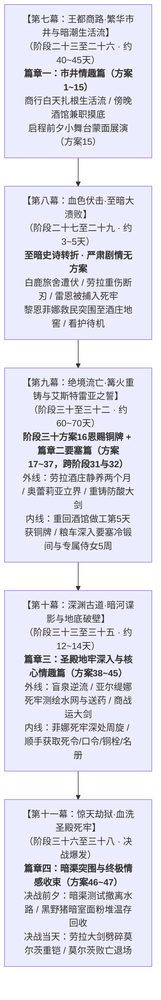

# 第二部莫尔茨NSFW剧情融入主线架构方案（十四幕四十五阶段母案·时空咬合与实施中枢）

> **归档位置**：`方案/第二部/莫尔茨NSFW/莫尔茨NSFW剧情融入主线架构方案.md`  
> **权威母案基准**：
> - [`00_第二部宏篇主线总纲与方案管理中枢.md`](../主线与世界扩充方案/00_第二部宏篇主线总纲与方案管理中枢.md)
> - [`01_宏篇主线剧情总大纲与分幕导航.md`](../主线与世界扩充方案/01_宏篇主线剧情总大纲与分幕导航.md)
> - [`06_第二部主线跨幕连续性与全局物理状态机.md`](../主线与世界扩充方案/06_第二部主线跨幕连续性与全局物理状态机.md)
> - [`00_莫尔茨NSFW情境企划全案总纲.md`](00_莫尔茨NSFW情境企划全案总纲.md)
> - [`01_黑野猪酒馆市井情趣篇（方案一至方案十六）.md`](01_黑野猪酒馆市井情趣篇（方案一至方案十六）.md)
> - [`02_圣殿要塞深入与要职近身篇（方案十七至方案三十七）.md`](02_圣殿要塞深入与要职近身篇（方案十七至方案三十七）.md)
> - [`03_圣殿地牢深入与核心情趣篇（方案三十八至方案四十五）.md`](03_圣殿地牢深入与核心情趣篇（方案三十八至方案四十五）.md)
> - [`04_王都暗渠突围与终极收束篇（方案四十六至方案四十七）.md`](04_王都暗渠突围与终极收束篇（方案四十六至方案四十七）.md)
> - 核心实体档案：[`docs2/npc/莫尔茨.TXT`](../../../docs2/npc/莫尔茨.TXT) · [`docs2/npc/科林.TXT`](../../../docs2/npc/科林.TXT) · [`docs2/npc/卢卡斯.TXT`](../../../docs2/npc/卢卡斯.TXT) · [`docs2/location/黑野猪酒馆.TXT`](../../../docs2/location/黑野猪酒馆.TXT) · [`docs2/location/圣殿要塞.TXT`](../../../docs2/location/圣殿要塞.TXT) · [`docs2/location/圣殿地牢.TXT`](../../../docs2/location/圣殿地牢.TXT) · [`docs2/location/圣泉大浴场.TXT`](../../../docs2/location/圣泉大浴场.TXT) · [`docs2/location/白鹿旅舍.TXT`](../../../docs2/location/白鹿旅舍.TXT)

---

## 一、 宏观定位与十四幕全案挂靠时空总览

依据母案标准——[《01_宏篇主线剧情总大纲与分幕导航.md》](../主线与世界扩充方案/01_宏篇主线剧情总大纲与分幕导航.md)，莫尔茨 NSFW 全篇在主线中横跨 **第七幕、第八幕、第九幕、第十幕、第十一幕**，物理时长覆盖维里迪亚王国【繁荫季四月】至【金叶季八月初】（约 140~150 天）：

---

## 二、 跨幕动线与各阶段行动脉络

### 1. 第七幕（阶段二十三至二十六 · 繁荫季四月上旬至五月中旬 · 约 40~45 天）
* **日常动线**：白天以心木商行与百工街为生活大本营，菲娜料理后厨与账目，黎恩搬运货物、帮科林扛台钻、与卢卡斯修蹄铁；
* **傍晚市井**：两人以避难伴侣名义，在临近的黑野猪酒馆兼职端酒与修缮，体验下城生活并结识莫尔茨，展开**方案 1 至 15**（平均每 3 天发生一次，符合火热市井生活流）；阶段二十六启程前夕包场小舞台蒙面展演（方案十五）；清晨石桥卢卡斯正规送行；
* **阶段交付**：两人随商队启程前往白鹿旅舍，酒馆第一期兼职暂告段落。

### 2. 第八幕（阶段二十七至二十九 · 繁荫季五月中旬 · 约 3~5 天）
* **主线事件**：白鹿旅舍遭伏，雷恩被捕入死牢，劳拉身负重伤，双手大剑折断；
* **行动定位**：黎恩与菲娜维持结界疏散平民，护送伤员突围至酒庄地窖，看护伤员，暂停外出活动。

### 3. 第九幕（阶段三十至三十二 · 繁荫季四月下旬至六月下旬 · 约 60~70 天）
* **重回酒馆与恩赐铜牌（阶段三十）**：全员撤抵酒庄地窖、劳拉伤情稳定后，黎恩与菲娜因未受通缉，重回黑野猪酒馆做工刺探情报。重回酒馆做工第 5 天深夜，莫尔茨因平原大搜捕急缺修甲工匠而买醉抱怨，顺水推舟掷出要塞通行铜牌，正式落地**方案十六**（深夜大厅恩赐职位、跨坐索吻与特许铜牌交付），酒馆篇圆满收官；
* **进驻要塞与深潜周旋（阶段三十一至三十二 · 篇章二全量 21 案深度穿插）**：次日清晨登上粮车深入圣殿要塞（方案十七），开启长达 5 周的内线行动。阶段三十一承载方案十七至二十七（11 案），阶段三十二承载方案二十八至三十七（10 案）；
* **内线分工与战术闭环（方案 17 至 37）**：黎恩在冷锻间打铁修甲，菲娜在专属侍女岗位刺探防务，并在方案三十七顺手记下【要塞地表排沙清淤日程】，于木廊茶话前夕传回地窖，闭环开启第十幕地底攻坚；两人私下密会时激烈缠绵，完成身体与情感的绝对回收。

### 4. 第十幕（阶段三十三至三十五 · 金叶季七月上旬至下旬 · 约 12~14 天）
* **内外部协同**：酒庄深窖后方由艾德里安、朱利安与艾琳娜主持统筹；外部特遣组进行盲泉逆流与水网测绘；
* **内线深入（方案 38 至 45）**：菲娜借侍女送药特权深入第七死牢重地，获取死令、水闸开闸口令、防卡死铜栓位置与值更底册，顺道送出内线图纸拓样；黎恩在死角暗中目睹，浑身血脉偾张，共享惊险背德快感。

### 5. 第十一幕（阶段三十六至三十八 · 金叶季七月末至八月初 · 决战爆发）
* **前夜突围（阶段三十六前夜）**：两人沿排沙暗渠测试撤离水路返回王都，发生方案 46（暗渠水下激流遭遇）；随后返回黑野猪酒馆暗室向全员汇总交接，完成方案 47；
* **决战当天（阶段三十七）**：突击队依照菲娜内线情报拔除铜栓、对齐水闸口令并报出死令破闸，劳拉重剑碎铠斩杀莫尔茨，成功解救雷恩。

---

## 三、 主线攻坚与内线情报互补矩阵

外部工程攻坚组与内部情报收集的分工协同如下：

| 维度 | 外部工程攻坚组（亚尔缇娜 / 哈根 / 玲 / 劳拉 / 加尔 / 艾玛 / 法林） | 内部接应与情报收集（菲娜 / 黎恩） |
| :--- | :--- | :--- |
| **核心专注领域** | 地底千米暗河穿透、外部水文地质、承重力学计算、工程破拆、破邪重器重铸与正面斩铠 | 要塞防务侦察、获取死牢出入便利、收集口令更次与图纸拓样 |
| **具体成果** | 1. 测绘千米地下暗河盲泉与地基落差（亚尔缇娜） 2. 凭借透镜透析死牢总钥匙二级倒须暗齿，工坊手工雕锉配制母胚（亚尔缇娜/哈根/加尔） 3. 勘破砂岩减配拱顶与水流对冲弱点并实施工程破拆（哈根） 4. 冰潭冷潜切断青铜吊销与长尾托坠（加尔） 5. 重铸防酸双手大剑正面斩碎莫尔茨生铁重铠（劳拉/法林/艾玛） | 1. 侦听死牢绝密死令“黑曜浸血，死寂永缄”（方案38） 2. 探知水闸开闸口令“逆三顺七”（方案41） 3. 摸清绞盘防卡死解脱铜栓物理位置（方案43） 4. 抄录十四年前资深骑士受审关押底册与值更表（方案44） 5. 早期酒窖拓印的钥匙粗胚蜡模（方案6） 6. 艾玛在甲胄库勘破要塞重铠受力卡榫弱点（方案42，带回工坊直接告知哈根与劳拉） 7. 批文顺带记下的地表排沙清淤日程（方案37） |
| **协同效果** | 外部伙伴负责通道打通、深层测绘与物理破拆，黎恩与菲娜自要塞内部提供口令、更次与图纸参考，两者相互结合，形成完整攻坚链路。 |

---

## 四、 十四幕四十五阶段全景日历与时空咬合规划

| 主线幕次与阶段 | 实际跨越天数 | 莫尔茨防务与日常状态 | 黎恩与菲娜行动 | 主线外线平行大事件 | 发生的莫尔茨NSFW方案 |
| :--- | :--- | :--- | :--- | :--- | :--- |
| **第七幕：王都商路** （阶段二十三至二十六） | 约 25 ~ 30 天 （繁荫季四月上旬至五月上旬） | 往返于要塞与王都下城，每隔 5~6 天前往黑野猪酒馆饮酒，其余时间在要塞督操。 | 白天在心木商行料理后勤与协助百工街；傍晚前往黑野猪酒馆兼职做工与修缮；结识科林、卢卡斯；黎恩搬酒装卸，菲娜端盘。 | 心木商行扎根王都下城；玲与艾玛结识科林并展开八音盒羁绊；黎恩修蹄铁结交卢卡斯；金鸢尾沙龙办妥《商行特许状》。 | **方案一至方案六**（吧台揉胸、立约、后巷搜身、柴房手交见巨物获悉姓名、圆桌踩弄、酒窖乳侍拓模）； 阶段二十六启程前夕：菲娜旅行皮囊带草药包与钥匙模子（**绝无铜牌**），卢卡斯石桥坦荡送行。 |
| **第八幕：至暗大溃败** （阶段二十七至二十九） | 约 3 ~ 5 天 （繁荫季五月中旬） | 押解雷恩入死牢并严刑拷问；全城戒严。 | 两人全力参战，维持结界疏散平民，护送重伤劳拉突围至酒庄地窖看护待机。 | 白鹿旅舍遭遇伏击，巨剑折断，雷恩被捕，泥泞突围至酒庄地窖。 | **无**（全员留守地窖看护伤员）。 |
| **第九幕：绝境流亡** （阶段三十至三十二） | 约 60 ~ 70 天 （繁荫季五月中旬至盛夏六月下旬） | 宵禁戒备、主水牢暗渠清淤排沙与圣泉大浴场水疗、校场步骑操演。 | 阶段三十劳拉伤势平稳后，两人回酒馆做工收集情报（展开方案七至十一）；阶段三十一界标对峙后要塞急缺工匠，酒馆展开方案十二至十五（舞台展演卢卡斯破防），莫尔茨在酒馆恩赐职位与铜牌（方案十六），次晨两人正式进驻要塞做工 5 周（方案十七至三十七）。 | 阶段三十劳拉酒庄静养，艾德里安领主觉醒；阶段三十一奥蕾莉亚界标断旗威慑圣殿铁骑；阶段三十二菲暗渠取回断刃，工坊重铸防酸大剑。 | 阶段三十至三十一前期：**方案七至方案十五**（圆桌滴液、水槽皂沫、桌底深喉、草料棚深喉、逗猫棒颜射、便所后入、暴雨床沿、暗室前后内射、舞台展演）； 阶段三十一当夜：**方案十六**（深夜恩赐铜牌与女上位索吻）； 次晨起展开：**方案十七至方案三十七**（粮车颠簸手交进要塞做工 5 周）。 |
| **第十幕：深渊古道** （阶段三十三至三十五） | 约 12 ~ 14 天 （金叶季七月上旬至下旬） | 临战戒备，莫尔茨坐镇底层死牢与刑房。 | 酒庄后方由艾德里安与艾琳娜坐镇；菲娜持特权深入第七死牢重地，获取死令、水闸口令、防卡死铜栓与牢位名册。 | 阶段三十三凯尔玲盲泉逆流破译石闸；阶段三十四亚尔缇娜测绘死牢水网与暗格送药；阶段三十五亚莉莎羊毛商战运大剑，罗恩荒原狼战破围。 | 依次展开： **方案三十八**（死令） ➔ **方案三十九**（副官观摩） ➔ **方案四十**（暗门） ➔ **方案四十一**（水闸口令） ➔ **方案四十二**（甲胄库掩护艾玛勘破重铠弱点） ➔ **方案四十三**（铜栓） ➔ **方案四十四**（关押底册与更次表） ➔ **方案四十五**（刑务暗室周旋）。 |
| **第十一幕：暗渠突围与大劫狱** （阶段三十六至三十八） | 约 2 ~ 3 天 （金叶季七月末至八月初） | 决战当天在底层水牢指挥防守，被劳拉正面击破生铁重铠，败亡退场。 | 阶段三十六前夜沿排沙暗渠测试撤离水路，返回黑野猪酒馆暗室汇总交接；决战当天里应外合报出死令破闸，解救雷恩。 | 阶段三十七决战爆发，哈根破拱顶、加尔潜渡斩销、劳拉重剑碎铠雪耻；阶段三十八全员撤出。 | 阶段三十六前夜：**方案四十六**（暗渠测试撤离水路） ➔ **方案四十七**（酒馆暗室汇总交接）。 决战当天方案结束，莫尔茨败亡退场。 |

---

## 五、 实施接口与落地规范

1. **第七幕**：白天商行经营生活流，傍晚酒馆兼职做工，展开方案一至六，启程前夕菲娜整理随身皮囊无铜牌；
2. **第九幕**：利用劳拉酒庄静养两个月时空，黎恩与菲娜回酒馆做工展开方案七至十五，界标对峙当夜方案十六交付通行铜牌，次晨粮车进驻要塞展开方案十七至三十七；
3. **第十幕与第十一幕**：酒庄后方统筹与要塞内线深潜紧密配合，外部工程破障与内部情报收集协同落地；
4. **docs2 规范实体与体制绝缘**：全案统一使用“圣泉大浴场”（`LOC_D2_33`）与“白鹿旅舍”（`LOC_D2_31`），要塞全域严格遵循封建骑士团体制称谓，严禁出现世俗行政与军队涉军词汇。
