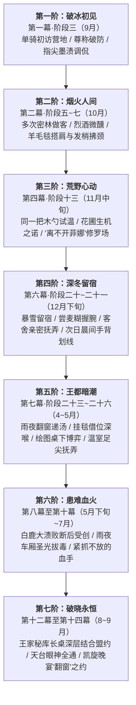

# 第二部朱利安主线NSFW剧情分布与菲娜全线关系线总纲

> **文档定位**：第二部维里迪亚王国篇·朱利安王子主线已融入 NSFW 剧情位置全景索引、叙事动力学与朱利安×菲娜全周期情感演进总纲  
> **归档位置**：`方案/第二部/朱利安NSFW/00_朱利安主线NSFW剧情分布与菲娜关系线总纲.md`  
> **核心原则**：纯净结构纲领，**不含任何具体 NSFW 描写**，只记录主线精准时空位置、剧情点编号、大致主题、核心获益与两人七阶情感演进脉络。  
> **历史原案归档**：原详细肉戏企划稿已全量移至 `方案/第二部/已执行/`（包含原 `00_总纲`、`01_白金宫廷与密室地籍篇`、`02_魔女暗影拔毒篇`、`03_情感演进关系线`）。

---

## 一、 朱利安主线已融入 NSFW 剧情分布与主题索引总表

全量朱利安相关 NSFW 情境均已作为规范剧情点，无缝嵌入主线各分阶段详规正文中：

| 序号 | 剧情点名称与大致主题 | 涉及核心角色 | 所属幕次与分阶段详规文件路径 | 阶段内精准位置 | 核心戏剧动机与情节功能 |
| :---: | :--- | :--- | :--- | :--- | :--- |
| **1** | **霜雪客舍——红炭炉火旁的耳语轻抚**<br>（大致主题：客舍微醺探望与亲密抚弄） | 朱利安、菲娜、黎恩 | **第六幕·阶段二十一**<br>[`06_第六幕.../阶段二十一_深冬暴雪留宿与冬日共盟·雪仗打铁与晨光降临祭详规.md`](../主线与世界扩充方案/分阶段详规/06_第六幕_霜雪冬歇·冬日庆典与降临共盟/阶段二十一_深冬暴雪留宿与冬日共盟·雪仗打铁与晨光降临祭详规.md) | **剧情点 5**<br>（介于“森林温泉”与“幼狼探访”之间） | 卸下年轻王储防备，建立深厚信赖；菲娜享受大姐姐调戏乐趣；黎恩被窝温存身心回收。 |
| **2** | **挂毯借位——先王绣帷下的屏息轻吟**<br>（大致主题：外廷长廊避险借位口交吞吐） | 朱利安、菲娜、黎恩（把风） | **第七幕·阶段二十四**<br>[`07_第七幕.../阶段二十四_工坊街百工与八音盒之音详规.md`](../主线与世界扩充方案/分阶段详规/07_第七幕_王都商路·繁华市井与暗潮生活流/阶段二十四_工坊街百工与八音盒之音详规.md) | **剧情点 5**<br>（介于“玛格丽特启程”与“白鹰铁蹄修蹄”之间） | 巡夜近卫步步逼近的绝险避嫌；打破王子的严谨自律；菲娜获得极致背德刺激并向黎恩邀功。 |
| **3** | **桌下暗流——绘图长桌下的隔门博弈与深喉**<br>（大致主题：绘图长桌下隔门手交与射后深喉） | 朱利安、菲娜、黎恩（门外戒备） | **第七幕·阶段二十五**<br>[`07_第七幕.../阶段二十五_王都繁华沙龙与市井暗涌详规.md`](../主线与世界扩充方案/分阶段详规/07_第七幕_王都商路·繁华市井与暗潮生活流/阶段二十五_王都繁华沙龙与市井暗涌详规.md) | **剧情点 3**<br>（介于“羊皮复账与名媛清谈”与“暗渠水文”之间） | 教廷近侍敲门送文书的知行撕裂；隔门周旋的双重感官过载；引爆黎恩独占欲的坦白契机。 |
| **4** | **密室急信与长桌救赎（艾玛×朱利安）**<br>（大致主题：暗影残毒紧急会诊与以太舒缓结合） | 艾玛、朱利安 | **第七幕·阶段二十五**<br>[`07_第七幕.../阶段二十五_王都繁华沙龙与市井暗涌详规.md`](../主线与世界扩充方案/分阶段详规/07_第七幕_王都商路·繁华市井与暗潮生活流/阶段二十五_王都繁华沙龙与市井暗涌详规.md) | **剧情点 6 & 7**<br>（介于“科林草料棚”与“晨曦清音八音盒”之间） | 王储沾染古代暗影毒素且受困政局无法离京；艾玛以学者与医者担当施救同调；朱利安清醒立誓永为同盟。 |
| **5** | **温室花影——天使喷泉旁的足尖抚弄**<br>（大致主题：冬日温室天使喷泉旁足尖抚弄） | 朱利安、菲娜、黎恩（暗角警戒） | **第七幕·阶段二十六**<br>[`07_第七幕.../阶段二十六_纯铜八音盒商行托付与白鹿启程详规.md`](../主线与世界扩充方案/分阶段详规/07_第七幕_王都商路·繁华市井与暗潮生活流/阶段二十六_纯铜八音盒商行托付与白鹿启程详规.md) | **剧情点 2**<br>（介于“商行退路交托”与“炉火温存”之间） | 出征前夕缓解王子廷议的高压与疲惫；毛玻璃外巡卫提灯晃过的极限惊险；灵动背德与主从倒错。 |
| **6** | **炉火温存——商馆工棚坦白与法林温存归巢**<br>（大致主题：艾玛向法林坦白与正配身心归巢） | 艾玛、法林（矮人魔法工匠） | **第七幕·阶段二十六**<br>[`07_第七幕.../阶段二十六_纯铜八音盒商行托付与白鹿启程详规.md`](../主线与世界扩充方案/分阶段详规/07_第七幕_王都商路·繁华市井与暗潮生活流/阶段二十六_纯铜八音盒商行托付与白鹿启程详规.md) | **剧情点 3**<br>（介于“温室足交”与“石桥送行”之间） | 艾玛向伴侣法林坦白密室以太救治经过；法林绿帽癖好引爆；工作台温存完成身心归宿闭环。 |
| **7** | **地籍盟约——全境图谱上的长桌深合**<br>（大致主题：起获特许状后全境大图长桌深合盟约） | 朱利安、菲娜、黎恩（门外把风） | **第十二幕·阶段四十**<br>[`12_第十二幕.../阶段四十_王家秘库档案起获与维克托地下工坊奇袭详规.md`](../主线与世界扩充方案/分阶段详规/12_第十二幕_王都暗流·沙龙旧卷与法理围城/阶段四十_王家秘库档案起获与维克托地下工坊奇袭详规.md) | **剧情点 3**<br>（介于“夹墙暗阁取卷”与“白垩暗记”之间） | 查获十九年特许状原本后宣泄多年隐忍孤独；身心与法理同盟彻底绑定；引爆黎恩独占欲最高峰。 |

---

## 二、 核心叙事动力学与人物心智模型

朱利安与菲娜的关系线依托于三人鲜明的人设反差与稳固的情感三角闭环：

```
【朱利安（24岁）】                                         【菲娜（320岁 / 20岁少女外貌）】
王室高压隐忍十八年                                         精灵守护者 · 炽天使血脉
严谨、克制、自律、禁欲                                     从容、底气十足、心软温柔
在道义信义与少男心悸间剧烈撕裂                             小恶魔玩心 · 享受背德征服与调戏
对黎恩怀有崇高敬意与同盟信义 ─────────────┬───────────── 知晓黎恩深好此道 · 享受事后撒娇坦白
                                          │
                                          ▼
                            【正主黎恩（灰之骑士）】
                            沉稳包容 · 战术把风者
                            善意吃醋调侃 · 隐秘欲火激荡
                            事后以深情专属占有完成身心绝对回收
```

### 1. 朱利安·维里迪亚的心智演进机制
* **高坛神祇到鲜活少女**：朱利安自幼生活在充斥着密探与教士虚伪假面的白金王宫，起初视菲娜为古老传说中神圣高洁的远古守护者；但在大本营接触中，发现她喜欢吃甜点、煮燕麦糊会弄糊、爱捉弄人，这份“神格剥落为生动少女”的反差让他迅速沦陷；
* **知行撕裂的深层愧疚与欲火**：朱利安将黎恩视为最值得托付后背的生死兄弟与剑术导师。明知菲娜是黎恩最重要的妻子，但在菲娜一次次主动凑近、言语调弄与死角身体掩护下，年轻王储压抑了二十四年的充沛气血与旺盛精力被瞬间点燃。越是想要恪守骑士戒律与盟友道义，下腹的坚挺与心中的悸动就越难以遏制。

### 2. 菲娜的多重动因驱动模型
* **小恶魔玩心与征服快感**：菲娜拥有320岁的阅历底气，面对这位比自己年轻三百岁、平日一本正经的年轻储君，心底天生的大姐姐调戏欲被彻底唤醒。看着平日高高在上的王子被自己一句轻声耳语弄得面红耳赤、浑身发颤，能带给她无与伦比的心跳与满足感；
* **顺理成章的心软与抚慰**：朱利安十八年来背负父亲妥协的重担与王国的窒息高压，其眼底深处的疲惫与孤独让菲娜心软怜惜，顺理成章地将肢体接触作为抚平他神经紧绷的温软赠礼；
* **深知黎恩喜好（最高情感引擎）**：菲娜深爱黎恩，且对黎恩的性情一清二楚。她清楚黎恩外表温和沉稳，但内心对这种纯情王子被自己逗弄得团团转的背德细节极具兴奋与独占欲。菲娜每一次在危险边缘的试探，都在期待着事后回到被窝向黎恩耳语坦白、换取黎恩霸道而狂热的专属占有。

---

## 三、 朱利安与菲娜全线七阶情感温差递进总线

朱利安与菲娜的关系绝非凭空产生，而是一条贯穿第二部全十四幕、严密交织于主线事件中的七阶成长线：



### 1. 第一阶：破冰初见（第一幕·阶段三 · 9月）
* **主线时空与事件**：朱利安单骑穿过迷雾初访大本营，在石溪对岸迎候的正是黎恩与菲娜；
* **核心互动与微反应**：朱利安按胸躬身尊称“守护者陛下”，菲娜轻笑破防：“叫我菲娜就好啦，年轻的王子殿下”；递茶时指尖轻碰，菲娜调侃朱利安手指上的测绘墨渍，公事防线悄然破开一道缝隙。

### 2. 第二阶：烟火人间（第二幕·阶段五~七 · 10月）
* **主线时空与事件**：朱利安借运送补给与建立互信多次往返大本营，在矮人祖厅与大食堂体验粗砺而真实的凡人烟火；
* **核心互动与微反应**：朱利安被矮人烈酒灌趴靠在长木柱旁，菲娜为他披上晒过太阳的厚羊毛毯，发梢拂过颈窝，带着清凉的指尖抚平其被风吹乱的额发；朱利安浑身僵直屏息，随后把脸埋进带着少女余温的毛毯里，少男心悸初萌。

### 3. 第三阶：荒野心动（第四幕·阶段十三 · 11月中旬）
* **主线时空与事件**：朱利安因边境猎户生计与石荒地碰壁，在营地寻求突破；
* **核心互动与微反应**：
  - 讨论退耕还林时，朱利安被干麦饼噎住，菲娜用自己的同一把木勺舀热茶递喂，王子意识到共用茶具后面红耳赤；
  - 朱利安挥铲松土，菲娜单手托腮许下以守护者血脉引地脉生机助树苗过冬之诺；
  - 开荒受阻求援，菲娜端茶掩口轻笑：*“哎呀，朱利安殿下现在已经完全离不开菲娜了呢~”*，引得黎恩酸溜溜苦笑吃醋打趣，朱利安窘迫摆手却忍不住偷看菲娜；
  - 菲娜赤着白嫩双足踏上冰冷石荒地施法，雪白足弓在朱利安脑海中留下深刻印记。

### 4. 第四阶：深冬留宿（第六幕·阶段二十~二十一 · 12月下旬）
* **主线时空与事件**：暴雪封山，全员心照不宣演戏留宿朱利安4天，经历雪仗打铁与地热温泉；
* **核心互动与微反应**：
  - 后厨爱丽榭教菲娜熬燕麦糊，热油溅手，朱利安情急下一把抓住菲娜手腕掏布擦拭，两手在火光前紧扣，菲娜调皮地挠了挠王子的手心；
  - **剧情点 5【霜雪客舍】**：深夜菲娜端燕麦糊探望微醺滚烫的朱利安，在长木椅旁挨坐抚弄耳垂，解开腰带完全褪下长裤与衬裤手侍完成宣泄；
  - 次日早晨大食堂长桌，朱利安眼神飘忽不敢直视；菲娜端来热羊奶时，**食指指尖在王子手背上慢条斯理划过一道细线**附耳调笑，朱利安当场一口羊奶呛咳，菲娜缩在木凳上笑得双肩乱颤。

### 5. 第五阶：王都暗潮（第七幕·阶段二十三~二十六 · 4月中旬~5月中旬）
* **主线时空与事件**：心木商行扎根王都，朱利安与菲娜在白金王宫与暗渠间高频密会；
* **核心互动与微反应**：
  - 雨夜朱利安冒雨翻窗入心木商行，菲娜拿细麻布细致替他擦去发梢与脖颈雨水，递上冒着热气的浓汤；
  - **剧情点 5【长廊挂毯借位】**：巡卫在挂毯半步之外走过，菲娜屈膝深喉含吮掩盖喘息，事后食指竖在唇前立下秘密契约；
  - **剧情点 3【绘图长桌桌底暗流】**：门外近侍催文书，长桌下菲娜手交喷发接深喉吸干；此后廷议中只要菲娜抚弄桌面，王子喉结便条件反射般剧烈滚动；
  - **剧情点 2【温室花影】**：天使喷泉阔叶掩映下，菲娜踢落短靴以白嫩足尖在巡卫提灯光影中踩弄套动；
  - 沙龙与公署外围，两人严格恪守君臣礼仪，但视线交汇超过两秒，朱利安便会本能地微偏目光、耳尖泛红，菲娜则用手帕掩唇浅笑。

### 6. 第六阶：患难血火（第八幕至第十幕 · 5月下旬~7月）
* **主线时空与事件**：白鹿大驿馆遭遇达米安血色伏击大溃败，朱利安率近卫断后右臂遭毒刃重创，全员转入地下流亡；
* **核心互动与微反应**：
  - 泥泞避难车厢内朱利安高热脱水，菲娜双手贴在血肉模糊的伤口上引动圣光蒸发黑血毒素；
  - 朱利安颤抖的左手死死抓住菲娜纤细的手腕劝其快走，菲娜眼底满是心疼，温柔叱责：*“笨蛋殿下，说什么胡话呢。菲娜可是守护者哦，说好要陪你看到维里迪亚破晓的……不许松手。”*
  - 两人掌心体温融为一体，少男爱慕彻底升华为刻骨铭心的生死羁绊。

### 7. 第七阶：破晓永恒（第十二幕至第十四幕 · 8月~9月）
* **主线时空与事件**：起获秘库档案、真理广场大公审、双城合围决战、加冕新王与凯旋篝火晚宴；
* **核心互动与微反应**：
  - **第十二幕·阶段四十剧情点 3【秘库长桌深合】**：在平铺全境割据地图与十九年特许状底卷的重橡木长桌上，朱利安卸下多年隐忍孤独，与菲娜动情深合，身心与法理同盟彻底绑定；
  - 决战前夕朱利安将地下最深处防线托付给黎恩菲娜，临战目光交汇眼神全通，菲娜如得逞小猫般朝朱利安轻眨左眼；
  - 第十四幕阶段四十五凯旋晚宴，朱利安穿便服与菲娜碰杯。菲娜打趣“当了国王总不会还要半夜翻窗跑来心木商行蹭热汤喝吧”，朱利安爽朗大笑深情回应：**“如果有守护者小姐亲手煮的热汤，就算白金王宫正门塌了，我也一定会翻窗跑过来的。”**黎恩在旁笑着揉乱菲娜长发，举起麦酒锡杯重重碰在一起。

---

## 四、 正主黎恩的三角闭环与事后身体回收工程

在整条关系线推进中，黎恩始终处于不可动摇的**核心情感支柱与身心归宿**位置：

```
朱利安（被戏弄/失态宣泄） ──[事后敬重抚胸]──> 黎恩（大度兄长/战术掩护）
        ▲                                              │
        │                                              ▼
  [死角偷欢]                                      [深情身体回收]
        │                                              │
        └─────── 菲娜（贴耳撒娇坦白） ◄────────────────┘
                 享受被吃醋占有 / 专属温存填满到底
```

1. **台面上的兄长风范与战术默契**：黎恩始终是朱利安最尊敬的人生导师与同盟统帅。长桌拌嘴时，黎恩适时的“酸溜溜吃醋”不仅化解了朱利安被调戏的尴尬，更为同伴关系注入了日轻生活流的鲜活呼吸感；
2. **私下里的欲火焚身与隐秘兴奋**：黎恩了解菲娜的小恶魔本性，在安全落脚点听取菲娜贴耳坦白如何用双唇、小脚或长木桌逗弄王子失态时，脑海中的画面会将他的欲火彻底引爆；
3. **霸道强势的身心回收**：黎恩将这种吃醋、自豪与独占欲转化为深夜刚猛炽热的专属温存，让身心在极度充盈中彻底归巢。

