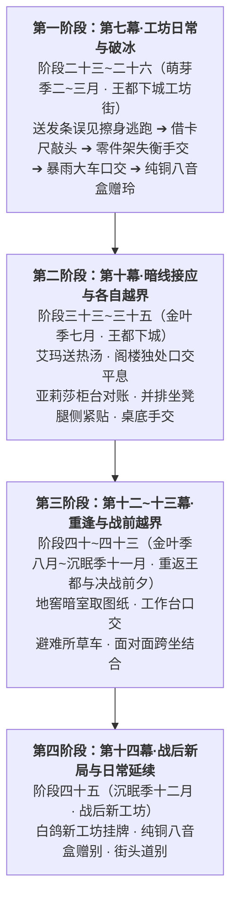

# 第二部科林主线剧情分布与全员关系线总纲

> **文档定位**：第二部维里迪亚王国篇·钟表学徒科林（NPC_D2_25）主线剧情融入索引与全员情感演进大纲  
> **归档位置**：`方案/第二部/科林NSFW/00_科林主线剧情分布与全员关系线总纲.md`  
> **核心原则**：纯正轻小说企划大纲体裁（泛 ACG 轻小说如《无职转生》《狼与香辛料》《转生史莱姆》的大纲纪事风格）。动宾利落，用语直白，只记叙事件因果链、空间死角与核心动作，保留自然对话，杜绝正文冗长描写、中式古风腔调与出戏的元叙事总结；各角色动机完全独立，绝不相互牵扯；依循工坊与主线动线自然推进。  
> **历法设定**：晨光大陆通用圣光历法，四季为萌芽季（1至3月）、繁荫季（4至6月）、金叶季（7至9月）、沉眠季（10至12月），每月30天共360天。

---

## 一、 跨幕演进全景架构图

---

## 二、 核心人物心智模型与独立动因

### 1. 科林（NPC_D2_25）的角色定位与行为逻辑
* **性格与神髓**：18岁，浅亚麻色短发，薄荷蓝瞳，双手干净无茧，专注于微型琴钢发条与游丝调校。礼貌、内向、自律，叫营地女性为“姐姐”。
* **行为模式（杜绝主动侵犯与撒野）**：处于青年生理旺盛期，在意外与狭窄空间接触中身体诚实产生生理反应，自身羞耻拘谨试图回避，绝不主动攻击、抓抱或哀求；在成熟女性的主导照料下经历男女之事。

### 2. 菲娜的心智模型与互动逻辑
* **大姐姐的从容掌控与照顾**：面对科林的拘谨与生理反应，以大姐姐照顾后辈的心态主动掌控节奏，拉开裤带帮其排解；事后自然向黎恩坦白。

### 3. 艾玛与亚莉莎的独立动因（物理隔离，互不牵扯）
* **艾玛**：把科林当弟弟照顾。察觉科林因高压封闭产生生理反应并羞愧掩饰时，以学者式的包容与务实关照，主动帮科林口交排解。事后向伴侣法林说明；
* **亚莉莎**：并排坐长凳对账，科林下身硬挺贴在腿侧。门外客户催账，亚莉莎看见科林满头大汗憋着不敢出声的样子心软，在桌底用手帮科林排解泄火。

---

## 三、 主线分阶段详规分布与索引总表

| 序号 | 剧情点名称与核心事件 | 涉及角色 | 所属幕次与分阶段详规文件路径 | 阶段内精准位置 | 时间与空间锚点 | 核心情节与推进逻辑 |
| :---: | :--- | :--- | :--- | :--- | :--- | :--- |
| **1** | **商行后院——推门误撞擦身与羞涩避险** （送发条误见擦背、拉单遮掩与黎恩解围） | 科林、菲娜、黎恩 | **第七幕·阶段二十三** [`阶段二十三_王都初至与心木商行详规.md`](../主线与世界扩充方案/分阶段详规/07_第七幕_王都商路·繁华市井与暗潮生活流/阶段二十三_王都初至与心木商行详规.md) | **剧情点 7 增补** （介于“后巷搜身”与“柴房独处”之间） | 萌芽季二月上旬午后 心木商行二楼更衣间 | 科林送发条推开更衣间房门，撞见黎恩用干布为赤身的菲娜擦背；菲娜抓单缩入黎恩怀中，科林慌乱逃跑。 |
| **2** | **工坊前堂——借尺测绘与前堂敲头破冰** （借卡尺偶遇、目光回避与轻敲额头解围） | 科林、菲娜、黎恩 | **第七幕·阶段二十四** [`阶段二十四_工坊街百工与八音盒之音详规.md`](../主线与世界扩充方案/分阶段详规/07_第七幕_王都商路·繁华市井与暗潮生活流/阶段二十四_工坊街百工与八音盒之音详规.md) | **剧情点 2 增补** （紧随“工坊游丝切磋”之后） | 萌芽季二月中旬上午 工坊临街长木整备台 | 黎恩带菲娜借卡尺测绘木料，两人相见极度尴尬；黎恩去后院看木料，菲娜见科林手抖，拿起卡尺轻敲科林额头化解冷场。 |
| **3** | **零件木架——木梯跌落与死角手交排解** （木梯失衡扑倒、肉棒顶蹭与伸手套弄） | 菲娜、科林 | **第七幕·阶段二十四** [`阶段二十四_工坊街百工与八音盒之音详规.md`](../主线与世界扩充方案/分阶段详规/07_第七幕_王都商路·繁华市井与暗潮生活流/阶段二十四_工坊街百工与八音盒之音详规.md) | **剧情点 4 增补** （介于“大厅圆桌赤足”与“阴冷地窖”之间） | 萌芽季二月下旬黄昏 工坊内侧零件架死角 | 取零件木梯打滑摔入菲娜怀中，肉棒顶在菲娜大腿；菲娜解开科林裤绳伸手握住肉棒套弄，帮科林排解射精。 |
| **4** | **后院车棚——暴雨避险与车厢口交** （雨天送件避雨、衣服淋湿与车内口交） | 菲娜、科林 | **第七幕·阶段二十五** [`阶段二十五_王都繁华沙龙与市井暗涌详规.md`](../主线与世界扩充方案/分阶段详规/07_第七幕_王都商路·繁华市井与暗潮生活流/阶段二十五_王都繁华沙龙与市井暗涌详规.md) | **剧情点 9 增补** （紧随“草料车尾深喉”之后） | 萌芽季三月中旬暴雨傍晚 黑野猪酒馆后院草料车棚内 | 暴雨送衬套浑身湿透，菲娜在车厢内为科林擦水；科林体热勃起窘迫，菲娜跪在干草上低头含住肉棒吸弄至射精。 |
| **5** | **工坊门前——纯铜八音盒赠玲与白鹿启程** （八音盒托付、眨眼示意与车队启程） | 科林、玲、菲娜、黎恩 | **第七幕·阶段二十六** [`阶段二十六_纯铜八音盒商行托付与白鹿启程详规.md`](../主线与世界扩充方案/分阶段详规/07_第七幕_王都商路·繁华市井与暗潮生活流/阶段二十六_纯铜八音盒商行托付与白鹿启程详规.md) | **剧情点 1 原案深化** （`### 1. 晨曦清音——纯铜风铃八音盒交付与市井温情`） | 萌芽季三月下旬清晨 工坊街工坊门前石板路 | 科林将纯铜八音盒赠给车里的玲作为护身信物；菲娜眨眼示意，黎恩拍肩勉励，车队启程前往白鹿大驿馆。 |
| **6** | **二楼暗室——艾玛送热汤与阁楼口交平息** （送热土豆汤、独处生理反应与口交平息） | 艾玛、科林 | **第十幕·阶段三十三** [`阶段三十三_盲泉逆流与太古石闸详规.md`](../主线与世界扩充方案/分阶段详规/10_第十幕_深渊古道·暗河谍影与地底破壁/阶段三十三_盲泉逆流与太古石闸详规.md) | **剧情点 3 增补** （介于“第七死牢回廊”与“暗河渡口”之间） | 金叶季七月上旬午后 工坊二楼药草储藏阁楼 | 艾玛送热土豆汤关照，科林贴近生理勃起羞耻遮掩；艾玛体贴关照，蹲下拉开裤子口交帮其排解。 |
| **7** | **账台死角——亚莉莎对账受制与桌底手交** （商行查账、并排坐凳腿侧紧贴与门外催账） | 亚莉莎、科林 | **第十幕·阶段三十五** [`阶段三十五_黑市商道交锋与重器密运详规.md`](../主线与世界扩充方案/分阶段详规/10_第十幕_深渊古道·暗河谍影与地底破壁/阶段三十五_黑市商道交锋与重器密运详规.md) | **剧情点 5 增补** （介于“绞盘绝壁”与“文书密室”之间） | 金叶季七月下旬下午 心木商行前堂木账台下死角 | 亚莉莎与科林并排坐在长凳上对账，科林下身充血紧贴大腿；门外客户催账，亚莉莎见科林强忍难受心软，在桌底帮科林套弄排解。 |
| **8** | **地窖暗室——暗道取图重逢与长凳口交** （取暗渠联动图纸、工作台独处与口交） | 菲娜、科林 | **第十二幕·阶段四十** [`阶段四十_王家秘库档案起获与维克托地下工坊奇袭详规.md`](../主线与世界扩充方案/分阶段详规/12_第十二幕_王都暗流·沙龙旧卷与法理围城/阶段四十_王家秘库档案起获与维克托地下工坊奇袭详规.md) | **剧情点 2 增补** （介于“夹墙暗阁”与“地籍盟约”之间） | 金叶季八月中旬深夜 工坊地下储藏暗室 | 菲娜潜入工坊取图，暗室独处时察觉科林紧绷充血；菲娜在工作长凳前跪地含入肉棒帮科林释放。 |
| **9** | **避难草车——决战雨夜、面对面跨坐** （八音盒安抚孤儿、草车避雨跨坐结合） | 菲娜、科林 | **第十三幕·阶段四十三** [`阶段四十三_水网投毒危机与千米超自然防火墙详规.md`](../主线与世界扩充方案/分阶段详规/13_第十三幕_王都异化·双城合围决战/阶段四十三_水网投毒危机与千米超自然防火墙详规.md) | **剧情点 4 增补** （介于“太古石闸启动”与“黑野猪长夜谈”之间） | 沉眠季十一月上旬暴雨夜 下城避难所后方草料大车内 | 科林用八音盒安抚孤儿后回草车避雨，菲娜跨坐在科林腿上引导肉棒插入体内结合套弄至射精。 |
| **10** | **工坊门前——白鸽新工坊挂牌与全员街头道别** （新工坊落成、微型八音盒赠别与战后生活流） | 科林、玲、菲娜、艾玛、亚莉莎、黎恩 | **第十四幕·阶段四十五** [`阶段四十五_校场誓师双城平暴与黎明新世界详规.md`](../主线与世界扩充方案/分阶段详规/14_第十四幕_破晓大审判与黎明宪章/阶段四十五_校场誓师双城平暴与黎明新世界详规.md) | **剧情点 8 原案深化** （`### 8. 阳光倾泻——钟表工坊挂牌、八音盒希望与新世界生活流`） | 沉眠季十二月清晨 下城区“白鸽与游丝”新工坊门前 | 战后新工坊挂牌，科林将最高精度的微型八音盒赠给远行的玲；与众人对视道别，黎恩拍肩赞许。 |

---

## 四、 分阶段情境详案

### 【第一阶段：第七幕·工坊日常与破冰】

#### 方案 1：商行后院——推门误撞擦身与羞涩避险（第七幕·阶段二十三）
* **时空地点**：心木商行后院二楼更衣间；萌芽季二月上旬午后。
* **涉及角色**：科林、菲娜、黎恩。
- 科林送修好的发条去心木商行，二楼更衣间没关门，科林推门撞见没穿衣服的菲娜，黎恩正在帮菲娜擦后背。
- 科林愣在门口，手里的零件盒掉在地上。
- 菲娜叫了一声抓起布单缩到黎恩身后：“呀……快关门啦！”
- 黎恩挡在前面接过零件盒：“送得挺及时，不过下次敲个门啊，科林。”科林红着脸跑回了工坊。

#### 方案 2：工坊前堂——借尺测绘与前堂敲头破冰（第七幕·阶段二十四）
* **时空地点**：“白鸽与游丝”工坊临街长木整备台；萌芽季二月中旬上午。
* **涉及角色**：科林、菲娜、黎恩。
- 几天后黎恩带菲娜来工坊借卡尺。
- 两人见面都很尴尬，科林装配游丝手发抖，菲娜别过头耳朵红了。黎恩借口去后院看木料：“我去后院挑几根木料，你们先量着。”
- 科林递卡尺时手抖掉在桌上。菲娜拿起卡尺敲了下科林的额头：“那天的事要是敢说出去半句……懂了吗？”
- 科林摸着额头连连点头：“菲娜姐姐，我绝对不说！”两人气氛缓和下来。

#### 方案 3：零件木架——木梯跌落与死角手交排解（第七幕·阶段二十四）
* **时空地点**：工坊内侧两米高的零件木架死角；萌芽季二月下旬黄昏。
* **涉及角色**：科林、菲娜。
- 菲娜来工坊取零件，科林爬木梯拿高处的零件盒，梯子打滑摔下来。
- 菲娜在下面接住科林，两人一起倒在墙角麻袋上。
- 科林压在菲娜身上，下身硬挺顶在菲娜大腿上，慌忙撑起身问：“菲娜姐姐……没砸到你吧？木梯突然滑了……”
- 菲娜被顶得大腿发热，按住科林没让他起来：“别乱动……先躺着。”伸手拉开科林的裤子帮他套弄。科林抓着菲娜的肩膀，很快射在菲娜手里。
- 菲娜洗了手拉科林起来提好裤子，戳了下他的脑门：“下次爬梯子专心点啊，科林。”科林红着脸应道：“……知道了，菲娜姐姐。”

#### 方案 4：后院车棚——暴雨避险与车厢口交（第七幕·阶段二十五）
* **时空地点**：黑野猪酒馆后院草料车棚内；萌芽季三月中旬暴雨傍晚。
* **涉及角色**：科林、菲娜。
- 暴雨天科林冒雨把车轴铜套送到酒馆后院，浑身湿透冻得发抖。
- 菲娜拉科林进草料大车避雨，拿麻布帮他擦身上的雨水：“怎么淋成这样才送过来，也不打把伞。”
- 靠近菲娜后科林下身硬挺起来顶在菲娜腿侧，发觉后抱着装零件的袋子僵在干草上不敢动：“雨太大了……菲娜姐姐身上好香……”
- 菲娜心软拉过科林帮他暖身子：“真拿你没办法……先帮你暖过来。”拉开科林的裤子低头口交。科林抓着车板，射在菲娜嘴里。
- 菲娜擦了擦嘴角整理衣服：“暖和过来了没？快把湿衣服换了，别感冒了。”科林小声应道：“嗯……谢谢菲娜姐姐。”

#### 方案 5：工坊门前——纯铜八音盒赠玲与白鹿启程（第七幕·阶段二十六）
* **时空地点**：工坊街“白鸽与游丝”工坊门前石板路；萌芽季三月下旬清晨。
* **涉及角色**：科林、玲、菲娜、黎恩。
- 商行车队出发前往白鹿大驿馆，经过工坊门前。
- 科林跑出来把调校好的纯铜八音盒送给车里的玲：“玲妹妹，这个送给你……路上风沙大，转动发条听听声音能定神。”
- 玲收下八音盒试听：“做工还算过得去嘛，谢啦。”
- 菲娜朝科林眨眼，黎恩骑马经过拍了拍科林的肩膀：“工坊交给你照看了，科林。”科林连连点头：“放心吧黎恩大哥！”车队启程前往白鹿大驿馆。

---

### 【第二阶段：第十幕·暗线接应与各自越界】

#### 方案 6：二楼暗室——艾玛送热汤与阁楼口交平息（第十幕·阶段三十三）
* **时空地点**：工坊二楼药草储藏小阁楼；金叶季七月上旬午后。
* **涉及角色**：科林、艾玛。
- 艾玛回城顺路带了热汤和草药到工坊二楼阁楼看望科林。
- 艾玛坐在一旁关切询问生活，靠得很近。科林下身充血顶在艾玛裙边。
- 艾玛低头看到后脸红了。科林慌忙端着汤碗挡在身前掩饰：“艾玛姐姐……汤、汤炖得很香……”
- 艾玛叹了口气拿开汤碗：“别硬撑着了，先放下来吧。”蹲下身拉开科林的裤子低头口交。科林抓着长凳，全射在艾玛嘴里。
- 艾玛漱口整理长袍：“这件事不许告诉别人，好好喝汤，把身子养好。”带上门离开。

#### 方案 7：账台死角——亚莉莎对账受制与桌底手交（第十幕·阶段三十五）
* **时空地点**：心木商行前堂木账台下死角；金叶季七月下旬下午。
* **涉及角色**：科林、亚莉莎。
- 亚莉莎坐在柜台内侧的长木凳上核对发条交付账册，科林坐在旁边拿着零件盒，两人逐一清点发条批号。
- 柜台前方是一整面厚木挡板，门外突然走进来两名商行的大客户与工匠，靠在柜台前催促交货查账。
- 长木凳空间窄，两人紧挨着并排坐在一起。科林靠近亚莉莎散发香气的身体，下身硬挺起来顶到亚莉莎的大腿。
- 亚莉莎察觉到后耳朵红了，左手悄悄伸到桌板底下想把科林往旁推开却碰到了科林。科林浑身一僵，两手紧抓着自己膝盖，连大气都不敢喘。
- 工匠催问账目。亚莉莎没好气地瞪了科林一眼，看见科林满头大汗忍着不敢出声的样子还是心软了。
- 亚莉莎暗自叹了口气，拉开科林的裤带帮科林套弄，嘴里若无其事地继续和大客户报着账目。科林很快射在亚莉莎手心里。
- 客户离开后，亚莉莎擦干净手，脸红离开柜台并且小声警告科林：“科林，刚才的事要是敢漏出一个字，我饶不了你！”

---

### 【第三阶段：第十二至十三幕·重逢与战前越界】

#### 方案 8：地窖暗室——暗道取图重逢与长凳口交（第十二幕·阶段四十）
* **时空地点**：工坊地下储藏暗室；金叶季八月中旬深夜。
* **涉及角色**：科林、菲娜。
- 战前菲娜潜入工坊地下暗室取水网图纸，和科林重逢。科林递过图纸声音发颤：“菲娜姐姐……你平安真是太好了。”
- 暗室独处靠得很近，科林下身硬挺起来。
- 菲娜拉科林坐在长凳上：“别动……今天你做得很好。”跪在两腿间拉开裤子低头口交。科林按着菲娜的肩膀射在菲娜嘴里。
- 菲娜擦了嘴角，叮嘱科林：“好好守在工坊，等我们打赢回来。”科林用力点头：“嗯，我等你们回来！”菲娜拿着图纸离开。

#### 方案 9：避难草车——决战雨夜、面对面跨坐（第十三幕·阶段四十三）
* **时空地点**：下城避难所后方草料大车内；沉眠季十一月上旬暴雨夜。
* **涉及角色**：科林、菲娜。
- 决战雨夜，科林用八音盒安抚避难所孤儿后回到草料大车里休息。
- 菲娜端热汤进车看望，科林喝完汤靠在菲娜肩头：“菲娜姐姐……外面打得很凶，你们一定要小心。”科林下身硬挺顶在菲娜腿边。
- 菲娜拉开科林的裤子，掀起裙子跨坐在科林腿上坐下去套弄。科林抱住菲娜全射在菲娜体内。
- 事后两人穿好衣服，菲娜叮嘱：“我们要发起总攻了，在避难所等我们。”科林用力点头：“菲娜姐姐一定要平安回来。”菲娜赶回前线。

#### 方案 10：工坊门前——白鸽新工坊挂牌与全员街头道别（第十四幕·阶段四十五）
* **时空地点**：下城区“白鸽与游丝”新工坊门前；沉眠季十二月清晨。
* **涉及角色**：科林、玲、菲娜、艾玛、亚莉莎、黎恩。
- 战后工坊换上新招牌重新开业。
- 科林把新做好的八音盒送给要出远门的玲：“玲妹妹，这个送给你当护身符。”玲收下试听：“音准很棒嘛，谢啦。”
- 菲娜、艾玛、亚莉莎都在街边招手，黎恩上前拍了拍科林的肩膀：“干得漂亮，科林，把工坊好好经营下去。”科林立正大声应道：“放心吧黎恩大哥！大家一路顺风！”车队启程离开。

---

## 五、 纯净交付自检法典

1. **角色称谓与指代标准**：直呼其名“科林”，严禁使用“少年”、“年轻学徒”等身份标签作为主语指代；科林对同伴统一称呼“菲娜姐姐”、“艾玛姐姐”、“亚莉莎姐姐”、“玲妹妹”；
2. **术语直白与去伪造作**：直白规范，杜绝“硬物/坚挺”等伪委婉；彻底清除手帕、布料包裹等做作阻隔描写；
3. **历法权威核验**：严格对齐圣光正统历法（萌芽季1~3月、繁荫季4~6月、金叶季7~9月、沉眠季10~12月，共360天）；
4. **轻小说大纲体裁保真**：完全采用动宾分镜，保留生动的人物对话与现场微反应，彻底拔除中式说书腔、古风修辞（杜绝“xx一笑”、“衣衫”、“歇息”）、角色OOC主动侵犯及出戏的元叙事总结。