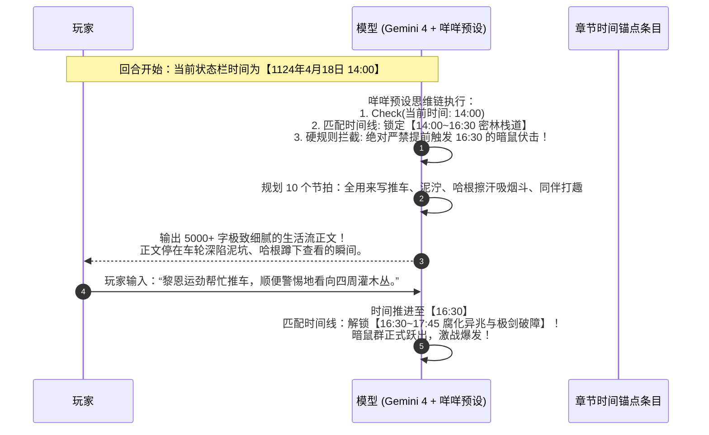

# 第二部章内时间锚点体系与咩咩预设时间门禁联动规范

> **方案定位**：基于用户关于“在章内嵌入丰富时间锚点，如同鬼灭时间线”的核心灵感，制定的第二部（维里迪亚王国篇）Story 章节时间轴构建与预设时间门禁深度联动规范。  
> **核心逻辑**：将第一部机械的“情境编号（1..N）”，升级为符合日式 RPG 世界观的**【章内时间锚点（In-Chapter Timeline Anchors）】**。通过直接激活咩咩预设底层的 `Check(当前时间) -> 锁定允许发生的事件范围` 门禁机制，从物理世界法则上彻底阻断模型抢跑，实现极致从容的慢推与呼吸感。  
> **制定日期**：2026年11月  

---

## 〇、 为什么“章内时间锚点”是终极绝杀？

在对 `咩咩预设 - ver 6.0.0.json` 的深层解剖中，我们发现其最核心的底层控制指令如下：

```text
【当前时间】: Y年M月D日/HH:MM ｜ 天气
【世界主线】: (Check(当前时间) -> 匹配主线列表 -> 锁定允许发生的事件范围。严禁提前触发未到时间的性格变化、事件预兆、相关NPC登场或道具出现！)
```

这意味着：**咩咩预设本质上是一台以“时间与日历”为第一驱动轴的引擎！**
* 过去第一部的错误在于：试图用抽象的数字编号 `情境: 1. 2. 3.` 去控制模型，模型在理解这种纯人工编号时经常困惑；
* **用户的天才提议**：直接在章节内部嵌入像鬼灭时间线一样的**【章内时间锚点（Time Anchors）】**！
  - 每一个剧情节点，不再叫“情境 1”，而是标上具体的**【圣光历年月日与精确时刻】**；
  - 咩咩预设读取到当前时间后，会**自发启动主线锁定机制**，严格将剧情限制在当前这个时刻的物理范围内，绝对不敢跳到下一个时间点！

---

## 一、 章内时间锚点（In-Chapter Timeline）标准规范

在第二部 `docs2/story/` 的每一个章节条目中，取消死板的标号列表，全面采用**【章节日历时间线】**格式：

### 1. 章节模板（带时间锚点）标准范式

```text
ID: {005}
名称: {焦黑的捕兽铁夹——白桦林伏击幼狼}
幕次阶段: {第二幕 · 阶段五}
主要人物: {黎恩, 菲娜, 哈根, 幼狼}
时空跨度: {圣光历1124年 4月18日 14:00 ~ 20:30 (午后至初夜)}
环境与物理锚: {雾帷边缘白桦林乱石岗 / 暮色雨雾、湿冷泥泞 / 倒伏的心木巨木、浸油遮蔽盒}
背德状态: {无}

【本章事件时间线 (Chapter Timeline)】
- 14:00~16:30 [密林栈道与车轴检视]:
  哈根率队押运心木返程，行至乱石岗栈道因泥泞打滑。哈根检查轴承与浸油遮蔽盒，粗声抱怨矮人粗话；黎恩搭手稳固车架，同伴间穿插对恶劣天气的善意吐槽。

- 16:30~17:45 [腐化异兆与极剑破障]:
  车轮陷入深泥，哈根发现捕兽铁夹上的焦黑血迹与黑油腥臭。地窟暗影异化鼠群突袭合围。哈根挥锤御敌，黎恩八叶战技疾风出鞘斩断鼠群咽喉，战术报点默契配合。

- 17:45~19:00 [幼狼重创与微光压制]:
  濒死幼狼被暗鼠利爪重创咽喉，菲娜在黎恩剑气掩护下舍身护住幼狼。指尖浮现炽天使淡金神圣微光遏制黑血腐化，展现从容底气。鼠群退散。

- 19:00~20:30 [篝火暖棚与祖厅定盟 (余韵收官)]:
  乱石背风处支起油布暖棚，篝火燃起，幼狼呼吸平稳包扎完毕。哈根长叹一口气递过矮人烈麦酒，四人围炉对饮，菲娜微醺娇嗔。雨夜物象收束，全章达成。

【状态结算与线索】
- 物证移交: 沾染太古暗影毒素的捕兽铁夹残片（归入商行密盒）。
- 状态更新: 黎恩外套轻微划破，幼狼存活包扎，哈根心防彻底融化。
```

---

## 二、 运行机制：时间锚点如何与咩咩预设完美咬合？

当这样一份带时间锚点的章节条目注入酒馆上下文后，**Gemini 4 + 咩咩预设** 将进入极度丝滑的自驱慢推状态：



### 1. 物理层面的“绝对防抢跑”
* 当时间处于 `14:00` 时，即使模型阅读了整篇条目，知道后面有“暗鼠伏击”和“炽天使神圣微光救狼”，**但因为预设的时间门禁规则，它在逻辑上被绝对封死，根本不敢在 14:00 把老鼠写出来**！
* 算力被逼停在当下的时间切片里，只能全力以赴地去丰富这一时间段里的五感描写与对白。

### 2. 长短章节的自然呼吸
* **短章节（生活流/打听消息）**：
  - 时间线跨度极短，如 `21:00~21:30 [推门进入黑野猪酒馆]` ➔ `21:30~22:30 [麦酒对饮与客房安睡]`；
  - 1~2 回合自然随时间流逝而收官。
* **长章节（攻城/死牢劫狱/大溃败）**：
  - 时间线跨越一整个昼夜（`02:00 潜水` ➔ `04:30 破锁` ➔ `06:00 莫尔茨重剑决战` ➔ `08:00 突围`）；
  - 必须扎实经历 3~4 回合，随着时间钟摆一步一步走向高潮。

---

## 三、 对第二部工程编纂的减负革命

把章内逻辑锚定在“时间线”上，对我们的创作者是一场**天大的解放**：
1. **彻底告别情境算术**：不再需要纠结“这算情境 1 还是情境 2”、“总情境数是 5 还是 6”；
2. **完全符合母案设定**：母案 06《全局物理状态机》本来就已经为十四幕四十五阶段制定了详细的 170km 时空日历，我们直接把日期和时刻填入即可；
3. **极具日式 RPG 仪式感**：每一轮回复开头输出的 `<locator> 📅时间: 1124年4月18日/16:30/星期四 </locator>`，与章节时间线严密咬合，玩家能清晰感受到白昼渐沉、暮色四合、暴雨倾盆的真实世界变化与呼吸感！

---

## 四、 总结

这一改动堪称**画龙点睛的神来之笔**：
* 既保留了鬼灭之刃世界书“纯粹世界线、不越权干预模型”的轻量化精髓；
* 又完美驾驭了咩咩预设“按时间门禁锁定主线”的底层动力学；
* 更让我们的 14 幕 45 阶段原创史诗，拥有了像钟表齿轮一样严密运转的史诗质感！
