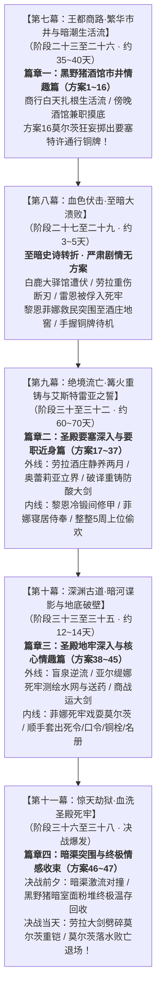

# 第二部莫尔茨NSFW剧情融入主线架构方案（十四幕四十五阶段母案·时空咬合与实施中枢）

> **归档位置**：`方案/第二部/莫尔茨NSFW/莫尔茨NSFW剧情融入主线架构方案.md`  
> **权威母案基准**：
> - [`00_第二部宏篇主线总纲与方案管理中枢.md`](../主线与世界扩充方案/00_第二部宏篇主线总纲与方案管理中枢.md)
> - [`01_宏篇主线剧情总大纲与分幕导航.md`](../主线与世界扩充方案/01_宏篇主线剧情总大纲与分幕导航.md)
> - [`06_第二部主线跨幕连续性与全局物理状态机.md`](../主线与世界扩充方案/06_第二部主线跨幕连续性与全局物理状态机.md)
> - [`00_莫尔茨NSFW情境企划全案总纲.md`](00_莫尔茨NSFW情境企划全案总纲.md)
> - [`01_黑野猪酒馆市井情趣篇（方案一至方案十六）.md`](01_黑野猪酒馆市井情趣篇（方案一至方案十六）.md)
> - [`02_圣殿要塞深入与要职近身篇（方案十七至方案三十七）.md`](02_圣殿要塞深入与要职近身篇（方案十七至方案三十七）.md)
> - [`03_圣殿地牢深入与核心情趣篇（方案三十八至方案四十五）.md`](03_圣殿地牢深入与核心情趣篇（方案三十八至方案四十五）.md)
> - [`04_王都暗渠突围与终极收束篇（方案四十六至方案四十七）.md`](04_王都暗渠突围与终极收束篇（方案四十六至方案四十七）.md)
> - 核心实体档案：[`docs2/npc/莫尔茨.TXT`](../../../docs2/npc/莫尔茨.TXT) · [`docs2/npc/科林.TXT`](../../../docs2/npc/科林.TXT) · [`docs2/npc/卢卡斯.TXT`](../../../docs2/npc/卢卡斯.TXT) · [`docs2/location/黑野猪酒馆.TXT`](../../../docs2/location/黑野猪酒馆.TXT) · [`docs2/location/圣殿要塞.TXT`](../../../docs2/location/圣殿要塞.TXT) · [`docs2/location/圣殿地牢.TXT`](../../../docs2/location/圣殿地牢.TXT)

---

## 一、 宏观定位与十四幕全案挂靠时间窗口（彻底纠偏历史代差）

### 1. 核心时间线校准与母案全景挂靠
早期草案曾将莫尔茨全篇 47 套方案拥挤塞在“大溃败之后至死牢大劫狱”的狭窄窗口中，严重割裂主线群像；随后的过渡方案中仍残留旧阶段编号漂移。  
依据现行母案最高权威标准——[《01_宏篇主线剧情总大纲与分幕导航.md》](../主线与世界扩充方案/01_宏篇主线剧情总大纲与分幕导航.md)，莫尔茨 NSFW 全篇在主线中横跨 **第七幕、第八幕、第九幕、第十幕、第十一幕**，获得纵贯整整两个季度（近 150 天）的充裕物理纵深：

---

## 二、 核心矛盾排查与系统性消解方案

### 1. 矛盾一：动因与动机解耦（去战略化与纯粹生活流）
* **病灶表现**：
  旧方案中曾残留“为了打探雷恩下落不得不去酒馆潜伏”、“搜集情报大局为重”等工具化特工倾向，破坏了纯正 JRPG 老夫老妻纯爱与上位背德质感。
* **消解方案（动机 100% 纯粹生活流 + 满足背德XP）**：
  - 黎恩与菲娜去王都下城黑野猪酒馆打杂，纯粹是异国游历体验市井生活，骨子里隐秘期待鱼龙混杂的环境能满足两人的特殊背德癖好；
  - 偶遇莫尔茨纯属偶发撞上，顺水推舟将狂妄的要塞典狱长当成两人的“上位情趣玩具”；
  - 深入要塞纯粹是觉得在要塞玩比在酒馆更刺激，顺手捎带的小道具是向黎恩邀功撒娇的情趣添头，没有任何公事负担与受害者苦情。

### 2. 矛盾二：空间往返与动线闭环（两张皮与舞台分叉彻底弥合）
* **病灶表现**：
  主线第七幕详规集中在心木商行，第九幕详规全员在南部酒庄，导致莫尔茨方案中“在酒馆打工”与“在要塞上工”缺乏主线时空依据。
* **消解方案（十四幕动线无痕闭环）**：
  1. **第七幕（阶段二十三至二十六）**：
     - **白天（商行正职）**：以临河心木商行与百工街为生活大本营，菲娜打理后厨（燕麦糊、洋甘菊茶），黎恩修车搬运、帮科林扛台钻、与卢卡斯修蹄铁；
     - **傍晚/深夜（市井兼职）**：为了帮商队摸清下城区三教九流与市井散客信息，两人以避难小夫妻名义，在临近的黑野猪酒馆兼职端酒与修缮，顺理成章偶遇莫尔茨并展开方案 1 至 14；
     - **伏笔交接（方案十六）**：在第七幕阶段二十六启程前往白鹿大驿馆前夕，莫尔茨在酒馆深夜极度自负地将**要塞特许通行铜牌**掷给菲娜和黎恩，恩赐他们下月进要塞上工，成为绝妙预埋伏笔。
  2. **第八幕（阶段二十七至二十九）**：
     - 白鹿大驿馆遭遇伏击，雷恩被俘，黎恩菲娜救民护送伤员至艾斯特雷亚酒庄地窖。
     - 全员严肃待机，两人手头原本就持有合法的要塞铜牌。
  3. **第九幕（阶段三十至三十二）**：
     - 劳拉在酒庄静养需整整两个月（60~70天），奥蕾莉亚立界威慑圣殿铁骑，后方矮人与艾玛破译古库重铸防酸大剑。
     - **进入要塞契机（阶段三十一之后）**：等劳拉伤情转为平稳后，黎恩与菲娜以第七幕既有的合法铜牌，光明正大搭乘运粮车进要塞当差！开启篇章二要塞篇（方案 17 ~ 37），黎恩在冷锻间打铁修甲兼摸清防务盲区，菲娜在寝居侍奉，展开整整 5 周的深度上位偷欢，与后方大剑重铸完全并行。
  4. **第十幕（阶段三十三至三十五）**：
     - 外部特遣组盲泉逆流潜入测绘，内部菲娜借侍女送药特权深入第七死牢重地戏耍莫尔茨（方案 38 ~ 45），顺手套出死令、开闸口令、防卡死铜栓与牢位名册。
  5. **第十一幕前夕（阶段三十六前夜）**：
     - 菲娜与黎恩顺着排沙暗渠测试撤离水路潜出要塞回城，在方案 46 激流中撞见巡查的莫尔茨，冰火对撞翻白眼绝顶；
     - 随后潜回黑野猪酒馆暗室向全员汇总交接；莫尔茨下值买醉，在方案 47 储藏室隔板与面粉堆完成全案终极神圣回收闭环！
  6. **第十一幕决战（阶段三十七）**：
     - 次日清晨大劫狱总攻爆发，菲娜交接内部口令，劳拉手持重铸新生大剑正面劈碎莫尔茨生铁重铠，莫尔茨彻底落水败亡退场！

### 3. 矛盾三：大劫狱关键要素的“内外互补”机制（避免与外部同伴冲突）
* **病灶表现**：
  死牢钥匙、立体水网图纸与情报获取，若定位不当，容易与亚尔缇娜壁虎测绘、哈根勘破承重弱点产生抢功冲突。
* **消解方案（内外分工与顺带收获矩阵）**：

| 维度 | 外部工程攻坚组（亚尔缇娜 / 哈根 / 玲 / 劳拉 / 加尔 / 艾玛 / 法林） | 内部游玩顺手收获（菲娜 / 黎恩） |
| :--- | :--- | :--- |
| **核心专注领域** | 地底千米暗河穿透、外部水文地质、承重力学计算、工程破拆、破邪重器重铸与正面斩铠 | 满足老夫老妻背德情趣、戏耍莫尔茨、顺手牵羊拿走内部通行便利与第一手前线参考资料 |
| **具体战果** | 1. 测绘千米地下暗河盲泉与地基落差（亚尔缇娜） 2. 凭借透镜透析死牢总钥匙二级倒须暗齿，工坊手工雕锉配制零误差母胚（亚尔缇娜/哈根/加尔） 3. 勘破砂岩减配拱顶与水流对冲弱点并实施工程破拆（哈根） 4. 冰潭冷潜切断青铜吊销与长尾托坠（加尔） 5. 重铸防酸双手大剑正面斩碎莫尔茨生铁重铠（劳拉/法林/艾玛） | 1. 偷听到的死牢绝密死令“黑曜浸血，死寂永缄”（方案38） 2. 闲聊听来的水闸开闸口令“逆三顺七”（方案41） 3. 摸清绞盘防卡死解脱铜栓物理位置（方案43） 4. 顺手抄录的十四年前资深骑士受审关押底册与值更表（方案44，作为团队背景参考，最终现场路线由戈德弗里十四年石壁刻痕指引） 5. 早期酒窖拓印的钥匙粗胚蜡模（方案6，为工坊摸清钥匙基本轮廓提供参考） 6. 菲娜与艾玛在甲胄库调阅的防御图纸（方案42，舍身引敌掩护艾玛顺利取走图纸） 7. 批文顺手记下的地表排沙清淤日程（方案37，为暗河逆流潜渡规避洪峰提供时间差参考） |
| **协同结论** | 外部伙伴负责严肃的“硬核通道打通、深层测绘与物理破坏”，黎恩菲娜在情趣游戏中“顺手牵羊拿到内部口令并带出一手参考资料”，团队结合前线资料展开专业攻坚，两者自然互补，绝无抢功冲突。 |

---

## 三、 要塞与主线宏大时间跨度拉长模型（十四幕四十五阶段全景日历）

### 全篇 140 ~ 150 天（跨越两个季度）十四幕四十五阶段大纵深日历规划表

| 主线幕次与阶段 | 实际跨越天数 | 莫尔茨防务与日常状态 | 黎恩与菲娜行动 | 主线外线平行大事件 | 发生的莫尔茨NSFW方案 |
| :--- | :--- | :--- | :--- | :--- | :--- |
| **第一阶段：市井酒馆兼职与情趣期** （第七幕·阶段二十三至二十六） | 约 35 ~ 40 天 （第 1 ~ 6 周） | 往返于要塞与王都下城，每隔 3~5 天前来黑野猪酒馆喝一次烈酒、撕咬烤肉宣泄暴戾，其余时间在要塞督操。 | 白天在心木商行料理后勤与协助百工街；傍晚前往黑野猪酒馆兼职跑堂与修缮，建立上位背德契约；结识科林、卢卡斯；黎恩搬酒装卸，菲娜端盘逐步展开调弄。 | 心木商行扎根王都下城；玲与艾玛结识科林并展开八音盒羁绊；黎恩修蹄铁结交卢卡斯；金鸢尾沙龙办妥《商行特许状》。 | **方案一至方案十四**（平均每 3~5 天发生一次试探，大厅圆桌与后院轮替，含逗猫棒颜射、木板便所后入、暴雨夜双向内射）； 阶段二十五发生**方案十五**（深夜舞台蒙面展演·卢卡斯破防硬挺）； 阶段二十六启程前夕发生**方案十六**（深夜大厅恩赐职位，莫尔茨狂妄掷出要塞特许通行铜牌！）。 |
| *(主线大幕交替·至暗转折)* （第八幕·阶段二十七至二十九） | 约 3 ~ 5 天 | 莫尔茨受调令押解雷恩入死牢并严刑拷问；全城戒严。 | 两人全力参战，维持超自然结界疏散平民，护送重伤劳拉突围至旧领酒庄地窖。 | 白鹿大驿馆大溃败，巨剑折断，雷恩被俘，泥泞突围至酒庄地窖。 | **无**（主线严肃大事件，两人手握既有铜牌休整待机）。 |
| **第二阶段：入驻要塞与要职近身偷欢期** （第九幕·阶段三十至三十二） | 约 60 ~ 70 天 （要塞期占后半段 35 天） | 依仗既有铜牌将二人调入要塞。期间经历全城宵禁大演练（4天）、主水牢暗渠清淤排沙与圣泉大浴堂水疗（5天）、校场步骑大操演（3天）、领邦演武（4天）。 | 前期在酒庄协助稳定劳拉伤情；阶段三十一奥蕾莉亚立界后，手持既有合法铜牌搭乘运粮车进驻要塞当差！黎恩在冷锻间打铁修甲兼粗活；菲娜担任专属寝居送酒侍女，展开整整 5 周的深度上位偷欢。 | 阶段三十劳拉酒庄静养，艾德里安领主觉醒；阶段三十一奥蕾莉亚界标断旗威慑圣殿铁骑；阶段三十二菲暗渠取回断刃，矮人、乔治与艾玛破译古库重铸防酸破邪巨剑。 | **方案十七至方案三十七**（粮车手交、蒸汽浴室乳侍、圣泉大浴堂水疗、冷锻间打铁、办公桌底隐奸、主堡大窗台三次后入、竞技场舔蛋、名贵黑丝足交、暴雷夜暗通、吊带黑丝大床本番记下清淤日程）。 |
| **第三阶段：深层死牢核心突破与决战前夕** （第十幕·阶段三十三至三十五） | 约 12 ~ 14 天 （约 2 周） | 大劫狱前夕要塞特级临战戒备，莫尔茨全天候坐镇底层死牢与刑房，向心腹极度炫耀。 | 菲娜持近身特权深入第七死牢重地，按节奏戏耍莫尔茨，顺手套出死令、水闸口令、防卡死铜栓与牢位名册。 | 阶段三十三凯尔玲盲泉逆流破译太古石闸；阶段三十四亚尔缇娜光剑测绘死牢水网与暗格送药；阶段三十五亚莉莎羊毛商战运大剑，罗恩荒原狼战破围。 | 依次展开： **方案三十八**（盲门听死令） ➔ **方案三十九**（哨所副官观摩，偷铜符） ➔ **方案四十**（忏悔室暗门） ➔ **方案四十一**（卫所多人口手身，泄露水闸口令） ➔ **方案四十二**（甲胄库突发引敌、板甲架单腿高悬艾玛目击与掩护脱身） ➔ **方案四十三**（绞盘室摸铜栓） ➔ **方案四十四**（文书室长桌后入顺取关押底册与更次表） ➔ **方案四十五**（刑务暗室四人四种体位压轴终极狂欢）。 |
| **第四阶段：暗渠水网测试与终极情感收束** （第十一幕前夕·阶段三十六前夜） | 约 2 ~ 3 天 | 莫尔茨在要塞与酒馆之间巡更买醉。 | 沿排沙暗渠溜出要塞返回酒馆暗室向全员汇总交接，面粉堆终极收束。 | 全员齐聚黑野猪地下暗室，决战兵刃与管网全就位；爱丽榭暗室备好急救汤药。 | **方案四十六**（暗渠测试撤离水路撞见莫尔茨激流贯穿） ➔ **方案四十七**（潜回酒馆暗室，莫尔茨买醉，储藏室隔板最后周旋与黎恩面粉堆终极温存回收！）。 |
| **第五阶段：惊天大劫狱总攻爆发！** （第十一幕决战·阶段三十七至三十八） | 决战当天 | 莫尔茨在底层水牢挥舞破甲锤负隅顽抗，被劳拉正面一剑劈碎生铁碎颅重板铠，轰入深潭彻底溃败败亡！ | 黎恩与菲娜与外部潜渡大队里应外合，凭内部死令与口令势如破竹开闸，解救雷恩与十四位资深骑士。 | 阶段三十七主线大高潮爆发，哈根破拱顶、加尔潜渡斩销、劳拉重剑碎铠雪耻；阶段三十八卢卡斯信义放行，全员撤回黑野猪暗室。 | **无（莫尔茨正式败亡退场，进入第十二幕法理围城）**。 |

---

## 四、 结论与后续实施接口

通过将莫尔茨 NSFW 全篇全面升级并深度咬合最新的【十四幕四十五阶段宏篇主线体系】，方案不仅彻底消除了此前与早期过渡架构的历史代差，更在物理动线上彻底理顺了外部大事件（劳拉静养、断刃重铸、奥蕾莉亚立界）与内部生活流（要塞冷锻间打铁、寝居偷欢）的无缝咬合：

1. **第七幕**：白天商行经营生活流，傍晚酒馆兼职摸底，合情合理埋下要塞铜牌伏笔；
2. **第九幕**：利用劳拉酒庄静养两个月的充裕时空，黎恩菲娜合法进驻要塞上工，填补外部慢推期间的内部戏份；
3. **第十幕与第十一幕**：外部工程硬破障与内部顺带免试口令无缝互补，既保证了主线群像的史诗厚重感，又让菲娜与黎恩的背德情趣游戏获得最高密度的戏剧释放与身心大圆满。
